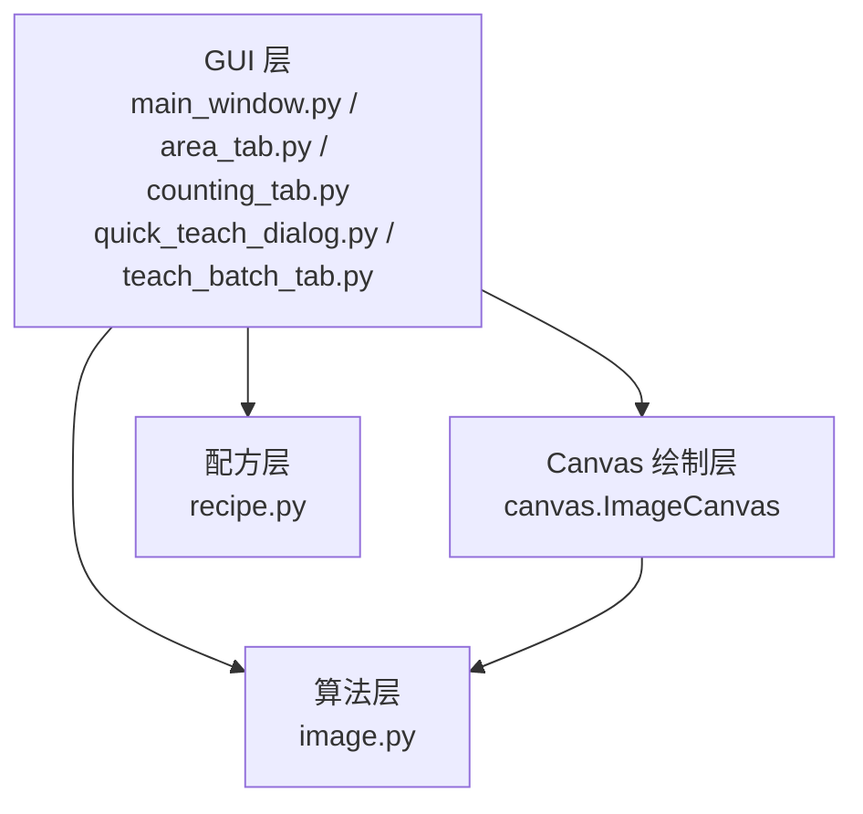
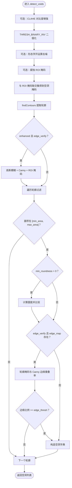
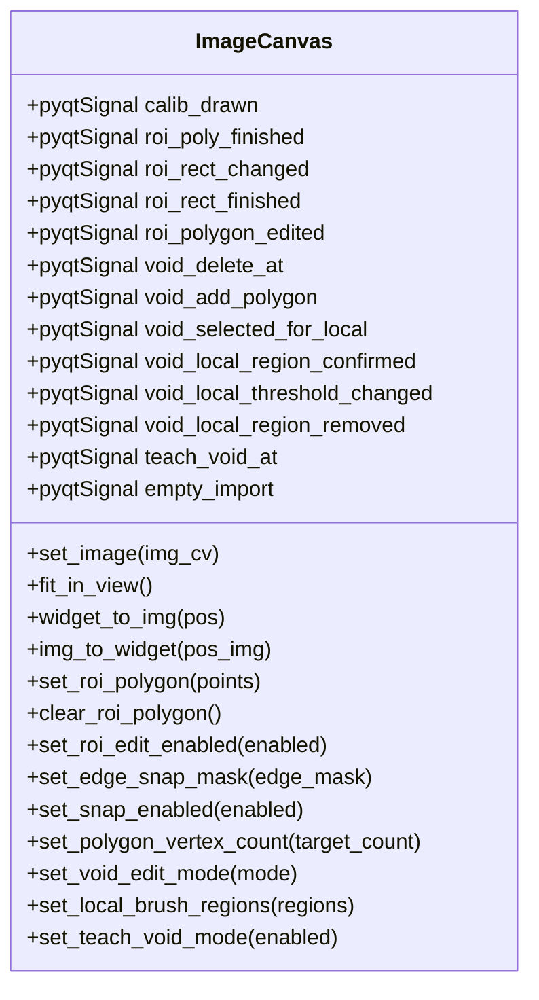
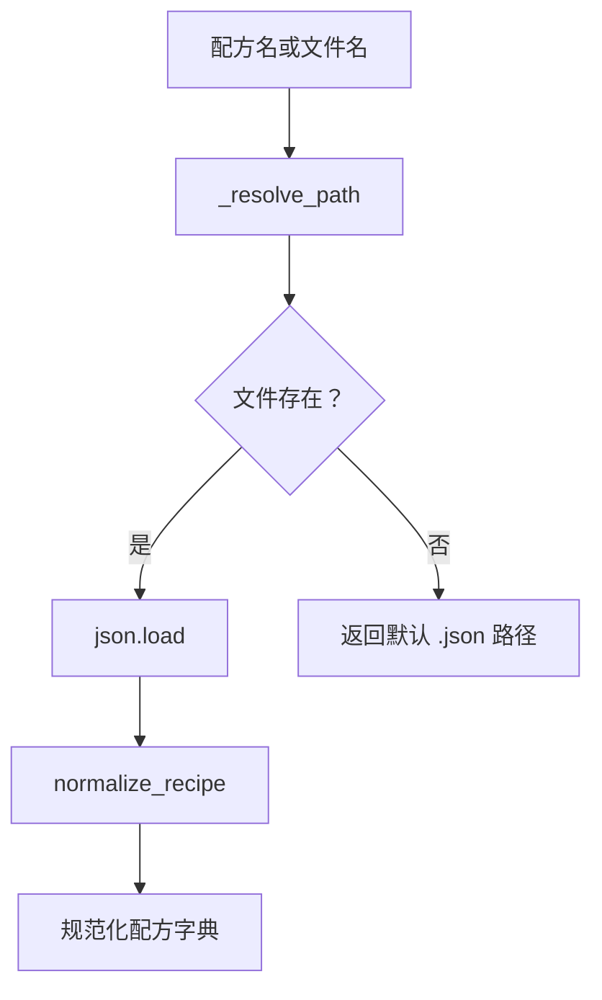
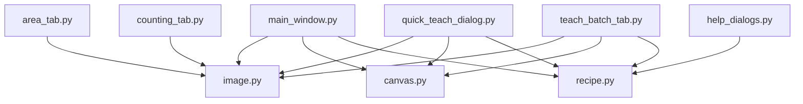

# API 参考

<cite>
**本文引用的文件**   
- [image.py](file://image.py)
- [canvas.py](file://canvas.py)
- [recipe.py](file://recipe.py)
- [main_window.py](file://main_window.py)
- [area_tab.py](file://area_tab.py)
- [counting_tab.py](file://counting_tab.py)
- [quick_teach_dialog.py](file://quick_teach_dialog.py)
- [teach_batch_tab.py](file://teach_batch_tab.py)
- [README.md](file://README.md)
- [PROJECT_CONCEPTION.md](file://PROJECT_CONCEPTION.md)
</cite>

## 目录
1. [引言](#引言)
2. [项目结构与分层约定](#项目结构与分层约定)
3. [公开接口总览](#公开接口总览)
4. [算法层 image.py 接口](#算法层-imagepy-接口)
5. [画布层 canvas.py ImageCanvas 接口](#画布层-canvaspy-imagecanvas-接口)
6. [配方层 recipe.py 接口](#配方层-recipepy-接口)
7. [跨模块调用关系图](#跨模块调用关系图)
8. [已知限制与内部实现边界](#已知限制与内部实现边界)
9. [性能与异常处理要点](#性能与异常处理要点)
10. [结论](#结论)

## 引言
Aurascope 是面向微电子封装产线的半自动化视觉检测桌面工具，核心能力包括金锡焊料空洞率分析、芯片剪切力标准校核、蓝膜物料计数和微观尺寸测量。其技术栈为 PyQt6 + OpenCV + NumPy + Pandas，运行于 Windows 7+，纯 CPU 计算，不联网、不收集用户数据。

本 API 参考聚焦三类对外暴露的接口：
- `image.py`：纯函数图像算法接口，包括空洞检测、Otsu 阈值、形态学操作、距离变换计数、Canny 边缘校验、圆度计算等。
- `canvas.py`：`ImageCanvas` 基类接口，包括 pyqtSignal 事件、`set_image`、坐标转换、ROI 编辑方法。
- `recipe.py`：配方 JSON 读写 API，包括加载、保存、校验、字段访问。

文档严格依据源码编写，不编造不存在的方法；对跨模块调用关系给出调用图，并明确标注哪些接口属于内部实现而非稳定 API。

**章节来源**
- [README.md:1-76](file://README.md#L1-L76)
- [PROJECT_CONCEPTION.md:1-143](file://PROJECT_CONCEPTION.md#L1-L143)

## 项目结构与分层约定
Aurascope 的代码组织遵循「入口 → 主窗口 → Tab 页面 → Canvas 绘制层 → 算法层 image.py → 配方/导出」的分层结构。GUI 层不得内联实现图像算法；图像算法集中在 `image.py`，由 `main_window.py`、`area_tab.py`、`counting_tab.py`、`quick_teach_dialog.py`、`teach_batch_tab.py` 等调用。



**图表来源**
- [main_window.py:30-49](file://main_window.py#L30-L49)
- [area_tab.py:22](file://area_tab.py#L22)
- [counting_tab.py:11](file://counting_tab.py#L11)
- [quick_teach_dialog.py:32-35](file://quick_teach_dialog.py#L32-L35)
- [teach_batch_tab.py:35-41](file://teach_batch_tab.py#L35-L41)

**章节来源**
- [PROJECT_CONCEPTION.md:77-108](file://PROJECT_CONCEPTION.md#L77-L108)
- [README.md:42-64](file://README.md#L42-L64)

## 公开接口总览
本节按模块列出本次 API 参考覆盖的公开接口，并标注用途、输入输出类型、异常行为及调用方。

### image.py 公开接口摘要
| 接口 | 用途 | 主要参数 | 返回值 | 异常行为 | 主要调用方 |
|---|---|---|---|---|---|
| `extract_threshold_contour` | 从矩形 ROI 提取阈值轮廓 | `img`, `rect_tuple`, `thresh_val` | `(rect_info, local_mask, contour)` 或 `(None, None, None)` | 无显式异常；非法输入返回空结果 | `main_window.py` |
| `resample_polygon_points` | 重采样多边形顶点 | `points`, `target_count` | 顶点列表 | 无显式异常 | `image.py` 内部 |
| `contour_to_polygon` | 将 OpenCV 轮廓转为多边形 | `contour`, `target_vertices` | 顶点列表 | 无显式异常 | `main_window.py` |
| `polygon_to_mask` | 多边形转二值掩码 | `points`, `img_shape` | `numpy.ndarray` 或 `None` | 无显式异常 | `area_tab.py`, `quick_teach_dialog.py`, `teach_batch_tab.py` |
| `build_snap_edge_mask` | 构建边缘吸附掩码 | `rect_info`, `local_mask`, `img_shape` | `numpy.ndarray` 或 `None` | 无显式异常 | `main_window.py` |
| `otsu_threshold` | Otsu 自动阈值 | `gray_img`, `roi_mask` | `int` | 无显式异常；空像素返回 128 | `area_tab.py`, `counting_tab.py`, `quick_teach_dialog.py`, `teach_batch_tab.py` |
| `detect_voids` | 空洞检测主流程 | `gray_img`, `roi_mask`, `thresh_val`, 增强/形态学/圆度/Canny 等参数 | 空洞字典列表 | 无显式异常；过滤后可能为空列表 | `main_window.py` |
| `is_void_in_roi` | 检查空洞是否位于 ROI 内 | `points`, `roi_mask` | `bool` | 无显式异常 | `image.py` 内部 |
| `calculate_roundness` | 计算圆度 | `points`, `area_px` | `float` | 无显式异常；周长为 0 时返回 0.0 | `main_window.py` |
| `detect_voids_local` | 局部阈值空洞检测（历史副本） | `gray_img`, `roi_mask`, `global_thresh_val`, `local_regions`, 其他增强参数 | 空洞字典列表 | 无显式异常 | `image.py` 内部（待合并） |
| `detect_defects` | 按 8 邻域检测缺陷 | `gray`, `thresh_val`, `bright`, `min_area`, `roi_mask` | 对象字典列表 | 非法输入抛 `ValueError` | `area_tab.py` |
| `detect_objects` | 基于增强检测的物料计数 | `gray_img`, `thresh_val`, 面积/增强/形态学/圆度/Canny/watershed/ROI 参数 | 对象字典列表 | 无显式异常；过滤后可能为空列表 | `counting_tab.py` |
| `create_local_region_around_void` | 根据空洞创建局部区域 | `void_info`, `padding` | `(x, y, w, h)` | 无显式异常 | `image.py` 内部 |
| `array_stats` / `class_stats` / `two_class_threshold` | 示教统计学习基础函数 | 灰度数组、直方图等 | 统计字典、阈值或 `None` | 非法输入返回 `None` | `quick_teach_dialog.py`, `teach_batch_tab.py` |
| `locate_solder_band` / `apply_taught_model` / `learn_taught_model` | 示教模型定位焊层带、套用模型、学习模型 | 灰度图、掩码、示教模型等 | 掩码、诊断信息、模型字典 | 示范不合法返回 `None` 或失败结果 | `quick_teach_dialog.py`, `teach_batch_tab.py` |

### canvas.py ImageCanvas 公开接口摘要
| 接口 | 用途 | 主要参数 | 返回值 | 异常行为 | 主要调用方 |
|---|---|---|---|---|---|
| `set_image` | 设置 OpenCV 图像并初始化显示 | `img_cv` | `None` | 无显式异常；无图时保持空状态 | `main_window.py`, `area_tab.py`, `counting_tab.py`, `quick_teach_dialog.py`, `teach_batch_tab.py` |
| `fit_in_view` | 自适应缩放使图像适配控件 | 无 | `None` | 无图时直接返回 | `canvas.py` 内部 |
| `widget_to_img` | 控件坐标转图像坐标 | `QPointF` | `QPointF` | 无图时返回 `(0,0)` | `canvas.py` 内部 |
| `img_to_widget` | 图像坐标转控件坐标 | `QPointF` | `QPointF` | 无显式异常 | `canvas.py` 内部 |
| `set_roi_polygon` | 设置可编辑 ROI 多边形 | `points` | `None` | 无显式异常 | `main_window.py`, `area_tab.py`, `teach_batch_tab.py` |
| `clear_roi_polygon` | 清空 ROI 多边形 | 无 | `None` | 无显式异常 | `canvas.py` 内部 |
| `set_roi_edit_enabled` | 启用/禁用 ROI 编辑 | `enabled` | `None` | 无显式异常 | `main_window.py`, `teach_batch_tab.py` |
| `set_edge_snap_mask` | 设置边缘吸附掩码 | `edge_mask` | `None` | 无显式异常 | `main_window.py` |
| `set_snap_enabled` | 启用/禁用吸附 | `enabled` | `None` | 无显式异常 | `main_window.py` |
| `set_polygon_vertex_count` | 调整 ROI 多边形顶点数 | `target_count` | `None` | 点数不足时静默返回 | `main_window.py` |
| `set_void_edit_mode` | 设置空洞编辑模式 | `'none'/'add'/'delete'/'local_brush'` | `None` | 无显式异常 | `main_window.py`, `teach_batch_tab.py` |
| `set_local_brush_regions` | 同步局部笔刷已确认区域 | `regions` | `None` | 无显式异常 | `teach_batch_tab.py` |
| `set_teach_void_mode` | 设置示教点选模式 | `enabled` | `None` | 无显式异常 | `teach_batch_tab.py` |

### recipe.py 公开接口摘要
| 接口 | 用途 | 主要参数 | 返回值 | 异常行为 | 主要调用方 |
|---|---|---|---|---|---|
| `recipe_dir` | 获取配方存储目录 | 无 | `str` | 无显式异常 | `help_dialogs.py`, `recipe.py` 内部 |
| `safe_name` | 清洗文件名 | `name` | `str` | 无显式异常 | `recipe.py` 内部 |
| `recipe_filename` | 显示名转文件名 | `name` | `str` | 无显式异常 | `recipe.py` 内部 |
| `list_recipes` | 列出可用配方 | `kind='v1'/'taught'/None` | `[(display_name, filename), ...]` | 读取失败按 v1 处理 | `main_window.py`, `quick_teach_dialog.py`, `teach_batch_tab.py` |
| `validate_detection` | 校验并夹紧检测参数 | `dict` | `dict` | 无显式异常；非法值被夹紧或替换为默认值 | `recipe.py` 内部 |
| `validate_roi` | 校验并清洗 ROI | `dict` | `dict` | 无显式异常；非法顶点被丢弃 | `recipe.py` 内部 |
| `build_recipe` | 组装配方字典 | `name`, `detection`, `roi`, `px_per_um`, `note` | `dict` | 无显式异常 | `main_window.py` |
| `normalize_recipe` | 规范化任意来源配方字典 | `dict` | `dict` 或 `None` | 非 dict 返回 `None` | `recipe.py` 内部 |
| `save_recipe` | 原子写入 v1 配方 JSON | `recipe` | `str` 路径 | 名称为空抛 `ValueError` | `main_window.py` |
| `load_recipe` | 按显示名或文件名加载配方 | `name_or_filename` | `dict` 或 `None` | 文件不存在或解析失败返回 `None` | `main_window.py`, `quick_teach_dialog.py`, `teach_batch_tab.py` |
| `delete_recipe` | 删除配方 | `name_or_filename` | `bool` | 文件不存在或删除失败返回 `False` | `main_window.py` |
| `validate_taught` / `save_taught` / `load_bar_template` | 示教模型校验、保存、模板图加载 | 模型字典、模板图等 | 模型字典、路径或 `None` | 名称为空抛 `ValueError`；模板不存在返回 `None` | `quick_teach_dialog.py`, `teach_batch_tab.py` |

**章节来源**
- [image.py:27-632](file://image.py#L27-L632)
- [canvas.py:13-209](file://canvas.py#L13-L209)
- [recipe.py:92-475](file://recipe.py#L92-L475)

## 算法层 image.py 接口

### detect_voids：空洞检测主流程
`detect_voids` 是 Aurascope 空洞分析的核心公开算法接口。它接受灰度图、ROI 掩码、全局阈值以及增强检测相关参数，返回空洞对象列表。

#### 函数签名
```python
def detect_voids(
    gray_img,
    roi_mask,
    thresh_val,
    min_area=1,
    max_area=None,
    enhanced=False,
    clahe_enabled=True,
    morph_enabled=True,
    morph_kernel=3,
    min_roundness=0.0,
    edge_verify=False,
    edge_thresh=0.3,
    clahe_clip_limit=2.0,
    roi_erosion_px=3,
) -> list
```

#### 参数说明
| 参数 | 类型 | 含义 | 默认值 | 备注 |
|---|---|---|---|---|
| `gray_img` | `numpy.ndarray` | 灰度图像 | 必填 | 通常来自 OpenCV 读入图像转换后的灰度图 |
| `roi_mask` | `numpy.ndarray` | ROI 掩码 | 必填 | 用于限制空洞检测范围 |
| `thresh_val` | `int` | 二值化阈值 | 必填 | 使用 `cv2.THRESH_BINARY_INV` |
| `min_area` | `int` | 最小面积过滤 | `1` | 小于该值的轮廓被跳过 |
| `max_area` | `int` 或 `None` | 最大面积过滤 | `None` | `None` 表示不限上限 |
| `enhanced` | `bool` | 是否启用增强检测 | `False` | 控制 CLAHE、形态学、圆度、Canny 等增强逻辑 |
| `clahe_enabled` | `bool` | 是否启用 CLAHE 对比度增强 | `True` | 需 `enhanced=True` 才生效 |
| `morph_enabled` | `bool` | 是否启用形态学开运算去噪 | `True` | 需 `enhanced=True` 且 `morph_kernel > 1` |
| `morph_kernel` | `int` | 形态学核大小 | `3` | 椭圆核 |
| `min_roundness` | `float` | 最小圆度阈值 | `0.0` | `0.0` 关闭；值越大越接近圆形 |
| `edge_verify` | `bool` | 是否启用 Canny 边缘验证 | `False` | 需 `enhanced=True` |
| `edge_thresh` | `float` | 边缘像素占比下限 | `0.3` | 低于该比例的空洞被过滤 |
| `clahe_clip_limit` | `float` | CLAHE 裁剪限制 | `2.0` | 配合 tileGridSize=(8,8) |
| `roi_erosion_px` | `int` | ROI 腐蚀像素 | `3` | 通过腐蚀 ROI 掩码避免边界伪影 |

#### 返回值结构
返回空洞字典列表，每个空洞包含：
| 字段 | 类型 | 含义 |
|---|---|---|
| `id` | `int` | 从 1 开始的连续编号 |
| `area_px` | `float` | 轮廓面积（像素） |
| `rect` | `(x, y, w, h)` | 外接矩形 |
| `cx` | `float` | 质心 x |
| `cy` | `float` | 质心 y |
| `points` | `list` | 全图坐标下的轮廓点 |
| `manual` | `bool` | 是否为手动添加（当前固定为 `False`） |

#### 处理流程


**图表来源**
- [image.py:200-286](file://image.py#L200-L286)

#### 异常行为
- 不抛异常；当没有满足条件的轮廓时返回空列表。
- 长循环中每 10 个轮廓调用一次 `_pump_events()`，以便在无 GUI 场景下仍可通过可选的 `QApplication.processEvents()` 让界面有机会刷新。
- 若 `M["m00"] == 0`，质心回退到外接矩形中心。

#### 示例调用
```python
from image import detect_voids

voids = detect_voids(
    gray_img=gray,
    roi_mask=roi_mask,
    thresh_val=80,
    enhanced=True,
    clahe_enabled=True,
    morph_enabled=True,
    morph_kernel=3,
    min_roundness=0.0,
    edge_verify=False,
    edge_thresh=0.3,
    clahe_clip_limit=2.0,
    roi_erosion_px=3,
)
```

**章节来源**
- [image.py:200-286](file://image.py#L200-L286)
- [image.py:14-25](file://image.py#L14-L25)

### Otsu 阈值接口
`otsu_threshold` 是基于 OpenCV Otsu 的自动阈值函数，支持在全图或 ROI 掩码范围内计算。

#### 函数签名
```python
def otsu_threshold(gray_img, roi_mask=None) -> int
```

#### 参数与返回值
| 参数 | 类型 | 含义 | 默认值 |
|---|---|---|---|
| `gray_img` | `numpy.ndarray` | 灰度图像 | 必填 |
| `roi_mask` | `numpy.ndarray` 或 `None` | ROI 掩码；`None` 时使用全图像素 | `None` |

返回值：
- `int`：0~255 的阈值。
- 当 ROI 像素为空时返回 `128`。

#### 示例调用
```python
from image import otsu_threshold

t = otsu_threshold(gray_img)
t_roi = otsu_threshold(gray_img, roi_mask)
```

**章节来源**
- [image.py:180-197](file://image.py#L180-L197)

### 形态学与轮廓辅助接口
`extract_threshold_contour`、`contour_to_polygon`、`polygon_to_mask`、`build_snap_edge_mask` 提供从 ROI 提取、轮廓简化、多边形掩码生成和边缘吸附掩码构建的能力。

#### extract_threshold_contour
- 输入：原始图像、`(x, y, w, h)` 矩形、阈值。
- 输出：`(rect_info, local_mask, contour)` 或 `(None, None, None)`。
- 行为：
  - 对 ROI 做灰度化与二值化。
  - 使用 `cv2.findContours` 提取外部轮廓。
  - 若无轮廓或最大轮廓面积 ≤ 3，返回空结果。
  - 返回的最大轮廓坐标会加回原图偏移。

#### contour_to_polygon
- 输入：OpenCV 轮廓、目标顶点数。
- 输出：多边形顶点列表。
- 行为：
  - 使用 `approxPolyDP` 近似多边形。
  - 顶点不足 3 时退回原始轮廓点。
  - 顶点过多时使用 `resample_polygon_points` 重采样。

#### polygon_to_mask
- 输入：多边形顶点、图像形状。
- 输出：二值掩码或 `None`。
- 行为：少于 3 个点返回 `None`；否则用 `fillPoly` 填充。

#### build_snap_edge_mask
- 输入：矩形信息、局部掩码、图像形状。
- 输出：边缘掩码或 `None`。
- 行为：对局部掩码做 Canny，再复制到整图对应位置。

**章节来源**
- [image.py:27-70](file://image.py#L27-L70)
- [image.py:73-109](file://image.py#L73-L109)
- [image.py:112-135](file://image.py#L112-L135)
- [image.py:138-155](file://image.py#L138-L155)
- [image.py:158-177](file://image.py#L158-L177)

### distanceTransform 计数接口
`detect_objects` 是物料计数的公开算法接口，复用空洞检测的核心逻辑，并额外支持基于 `distanceTransform` 的距离峰值计数。

#### 函数签名
```python
def detect_objects(
    gray_img,
    thresh_val,
    min_area=1,
    max_area=None,
    enhanced=False,
    clahe_enabled=True,
    clahe_clip_limit=2.0,
    morph_enabled=True,
    morph_kernel=3,
    morph_shape=cv2.MORPH_ELLIPSE,
    min_roundness=0.0,
    edge_verify=False,
    edge_thresh=0.3,
    invert=False,
    watershed_enabled=False,
    watershed_distance=0.5,
    roi_mask=None,
) -> list
```

#### 关键行为
- `invert=True` 使用 `THRESH_BINARY_INV` 检测亮色物体；`False` 使用 `THRESH_BINARY` 检测暗色物体。
- 形态学阶段同时执行开运算和闭运算。
- 当 `watershed_enabled=True` 且二值图非空时：
  - 计算 `distanceTransform`。
  - 膨胀距离图找局部极大值。
  - 对每个峰值生成圆形轮廓作为对象。
- 否则走常规 `findContours`。
- 支持圆度过滤和 Canny 边缘验证。

#### 返回值结构
对象字典列表，字段包括：
| 字段 | 类型 | 含义 |
|---|---|---|
| `id` | `int` | 从 1 开始编号 |
| `area_px` | `float` | 面积 |
| `rect` | `(x, y, w, h)` | 外接矩形 |
| `cx` | `float` | 质心 x |
| `cy` | `float` | 质心 y |
| `points` | `list` | 轮廓点 |

#### 示例调用
```python
from image import detect_objects

objects = detect_objects(
    gray_img=gray,
    thresh_val=120,
    enhanced=True,
    watershed_enabled=True,
    watershed_distance=3,
    min_area=10,
)
```

**章节来源**
- [image.py:491-632](file://image.py#L491-L632)

### Canny 边缘校验与圆度计算
#### Canny 边缘校验
Canny 边缘校验不是独立公开函数，而是嵌入在 `detect_voids`、`detect_voids_local`、`detect_objects` 中的增强分支：
1. 对增强后的灰度图做高斯模糊。
2. 使用 Canny 提取边缘。
3. 与 ROI 掩码取交集。
4. 对每个候选轮廓构造掩码，计算与 Canny 边缘的重叠像素比例。
5. 若比例低于 `edge_thresh`，跳过该轮廓。

注意：源码中存在一个已知问题——`edge_map` 在某些分支中可能未初始化，导致 Canny 校验静默失效。文档以实际代码为准，不承诺“只要开启 edge_verify 就一定有效”。

#### calculate_roundness
```python
def calculate_roundness(points, area_px) -> float
```
- 使用公式 `4 * π * area / perimeter²`。
- 周长为 0 时返回 `0.0`。
- 结果截断到 `[0, 1]`。

**章节来源**
- [image.py:228-263](file://image.py#L228-L263)
- [image.py:312-326](file://image.py#L312-L326)
- [image.py:576-610](file://image.py#L576-L610)

### detect_defects：缺陷面积检测
`detect_defects` 是 `area_tab.py` 使用的缺陷检测接口，具有更严格的参数校验。

#### 函数签名
```python
def detect_defects(gray, thresh_val, bright=True, min_area=1, roi_mask=None) -> list
```

#### 参数校验
- `gray` 必须是非空二维 `uint8` 数组。
- `thresh_val` 必须是 `[0, 255]` 内的有限实数。
- `bright` 必须是布尔值。
- `min_area` 必须是有限非负实数。
- `roi_mask` 若提供，必须与 `gray` 同形、`uint8` 且仅含 0/255。
- 非法输入抛 `ValueError`。

#### 返回值
对象字典列表，字段包括：
| 字段 | 类型 | 含义 |
|---|---|---|
| `id` | `int` | 从 1 开始编号 |
| `area_px` | `int` | 连通域面积 |
| `cx` | `float` | 质心 x |
| `cy` | `float` | 质心 y |
| `rect` | `(x, y, w, h)` | 外接矩形 |
| `points` | `ndarray` 或 `list` | 最大外轮廓点 |
| `mask` | `numpy.ndarray` | 局部二值掩码 |

**章节来源**
- [image.py:425-488](file://image.py#L425-L488)

### detect_voids_local：历史副本接口
`detect_voids_local` 与 `detect_voids` 功能高度相似，但支持 `local_regions` 局部阈值覆盖，并在增强模式下对 `gray_img` 原地应用 CLAHE。

重要说明：
- 该函数是已知技术债；`main_window.py` 内另有一份 `detect_voids_local` 副本。
- 现行行为应以 `image.py` 为准，两份实现待合并。
- 该接口不应被视为长期稳定 API；新增业务应优先使用 `detect_voids` 或 `detect_objects`。

**章节来源**
- [image.py:328-422](file://image.py#L328-L422)

## 画布层 canvas.py ImageCanvas 接口

### ImageCanvas 类概览
`ImageCanvas` 继承自 `QWidget`，是 Aurascope 所有图像交互画布的基类。它负责：
- 显示 OpenCV 图像。
- 管理缩放、平移、坐标转换。
- 支持 ROI 多边形绘制与编辑。
- 支持空洞添加、删除、局部笔刷、示教点选等交互。
- 通过 `pyqtSignal` 向调用方暴露交互事件。



**图表来源**
- [canvas.py:13-209](file://canvas.py#L13-L209)

### pyqtSignal 事件
| 信号 | 参数 | 触发时机 | 语义 |
|---|---|---|---|
| `calib_drawn` | `QPointF, QPointF` | 标定模式下拖动结束 | 两条标定线端点 |
| `roi_poly_finished` | `list` | 多边形 ROI 绘制完成 | 图像坐标下的顶点列表 |
| `roi_rect_changed` | `tuple` | 矩形 ROI 拖拽中 | `(x, y, w, h)` |
| `roi_rect_finished` | `tuple` | 矩形 ROI 拖拽结束且宽高大于 5 | `(x, y, w, h)` |
| `roi_polygon_edited` | `list` | ROI 多边形顶点被编辑 | 图像坐标下的顶点列表 |
| `void_delete_at` | `float, float` | 删除模式下点击 | 图像坐标 |
| `void_add_polygon` | `list` | 添加模式下双击确认 | 空洞轮廓点 |
| `void_selected_for_local` | `int` | 选中空洞供局部阈值使用 | 空洞 id |
| `void_local_region_confirmed` | `float, float, float` | 局部笔刷确认 | `(cx, cy, radius)` |
| `void_local_threshold_changed` | `int, int` | Shift+滚轮调节已确认区域阈值 | `(region_index, new_thresh)` |
| `void_local_region_removed` | `int` | 右键移除已确认区域 | 区域索引 |
| `teach_void_at` | `float, float` | 示教模式下左键点击 | 图像坐标 |
| `empty_import` | 无 | 空状态导入图片按钮 | 触发导入 |

**章节来源**
- [canvas.py:16-28](file://canvas.py#L16-L28)

### set_image：设置图像
```python
def set_image(self, img_cv) -> None
```
- 接收 OpenCV 图像。
- 自动处理灰度图和 BGR 图。
- 转换为 `QImage.Format_RGB888`。
- 清空 ROI 多边形、边缘吸附掩码、禁用 ROI 编辑。
- 调用 `fit_in_view()` 并刷新绘制。

**章节来源**
- [canvas.py:123-140](file://canvas.py#L123-L140)

### 坐标转换
```python
def widget_to_img(self, pos) -> QPointF
def img_to_widget(self, pos_img) -> QPointF
```
- `widget_to_img`：控件坐标 → 图像坐标。
- `img_to_widget`：图像坐标 → 控件坐标。
- 无图时 `widget_to_img` 返回 `(0, 0)`。
- 坐标会被钳制到图像边界内。

注意：滚轮缩放时 Y 轴存在已知漂移问题，文档描述现状而不将其包装为正确设计。

**章节来源**
- [canvas.py:152-164](file://canvas.py#L152-L164)
- [canvas.py:695-706](file://canvas.py#L695-L706)

### ROI 编辑方法
| 方法 | 作用 | 参数 | 行为 |
|---|---|---|---|
| `set_roi_polygon` | 设置 ROI 多边形 | `points` | 转换为 `QPointF` 列表，清空选中顶点 |
| `clear_roi_polygon` | 清空 ROI | 无 | 清空顶点、选中边、拖拽状态 |
| `set_roi_edit_enabled` | 启用/禁用 ROI 编辑 | `enabled` | 控制顶点拖拽、双击插入、Delete 删除 |
| `set_edge_snap_mask` | 设置边缘吸附掩码 | `edge_mask` | 用于顶点吸附到真实边缘 |
| `set_snap_enabled` | 启用/禁用吸附 | `enabled` | 控制拖拽结束时是否吸附 |
| `set_polygon_vertex_count` | 调整多边形顶点数 | `target_count` | 少于 3 点静默返回；否则重采样 |

ROI 编辑交互约定：
- 左键拖拽顶点移动顶点。
- 左键拖拽边移动整条边。
- 双击边插入新顶点。
- Delete 键删除选中顶点。
- 拖拽结束时若启用吸附，则尝试吸附到 `edge_snap_mask`。

**章节来源**
- [canvas.py:166-209](file://canvas.py#L166-L209)
- [canvas.py:397-429](file://canvas.py#L397-L429)
- [canvas.py:510-529](file://canvas.py#L510-L529)
- [canvas.py:546-624](file://canvas.py#L546-L624)

### 空洞编辑与局部笔刷
| 方法 | 作用 | 参数 | 行为 |
|---|---|---|---|
| `set_void_edit_mode` | 设置空洞编辑模式 | `'none'/'add'/'delete'/'local_brush'` | 切换 UI 状态、清理预览 |
| `set_local_brush_regions` | 同步局部笔刷已确认区域 | `regions` | 渲染用，不改变检测结果 |
| `set_teach_void_mode` | 设置示教点选模式 | `enabled` | 左键点击直接发射 `teach_void_at` |

局部笔刷模式支持：
- Ctrl+滚轮：调节笔刷半径。
- Shift+滚轮：调节已确认区域的阈值。
- 左键放置、双击确认、右键删除已确认区域。

**章节来源**
- [canvas.py:95-121](file://canvas.py#L95-L121)
- [canvas.py:626-693](file://canvas.py#L626-L693)

## 配方层 recipe.py 接口

### 配方目录与命名
- 配方默认存储在 `<app_dir>/recipes/`。
- frozen 打包后优先使用 exe 同级目录；不可写时回退到用户数据目录。
- 环境变量 `AURASCOPE_RECIPE_DIR` 可覆盖存储目录。
- 文件名通过 `safe_name` 清洗，最多 64 字符。
- 示教模型使用 `.taught.json` 后缀，与参数型配方隔离命名空间。



**图表来源**
- [recipe.py:123-134](file://recipe.py#L123-L134)
- [recipe.py:452-462](file://recipe.py#L452-L462)

**章节来源**
- [recipe.py:69-134](file://recipe.py#L69-L134)

### 加载与保存
#### load_recipe
```python
def load_recipe(name_or_filename) -> dict | None
```
- 接受显示名、`<名>.json`、`<名>.taught.json`。
- 文件不存在返回 `None`。
- 解析失败返回 `None`。
- 成功返回规范化后的配方字典。

#### save_recipe
```python
def save_recipe(recipe) -> str
```
- 先写临时文件 `.tmp`，再用 `os.replace` 原子替换。
- 名称为空抛 `ValueError`。
- 返回保存路径。

#### delete_recipe
```python
def delete_recipe(name_or_filename) -> bool
```
- 文件不存在返回 `False`。
- 删除失败返回 `False`。
- 成功返回 `True`。

**章节来源**
- [recipe.py:439-475](file://recipe.py#L439-L475)

### 校验与规范化
#### validate_detection
- 合并 `DETECTION_DEFAULTS`。
- 布尔字段强制 `bool`。
- 浮点字段按 `_RANGES` 夹紧。
- `max_area` 为 0 或无法转为正整数时视为 `None`。

#### validate_roi
- 清洗多边形顶点，非法点丢弃。
- `layer_threshold` 夹紧到 `[0, 255]`。
- `vertices` 夹紧到 `[3, 120]`。
- 少于 3 个有效顶点时 ROI 类型为 `none`。

#### normalize_recipe
- 非 dict 返回 `None`。
- `type='taught'` 走 `validate_taught`。
- 其余按 v1 参数型配方处理。

**章节来源**
- [recipe.py:169-258](file://recipe.py#L169-L258)

### 示教模型接口
#### validate_taught
- 校验 solder、background、void、band、scale_bar、diagnostics 等字段。
- 兼容 schema < 3 的旧配方，迁移面积上下限为自动档。
- 非法输入返回 `None`。

#### save_taught
- 保存 `.taught.json`。
- 名称为空抛 `ValueError`。
- 可选保存配套比例尺模板 PNG。

#### load_bar_template
- 加载示教模型配套的比例尺模板图。
- 不存在返回 `None`。
- 绕开 cv2.imread 中文路径问题，使用字节流 + `imdecode`。

**章节来源**
- [recipe.py:261-430](file://recipe.py#L261-L430)

## 跨模块调用关系图



**图表来源**
- [main_window.py:30-49](file://main_window.py#L30-L49)
- [area_tab.py:22](file://area_tab.py#L22)
- [counting_tab.py:11](file://counting_tab.py#L11)
- [quick_teach_dialog.py:32-35](file://quick_teach_dialog.py#L32-L35)
- [teach_batch_tab.py:35-41](file://teach_batch_tab.py#L35-L41)
- [help_dialogs.py:10](file://help_dialogs.py#L10)

### 调用关系说明
- `main_window.py` 是空洞分析的主入口，同时依赖 `ImageCanvas`、`image.py` 和 `recipe.py`。
- `area_tab.py` 依赖 `image.detect_defects`、`otsu_threshold`、`polygon_to_mask`。
- `counting_tab.py` 依赖 `image.detect_objects`、`otsu_threshold`。
- `quick_teach_dialog.py` 依赖 `ImageCanvas`、`locate_solder_band`、`polygon_to_mask`、`grab_local_dark_blob`、`save_taught`、`list_recipes`。
- `teach_batch_tab.py` 依赖 `ImageCanvas`、`polygon_to_mask`、`otsu_threshold`、`locate_solder_band`、`list_recipes`、`load_recipe`、`save_taught`、`load_bar_template`。
- `help_dialogs.py` 依赖 `recipe.recipe_dir`。

**章节来源**
- [main_window.py:30-49](file://main_window.py#L30-L49)
- [area_tab.py:22](file://area_tab.py#L22)
- [counting_tab.py:11](file://counting_tab.py#L11)
- [quick_teach_dialog.py:32-35](file://quick_teach_dialog.py#L32-L35)
- [teach_batch_tab.py:35-41](file://teach_batch_tab.py#L35-L41)
- [help_dialogs.py:10](file://help_dialogs.py#L10)

## 已知限制与内部实现边界

### 不属于稳定 API 的内部实现
以下接口虽存在于 `image.py`，但更适合视为内部实现或历史遗留实现，不建议外部模块直接依赖：
- `resample_polygon_points`：主要用于多边形重采样。
- `contour_to_polygon`：轮廓到多边形转换。
- `polygon_to_mask`：多边形到掩码转换。
- `build_snap_edge_mask`：边缘吸附掩码构建。
- `is_void_in_roi`：空洞是否在 ROI 内。
- `create_local_region_around_void`：根据空洞创建局部区域。
- `array_stats`、`class_stats`、`two_class_threshold`：示教统计学习基础函数。
- `fill_holes`、`band_geometry`、`compare_band_geometry`、`locate_solder_band`、`apply_taught_model`、`learn_taught_model`、`locate_scale_bar`、`measure_bar_length`、`bridge_edge_voids`：示教模型与批量检测内部流程。

稳定 API 应优先选择语义明确的顶层函数：`detect_voids`、`detect_objects`、`detect_defects`、`otsu_threshold`、`calculate_roundness`、`load_recipe`、`save_recipe`、`list_recipes`、`ImageCanvas.set_image` 等。

### 已知技术债与限制
- **重复 `detect_voids_local`**：`image.py` 与 `main_window.py` 各有一份实现，属已知技术债，现行行为以 `image.py` 为准，两份待合并。
- **Canny 边缘校验静默失效**：`edge_map` 在某些分支未初始化，导致 `edge_verify=True` 时可能不生效。
- **`chk_roi_overlay` 重复创建**：UI 层存在重复创建覆盖层的隐患。
- **滚轮缩放 Y 轴漂移**：`canvas.py` 的缩放锚点在 Y 方向存在已知问题。
- **`select_for_local` 为死代码**：仓库中存在无 UI 入口的死代码。
- **大图增强检测无进度提示**：长时间图像处理可能阻塞界面。
- **测试环境**：仓库根目录下有 pytest 风格单测，部分用例依赖 `QApplication`；仓库内无 CI 配置，不得虚构流水线、覆盖率门槛或发布流程。

**章节来源**
- [handoff.md](file://handoff.md)
- [image.py:328-422](file://image.py#L328-L422)
- [image.py:228-263](file://image.py#L228-L263)
- [canvas.py:695-706](file://canvas.py#L695-L706)

## 性能与异常处理要点

### 性能特征
- `detect_voids`、`detect_objects`、`detect_defects` 在轮廓或连通域遍历中每 10 项调用一次 `_pump_events()`，有助于长循环中界面响应。
- `detect_objects` 的 watershed 分支使用 `distanceTransform` 找局部极大值，比完整 watershed 计算量更低，适合近似圆形物料。
- `locate_solder_band` 和 `apply_taught_model` 涉及多次形态学、连通域、几何比较，属于较重计算路径。
- `bridge_edge_voids` 使用一维滤波和逐列包络，针对贴边空洞缺口进行桥接，复杂度与图像宽度线性相关。

### 异常处理策略
- `detect_defects` 对输入做严格类型和范围校验，非法输入抛 `ValueError`。
- `load_recipe`、`load_bar_template` 对 IO 和解析异常做容错，失败返回 `None`。
- `save_recipe`、`save_taught` 对空名称抛 `ValueError`。
- `normalize_recipe`、`validate_taught` 对非法输入返回 `None`，而不是抛出异常，便于上层判断。
- `image.py` 多数算法函数不抛异常，而是返回空结果或默认值，符合“算法层尽量不中断 GUI”的设计。

**章节来源**
- [image.py:238-240](file://image.py#L238-L240)
- [image.py:437-457](file://image.py#L437-L457)
- [recipe.py:439-475](file://recipe.py#L439-L475)
- [recipe.py:241-258](file://recipe.py#L241-L258)

## 结论
Aurascope 的公开 API 围绕三层展开：
- `image.py` 提供纯函数图像算法，核心是 `detect_voids`、`detect_objects`、`detect_defects`、`otsu_threshold`、`calculate_roundness`。
- `canvas.py` 的 `ImageCanvas` 提供统一的图像显示、坐标转换、ROI 编辑和交互事件。
- `recipe.py` 提供配方 JSON 的加载、保存、校验与示教模型管理。

文档严格依据源码定义接口签名、参数类型、返回值结构和异常行为，并通过调用图展示 GUI 层、Canvas 层、算法层与配方层之间的依赖关系。对于内部实现和历史技术债，文档明确标注其边界，避免将内部细节误当作稳定 API。