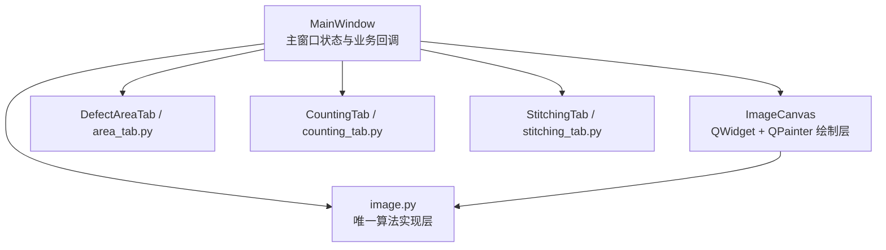
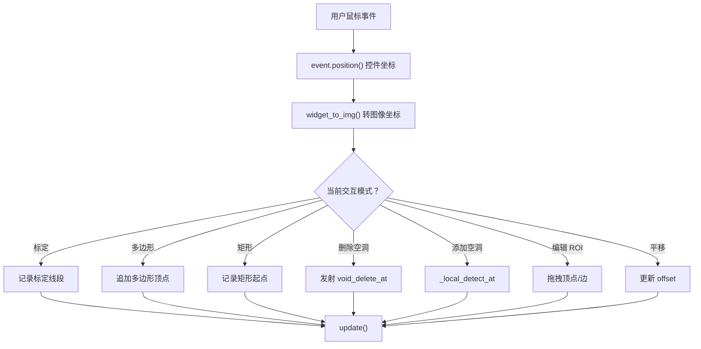
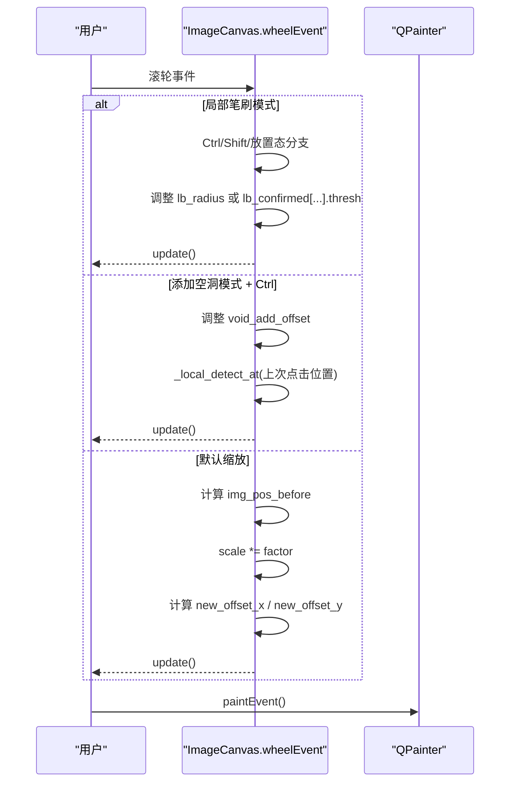
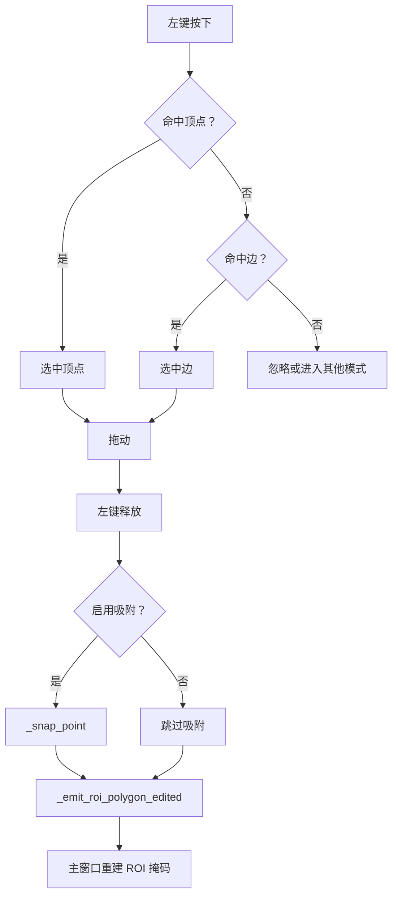
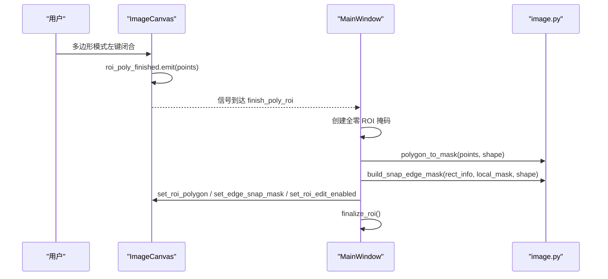
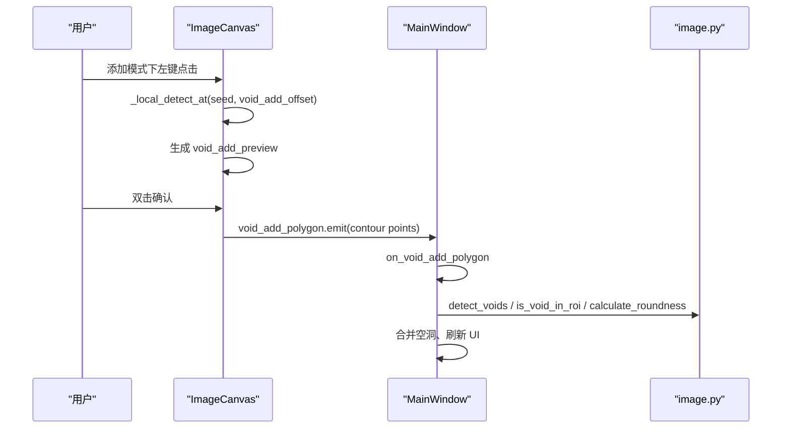
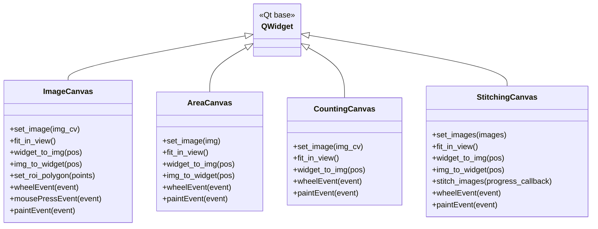
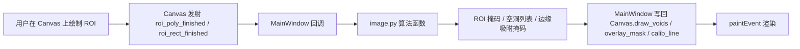

# Canvas 绘制层接口（canvas.py）

<cite>
**本文引用的文件**   
- [canvas.py](file://canvas.py)
- [area_canvas.py](file://area_canvas.py)
- [counting_canvas.py](file://counting_canvas.py)
- [stitching_canvas.py](file://stitching_canvas.py)
- [image.py](file://image.py)
- [main_window.py](file://main_window.py)
</cite>

## 目录
1. [引言](#引言)
2. [Canvas 层定位与依赖方向](#canvas-层定位与依赖方向)
3. [ImageCanvas 公共接口总览](#imagecanvas-公共接口总览)
4. [图像加载与坐标转换](#图像加载与坐标转换)
5. [滚轮缩放与右键平移交互](#滚轮缩放与右键平移交互)
6. [多边形 ROI 编辑约定](#多边形-roi-编辑约定)
7. [QPainter 绘制约定：空洞、ROI、标注、蒙版](#qpainter-绘制约定空洞roilabel标注蒙版)
8. [信号契约与主窗口处理链](#信号契约与主窗口处理链)
9. [子类继承关系与差异](#子类继承关系与差异)
10. [GUI 层不得内联实现图像算法](#gui-层不得内联实现图像算法)
11. [已知限制与风险](#已知限制与风险)
12. [故障排查](#故障排查)
13. [结论](#结论)

## 引言
本文件为 Aurascope 中 `canvas.py` 的 `ImageCanvas` 基类编写 Canvas 接口文档。它面向两类读者：一是需要扩展或修复画布行为的开发者，二是需要理解「用户操作 → 画布信号 → 主窗口 → image.py 算法」调用链的产品维护者。

`ImageCanvas` 是空洞分析 Tab 的核心绘制与交互组件：负责显示 OpenCV 图像、在 QWidget + QPainter 上绘制 ROI、空洞、标定线、局部笔刷等叠加层，并通过 PyQt6 的 `pyqtSignal` 把用户操作解耦到主窗口和业务逻辑层。

## Canvas 层定位与依赖方向
Aurascope 的 GUI 层按「入口 → 主窗口 → Tab 页面 → Canvas 绘制层 → 算法层 image.py → 配方/导出」分层组织。Canvas 层只承担：
- 图像显示与视图变换；
- 鼠标、键盘、滚轮事件解析；
- 多边形 ROI、矩形 ROI、标定线、空洞、局部笔刷的 QPainter 绘制；
- 通过信号向主窗口报告用户意图。

Canvas 层不应直接实现阈值、形态学、轮廓、圆度、Canny 边缘校验等图像处理逻辑；这些能力集中在 `image.py`。

**图表来源**
- [main_window.py:31-48](file://main_window.py#L31-L48)
- [canvas.py:13-28](file://canvas.py#L13-L28)
- [image.py:1-35](file://image.py#L1-L35)

**章节来源**
- [main_window.py:31-48](file://main_window.py#L31-L48)
- [canvas.py:1-11](file://canvas.py#L1-L11)

## ImageCanvas 公共接口总览
`ImageCanvas` 是一个 `QWidget`，对外暴露三类能力：

| 类别 | 成员 | 用途 |
|---|---|---|
| 图像设置 | `set_image(img_cv)` | 接收 OpenCV BGR/灰度图，转换为 `QImage`，清空 ROI 并自适应视图 |
| 视图控制 | `fit_in_view()` | 根据控件尺寸和图像尺寸计算 `scale` 与 `offset` |
| 坐标转换 | `widget_to_img(pos)`、`img_to_widget(pos)` | 屏幕坐标 ↔ 图像像素坐标 |
| ROI 数据 | `set_roi_polygon(points)`、`clear_roi_polygon()`、`set_roi_edit_enabled(enabled)` | 设置可编辑多边形顶点、清除、启用编辑 |
| 吸附控制 | `set_edge_snap_mask(mask)`、`set_snap_enabled(enabled)` | 设置边缘吸附掩码、开关吸附 |
| 多边形重采样 | `set_polygon_vertex_count(target_count)` | 将 ROI 多边形重采样到目标顶点数 |
| 模式控制 | `set_void_edit_mode(mode)`、`set_teach_void_mode(enabled)` | 切换空洞编辑模式、示教点选模式 |
| 局部笔刷同步 | `set_local_brush_regions(regions)` | 从主窗口同步已确认的圆形局部区域用于渲染 |
| 绘制数据 | `overlay_mask`、`overlay_preview`、`draw_voids`、`calib_line`、`show_labels`、`fill_voids`、`show_roi_overlay`、`void_rate_text` | 由主窗口写入，Canvas 在 `paintEvent` 中绘制 |

注意：`ImageCanvas` 不持有空洞检测结果的业务所有权；空洞列表、ROI 掩码、标定长度、增强检测参数等主要由 `main_window.py` 管理，Canvas 只负责显示和交互。

**章节来源**
- [canvas.py:13-94](file://canvas.py#L13-L94)
- [canvas.py:123-209](file://canvas.py#L123-L209)
- [canvas.py:708-943](file://canvas.py#L708-L943)

## 图像加载与坐标转换
### set_image
`set_image(img_cv)` 是 Canvas 加载原图的入口。它执行以下行为：
1. 隐藏空状态按钮；
2. 保存 OpenCV 图像到 `self.img_cv`；
3. 如果是灰度图，转为 RGB；如果是彩色图，从 BGR 转 RGB；
4. 用 `QImage.Format.Format_RGB888` 构造 Qt 图像；
5. 清空 ROI 多边形、边缘吸附掩码、ROI 编辑状态；
6. 调用 `fit_in_view()` 自适应视图；
7. 触发重绘。

该函数假设传入的是 NumPy/OpenCV 格式的图像，且至少包含高度和宽度信息。若后续主窗口未正确初始化其他状态变量，仅调用 `set_image` 不会自动重置空洞、ROI、标定等状态。

### widget_to_img 与 img_to_widget
- `widget_to_img(pos)`：将鼠标所在控件坐标转换为图像像素坐标，并对结果做边界钳制，保证返回点在 `[0, width-1] × [0, height-1]` 范围内。
- `img_to_widget(pos_img)`：将图像像素坐标转换为控件坐标，用于在 QPainter 中绘制文本、手柄、标签等叠加层。

这两个函数是 Canvas 所有交互逻辑的基础：鼠标点击、滚轮缩放锚点、多边形顶点命中、空洞悬停命中都依赖它们。

**图表来源**
- [canvas.py:152-164](file://canvas.py#L152-L164)
- [canvas.py:350-508](file://canvas.py#L350-L508)

**章节来源**
- [canvas.py:123-164](file://canvas.py#L123-L164)

## 滚轮缩放与右键平移交互
### 默认缩放
默认滚轮行为以鼠标位置为锚点进行缩放：
1. 读取滚轮方向和角度；
2. 计算缩放前鼠标对应的图像坐标；
3. 乘以缩放因子 `1.1` 或 `0.9`；
4. 限制 `scale` 在 `0.01` 到 `50.0` 之间；
5. 根据缩放后的倍率重新计算 `offset`，使鼠标指向的图像点尽量保持在同一屏幕位置；
6. 触发重绘。

### Y 轴缩放锚点漂移问题
当前实现先计算 X 轴偏移，再单独计算 Y 轴偏移，但 Y 轴计算使用了缩放前的 `self.scale` 与缩放后的 `self.scale` 混合公式，导致 Y 轴锚点可能漂移。文档作者明确提示：**不要把现状写成正确设计**。这是已知缺陷，不是预期行为。

### 右键平移
右键按下时记录最后鼠标位置并切换为闭合手型光标；移动事件中持续累加 `offset`；释放时恢复箭头光标。该行为与 ROI 绘制、多边形编辑互斥：当左键正在拖拽 ROI 或矩形时，右键平移会打断左键拖拽。

### 特殊滚轮分支
- 局部笔刷模式：Ctrl+滚轮调半径，Shift+滚轮调已确认区域的阈值，无修饰键在放置态调半径。
- 添加空洞模式：Ctrl+滚轮调节 Otsu 阈值偏移量，并基于上次点击位置重新检测预览。

**图表来源**
- [canvas.py:626-706](file://canvas.py#L626-L706)

**章节来源**
- [canvas.py:626-706](file://canvas.py#L626-L706)

## 多边形 ROI 编辑约定
`ImageCanvas` 支持对已确认的多边形 ROI 进行交互式编辑，包括：
- 拖拽顶点；
- 拖拽整条边；
- 双击边插入新顶点；
- Delete 键删除选中顶点；
- 边缘吸附；
- 顶点数量重采样。

### 关键状态变量
| 变量 | 含义 |
|---|---|
| `roi_polygon_points` | ROI 多边形顶点列表，元素为 `QPointF` |
| `roi_edit_enabled` | 是否允许编辑 ROI |
| `selected_vertex_idx` | 当前选中的顶点索引 |
| `active_edge_idx` | 当前被拖拽的边索引 |
| `drag_kind` | `'vertex'`、`'edge'` 或 `None` |
| `hit_radius_px` | 顶点/边命中半径（像素） |
| `snap_enabled` | 是否启用边缘吸附 |
| `edge_snap_mask` | 由 `image.py` 生成的 Canny 边缘掩码 |

### 编辑流程
1. 左键按下时判断是否命中顶点或边；
2. 拖动时更新顶点或边的两端点；
3. 左键释放时，如果开启吸附，则对受影响顶点调用 `_snap_point`；
4. 调用 `_emit_roi_polygon_edited()` 发射 `roi_polygon_edited` 信号；
5. 主窗口收到信号后重建 ROI 掩码、恢复手动空洞、刷新指标。

### 顶点命中与边命中
- 顶点命中使用 `_closest_vertex_index`，阈值随 `scale` 归一化；
- 边命中使用 `_closest_edge_index`，计算点到线段距离；
- 吸附使用 `_snap_point`，在 `edge_snap_mask` 附近查找最近边缘像素。

**图表来源**
- [canvas.py:397-415](file://canvas.py#L397-L415)
- [canvas.py:510-528](file://canvas.py#L510-L528)
- [canvas.py:546-624](file://canvas.py#L546-L624)

**章节来源**
- [canvas.py:166-209](file://canvas.py#L166-L209)
- [canvas.py:230-252](file://canvas.py#L230-L252)
- [canvas.py:302-324](file://canvas.py#L302-L324)
- [canvas.py:397-415](file://canvas.py#L397-L415)
- [canvas.py:510-528](file://canvas.py#L510-L528)
- [canvas.py:546-624](file://canvas.py#L546-L624)

## QPainter 绘制约定：空洞、ROI、标注、蒙版
`paintEvent` 是 Canvas 的绘制核心。绘制顺序如下：

1. 填充浅灰背景；
2. 若无图像，绘制 logo 和空状态按钮；
3. 保存 painter 状态，应用 `translate(offset)` 和 `scale(scale)`；
4. 绘制图像阴影；
5. 绘制原图；
6. 如果存在 `overlay_mask` 且 `show_roi_overlay` 为真，绘制 ROI 蒙版；
7. 如果存在 `overlay_preview` 且当前有矩形 ROI，绘制预览蒙版；
8. 绘制 ROI 多边形边线和可选顶点手柄；
9. 绘制添加空洞预览；
10. 绘制空洞多边形，可选择填充；
11. 绘制标定线、当前绘制中的标定线、多边形草图、矩形草图；
12. 绘制局部笔刷区域；
13. 恢复 painter 状态；
14. 在控件坐标系下绘制状态文字、空洞编号、ROI 标签、标定标注。

### 绘制约定总结
| 数据字段 | 绘制内容 | 条件 |
|---|---|---|
| `overlay_mask` | ROI 多边形或矩形对应的 RGBA 蒙版 | `show_roi_overlay` 为真 |
| `overlay_preview` | 矩形 ROI 阈值预览 | 同时存在 `current_rect` |
| `roi_polygon_points` | ROI 边线、顶点手柄 | 至少两个点；编辑态才画手柄 |
| `draw_voids` | 空洞多边形，可选红色半透明填充 | 非空列表 |
| `calib_line` | 标定线段、端点、标注 | 非空 |
| `lb_confirmed` | 已确认的局部笔刷圆 | 非空列表 |
| `lb_state == 'placed'` | 未确认笔刷圆及圆周点 | 放置态 |
| `lb_state == 'preview'` | 半透明蓝色预览圆 | 预览态 |
| `void_rate_text` | 右上角空洞率文字 | 非空字符串 |
| `show_labels` | 空洞编号 | 布尔值 |

**章节来源**
- [canvas.py:708-943](file://canvas.py#L708-L943)

## 信号契约与主窗口处理链
`ImageCanvas` 通过 `pyqtSignal` 暴露用户交互事件。主窗口在 `_connect_signals` 中集中连接这些信号。

### 信号定义表
| 信号名 | 参数 | 触发时机 | 典型下游处理 |
|---|---|---|---|
| `calib_drawn` | `(QPointF, QPointF)` | 标定模式完成拖动 | 主窗口弹出标尺输入框，计算像素比例 |
| `roi_poly_finished` | `list` | 多边形 ROI 首尾闭合 | 生成 ROI 掩码，启用 ROI 编辑 |
| `roi_rect_changed` | `tuple` | 矩形 ROI 拖动中 | 更新阈值预览 |
| `roi_rect_finished` | `tuple` | 矩形 ROI 释放且面积大于阈值 | 准备层阈值或一键自动 ROI |
| `roi_polygon_edited` | `list` | ROI 顶点/边编辑完成 | 重建 ROI 掩码、恢复手动空洞、刷新指标 |
| `void_delete_at` | `(float, float)` | 删除模式下点击图像 | 主窗口根据图像坐标找到空洞 ID 并删除 |
| `void_add_polygon` | `list` | 添加空洞双击确认 | 主窗口合并手动空洞并重新检测 |
| `void_selected_for_local` | `int` | 选择某个空洞用于局部调节 | 主窗口高亮对应空洞 |
| `void_local_region_confirmed` | `(float, float, float)` | 局部笔刷双击确认 | 主窗口加入 `lb_confirmed` |
| `void_local_threshold_changed` | `(int, int)` | Shift+滚轮调整阈值 | 主窗口更新对应区域阈值 |
| `void_local_region_removed` | `int` | 右键双击删除已确认区域 | 主窗口移除对应区域 |
| `teach_void_at` | `(float, float)` | 示教模式下左键点击 | 主窗口或快速示教对话框记录空洞位置 |
| `empty_import` | 无 | 空状态导入图片按钮 | 打开文件选择器 |

### 典型调用链：用户绘制 → signal → MainWindow 处理 → image.py
以「多边形 ROI 完成」为例：

**图表来源**
- [canvas.py:423-434](file://canvas.py#L423-L434)
- [main_window.py:976-990](file://main_window.py#L976-L990)
- [image.py:112-177](file://image.py#L112-L177)

另一个典型链路是「添加空洞」：

**图表来源**
- [canvas.py:369-388](file://canvas.py#L369-L388)
- [canvas.py:562-569](file://canvas.py#L562-L569)
- [main_window.py:729-730](file://main_window.py#L729-L730)

**章节来源**
- [canvas.py:16-28](file://canvas.py#L16-L28)
- [canvas.py:350-569](file://canvas.py#L350-L569)
- [main_window.py:722-734](file://main_window.py#L722-L734)
- [main_window.py:925-990](file://main_window.py#L925-L990)
- [image.py:27-177](file://image.py#L27-L177)

## 子类继承关系与差异
仓库中存在多个 Canvas 类，但它们并不都继承自 `ImageCanvas`：

| 类 | 继承关系 | 职责 | 与 ImageCanvas 的关系 |
|---|---|---|---|
| `ImageCanvas` | `QWidget` | 空洞分析通用画布 | 基类 |
| `AreaCanvas` | `QWidget` | 缺陷面积页专用画布 | 独立实现，不继承 `ImageCanvas` |
| `CountingCanvas` | `QWidget` | 物料计数画布 | 独立实现，不继承 `ImageCanvas` |
| `StitchingCanvas` | `QWidget` | 图像拼接画布 | 独立实现，不继承 `ImageCanvas` |

这意味着「Canvas 层统一复用通用能力」在当前代码库中是**部分事实**：只有空洞分析 Tab 使用的 `ImageCanvas` 提供完整的多边形 ROI 编辑、边缘吸附、局部笔刷、空洞增删等能力；其他 Tab 各自实现了自己的 `QWidget` 画布。

### AreaCanvas
- 有自己的 `set_image`、`fit_in_view`、`widget_to_img`、`img_to_widget`；
- 有自己的 ROI、标定、距离测量、对象删除、多边形绘制；
- 有自己的信号集，如 `distance_added`、`roi_pick`、`add_click`、`delete_click`；
- 滚轮缩放使用更简洁的锚点公式，没有 `ImageCanvas` 的 Y 轴漂移问题；
- 不继承 `ImageCanvas`，因此不能直接复用其 ROI 编辑、空洞增删、局部笔刷逻辑。

### CountingCanvas
- 实现矩形 ROI、多边形 ROI、对象删除/添加、右键平移、滚轮缩放；
- 有自己的 `roi_rect_finished`、`roi_polygon_finished`、`object_delete_at`、`object_add_at`；
- 不继承 `ImageCanvas`；
- 滚轮缩放 Y 轴计算方式与 `ImageCanvas` 类似，也存在缩放锚点不一致的风险。

### StitchingCanvas
- 管理多张图像、标记点对、拼接结果；
- 提供 `line_marked`、`stitch_completed`、`empty_import`；
- 有自己的 `stitch_images` 算法，属于拼接业务逻辑，不属于空洞分析算法；
- 不继承 `ImageCanvas`。

**图表来源**
- [canvas.py:13-28](file://canvas.py#L13-L28)
- [area_canvas.py:85-97](file://area_canvas.py#L85-L97)
- [counting_canvas.py:10-15](file://counting_canvas.py#L10-L15)
- [stitching_canvas.py:22-27](file://stitching_canvas.py#L22-L27)

**章节来源**
- [area_canvas.py:85-165](file://area_canvas.py#L85-L165)
- [counting_canvas.py:10-75](file://counting_canvas.py#L10-L75)
- [stitching_canvas.py:22-143](file://stitching_canvas.py#L22-L143)

## GUI 层不得内联实现图像算法
项目规范明确要求：GUI 层不得内联实现图像算法，必须调用 `image.py`。

`image.py` 提供的关键函数包括：
- `extract_threshold_contour`：从矩形区域提取阈值轮廓；
- `resample_polygon_points`：重采样多边形顶点；
- `contour_to_polygon`：OpenCV 轮廓转多边形；
- `polygon_to_mask`：多边形转二值掩码；
- `build_snap_edge_mask`：构建边缘吸附掩码；
- `otsu_threshold`：Otsu 自动阈值；
- `detect_voids`、`is_void_in_roi`、`calculate_roundness`、`detect_voids_local`、`create_local_region_around_void`：空洞检测相关算法。

`main_window.py` 在导入时显式引入这些函数，并在 ROI 确认、自动 ROI、空洞检测、局部阈值调节等路径中调用。Canvas 层本身只在添加空洞预览中使用 `_local_detect_at` 做轻量级局部 Otsu 检测，但这属于交互预览逻辑，不应替代主检测流程。

**图表来源**
- [main_window.py:32-35](file://main_window.py#L32-L35)
- [main_window.py:1008-1056](file://main_window.py#L1008-L1056)
- [image.py:27-177](file://image.py#L27-L177)

**章节来源**
- [main_window.py:32-35](file://main_window.py#L32-L35)
- [main_window.py:1008-1056](file://main_window.py#L1008-L1056)
- [image.py:27-177](file://image.py#L27-L177)

## 已知限制与风险
本节汇总 Canvas 层及相关模块的已知限制，重点来自源码注释和项目交接说明。

### 1. Y 轴缩放锚点漂移
`ImageCanvas.wheelEvent` 默认缩放分支分别计算 X 和 Y 偏移，Y 轴计算存在历史实现偏差。文档应明确指出：这不是正确设计，而是已知缺陷。

**章节来源**
- [canvas.py:695-706](file://canvas.py#L695-L706)

### 2. 部分状态变量未初始化的副作用
`ImageCanvas.__init__` 初始化了大量状态变量，包括 `mode`、`is_dragging`、`current_points`、`current_rect`、`overlay_mask`、`overlay_preview`、`draw_voids`、`show_labels`、`fill_voids`、`show_roi_overlay`、`calib_line`、ROI 编辑状态、局部笔刷状态等。但如果外部代码直接实例化 `ImageCanvas` 后只调用部分方法，仍可能出现：
- `draw_voids` 为空列表时仍可访问；
- `lb_confirmed` 为空列表时仍可访问；
- `void_add_preview` 为 `None` 时仍可访问；
- `img_qt` 为 `None` 时某些绘制分支提前返回。

Canvas 内部多数绘制分支做了空检查，但业务侧写入 `draw_voids`、`lb_confirmed`、`void_rate_text` 等字段时仍需保证类型一致。

**章节来源**
- [canvas.py:30-94](file://canvas.py#L30-L94)
- [canvas.py:708-943](file://canvas.py#L708-L943)

### 3. 其他 Canvas 子类未复用 ImageCanvas
`area_canvas.py`、`counting_canvas.py`、`stitching_canvas.py` 都是独立的 `QWidget` 子类，没有继承 `ImageCanvas`。因此：
- 它们没有共享 `ImageCanvas` 的 ROI 编辑、边缘吸附、空洞增删、局部笔刷；
- 它们各自重复实现 `set_image`、`fit_in_view`、`widget_to_img`、`img_to_widget`、`wheelEvent`、`paintEvent`；
- 新增通用交互能力时，需评估是否要同时修改多个 Canvas 类。

**章节来源**
- [area_canvas.py:85-165](file://area_canvas.py#L85-L165)
- [counting_canvas.py:10-75](file://counting_canvas.py#L10-L75)
- [stitching_canvas.py:22-143](file://stitching_canvas.py#L22-L143)

### 4. 空洞检测与 edge_map 技术债
项目交接说明指出：`main_window.py` 内另有一份 `detect_voids_local` 副本属已知技术债，现行行为以 `image.py` 为准，两份待合并；同时存在 `edge_map` 未初始化导致 Canny 校验静默失效的问题。虽然该问题主要位于主窗口和算法调用侧，但它会影响 Canvas 最终绘制的空洞结果。

**章节来源**
- [main_window.py:32-35](file://main_window.py#L32-L35)

## 故障排查
### 现象：滚轮缩放后图像纵向偏移异常
**可能原因**：`ImageCanvas.wheelEvent` 默认缩放分支的 Y 轴偏移计算存在历史偏差。  
**建议**：优先复现最小用例，确认是否为 Y 轴缩放锚点漂移；修复时应保持 X/Y 锚点计算对称。

**章节来源**
- [canvas.py:695-706](file://canvas.py#L695-L706)

### 现象：ROI 多边形无法吸附边缘
**可能原因**：
- 未调用 `set_edge_snap_mask`；
- 未启用 `set_snap_enabled(True)`；
- `edge_snap_mask` 为空或未由 `image.py` 的 `build_snap_edge_mask` 生成；
- 吸附半径 `snap_radius_px` 过小。

**建议**：检查主窗口是否在确认 ROI 后调用 `set_edge_snap_mask` 和 `set_snap_enabled`。

**章节来源**
- [canvas.py:188-192](file://canvas.py#L188-L192)
- [canvas.py:302-324](file://canvas.py#L302-L324)
- [main_window.py:1058-1071](file://main_window.py#L1058-L1071)

### 现象：点击 Canvas 无响应
**可能原因**：
- `img_qt` 为 `None`，`mousePressEvent` 直接返回；
- 焦点不在 Canvas；
- 父布局或 Tab 容器遮挡了事件。

**建议**：确认 `set_image` 已成功调用，且 Canvas 被添加到可见布局中。

**章节来源**
- [canvas.py:350-353](file://canvas.py#L350-L353)

### 现象：添加空洞预览一直显示“未检测到空洞”
**可能原因**：
- 点击位置超出图像范围；
- 局部区域太小；
- Otsu 阈值偏移不合适；
- 轮廓面积为 3 以下。

**建议**：使用 Ctrl+滚轮调整 `void_add_offset`，观察预览变化；确认 `_local_detect_at` 能返回有效轮廓。

**章节来源**
- [canvas.py:258-293](file://canvas.py#L258-L293)
- [canvas.py:671-693](file://canvas.py#L671-L693)

### 现象：局部笔刷区域不显示或阈值不生效
**可能原因**：
- 主窗口未调用 `set_local_brush_regions`；
- `lb_confirmed` 为空；
- Shift+滚轮未命中任何已确认区域；
- 半径为 0。

**建议**：检查主窗口是否正确同步 `lb_confirmed`，并确认双击确认逻辑能发射 `void_local_region_confirmed`。

**章节来源**
- [canvas.py:111-114](file://canvas.py#L111-L114)
- [canvas.py:571-589](file://canvas.py#L571-L589)
- [canvas.py:644-661](file://canvas.py#L644-L661)

## 结论
`ImageCanvas` 是 Aurascope 空洞分析页面的核心绘制与交互层，承担了图像显示、坐标转换、滚轮缩放、右键平移、多边形 ROI 编辑、空洞增删、局部笔刷、标定线等职责。它的对外契约主要通过 `pyqtSignal` 暴露给 `main_window.py`，再由主窗口调用 `image.py` 的算法函数完成真正的图像处理。

当前仓库中并非所有 Canvas 都继承 `ImageCanvas`：`AreaCanvas`、`CountingCanvas`、`StitchingCanvas` 均为独立实现。因此，“Canvas 层复用通用能力”应理解为空洞分析场景下的事实，而不是全局继承结构。

开发和维护时应遵守以下原则：
1. 图像算法放在 `image.py`，GUI 层不内联实现；
2. Canvas 只负责交互和绘制，业务状态由主窗口管理；
3. 新增通用交互能力时，需评估是否需要同步到其他 Canvas 子类；
4. 修复缩放问题时，应以 X/Y 锚点一致为目标，不要沿用现有 Y 轴漂移实现；
5. 所有 Canvas 信号都应明确参数类型和语义，避免主窗口回调出现类型误用。