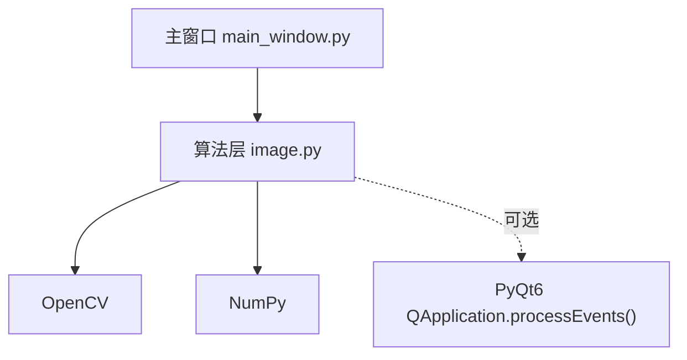
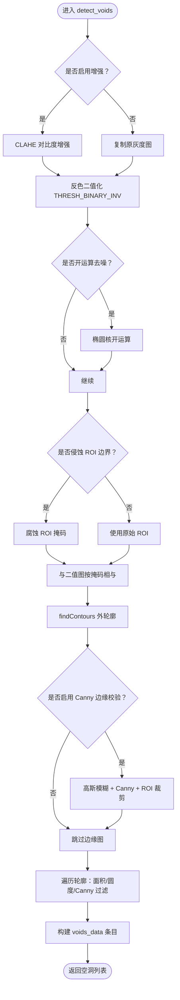
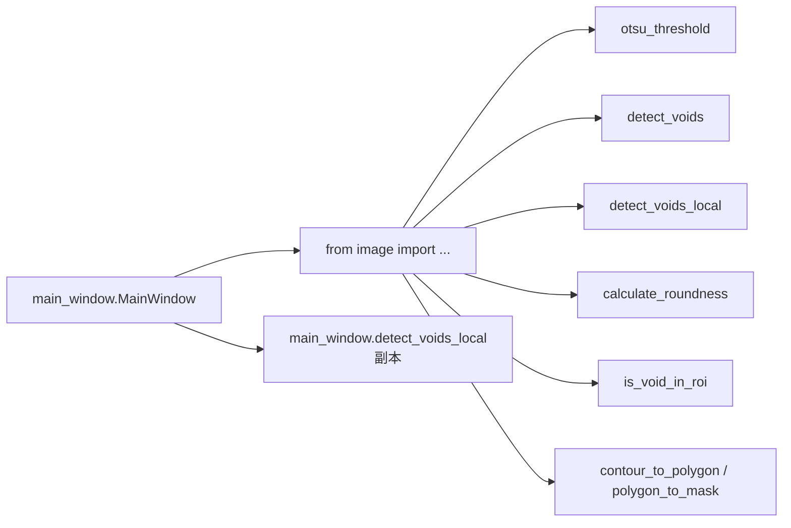

# 图像处理算法接口（image.py）

<cite>
**本文引用的文件**   
- [image.py](file://image.py)
- [main_window.py](file://main_window.py)
</cite>

## 目录
1. [引言](#引言)
2. [项目结构与职责边界](#项目结构与职责边界)
3. [核心 API 总览](#核心-api-总览)
4. [架构与数据流](#架构与数据流)
5. [函数级 API 参考](#函数级-api-参考)
6. [返回对象字段语义](#返回对象字段语义)
7. [依赖关系分析](#依赖关系分析)
8. [性能注意事项](#性能注意事项)
9. [常见误用与故障排查](#常见误用与故障排查)
10. [结论](#结论)

## 引言
本文件为 Aurascope 中 `image.py` 的纯函数算法接口编写 API 参考。该模块承担图像阈值、形态学去噪、轮廓提取、圆度计算、距离变换局部极大值计数、Canny 边缘校验与面积统计等核心逻辑，是 GUI 层不得内联实现算法的“唯一算法实现层”。

需要特别强调：`main_window.py` 中存在一份 `detect_voids_local` 副本及 `detect_voids_local_brush` 等辅助函数，属于已知技术债；当前空洞检测 UI 调用的是 `main_window.py` 中的本地副本，而非 `image.py` 中的同名函数。**文档以 `image.py` 的实现为准进行规范描述，两份实现待合并**。

## 项目结构与职责边界
Aurascope 采用「入口 → 主窗口 → Tab 页面 → Canvas 绘制层 → 算法层 image.py → 配方/导出」的分层结构。`image.py` 仅依赖 OpenCV、NumPy 和可选的 PyQt6 事件泵；GUI 通过导入这些纯函数完成空洞检测、缺陷面积、物料计数、示教模型等流程。

**图表来源**
- [main_window.py:31-34](file://main_window.py#L31-L34)
- [image.py:3-11](file://image.py#L3-L11)

**章节来源**
- [image.py:1-11](file://image.py#L1-L11)
- [main_window.py:31-34](file://main_window.py#L31-L34)

## 核心 API 总览
本节按业务维度列出本次 API 参考覆盖的函数族：

| 功能 | 主要函数 | 输入 | 输出 |
|---|---|---|---|
| Otsu 阈值计算 | `otsu_threshold` | 灰度图、可选 ROI 掩码 | 整数阈值 |
| 空洞检测 | `detect_voids` | 灰度图、ROI 掩码、阈值、增强参数 | 空洞字典列表 |
| 局部阈值空洞检测（image.py 版本） | `detect_voids_local` | 灰度图、ROI 掩码、全局阈值、局部区域 | 空洞字典列表 |
| 局部矩形区域构造 | `create_local_region_around_void` | 空洞信息、扩展像素 | `(x, y, w, h)` |
| 缺陷检测（精确连通域） | `detect_defects` | 灰度图、阈值、方向、面积过滤、ROI | 缺陷字典列表 |
| 物料计数 | `detect_objects` | 灰度图、阈值、形态学/Watershed 参数 | 对象字典列表 |
| 轮廓与多边形工具 | `extract_threshold_contour`、`contour_to_polygon`、`polygon_to_mask`、`build_snap_edge_mask` | 图像、轮廓、多边形、矩形 | 掩码、多边形、边缘掩码 |
| 圆度与 ROI 校验 | `calculate_roundness`、`is_void_in_roi` | 轮廓点、面积、ROI 掩码 | 浮点圆度、布尔值 |
| 距离变换局部极大值计数 | `detect_objects`（Watershed 分支） | 二值图、峰值间距 | 圆形对象列表 |
| Canny 边缘校验 | 内置于 `detect_voids`、`detect_objects`、`detect_voids_local` | 轮廓、边缘图 | 过滤结果 |
| 面积统计 | `_refresh_void_metrics`（UI 层聚合）、`array_stats`、`class_stats` | 空洞列表、像素数组 | 汇总指标、统计字典 |

**章节来源**
- [image.py:27-177](file://image.py#L27-L177)
- [image.py:180-286](file://image.py#L180-L286)
- [image.py:312-422](file://image.py#L312-L422)
- [image.py:425-632](file://image.py#L425-L632)
- [image.py:635-651](file://image.py#L635-L651)
- [image.py:753-811](file://image.py#L753-L811)
- [main_window.py:1587-1613](file://main_window.py#L1587-L1613)

## 架构与数据流
空洞检测的主流程如下：

**图表来源**
- [image.py:200-286](file://image.py#L200-L286)

**章节来源**
- [image.py:200-286](file://image.py#L200-L286)

## 函数级 API 参考

### `otsu_threshold(gray_img, roi_mask=None)`
- **用途**：对灰度图或 ROI 内像素执行 Otsu 自动阈值计算。
- **参数**
  - `gray_img`：二维 NumPy 数组，通常为 `uint8` 灰度图。
  - `roi_mask`：可选，与 `gray_img` 同形的 `uint8` 掩码，非零像素参与 Otsu。
- **返回值**
  - `int`：0–255 的阈值；若 ROI 无有效像素则返回 `128`。
- **异常行为**
  - 不抛异常；空 ROI 时退化为固定阈值。
- **典型调用**
  - 在 ROI 编辑完成后，先对 ROI 内像素计算 Otsu，再传给空洞检测。
- **复杂度**
  - 时间复杂度与 ROI 像素数线性相关；大图全图 Otsu 可能较慢。

**章节来源**
- [image.py:180-197](file://image.py#L180-L197)

### `detect_voids(gray_img, roi_mask, thresh_val, min_area=1, max_area=None, enhanced=False, clahe_enabled=True, morph_enabled=True, morph_kernel=3, min_roundness=0.0, edge_verify=False, edge_thresh=0.3, clahe_clip_limit=2.0, roi_erosion_px=3)`
- **用途**：基于全局阈值、可选增强、形态学去噪、ROI 边界侵蚀、圆度与 Canny 边缘校验的空洞检测。
- **参数**
  - `gray_img`：灰度图；若为彩色图，调用方应提前转为灰度。
  - `roi_mask`：与图像同形、值为 0/255 的二值掩码。
  - `thresh_val`：反色二值化阈值；暗空洞使用 `THRESH_BINARY_INV`。
  - `min_area`：最小面积（像素），默认 1。
  - `max_area`：最大面积（像素），`None` 表示不限制。
  - `enhanced`：是否启用 CLAHE、形态学、圆度、Canny 增强流程。
  - `clahe_enabled` / `clahe_clip_limit`：CLAHE 开关与 clipLimit。
  - `morph_enabled` / `morph_kernel`：开运算去噪开关与椭圆核尺寸。
  - `min_roundness`：圆度下限，0 关闭；越接近 1 越圆。
  - `edge_verify` / `edge_thresh`：Canny 边缘校验开关与边缘像素占比阈值。
  - `clahe_clip_limit`：CLAHE clipLimit，默认 2.0。
  - `roi_erosion_px`：ROI 边界向内侵蚀像素数，避免边缘伪空洞。
- **返回值**
  - `list[dict]`：空洞列表，每项包含 `id`、`area_px`、`rect`、`cx`、`cy`、`points`、`manual`。
- **异常行为**
  - 不抛异常；无效 ROI、空轮廓、过小轮廓会被跳过。
- **关键流程**
  - CLAHE → 反色二值化 → 可选开运算 → ROI 侵蚀 → 掩码相与 → findContours → 可选 Canny → 面积/圆度/边缘过滤 → 构建结果。
- **调用示例**
  - 单张图像空洞分析：传入全局 Otsu 阈值与用户绘制的 ROI。
- **性能注意**
  - 每 10 个轮廓调用一次 `_pump_events()`，长循环可刷新界面；但大量轮廓仍会阻塞。
  - Canny 校验会为每个轮廓创建临时掩码并计数，开销随轮廓数量增长。

**章节来源**
- [image.py:200-286](file://image.py#L200-L286)

### `detect_voids_local(gray_img, roi_mask, global_thresh_val, local_regions=None, min_area=1, max_area=None, enhanced=False, clahe_enabled=True, clahe_clip_limit=2.0, morph_enabled=True, morph_kernel=3, min_roundness=0.0, edge_verify=False, roi_erosion_px=3)`
- **用途**：在全局阈值基础上，对若干局部矩形区域应用不同阈值，再统一检测空洞。
- **参数**
  - `local_regions`：列表，每项为 `(x, y, w, h, local_thresh)`。
  - 其余参数与 `detect_voids` 基本一致。
- **返回值**
  - `list[dict]`：空洞列表，字段与 `detect_voids` 相同。
- **异常行为**
  - 不抛异常；无效区域、空 ROI、空轮廓被跳过。
- **关键差异**
  - 先做全局二值化，再逐局部区域覆盖对应区域的二值结果。
  - 支持 `roi_erosion_px`，但 `edge_map` 在部分分支中未初始化，可能导致 Canny 校验静默失效。
- **技术债说明**
  - `main_window.py` 中也存在同名函数，且 UI 实际调用的是 `main_window.py` 中的副本；现行行为以 `image.py` 为准，两份实现待合并。

**章节来源**
- [image.py:328-422](file://image.py#L328-L422)
- [main_window.py:1464-1474](file://main_window.py#L1464-L1474)

### `create_local_region_around_void(void_info, padding=20)`
- **用途**：根据空洞的 `rect` 向外扩展像素，生成局部矩形区域。
- **参数**
  - `void_info`：空洞字典，至少含 `rect`。
  - `padding`：左右上下各扩展的像素数。
- **返回值**
  - `(x, y, w, h)`：局部矩形坐标。
- **异常行为**
  - 不抛异常；负向坐标被截断到 0。
- **调用场景**
  - 用户选中某个空洞后，围绕其生成局部阈值调节区域。

**章节来源**
- [image.py:635-651](file://image.py#L635-L651)

### `detect_defects(gray, thresh_val, bright=True, min_area=1, roi_mask=None)`
- **用途**：按 8 邻域连通域检测缺陷，返回精确像素面积、质心、bbox、最大外轮廓与局部掩膜。
- **参数**
  - `gray`：非空二维 `uint8` 数组。
  - `thresh_val`：[0, 255] 实数。
  - `bright`：True 检测亮缺陷，False 检测暗缺陷。
  - `min_area`：有限非负实数。
  - `roi_mask`：与 gray 同形、仅含 0/255 的 `uint8` 掩码。
- **返回值**
  - `list[dict]`：每项含 `id`、`area_px`、`cx`、`cy`、`rect`、`points`、`mask`。
- **异常行为**
  - 非法输入抛 `ValueError`，包括类型、形状、dtype、范围错误。
- **设计特点**
  - 使用 `connectedComponentsWithStats` 直接得到面积与质心，再用 bbox 内标签比较构造局部掩膜，避免为每个对象分配整幅掩膜。

**章节来源**
- [image.py:425-488](file://image.py#L425-L488)

### `detect_objects(gray_img, thresh_val, min_area=1, max_area=None, enhanced=False, clahe_enabled=True, clahe_clip_limit=2.0, morph_enabled=True, morph_kernel=3, morph_shape=cv2.MORPH_ELLIPSE, min_roundness=0.0, edge_verify=False, edge_thresh=0.3, invert=False, watershed_enabled=False, watershed_distance=0.5, roi_mask=None)`
- **用途**：物料计数通用接口，复用空洞检测核心逻辑，支持亮/暗物体、形态学开闭运算、Canny 校验、Watershed 距离变换峰值计数。
- **参数**
  - `invert`：True 检测亮物体，False 检测暗物体。
  - `watershed_enabled`：启用距离变换局部极大值计数。
  - `watershed_distance`：最小峰值间距（像素），越大越保守。
  - 其余参数与空洞检测类似。
- **返回值**
  - `list[dict]`：对象字典列表，含 `id`、`area_px`、`rect`、`cx`、`cy`、`points`。
- **Watershed 分支**
  - 对二值图计算 L2 距离变换，膨胀后取局部极大值作为种子，生成圆形候选对象。
- **异常行为**
  - 不抛异常；无效轮廓、过小面积、低圆度、低边缘重叠率被过滤。

**章节来源**
- [image.py:491-632](file://image.py#L491-L632)

### 轮廓与多边形工具

#### `extract_threshold_contour(img, rect_tuple, thresh_val)`
- **用途**：从矩形 ROI 中提取阈值后的最大外轮廓。
- **参数**
  - `img`：原始图像。
  - `rect_tuple`：`(x, y, w, h)`。
  - `thresh_val`：阈值。
- **返回值**
  - `(rect_info, local_mask, contour)` 或 `(None, None, None)`。
- **行为**
  - 自动将彩色图转灰度；若无轮廓或最大轮廓面积 ≤ 3，返回空轮廓。

**章节来源**
- [image.py:27-70](file://image.py#L27-L70)

#### `resample_polygon_points(points, target_count)`
- **用途**：按周长均匀重采样多边形顶点。
- **参数**
  - `points`：多边形顶点列表。
  - `target_count`：目标顶点数。
- **返回值**
  - 重采样后的顶点列表。

**章节来源**
- [image.py:73-109](file://image.py#L73-L109)

#### `contour_to_polygon(contour, target_vertices)`
- **用途**：OpenCV 轮廓近似为多边形，必要时重采样到目标顶点数。
- **参数**
  - `contour`：OpenCV 轮廓。
  - `target_vertices`：目标顶点数。
- **返回值**
  - 多边形顶点列表。

**章节来源**
- [image.py:112-135](file://image.py#L112-L135)

#### `polygon_to_mask(points, img_shape)`
- **用途**：多边形填充为二值掩码。
- **参数**
  - `points`：多边形顶点。
  - `img_shape`：图像尺寸 `(h, w)`。
- **返回值**
  - `numpy.ndarray` 二值掩码；点数不足 3 返回 `None`。

**章节来源**
- [image.py:138-155](file://image.py#L138-L155)

#### `build_snap_edge_mask(rect_info, local_mask, img_shape)`
- **用途**：对局部掩码做 Canny 边缘检测，并映射回整图尺寸。
- **参数**
  - `rect_info`：`(x, y, w, h)`。
  - `local_mask`：局部二值掩码。
  - `img_shape`：整图尺寸。
- **返回值**
  - 整图尺寸的边缘掩码；无效输入返回 `None`。

**章节来源**
- [image.py:158-177](file://image.py#L158-L177)

### 圆度与 ROI 校验

#### `calculate_roundness(points, area_px)`
- **用途**：根据轮廓周长与面积计算圆度。
- **参数**
  - `points`：轮廓点。
  - `area_px`：像素面积。
- **返回值**
  - `float`：0–1；周长为 0 时返回 0。

**章节来源**
- [image.py:312-326](file://image.py#L312-L326)

#### `is_void_in_roi(points, roi_mask)`
- **用途**：判断空洞轮廓是否与 ROI 有足够重叠。
- **参数**
  - `points`：空洞轮廓点。
  - `roi_mask`：ROI 掩码。
- **返回值**
  - `bool`：重叠像素超过空洞掩膜一半则认为在 ROI 内。

**章节来源**
- [image.py:289-309](file://image.py#L289-L309)

### 面积统计与示教统计

#### `array_stats(px)`
- **用途**：一维像素数组的灰度统计。
- **返回值**
  - `None` 或字典：`median`、`std`、`p5`、`p95`、`count`。

**章节来源**
- [image.py:753-764](file://image.py#L753-L764)

#### `class_stats(gray, mask=None)`
- **用途**：一类像素的灰度统计，可选 mask。
- **返回值**
  - 与 `array_stats` 相同的字典结构。

**章节来源**
- [image.py:767-771](file://image.py#L767-L771)

#### `two_class_threshold(hist_a, hist_b)`
- **用途**：基于两类直方图的平衡误分类率最小化求分离阈值。
- **参数**
  - `hist_a`、`hist_b`：长度 256 的灰度直方图。
- **返回值**
  - `float` 阈值；输入非法返回 `None`。

**章节来源**
- [image.py:774-811](file://image.py#L774-L811)

## 返回对象字段语义
空洞检测类函数返回的列表项通常具有以下字段：

| 字段 | 类型 | 含义 | 注意事项 |
|---|---|---|---|
| `id` | `int` | 空洞序号，从 1 开始递增 | 同一批次内连续编号 |
| `area_px` | `float` 或 `int` | 空洞像素面积 | 空洞检测常用 `cv2.contourArea`；缺陷检测可用 `CC_STAT_AREA` |
| `rect` | `(x, y, w, h)` | 外接矩形 | 坐标为整像素，单位与图像一致 |
| `cx` | `float` | 质心 x | 由 moments 计算，面积为 0 时回退到矩形中心 |
| `cy` | `float` | 质心 y | 同上 |
| `points` | `list[list[float]]` 或 `list[tuple]` | 轮廓点 | 全图坐标；用于圆度、可视化、导出 |
| `manual` | `bool` | 是否人工标注 | 自动检测通常为 `False` |
| `mask` | `numpy.ndarray` | 局部二值掩码 | 仅 `detect_defects` 返回；用于精确孔洞掩膜 |

**章节来源**
- [image.py:275-283](file://image.py#L275-L283)
- [image.py:479-487](file://image.py#L479-L487)
- [image.py:1171-1177](file://image.py#L1171-L1177)

## 依赖关系分析
`image.py` 对外暴露的算法接口与 GUI 层的依赖关系如下：

**图表来源**
- [main_window.py:31-34](file://main_window.py#L31-L34)
- [main_window.py:1464-1474](file://main_window.py#L1464-L1474)

**章节来源**
- [main_window.py:31-34](file://main_window.py#L31-L34)
- [main_window.py:1464-1474](file://main_window.py#L1464-L1474)

## 性能注意事项
1. **大图 Otsu**：`otsu_threshold` 在无 ROI 时会 flatten 整图像素，时间复杂度与像素数线性相关。大图建议先计算 ROI 掩码或使用 `detect_voids` 的 ROI 约束。
2. **多 ROI 循环**：局部阈值检测会对每个局部区域创建整图大小的临时掩码，ROI 越多，内存与 CPU 压力越大。应避免重复添加重叠区域。
3. **OpenCV 数据类型**：多数函数期望 `uint8` 灰度图；传入 float、RGB、空数组、形状不一致的 ROI 可能产生静默错误或后续步骤失败。
4. **Canny 边缘校验**：每次校验都会为轮廓创建临时掩码并计数，轮廓数量大时显著增加开销。仅在确实需要边缘验证时开启。
5. **形态学核尺寸**：`morph_kernel` 越大，开/闭运算耗时越高；过大核可能吞掉小空洞。
6. **Watershed 距离变换**：`detect_objects` 的 Watershed 分支会计算距离变换、膨胀、连通域，适合粘连物体分离，但不适合极小对象。
7. **界面事件泵**：长循环中每 10 次迭代调用 `_pump_events()`，可缓解 GUI 卡顿，但不能替代异步处理。

[本节为通用性能指导，不直接分析具体代码行]

## 常见误用与故障排查

### 1. 把 `main_window.py` 的 `detect_voids_local` 当作权威实现
- **现象**：修改 `image.py` 的同名函数后，UI 行为未变化。
- **原因**：`main_window.py` 导入了自己的 `detect_voids_local`，空洞分析页调用的是副本。
- **处理**：以 `image.py` 为准修复算法；合并前需同步两份实现，并在合并后统一导入源。

**章节来源**
- [main_window.py:31-34](file://main_window.py#L31-L34)
- [main_window.py:1464-1474](file://main_window.py#L1464-L1474)

### 2. 传入 RGB 图像给期望灰度的函数
- **现象**：Otsu、形态学、轮廓检测出现异常或结果不符合预期。
- **原因**：函数假设二维灰度图；彩色图应先转灰度。
- **处理**：调用方在传入前执行 `cv2.cvtColor(img, cv2.COLOR_BGR2GRAY)`。

**章节来源**
- [image.py:180-197](file://image.py#L180-L197)
- [image.py:200-214](file://image.py#L200-L214)

### 3. ROI 掩码 dtype 或形状不正确
- **现象**：`bitwise_and`、`erode`、`findContours` 报错或静默返回空结果。
- **原因**：掩码必须与图像同形、`uint8`、仅含 0/255。
- **处理**：构造掩码时使用 `np.zeros((h, w), dtype=np.uint8)`，填充后确保值为 0/255。

**章节来源**
- [image.py:452-456](file://image.py#L452-L456)
- [image.py:138-155](file://image.py#L138-L155)

### 4. Canny 边缘校验静默失效
- **现象**：开启 `edge_verify` 后空洞未被过滤。
- **原因**：部分实现路径中 `edge_map` 未初始化或掩码使用不一致，导致边缘重叠率为 0 或条件不触发。
- **处理**：优先以 `image.py` 的 `detect_voids` 行为为准；合并副本时需统一边缘图初始化逻辑。

**章节来源**
- [image.py:228-233](file://image.py#L228-L233)
- [image.py:366-370](file://image.py#L366-L370)

### 5. 圆度计算传入空轮廓或面积为 0
- **现象**：圆度为 0 或 NaN。
- **原因**：周长为 0 时无法计算；面积与周长不一致也可能导致异常值。
- **处理**：先检查 `perimeter > 0` 与 `area_px > 0`，再调用 `calculate_roundness`。

**章节来源**
- [image.py:312-326](file://image.py#L312-L326)

### 6. 大图增强检测无进度提示
- **现象**：开启 CLAHE、形态学、Canny 后界面长时间无响应。
- **原因**：算法为纯 CPU 计算，虽每 10 个轮廓刷新事件，但仍可能阻塞。
- **处理**：分批处理、降低 `morph_kernel`、关闭非必要增强、考虑异步线程。

**章节来源**
- [image.py:238-240](file://image.py#L238-L240)
- [image.py:375-377](file://image.py#L375-L377)

## 结论
`image.py` 提供了 Aurascope 的核心图像处理算法接口，涵盖 Otsu 阈值、形态学去噪、轮廓与圆度、距离变换计数、Canny 边缘校验与面积统计。这些函数不依赖 Qt，可被单测独立验证。当前 `main_window.py` 中的 `detect_voids_local` 副本是已知技术债，文档以 `image.py` 为准；合并前应统一签名、异常行为与返回字段语义，并消除边缘图未初始化等隐患。

在实际使用中，应特别注意：
- 输入图像与掩码的数据类型、形状、取值范围；
- 大图 Otsu 与多 ROI 循环的性能影响；
- Canny 边缘校验与形态学核尺寸的取舍；
- 返回对象的字段含义，尤其是 `id`、`area_px`、`rect`、`cx/cy`、`points`、`manual`。

[本节为总结性内容，不直接分析具体代码行]