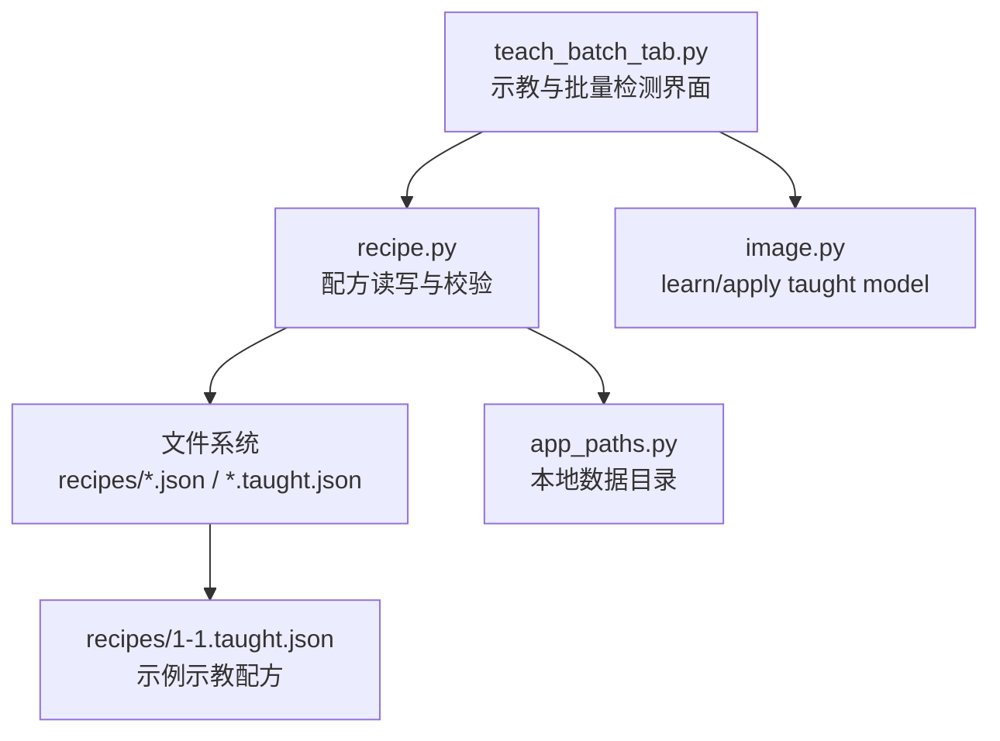
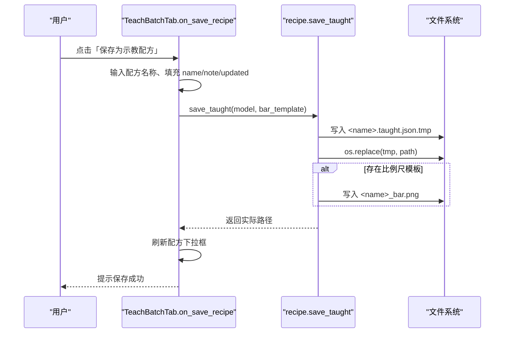
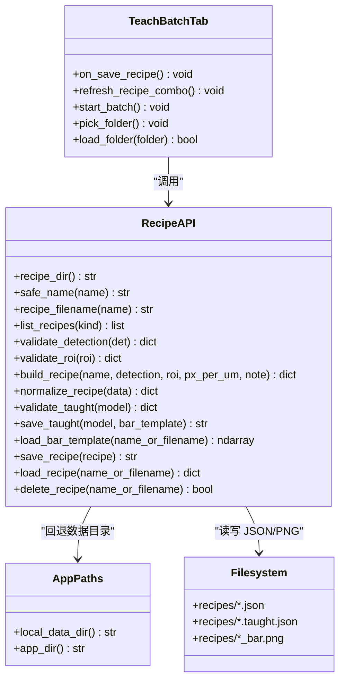

# 配方读写接口（recipe.py）

<cite>
**本文引用的文件**   
- [recipe.py](file://recipe.py)
- [teach_batch_tab.py](file://teach_batch_tab.py)
- [app_paths.py](file://app_paths.py)
- [1-1.taught.json](file://recipes/1-1.taught.json)
- [README.md](file://README.md)
</cite>

## 目录
1. [引言](#引言)
2. [项目结构与定位](#项目结构与定位)
3. [公开 API 总览](#公开-api-总览)
4. [配方存储位置与路径解析](#配方存储位置与路径解析)
5. JSON Schema 与字段语义
6. [加载、保存、校验与删除流程](#加载保存校验与删除流程)
7. [从 UI 到配方的完整调用示例](#从-ui-到配方的完整调用示例)
8. [关键字段说明与版本兼容策略](#关键字段说明与版本兼容策略)
9. [依赖关系分析](#依赖关系分析)
10. [性能与健壮性注意事项](#性能与健壮性注意事项)
11. [故障排查](#故障排查)
12. [结论](#结论)

## 引言
本文件为 Aurascope 的「示教配方」JSON 读写接口文档，聚焦 `recipe.py` 中用于批量示教与批量检测的配方管理 API。它不等同于空洞分析的通用参数型配方：示教配方以 `type=taught` 标识，核心是学习得到的焊层/背景/空洞灰度统计、分离阈值、比例尺模板及批量检测可调参数。

根据仓库 README，Aurascope 是微电子封装产线的半自动化视觉检测桌面工具；配方落盘于 `recipes/` 目录，由 `recipe.py` 负责 JSON 序列化、校验、默认值补齐与 v1/v2/v3 schema 兼容处理。

**章节来源**
- [README.md:1-80](file://README.md#L1-L80)

## 项目结构与定位
在 Aurascope 的分层结构中，配方读写属于「算法结果持久化」层：
- GUI 层：`teach_batch_tab.py` 提供示教步骤、批量选择、预览与导出。
- 配方层：`recipe.py` 定义 schema、校验规则、JSON 读写与示教模型保存。
- 路径层：`app_paths.py` 提供程序目录、用户数据目录等基础路径。
- 算法层：`image.py` 中的 `learn_taught_model` / `apply_taught_model` 真正生成和消费示教模型字典。



**图表来源**
- [recipe.py:1-20](file://recipe.py#L1-L20)
- [teach_batch_tab.py:41-42](file://teach_batch_tab.py#L41-L42)
- [app_paths.py:14-26](file://app_paths.py#L14-L26)
- [1-1.taught.json:1-56](file://recipes/1-1.taught.json#L1-L56)

**章节来源**
- [README.md:42-64](file://README.md#L42-L64)
- [recipe.py:1-20](file://recipe.py#L1-L20)

## 公开 API 总览
以下 API 均位于 `recipe.py`，除 `_writable`、`_recipe_root`、`_resolve_path`、`_clamp`、`_validate_band_ref`、`_validate_band_tol`、`_to_float` 等内部辅助函数外，其余均为面向模块或 UI 调用的公开接口。

| 方法 | 输入 | 返回值 | 主要职责 | 失败行为 |
|---|---|---|---|---|
| `recipe_dir()` | 无 | `str` | 确保并返回配方根目录 | 通过 `os.makedirs` 创建目录；若不可写则回退到用户数据目录 |
| `safe_name(name)` | `name: str` | `str` | 过滤非法文件名字符并截断至 64 字符 | 空名返回空字符串 |
| `recipe_filename(name)` | `name: str` | `str` | 显示名 → `.json` 文件名 | 对空名返回 `.json` |
| `list_recipes(kind=None)` | `kind: 'v1'/'taught'/None` | `[(display, filename), ...]` | 列出所有可读取的配方，按修改时间倒序 | 单个文件读异常时仍加入列表，显示名取文件名前缀 |
| `validate_detection(det)` | `det: dict` | `dict` | 校验并夹紧空洞分析检测参数 | 缺失字段用默认值，越界字段被夹紧 |
| `validate_roi(roi)` | `roi: dict` | `dict` | 清洗多边形顶点、限制层阈值与顶点数 | 无效点跳过，最终少于 3 个点时 ROI 类型变为 `none` |
| `build_recipe(name, detection, roi, px_per_um=0.0, note='')` | 名称、检测参数、ROI、像素比、备注 | `dict` | 组装 v1 参数型配方字典 | 自动补默认值并校验 |
| `normalize_recipe(data)` | `data: dict` | `dict` 或 `None` | 把任意来源字典规范化为完整配方 | 非 dict 返回 `None`；`type=taught` 走示教模型校验 |
| `validate_taught(model)` | `model: dict` | `dict` 或 `None` | 校验并迁移示教模型到 schema v3 | 非 dict 返回 `None`；旧 schema 做兼容迁移 |
| `save_taught(model, bar_template=None)` | 示教模型、可选比例尺模板图 | `str` 实际路径 | 原子写入 `.taught.json`，并保存配套 PNG 模板 | 名称为空抛 `ValueError`；IO 异常向上传播 |
| `load_bar_template(name_or_filename)` | 显示名、`.json` 或 `.taught.json` | `numpy.ndarray` 或 `None` | 加载配套比例尺模板灰度图 | 不存在或解码失败返回 `None` |
| `save_recipe(recipe)` | v1 参数型配方字典 | `str` 实际路径 | 原子写入 `.json` | 名称为空抛 `ValueError` |
| `load_recipe(name_or_filename)` | 显示名或文件名 | `dict` 或 `None` | 加载并规范化配方 | 文件不存在、JSON 解析失败、规范化失败均返回 `None` |
| `delete_recipe(name_or_filename)` | 显示名或文件名 | `bool` | 删除配方文件 | 文件不存在或删除失败返回 `False` |

**章节来源**
- [recipe.py:56-103](file://recipe.py#L56-L103)
- [recipe.py:137-166](file://recipe.py#L137-L166)
- [recipe.py:169-238](file://recipe.py#L169-L238)
- [recipe.py:241-348](file://recipe.py#L241-L348)
- [recipe.py:385-429](file://recipe.py#L385-L429)
- [recipe.py:439-474](file://recipe.py#L439-L474)

## 配方存储位置与路径解析
### 根目录优先级
`recipe.py` 的 `_recipe_root()` 决定配方根目录，优先级如下：
1. 环境变量 `AURASCOPE_RECIPE_DIR`：若设置，直接使用该绝对路径。
2. 打包运行（`sys.frozen` 为真）：优先使用 `exe` 同级目录下的 `recipes`。
3. 源码运行：优先使用 `recipe.py` 所在目录下的 `recipes`。
4. 若首选目录不可写：回退到 `app_paths.local_data_dir()` 下的 `recipes`。

`app_paths.local_data_dir()` 基于 `LOCALAPPDATA` 或 `~\AppData\Local`，子目录为 `Aurascope`。因此 PyInstaller 打包后，若安装目录只读，配方会落到当前用户的 AppData 下，而不是 exe 同级目录。

### 命名空间隔离
- 参数型配方：`<name>.json`
- 示教配方：`<name>.taught.json`
- 配套比例尺模板图：`<name>_bar.png`

这种命名隔离避免同名参数型配方与示教配方互相覆盖。

### 路径解析兼容性
`_resolve_path()` 支持三种入参形式：
- 已带后缀的文件名，如 `1-1.taught.json`。
- 显示名，如 `1-1`，会依次尝试 `<name>.json` 与 `<name>.taught.json`。
- 如果都不存在，返回 `<name>.json` 的路径（用于保存时的目标路径）。

**章节来源**
- [recipe.py:56-89](file://recipe.py#L56-L89)
- [recipe.py:111-134](file://recipe.py#L111-L134)
- [app_paths.py:21-26](file://app_paths.py#L21-L26)

## JSON Schema 与字段语义
### 参数型配方（v1，`type` 未设为 `taught`）
由 `build_recipe()` 与 `normalize_recipe()` 共同维护，核心字段如下：

| 字段 | 类型 | 必填 | 默认值 | 含义 |
|---|---|---:|---:|---|
| `schema_version` | int | 否 | `SCHEMA_VERSION`（当前为 1） | 配方 schema 版本 |
| `name` | string | 否 | `''` | 配方显示名 |
| `note` | string | 否 | `''` | 备注 |
| `updated` | string | 否 | `''` | 更新时间 ISO 字符串 |
| `detection` | dict | 否 | 使用 `DETECTION_DEFAULTS` | 空洞检测参数集合 |
| `roi` | dict | 否 | 使用 `validate_roi({})` | ROI 多边形与绘制参数 |
| `px_per_um` | float | 否 | `0.0` | 像素/微米标定值 |

`detection` 的关键默认值包括：
- `threshold`: 80
- `min_area`: 1
- `max_area`: None（表示无上限）
- `roi_erosion_px`: 3
- `enhanced`: True
- `clahe_enabled`: True
- `clahe_clip_limit`: 2.0
- `morph_enabled`: True
- `morph_kernel`: 3
- `min_roundness`: 0.0
- `edge_verify`: False
- `edge_thresh`: 0.3

数值字段会被 `_RANGES` 夹紧，布尔字段强制转为 bool，`max_area` 非正数等价于 None。

### 示教配方（v2/v3，`type=taught`）
示教配方由 `validate_taught()` 输出，统一归一化为 schema v3。示例文件 `recipes/1-1.taught.json` 展示了典型结构。

| 顶层字段 | 类型 | 必填 | 默认值 | 含义 |
|---|---|---:|---:|---|
| `schema_version` | int | 否 | 迁移为 3 | 当前稳定 schema 版本 |
| `type` | string | 否 | `'taught'` | 标识示教模型 |
| `name` | string | 否 | `''` | 配方显示名 |
| `note` | string | 否 | `''` | 备注，UI 保存时会写入样板图文件名 |
| `updated` | string | 否 | `''` | 更新时间 |
| `solder` | dict | 否 | 各灰度统计默认值 | 焊层类灰度分布与分离阈值 |
| `background` | dict | 否 | 背景灰度默认值 | 背景类灰度统计 |
| `void` | dict | 否 | 空洞阈值、面积、圆度、深度容差等默认值 | 空洞判定参数 |
| `px_per_um` | float | 否 | `0.0` | 像素/微米 |
| `ref_median` | float | 否 | `0.0` | 参考中位数 |
| `band` | dict | 否 | 长宽比、面积分数、形态学核等默认值 | 焊层带几何约束 |
| `band_ref` | dict 或 None | 否 | `None` | 示教模板的焊层几何基准 |
| `band_tol` | dict | 否 | 中心偏移、面积/长宽比容忍范围 | 偏差阈值 |
| `scale_bar` | dict | 否 | 水平、暗色、长度、真实长度默认值 | 比例尺配置 |
| `diagnostics` | dict | 否 | 可分性等诊断指标默认值 | 学习质量诊断 |

**章节来源**
- [recipe.py:22-50](file://recipe.py#L22-L50)
- [recipe.py:228-258](file://recipe.py#L228-L258)
- [recipe.py:271-348](file://recipe.py#L271-L348)
- [1-1.taught.json:1-56](file://recipes/1-1.taught.json#L1-L56)

## 加载、保存、校验与删除流程
### 保存示教配方


**图表来源**
- [teach_batch_tab.py:1211-1235](file://teach_batch_tab.py#L1211-L1235)
- [recipe.py:385-404](file://recipe.py#L385-L404)

### 加载示教配方并启动批量
```mermaid
sequenceDiagram
participant User as "用户"
participant Tab as "TeachBatchTab.start_batch"
participant Recipe as "recipe.load_recipe"
participant Bar as "recipe.load_bar_template"
participant Worker as "BatchWorker"
User->>Tab : 点击「开始批量」
alt 当前已有示教模型
Tab->>Tab : 直接使用 self.model
else 从下拉框选择
Tab->>Recipe : load_recipe(fn)
Recipe-->>Tab : 规范化后的 model 或 None
opt 模型有效且为示教类型
Tab->>Bar : load_bar_template(fn)
Bar-->>Tab : 模板图或 None
else 模型无效或非示教
Tab-->>User : 提示「配方读取失败或不是示教配方」
end
end
Tab->>Worker : 构造 BatchWorker(image_paths, model, bar_template)
Worker->>Worker : 逐图 apply_taught_model
Worker-->>Tab : finished(results)
```

**图表来源**
- [teach_batch_tab.py:1401-1453](file://teach_batch_tab.py#L1401-L1453)
- [recipe.py:452-462](file://recipe.py#L452-L462)
- [recipe.py:407-429](file://recipe.py#L407-L429)

### 校验失败的回退行为
| 场景 | 行为 |
|---|---|
| `normalize_recipe()` 收到非 dict | 返回 `None` |
| `validate_taught()` 收到非 dict | 返回 `None` |
| `load_recipe()` 找不到文件 | 返回 `None` |
| `load_recipe()` JSON 解析失败 | 返回 `None` |
| `load_recipe()` 规范化失败 | 返回 `None` |
| `list_recipes()` 单个文件损坏 | 该文件仍出现在列表中，显示名取文件名前缀，`type` 为 None |
| 数值字段超出 `_RANGES` | 被夹紧到合法范围 |
| 布尔字段传入非 bool | 强制转 bool |
| `max_area` 为 0、None 或非数字 | 视为无上限 |
| ROI 多边形点数不足 3 | 类型变为 `none` |
| 旧 schema 示教配方 | 迁移为 v3，保留 `*_taught` 字段供追溯 |

**章节来源**
- [recipe.py:169-225](file://recipe.py#L169-L225)
- [recipe.py:241-348](file://recipe.py#L241-L348)
- [recipe.py:452-474](file://recipe.py#L452-L474)

## 从 UI 到配方的完整调用示例
以下示例描述用户在 `teach_batch_tab.py` 中完成一次「完整示教 + 批量检测」的典型流程。

### 前置条件
- 已打开 Aurascope 主窗口并进入「示教与批量检测」Tab。
- 准备一张样板图和若干待测图片文件夹。
- 如需恢复历史配方，确保 `recipes/` 目录下存在 `.taught.json` 文件。

### 步骤一：上传样板图
1. 点击「上传样板图」。
2. 选择一张包含典型空洞和金锡焊层的图像。
3. UI 将图像载入画布，清空上一次示教状态。

对应代码入口：
- [teach_batch_tab.py:778-816](file://teach_batch_tab.py#L778-L816)

### 步骤二：点选典型空洞
1. 点击「点选空洞」按钮进入点选模式。
2. 在图上点击 2~3 个明显空洞。
3. 每个点会抓取局部暗核掩码，并显示在列表中。

对应代码入口：
- [teach_batch_tab.py:964-1000](file://teach_batch_tab.py#L964-L1000)

### 步骤三：定义焊层区域
有两种方式：
- 「自动识别焊层带」：基于空洞锚点反推焊层类/背景类，再定位焊层带。
- 「多边形手绘」：沿焊层边界手动绘制多边形。

完成后可以进入「编辑顶点」微调。

对应代码入口：
- [teach_batch_tab.py:820-881](file://teach_batch_tab.py#L820-L881)
- [teach_batch_tab.py:883-931](file://teach_batch_tab.py#L883-L931)
- [teach_batch_tab.py:933-946](file://teach_batch_tab.py#L933-L946)

### 步骤四：标定比例尺
1. 点击「在比例尺上划线」。
2. 在 SEM/设备自带比例尺上划一条线。
3. 输入实际长度（单位 μm）。
4. UI 计算 `px_per_um`，并保存比例尺模板 patch。

对应代码入口：
- [teach_batch_tab.py:1066-1122](file://teach_batch_tab.py#L1066-L1122)

### 步骤五：学习并预览
1. 点击「开始学习」。
2. UI 调用 `learn_taught_model()` 生成示教模型。
3. 调用 `apply_taught_model()` 在样板图上回放。
4. 若学习成功，启用「保存为示教配方」。

对应代码入口：
- [teach_batch_tab.py:1126-1195](file://teach_batch_tab.py#L1126-L1195)

### 步骤六：保存为示教配方
1. 点击「保存为示教配方」。
2. 输入配方名称。
3. UI 填充 `name`、`note`、`updated`。
4. 调用 `recipe.save_taught()` 写入 `recipes/<name>.taught.json`。
5. 同时保存比例尺模板 `<name>_bar.png`。
6. 刷新配方下拉框并选中刚保存的配方。

对应代码入口：
- [teach_batch_tab.py:1211-1235](file://teach_batch_tab.py#L1211-L1235)
- [recipe.py:385-404](file://recipe.py#L385-L404)

### 步骤七：选择批次文件夹并开始批量
1. 点击「选择批次文件夹」。
2. UI 扫描文件夹内图片扩展名，构建 `batch_paths`。
3. 若存在同名示教配方，自动选中并提示可直接批量。
4. 点击「开始批量」。
5. 若未选择模型，则调用 `load_recipe()` 加载所选配方。
6. 调用 `load_bar_template()` 加载配套模板图。
7. 构造 `BatchWorker` 逐图执行 `apply_taught_model()`。

对应代码入口：
- [teach_batch_tab.py:1251-1288](file://teach_batch_tab.py#L1251-L1288)
- [teach_batch_tab.py:1401-1453](file://teach_batch_tab.py#L1401-L1453)

### 步骤八：从 recipes/*.taught.json 恢复配方
当用户再次打开应用：
1. 下拉框调用 `list_recipes(kind='taught')`。
2. 遍历 `recipes/` 下所有 `.json` 文件。
3. 对每个文件尝试 `json.load()`。
4. 若 `type == 'taught'`，纳入示教配方列表。
5. 用户选择后，`start_batch()` 调用 `load_recipe()` 规范化并加载。

对应代码入口：
- [recipe.py:137-166](file://recipe.py#L137-L166)
- [teach_batch_tab.py:1239-1249](file://teach_batch_tab.py#L1239-L1249)
- [teach_batch_tab.py:1401-1417](file://teach_batch_tab.py#L1401-L1417)

**章节来源**
- [teach_batch_tab.py:778-816](file://teach_batch_tab.py#L778-L816)
- [teach_batch_tab.py:820-946](file://teach_batch_tab.py#L820-L946)
- [teach_batch_tab.py:1066-1195](file://teach_batch_tab.py#L1066-L1195)
- [teach_batch_tab.py:1211-1288](file://teach_batch_tab.py#L1211-L1288)
- [teach_batch_tab.py:1401-1453](file://teach_batch_tab.py#L1401-L1453)
- [recipe.py:137-166](file://recipe.py#L137-L166)
- [recipe.py:385-404](file://recipe.py#L385-L404)
- [recipe.py:452-462](file://recipe.py#L452-L462)

## 关键字段说明与版本兼容策略
### 阈值相关
| 字段 | 含义 | 默认值或约束 |
|---|---|---|
| `solder.threshold` | 焊层类与背景类的分离阈值 | 0~255，默认 128.0 |
| `void.threshold` | 空洞阈值 | 0~255，允许 None（表示自动） |
| `void.depth_offset` | 深度容差：正值更包容，把偏浅暗斑也算作空洞 | -80.0~80.0，默认 0.0 |
| `detection.threshold` | 参数型配方的全局阈值 | 0~255，默认 80 |

### 形态学与轮廓参数
| 字段 | 含义 | 默认值或约束 |
|---|---|---|
| `morph_kernel` | 形态学核大小 | 1~15，默认 3 |
| `min_roundness` | 最小圆度 | 0.0~1.0，默认 0.0 |
| `edge_verify` | 是否启用 Canny 边缘校验 | 布尔，默认 False |
| `edge_thresh` | Canny 阈值 | 0.0~1.0，默认 0.3 |
| `band.open_kernel` | 焊层带形态学开运算核 | 1~21，默认 5 |
| `band.min_thickness_px` | 竖向最小厚度，剔除薄碎片 | 0~60，默认 8 |
| `band.bridge_win_px` | 贴边空洞缺口桥接窗口 | -1=自动，0=关闭，>1=指定宽度 |

### ROI 与标注
| 字段 | 含义 | 默认值或约束 |
|---|---|---|
| `roi.type` | `polygon` 或 `none` | 有效顶点≥3 时为 polygon |
| `roi.polygon` | 多边形顶点列表 `[x, y]` | 坐标四舍五入到 0.1 |
| `roi.layer_threshold` | 层阈值 | 0~255，默认 100 |
| `roi.vertices` | 多边形顶点数量 | 3~120，默认 24 |
| `scale_bar.horizontal` | 比例尺方向是否水平 | 布尔，默认 True |
| `scale_bar.dark` | 比例尺明暗 | 布尔，默认 True |
| `scale_bar.length_px` | 示范比例尺像素长度 | float，默认 0.0 |
| `scale_bar.real_um` | 示范比例尺真实长度 | float，默认 0.0 |

### 批量与统计
| 字段 | 含义 | 默认值或约束 |
|---|---|---|
| `void.min_area` | 空洞面积下限 | ≥0；0 或 None 表示自动 |
| `void.max_area` | 空洞面积上限 | >0 表示手动；否则自动 |
| `void.min_area_taught` | 示教时记录的最小空洞面积 | ≥1，默认 4 |
| `void.max_area_taught` | 示教时记录的最大空洞面积 | ≥0，可为 None |
| `void.taught_count` | 示教时空洞样本数量 | 0~9999，默认 0 |
| `px_per_um` | 像素/微米 | float，默认 0.0 |
| `diagnostics.solder_bg_separability` | 焊层与背景可分性 | float，默认 0.0 |
| `diagnostics.solder_void_separability` | 焊层与空洞可分性 | float，默认 0.0 |

### 版本兼容策略
- `SCHEMA_VERSION = 1` 用于参数型配方。
- 示教模型在 `validate_taught()` 中统一迁移为 `schema_version=3`。
- 对于 schema < 3 的旧示教配方：
  - 面积上下限原为「按点选尺寸推导」，迁移后一律视为自动档。
  - 旧值保留在 `min_area_taught` / `max_area_taught` 中，便于追溯。
- `normalize_recipe()` 对缺失字段采用安全默认值，避免旧配方导致运行时崩溃。

**章节来源**
- [recipe.py:22-50](file://recipe.py#L22-L50)
- [recipe.py:169-225](file://recipe.py#L169-L225)
- [recipe.py:271-348](file://recipe.py#L271-L348)
- [1-1.taught.json:1-56](file://recipes/1-1.taught.json#L1-L56)

## 依赖关系分析


**图表来源**
- [recipe.py:56-474](file://recipe.py#L56-L474)
- [teach_batch_tab.py:1211-1453](file://teach_batch_tab.py#L1211-L1453)
- [app_paths.py:14-26](file://app_paths.py#L14-L26)

**章节来源**
- [recipe.py:56-474](file://recipe.py#L56-L474)
- [teach_batch_tab.py:1211-1453](file://teach_batch_tab.py#L1211-L1453)
- [app_paths.py:14-26](file://app_paths.py#L14-L26)

## 性能与健壮性注意事项
1. **原子写入**：`save_recipe()` 与 `save_taught()` 先写 `.tmp` 再用 `os.replace()` 替换，避免写一半损坏。
2. **中文路径兼容**：`load_bar_template()` 绕过 `cv2.imread` 的中文路径问题，改用字节读取 + `cv2.imdecode()`。
3. **不可写目录回退**：`_writable()` 探测首选目录是否可写；不可写时回退到 `app_paths.local_data_dir()`。
4. **列表读取容错**：`list_recipes()` 对单个损坏 JSON 不中断整个列表，仅降级显示名。
5. **批量线程轻量结果**：`BatchWorker` 剥离 `band_mask` / `voids` 等大对象，避免几十张 4K 图常驻内存达数百 MB。
6. **进度与取消**：批量过程通过信号更新进度条，支持取消。

**章节来源**
- [recipe.py:56-89](file://recipe.py#L56-L89)
- [recipe.py:385-429](file://recipe.py#L385-L429)
- [recipe.py:439-474](file://recipe.py#L439-L474)
- [teach_batch_tab.py:82-159](file://teach_batch_tab.py#L82-L159)

## 故障排查
| 现象 | 可能原因 | 排查建议 |
|---|---|---|
| 保存配方后下拉框没有新项 | 保存失败或名称为空 | 检查 `on_save_recipe()` 是否捕获异常；确认名称不为空 |
| 批量启动时报「配方读取失败或不是示教配方」 | `load_recipe()` 返回 `None` 或 `type != 'taught'` | 检查 `recipes/<name>.taught.json` 是否存在且 JSON 合法 |
| 配方保存在 exe 同级但无法写入 | Program Files 或共享目录只读 | 查看是否回退到 `LOCALAPPDATA/Aurascope/recipes` |
| 比例尺模板图未加载 | 文件名不匹配或 PNG 损坏 | 检查 `<name>_bar.png` 是否存在；确认传入的是 `.taught.json` 或显示名 |
| 旧配方加载后参数异常 | schema 版本过旧 | 让 `validate_taught()` 迁移为 v3；必要时人工修正 JSON |
| 批量结果大量警告 | 比例尺识别失败或分割失败 | 查看单图结果中的 `warnings`；重新示教或调整空洞判定 |
| 批量卡住或内存暴涨 | 大对象未剥离或图片过多 | 确认 `BatchWorker` 未携带 `band_mask` / `voids`；分批处理大图 |

**章节来源**
- [teach_batch_tab.py:1211-1235](file://teach_batch_tab.py#L1211-L1235)
- [teach_batch_tab.py:1401-1453](file://teach_batch_tab.py#L1401-L1453)
- [recipe.py:385-429](file://recipe.py#L385-L429)
- [recipe.py:452-474](file://recipe.py#L452-L474)

## 结论
`recipe.py` 为 Aurascope 的示教配方提供了稳定的 JSON 读写契约：
- 对外暴露清晰的加载、保存、校验、列表、删除 API。
- 通过 `validate_detection` / `validate_roi` / `validate_taught` 实现强容错的字段校验与默认值补齐。
- 通过 `.taught.json` 命名隔离参数型配方与示教配方。
- 通过 `_recipe_root()` 与 `app_paths.local_data_dir()` 区分源码运行与 PyInstaller 打包的可写路径。
- 通过 schema 迁移保证旧配方仍可加载，同时统一输出为 v3。

在实际使用中，应优先通过 `teach_batch_tab.py` 的 UI 流程操作配方；仅在调试、迁移或批处理脚本中直接调用 `recipe.py` 的公开 API。