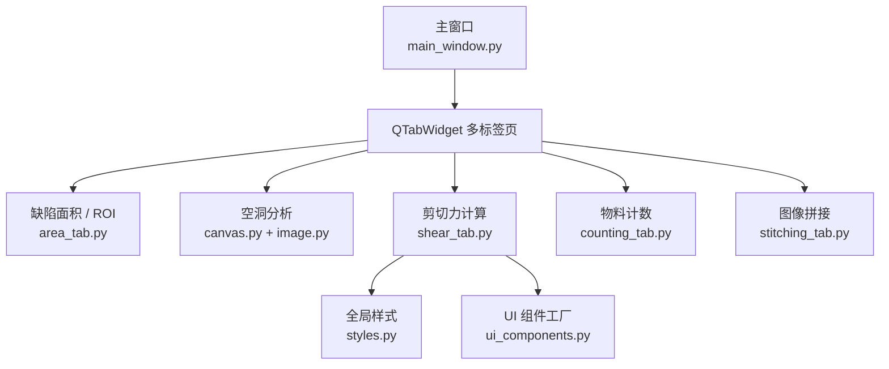
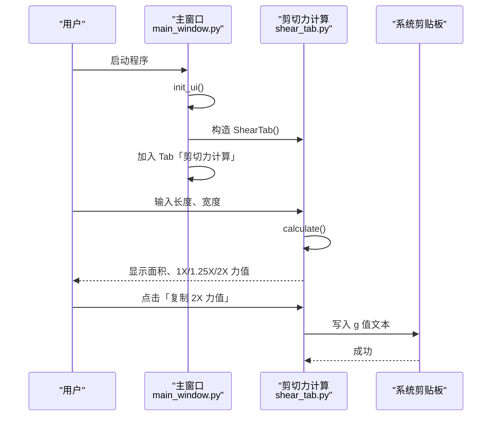
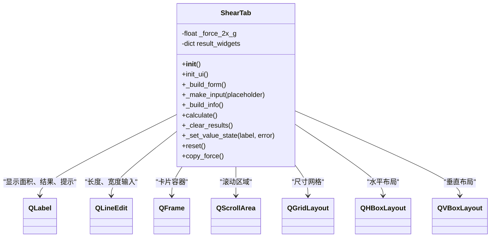
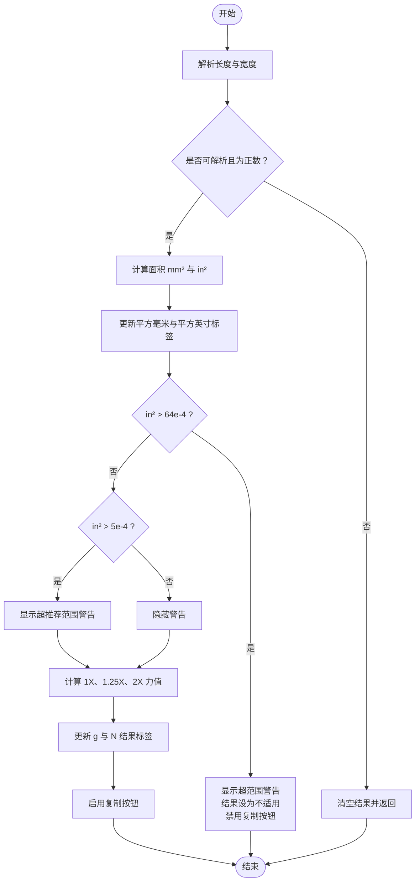

# 剪切力计算模块

<cite>
**本文引用的文件**   
- [shear_tab.py](file://shear_tab.py)
- [main_window.py](file://main_window.py)
- [ui_components.py](file://ui_components.py)
- [styles.py](file://styles.py)
- [README.md](file://README.md)
- [PROJECT_CONCEPTION.md](file://PROJECT_CONCEPTION.md)
- [app_paths.py](file://app_paths.py)
</cite>

## 目录
1. [引言](#引言)
2. [项目结构定位](#项目结构定位)
3. [核心组件](#核心组件)
4. [架构总览](#架构总览)
5. [详细组件分析](#详细组件分析)
6. [依赖关系分析](#依赖关系分析)
7. [性能与复杂度](#性能与复杂度)
8. [输入规范与校验规则](#输入规范与校验规则)
9. [错误提示策略](#错误提示策略)
10. [可配置项与会话状态](#可配置项与会话状态)
11. [示例输入输出表](#示例输入输出表)
12. [故障排查](#故障排查)
13. [结论](#结论)

## 引言
本技术设计文档聚焦 Aurascope 的「剪切力计算」功能，对应源码文件 `shear_tab.py`。该模块是一个纯计算型 UI Tab：用户输入芯片长、宽等参数后，模块依据 MIL-STD-883H Method 2019.9 标准中的面积-力值映射逻辑，输出 1X、1.25X、2X 三种剪切力要求，并以克和牛顿两种单位展示结果；同时提供“复制 2X 力值”到系统剪贴板的能力。

从产品层面看，该功能用于替代手工查阅标准并手算的过程，面向质量/可靠性工程师进行来料或工艺校核。它不处理图像、不调用 OpenCV、不读写配方 JSON，也不参与空洞检测流程，属于独立于 image.py 的轻量数值计算与 UI 展示层。

**章节来源**
- [README.md:7-14](file://README.md#L7-L14)
- [PROJECT_CONCEPTION.md:28-36](file://PROJECT_CONCEPTION.md#L28-L36)

## 项目结构定位
Aurascope 的整体分层约定是：GUI 层 → Canvas 绘制层 → 算法层 image.py → 数据导出层。剪切力计算模块位于 GUI 层，由主窗口装配为第 4 个 Tab，但不进入空洞分析、测距、拼接等其他业务流。



**图表来源**
- [main_window.py:138-140](file://main_window.py#L138-L140)
- [shear_tab.py:1-20](file://shear_tab.py#L1-L20)
- [styles.py:1-42](file://styles.py#L1-L42)
- [ui_components.py:1-10](file://ui_components.py#L1-L10)

**章节来源**
- [main_window.py:138-140](file://main_window.py#L138-L140)
- [README.md:42-64](file://README.md#L42-L64)

## 核心组件
ShearTab 的核心职责可以概括为以下四点：

| 职责 | 实现方式 | 关键代码位置 |
|---|---|---|
| 构建左侧输入表单 | `_build_form()` 使用 QFrame、QScrollArea、QGridLayout、QLineEdit | [shear_tab.py:39-144](file://shear_tab.py#L39-L144) |
| 构建右侧标准说明面板 | `_build_info()` 展示适用范围、公式与单位换算 | [shear_tab.py:155-201](file://shear_tab.py#L155-L201) |
| 实时计算剪切力 | `calculate()` 监听输入变化，输出面积与 1X/1.25X/2X 力值 | [shear_tab.py:205-253](file://shear_tab.py#L205-L253) |
| 结果展示与辅助操作 | 结果卡片、警告框、复制 2X 力值、一键清零 | [shear_tab.py:89-133](file://shear_tab.py#L89-L133)、[shear_tab.py:276-285](file://shear_tab.py#L276-L285) |

ShearTab 内部维护两个关键实例字段：

| 字段 | 类型 | 含义 |
|---|---|---|
| `_force_2x_g` | float | 最近一次计算的 2X 力值（单位：g），用于复制到剪贴板 |
| `result_widgets` | dict | 倍率到 `(克标签, 牛顿标签)` 的映射 |

**章节来源**
- [shear_tab.py:22-27](file://shear_tab.py#L22-L27)
- [shear_tab.py:89-133](file://shear_tab.py#L89-L133)
- [shear_tab.py:205-285](file://shear_tab.py#L205-L285)

## 架构总览
剪切力计算模块在应用中的调用链非常短：主窗口创建 ShearTab 实例并加入 Tab，用户切换至「剪切力计算」标签后直接交互。模块自身不持有图片、ROI、空洞数据或配方对象。



**图表来源**
- [main_window.py:138-140](file://main_window.py#L138-L140)
- [shear_tab.py:205-285](file://shear_tab.py#L205-L285)

## 详细组件分析

### ShearTab 类结构
ShearTab 继承自 QWidget，采用 Qt 布局组合而非继承扩展。其方法按职责划分清晰：



**图表来源**
- [shear_tab.py:22-285](file://shear_tab.py#L22-L285)

**章节来源**
- [shear_tab.py:22-285](file://shear_tab.py#L22-L285)

### 输入表单组件
左侧表单包含以下控件：

| 控件 | 用途 | 默认行为 |
|---|---|---|
| 标题标签 | 显示「芯片剪切力计算器」 | 通过 `create_card_title` 创建 |
| 副标题标签 | 标注参考标准 | 通过 `create_card_subtitle` 创建 |
| 步骤标题「芯片尺寸」 | 分组输入 | 通过 `create_step_title` 创建 |
| 长度输入框 | 单位 mm | `QDoubleValidator(0.0, 99999.0, 3)` |
| 宽度输入框 | 单位 mm | `QDoubleValidator(0.0, 99999.0, 3)` |
| 一键清零按钮 | 清空输入并重置结果 | 调用 `reset()` |
| 步骤标题「面积」 | 分组显示换算结果 | 通过 `create_step_title` 创建 |
| 平方毫米标签 | 显示 `length × width` | 格式化 6 位小数 |
| 平方英寸标签 | 显示 mm² ÷ 645.16 | 格式化 6 位小数 |
| 警告框 | 超出标准范围时提示 | 初始隐藏 |
| 三个结果卡片 | 1X、1.25X、2X 力值 | 每卡含 g 与 N 两行 |
| 复制按钮 | 复制 2X 力值 | 初始禁用 |
| 提示标签 | 引导用户输入 | 计算成功后隐藏 |

**章节来源**
- [shear_tab.py:39-144](file://shear_tab.py#L39-L144)
- [ui_components.py:181-288](file://ui_components.py#L181-L288)

### 标准说明面板
右侧信息面板以静态文本形式说明：

1. 参考标准：MIL-STD-883H Method 2019.9 (Figure 2019-4)。
2. 适用范围：预制金锡 Preform/Pre-coated 芯片剪切力计算。
3. 面积范围限制：
   - 小于 5×10⁻⁴ in²：按比例计算。
   - 5×10⁻⁴ ~ 64×10⁻⁴ in²：线性插值区域。
   - 大于 64×10⁻⁴ in²：标准要求最低 2.5 kgf，此计算器暂不适用。
4. 计算公式：
   - 面积(mm²) = 长度 × 宽度。
   - 面积(in²) = 面积(mm²) ÷ 645.16。
   - 1X 力值(g) = 面积(in²) × 400 × 1000，即 0.04 kg / 1.0×10⁻⁴ in²。
   - 力值(N) = 力值(g) ÷ 1000 × 9.8。

这些信息与模块常量共同构成当前实现的权威契约。

**章节来源**
- [shear_tab.py:155-201](file://shear_tab.py#L155-L201)
- [PROJECT_CONCEPTION.md:28-36](file://PROJECT_CONCEPTION.md#L28-L36)

### 计算流程
`calculate()` 是模块的核心控制流。其执行顺序如下：



**图表来源**
- [shear_tab.py:205-253](file://shear_tab.py#L205-L253)

**章节来源**
- [shear_tab.py:205-253](file://shear_tab.py#L205-L253)

### 结果卡片与单位展示
每个倍率对应一个结果卡片，卡片内包含：

- 标题：如「1X 最小力值」、「1.25X 测试力值」、「2X 测试力值」。
- 倍率徽章：x1、x1.25、x2，颜色来自 styles.py 的设计 token。
- 克值标签：格式化为 1 位小数，单位 g。
- 牛顿值标签：格式化为 4 位小数，单位 N。

当面积超过 64×10⁻⁴ in² 时，所有结果标签文本改为「不适用」，并通过 `_set_value_state(..., error=True)` 切换为 ErrorValue 语义样式。

**章节来源**
- [shear_tab.py:89-133](file://shear_tab.py#L89-L133)
- [shear_tab.py:223-253](file://shear_tab.py#L223-L253)
- [shear_tab.py:269-274](file://shear_tab.py#L269-L274)
- [styles.py:197-205](file://styles.py#L197-L205)

### 复制 2X 力值
`copy_force()` 仅在 `_force_2x_g > 0` 时将格式化后的 g 值写入系统剪贴板。该功能依赖 PyQt6 的 QApplication.clipboard，不依赖 image.py 或其他业务模块。

**章节来源**
- [shear_tab.py:281-285](file://shear_tab.py#L281-L285)

## 依赖关系分析
ShearTab 的依赖方向明确且单向：

```mermaid
graph LR
ShearTab["shear_tab.py"] --> Styles["_C 颜色 token"]
ShearTab --> UiComponents["ui_components.py 工厂函数"]
ShearTab --> QtWidgets["PyQt6.QtWidgets"]
ShearTab --> QtCore["PyQt6.QtCore"]
ShearTab --> QtGui["PyQt6.QtGui"]
ShearTab -.-> Clipboard["系统剪贴板"]
ShearTab -.×-> Image["image.py"]
ShearTab -.×-> Canvas["canvas.py"]
ShearTab -.×-> Recipe["recipe.py"]
```

关键点：

- ShearTab 不 import image.py、canvas.py、area_tab.py、counting_tab.py、stitching_tab.py。
- ShearTab 仅从 styles.py 读取颜色 token `_C`，从 ui_components.py 获取 UI 工厂函数。
- 主窗口 main_window.py 是唯一将 ShearTab 装配进应用的入口。

**图表来源**
- [shear_tab.py:1-20](file://shear_tab.py#L1-L20)
- [main_window.py:45-49](file://main_window.py#L45-L49)
- [main_window.py:138-140](file://main_window.py#L138-L140)

**章节来源**
- [shear_tab.py:1-20](file://shear_tab.py#L1-L20)
- [main_window.py:45-49](file://main_window.py#L45-L49)

## 性能与复杂度
ShearTab 的计算逻辑只涉及浮点乘除、比较和字符串格式化，时间复杂度为 O(1)，空间复杂度也为 O(1)。每次输入变化触发一次 `calculate()`，不涉及图像、数据库或外部 I/O。

主要性能特征：

| 维度 | 表现 |
|---|---|
| CPU 占用 | 极低，仅做标量运算 |
| 内存占用 | 仅保存少量实例字段与 QLabel 引用 |
| 响应延迟 | 输入变化后立即刷新 UI，无异步任务 |
| 外部依赖 | 无网络、无 GPU、无 OpenCV |
| 可扩展性 | 若未来增加更多倍率或单位，只需扩展 result_widgets 与循环 |

**章节来源**
- [shear_tab.py:205-253](file://shear_tab.py#L205-L253)

## 输入规范与校验规则

### 输入字段定义

| 字段 | 控件 | 单位 | 必填 | 校验器 | 取值范围 |
|---|---|---|---|---|---|
| 长度 | QLineEdit | mm | 是 | QDoubleValidator | 0.0 ~ 99999.0，最多 3 位小数 |
| 宽度 | QLineEdit | mm | 是 | QDoubleValidator | 0.0 ~ 99999.0，最多 3 位小数 |

注意：QDoubleValidator 允许空字符串和负数边界外的非法输入被拦截，但 `calculate()` 仍会显式检查解析失败和正数条件。

### 必填字段
长度和宽度均为必填。任一为空、无法转为 float、或小于等于 0 时，模块不会输出有效结果，而是调用 `_clear_results()` 恢复初始状态。

### 单位约定
- 输入单位固定为毫米（mm）。
- 中间面积单位转换为平方英寸（in²）时使用常量 645.16。
- 输出力值同时显示克（g）和牛顿（N）。
- 当前没有单位选择器，也没有单位换算开关。

### 标准适用范围
根据模块内常量和说明文本：

| 条件 | 行为 |
|---|---|
| 面积 < 5×10⁻⁴ in² | 按比例计算，正常显示结果 |
| 5×10⁻⁴ ≤ 面积 ≤ 64×10⁻⁴ in² | 正常显示结果，并可能显示「超出推荐范围」提示 |
| 面积 > 64×10⁻⁴ in² | 显示「此计算器不适用」警告，结果标记为不适用 |

**章节来源**
- [shear_tab.py:16-19](file://shear_tab.py#L16-L19)
- [shear_tab.py:146-151](file://shear_tab.py#L146-L151)
- [shear_tab.py:205-240](file://shear_tab.py#L205-L240)
- [shear_tab.py:255-267](file://shear_tab.py#L255-L267)

## 错误提示策略
模块的错误提示分为三类：

| 场景 | 用户可见行为 | 代码路径 |
|---|---|---|
| 输入为空或非数字 | 结果恢复为 0.0 g / 0.0000 N，提示文字重新出现 | [shear_tab.py:205-215](file://shear_tab.py#L205-L215)、[shear_tab.py:255-267](file://shear_tab.py#L255-L267) |
| 输入非正数 | 同空输入处理 | [shear_tab.py:213-215](file://shear_tab.py#L213-L215) |
| 面积 > 64×10⁻⁴ in² | 显示黄色警告框，结果标签写「不适用」，复制按钮禁用 | [shear_tab.py:223-234](file://shear_tab.py#L223-L234) |
| 面积 > 5×10⁻⁴ in² | 显示「仅供参考」警告，但仍计算结果 | [shear_tab.py:236-240](file://shear_tab.py#L236-L240) |
| 计算成功 | 隐藏提示，启用复制按钮，结果标签使用 ForceValue 样式 | [shear_tab.py:242-253](file://shear_tab.py#L242-L253) |

警告框通过 `create_warning_box` 创建，objectName 为 WarningBox，样式由 styles.py 中 WarningBox 规则控制。结果标签通过 `_set_value_state` 切换 objectName 为 ForceValue 或 ErrorValue，从而改变字体颜色和语义。

**章节来源**
- [shear_tab.py:85-87](file://shear_tab.py#L85-L87)
- [shear_tab.py:223-253](file://shear_tab.py#L223-L253)
- [shear_tab.py:255-274](file://shear_tab.py#L255-L274)
- [ui_components.py:283-288](file://ui_components.py#L283-L288)
- [styles.py:191-195](file://styles.py#L191-L195)
- [styles.py:197-205](file://styles.py#L197-L205)

## 可配置项与会话状态

### 当前已实现的可观察行为
| 能力 | 当前实现 | 说明 |
|---|---|---|
| 是否显示所有倍率 | 固定显示 1X、1.25X、2X | 无开关 |
| 默认单位 | 固定 mm 输入、g/N 输出 | 无可选单位 |
| 小数位数 | 面积 6 位，g 值 1 位，N 值 4 位 | 硬编码在 f-string |
| 结果显示范围 | 始终显示三组结果 | 无折叠或过滤 |
| 配置持久化 | 未实现 | 未使用 QSettings 或 app_paths |
| 会话状态暂存 | 仅保留 `_force_2x_g` | 进程重启后丢失 |

### 建议的未来配置项
如果后续需要增强可配置性，可考虑以下字段：

| 配置键 | 类型 | 默认值 | 作用 |
|---|---|---|---|
| `shear/show_all_multipliers` | bool | true | 是否显示 1.25X 等中间倍率 |
| `shear/input_unit` | enum | mm | 输入单位，当前固定 mm |
| `shear/decimal_places_area` | int | 6 | 面积显示小数位数 |
| `shear/decimal_places_force_g` | int | 1 | 克值小数位数 |
| `shear/decimal_places_force_n` | int | 4 | 牛顿值小数位数 |
| `shear/default_length_mm` | float | null | 上次使用的长度 |
| `shear/default_width_mm` | float | null | 上次使用的宽度 |

这些配置可持久化到 `QSettings('Aurascope', 'Aurascope')`，或使用 `app_paths.local_data_dir()` 下的 JSON 配置文件。当前 ShearTab 并未访问这些机制，因此上述内容属于设计建议，不是现行行为。

**章节来源**
- [shear_tab.py:24-27](file://shear_tab.py#L24-L27)
- [shear_tab.py:220-248](file://shear_tab.py#L220-L248)
- [app_paths.py:21-26](file://app_paths.py#L21-L26)
- [main_window.py:418-449](file://main_window.py#L418-L449)

## 示例输入输出表
以下表格基于模块实际计算逻辑生成，单位为 mm、in²、g、N。

| 长度 mm | 宽度 mm | 面积 mm² | 面积 in² | 1X g | 1.25X g | 2X g | 2X N | 适用性 |
|---|---|---|---|---|---|---|---|---|
| 0.5 | 0.5 | 0.25 | 约 0.000387 | 约 154.9 | 约 193.6 | 约 309.8 | 约 3.037 | 正常 |
| 1.0 | 1.0 | 1.0 | 约 0.001550 | 约 619.6 | 约 774.5 | 约 1239.2 | 约 12.146 | 正常 |
| 2.0 | 2.0 | 4.0 | 约 0.006198 | 约 2478.3 | 约 3097.9 | 约 4956.6 | 约 48.585 | 正常 |
| 10.0 | 10.0 | 100.0 | 约 0.154999 | 约 61999.6 | 约 77499.5 | 约 123999.2 | 约 1214.993 | 不适用 |

说明：

- 1X g 由 `area_in2 × FORCE_FACTOR × 1000` 计算，其中 `FORCE_FACTOR = 0.04 / 0.0001`。
- 1.25X g 为 1X g × 1.25。
- 2X g 为 1X g × 2.0。
- N 值为 g 值 ÷ 1000 × 9.8。
- 当 area_in2 > 64×10⁻⁴ 时，结果标记为「不适用」。

**章节来源**
- [shear_tab.py:16-19](file://shear_tab.py#L16-L19)
- [shear_tab.py:217-248](file://shear_tab.py#L217-L248)

## 故障排查

| 现象 | 可能原因 | 排查与修复建议 |
|---|---|---|
| 输入长度或宽度后无结果 | 输入为空、非数字或 ≤ 0 | 检查 QLineEdit 内容；确认 QDoubleValidator 未阻止输入；查看 `_clear_results()` 分支 |
| 结果全部显示「不适用」 | 面积超过 64×10⁻⁴ in² | 检查长度×宽度换算后的 in²；确认 MAX_AREA_IN2 常量 |
| 警告框一直显示 | 面积超过 5×10⁻⁴ in² | 这是预期提示，表示超出推荐范围但仍可计算 |
| 复制按钮不可用 | 尚未计算有效结果 | 先完成一次合法计算，使 `_force_2x_g > 0` |
| 复制后粘贴为空 | 剪贴板不可用或 `_force_2x_g` 为 0 | 检查 QApplication.clipboard 返回值；确认已计算 |
| 结果颜色异常 | objectName 未正确切换或 QSS 未刷新 | 检查 `_set_value_state` 是否设置 ErrorValue 或 ForceValue，并调用 unpolish/polish |
| 界面样式不一致 | styles.py 中对应 objectName 缺失或 token 变更 | 对照 styles.py 中 SidebarCard、ResultCard、ForceValue、WarningBox 等规则 |

**章节来源**
- [shear_tab.py:205-285](file://shear_tab.py#L205-L285)
- [styles.py:147-157](file://styles.py#L147-L157)
- [styles.py:191-205](file://styles.py#L191-L205)

## 结论
ShearTab 是一个职责单一、耦合度低的纯计算型 UI 模块。它通过 PyQt6 构建输入表单与结果卡片，依据 MIL-STD-883H Method 2019.9 的面积-力值映射输出 1X、1.25X、2X 剪切力要求，并提供 g/N 双单位展示与 2X 值复制能力。模块不依赖 image.py，不参与图像处理、配方管理或批量检测流程，符合 Aurascope 的 GUI 层解耦约定。

当前实现没有独立的配置持久化机制，所有显示格式和单位均硬编码。若未来需要扩展，应优先补充可配置项、统一小数位数、支持可选倍率显示，并将配置落盘到 QSettings 或 app_paths 提供的本地数据目录。对于现有用户而言，该模块已经能够稳定完成预覆金锡芯片剪切力的快速标准校核。