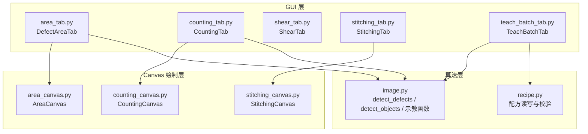
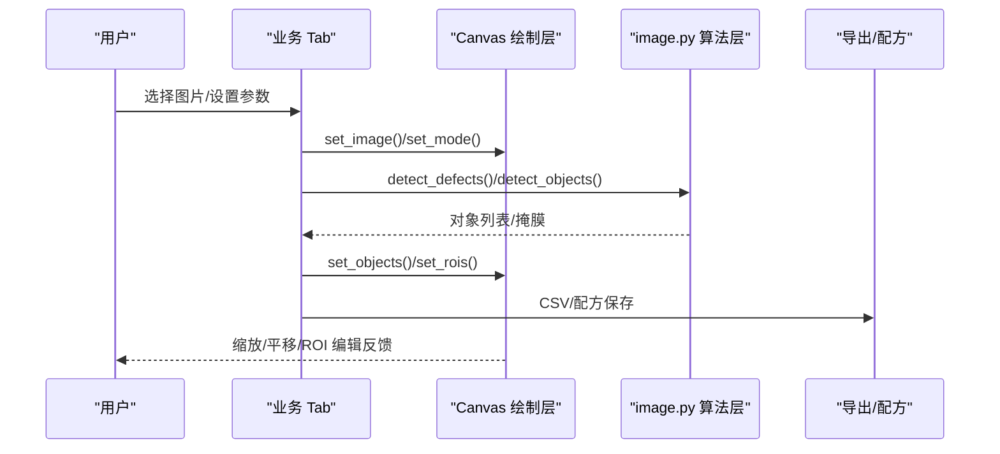
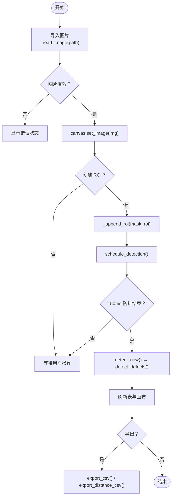
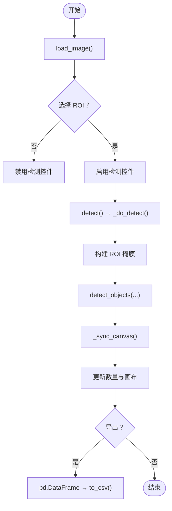
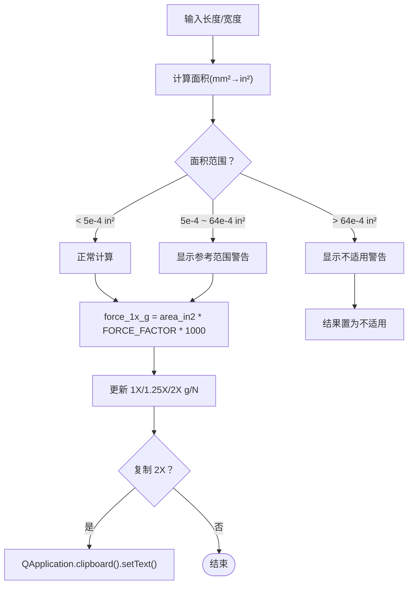
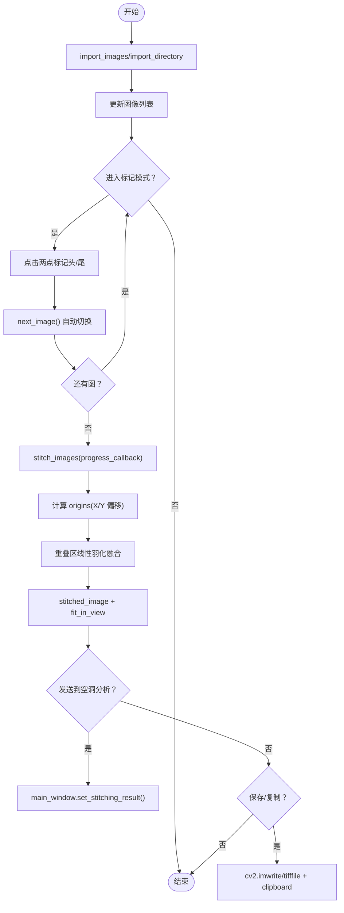
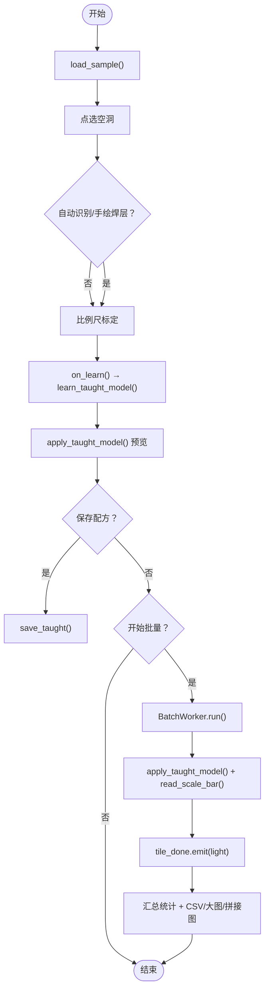
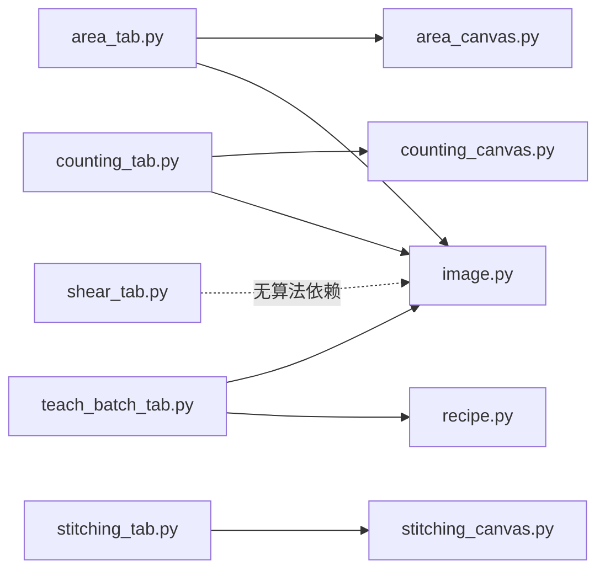

# 功能模块技术设计

<cite>
**本文引用的文件**   
- [README.md](file://README.md)
- [PROJECT_CONCEPTION.md](file://PROJECT_CONCEPTION.md)
- [.qoder/skills/roi-page-ui-design/SKILL.md](file://.qoder/skills/roi-page-ui-design/SKILL.md)
- [area_tab.py](file://area_tab.py)
- [area_canvas.py](file://area_canvas.py)
- [counting_tab.py](file://counting_tab.py)
- [counting_canvas.py](file://counting_canvas.py)
- [shear_tab.py](file://shear_tab.py)
- [stitching_tab.py](file://stitching_tab.py)
- [stitching_canvas.py](file://stitching_canvas.py)
- [teach_batch_tab.py](file://teach_batch_tab.py)
- [recipe.py](file://recipe.py)
- [image.py](file://image.py)
</cite>

## 目录
1. [引言](#引言)
2. [项目结构](#项目结构)
3. [核心组件](#核心组件)
4. [架构总览](#架构总览)
5. [详细模块分析](#详细模块分析)
6. [依赖关系分析](#依赖关系分析)
7. [性能注意事项](#性能注意事项)
8. [故障排查指南](#故障排查指南)
9. [结论](#结论)

## 引言
Aurascope 是面向微电子封装产线的半自动化视觉检测与数据分析桌面工具，采用 PyQt6 + OpenCV + NumPy + Pandas 的单机架构。本设计文档聚焦六个业务模块：缺陷面积多 ROI、物料计数、剪切力计算、图像拼接、示教/批量检测，并说明每个模块的职责边界、输入输出、UI 与 Canvas 协作方式、关键数据结构、与 image.py 的调用关系以及导出产物。

## 项目结构
仓库按「入口 → 主窗口 → Tab 页面 → Canvas 绘制层 → 算法层 image.py → 配方/导出」分层组织。本次范围覆盖以下文件：
- 缺陷面积多 ROI：area_tab.py / area_canvas.py
- 物料计数：counting_tab.py / counting_canvas.py
- 剪切力计算：shear_tab.py
- 图像拼接：stitching_tab.py / stitching_canvas.py
- 示教/批量检测：teach_batch_tab.py + recipe.py
- 通用算法层：image.py

**图示来源** 
- [area_tab.py:110-150](file://area_tab.py#L110-L150)
- [area_canvas.py:85-134](file://area_canvas.py#L85-L134)
- [counting_tab.py:19-52](file://counting_tab.py#L19-L52)
- [counting_canvas.py:10-43](file://counting_canvas.py#L10-L43)
- [stitching_tab.py:26-47](file://stitching_tab.py#L26-L47)
- [stitching_canvas.py:22-58](file://stitching_canvas.py#L22-L58)
- [teach_batch_tab.py:201-238](file://teach_batch_tab.py#L201-L238)
- [image.py:425-632](file://image.py#L425-L632)
- [recipe.py:137-258](file://recipe.py#L137-L258)

**章节来源**
- [README.md:42-64](file://README.md#L42-L64)
- [PROJECT_CONCEPTION.md:77-108](file://PROJECT_CONCEPTION.md#L77-L108)

## 核心组件
- DefectAreaTab（area_tab.py）：负责图片加载、ROI 管理、阈值/Otsu、最小面积、标定、距离测量、批量检测队列、CSV 导出；通过 AreaCanvas 渲染 ROI、缺陷、测距线、标定线。
- CountingTab（counting_tab.py）：负责蓝膜物料计数参数、ROI 框选、形态学去噪、距离峰值计数、手动增删、CSV 导出；通过 CountingCanvas 渲染对象轮廓与编号。
- ShearTab（shear_tab.py）：纯 UI 计算器，按 MIL-STD-883H Method 2019.9 计算芯片剪切力要求值，无图像算法依赖。
- StitchingTab（stitching_tab.py）：负责多图导入、水平线标记、拼接进度、结果发送到空洞分析、PNG/TIF 保存与剪贴板复制；由 StitchingCanvas 完成对齐融合。
- TeachBatchTab（teach_batch_tab.py）：完整示教流程与快速示教、批量检测线程、结果核对修正、汇总大图与金锡拼接图导出；依赖 recipe.py 管理示教配方。
- image.py：统一算法实现层，提供 detect_defects、detect_objects、Otsu、形态学、连通域、圆度、Canny 边缘验证、示教统计与阈值等函数。
- recipe.py：配方 JSON 读写、schema v1/v2 规范化、数值范围夹紧、示教模型字段校验。

**章节来源**
- [area_tab.py:110-150](file://area_tab.py#L110-L150)
- [counting_tab.py:19-52](file://counting_tab.py#L19-L52)
- [shear_tab.py:22-36](file://shear_tab.py#L22-L36)
- [stitching_tab.py:26-47](file://stitching_tab.py#L26-L47)
- [teach_batch_tab.py:201-238](file://teach_batch_tab.py#L201-L238)
- [image.py:425-632](file://image.py#L425-L632)
- [recipe.py:137-258](file://recipe.py#L137-L258)

## 架构总览
各模块遵循「GUI 层不得内联实现图像算法」的分层约定：Tab 负责交互与状态，Canvas 负责坐标变换与 QPainter 渲染，算法逻辑集中在 image.py，配方与导出由 recipe.py 或各自模块处理。

**图示来源**
- [area_tab.py:342-378](file://area_tab.py#L342-L378)
- [area_canvas.py:135-150](file://area_canvas.py#L135-L150)
- [image.py:425-488](file://image.py#L425-L488)
- [recipe.py:439-462](file://recipe.py#L439-L462)

## 详细模块分析

### 缺陷面积多 ROI（area_tab.py / area_canvas.py）
职责边界
- area_tab.py：图片解码与校验、ROI 添加/删除/清空、阈值/Otsu、最小面积、标定、距离测量、批量检测队列、CSV 导出、状态文案与侧栏布局。
- area_canvas.py：自绘原图、ROI 虚线/选中实线、缺陷填充与轮廓、测距线与约束徽标、标定线、文字标签、缩放锚点、右键平移、ESC 取消草稿。

输入输出
- 输入：图片路径、ROI 矩形或多边形、阈值、亮/暗缺陷开关、最小面积、标定长度与单位。
- 输出：ROI 列表、缺陷对象列表、距离测量记录、CSV 文件。

UI 与 Canvas 协作
- 左侧可滚动侧栏 + 右侧 AreaCanvas；按钮层级、折叠区块、表格列数、画布配色与线宽均受 SKILL.md 契约约束。
- 模式集合 none/rect/poly/calibrate/measure/distance_delete/add/delete；ESC 撤销草图并退出工具模式。
- 防抖：阈值/最小面积改动 150ms 防抖；拖动阈值只更新状态文案，松手才重跑；切换 ROI 时取消未执行防抖并把旧结果标记为待检测。

关键数据结构
- ROI：id、roi('rect'|'poly', data)、mask、params(threshold/bright/min_area)、objects、status(pending/active/error/manual_changed)、area_px。
- 缺陷对象：id、area_px、rect、cx/cy、points、mask。
- 距离测量：id、p1/p2、dist_px、constraint(h/v/自由)。

与 image.py 的调用关系
- 使用 detect_defects(gray, thresh_val, bright, min_area, roi_mask) 返回精确像素面积及 bbox 局部掩膜。
- 使用 otsu_threshold(gray_img, roi_mask) 对当前 ROI 自动计算阈值。
- 使用 polygon_to_mask(points, img_shape) 将多边形转为掩膜。

导出产物
- 缺陷面积 CSV：ROI编号、缺陷编号、像素面积、实际面积、面积单位、质心x_px、质心y_px、来源。
- 距离测量 CSV：序号、距离(单位)/px、起点/终点坐标、约束。

流程图

**图示来源**
- [area_tab.py:342-378](file://area_tab.py#L342-L378)
- [area_tab.py:659-683](file://area_tab.py#L659-L683)
- [area_tab.py:751-800](file://area_tab.py#L751-L800)
- [area_canvas.py:419-498](file://area_canvas.py#L419-L498)

参数校验规则
- 矩形 ROI：w/h > 5，裁剪到图像边界；多边形 ROI：至少 3 个顶点且面积非零。
- 标定线长度 ≥ 10px；实际长度必须 > 0，单位 ∈ {nm, µm, mm, cm, m}。
- 阈值 ∈ [0, 255]；最小面积 ∈ [1, 100000]。
- 距离测量需先完成标定；小于 7° 自动吸附水平或垂直。

异常处理
- 图片解码失败、TIF 维度/色彩类型不支持、16bit 归一化提示。
- 清空 ROI/停止检测前弹出确认对话框。
- 距离 CSV 导出使用临时文件 + os.replace 原子替换，失败清理临时文件。

性能注意事项
- 150ms 防抖避免频繁重算；批量检测队列顺序执行。
- mask_to_qimage 逐像素着色并 copy，避免依赖临时内存。
- 大图中 Otsu 仅在当前 ROI 上计算。

已知限制
- 滚轮缩放存在 Y 轴漂移问题（见架构总览中的已知问题），不要把现状写成正确设计。

**章节来源**
- [.qoder/skills/roi-page-ui-design/SKILL.md:10-18](file://.qoder/skills/roi-page-ui-design/SKILL.md#L10-L18)
- [.qoder/skills/roi-page-ui-design/SKILL.md:53-61](file://.qoder/skills/roi-page-ui-design/SKILL.md#L53-L61)
- [.qoder/skills/roi-page-ui-design/SKILL.md:97-130](file://.qoder/skills/roi-page-ui-design/SKILL.md#L97-L130)
- [area_tab.py:342-431](file://area_tab.py#L342-L431)
- [area_tab.py:561-590](file://area_tab.py#L561-L590)
- [area_tab.py:751-800](file://area_tab.py#L751-L800)
- [area_canvas.py:85-134](file://area_canvas.py#L85-L134)
- [area_canvas.py:332-340](file://area_canvas.py#L332-L340)
- [image.py:425-488](file://image.py#L425-L488)

### 物料计数（counting_tab.py / counting_canvas.py）
职责边界
- counting_tab.py：上传图片、ROI 框选（矩形/多边形）、二值化阈值/Otsu、最小面积、形态学去噪、距离峰值计数、手动添加/删除、恢复默认、CSV 导出。
- counting_canvas.py：绘制原图、ROI 预览、对象轮廓与编号、删除高亮、总数胶囊、右键平移、滚轮缩放。

输入输出
- 输入：图片、ROI、阈值、最小面积、形态学核大小/形状、是否启用距离峰值计数。
- 输出：对象列表（id、area_px、rect、cx/cy、points）、数量、CSV。

UI 与 Canvas 协作
- 左侧侧栏控件控制检测设置与手动编辑；右侧 CountingCanvas 实时渲染对象与 ROI。
- 工具按钮互斥管理 ROI 模式；添加/删除模式切换后更新 hover 索引。

关键数据结构
- 对象：id、area_px、rect、cx/cy、points。
- ROI：rect(x,y,w,h) 或 polygon(points)。

与 image.py 的调用关系
- 使用 detect_objects(gray, thresh_val, min_area, enhanced, clahe_enabled, morph_enabled, morph_kernel, morph_shape, min_roundness, edge_verify, invert, watershed_enabled, watershed_distance, roi_mask)。
- 使用 otsu_threshold(gray) 自动计算阈值。

导出产物
- 计数 CSV：编号、面积(像素)、中心X/Y、宽度、高度。

流程图

**图示来源**
- [counting_tab.py:181-197](file://counting_tab.py#L181-L197)
- [counting_tab.py:363-414](file://counting_tab.py#L363-L414)
- [counting_canvas.py:44-59](file://counting_canvas.py#L44-L59)
- [image.py:491-632](file://image.py#L491-L632)

参数校验规则
- ROI 矩形 w/h > 5；多边形闭合点击首点或双击完成。
- 阈值 ∈ [0, 255]；最小面积 ∈ [0, 100000]。
- 形态学核大小为奇数（偶数自动减 1）。
- 距离峰值计数最小间距 ∈ [3, 50]。

异常处理
- 图片读取失败弹出 QMessageBox 警告。
- 无数据导出时提示“没有数据可导出”。

性能注意事项
- 150ms 防抖自动重新检测；形态学开闭运算与 distanceTransform 峰值计数在较大图上可能耗时。

**章节来源**
- [counting_tab.py:181-197](file://counting_tab.py#L181-L197)
- [counting_tab.py:321-361](file://counting_tab.py#L321-L361)
- [counting_tab.py:363-447](file://counting_tab.py#L363-L447)
- [counting_canvas.py:77-185](file://counting_canvas.py#L77-L185)
- [image.py:491-632](file://image.py#L491-L632)

### 剪切力计算（shear_tab.py）
职责边界
- 纯 UI 计算器，不依赖图像算法；根据输入长宽计算面积，按 MIL-STD-883H Method 2019.9 给出 1X/1.25X/2X 力值（g/N），支持复制 2X 值。

输入输出
- 输入：芯片长度(mm)、宽度(mm)。
- 输出：面积(mm²/in²)、三个倍率下的力值、警告信息。

UI 与 Canvas 协作
- 左右双面板：左侧表单输入与结果卡片，右侧标准说明；使用 styles._C token 与 ui_components 工厂。

关键数据结构
- 结果映射：mult → (g_label, n_label)。
- 常量：MM2_PER_IN2=645.16、MAX_AREA_IN2=64e-4、WARN_AREA_IN2=5e-4、FORCE_FACTOR=0.04/0.0001。

与 image.py 的调用关系
- 无直接调用；纯数学计算。

导出产物
- 无文件导出；支持复制到系统剪贴板。

流程图

**图示来源**
- [shear_tab.py:205-254](file://shear_tab.py#L205-L254)
- [shear_tab.py:281-285](file://shear_tab.py#L281-L285)

参数校验规则
- 长度/宽度必须为正数；超过 64e-4 in² 显示不适用；超过 5e-4 in² 显示参考范围警告。

异常处理
- 输入解析失败清空结果；复制剪贴板失败不影响主流程。

性能注意事项
- 无图像处理，性能可忽略。

**章节来源**
- [shear_tab.py:22-36](file://shear_tab.py#L22-L36)
- [shear_tab.py:205-285](file://shear_tab.py#L205-L285)

### 图像拼接（stitching_tab.py / stitching_canvas.py）
职责边界
- stitching_tab.py：多图导入（单文件/文件夹）、图像列表管理、水平线标记模式、拼接进度、发送到空洞分析、PNG/TIF 保存、剪贴板复制。
- stitching_canvas.py：当前图像与拼接结果绘制、标记点拖拽、右键平移、滚轮缩放、X/Y 双轴对齐与重叠区羽化融合。

输入输出
- 输入：多张图像、每张图的标记线（头/尾点）。
- 输出：拼接结果图像、进度回调、发送到空洞分析。

UI 与 Canvas 协作
- 左侧侧栏步骤：导入 → 标记 → 拼接 → 导出；右侧 StitchingCanvas 显示当前图或拼接结果。
- 标记完成后自动切换到下一张图；全部标记完成提示并退出标记模式。

关键数据结构
- images：[{path, name, image}]。
- canvas.images：[{image, name, line_p1, line_p2, marked}]。
- stitched_image：uint8 BGR/灰度数组。

与 image.py 的调用关系
- 无直接调用；拼接逻辑在 stitching_canvas.stitch_images()。

导出产物
- PNG/TIF 文件；系统剪贴板图像。

流程图

**图示来源**
- [stitching_tab.py:160-217](file://stitching_tab.py#L160-L217)
- [stitching_tab.py:299-326](file://stitching_tab.py#L299-L326)
- [stitching_tab.py:329-363](file://stitching_tab.py#L329-L363)
- [stitching_canvas.py:297-406](file://stitching_canvas.py#L297-L406)

参数校验规则
- 至少两张图已标记才能拼接；标记点需为 QPointF 且在图像范围内。

异常处理
- tifffile 读取失败回退 cv2.imdecode；复制剪贴板失败返回原因。

性能注意事项
- 拼接过程使用 progress_callback 更新 QProgressDialog；羽化权重图只在重叠侧生成，避免整图淡出。

**章节来源**
- [stitching_tab.py:160-217](file://stitching_tab.py#L160-L217)
- [stitching_tab.py:299-363](file://stitching_tab.py#L299-L363)
- [stitching_canvas.py:297-406](file://stitching_canvas.py#L297-L406)

### 示教/批量检测（teach_batch_tab.py + recipe.py）
职责边界
- teach_batch_tab.py：样板图上传、点选空洞、自动识别焊层带/多边形手绘、比例尺标定、学习/预览/保存配方、批量检测线程、结果核对修正、汇总大图与金锡拼接图导出。
- recipe.py：配方 JSON 读写、schema v1/v2 规范化、示教模型 validate_taught、bar 模板图保存/加载。

输入输出
- 输入：样板图、空洞点选、焊层区域、比例尺、批量文件夹、示教配方。
- 输出：轻量批量结果、缩略图、CSV、汇总大图、金锡拼接图、示教配方 .taught.json。

UI 与 Canvas 协作
- 左侧堆叠面板：批量控制项与快速示教；右侧 ImageCanvas 用于示教与预览。
- 结果区横跨画布下方：缩略图胶片条、汇总表、单图核对与修正。

关键数据结构
- 示教模型：solder/background/void/band/scale_bar/diagnostics 等字段，经 validate_taught 规范化。
- 批量结果：ok/filename/path/warnings/thumb/px_per_um_used/bar_found 等轻量键。
- 编辑态：_edit_polygon/_edit_mask/_edit_voids/_baseline_voids。

与 image.py 的调用关系
- 使用 locate_solder_band、grab_local_dark_blob、learn_taught_model、apply_taught_model、read_scale_bar、resample_polygon_points、two_class_threshold、annotate_result、make_thumb、render_summary_sheet、render_solder_strip。
- 使用 polygon_to_mask、otsu_threshold。

导出产物
- CSV：每张图片的金锡面积、空洞数、空洞率、警告。
- 标注图：单张/全部导出。
- 汇总大图：vertical/horizontal/grid2/grid3 排版。
- 金锡拼接图：黑底红填充空洞。
- 示教配方：.taught.json + _bar.png。

流程图

**图示来源**
- [teach_batch_tab.py:778-800](file://teach_batch_tab.py#L778-L800)
- [teach_batch_tab.py:82-159](file://teach_batch_tab.py#L82-L159)
- [recipe.py:385-429](file://recipe.py#L385-L429)
- [recipe.py:439-462](file://recipe.py#L439-L462)

参数校验规则
- 示教模型字段经 validate_taught 夹紧；面积上下限自动档默认 0.02%/30%；深度容差 ∈ [-80, 80]。
- 批量线程中轻量结果剥离 band_mask/voids 以避免内存膨胀。

异常处理
- 图片读取失败记录 warnings；比例尺识别失败退回示范值；批量线程异常通过 failed 信号上报。

性能注意事项
- BatchWorker 顺序处理，进度信号与取消支持；缩略图按需生成；结果区仅传轻量数据。

**章节来源**
- [teach_batch_tab.py:82-159](file://teach_batch_tab.py#L82-L159)
- [teach_batch_tab.py:778-800](file://teach_batch_tab.py#L778-L800)
- [recipe.py:271-348](file://recipe.py#L271-L348)
- [recipe.py:385-429](file://recipe.py#L385-L429)
- [recipe.py:439-462](file://recipe.py#L439-L462)

## 依赖关系分析
- GUI 层依赖 Canvas 层进行渲染，Canvas 层不持有业务逻辑。
- Tab 层调用 image.py 的算法函数；teach_batch_tab.py 额外依赖 recipe.py。
- shear_tab.py 无外部算法依赖，纯 UI 计算。
- stitching_tab.py 与 stitching_canvas.py 内部耦合紧密，但不依赖 image.py。

**图示来源**
- [area_tab.py:21-28](file://area_tab.py#L21-L28)
- [counting_tab.py:11-16](file://counting_tab.py#L11-L16)
- [stitching_tab.py:16-23](file://stitching_tab.py#L16-L23)
- [teach_batch_tab.py:35-51](file://teach_batch_tab.py#L35-L51)
- [shear_tab.py:9-13](file://shear_tab.py#L9-L13)

**章节来源**
- [area_tab.py:21-28](file://area_tab.py#L21-L28)
- [counting_tab.py:11-16](file://counting_tab.py#L11-L16)
- [stitching_tab.py:16-23](file://stitching_tab.py#L16-L23)
- [teach_batch_tab.py:35-51](file://teach_batch_tab.py#L35-L51)
- [shear_tab.py:9-13](file://shear_tab.py#L9-L13)

## 性能注意事项
- 缺陷面积多 ROI：150ms 防抖、批量队列顺序执行、mask_to_qimage 拷贝避免共享内存。
- 物料计数：形态学开闭运算与 distanceTransform 峰值计数在大图上可能耗时；150ms 防抖减少重算。
- 图像拼接：progress_callback 更新进度；羽化权重图仅在重叠侧生成；STITCH_AUTO_REFINE 默认关闭以避免误改对齐。
- 示教/批量检测：BatchWorker 剥离 heavy keys（band_mask/voids），缩略图按需生成；比例尺识别失败退回示范值。
- 剪切力计算：无图像处理，性能可忽略。

[本节为通用指导，不直接分析具体文件]

## 故障排查指南
- 重复 detect_voids_local：main_window.py 内存在副本属已知技术债，现行行为以 image.py 为准，两份待合并。
- Canny 边缘校验静默失效：edge_map 未初始化导致 edge_verify 分支无效，需检查 enhanced 与 edge_verify 同时启用。
- chk_roi_overlay 被重复创建：可能导致 UI 状态不一致，需检查 area_tab.py 中复用的辅助控件。
- 滚轮缩放 Y 漂移：area_canvas.py 的 wheelEvent 存在 Y 轴漂移已知问题，不要把现状视为正确设计。
- select_for_local 为死代码：无 UI 入口，不影响现行行为。
- 大图增强检测无进度提示：image.py 中 _pump_events 仅在循环中每 10 次调用，长时间任务需补充进度反馈。

**章节来源**
- [image.py:228-233](file://image.py#L228-L233)
- [image.py:366-370](file://image.py#L366-L370)
- [area_canvas.py:332-340](file://area_canvas.py#L332-L340)

## 结论
六个模块严格遵循「GUI 层 → Canvas 层 → 算法层 image.py → 配方/导出」的分层架构。缺陷面积多 ROI 与物料计数复用 image.py 的检测能力，剪切力计算为纯 UI 计算器，图像拼接独立于算法层，示教/批量检测通过 recipe.py 管理示教配方。文档明确了各模块的职责边界、输入输出、UI 与 Canvas 协作、关键数据结构、参数校验、异常处理与性能注意事项，并为后续扩展与维护提供了可追溯的依据。