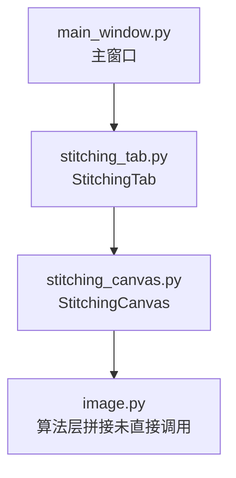
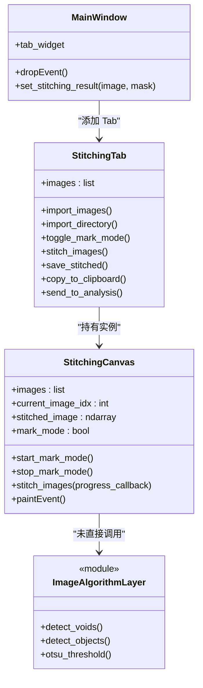
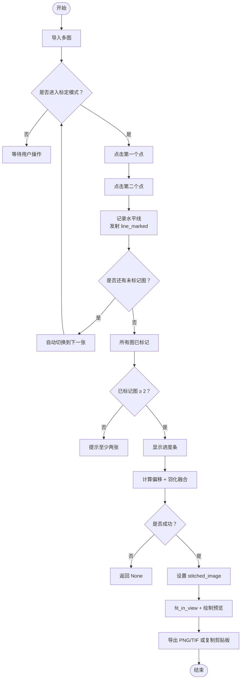
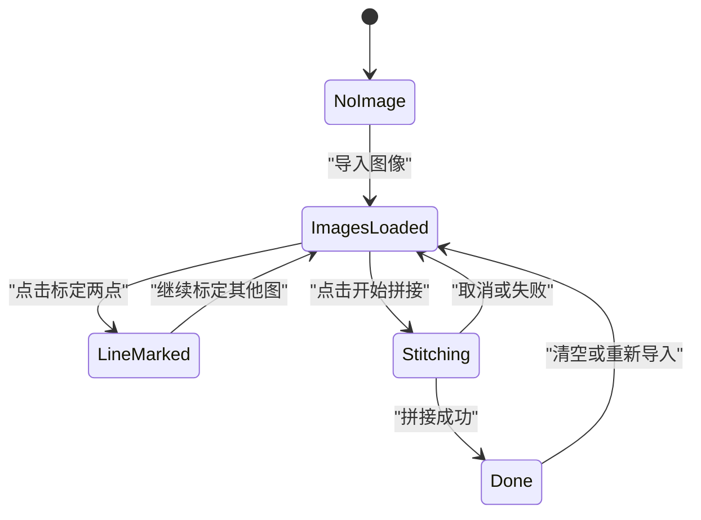
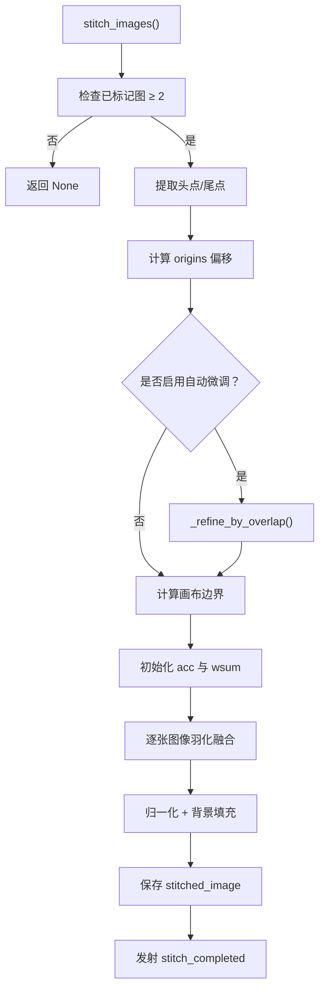
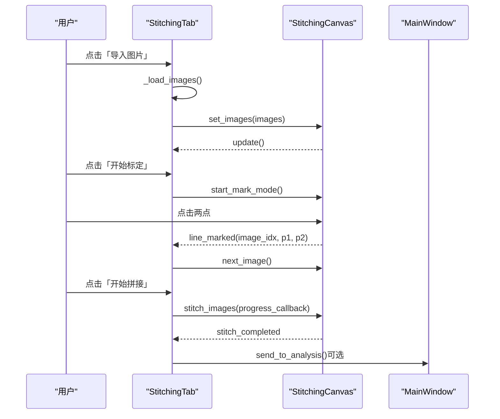

# 图像拼接模块

<cite>
**本文引用的文件**   
- [stitching_tab.py](file://stitching_tab.py)
- [stitching_canvas.py](file://stitching_canvas.py)
- [main_window.py](file://main_window.py)
- [image.py](file://image.py)
- [README.md](file://README.md)
</cite>

## 目录
1. [引言](#引言)
2. [项目结构](#项目结构)
3. [核心组件](#核心组件)
4. [架构总览](#架构总览)
5. [详细组件分析](#详细组件分析)
6. [依赖关系分析](#依赖关系分析)
7. [性能注意事项](#性能注意事项)
8. [参数校验与异常处理](#参数校验与异常处理)
9. [导出产物与坐标约定](#导出产物与坐标约定)
10. [故障排查](#故障排查)
11. [结论](#结论)

## 引言
本技术设计文档聚焦 Aurascope 的「图像拼接」功能，覆盖 `stitching_tab.py`（UI 控制层）与 `stitching_canvas.py`（Canvas 绘制与拼接实现层）。该功能面向金锡焊料 X 光 / SEM 切片图：用户导入多张相邻切片，在每张图上点击金锡水平线两端完成标定，按顺序无缝拼接成大图，并支持 PNG/TIF 导出及剪贴板复制。

根据仓库 README 的项目定位，Aurascope 是 PyQt6 + OpenCV + NumPy + Pandas 的单机桌面应用；拼接模块遵循「GUI 层不内联算法」的分层约定：`stitching_tab.py` 负责 UI、列表与流程控制，`stitching_canvas.py` 负责缩略图浏览、标定交互、拼接计算与预览绘制。

**章节来源**
- [README.md:1-80](file://README.md#L1-L80)

## 项目结构
图像拼接相关代码位于仓库根目录的两个文件：

| 文件 | 职责 | 关键类/函数 |
|---|---|---|
| `stitching_tab.py` | 侧边栏 UI、图像导入、列表管理、标定模式切换、拼接按钮、进度条、导出与剪贴板、发送到空洞分析 | `StitchingTab` |
| `stitching_canvas.py` | 当前图像浏览、金锡水平线点击标定、点拖拽调整、缩放平移、拼接融合、结果绘制 | `StitchingCanvas` |
| `main_window.py` | 主窗口装配、拖入多图自动跳转至拼接 Tab、接收拼接结果 | `MainWindow.dropEvent`、`set_stitching_result` |
| `image.py` | 通用图像处理算法层；拼接模块未直接调用其拼接函数，但作为项目统一算法层存在 | `detect_voids`、`detect_objects`、`otsu_threshold` 等 |

**图表来源**
- [main_window.py:147-148](file://main_window.py#L147-L148)
- [main_window.py:342-343](file://main_window.py#L342-L343)
- [stitching_tab.py:23-43](file://stitching_tab.py#L23-L43)
- [stitching_canvas.py:22-27](file://stitching_canvas.py#L22-L27)

**章节来源**
- [stitching_tab.py:1-46](file://stitching_tab.py#L1-L46)
- [stitching_canvas.py:1-27](file://stitching_canvas.py#L1-L27)
- [main_window.py:147-148](file://main_window.py#L147-L148)
- [main_window.py:342-343](file://main_window.py#L342-L343)

## 核心组件
### StitchingTab：UI 与流程控制
`StitchingTab` 是图像拼接功能的入口控件，承担以下职责：

1. **图像导入**
   - 支持多选文件导入与文件夹批量导入。
   - 内部维护 `self.images`，元素为 `{path, name, image}`。
   - 读取 TIF/TIFF 优先使用 `tifffile`，失败回退到 `cv2.imdecode`。
   - 非 `uint8` 图像会归一化到 `[0, 255]` 再转 `uint8`。

2. **图像列表管理**
   - 使用 `QListWidget` 显示文件名。
   - 支持移除选中项、清空全部。
   - 列表变化时同步 `canvas.set_images()`。

3. **标定顺序控制**
   - 通过 `toggle_mark_mode()` 切换 Canvas 的 `mark_mode`。
   - 监听 `canvas.line_marked`，自动切换到下一张图。
   - 所有图标记完成后退出标定模式。

4. **拼接触发与进度**
   - `stitch_images()` 校验至少两张已标记图。
   - 创建 `QProgressDialog`，通过回调更新进度文本与百分比。
   - 调用 `canvas.stitch_images(progress_callback=...)`。

5. **导出与剪贴板**
   - `save_stitched()` 弹出保存对话框，默认文件名带时间戳。
   - TIF/TIFF 用 `tifffile.imwrite`，PNG 用 `cv2.imencode`。
   - 保存后尝试复制到剪贴板，提示成功或失败原因。
   - `copy_to_clipboard()` 将 BGR/灰度 NumPy 数组转为 `QImage` 写入系统剪贴板。

6. **发送到空洞分析**
   - 若已有拼接结果，调用 `main_window.set_stitching_result(image, None)` 并切换到空洞分析 Tab。

**章节来源**
- [stitching_tab.py:26-46](file://stitching_tab.py#L26-L46)
- [stitching_tab.py:48-135](file://stitching_tab.py#L48-L135)
- [stitching_tab.py:158-217](file://stitching_tab.py#L158-L217)
- [stitching_tab.py:219-260](file://stitching_tab.py#L219-L260)
- [stitching_tab.py:262-290](file://stitching_tab.py#L262-L290)
- [stitching_tab.py:297-325](file://stitching_tab.py#L297-L325)
- [stitching_tab.py:329-367](file://stitching_tab.py#L329-L367)
- [stitching_tab.py:371-381](file://stitching_tab.py#L371-L381)
- [stitching_tab.py:385-447](file://stitching_tab.py#L385-L447)

### StitchingCanvas：标定、预览与拼接
`StitchingCanvas` 继承自 `QWidget`，承担以下职责：

1. **多图缩略图浏览**
   - 维护 `self.images`，元素为 `{image, name, line_p1, line_p2, marked}`。
   - `current_image_idx` 表示当前显示图像。
   - 提供 `next_image()`、`prev_image()`、`set_current_image()`。

2. **金锡水平线点击标定**
   - `start_mark_mode()` / `stop_mark_mode()` 控制标定模式。
   - 左键点击记录两个点，构成水平线；第二个点确认后发射 `line_marked` 信号。
   - 非标定模式下可拖拽已标记的 p1/p2 点调整位置。

3. **缩放与平移**
   - 滚轮缩放，锚点为鼠标当前位置。
   - 右键拖拽平移。
   - `widget_to_img()` / `img_to_widget()` 实现屏幕坐标↔图像坐标转换。

4. **拼接预览绘制**
   - `paintEvent()` 优先绘制 `stitched_image`，否则绘制当前单图。
   - `_draw_stitched()` 将 BGR/灰度 NumPy 数组转为 `QImage` 并绘制。
   - 标注拼接尺寸与操作提示。

5. **拼接算法**
   - `stitch_images()` 按标记头尾点计算相对偏移，构建画布范围，逐张羽化融合。
   - 可选 `_refine_by_overlap()` 在重叠区做小范围互相关微调（默认关闭）。
   - 背景未覆盖区域填充深灰色 `STITCH_BG = 64`。

**章节来源**
- [stitching_canvas.py:22-72](file://stitching_canvas.py#L22-L72)
- [stitching_canvas.py:81-109](file://stitching_canvas.py#L81-L109)
- [stitching_canvas.py:111-140](file://stitching_canvas.py#L111-L140)
- [stitching_canvas.py:142-292](file://stitching_canvas.py#L142-L292)
- [stitching_canvas.py:294-403](file://stitching_canvas.py#L294-L403)
- [stitching_canvas.py:405-480](file://stitching_canvas.py#L405-L480)
- [stitching_canvas.py:482-601](file://stitching_canvas.py#L482-L601)

## 架构总览
图像拼接模块采用「Tab → Canvas → 算法」三层结构：

**图表来源**
- [main_window.py:147-148](file://main_window.py#L147-L148)
- [main_window.py:342-343](file://main_window.py#L342-L343)
- [stitching_tab.py:26-46](file://stitching_tab.py#L26-L46)
- [stitching_canvas.py:22-72](file://stitching_canvas.py#L22-L72)
- [image.py:1-11](file://image.py#L1-L11)

## 详细组件分析

### 数据流与状态机
图像拼接的核心数据流如下：

Canvas 的状态变化可抽象为以下状态机：

**图表来源**
- [stitching_tab.py:158-217](file://stitching_tab.py#L158-L217)
- [stitching_tab.py:297-325](file://stitching_tab.py#L297-L325)
- [stitching_tab.py:329-367](file://stitching_tab.py#L329-L367)
- [stitching_canvas.py:142-174](file://stitching_canvas.py#L142-L174)
- [stitching_canvas.py:294-403](file://stitching_canvas.py#L294-L403)

**章节来源**
- [stitching_tab.py:158-217](file://stitching_tab.py#L158-L217)
- [stitching_tab.py:297-325](file://stitching_tab.py#L297-L325)
- [stitching_tab.py:329-367](file://stitching_tab.py#L329-L367)
- [stitching_canvas.py:142-174](file://stitching_canvas.py#L142-L174)
- [stitching_canvas.py:294-403](file://stitching_canvas.py#L294-L403)

### 关键数据结构
| 字段 | 所属对象 | 类型 | 说明 |
|---|---|---|---|
| `image_list` | `StitchingTab.image_list` | `QListWidget` | 显示已导入图像的文件名 |
| `images` | `StitchingTab.images` | `list[dict]` | `{path, name, image}`，存储原始图像 |
| `images` | `StitchingCanvas.images` | `list[dict]` | `{image, name, line_p1, line_p2, marked}`，存储标定状态 |
| `horizontal_lines` | `StitchingCanvas.images[*]` | `tuple(QPointF, QPointF)` | 由 `line_p1`、`line_p2` 表示金锡水平线 |
| `stitch_order` | 隐含于 `StitchingCanvas.images` 顺序 | `list[int]` | 拼接顺序即 `images` 中已标记图的顺序 |
| `final_image` | `StitchingCanvas.stitched_image` | `numpy.ndarray` | 拼接结果，BGR `uint8` |
| `annotations` | 当前无持久化结构 | — | 界面仅绘制临时点，未形成独立标注对象 |

注意：
- `StitchingTab.images` 与 `StitchingCanvas.images` 是两个不同列表：前者用于 UI 列表和文件读取，后者用于 Canvas 标定与拼接。
- `horizontal_lines` 并非独立变量，而是分散在每个 Canvas 图像字典的 `line_p1`、`line_p2` 中。
- `stitch_order` 没有显式排序控件；拼接顺序即为 `images` 中已标记图的遍历顺序。
- `annotations` 目前不存在结构化存储；临时标记点保存在 `temp_points`，确认后写入 `line_p1`/`line_p2`。

**章节来源**
- [stitching_tab.py:29-32](file://stitching_tab.py#L29-L32)
- [stitching_tab.py:81-85](file://stitching_tab.py#L81-L85)
- [stitching_canvas.py:34-56](file://stitching_canvas.py#L34-L56)
- [stitching_canvas.py:58-72](file://stitching_canvas.py#L58-L72)
- [stitching_canvas.py:158-174](file://stitching_canvas.py#L158-L174)

### 拼接算法流程
`StitchingCanvas.stitch_images()` 的核心逻辑如下：

1. 过滤出已标记且 `line_p1` 不为空的图像。
2. 对每张图，按 x 坐标区分“头点”和“尾点”。
3. 计算原点偏移：第 i 张的尾点应与第 i+1 张的头点在画布上重合。
4. 可选启用 `_refine_by_overlap()` 进行重叠区互相关微调（默认关闭）。
5. 计算画布宽高，初始化累加数组 `acc` 与权重数组 `wsum`。
6. 逐张图像转换为 float32，计算左右重叠宽度，生成线性羽化权重。
7. 将加权像素累加到对应画布区域。
8. 归一化后填充未覆盖区域为深灰色背景。
9. 设置 `stitched_image`，调用 `fit_in_view()`，发射 `stitch_completed`。

**图表来源**
- [stitching_canvas.py:294-403](file://stitching_canvas.py#L294-L403)
- [stitching_canvas.py:405-480](file://stitching_canvas.py#L405-L480)

**章节来源**
- [stitching_canvas.py:294-403](file://stitching_canvas.py#L294-L403)
- [stitching_canvas.py:405-480](file://stitching_canvas.py#L405-L480)

### UI 与 Canvas 协作时序

**图表来源**
- [stitching_tab.py:158-217](file://stitching_tab.py#L158-L217)
- [stitching_tab.py:297-325](file://stitching_tab.py#L297-L325)
- [stitching_tab.py:329-367](file://stitching_tab.py#L329-L367)
- [stitching_canvas.py:81-109](file://stitching_canvas.py#L81-L109)
- [stitching_canvas.py:142-174](file://stitching_canvas.py#L142-L174)
- [stitching_canvas.py:294-403](file://stitching_canvas.py#L294-L403)

**章节来源**
- [stitching_tab.py:158-217](file://stitching_tab.py#L158-L217)
- [stitching_tab.py:297-325](file://stitching_tab.py#L297-L325)
- [stitching_tab.py:329-367](file://stitching_tab.py#L329-L367)
- [stitching_canvas.py:81-109](file://stitching_canvas.py#L81-L109)
- [stitching_canvas.py:142-174](file://stitching_canvas.py#L142-L174)
- [stitching_canvas.py:294-403](file://stitching_canvas.py#L294-L403)

## 依赖关系分析
### 模块间依赖
- `main_window.py` 导入 `StitchingTab`，将其加入 `tab_widget`。
- `main_window.py` 的 `dropEvent()` 在多张图片拖入时跳转到拼接 Tab 并调用 `add_images()`。
- `stitching_tab.py` 导入 `StitchingCanvas`，并在初始化时绑定 `empty_import`、`line_marked`、`stitch_completed` 信号。
- `stitching_canvas.py` 仅依赖 `ui_components.paint_empty_state`，不直接依赖 `image.py` 的拼接函数。
- `image.py` 是项目统一算法层，但拼接模块未调用其函数；空洞检测、物料计数等仍走 `image.py`。

**图表来源**
- [main_window.py:48](file://main_window.py#L48)
- [main_window.py:147-148](file://main_window.py#L147-L148)
- [main_window.py:342-343](file://main_window.py#L342-L343)
- [stitching_tab.py:16-23](file://stitching_tab.py#L16-L23)
- [stitching_canvas.py:9](file://stitching_canvas.py#L9)
- [image.py:1-11](file://image.py#L1-L11)

**章节来源**
- [main_window.py:48](file://main_window.py#L48)
- [main_window.py:147-148](file://main_window.py#L147-L148)
- [main_window.py:342-343](file://main_window.py#L342-L343)
- [stitching_tab.py:16-23](file://stitching_tab.py#L16-L23)
- [stitching_canvas.py:9](file://stitching_canvas.py#L9)
- [image.py:1-11](file://image.py#L1-L11)

## 性能注意事项
1. **大图拼接内存峰值**
   - 拼接过程中同时持有所有输入图像、float32 副本、累加数组 `acc`、权重数组 `wsum`、最终输出数组。
   - 若输入图为 N 张 H×W×3 图像，峰值内存约为 `(N + 3) × H × W × 4` 字节（含 float32 与 uint8 副本）。
   - 建议：避免一次性导入过多超大分辨率 SEM 切片；必要时先降采样预览。

2. **进度更新频率**
   - `stitch_images()` 在每张图片融合后调用 `progress_callback`，最多 N 次。
   - `StitchingTab.stitch_images()` 每次回调中调用 `QApplication.processEvents()`，保证进度条刷新。
   - 对于极大图，可考虑降低回调频率，例如每 5 张图更新一次。

3. **取消操作的中断机制**
   - 当前 `QProgressDialog` 支持“取消”，但 `stitch_images()` 未检查 `progress.wasCanceled()`。
   - 因此「取消」按钮仅关闭对话框，不会中断正在进行的融合循环。
   - 改进建议：在融合循环中加入取消检查，提前返回 `None`。

4. **自动微调开销**
   - `_refine_by_overlap()` 默认关闭；若启用，会在相邻重叠区做 ±span 范围的互相关搜索，复杂度随 span² 增长。
   - 当前 `span=24`，最坏情况约 `(49)² ≈ 2400` 次 patch 比较。

**章节来源**
- [stitching_canvas.py:349-396](file://stitching_canvas.py#L349-L396)
- [stitching_canvas.py:424-480](file://stitching_canvas.py#L424-L480)
- [stitching_tab.py:340-359](file://stitching_tab.py#L340-L359)

## 参数校验与异常处理
### 参数校验规则
| 场景 | 校验规则 | 当前行为 |
|---|---|---|
| 导入图像 | 文件必须存在且可读 | `_read_image()` 返回 `None` 时跳过该文件 |
| 标定 | 至少两张图已标记 | `stitch_images()` 检查 `marked_count < 2` 并提示 |
| 水平线有效 | `line_p1` 不能为空 | `stitch_images()` 过滤 `im.get('line_p1') is not None` |
| 拼接输入 | 已标记图数量 ≥ 2 | 少于 2 张返回 `None` |
| 导出 | 必须有拼接结果 | `save_stitched()` 与 `copy_to_clipboard()` 均检查 `stitched_image is None` |

### 异常处理现状
| 异常类型 | 处理方式 | 风险 |
|---|---|---|
| TIF 读取失败 | 捕获异常后回退到 `cv2.imdecode` | 若两者都失败，返回 `None`，用户可能只看到“导入失败”而无明确提示 |
| 图像尺寸不一致 | 拼接允许不同尺寸，按偏移放置 | 若偏移过大，可能出现空白或溢出 |
| 拼接溢出 | 通过 `min_x/min_y/max_x/max_y` 计算画布大小 | 负偏移被纳入画布，理论上不会截断，但可能产生极大画布 |
| 剪贴板不可用 | 返回 `(False, '剪贴板不可用')` | 不影响落盘导出 |
| 拼接失败 | 返回 `None`，不设置 `stitched_image` | UI 保持上次状态，需用户重新标定或导入 |

### 已知限制
- 当前未实现真正的「取消中断」：进度条可关闭，但融合循环继续执行。
- 未对输入图像尺寸一致性做强制校验；极端情况下可能产生异常大的画布。
- 未对 `horizontal_lines` 的水平性做几何校验（例如 y 差值阈值）。
- `annotations` 未持久化；关闭 Tab 后标定信息丢失。

**章节来源**
- [stitching_tab.py:197-217](file://stitching_tab.py#L197-L217)
- [stitching_tab.py:219-260](file://stitching_tab.py#L219-L260)
- [stitching_tab.py:329-367](file://stitching_tab.py#L329-L367)
- [stitching_tab.py:385-447](file://stitching_tab.py#L385-L447)
- [stitching_canvas.py:309-314](file://stitching_canvas.py#L309-L314)
- [stitching_canvas.py:349-396](file://stitching_canvas.py#L349-L396)

## 导出产物与坐标约定
### 导出格式
| 格式 | 实现方式 | 特点 |
|---|---|---|
| PNG | `cv2.imencode('.png', ...).tofile(path)` | 有损压缩，适合 PPT/Word 粘贴 |
| TIF/TIFF | `tifffile.imwrite(path, image)` | 无损或低损，保留更高精度 |

### 分辨率保留策略
- 拼接结果 `stitched_image` 为 `uint8` BGR 数组。
- PNG 导出直接编码，不额外缩放。
- TIF 导出直接写入，不额外缩放。
- 剪贴板复制时转换为 RGB `QImage.Format_RGB888`，尺寸不变。

### 坐标标注约定
- 图像坐标原点在左上角，x 向右增加，y 向下增加。
- 标定点 `line_p1`、`line_p2` 以 `QPointF(x, y)` 存储。
- 拼接画布坐标系以 `min_x/min_y` 为左上角，正方向向右/向下。
- 当前未导出标注坐标；若需后续分析，应扩展 `annotations` 结构，记录每张图在原图中的偏移。

**章节来源**
- [stitching_tab.py:385-447](file://stitching_tab.py#L385-L447)
- [stitching_canvas.py:349-396](file://stitching_canvas.py#L349-L396)
- [stitching_canvas.py:497-520](file://stitching_canvas.py#L497-L520)

## 故障排查
| 现象 | 可能原因 | 排查步骤 |
|---|---|---|
| 导入 TIF 失败 | `tifffile` 缺失或文件损坏 | 检查控制台打印的 `tifffile 读取失败` 日志 |
| 无法开始拼接 | 已标记图不足 2 张 | 检查 Canvas 中绿色水平线数量 |
| 拼接结果出现大空白 | 标定头尾点顺序错误或偏移过大 | 检查 `line_p1.x()` 与 `line_p2.x()` 的大小关系 |
| 拼接后图片过大导致卡顿 | 输入图分辨率过高 | 先缩小预览，确认拼接效果后再全分辨率导出 |
| 点击「取消」后程序仍运行 | 未检查 `progress.wasCanceled()` | 在融合循环中加入取消判断 |
| 导出 PNG 成功但剪贴板失败 | 剪贴板服务不可用或权限问题 | 查看 `copy_to_clipboard()` 返回的失败原因 |
| 发送到空洞分析无效 | 主窗口未实现 `set_stitching_result` | 检查 `hasattr(main_window, 'set_stitching_result')` |

**章节来源**
- [stitching_tab.py:219-260](file://stitching_tab.py#L219-L260)
- [stitching_tab.py:329-367](file://stitching_tab.py#L329-L367)
- [stitching_tab.py:371-381](file://stitching_tab.py#L371-L381)
- [stitching_tab.py:385-447](file://stitching_tab.py#L385-L447)
- [stitching_canvas.py:309-314](file://stitching_canvas.py#L309-L314)

## 结论
图像拼接模块以 `stitching_tab.py` 为 UI 入口、`stitching_canvas.py` 为算法与绘制核心，实现了从多图导入、金锡水平线标定、顺序拼接、预览到导出的完整流程。其优势在于：

- 职责清晰：UI 控制与 Canvas 绘制分离。
- 交互友好：支持滚动浏览、点击标定、拖拽调整、滚轮缩放、右键平移。
- 拼接合理：按头尾点计算偏移，使用线性羽化融合，背景填充深灰色。
- 导出灵活：支持 PNG/TIF 落盘与剪贴板复制。

待改进点包括：

- 补充真正的取消中断机制。
- 增加水平线几何有效性校验。
- 增加图像尺寸一致性警告。
- 持久化 `annotations` 以便后续分析。
- 对超大图像增加内存峰值监控与分块处理。