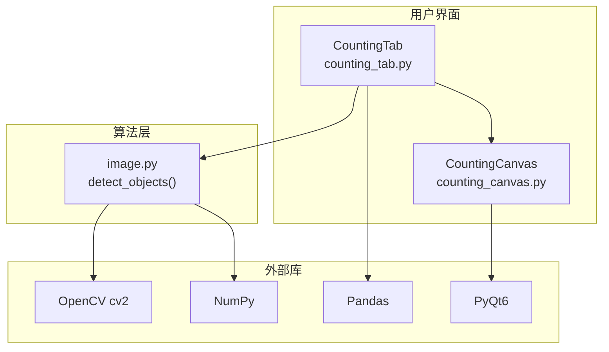
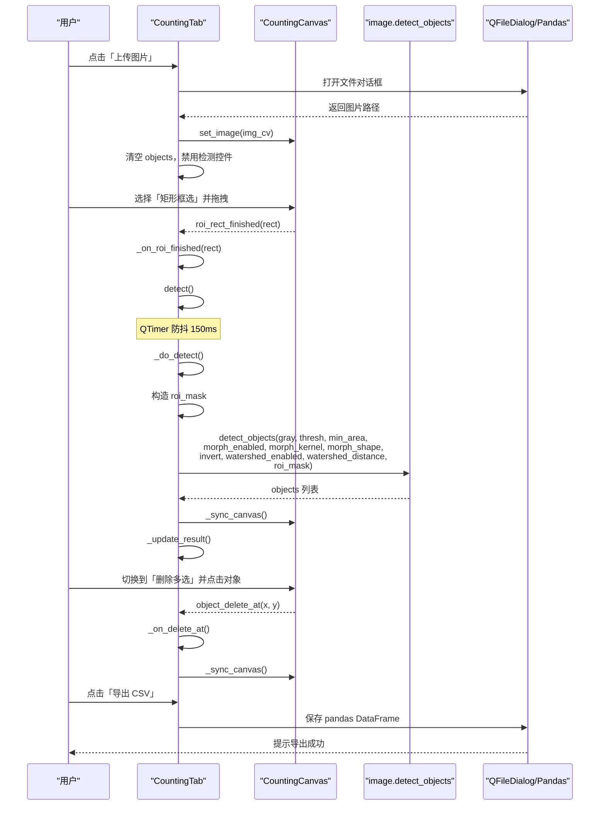
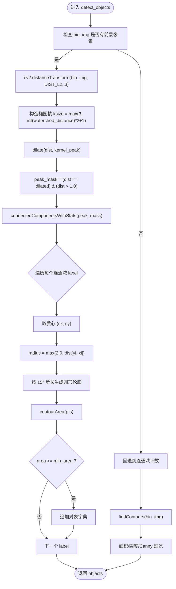
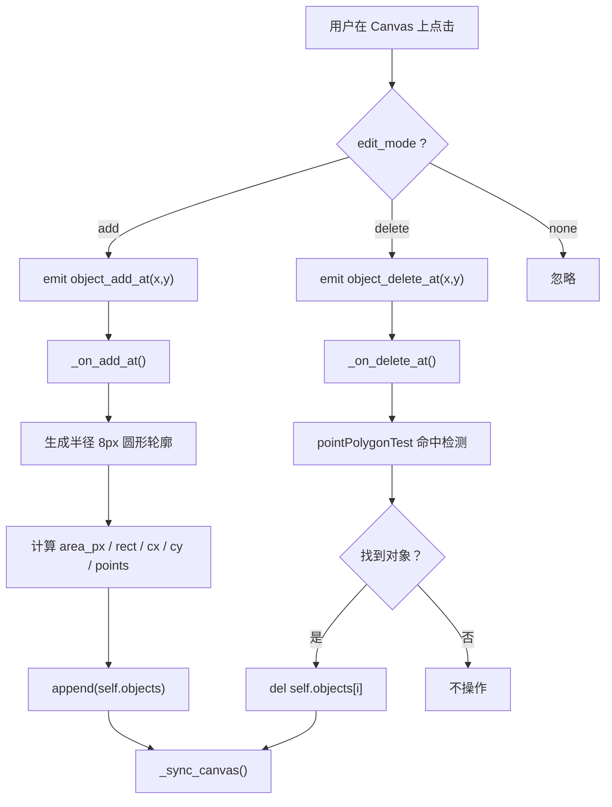
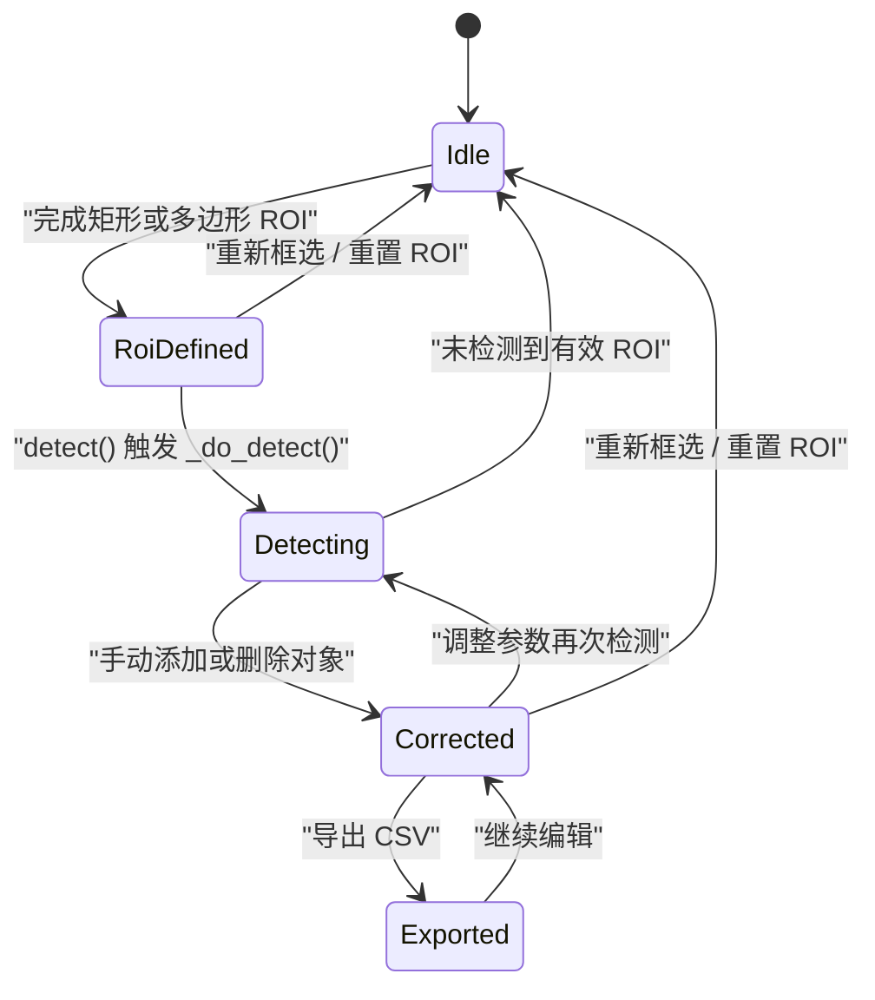
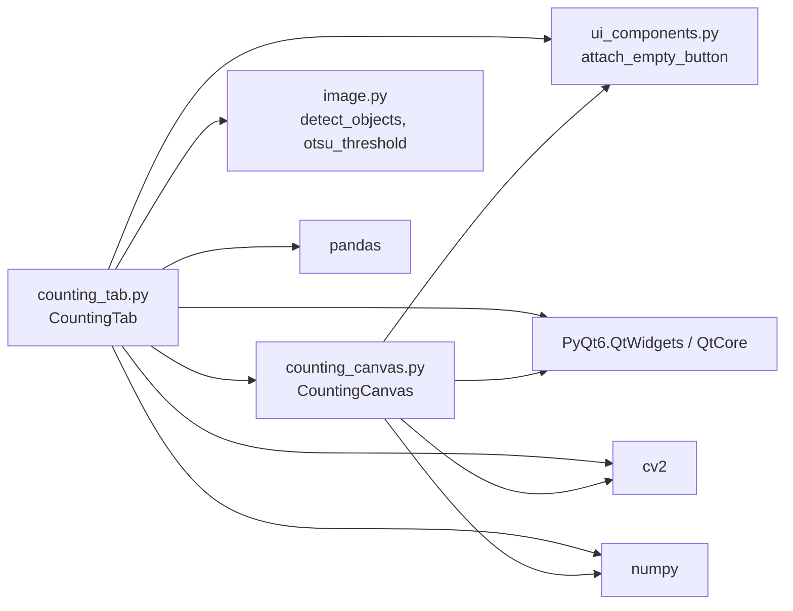

# 物料计数模块

<cite>
**本文引用的文件**   
- [counting_tab.py](file://counting_tab.py)
- [counting_canvas.py](file://counting_canvas.py)
- [image.py](file://image.py)
- [README.md](file://README.md)
</cite>

## 目录
1. [引言](#引言)
2. [项目结构](#项目结构)
3. [核心组件](#核心组件)
4. [架构总览](#架构总览)
5. [详细组件分析](#详细组件分析)
6. [依赖关系分析](#依赖关系分析)
7. [性能注意事项](#性能注意事项)
8. [参数校验规则](#参数校验规则)
9. [异常处理与故障排查](#异常处理与故障排查)
10. [已知限制](#已知限制)
11. [结论](#结论)

## 引言
本技术设计文档聚焦 Aurascope 的「物料计数」功能，覆盖 `counting_tab.py`（Tab 页面、参数面板、结果与导出）与 `counting_canvas.py`（图像画布、ROI 绘制、点选增删标记）。该功能面向蓝膜上 LD / Submount 等离散物料的自动计数：用户在图像上框选 ROI，调用 `image.detect_objects` 中的距离变换局部极大值路径进行离散物体计数；同时支持手动添加遗漏、删除误检对象，并在右侧面板实时显示数量，最终通过 CSV 导出编号、面积、中心坐标与包围盒。

根据 README 的功能说明，物料计数是 Aurascope 四大业务主线之一，与空洞分析、距离测量、剪切力计算并列；其 UI 入口位于 `main_window.py` 装配的 Tab 页中，算法实现集中在 `image.py`，GUI 层不得内联实现图像处理逻辑。

## 项目结构
物料计数相关代码采用「UI 层 → Canvas 层 → 算法层」分层组织：

| 层级 | 文件 | 职责 |
|---|---|---|
| UI 层 | `counting_tab.py` | 加载图片、构建侧边栏参数面板、绑定 Canvas 信号、触发检测、同步结果、导出 CSV |
| Canvas 层 | `counting_canvas.py` | 自绘 QWidget，负责图像缩放/平移、矩形/多边形 ROI 绘制、对象点选高亮、增删事件发射 |
| 算法层 | `image.py` | 提供 `detect_objects`，实现 CLAHE、二值化、形态学、连通域、distanceTransform 峰值计数、Canny 边缘校验等 |
| 外部依赖 | `ui_components.py`、`cv2`、`numpy`、`pandas`、`PyQt6` | 控件工厂、OpenCV、NumPy、Pandas、Qt GUI |



**图表来源**
- [counting_tab.py:19-17](file://counting_tab.py#L19-L17)
- [counting_canvas.py:10-15](file://counting_canvas.py#L10-L15)
- [image.py:491-507](file://image.py#L491-L507)

**章节来源**
- [README.md:7-14](file://README.md#L7-L14)
- [README.md:42-64](file://README.md#L42-L64)

## 核心组件
本节从职责边界、关键状态、数据结构与数据流四个维度说明两个核心类。

### CountingCanvas：图像绘制与交互层
`CountingCanvas` 继承自 `QWidget`，承担以下职责：

1. **图像显示**：将 OpenCV BGR 图像转换为 `QImage`，并维护 `scale`、`offset` 实现缩放与平移。
2. **ROI 绘制**：
   - 矩形 ROI：左键拖拽生成 `(x, y, w, h)`，释放时若宽高均大于 5 像素则发射 `roi_rect_finished`。
   - 多边形 ROI：左键逐点添加顶点，双击或点击首点闭合后发射 `roi_polygon_finished`。
3. **对象编辑**：
   - 删除模式：鼠标移动时用 `cv2.pointPolygonTest` 判断是否命中对象轮廓，高亮 `_hovered_idx`，点击发射 `object_delete_at`。
   - 添加模式：点击位置生成半径为 8 像素的圆形轮廓，作为新对象加入 `objects`。
4. **实时预览**：在 `paintEvent` 中绘制对象多边形、编号标签、ROI 边框、多边形绘制点与连线、总数浮标。

关键属性：
- `img_cv` / `img_qt`：原始图像与 Qt 图像缓存。
- `roi_mode`：`'none'` / `'rect'` / `'poly'`。
- `roi_rect` / `roi_polygon`：当前 ROI。
- `objects`：对象列表，元素含 `id`、`area_px`、`rect`、`cx`、`cy`、`points`。
- `edit_mode`：`'none'` / `'add'` / `'delete'`。
- `_hovered_idx`：删除模式下被高亮的对象索引。

关键信号：
- `roi_rect_finished(rect)`
- `roi_polygon_finished(points)`
- `object_delete_at(x, y)`
- `object_add_at(x, y)`
- `empty_import()`

**章节来源**
- [counting_canvas.py:10-42](file://counting_canvas.py#L10-L42)
- [counting_canvas.py:77-185](file://counting_canvas.py#L77-L185)
- [counting_canvas.py:187-270](file://counting_canvas.py#L187-L270)

### CountingTab：参数面板、检测流程与导出
`CountingTab` 继承自 `QWidget`，承担以下职责：

1. **图片导入**：通过 `QFileDialog` 读取图片，解码为 OpenCV BGR 数组，设置到 Canvas，清空已有对象。
2. **ROI 控制**：
   - 「矩形框选」/「多边形框选」按钮切换 `canvas.roi_mode`，并清空旧 ROI 与对象。
   - 「重新框选」重置所有状态并默认进入矩形 ROI 模式。
3. **检测参数面板**：
   - 二值化阈值滑块 + Otsu 自动阈值。
   - 最小面积 SpinBox。
   - 形态学去噪开关、核大小滑块、形状下拉（椭圆/矩形/十字）。
   - 距离峰值计数开关（watershed）、最小间距滑块。
4. **手动编辑**：
   - 「添加遗漏」切换 add 模式。
   - 「删除多选」切换 delete 模式。
5. **检测调度**：
   - 所有参数变更调用 `detect()`，内部使用 `QTimer` 单次触发，延迟 150ms 防抖。
   - `_do_detect` 构造 `roi_mask`，调用 `image.detect_objects`，同步 Canvas 与结果标签。
6. **CSV 导出**：遍历 `self.objects`，用 Pandas 写入编号、面积、中心 X/Y、宽度、高度。

关键属性：
- `img_cv`：当前图像。
- `objects`：检测结果列表。
- `min_area` / `invert` / `morph_enabled` / `morph_kernel` / `morph_shape` / `watershed_enabled` / `watershed_distance`。
- `_detect_timer`：防抖定时器。

**章节来源**
- [counting_tab.py:19-36](file://counting_tab.py#L19-L36)
- [counting_tab.py:53-179](file://counting_tab.py#L53-L179)
- [counting_tab.py:181-234](file://counting_tab.py#L181-L234)
- [counting_tab.py:236-287](file://counting_tab.py#L236-L287)
- [counting_tab.py:289-319](file://counting_tab.py#L289-L319)
- [counting_tab.py:321-361](file://counting_tab.py#L321-L361)
- [counting_tab.py:363-447](file://counting_tab.py#L363-L447)

## 架构总览
下图展示一次完整计数的时序：从导入图片到 ROI 定义、调参、自动计数、手动修正、导出 CSV。



**图表来源**
- [counting_tab.py:181-196](file://counting_tab.py#L181-L196)
- [counting_tab.py:289-296](file://counting_tab.py#L289-L296)
- [counting_tab.py:363-414](file://counting_tab.py#L363-L414)
- [counting_tab.py:416-447](file://counting_tab.py#L416-L447)
- [counting_canvas.py:77-169](file://counting_canvas.py#L77-L169)

## 详细组件分析

### 数据处理流程：ROI → 灰度 → 二值化 → 形态学 → distanceTransform 峰值计数
当启用「距离峰值计数」时，`image.detect_objects` 走如下分支：



**图表来源**
- [image.py:542-572](file://image.py#L542-L572)
- [image.py:574-632](file://image.py#L574-L632)

#### 关键数据结构
| 名称 | 类型 | 含义 | 生命周期 |
|---|---|---|---|
| `roi_mask` | `numpy.ndarray`，`(H,W)` uint8 | ROI 区域掩码，非 ROI 区域为 0，ROI 内为 255 | 每次 `_do_detect` 临时构造 |
| `bin_img` | `numpy.ndarray`，`(H,W)` uint8 | 二值化后的前景掩码 | `detect_objects` 内部变量 |
| `dist` | `numpy.ndarray`，`(H,W)` float32 | 距离变换结果 | watershed 分支内部变量 |
| `peak_mask` | `numpy.ndarray`，`(H,W)` uint8 | 局部极大值掩码 | watershed 分支内部变量 |
| `objects` | `list[dict]` | 检测结果列表 | `CountingTab.objects` 持久化 |
| `detected_objects` | — | 文档术语，对应实际代码中的 `objects` | 同上 |
| `manual_add/remove` 队列 | — | 当前实现为即时操作，无独立队列 | 见下方「手动修正模型」 |
| `counts` | — | 文档术语，对应 `len(objects)` 与 CSV 行集合 | 由 `objects` 派生 |

#### 手动修正模型
当前实现没有独立的 `manual_add_queue` / `manual_remove_queue`。手动操作直接修改 `CountingTab.objects`：

- **添加遗漏**：`_toggle_add` 切换 Canvas 的 `edit_mode='add'`；Canvas 发射 `object_add_at(x, y)`；`_on_add_at` 生成固定半径圆形轮廓，计算 `area_px`、`rect`、`cx`、`cy`、`points`，追加到 `self.objects`。
- **删除误检**：`_toggle_del` 切换 Canvas 的 `edit_mode='delete'`；Canvas 用 `pointPolygonTest` 高亮命中对象；点击后 `_on_delete_at` 反向遍历 `self.objects`，找到第一个包含点击点的多边形并删除。

因此，「手动增删修正」在当前实现中是**即时生效**，而非先入队再批量提交。若未来需要撤销/重做能力，应引入显式队列与命令历史。



**图表来源**
- [counting_canvas.py:83-89](file://counting_canvas.py#L83-L89)
- [counting_canvas.py:149-157](file://counting_canvas.py#L149-L157)
- [counting_tab.py:236-287](file://counting_tab.py#L236-L287)

**章节来源**
- [image.py:491-632](file://image.py#L491-L632)
- [counting_tab.py:236-287](file://counting_tab.py#L236-L287)
- [counting_tab.py:363-414](file://counting_tab.py#L363-L414)

### 状态机：idle / roi_defined / detecting / corrected
虽然代码中没有显式的枚举状态机，但 `CountingTab` 与 `CountingCanvas` 的组合行为可抽象为如下状态：



状态语义：

| 状态 | 条件 | 行为 |
|---|---|---|
| `Idle` | 无图片或未定义 ROI | 仅允许上传图片、选择 ROI 模式 |
| `RoiDefined` | `canvas.roi_rect` 或 `canvas.roi_polygon` 有效 | 启用检测控件，等待参数调整或自动触发检测 |
| `Detecting` | `_do_detect` 执行中 | 构造 `roi_mask`，调用 `detect_objects`，更新 `objects` |
| `Corrected` | 手动添加/删除对象后 | 结果已修正，可继续调参或导出 |
| `Exported` | CSV 已保存 | 保留当前 `objects`，允许继续编辑 |

注意：当前代码没有状态变量记录这些状态，而是通过 `canvas.roi_rect` / `canvas.roi_polygon` / `self.objects` / `self._detect_widgets.enabled` 等字段隐式表达。若需增强健壮性，建议引入显式状态枚举。

**图表来源**
- [counting_tab.py:181-196](file://counting_tab.py#L181-L196)
- [counting_tab.py:289-296](file://counting_tab.py#L289-L296)
- [counting_tab.py:363-414](file://counting_tab.py#L363-L414)

## 依赖关系分析



**图表来源**
- [counting_tab.py:1-16](file://counting_tab.py#L1-L16)
- [counting_canvas.py:1-8](file://counting_canvas.py#L1-L8)

### 耦合与内聚
- `CountingTab` 与 `CountingCanvas` 通过信号槽解耦：Canvas 只负责交互事件，Tab 负责业务状态与算法调用。
- `CountingTab` 直接依赖 `image.detect_objects`，符合「GUI 层不得内联实现图像算法」的设计约定。
- `CountingCanvas` 不依赖 `CountingTab`，仅通过信号向外暴露交互意图，内聚性良好。
- 潜在风险：`CountingTab` 直接读写 `canvas.objects`、`canvas.count`、`canvas.roi_mode` 等内部字段，属于较紧的耦合；若 Canvas 内部结构变化，Tab 需要同步修改。

**章节来源**
- [counting_tab.py:11-16](file://counting_tab.py#L11-L16)
- [counting_canvas.py:1-8](file://counting_canvas.py#L1-L8)

## 性能注意事项
1. **distanceTransform 在大图上的耗时**  
   `cv2.distanceTransform` 的时间复杂度与图像尺寸和前景像素分布相关。对于高分辨率工业图像，该步骤可能成为瓶颈。建议在后续优化中考虑：
   - 对大图先下采样再计数，最后映射回原图坐标。
   - 复用中间数组（如 `dist`、`peak_mask`），避免每帧重复分配。
   - 在长循环中调用 `image._pump_events()`，防止 GUI 假死。

2. **批量计数时的中间数组复用**  
   当前 `detect_objects` 每次调用都会创建 CLAHE、二值图、形态学结果、距离图等中间数组。若用于批量处理，应在调用方预分配缓冲区并传入，减少内存分配与 GC 压力。

3. **形态学核大小奇偶校验**  
   `slider_morph` 强制值为奇数（偶数时回退到 `val-1`），这是合理的，因为形态学核通常为奇数尺寸。

4. **Otsu 阈值计算**  
   `auto_otsu` 会转换灰度并调用 `otsu_threshold`，后者在 ROI 为空时返回 128。该兜底值合理，但应配合日志或提示，让用户知道阈值是自动计算的默认值。

5. **Canvas 缩放锚点问题**  
   `CountingCanvas.wheelEvent` 的缩放偏移计算存在 Y 轴漂移风险；仓库其他 Canvas 也存在类似问题。文档应明确：**这不是正确设计，而是已知缺陷**，不应作为稳定 API 依赖。

**章节来源**
- [image.py:527-572](file://image.py#L527-L572)
- [counting_tab.py:339-346](file://counting_tab.py#L339-L346)
- [counting_tab.py:321-328](file://counting_tab.py#L321-L328)
- [counting_canvas.py:176-185](file://counting_canvas.py#L176-L185)

## 参数校验规则
下表汇总当前 UI 层与算法层对关键参数的约束：

| 参数 | UI 约束 | 算法层约束 | 说明 |
|---|---|---|---|
| 二值化阈值 | 滑块范围 0–255 | `detect_objects` 直接使用 | 手动输入或 Otsu 自动设置 |
| 最小面积 | SpinBox 范围 0–100000 px² | `detect_objects` 中 `area < min_area` 跳过 | 单位是像素面积 |
| 形态学核大小 | 滑块 1–15，步进 2 | `morph_kernel > 1` 才执行开运算 | 偶数值会被 UI 强制回退为奇数 |
| 形态学形状 | 下拉：椭圆/矩形/十字 | 映射到 `cv2.MORPH_ELLIPSE` / `MORPH_RECT` / `MORPH_CROSS` | 影响开运算核形状 |
| 距离峰值计数开关 | 复选框 | `watershed_enabled` 控制分支 | 关闭时走连通域路径 |
| 最小间距 | 滑块 3–50，默认 10 | `ksize = max(3, int(watershed_distance)*2+1)` | 越大越保守，峰值越少 |
| ROI 有效性 | Canvas 要求矩形宽高 > 5 | `_do_detect` 检查 `roi_rect[2]>5 and roi_rect[3]>5` | 无效 ROI 清空对象并返回 |
| 图像有效性 | `cv2.imdecode` 返回 None 时弹窗 | 无额外校验 | 无法读取图片时中止导入 |

**章节来源**
- [counting_tab.py:96-145](file://counting_tab.py#L96-L145)
- [counting_tab.py:330-361](file://counting_tab.py#L330-L361)
- [counting_tab.py:373-388](file://counting_tab.py#L373-L388)
- [image.py:544-550](file://image.py#L544-L550)

## 异常处理与故障排查

### 常见异常场景
| 场景 | 当前行为 | 建议改进 |
|---|---|---|
| 图片无法读取 | 弹出「无法读取图片」警告，不设置 `img_cv` | 可补充错误原因（格式不支持、文件损坏） |
| ROI 为空或太小 | `_do_detect` 清空 `objects`，同步 Canvas，返回 | 可在 UI 提示「请先框选有效区域」 |
| 二值化后无前景像素 | `detect_objects` 连通域结果为空，返回空列表 | 提示用户调整阈值或形态学参数 |
| distanceTransform 无峰值 | `peak_mask` 全零，`connectedComponentsWithStats` 只返回背景，返回空列表 | 降低 `watershed_distance` 或增大阈值前景 |
| OpenCV 报错 | 未捕获，可能抛出异常中断 | 建议包裹 try/except，记录日志并提示用户 |
| 手动添加点在图像外 | `_on_add_at` 检查坐标范围，直接 return | 可提示「点击位置超出图像范围」 |
| 导出时无对象 | 弹出「没有数据可导出」信息框 | 行为合理 |

### 调试建议
1. **确认 ROI 是否有效**：检查 `canvas.roi_rect` 或 `canvas.roi_polygon` 是否为 None。
2. **确认二值化前景**：在 `_do_detect` 中可临时保存 `bin_img` 或 `roi_mask` 到磁盘，验证阈值是否合适。
3. **确认 watershed 分支**：若 `cv2.countNonZero(bin_img) == 0`，不会进入 distanceTransform 分支，应回退到连通域计数。
4. **确认对象坐标**：手动添加的对象使用固定半径圆形轮廓，`area_px` 来自 `contourArea`，可能与真实物料面积不一致，仅适合计数用途。
5. **确认 CSV 字段**：导出的 `rect` 是对象包围盒，`cx/cy` 是中心坐标，`area_px` 是轮廓面积。

**章节来源**
- [counting_tab.py:181-196](file://counting_tab.py#L181-L196)
- [counting_tab.py:255-287](file://counting_tab.py#L255-L287)
- [counting_tab.py:363-414](file://counting_tab.py#L363-L414)
- [counting_tab.py:425-447](file://counting_tab.py#L425-L447)

## 已知限制
本节列出与物料计数模块相关的已知限制，并结合源码说明影响与规避方法。

### 1. edge_map 未初始化导致 Canny 校验静默失效
在 `image.detect_objects` 中，Canny 边缘图仅在 `enhanced and edge_verify` 同时为真时计算：

```python
edge_map = None
if enhanced and edge_verify:
    blurred = cv2.GaussianBlur(processed, (5, 5), 1.0)
    edge_map = cv2.Canny(blurred, 30, 100)
```

随后在轮廓过滤中使用：

```python
if enhanced and edge_verify and edge_map is not None:
    ...
```

由于 `CountingTab.detect()` 调用 `detect_objects` 时传入 `edge_verify=False`，因此 `edge_map` 始终为 `None`，Canny 校验分支不会被执行。这意味着：

- **影响**：当前物料计数功能不会使用 Canny 边缘校验来剔除伪轮廓。
- **现状**：这是预期行为，因为 UI 没有暴露 Canny 开关。
- **规避方法**：若未来启用 Canny 校验，应确保：
  1. UI 暴露 `edge_verify` 开关。
  2. 在 `edge_verify=True` 时，保证 `processed` 已通过 CLAHE 或灰度转换，避免 `edge_map` 为 `None`。
  3. 对 `edge_thresh` 增加默认值与校验，避免阈值过小导致全部对象被剔除。

**章节来源**
- [image.py:576-580](file://image.py#L576-L580)
- [image.py:602-610](file://image.py#L602-L610)
- [counting_tab.py:395-412](file://counting_tab.py#L395-L412)

### 2. 手动修正无撤销/重做能力
当前手动添加/删除直接修改 `self.objects`，没有命令队列或历史栈。若用户误删对象，只能重新运行检测或再次手动添加。

**规避方法**：
- 引入 `manual_add_queue` / `manual_remove_queue`，并在确认后再应用。
- 或引入命令模式，记录 `AddObjectCommand` / `RemoveObjectCommand`，支持撤销/重做。

**章节来源**
- [counting_tab.py:236-287](file://counting_tab.py#L236-L287)

### 3. Canvas 缩放 Y 轴漂移
`CountingCanvas.wheelEvent` 的缩放偏移计算存在 Y 轴漂移问题，仓库其他 Canvas 也有同类问题。这会影响 ROI 绘制精度与对象定位体验。

**规避方法**：
- 修复缩放锚点计算，使缩放以鼠标位置为中心。
- 在修复前，提醒用户尽量使用较小缩放倍率进行精细 ROI 绘制。

**章节来源**
- [counting_canvas.py:176-185](file://counting_canvas.py#L176-L185)

### 4. 手动添加对象面积不准确
`_on_add_at` 使用固定半径 8 像素的圆形轮廓计算 `area_px`，该面积不代表真实物料面积，仅用于计数与导出占位。

**影响**：
- CSV 中的 `area_px` 对人工添加对象无物理意义。
- 若下游逻辑依赖面积阈值筛选，人工添加对象可能被误判。

**规避方法**：
- 在导出时标注 `is_manual=True`。
- 或在 UI 中提示用户「人工添加对象的面积为估算值」。

**章节来源**
- [counting_tab.py:255-287](file://counting_tab.py#L255-L287)

## 结论
物料计数模块以 `counting_tab.py` 为业务入口、`counting_canvas.py` 为交互绘制层、`image.py` 为算法实现层，形成了清晰的职责边界。用户通过 Canvas 框选 ROI，Tab 层负责参数调节与结果同步，最终通过 CSV 导出计数结果。

当前实现的关键优势包括：
- ROI 支持矩形与多边形两种模式。
- 支持距离变换局部极大值计数，适用于粘连物体的分离。
- 支持手动添加遗漏、删除误检对象。
- 参数面板提供阈值、形态学、watershed 等可调选项。

主要待改进点包括：
- 缺少显式状态机，状态由多个字段隐式表达。
- 手动修正无撤销/重做能力。
- Canny 边缘校验当前未启用，且若启用需完善 `edge_map` 初始化逻辑。
- Canvas 缩放存在 Y 轴漂移已知缺陷。
- 批量处理时未复用中间数组，distanceTransform 在大图上可能成为性能瓶颈。

建议在后续迭代中优先引入显式状态管理、手动操作队列、Canny 校验开关与参数校验，并对大图场景增加进度反馈与中间数组复用优化。