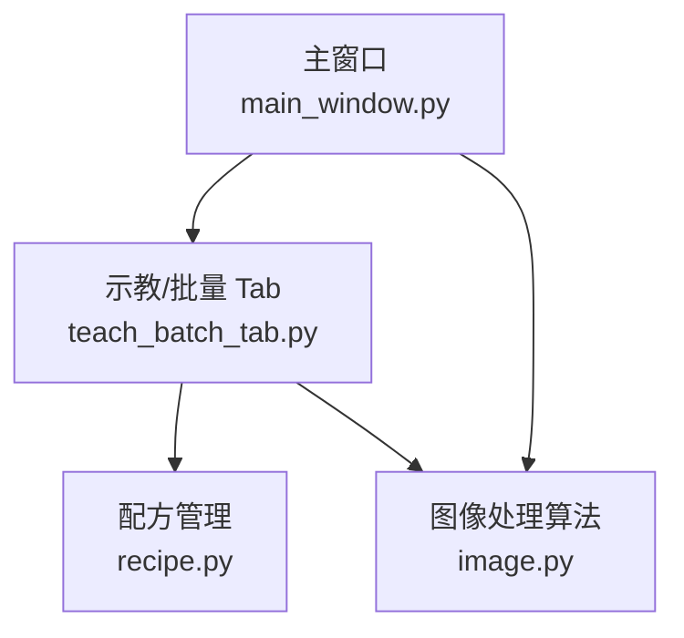
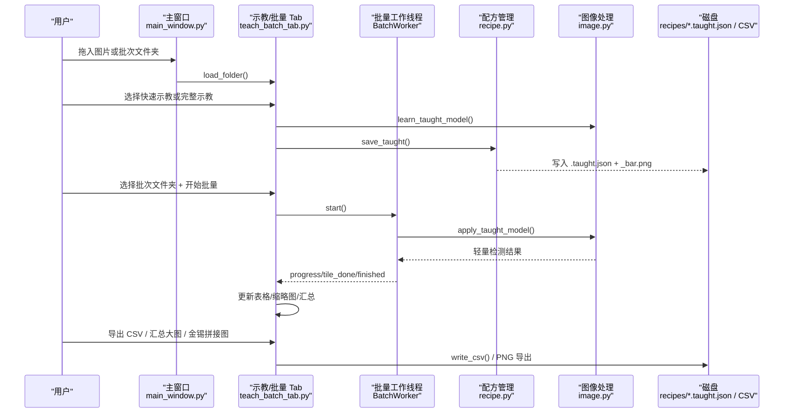
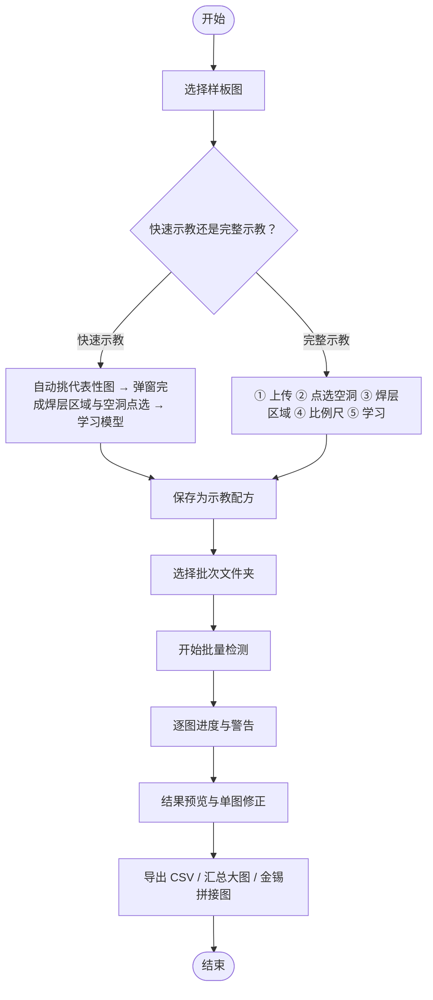
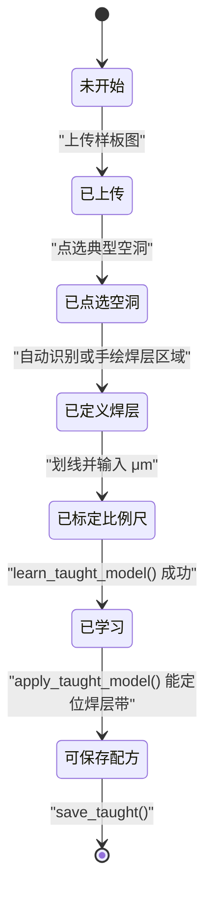
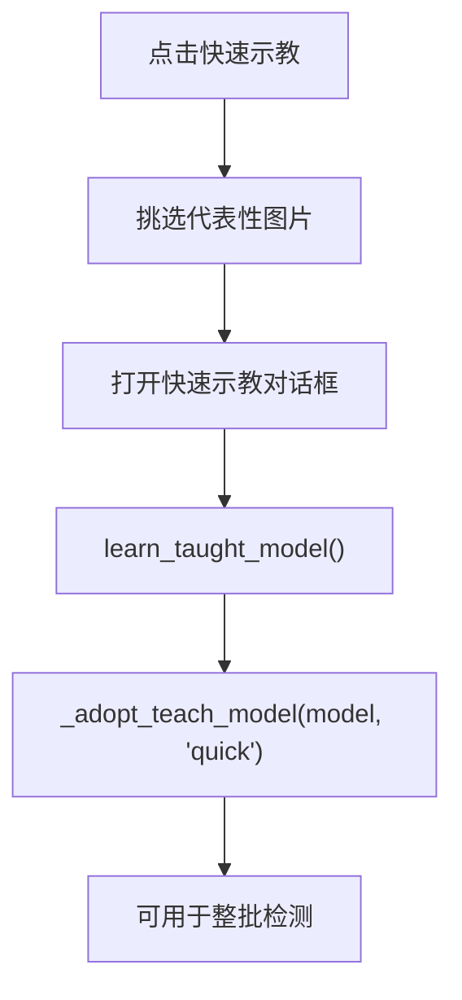
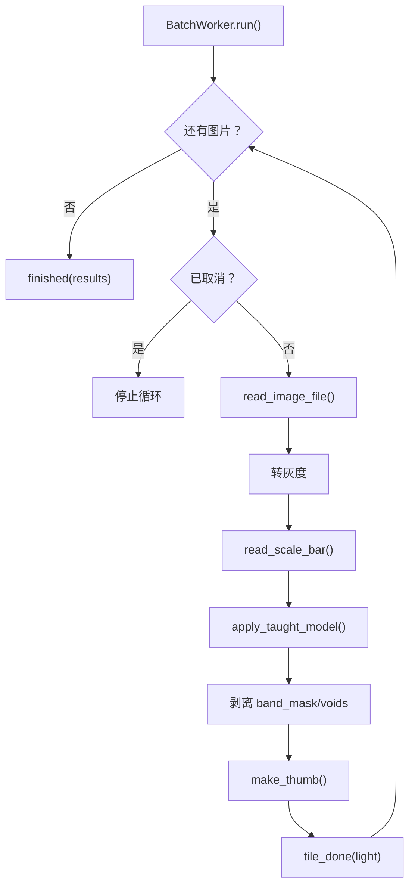
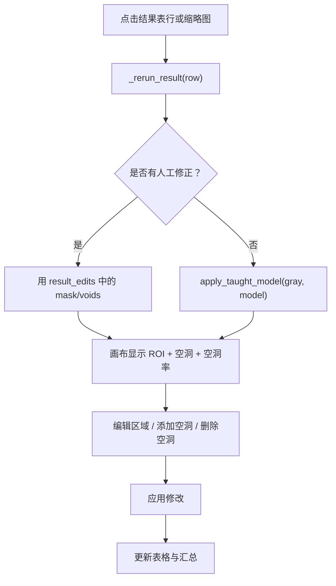
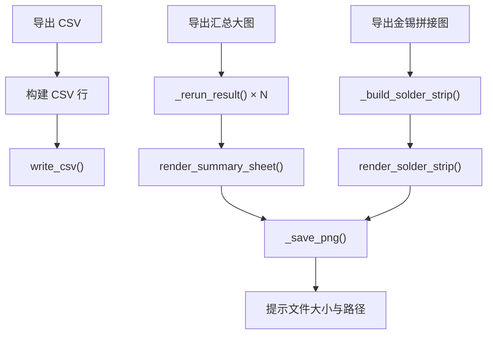
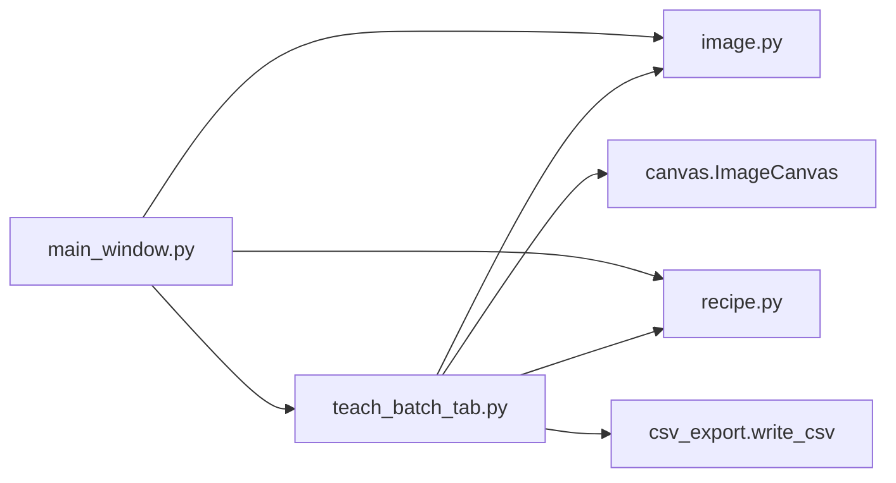

# 示教/批量检测模块

<cite>
**本文引用的文件**   
- [teach_batch_tab.py](file://teach_batch_tab.py)
- [recipe.py](file://recipe.py)
- [image.py](file://image.py)
- [main_window.py](file://main_window.py)
- [README.md](file://README.md)
- [PROJECT_CONCEPTION.md](file://PROJECT_CONCEPTION.md)
</cite>

## 目录
1. [引言](#引言)
2. [项目结构定位](#项目结构定位)
3. [核心组件与职责边界](#核心组件与职责边界)
4. [架构总览](#架构总览)
5. [关键数据结构](#关键数据结构)
6. [业务流程与状态机](#业务流程与状态机)
7. [详细组件分析](#详细组件分析)
8. [依赖关系分析](#依赖关系分析)
9. [参数校验规则](#参数校验规则)
10. [异常处理与恢复](#异常处理与恢复)
11. [性能与内存注意事项](#性能与内存注意事项)
12. [配方命名约定与扩展方式](#配方命名约定与扩展方式)
13. [故障排查指南](#故障排查指南)
14. [结论](#结论)

## 引言
本技术设计文档聚焦「示教/批量检测」功能，围绕 `teach_batch_tab.py` 与 `recipe.py`，说明两步快速示教、完整五步示教、配方保存/加载、批量空洞检测、进度与结果汇总、CSV 导出等能力。该模块是 Aurascope 的第七条业务主线之一：用户先通过样板图学习焊层带与空洞灰度模型，再对整批 SEM/X 光图片自动套用模型，输出空洞率、面积统计与可视化标注图。

根据项目整体设计，GUI 层不得内联实现图像算法；算法统一集中在 `image.py`。因此，本模块中 UI 仅负责交互、状态管理、批量调度与结果展示，实际空洞检测、焊层带定位、比例尺识别、示教模型学习与结果渲染均调用 `image.py` 中的函数。

**章节来源**
- [README.md:1-80](file://README.md#L1-L80)
- [PROJECT_CONCEPTION.md:77-108](file://PROJECT_CONCEPTION.md#L77-L108)

## 项目结构定位
在仓库根目录中，本模块由以下文件构成：
- `teach_batch_tab.py`：示教向导、快速示教、批量面板、进度条、取消按钮、结果预览与修正、汇总与导出。
- `recipe.py`：配方 JSON 的 schema 校验、默认值填充、读写、版本兼容、示教模型与参数型配方隔离、比例尺模板图读写。
- `image.py`：阈值、形态学、轮廓、两分类阈值、焊层带定位、空洞检测、示教模型学习、结果标注与汇总大图渲染。
- `main_window.py`：主窗口装配 Tab，并存在一份 `detect_voids_local` 副本（已知技术债）。

**图表来源**
- [main_window.py:32-51](file://main_window.py#L32-L51)
- [teach_batch_tab.py:34-51](file://teach_batch_tab.py#L34-L51)
- [recipe.py:1-10](file://recipe.py#L1-L10)
- [image.py:1-12](file://image.py#L1-L12)

**章节来源**
- [README.md:42-65](file://README.md#L42-L65)
- [PROJECT_CONCEPTION.md:77-108](file://PROJECT_CONCEPTION.md#L77-L108)

## 核心组件与职责边界
| 组件 | 主要职责 | 不负责 |
|---|---|---|
| `TeachBatchTab` | 样板图上传、点选空洞、焊层区域草拟/手绘/顶点编辑、比例尺标定、学习、保存配方、选择批次文件夹、启动批量、进度与取消、结果表格与缩略图、单图核对修正、汇总统计、CSV/汇总大图/金锡拼接图导出。 | 不直接实现空洞检测算法；不直接解析配方 schema。 |
| `BatchWorker` | 后台线程顺序遍历图片，读取图像、识别比例尺、应用示教模型、生成轻量结果、发射进度与单图结果信号。 | 不持有完整掩码/空洞点集常驻内存；不直接写 CSV。 |
| `recipe.py` | 配方根目录、显示名转文件名、v1 参数型配方与 v2/v3 示教模型区分、schema 校验、默认值填充、JSON 原子写入、示教模型配套比例尺模板图读写。 | 不绘制 UI；不执行空洞检测。 |
| `image.py` | 阈值、形态学、轮廓、两分类阈值、焊层带定位、空洞检测、示教模型学习、结果标注、汇总大图渲染、金锡拼接图渲染。 | 不管理 Qt 控件；不直接管理批量任务生命周期。 |
| `main_window.py` | 装配各 Tab，提供拖拽导入、最近打开、窗口状态保存；包含空洞分析侧边栏与局部阈值逻辑。 | 不应成为批量示教的二次算法实现入口。 |

**章节来源**
- [teach_batch_tab.py:82-159](file://teach_batch_tab.py#L82-L159)
- [teach_batch_tab.py:201-238](file://teach_batch_tab.py#L201-L238)
- [recipe.py:1-10](file://recipe.py#L1-L10)
- [image.py:747-751](file://image.py#L747-L751)
- [main_window.py:54-148](file://main_window.py#L54-L148)

## 架构总览
下图展示从用户操作到算法落盘与导出的端到端流程。

**图表来源**
- [main_window.py:314-344](file://main_window.py#L314-L344)
- [teach_batch_tab.py:1251-1288](file://teach_batch_tab.py#L1251-L1288)
- [teach_batch_tab.py:1401-1453](file://teach_batch_tab.py#L1401-L1453)
- [teach_batch_tab.py:107-159](file://teach_batch_tab.py#L107-L159)
- [recipe.py:385-404](file://recipe.py#L385-L404)

## 关键数据结构
本节列出模块运行时的核心数据对象及其作用。

| 名称 | 类型 | 含义 | 生命周期 |
|---|---|---|---|
| `current_recipe` | 字符串或 None | 当前下拉框选中的配方文件名（如 `xxx.taught.json`）；若使用快速/完整示教产生的临时模型，则可能跳过配方加载。 | 随下拉框变化；批量开始时用于加载配方。 |
| `model` | 字典或 None | 当前生效的示教模型，来源可以是完整示教、快速示教或已加载的配方。 | 示教完成后设置；切换批次时可能被清空。 |
| `_model_source` | `'teach'` / `'quick'` / None | 标记 `model` 来自完整示教还是快速示教。 | 与 `model` 同步更新。 |
| `step_state` | 隐式状态 | 五步示教是否完成：① 有灰度图、② 有点选空洞、③ 有 ROI 掩码、④ 有像素比、⑤ 有学习模型。 | 由 `_step_done()` 与步骤按钮共同维护。 |
| `batch_paths` | 列表 | 批次文件夹中按文件名排序的图片路径。 | 选择文件夹后赋值；换文件夹会重建。 |
| `batch_results` | 列表 | 批量轻量结果列表，每项含文件名、空洞数、空洞率、警告、可选缩略图等。 | 批量开始前清空；批量结束后保留用于导出。 |
| `progress` | `QProgressBar` | 进度条，显示 `idx/total`。 | 批量期间持续刷新。 |
| `results` | 结果区控件 | 汇总标签、缩略图胶片条、结果表格、导出按钮组。 | 批量模式下可见。 |
| `result_edits` | 字典 | 行号 → 人工修正快照，含 mask/polygon/voids/caliber。 | 单图核对修正期间累积。 |
| `_last_model` | 字典或 None | 本次批量使用的权威模型，供预览/导出标注图时按需重算。 | 批量开始后缓存。 |
| `_last_bar_template` | 灰度图或 None | 示教模型配套的比例尺模板图。 | 批量开始后缓存。 |

**章节来源**
- [teach_batch_tab.py:204-238](file://teach_batch_tab.py#L204-L238)
- [teach_batch_tab.py:718-733](file://teach_batch_tab.py#L718-L733)
- [teach_batch_tab.py:1401-1453](file://teach_batch_tab.py#L1401-L1453)
- [teach_batch_tab.py:1905-1945](file://teach_batch_tab.py#L1905-L1945)

## 业务流程与状态机
### 总体流程图

**图表来源**
- [teach_batch_tab.py:1-15](file://teach_batch_tab.py#L1-L15)
- [teach_batch_tab.py:1330-1383](file://teach_batch_tab.py#L1330-L1383)
- [teach_batch_tab.py:1401-1453](file://teach_batch_tab.py#L1401-L1453)
- [teach_batch_tab.py:1855-1901](file://teach_batch_tab.py#L1855-L1901)

### 示教步骤状态机
五步示教的状态由 `_step_done(i)` 判断，并由步骤按钮显示当前步与已完成步。

**图表来源**
- [teach_batch_tab.py:349-448](file://teach_batch_tab.py#L349-L448)
- [teach_batch_tab.py:718-733](file://teach_batch_tab.py#L718-L733)
- [teach_batch_tab.py:1126-1195](file://teach_batch_tab.py#L1126-L1195)

**章节来源**
- [teach_batch_tab.py:349-448](file://teach_batch_tab.py#L349-L448)
- [teach_batch_tab.py:718-733](file://teach_batch_tab.py#L718-L733)
- [teach_batch_tab.py:1126-1195](file://teach_batch_tab.py#L1126-L1195)

## 详细组件分析

### 示教向导与快速示教
- 完整示教提供五个步骤：样板图、点选空洞、焊层区域、比例尺、学习。
- 快速示教跳过手动五步，改为：选择批次 → 自动挑选代表性图片 → 弹出快速示教对话框 → 自动识别焊层区域 + 点选空洞 → 学习模型 → 可直接用于整批。
- 快速示教模型与完整示教模型统一写入 `self.model`，并通过 `_adopt_teach_model()` 记录来源 `_model_source`。
- 若批量前已有 `model`，`start_batch()` 优先使用该模型，不再强制要求从下拉框加载配方。

**图表来源**
- [teach_batch_tab.py:1292-1328](file://teach_batch_tab.py#L1292-L1328)
- [teach_batch_tab.py:1330-1383](file://teach_batch_tab.py#L1330-L1383)
- [teach_batch_tab.py:240-264](file://teach_batch_tab.py#L240-L264)

**章节来源**
- [teach_batch_tab.py:240-264](file://teach_batch_tab.py#L240-L264)
- [teach_batch_tab.py:1292-1383](file://teach_batch_tab.py#L1292-L1383)
- [teach_batch_tab.py:1401-1417](file://teach_batch_tab.py#L1401-L1417)

### 批量检测与进度
- `BatchWorker` 继承 `QThread`，顺序遍历 `image_paths`。
- 每张图片读取后转为灰度，调用 `read_scale_bar()` 和 `apply_taught_model()`。
- 结果剥离 `band_mask`、`voids` 等重型字段，只保留轻量结果，避免几十张 4K 图的掩码常驻内存。
- 缩略图按需生成；失败或警告信息写入 `warnings`。
- 支持取消：`cancel()` 设置 `_cancel`，`run()` 每张图片前检查。

**图表来源**
- [teach_batch_tab.py:82-159](file://teach_batch_tab.py#L82-L159)

**章节来源**
- [teach_batch_tab.py:82-159](file://teach_batch_tab.py#L82-L159)
- [teach_batch_tab.py:1401-1453](file://teach_batch_tab.py#L1401-L1453)
- [teach_batch_tab.py:1455-1463](file://teach_batch_tab.py#L1455-L1463)

### 结果预览与单图修正
- 批量完成后，结果区显示总空洞率、块均值、范围、空洞数范围、总面积与最大空洞。
- 缩略图胶片条支持点击放大；异常图描红边。
- 单图核对支持：
  - 编辑金锡区域多边形；
  - 添加空洞；
  - 删除空洞；
  - 应用修改或还原自动结果。
- 面积口径以“区域掩码”为准；如果用户拖动过顶点，口径变为“人工修正轮廓”，并在界面与 CSV 中标注。

**图表来源**
- [teach_batch_tab.py:1905-1945](file://teach_batch_tab.py#L1905-L1945)
- [teach_batch_tab.py:2165-2221](file://teach_batch_tab.py#L2165-L2221)
- [teach_batch_tab.py:2288-2296](file://teach_batch_tab.py#L2288-L2296)

**章节来源**
- [teach_batch_tab.py:1507-1546](file://teach_batch_tab.py#L1507-L1546)
- [teach_batch_tab.py:1655-1684](file://teach_batch_tab.py#L1655-L1684)
- [teach_batch_tab.py:1905-2000](file://teach_batch_tab.py#L1905-L2000)
- [teach_batch_tab.py:2165-2256](file://teach_batch_tab.py#L2165-L2256)

### 导出功能
- CSV 导出：遍历 `batch_results`，成功项写入空洞率、面积、阈值、过滤计数、比例尺识别情况、面积口径与警告；失败项写入文件名与警告；末尾追加汇总行。
- 汇总大图导出：重跑每张图，调用 `render_summary_sheet()`，支持纵向堆叠、横向一行、网格 2 列/3 列。
- 金锡拼接图导出：把每张图的金锡区域抠出、横向拼接，背景填黑，空洞红色填充；同时尝试复制到剪贴板。
- PNG 保存统一走 `_save_png()`，做临时文件、原子替换、文件头签名校验与 DLP/加密属性提示。

**图表来源**
- [teach_batch_tab.py:1695-1741](file://teach_batch_tab.py#L1695-L1741)
- [teach_batch_tab.py:1743-1801](file://teach_batch_tab.py#L1743-L1801)
- [teach_batch_tab.py:1855-1901](file://teach_batch_tab.py#L1855-L1901)
- [teach_batch_tab.py:2298-2394](file://teach_batch_tab.py#L2298-L2394)

**章节来源**
- [teach_batch_tab.py:1695-1801](file://teach_batch_tab.py#L1695-L1801)
- [teach_batch_tab.py:1855-1901](file://teach_batch_tab.py#L1855-L1901)
- [teach_batch_tab.py:2298-2394](file://teach_batch_tab.py#L2298-L2394)

## 依赖关系分析

**图表来源**
- [teach_batch_tab.py:34-51](file://teach_batch_tab.py#L34-L51)
- [main_window.py:32-51](file://main_window.py#L32-L51)

**章节来源**
- [teach_batch_tab.py:34-51](file://teach_batch_tab.py#L34-L51)
- [main_window.py:32-51](file://main_window.py#L32-L51)

## 参数校验规则
### 配方参数校验
`recipe.py` 对检测参数进行默认值填充与范围夹紧：
- `threshold`：0~255。
- `min_area`：0~10,000,000。
- `max_area`：0 或 None 表示无上限；非法值转为 0。
- `roi_erosion_px`：0~20。
- `clahe_clip_limit`：1.0~4.0。
- `min_roundness`：0.0~1.0。
- `edge_thresh`：0.0~1.0。
- `morph_kernel`：1~15。
- 布尔键：`enhanced`、`clahe_enabled`、`morph_enabled`、`edge_verify`。
- ROI 多边形至少 3 个点才视为有效多边形；否则回退为 `type='none'`。

### 示教模型校验
示教模型 `validate_taught()` 将旧 schema 迁移到稳定结构，包括：
- `solder`：median/std/p5/p95/threshold。
- `background`：median/std。
- `void`：threshold、min_area/max_area、depth_offset、roundness、taught_count 等。
- `band`：aspect、area_frac、open_kernel、min_thickness_px、bridge_win_px。
- `scale_bar`：horizontal/dark/length_px/real_um。
- `diagnostics`：solder_bg_separability、solder_void_separability。

### 示教阶段校验
- 样板图必须非空。
- 点选空洞至少 1 个，且主体需在焊层带内（重叠 ≥ 50%）。
- 焊层区域必须有 ROI 掩码。
- 比例尺划线长度需 ≥ 5 px，实际长度 > 0。
- 学习成功后需能在样板图上定位焊层带。

**章节来源**
- [recipe.py:22-50](file://recipe.py#L22-L50)
- [recipe.py:169-225](file://recipe.py#L169-L225)
- [recipe.py:271-348](file://recipe.py#L271-L348)
- [teach_batch_tab.py:1126-1195](file://teach_batch_tab.py#L1126-L1195)
- [teach_batch_tab.py:1066-1122](file://teach_batch_tab.py#L1066-L1122)

## 异常处理与恢复
| 场景 | 行为 | 恢复建议 |
|---|---|---|
| 配方解析失败 | `load_recipe()` 返回 None；批量启动时提示“配方读取失败或不是示教配方”。 | 重新选择配方或重新示教。 |
| 图片读取失败 | `read_image_file()` 返回 None；批量结果中写入 `ok=False` 与“图片读取失败”。 | 检查文件格式、路径、TIF 解码。 |
| 批量中断 | 用户点击取消后，`_batch_canceled=True`，线程提前退出；完成后提示“已取消，已完成 X/Y 张”。 | 查看结果区中已完成的图片，继续核对或重新运行。 |
| 批量异常 | `worker.failed` 信号弹出错误提示。 | 检查日志、图片格式、模型是否有效。 |
| 比例尺识别失败 | 自动识别失败时退回示范值，并在 warnings 中说明。 | 重新标定比例尺或调整示教模型。 |
| 汇总/拼接图导出失败 | `_save_png()` 记录错误原因，提示文件头签名不符、DLP 加密、无法解码等。 | 检查保存目录权限、杀毒软件/DLP 策略、扩展名。 |

**章节来源**
- [teach_batch_tab.py:115-120](file://teach_batch_tab.py#L115-L120)
- [teach_batch_tab.py:157-159](file://teach_batch_tab.py#L157-L159)
- [teach_batch_tab.py:1412-1417](file://teach_batch_tab.py#L1412-L1417)
- [teach_batch_tab.py:1455-1463](file://teach_batch_tab.py#L1455-L1463)
- [teach_batch_tab.py:1507-1546](file://teach_batch_tab.py#L1507-L1546)
- [teach_batch_tab.py:2298-2394](file://teach_batch_tab.py#L2298-L2394)

## 性能与内存注意事项
1. **批量任务分片处理**  
   `BatchWorker.run()` 逐张处理图片，每张图片独立读取、转换灰度、应用模型、发射轻量结果。没有显式 batch size 分片，但天然按图片粒度串行处理。

2. **内存释放**  
   批量结果中刻意剥离 `band_mask`、`voids` 等重型字段，避免几十张 4K 图的掩码常驻内存导致几百 MB 占用。需要叠加图时，通过 `_rerun_result()` 按需重算。

3. **取消后清理**  
   取消后 `_batch_canceled=True`，线程提前退出；UI 显示“已取消，已完成 X/Y 张”。结果区仍保留已生成的结果，允许用户继续核对。

4. **进度刷新**  
   `image.py` 内部长循环通过 `_pump_events()` 定期调用 `QApplication.processEvents()`，避免 GUI 卡死；`BatchWorker` 每张图片发射一次进度信号。

5. **大图增强检测**  
   代码注释指出大图增强检测可能存在进度提示不足的问题；当前批量线程通过轻量结果缓解内存压力，但重算叠加图时仍需注意 CPU 与内存峰值。

**章节来源**
- [teach_batch_tab.py:82-159](file://teach_batch_tab.py#L82-L159)
- [teach_batch_tab.py:1905-1945](file://teach_batch_tab.py#L1905-L1945)
- [image.py:14-25](file://image.py#L14-L25)
- [image.py:238-240](file://image.py#L238-L240)
- [image.py:375-377](file://image.py#L375-L377)

## 配方命名约定与扩展方式
### 文件命名约定
- 示教配方保存在 `recipes/` 目录下，文件名带 `.taught.json` 后缀，例如 `1-1.taught.json`、`2.taught.json`。
- 示教模型配套的比例尺模板图命名为 `<name>_bar.png`，例如 `1-1_bar.png`。
- 普通参数型配方使用 `.json` 后缀，与示教配方隔离命名空间，避免同名互相覆盖。

### 字段含义
- `schema_version`：配方 schema 版本。
- `type`：`taught` 表示示教模型；其他为参数型配方。
- `name`：配方显示名。
- `note`：备注，示例中会写入样板图文件名、点选数量等。
- `updated`：更新时间。
- `detection`：参数型配方的检测参数（阈值、形态学、CLAHE、圆度、边缘验证等）。
- `roi`：ROI 多边形、层阈值、顶点数。
- `px_per_um`：像素/微米。
- 示教模型额外包含 `solder`、`background`、`void`、`band`、`scale_bar`、`diagnostics`、`band_ref`、`band_tol` 等。

### 扩展方式
- 新增示教模型字段时，应在 `validate_taught()` 中提供默认值与范围夹紧，保持向后兼容。
- 新增检测参数时，应在 `DETECTION_DEFAULTS`、`_RANGES`、`validate_detection()` 中补充。
- 新增导出字段时，应在 `export_csv()` 与汇总统计中同步。
- 新增批量中间结果字段时，应评估是否属于 HEAVY_KEYS，避免常驻内存。

**章节来源**
- [recipe.py:69-120](file://recipe.py#L69-L120)
- [recipe.py:137-166](file://recipe.py#L137-L166)
- [recipe.py:228-258](file://recipe.py#L228-L258)
- [recipe.py:271-348](file://recipe.py#L271-L348)
- [recipe.py:385-429](file://recipe.py#L385-L429)
- [teach_batch_tab.py:1211-1235](file://teach_batch_tab.py#L1211-L1235)
- [teach_batch_tab.py:1855-1901](file://teach_batch_tab.py#L1855-L1901)

## 故障排查指南
| 现象 | 可能原因 | 排查步骤 |
|---|---|---|
| 批量开始后无进度 | 线程未启动、图片列表为空、或 UI 被阻塞。 | 检查 `batch_paths` 是否为空；确认 `start_batch()` 调用了 `worker.start()`。 |
| 批量中途取消后结果不完整 | 正常行为：取消即停。 | 查看结果区中已完成的图片；必要时重新运行。 |
| 某张图显示“处理失败” | 图片读取失败、模型无效、或 `apply_taught_model()` 返回失败。 | 检查 `warnings`；单独预览该图；确认配方是否匹配批次。 |
| 比例尺始终显示“未识别” | 示范比例尺模板缺失、划线太短、或自动识别失败。 | 重新标定比例尺；检查 `_bar.png` 是否存在。 |
| 汇总大图导出后打不开 | 文件头签名不符、DLP 加密、或外部程序改写。 | 查看 `_save_png()` 的错误提示；检查公司加密策略。 |
| 快速示教找不到代表性图 | 批次中可读图片太少，或全部读取失败。 | 检查文件夹中是否有 PNG/JPG/BMP/TIF；确认图片可读。 |
| 示教学习失败 | ROI 太小、点选空洞不在焊层带内、或两类灰度不可分。 | 检查 ROI 掩码、点选位置、学习诊断信息。 |

**章节来源**
- [teach_batch_tab.py:115-120](file://teach_batch_tab.py#L115-L120)
- [teach_batch_tab.py:1455-1463](file://teach_batch_tab.py#L1455-L1463)
- [teach_batch_tab.py:1507-1546](file://teach_batch_tab.py#L1507-L1546)
- [teach_batch_tab.py:2298-2394](file://teach_batch_tab.py#L2298-L2394)
- [teach_batch_tab.py:1126-1195](file://teach_batch_tab.py#L1126-L1195)

## 已知技术债与限制
1. **重复的 `detect_voids_local`**  
   `image.py` 与 `main_window.py` 中存在两份 `detect_voids_local` 相关实现。现行行为以 `image.py` 为准，`main_window.py` 内的副本属于已知技术债，待合并。

2. **Canny 边缘验证静默失效风险**  
   历史 handoff 清单指出 `edge_map` 未初始化可能导致 Canny 校验静默失效；当前 `image.py` 的实现中，`edge_map` 在增强且启用边缘验证时创建，但仍需注意分支条件与变量作用域。

3. **大图增强检测进度提示不足**  
   批量线程通过轻量结果缓解内存压力，但重算叠加图时可能缺少细粒度进度反馈。

4. **UI 控件复用问题**  
   历史清单还提到 `chk_roi_overlay` 被重复创建、`select_for_local` 为无 UI 入口的死代码、滚轮缩放 Y 轴漂移等问题；这些不属于本模块核心逻辑，但会影响整体体验。

**章节来源**
- [main_window.py:32-35](file://main_window.py#L32-L35)
- [main_window.py:1879-1906](file://main_window.py#L1879-L1906)
- [image.py:328-422](file://image.py#L328-L422)
- [image.py:228-234](file://image.py#L228-L234)

## 结论
`teach_batch_tab.py` 与 `recipe.py` 共同构成了 Aurascope 的示教/批量检测闭环：前者负责用户交互、示教向导、批量调度与结果呈现，后者负责配方 schema、默认值、版本兼容与持久化。算法层统一收敛于 `image.py`，保证空洞检测、焊层带定位、示教模型学习与结果渲染的可测试性与一致性。

在实际使用中，推荐优先使用“快速示教（两步）”：选择批次 → 自动挑代表性图 → 弹窗完成焊层区域与空洞点选 → 学习模型 → 直接批量。只有在快速示教不适用时，才进入完整五步示教。批量完成后，务必通过结果区逐张核对，必要时进行单图修正，最后导出 CSV 与汇总大图作为报告依据。