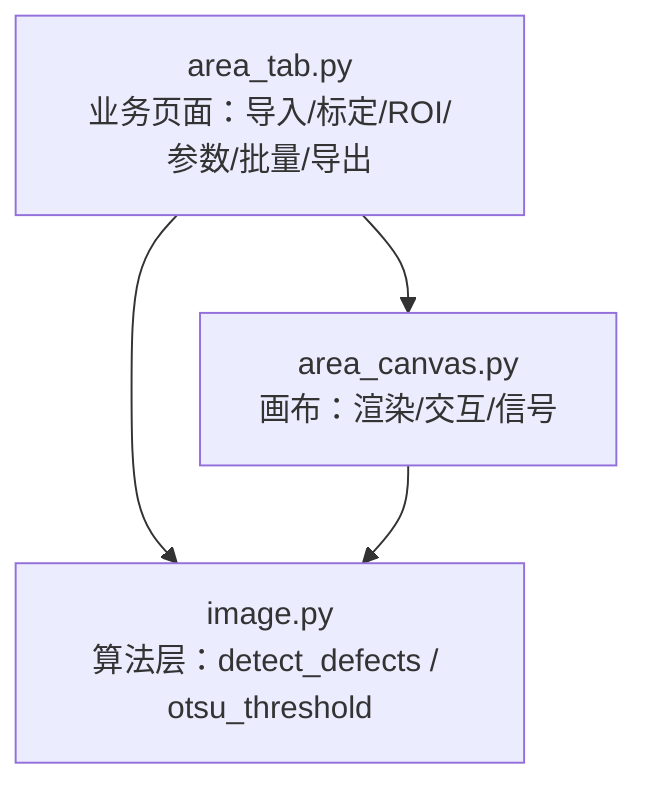
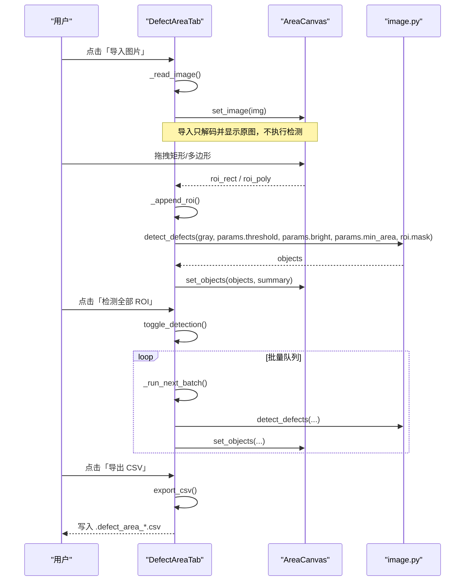
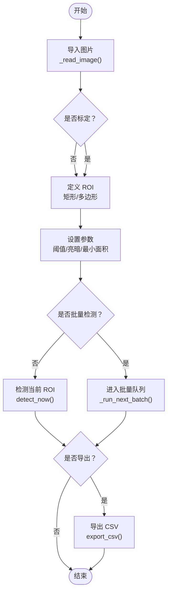
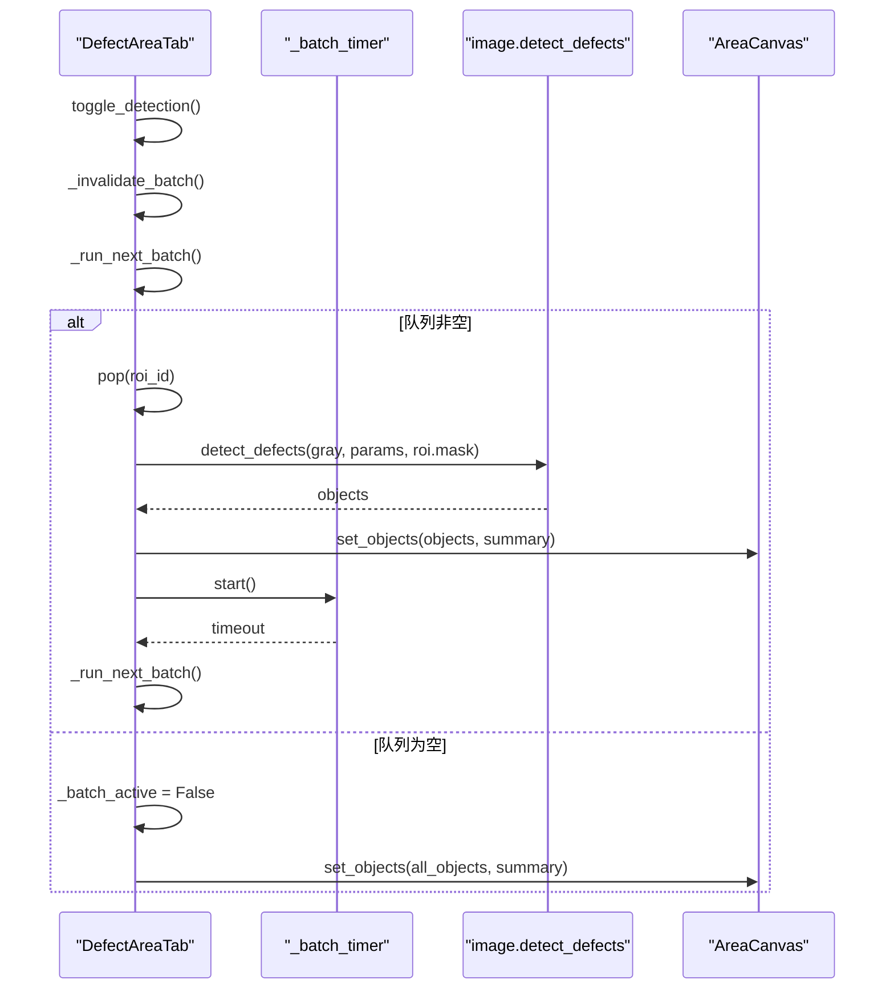
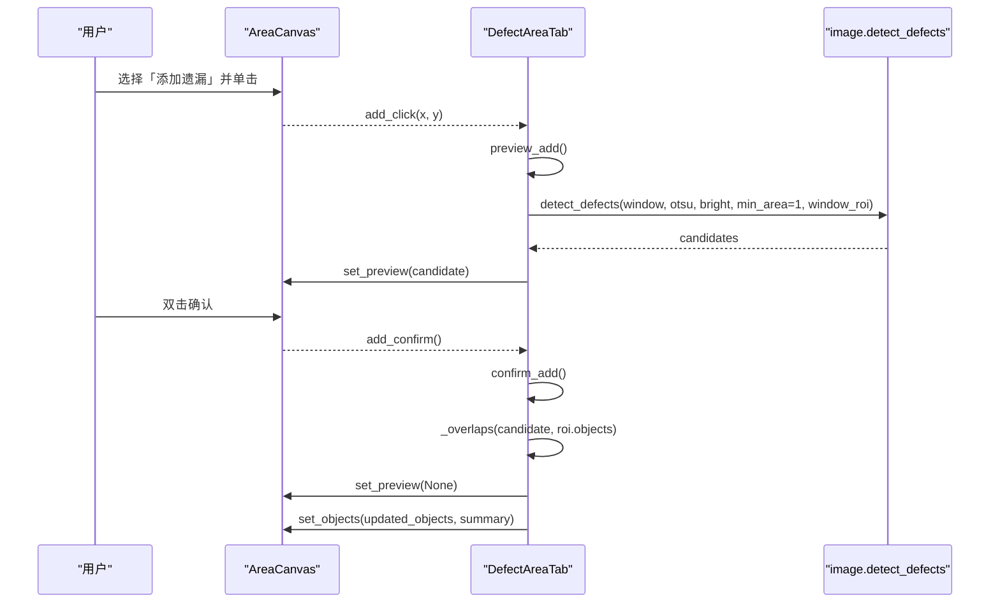
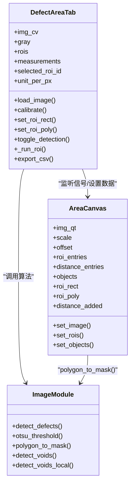

# 缺陷面积多 ROI 模块

<cite>
**本文引用的文件**   
- [area_tab.py](file://area_tab.py)
- [area_canvas.py](file://area_canvas.py)
- [image.py](file://image.py)
- [test_area_tab.py](file://test_area_tab.py)
</cite>

## 目录
1. [引言](#引言)
2. [项目结构](#项目结构)
3. [核心组件](#核心组件)
4. [架构总览](#架构总览)
5. [详细组件分析](#详细组件分析)
6. [依赖关系分析](#依赖关系分析)
7. [性能注意事项](#性能注意事项)
8. [参数校验与状态表](#参数校验与状态表)
9. [异常处理与故障排查](#异常处理与故障排查)
10. [结论](#结论)

## 引言
本模块为 Aurascope 的「缺陷面积多 ROI」功能，面向在单张图像上定义多个矩形或多边形 ROI、对每个 ROI 执行缺陷检测并统计像素/实际面积、支持距离测量、批量检测与 CSV 导出的桌面工作流。其职责边界清晰：

- `area_tab.py`（业务页面）负责图片导入、比例尺标定、ROI 管理、阈值等参数面板、结果表格、批量检测调度、导出与状态提示。
- `area_canvas.py`（专用画布）负责图像渲染、坐标变换、ROI 绘制/编辑、距离测量交互、对象悬停/选中高亮，并通过信号把顶点、当前选中状态、模式变更暴露给 Tab。
- `image.py` 是唯一的算法实现层；缺陷面积页调用 `detect_defects()` 和 `otsu_threshold()`，空洞检测相关函数 `detect_voids()` / `detect_voids_local()` 在本模块中未被使用，但作为算法层接口仍需在文档中明确引用关系。

UI 契约方面，该页应遵循 `.qoder/skills/roi-page-ui-design/SKILL.md`；由于仓库中未找到该技能文件，本文不虚构其内容，仅声明约束：**不得另立一套设计语言**。

## 项目结构
缺陷面积多 ROI 模块由三个核心文件组成，依赖方向自 GUI 层指向算法层：

**图表来源**
- [area_tab.py:1-28](file://area_tab.py#L1-L28)
- [area_canvas.py:1-13](file://area_canvas.py#L1-L13)
- [image.py:425-488](file://image.py#L425-L488)

**章节来源**
- [area_tab.py:1-28](file://area_tab.py#L1-L28)
- [area_canvas.py:1-13](file://area_canvas.py#L1-L13)
- [image.py:1-11](file://image.py#L1-L11)

## 核心组件
### 1. DefectAreaTab（业务页面）
`DefectAreaTab` 是用户入口，承担以下职责：

| 职责 | 关键属性/方法 | 说明 |
|---|---|---|
| 图片导入 | `load_image()`、`_read_image()` | 解码 PNG/JPG/BMP/TIF，拒绝多页 TIF、非灰度/RGB、非 uint8/uint16；导入时只显示原图，不调用连通域检测。 |
| 比例尺标定 | `calibrate()`、`clear_calibration()` | 根据标定线像素长度与实际长度计算 `unit_per_px`，更新 Canvas 标线和标签。 |
| 距离测量 | `add_distance()`、`_refresh_distances()`、`export_distance_csv()` | 记录起点、终点、像素距离、约束类型，支持最小/最大/平均/总计统计与 CSV 导出。 |
| ROI 管理 | `set_roi_rect()`、`set_roi_poly()`、`_append_roi()`、`delete_current_roi()`、`clear_roi()` | 创建 mask、分配 id、同步参数、自动检测单个 ROI。 |
| 参数面板 | `schedule_detection()`、`auto_otsu()`、`_sync_parameter_widgets()` | 保存 threshold/bright/min_area，拖动阈值防抖，Otsu 基于当前 ROI mask 计算。 |
| 批量检测 | `confirm_toggle_detection()`、`toggle_detection()`、`_run_next_batch()` | 队列式逐个 ROI 检测，按钮在「检测全部 ROI」与「停止并清空」之间切换。 |
| 手动修正 | `preview_add()`、`confirm_add()`、`delete_at()` | 在当前已检测 ROI 内点击添加遗漏、双击确认、右键删除误检，禁止与已有缺陷像素重叠。 |
| 结果展示 | `_refresh_results()`、`select_object()` | 刷新 ROI 表格、缺陷明细表格、Canvas 对象与摘要。 |
| 导出 | `export_csv()` | 按 ROI × 缺陷行输出 CSV，使用临时文件 + `os.replace` 原子写入。 |

**章节来源**
- [area_tab.py:110-150](file://area_tab.py#L110-L150)
- [area_tab.py:152-323](file://area_tab.py#L152-L323)
- [area_tab.py:342-378](file://area_tab.py#L342-L378)
- [area_tab.py:409-431](file://area_tab.py#L409-L431)
- [area_tab.py:444-559](file://area_tab.py#L444-L559)
- [area_tab.py:561-590](file://area_tab.py#L561-L590)
- [area_tab.py:659-683](file://area_tab.py#L659-L683)
- [area_tab.py:751-800](file://area_tab.py#L751-L800)
- [area_tab.py:821-890](file://area_tab.py#L821-L890)
- [area_tab.py:1029-1114](file://area_tab.py#L1029-L1114)
- [area_tab.py:1116-1166](file://area_tab.py#L1116-L1166)

### 2. AreaCanvas（专用画布）
`AreaCanvas` 是纯 UI 与几何交互层，不持有检测业务逻辑：

| 能力 | 实现要点 |
|---|---|
| 图像渲染 | 将 OpenCV BGR/灰度转为 `QImage`，支持缩放、平移、最近邻插值避免掩膜插值。 |
| 坐标转换 | `widget_to_img()` / `img_to_widget()` / `_clamped()` 统一屏幕坐标↔图像坐标。 |
| ROI 绘制 | 支持矩形拖拽与多边形逐点添加，双击闭合；选中 ROI 以实线高亮，其他 ROI 虚线显示。 |
| 距离测量 | 两点连线，7° 规则自动对齐水平或垂直，支持删除命中测距线。 |
| 对象交互 | 基于局部 mask 的 `mask_hit()` 与 `hit_index()`，支持删除模式悬停高亮、选中高亮、预览高亮。 |
| 信号接口 | `roi_rect`、`roi_poly`、`roi_pick`、`distance_added`、`mode_cancel`、`add_click`、`add_confirm`、`add_cancel`、`delete_click`、`empty_import`。 |
| 数据设置 | `set_rois()`、`set_objects()`、`set_calib()`、`set_distances()`、`set_preview()`、`cancel_draft()`。 |

**章节来源**
- [area_canvas.py:85-134](file://area_canvas.py#L85-L134)
- [area_canvas.py:135-150](file://area_canvas.py#L135-L150)
- [area_canvas.py:152-199](file://area_canvas.py#L152-L199)
- [area_canvas.py:215-340](file://area_canvas.py#L215-L340)
- [area_canvas.py:358-498](file://area_canvas.py#L358-L498)

### 3. 算法层接口
缺陷面积页直接调用：

- `image.detect_defects(gray, thresh_val, bright, min_area, roi_mask)`：返回对象列表，含 `id`、`area_px`、`rect`、`cx`、`cy`、`points`、`mask`、`source`、`roi_id`。
- `image.otsu_threshold(gray_img, roi_mask=None)`：基于 ROI 像素计算 Otsu 阈值。
- `image.polygon_to_mask(points, img_shape)`：将多边形顶点转换为整幅图像的 uint8 mask。

空洞检测函数 `detect_voids()` 与 `detect_voids_local()` 在本模块中未被调用；它们属于通用算法库，供其他功能或历史代码使用。

**章节来源**
- [image.py:180-197](file://image.py#L180-L197)
- [image.py:200-286](file://image.py#L200-L286)
- [image.py:328-422](file://image.py#L328-L422)
- [image.py:425-488](file://image.py#L425-L488)

## 架构总览
缺陷面积多 ROI 的整体协作如下：

**图表来源**
- [area_tab.py:342-378](file://area_tab.py#L342-L378)
- [area_tab.py:561-683](file://area_tab.py#L561-L683)
- [area_tab.py:751-820](file://area_tab.py#L751-L820)
- [area_tab.py:821-890](file://area_tab.py#L821-L890)
- [area_tab.py:1116-1166](file://area_tab.py#L1116-L1166)
- [image.py:425-488](file://image.py#L425-L488)

## 详细组件分析

### 业务流程：导入 → 标定 → 定义 ROI → 调参 → 批量检测 → 导出

**图表来源**
- [area_tab.py:342-378](file://area_tab.py#L342-L378)
- [area_tab.py:409-431](file://area_tab.py#L409-L431)
- [area_tab.py:561-683](file://area_tab.py#L561-L683)
- [area_tab.py:821-890](file://area_tab.py#L821-L890)
- [area_tab.py:1116-1166](file://area_tab.py#L1116-L1166)

### 数据结构定义

#### 1. rois：ROI 列表
每个 ROI 是一个字典，关键字段如下：

| 字段 | 类型 | 含义 | 复杂度/注意 |
|---|---|---|---|
| `id` | int | 自增编号 | 删除后不会重新编号，保证稳定性。 |
| `roi` | tuple | `('rect', (x,y,w,h))` 或 `('poly', points)` | 用于 Canvas 绘制轮廓。 |
| `mask` | numpy.ndarray | 与灰度图同形的 uint8 二值掩码 | 大图下每个 ROI 都持有一张整图尺寸 mask，内存占用为 `H×W` 字节。 |
| `params` | dict | `threshold`、`bright`、`min_area` | 与 UI 控件双向同步。 |
| `objects` | list | 缺陷对象列表 | 每次检测或手动修正后重建。 |
| `status` | str | `'pending'` / `'active'` / `'error'` | 控制按钮文本与表格状态列。 |
| `manual_changed` | bool | 是否有人工增删 | 影响重跑时的状态提示。 |
| `area_px` | int | 当前 ROI 所有缺陷的像素面积之和 | 用于 ROI 表格与汇总。 |

**章节来源**
- [area_tab.py:659-683](file://area_tab.py#L659-L683)
- [area_tab.py:914-978](file://area_tab.py#L914-L978)

#### 2. roi_polygon_pts：多边形顶点
多边形 ROI 的顶点由 `AreaCanvas.poly_drawing` 收集，双击后通过 `roi_poly` 信号传给 `DefectAreaTab.set_roi_poly()`。Tab 将其裁剪到图像范围、检查面积为正，再调用 `polygon_to_mask()` 生成整图 mask。

| 阶段 | 存储位置 | 说明 |
|---|---|---|
| 绘制中 | `AreaCanvas.poly_drawing` | 屏幕坐标下的浮点顶点列表。 |
| 提交前 | `set_roi_poly()` 中的 `vertices` | 被 clip 到 `[0, W-1] × [0, H-1]`。 |
| 持久化 | `roi['roi'] = ('poly', points)` | 最终整数顶点列表。 |
| 掩码 | `roi['mask']` | 由 `image.polygon_to_mask()` 生成。 |

**章节来源**
- [area_canvas.py:257-329](file://area_canvas.py#L257-L329)
- [area_tab.py:576-590](file://area_tab.py#L576-L590)
- [image.py:138-155](file://image.py#L138-L155)

#### 3. measurements：距离测量数据
每条测量记录包含：

| 字段 | 含义 |
|---|---|
| `id` | 自增序号 |
| `p1`、`p2` | 起点与终点图像坐标 |
| `dist_px` | 像素距离 |
| `constraint` | `'h'`、`'v'` 或空字符串 |

Canvas 通过 `distance_added` 信号传递原始数据，Tab 构造 `measurements` 并刷新 Canvas 与距离表格。

**章节来源**
- [area_canvas.py:244-255](file://area_canvas.py#L244-L255)
- [area_tab.py:444-500](file://area_tab.py#L444-L500)

#### 4. voids_data：空洞检测结果
`voids_data` 是 `image.detect_voids()` 的返回值结构，包含空洞的 `id`、`area_px`、`rect`、`cx`、`cy`、`points`、`manual`。该结构在本模块中未被使用；当前缺陷面积页使用 `detect_defects()` 返回的 `objects`。

| 字段 | 用途 | 本模块是否使用 |
|---|---|---|
| `id` | 空洞编号 | 否 |
| `area_px` | 空洞像素面积 | 否 |
| `rect` | 包围盒 | 否 |
| `cx`、`cy` | 质心 | 否 |
| `points` | 轮廓点 | 否 |
| `manual` | 是否手动 | 否 |

**章节来源**
- [image.py:235-286](file://image.py#L235-L286)

### 关键流程时序：批量检测

**图表来源**
- [area_tab.py:762-820](file://area_tab.py#L762-L820)
- [area_tab.py:821-847](file://area_tab.py#L821-L847)

### 关键流程时序：手动添加遗漏

**图表来源**
- [area_tab.py:1029-1096](file://area_tab.py#L1029-L1096)
- [area_canvas.py:314-329](file://area_canvas.py#L314-L329)

## 依赖关系分析

**图表来源**
- [area_tab.py:110-150](file://area_tab.py#L110-L150)
- [area_canvas.py:85-134](file://area_canvas.py#L85-L134)
- [image.py:138-155](file://image.py#L138-L155)
- [image.py:180-197](file://image.py#L180-L197)
- [image.py:425-488](file://image.py#L425-L488)

**章节来源**
- [area_tab.py:1-28](file://area_tab.py#L1-L28)
- [area_canvas.py:1-13](file://area_canvas.py#L1-L13)
- [image.py:1-11](file://image.py#L1-L11)

## 性能注意事项
1. **大图 ROI mask 内存占用**  
   每个 ROI 的 `mask` 是与灰度图同形的 `uint8` 数组。若图像为 `H×W`，则一个 ROI mask 占用约 `H×W` 字节；多个 ROI 会线性叠加。对于超大图像，应避免无意义地创建大量 ROI。

2. **批量检测避免重复加载原图**  
   `load_image()` 只解码一次并缓存 `self.img_cv` 与 `self.gray`；批量检测循环中复用同一灰度图，不再重复从磁盘读取。这是正确行为，不应改为每 ROI 重新加载。

3. **Canvas 掩膜图像缓存**  
   `set_objects()` 会为每个对象调用 `mask_to_qimage()` 并缓存到 `_mask_images`。对象数量较多时，这会额外复制掩膜 RGBA 图像；删除或重跑时应确保旧对象被替换而非累积。

4. **Otsu 与形态学增强**  
   `otsu_threshold()` 仅在 ROI mask 非空时计算；`detect_voids()` 中的 CLAHE、形态学开运算、Canny 边缘验证属于可选增强路径，开启后会增加 CPU 与内存开销。缺陷面积页当前未启用这些增强选项。

5. **事件泵机制**  
   `image.py` 的 `_pump_events()` 在长循环中尝试调用 `QApplication.processEvents()`，避免 GUI 完全卡死；但该模块的批量检测使用 Qt 定时器分帧，主要阻塞发生在 `detect_defects()` 内部。

**章节来源**
- [area_tab.py:342-378](file://area_tab.py#L342-L378)
- [area_tab.py:803-847](file://area_tab.py#L803-L847)
- [area_canvas.py:192-199](file://area_canvas.py#L192-L199)
- [image.py:14-24](file://image.py#L14-L24)
- [image.py:200-286](file://image.py#L200-L286)

## 参数校验与状态表

### 参数校验规则

| 参数/输入 | 校验规则 | 失败行为 |
|---|---|---|
| 图片 | 必须是可解码的 PNG/JPG/BMP/TIF；TIF 必须单页二维；数据类型为 uint8 或 uint16 | 抛出 `ValueError`，显示「图片加载失败」，保留空白画布。 |
| 标定线长度 | 像素距离 ≥ 10，且实际长度 > 0 | 显示「标定线太短」或「标定失败」。 |
| ROI 矩形 | 宽和高均 > 5，四个坐标有限 | 直接忽略无效 ROI。 |
| ROI 多边形 | 至少 3 个顶点，顶点有限，`cv2.contourArea` 不为 0，mask 非全零 | 直接忽略无效 ROI。 |
| 阈值 | `detect_defects()` 要求 0 ≤ threshold ≤ 255 | 抛出 `ValueError`，ROI 状态设为 `error`。 |
| 最小面积 | `detect_defects()` 要求非负有限数 | 抛出 `ValueError`，ROI 状态设为 `error`。 |
| 亮/暗标志 | 布尔值 | 非法时抛 `ValueError`。 |
| ROI mask | 与灰度图同形、uint8、仅含 0 或 255 | 非法时抛 `ValueError`。 |
| 手动添加 | 点击必须在当前 ROI mask 内，且不与已有缺陷像素重叠 | 拒绝添加并提示原因。 |

**章节来源**
- [area_tab.py:53-92](file://area_tab.py#L53-L92)
- [area_tab.py:409-431](file://area_tab.py#L409-L431)
- [area_tab.py:561-590](file://area_tab.py#L561-L590)
- [area_tab.py:1029-1096](file://area_tab.py#L1029-L1096)
- [image.py:425-488](file://image.py#L425-L488)

### ROI 状态变化表

| 状态 | 触发条件 | 后续行为 |
|---|---|---|
| `pending` | 新建 ROI、清空 ROI、批量启动、参数保存但未重跑 | 表格显示「待检测」，不自动重跑。 |
| `active` | `_run_roi()` 成功 | 表格显示「已检测」，允许手动增删与 Otsu 重跑。 |
| `error` | `detect_defects()` 抛出 `ValueError` 或 `cv2.error` | 清空对象、重置面积，表格显示「检测失败」。 |
| 停止并清空 | 用户点击「检测全部 ROI」且当前处于分析活跃状态 | 清空所有 ROI 的 `objects`、`area_px`、`manual_changed`，恢复 `pending`。 |

**章节来源**
- [area_tab.py:659-683](file://area_tab.py#L659-L683)
- [area_tab.py:751-800](file://area_tab.py#L751-L800)
- [area_tab.py:821-847](file://area_tab.py#L821-L847)
- [area_tab.py:914-978](file://area_tab.py#L914-L978)

## 异常处理与故障排查

### 异常分类与处理策略

| 异常场景 | 发生位置 | 处理方式 |
|---|---|---|
| 无图 | `calibrate()`、`toggle_detection()`、`auto_otsu()` | 显示「请先导入图片」，不继续执行。 |
| ROI 越界 | `set_roi_rect()`、`set_roi_poly()` | 裁剪或拒绝，不创建无效 ROI。 |
| OpenCV 错误 | `_run_roi()` | 捕获 `cv2.error`，记录日志，ROI 状态设为 `error`。 |
| 参数非法 | `detect_defects()` | 捕获 `ValueError`，记录日志，ROI 状态设为 `error`。 |
| 图片解码失败 | `load_image()` | 捕获 `OSError`、`ValueError`、`zlib.error`、`ImportError`，显示失败信息。 |
| CSV 导出失败 | `export_csv()`、`export_distance_csv()` | 捕获 `OSError`，提示临时文件清理失败或写入失败。 |
| 批量检测进行中导出 | `export_csv()` | 拒绝导出并提示等待完成。 |

### 已知限制与注意事项
1. **ROI mask 内存增长**：每个 ROI 持有整图尺寸 mask，多图多 ROI 场景下应关注内存峰值。
2. **手动添加区域较小**：`preview_add()` 使用点击点周围 40 像素窗口进行二次检测，对极小缺陷可能漏检。
3. **批量进度提示较简**：状态栏显示「正在检测 ROI X/Y」，但没有进度条；长时间检测时界面仍可用，但无法精确预估剩余时间。
4. **测试覆盖不完整**：`test_area_tab.py` 仅断言 `image.detect_defects` 存在并做基础调用检查，未覆盖 ROI 生命周期、批量检测与导出路径。

**章节来源**
- [area_tab.py:342-378](file://area_tab.py#L342-L378)
- [area_tab.py:821-847](file://area_tab.py#L821-L847)
- [area_tab.py:1116-1166](file://area_tab.py#L1116-L1166)
- [test_area_tab.py:1-61](file://test_area_tab.py#L1-L61)

## 结论
缺陷面积多 ROI 模块以 `area_tab.py` 为业务中枢、`area_canvas.py` 为交互画布、`image.py` 为算法边界，实现了从图片导入、标定、ROI 定义、参数调节、批量检测到 CSV 导出的完整闭环。其设计优点包括：

- 职责分离明确：GUI 不内联图像算法，Canvas 不持有检测状态。
- 数据流清晰：Canvas 通过信号暴露 ROI 顶点与交互事件，Tab 负责状态机与结果聚合。
- 批量检测安全：使用队列与定时器分帧，避免一次性阻塞主线程。
- 导出健壮：CSV 与距离测量均采用临时文件 + 原子替换，降低写入中断风险。

需要持续改进的点包括：

- 对超大图像的多 ROI mask 内存占用提供显式警告或按需延迟构建。
- 补充针对 ROI 生命周期、批量检测、手动修正与导出的单元测试。
- 明确 `.qoder/skills/roi-page-ui-design/SKILL.md` 的具体 UI 契约，并在代码注释中引用，避免未来偏离既定设计规范。