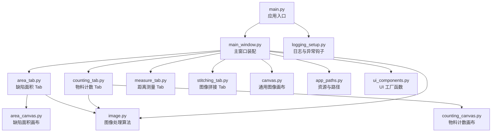
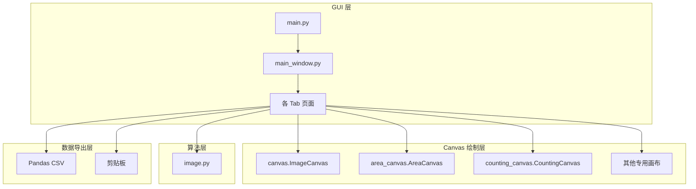
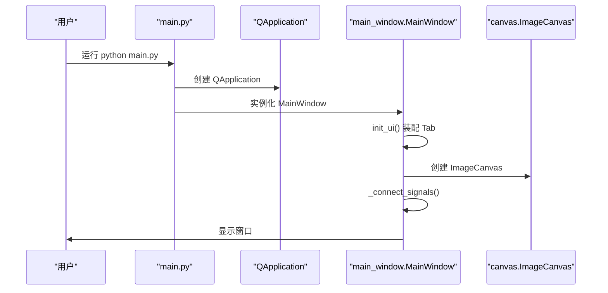
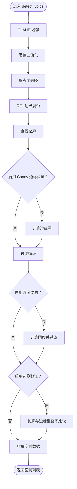
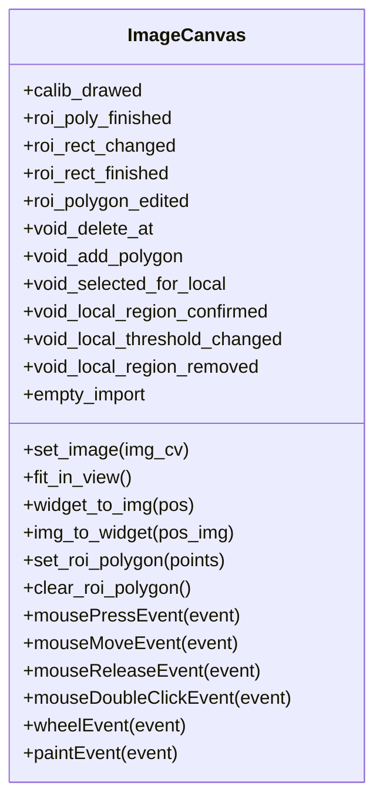
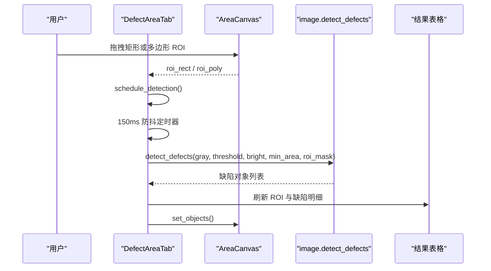
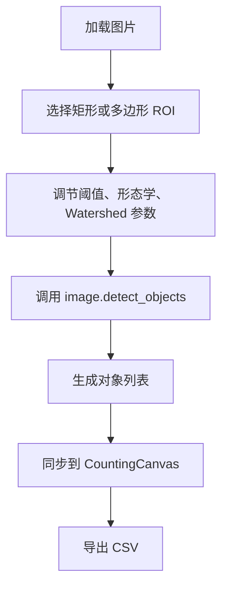
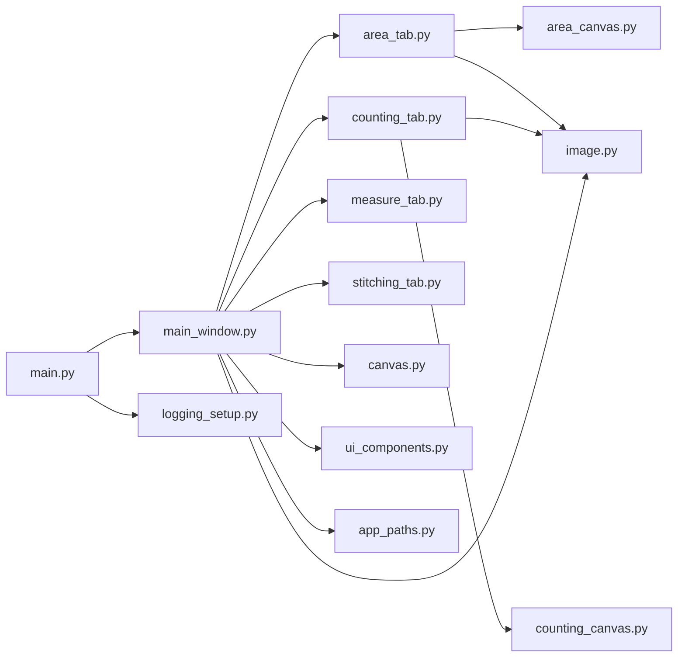
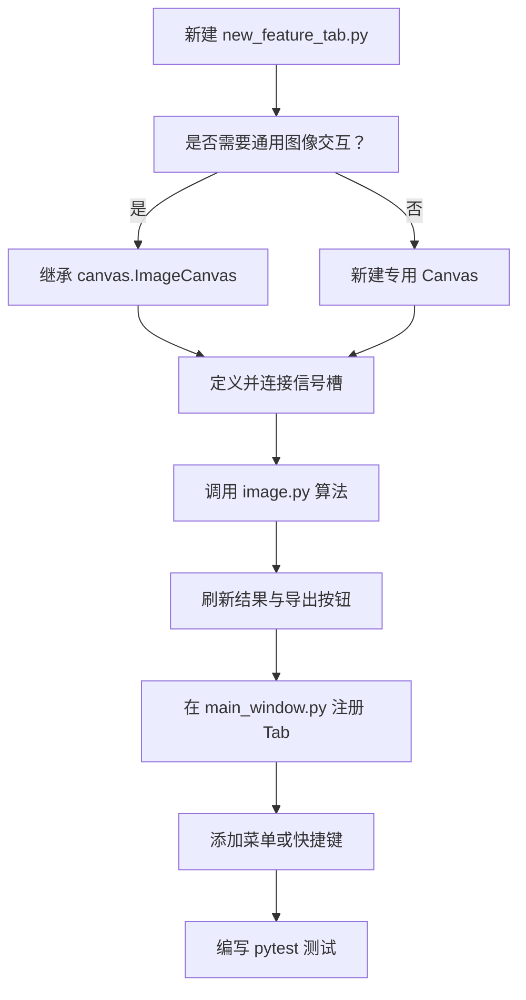

# 开发指南

<cite>
**本文引用的文件**   
- [README.md](file://README.md)
- [PROJECT_CONCEPTION.md](file://PROJECT_CONCEPTION.md)
- [main.py](file://main.py)
- [main_window.py](file://main_window.py)
- [image.py](file://image.py)
- [canvas.py](file://canvas.py)
- [area_tab.py](file://area_tab.py)
- [area_canvas.py](file://area_canvas.py)
- [counting_tab.py](file://counting_tab.py)
- [counting_canvas.py](file://counting_canvas.py)
- [measure_tab.py](file://measure_tab.py)
- [stitching_tab.py](file://stitching_tab.py)
- [ui_components.py](file://ui_components.py)
- [logging_setup.py](file://logging_setup.py)
- [app_paths.py](file://app_paths.py)
</cite>

## 目录
1. [引言](#引言)
2. [项目结构](#项目结构)
3. [核心组件](#核心组件)
4. [架构总览](#架构总览)
5. [详细组件分析](#详细组件分析)
6. [依赖关系分析](#依赖关系分析)
7. [性能与调试](#性能与调试)
8. [测试编写规范](#测试编写规范)
9. [新增 Tab 页面标准流程](#新增-tab-页面标准流程)
10. [编码规范清单](#编码规范清单)
11. [已知限制与排查建议](#已知限制与排查建议)
12. [结论](#结论)

## 引言
Aurascope 是面向微电子封装产线的半自动化视觉检测与数据分析桌面工具，运行在 Windows 7+ 上，使用 PyQt6、OpenCV、NumPy 和 Pandas。其核心价值是把重复性高、容易出错的量化工作标准化：导入 SEM/X 光图像后，通过框选、调参等操作直接得到检测结果，替代人工目检和手算流程。

仓库根目录的 README 明确了四个主要功能模块：空洞分析、距离测量、剪切力计算、物料计数；同时说明技术栈、安装方式、运行入口 `python main.py` 以及 PyInstaller 打包入口 `AurascopeV6.spec`。项目构思文档进一步强调：软件不做“AI 全自动判断”，而是把已有图像处理流程整合为工程师友好的交互界面，并明确算法逻辑集中在 `image.py`，GUI 层与之解耦。

本开发指南面向希望扩展或修改代码的开发者，重点说明分层约定、Canvas 复用规则、UI 工厂函数契约、新增 Tab 的标准流程、测试规范、调试技巧，以及当前仓库中测试文件的含义与运行方式。

## 项目结构
从仓库根目录看，项目采用「入口 → 主窗口 → Tab 页面 → Canvas 绘制层 → 算法层 image.py → 配方/导出」的分层组织方式：

- 入口与启动：`main.py` 负责日志初始化、异常钩子、QApplication 创建、全局样式与图标设置，然后实例化 `MainWindow`。
- 主窗口装配：`main_window.py` 组装所有 Tab、菜单、侧边栏、撤销栈、最近打开记录、更新检查等。
- Tab 页面：每个业务模块一个 Tab 文件，例如 `area_tab.py`（缺陷面积）、`counting_tab.py`（物料计数）、`measure_tab.py`（距离测量）、`stitching_tab.py`（图像拼接）、`shear_tab.py`（剪切力）、`teach_batch_tab.py`（批量示教）。
- Canvas 绘制层：`canvas.py` 提供通用图像画布 `ImageCanvas`，其他 Tab 可继承或组合专用 Canvas。
- 算法层：`image.py` 集中实现阈值、Otsu、形态学、轮廓、圆度、distanceTransform、Canny 边缘验证等。
- 路径与资源：`app_paths.py` 统一解析源码运行与 PyInstaller 打包后的资源路径、用户数据目录与日志目录。
- UI 组件：`ui_components.py` 提供按钮、分组框、折叠区域、剪贴板复制、下拉弹层样式等工厂函数。
- 日志：`logging_setup.py` 提供滚动日志、未捕获异常兜底、线程异常处理。



**图表来源**
- [main.py:19-39](file://main.py#L19-L39)
- [main_window.py:53-147](file://main_window.py#L53-L147)
- [area_tab.py:110-150](file://area_tab.py#L110-L150)
- [counting_tab.py:19-52](file://counting_tab.py#L19-L52)
- [measure_tab.py:22-40](file://measure_tab.py#L22-L40)
- [stitching_tab.py:26-46](file://stitching_tab.py#L26-L46)
- [canvas.py:13-28](file://canvas.py#L13-L28)
- [image.py:1-11](file://image.py#L1-L11)
- [app_paths.py:8-32](file://app_paths.py#L8-L32)
- [logging_setup.py:15-31](file://logging_setup.py#L15-L31)
- [ui_components.py:34-40](file://ui_components.py#L34-L40)

**章节来源**
- [README.md:1-76](file://README.md#L1-L76)
- [PROJECT_CONCEPTION.md:77-107](file://PROJECT_CONCEPTION.md#L77-L107)
- [main.py:1-44](file://main.py#L1-L44)
- [main_window.py:53-147](file://main_window.py#L53-L147)

## 核心组件
本项目最关键的五个核心组件是：

| 组件 | 职责 | 关键行为 | 典型调用方 |
|------|------|----------|------------|
| `main.py` | 应用入口 | 初始化日志、异常钩子、QApplication、全局样式、图标、版本号 | 无 |
| `main_window.py` | 主窗口装配 | 注册所有 Tab、构建菜单、连接 Canvas 信号、管理最近打开与窗口状态 | 各 Tab、Canvas、update_check |
| `image.py` | 图像处理算法 | Otsu、阈值、形态学、轮廓、圆度、distanceTransform、Canny 边缘验证、对象检测 | 空洞分析、缺陷面积、物料计数、批量示教 |
| `canvas.py` | 通用图像画布 | 原图坐标↔屏幕坐标转换、滚轮缩放、右键平移、多边形 ROI 编辑、空洞添加/删除/局部笔刷 | 空洞分析 Tab |
| `ui_components.py` | UI 工厂函数 | 创建按钮、分组框、折叠区域、剪贴板复制、下拉弹层样式 | 所有 Tab 与对话框 |

其中，`image.py` 是唯一算法实现层；GUI 层不得内联实现图像算法，必须通过 `image.py` 暴露的函数完成阈值、轮廓、形态学、统计与导出前的数据处理。`canvas.py` 的 `ImageCanvas` 是通用绘制与交互基类，新增业务画布应优先继承或组合它，而不是从零实现缩放、平移、坐标转换。

**章节来源**
- [main.py:19-39](file://main.py#L19-L39)
- [main_window.py:31-48](file://main_window.py#L31-L48)
- [image.py:27-286](file://image.py#L27-L286)
- [canvas.py:13-140](file://canvas.py#L13-L140)
- [ui_components.py:34-40](file://ui_components.py#L34-L40)

## 架构总览
Aurascope 的运行时架构可以理解为四层：

1. **PyQt6 GUI 层**：`main.py` 启动 QApplication，`main_window.py` 装配 QTabWidget、菜单、侧边栏、模块导航按钮。
2. **Canvas 绘制层**：基于 QWidget + QPainter，负责图像显示、缩放、平移、ROI 编辑、结果覆盖层绘制。
3. **算法层**：`image.py` 使用 OpenCV 与 NumPy 实现阈值、形态学、轮廓、圆度、distanceTransform、Canny 边缘校验等。
4. **数据导出层**：Pandas 用于 CSV 导出，部分 Tab 也支持剪贴板复制。



**图表来源**
- [main.py:19-39](file://main.py#L19-L39)
- [main_window.py:96-147](file://main_window.py#L96-L147)
- [canvas.py:13-28](file://canvas.py#L13-L28)
- [area_canvas.py:85-97](file://area_canvas.py#L85-L97)
- [counting_canvas.py:10-15](file://counting_canvas.py#L10-L15)
- [image.py:200-286](file://image.py#L200-L286)

## 详细组件分析

### 主入口与主窗口
`main.py` 的职责很清晰：设置 Qt 平台环境变量、初始化日志、安装全局异常钩子、创建 QApplication、设置 Fusion 风格、加载全局样式表与图标、创建并显示 `MainWindow`。它不持有业务状态，也不直接操作图像。

`main_window.py` 是装配中心：
- 创建 `QTabWidget`，依次挂载 ROI 页、空洞分析页、示教/批量页、剪切力计算页、物料计数页、图像拼接页。
- 空洞分析页内部使用 `QSplitter` 分割侧边栏与 `ImageCanvas`。
- 通过 `_connect_signals()` 连接 Canvas 的信号到主窗口方法，包括标定线绘制、ROI 矩形/多边形、空洞删除/添加、局部阈值区域确认与移除等。
- 通过 `_build_menu()` 构建「文件」「帮助」菜单，并维护最近打开图片与批次文件夹。
- 通过 `_restore_window_state()` 与 `closeEvent()` 保存/恢复窗口几何、窗口状态、当前 Tab、分隔条位置。



**图表来源**
- [main.py:19-39](file://main.py#L19-L39)
- [main_window.py:96-147](file://main_window.py#L96-L147)
- [main_window.py:670-683](file://main_window.py#L670-L683)

**章节来源**
- [main.py:1-44](file://main.py#L1-L44)
- [main_window.py:53-147](file://main_window.py#L53-L147)
- [main_window.py:230-245](file://main_window.py#L230-L245)
- [main_window.py:361-392](file://main_window.py#L361-L392)
- [main_window.py:670-683](file://main_window.py#L670-L683)

### 图像算法层 image.py
`image.py` 是纯算法层，包含以下关键能力：

| 函数/能力 | 输入 | 输出/作用 | 备注 |
|-----------|------|-----------|------|
| `extract_threshold_contour` | 灰度图、矩形 ROI、阈值 | 返回矩形信息、局部掩码、最大轮廓 | 用于 ROI 提取 |
| `contour_to_polygon` / `polygon_to_mask` | 轮廓、顶点数、顶点列表、图像尺寸 | 多边形顶点、二值掩码 | 多边形与掩码互转 |
| `otsu_threshold` | 灰度图、可选 ROI 掩码 | 自动阈值 | 对 ROI 像素或全图计算 |
| `detect_voids` | 灰度图、ROI 掩码、阈值、增强参数 | 空洞列表 | 空洞分析主流程 |
| `detect_voids_local` | 灰度图、ROI 掩码、全局阈值、局部区域 | 空洞列表 | 支持局部阈值覆盖 |
| `detect_defects` | 灰度图、阈值、亮/暗标志、最小面积、ROI 掩码 | 缺陷对象列表 | 缺陷面积页使用 |
| `detect_objects` | 灰度图、阈值、增强/形态学/Watershed 参数 | 对象列表 | 物料计数主流程 |
| `calculate_roundness` / `is_void_in_roi` | 轮廓点、面积、ROI 掩码 | 圆度、是否在 ROI 内 | 过滤与校验 |

需要注意两个重要细节：

1. `_pump_events()` 在长循环中尝试调用 `QApplication.processEvents()`，但只在 GUI 可用时执行；这样算法模块可以在无 GUI 场景下被报告工具或脚本调用，而不强制绑定 PyQt6。
2. `main_window.py` 内另有一份 `detect_voids_local` 副本，属于已知技术债。现行行为应以 `image.py` 为准，两份实现待合并。



**图表来源**
- [image.py:200-286](file://image.py#L200-L286)

**章节来源**
- [image.py:1-25](file://image.py#L1-L25)
- [image.py:27-70](file://image.py#L27-L70)
- [image.py:180-197](file://image.py#L180-L197)
- [image.py:200-286](file://image.py#L200-L286)
- [image.py:328-422](file://image.py#L328-L422)
- [image.py:425-488](file://image.py#L425-L488)
- [image.py:491-632](file://image.py#L491-L632)

### 通用画布 canvas.py
`canvas.py` 中的 `ImageCanvas` 是所有图像交互的基础：

- 提供 `calib_drawn`、`roi_poly_finished`、`roi_rect_changed`、`roi_rect_finished`、`roi_polygon_edited`、`void_delete_at`、`void_add_polygon`、`void_selected_for_local`、`void_local_region_confirmed`、`void_local_threshold_changed`、`void_local_region_removed`、`empty_import` 等信号。
- 维护原图 `img_cv`、Qt 图像 `img_qt`、缩放比例 `scale`、偏移 `offset`、鼠标模式、ROI 多边形、空洞绘制列表、局部笔刷状态等。
- 实现 widget 坐标 ↔ 图像坐标转换、滚轮缩放、右键平移、多边形 ROI 编辑、空洞添加/删除、局部阈值笔刷。
- 在 `paintEvent` 中绘制图像、阴影、ROI 蒙版、预览、多边形、空洞覆盖层、状态提示。

需要特别指出：**canvas.py 存在 Y 轴漂移的已知问题**。滚轮缩放时虽然以鼠标位置为锚点计算 X 轴偏移，但 Y 轴偏移的计算方式并不完全对称，因此不能把现状描述为“正确设计”。新增 Canvas 时应尽量参考 `area_canvas.py` 的缩放锚点实现，并在 PR 中显式回归该问题。



**图表来源**
- [canvas.py:13-28](file://canvas.py#L13-L28)
- [canvas.py:123-140](file://canvas.py#L123-L140)
- [canvas.py:152-164](file://canvas.py#L152-L164)
- [canvas.py:350-609](file://canvas.py#L350-L609)
- [canvas.py:626-706](file://canvas.py#L626-L706)
- [canvas.py:708-800](file://canvas.py#L708-L800)

**章节来源**
- [canvas.py:13-94](file://canvas.py#L13-L94)
- [canvas.py:123-140](file://canvas.py#L123-L140)
- [canvas.py:350-609](file://canvas.py#L350-L609)
- [canvas.py:626-706](file://canvas.py#L626-L706)

### 缺陷面积 Tab area_tab.py 与 area_canvas.py
`area_tab.py` 是缺陷面积测量的业务控制器，`area_canvas.py` 是仅负责渲染、坐标变换及交互的画布。二者分工明确：

- `DefectAreaTab` 持有图像、灰度图、ROI 列表、检测结果、测量记录、单位换算、防抖定时器、批量队列等。
- `AreaCanvas` 只渲染图像、ROI、缺陷对象、测距线、标定线、预览与状态文本，并通过信号把用户操作交给 Tab。
- 导入图片时只解码和显示原图，不在导入阶段执行连通域检测或创建掩膜，避免大图导入卡顿。
- 检测流程通过 `schedule_detection` 触发 150ms 防抖定时器，再调用 `detect_now` 执行 `detect_defects`。
- 导出 CSV 使用临时文件写入后原子替换目标路径，失败时清理临时文件。



**图表来源**
- [area_tab.py:110-150](file://area_tab.py#L110-L150)
- [area_tab.py:342-378](file://area_tab.py#L342-L378)
- [area_tab.py:561-590](file://area_tab.py#L561-L590)
- [area_tab.py:751-800](file://area_tab.py#L751-L800)
- [area_canvas.py:85-97](file://area_canvas.py#L85-L97)

**章节来源**
- [area_tab.py:110-150](file://area_tab.py#L110-L150)
- [area_tab.py:342-378](file://area_tab.py#L342-L378)
- [area_tab.py:561-590](file://area_tab.py#L561-L590)
- [area_tab.py:751-800](file://area_tab.py#L751-L800)
- [area_canvas.py:85-150](file://area_canvas.py#L85-L150)
- [area_canvas.py:215-340](file://area_canvas.py#L215-L340)

### 物料计数 counting_tab.py 与 counting_canvas.py
`CountingTab` 负责物料计数的 UI 与业务流程，`CountingCanvas` 负责绘制 ROI、对象轮廓、编号与总数。

- 支持矩形和多边形 ROI。
- 通过 `image.detect_objects` 调用增强检测，支持 CLAHE、形态学、圆度、Canny 边缘验证、距离峰值计数。
- 支持手动添加遗漏、删除误检。
- 导出 CSV 使用 Pandas，字段包括编号、像素面积、中心坐标、宽高。



**图表来源**
- [counting_tab.py:19-52](file://counting_tab.py#L19-L52)
- [counting_tab.py:363-414](file://counting_tab.py#L363-L414)
- [counting_canvas.py:10-59](file://counting_canvas.py#L10-L59)

**章节来源**
- [counting_tab.py:19-52](file://counting_tab.py#L19-L52)
- [counting_tab.py:363-414](file://counting_tab.py#L363-L414)
- [counting_tab.py:425-447](file://counting_tab.py#L425-L447)
- [counting_canvas.py:10-59](file://counting_canvas.py#L10-L59)

### 距离测量 measure_tab.py
`MeasureTab` 展示距离测量流程：先划线标定像素比，再依次点击两点测量，最后统计并导出 CSV。该 Tab 目前已在 `main_window.py` 中被注释掉挂载，实际功能已并入 ROI 页的 `area_tab.py` / `area_canvas.py`。

- 标定成功后计算每像素对应微米值。
- 测量记录包含起点、终点、像素距离、实际距离。
- 导出 CSV 使用 Pandas。

**章节来源**
- [measure_tab.py:22-40](file://measure_tab.py#L22-L40)
- [measure_tab.py:227-261](file://measure_tab.py#L227-L261)
- [measure_tab.py:300-322](file://measure_tab.py#L300-L322)

### 图像拼接 stitching_tab.py
`StitchingTab` 支持导入多张图像、标记金锡水平线、拼接、发送到空洞分析、保存拼接图并复制到剪贴板。

- 支持单文件导入与文件夹导入。
- 拼接完成后允许发送到 `analysis_tab`。
- 导出支持 PNG/TIF，并尝试复制到系统剪贴板。

**章节来源**
- [stitching_tab.py:26-46](file://stitching_tab.py#L26-L46)
- [stitching_tab.py:329-363](file://stitching_tab.py#L329-L363)
- [stitching_tab.py:371-382](file://stitching_tab.py#L371-L382)
- [stitching_tab.py:385-447](file://stitching_tab.py#L385-L447)

## 依赖关系分析
项目的依赖方向非常明确：GUI 层依赖 Canvas 层，Canvas 层依赖 `image.py`，Tab 层负责装配 UI、连接信号槽、调用算法、更新结果与导出。



**图表来源**
- [main.py:12-16](file://main.py#L12-L16)
- [main_window.py:24-48](file://main_window.py#L24-L48)
- [area_tab.py:21-28](file://area_tab.py#L21-L28)
- [counting_tab.py:11-16](file://counting_tab.py#L11-L16)
- [ui_components.py:34-40](file://ui_components.py#L34-L40)
- [logging_setup.py:15-31](file://logging_setup.py#L15-L31)
- [app_paths.py:8-32](file://app_paths.py#L8-L32)

**章节来源**
- [main_window.py:24-48](file://main_window.py#L24-L48)
- [area_tab.py:21-28](file://area_tab.py#L21-L28)
- [counting_tab.py:11-16](file://counting_tab.py#L11-L16)

## 性能与调试

### 日志与调试
`logging_setup.py` 提供统一日志与全局异常兜底：

- `setup_logging()` 初始化滚动日志，默认日志级别为 `INFO`，日志文件位于用户数据目录下的 `logs/aurascope.log`，单文件 1MB × 5 份备份。
- `install_excepthook()` 替换主线程与工作线程的未捕获异常处理器，将堆栈写入日志，并在有 GUI 时弹出错误对话框，支持复制详情或打开日志目录。
- 推荐在业务关键路径使用 `logging.getLogger('Aurascope')` 记录信息、警告与错误。

调试建议：

1. 遇到崩溃或静默失败时，优先查看 `logs/aurascope.log`。
2. 如果异常发生在长循环中，检查是否缺少 `_pump_events()` 或进度反馈。
3. 大图像检测无响应时，确认是否启用了 CLAHE、形态学、Canny 边缘验证等昂贵选项。
4. 若怀疑 GUI 阻塞，可在关键步骤前后增加日志时间戳，观察耗时分布。
5. 对于离线环境或 CI 模拟，注意 `QT_QPA_PLATFORM=offscreen` 会影响弹窗与某些 UI 行为。

**章节来源**
- [logging_setup.py:15-31](file://logging_setup.py#L15-L31)
- [logging_setup.py:38-88](file://logging_setup.py#L38-L88)
- [image.py:14-25](file://image.py#L14-L25)

### 大图像性能分析
大图像性能瓶颈通常出现在以下环节：

| 环节 | 风险 | 优化建议 |
|------|------|----------|
| 导入 TIF/16 位图像 | 解码与类型转换可能较慢 | 仅在必要时转换 dtype，避免重复拷贝 |
| CLAHE 增强 | 分块直方图均衡开销较大 | 对大图可关闭或降低 clipLimit |
| 形态学开闭运算 | 核越大越慢 | 保持较小核，如 3×3 |
| Canny 边缘验证 | 模糊 + Canny + 多次掩码操作 | 仅在需要时启用 |
| 轮廓遍历 | 大量小轮廓时循环开销明显 | 使用现有 `_pump_events()` 间隔刷新 |
| 结果覆盖层绘制 | 大量 ROI/对象时 QPainter 重绘压力大 | 控制显示数量，避免一次性渲染过多覆盖层 |

## 测试编写规范

### pytest 风格
仓库根目录下以 `test_*.py` 开头的文件均为 pytest 风格的单元测试或集成测试用例。常见命名语义如下：

| 文件 | 含义 |
|------|------|
| `test_area_tab.py` | 缺陷面积 Tab 相关测试 |
| `test_quick_teach.py` | 快速示教相关测试 |
| `test_quick_teach_flow.py` | 快速示教流程测试 |
| `test_stitching.py` | 图像拼接相关测试 |
| `test_teach_batch_logic.py` | 批量示教逻辑测试 |
| `test_ui_audit.py` | UI 审计或一致性检查类测试 |
| `test_update_check.py` | 更新检查相关测试 |

运行方式：

```bash
pip install -r requirements.txt
pytest
```

如果只想运行某个文件：

```bash
pytest test_stitching.py
pytest test_area_tab.py -v
```

### QApplication 依赖处理
部分测试依赖 PyQt6 的 QApplication。建议在测试中使用 `pytest-qt` 提供的 `qtbot`，或在测试夹具中创建 QApplication 实例。若测试不需要真实 GUI，应避免直接创建窗口，改用 offscreen 模式或 mock。

仓库中 `ui_components.confirm_action` 已经考虑了离屏环境：当 `QT_QPA_PLATFORM=offscreen` 或 `AURASCOPE_AUTO_CONFIRM=1` 时自动返回 True，避免阻塞自动化测试。

### 模拟图像与 ROI
测试图像算法时，建议使用 NumPy 构造最小可行输入：

- 灰度图：`np.zeros((h, w), dtype=np.uint8)`
- 带噪声图：`np.random.randint(0, 255, (h, w), dtype=np.uint8)`
- ROI 掩码：`np.zeros_like(gray); mask[y:y+h, x:x+w] = 255`
- 空洞轮廓：用 `cv2.circle` 或 `cv2.rectangle` 填充后取轮廓

断言重点：

1. 返回值类型与形状是否符合预期。
2. 空洞/对象数量是否在合理范围。
3. 导出 CSV 的行数、列名、数值精度。
4. ROI 掩码是否与输入一致。
5. 异常情况是否抛出明确错误或返回安全默认值。

### 断言导出结果
CSV 导出测试建议：

1. 使用临时文件或内存缓冲读取结果。
2. 断行列数、列名顺序。
3. 断关键字段数值，允许浮点数误差。
4. 断空数据时不会写出无效文件。
5. 断异常路径下不会残留临时文件。

**章节来源**
- [ui_components.py:11-31](file://ui_components.py#L11-L31)
- [counting_tab.py:425-447](file://counting_tab.py#L425-L447)
- [area_tab.py:502-543](file://area_tab.py#L502-L543)

## 新增 Tab 页面标准流程
新增一个业务 Tab 时，请遵循以下标准流程：

1. **新建 Tab 文件**：例如 `new_feature_tab.py`，定义 `NewFeatureTab(QWidget)`。
2. **新建或复用 Canvas**：
   - 如果需要通用图像缩放、平移、坐标转换，优先继承 `canvas.ImageCanvas`。
   - 如果只是简单绘制，可新建独立 Canvas 类，但仍应复用 `ui_components.attach_empty_button` 等通用 UI 能力。
3. **连接信号槽**：
   - Canvas 发出用户操作信号。
   - Tab 接收信号，更新业务状态。
   - Tab 调用 `image.py` 中的算法函数。
   - Tab 刷新结果表格、统计标签、导出按钮状态。
4. **在 main_window.py 注册**：
   - 在 `init_ui()` 中实例化 Tab。
   - 通过 `tab_widget.addTab(self.new_feature_tab, "新标签名")` 挂载。
   - 如需顶部模块导航按钮，确保 Tab 索引与按钮映射一致。
5. **添加菜单或快捷键**：
   - 如果是全局入口，可在 `_build_menu()` 中添加菜单项。
   - 如果是快捷键，可使用 `QShortcut(QKeySequence(...), self)` 连接回调。
6. **添加测试**：
   - 新建 `test_new_feature_tab.py`。
   - 覆盖正常流程、空图像、非法 ROI、导出结果、异常路径。
7. **更新文档与说明**：
   - 如有新功能，补充 `说明书.md` 或相关 specs/plans。



**图表来源**
- [main_window.py:96-147](file://main_window.py#L96-L147)
- [canvas.py:13-28](file://canvas.py#L13-L28)
- [area_tab.py:110-150](file://area_tab.py#L110-L150)

**章节来源**
- [main_window.py:96-147](file://main_window.py#L96-L147)
- [canvas.py:13-28](file://canvas.py#L13-L28)
- [area_tab.py:110-150](file://area_tab.py#L110-L150)

## 编码规范清单

### GUI 层不得内联图像算法
- 所有阈值、形态学、轮廓、圆度、distanceTransform、Canny 边缘验证等图像处理逻辑必须放在 `image.py`。
- Tab 和 Canvas 只负责 UI 交互、状态管理、结果展示与导出。
- 如果确实需要新增算法，先在 `image.py` 实现函数，再由 GUI 层调用。

### Canvas 必须继承 ImageCanvas 复用通用交互
- 新增图像类 Canvas 应继承 `canvas.ImageCanvas`，复用坐标转换、缩放、平移、ROI 编辑、空洞交互等能力。
- 不要在每个 Tab 里重新实现一遍滚轮缩放、右键平移、widget↔image 坐标转换。
- 若 Canvas 只是简单绘制且无需通用交互，也应尽量复用 `ui_components.attach_empty_button` 等通用 UI 能力。

### ui_components.py 的 create_* 工厂函数只创建控件
- `create_primary_button`、`create_secondary_button`、`create_success_button`、`create_danger_button`、`create_step_title`、`create_info_label`、`create_slider_with_label`、`create_checkbox` 等函数只创建控件并返回。
- 调用方必须手动 `layout.addWidget(...)` 或加入布局。
- 不要在工厂函数内部隐藏布局逻辑，否则测试和复用困难。

### create_groupbox() 必须使用 Preferred/Expanding 尺寸策略
- `create_groupbox(title)` 内部固定设置了 `QSizePolicy.Policy.Expanding, QSizePolicy.Policy.Preferred`。
- 如果自定义分组框不使用该策略，控件可能被父布局静默裁剪，导致内容不可见。
- 新增分组框时，优先调用 `create_groupbox`，不要手写尺寸策略。

### 信号槽与状态同步
- Canvas 负责发出信号，Tab 负责消费信号并更新业务状态。
- Tab 不应直接修改 Canvas 的内部绘制状态，除非通过公开 API。
- 长耗时操作应使用定时器防抖或进度提示，避免阻塞事件循环。

### 路径与资源
- 资源路径统一通过 `app_paths.resource_path(name)` 访问。
- 用户数据与日志路径通过 `app_paths.local_data_dir()` 与 `app_paths.log_dir()` 访问。
- 不要在业务代码里硬编码绝对路径或相对路径。

**章节来源**
- [ui_components.py:34-40](file://ui_components.py#L34-L40)
- [ui_components.py:238-242](file://ui_components.py#L238-L242)
- [canvas.py:13-28](file://canvas.py#L13-L28)
- [app_paths.py:8-32](file://app_paths.py#L8-L32)

## 已知限制与排查建议

### 已知限制
根据仓库上下文与代码现状，当前主要已知限制包括：

| 限制 | 影响 | 建议 |
|------|------|------|
| `main_window.py` 内存在 `detect_voids_local` 副本 | 与 `image.py` 实现不一致，维护成本高 | 以 `image.py` 为准，逐步合并 |
| Canny 边缘验证中 `edge_map` 可能未初始化 | 条件分支下可能静默失效 | 检查增强开关与 edge_verify 条件 |
| `chk_roi_overlay` 被重复创建 | UI 状态可能混乱 | 审查创建与赋值逻辑 |
| 滚轮缩放 Y 轴漂移 | 放大缩小后图像纵向偏移 | 回归 canvas.py 缩放逻辑 |
| `select_for_local` 为无 UI 入口的死代码 | 增加维护负担 | 评估保留或删除 |
| 大图增强检测无进度提示 | 用户可能以为程序卡死 | 增加进度条或日志 |

### 排查建议
1. 空洞检测异常：先关闭 CLAHE、形态学、Canny 边缘验证，逐步开启定位问题。
2. ROI 显示异常：检查 `overlay_mask`、`roi_polygon_points`、`show_roi_overlay`。
3. 导出 CSV 为空：检查结果列表是否为空、列名是否正确、编码是否为 `utf-8-sig`。
4. 菜单或快捷键无效：检查是否在 `main_window.py` 中注册，以及信号是否连接。
5. 测试阻塞：检查是否弹出 `QMessageBox`，必要时设置 `AURASCOPE_AUTO_CONFIRM=1` 或 `QT_QPA_PLATFORM=offscreen`。

**章节来源**
- [image.py:228-233](file://image.py#L228-L233)
- [image.py:366-370](file://image.py#L366-L370)
- [canvas.py:626-706](file://canvas.py#L626-L706)
- [ui_components.py:11-31](file://ui_components.py#L11-L31)

## 结论
Aurascope 的代码结构已经形成较清晰的「GUI → Canvas → 算法 → 导出」分层。开发扩展时应严格遵守：

- 算法集中在 `image.py`，GUI 层不得内联实现图像算法。
- Canvas 优先继承 `ImageCanvas`，复用通用交互。
- `ui_components.py` 的 `create_*` 工厂函数只创建控件，不加入布局。
- `create_groupbox()` 必须使用 Preferred/Expanding 尺寸策略。
- 新增 Tab 需按「新建 Tab → 继承/组合 Canvas → 连接信号槽 → 在 main_window.py 注册 → 添加菜单/快捷键 → 编写测试」的标准流程进行。
- 测试使用 pytest 风格，注意 QApplication 依赖、模拟图像与 ROI、断言导出结果。
- 调试优先使用 `logging_setup.py` 的日志与异常钩子，并结合 `_pump_events()` 与性能热点分析。
- 仓库根目录的 `test_*.py` 可直接用 `pytest` 运行；仓库内无 CI 配置，不要虚构流水线或覆盖率门槛。