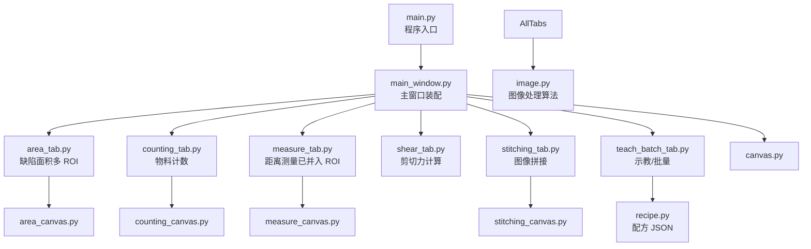
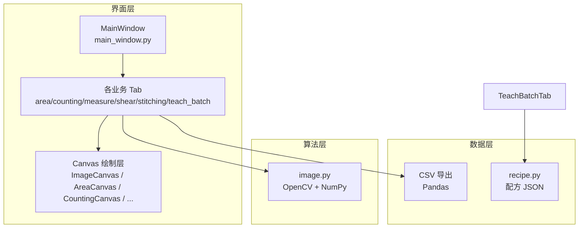
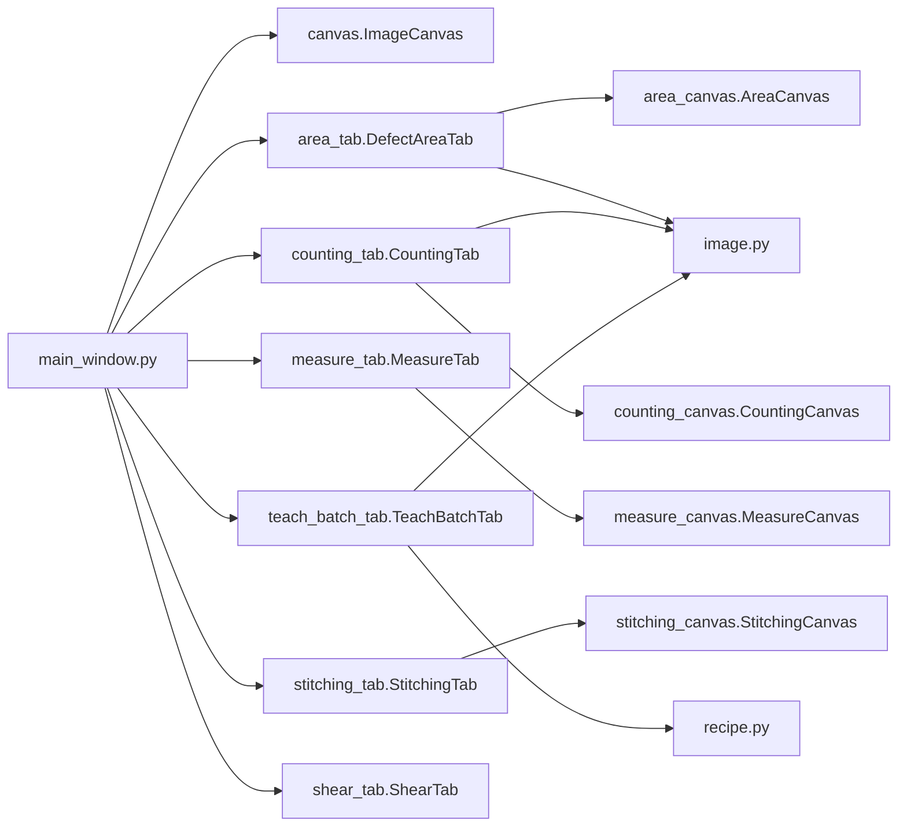

# 新功能开发流程

<cite>
**本文引用的文件**   
- [README.md](file://README.md)
- [PROJECT_CONCEPTION.md](file://PROJECT_CONCEPTION.md)
- [main.py](file://main.py)
- [main_window.py](file://main_window.py)
- [canvas.py](file://canvas.py)
- [area_tab.py](file://area_tab.py)
- [area_canvas.py](file://area_canvas.py)
- [counting_tab.py](file://counting_tab.py)
- [counting_canvas.py](file://counting_canvas.py)
- [measure_tab.py](file://measure_tab.py)
- [measure_canvas.py](file://measure_canvas.py)
- [shear_tab.py](file://shear_tab.py)
- [stitching_tab.py](file://stitching_tab.py)
- [stitching_canvas.py](file://stitching_canvas.py)
- [teach_batch_tab.py](file://teach_batch_tab.py)
- [recipe.py](file://recipe.py)
- [image.py](file://image.py)
</cite>

## 目录
1. [引言](#引言)
2. [项目结构](#项目结构)
3. [核心组件](#核心组件)
4. [架构总览](#架构总览)
5. [新增 Tab 的标准流程](#新增-tab-的标准流程)
6. [七条业务主线对照](#七条业务主线对照)
7. [依赖关系分析](#依赖关系分析)
8. [性能与交互约定](#性能与交互约定)
9. [故障排查](#故障排查)
10. [结论](#结论)

## 引言
Aurascope 是面向微电子封装产线的半自动化视觉检测桌面工具，采用 PyQt6 + OpenCV + NumPy + Pandas。产品文档 README.md 与 PROJECT_CONCEPTION.md 明确：软件不联网、不收集用户数据、纯 CPU 计算，算法集中在 image.py，GUI 层只负责图像导入、ROI/标定交互、参数调节、结果展示与 CSV 导出。

本文以「在 Aurascope 中新增一个 Tab 页面」为主线，给出从新建 Tab 文件到注册到 main_window.py 的最小可运行步骤，并说明 Canvas 继承、image.py 调用、配方持久化与导出 CSV 的规范。

## 项目结构
仓库根目录按功能模块组织，Tab 页面与其画布通常成对出现；主窗口集中装配所有 Tab，image.py 是唯一算法实现层，recipe.py 管理配方 JSON。

**图表来源**
- [main_window.py:109-148](file://main_window.py#L109-L148)
- [README.md:42-64](file://README.md#L42-L64)

**章节来源**
- [README.md:42-64](file://README.md#L42-L64)
- [PROJECT_CONCEPTION.md:77-107](file://PROJECT_CONCEPTION.md#L77-L107)

## 核心组件
- **main.py**：程序入口，启动 QApplication 并创建 MainWindow。
- **main_window.py**：MainWindow 负责创建 QTabWidget、实例化各 Tab、构建标题栏/菜单/最近打开、保存窗口状态。
- **canvas.py 中的 ImageCanvas**：空洞分析使用的通用画布，提供缩放、平移、坐标转换、ROI 多边形编辑、局部阈值笔刷、标定线等能力。
- **area_canvas.py / counting_canvas.py / measure_canvas.py / stitching_canvas.py**：各自业务画布，独立实现绘制与交互，但语义与 ImageCanvas 保持一致。
- **image.py**：唯一算法层，包含 Otsu、形态学去噪、轮廓与圆度、distanceTransform 计数、Canny 边缘校验、detect_voids/detect_objects/detect_defects 等函数。
- **recipe.py**：配方 JSON schema、读写、校验与示教模型 normalize/validate。
- **shear_tab.py**：纯表单+统计计算器，无图像画布。

**章节来源**
- [main_window.py:54-154](file://main_window.py#L54-L154)
- [canvas.py:13-94](file://canvas.py#L13-L94)
- [image.py:200-286](file://image.py#L200-L286)
- [recipe.py:20-50](file://recipe.py#L20-L50)

## 架构总览
Aurascope 的分层职责非常清晰：

**图表来源**
- [main_window.py:109-148](file://main_window.py#L109-L148)
- [PROJECT_CONCEPTION.md:77-107](file://PROJECT_CONCEPTION.md#L77-L107)

## 新增 Tab 的标准流程

### 第一步：新建 Tab 文件
新建 `new_tab.py`，类名建议为 `NewTab(QWidget)`，遵循 area_tab.py / counting_tab.py / stitching_tab.py 的结构：
1. 左侧侧边栏使用 QFrame + QScrollArea + QVBoxLayout，按钮通过 ui_components 的 create_* 工厂创建。
2. 右侧放置画布或结果控件。
3. 图片加载时仅解码显示，不在 GUI 层执行算法。
4. 用户操作触发信号 → Tab 处理状态 → 调用 image.py 纯函数 → 刷新表格/统计/画布。

参考路径：
- [area_tab.py:110-323](file://area_tab.py#L110-L323)
- [counting_tab.py:19-179](file://counting_tab.py#L19-L179)
- [stitching_tab.py:26-135](file://stitching_tab.py#L26-L135)

**章节来源**
- [area_tab.py:110-323](file://area_tab.py#L110-L323)
- [counting_tab.py:19-179](file://counting_tab.py#L19-L179)
- [stitching_tab.py:26-135](file://stitching_tab.py#L26-L135)

### 第二步：如需自定义绘制，新建 Canvas 文件
如果新 Tab 需要图像交互（缩放、平移、坐标转换、ROI 编辑），应新建 `new_canvas.py`，推荐两种方案：

- **复用 ImageCanvas**：适用于空洞分析、示教、批量等已有 ROI/标定/多边形编辑能力的场景。
- **自绘 QWidget**：适用于计数、测距、拼接等已有独立画布的场景，参考 counting_canvas.py / measure_canvas.py / stitching_canvas.py。

无论哪种方案，都应保持以下约定：
- 暴露 `empty_import` 信号，用于空状态点击导入。
- 维护 `scale`、`offset`、`img_qt`，并提供 `widget_to_img` / `img_to_widget`。
- 滚轮缩放锚点逻辑参考现有实现；注意 canvas.py 存在 Y 轴漂移已知问题，不要把现状写成正确设计。
- 右键拖拽平移，左键根据 mode 分发 ROI/标定/删除/添加等操作。
- paintEvent 中先 draw 原图，再叠加 ROI、对象、标注、提示文字。

参考路径：
- [canvas.py:13-94](file://canvas.py#L13-L94)
- [canvas.py:626-706](file://canvas.py#L626-L706)
- [area_canvas.py:85-150](file://area_canvas.py#L85-L150)
- [counting_canvas.py:10-60](file://counting_canvas.py#L10-L60)
- [measure_canvas.py:10-47](file://measure_canvas.py#L10-L47)
- [stitching_canvas.py:22-75](file://stitching_canvas.py#L22-L75)

**章节来源**
- [canvas.py:13-94](file://canvas.py#L13-L94)
- [canvas.py:626-706](file://canvas.py#L626-L706)
- [area_canvas.py:85-150](file://area_canvas.py#L85-L150)
- [counting_canvas.py:10-60](file://counting_canvas.py#L10-L60)
- [measure_canvas.py:10-47](file://measure_canvas.py#L10-L47)
- [stitching_canvas.py:22-75](file://stitching_canvas.py#L22-L75)

### 第三步：业务逻辑调用 image.py，不在 GUI 层内联算法
所有阈值、形态学、轮廓、连通域、distanceTransform、Canny、二值化、统计等逻辑必须放在 image.py 中。Tab 层只做：
- 读取 UI 参数。
- 构造输入灰度图与 ROI mask。
- 调用 detect_voids / detect_objects / detect_defects / otsu_threshold 等函数。
- 把返回的对象列表写入表格、画布和统计标签。

参考路径：
- [image.py:200-286](file://image.py#L200-L286)
- [image.py:425-488](file://image.py#L425-L488)
- [image.py:491-632](file://image.py#L491-L632)
- [counting_tab.py:390-412](file://counting_tab.py#L390-L412)

**章节来源**
- [image.py:200-286](file://image.py#L200-L286)
- [image.py:425-488](file://image.py#L425-L488)
- [image.py:491-632](file://image.py#L491-L632)
- [counting_tab.py:390-412](file://counting_tab.py#L390-L412)

### 第四步：在 main_window.py 中实例化 Tab、添加到 Tab 栏、注册菜单项与快捷键
最小可运行示例如下：

1. 在 import 区域引入新 Tab：
   - 参考 [main_window.py:45-49](file://main_window.py#L45-L49)。

2. 在 init_ui 中实例化并加入 tab_widget：
   - 参考 [main_window.py:109-148](file://main_window.py#L109-L148)。

3. 如果需要全局菜单项或快捷键：
   - 菜单在 _build_menu 中注册；
   - 快捷键在 __init__ 或 init_ui 中使用 QShortcut 绑定。

4. 如果新 Tab 需要接收拖拽图片或文件夹：
   - 参考 dropEvent 中对 area_tab / stitching_tab / teach_batch_tab 的路由逻辑。

**章节来源**
- [main_window.py:45-49](file://main_window.py#L45-L49)
- [main_window.py:109-148](file://main_window.py#L109-L148)
- [main_window.py:225-242](file://main_window.py#L225-L242)
- [main_window.py:313-339](file://main_window.py#L313-L339)

### 第五步：如需持久化配置，扩展 recipe.py 的配方 JSON schema
若新 Tab 需要保存用户参数或检测结果模板：
1. 在 recipe.py 中定义默认值、合法范围、布尔/浮点字段映射。
2. 使用 build_recipe / validate_detection / validate_roi / normalize_recipe 保证加载/保存健壮。
3. 示教配方走 type=taught 的 validate_taught 分支，文件名带 .taught.json。
4. 新 Tab 通过 list_recipes / load_recipe / save_recipe 读写 recipes/ 目录。

参考路径：
- [recipe.py:20-50](file://recipe.py#L20-L50)
- [recipe.py:169-238](file://recipe.py#L169-L238)
- [recipe.py:241-348](file://recipe.py#L241-L348)
- [recipe.py:439-475](file://recipe.py#L439-L475)

**章节来源**
- [recipe.py:20-50](file://recipe.py#L20-L50)
- [recipe.py:169-238](file://recipe.py#L169-L238)
- [recipe.py:241-348](file://recipe.py#L241-L348)
- [recipe.py:439-475](file://recipe.py#L439-L475)

### 第六步：如需导出结果，遵循现有 CSV 导出模式
现有导出模式统一为：
- 使用 pandas.DataFrame 或 csv.writer。
- 使用 QFileDialog.getSaveFileName 选择路径。
- 文件名带时间戳。
- 编码使用 utf-8-sig，便于 Excel 直接打开。
- 失败时给用户提示，成功时更新状态栏。

参考路径：
- [area_tab.py:502-543](file://area_tab.py#L502-L543)
- [counting_tab.py:425-447](file://counting_tab.py#L425-L447)
- [measure_tab.py:302-321](file://measure_tab.py#L302-L321)

**章节来源**
- [area_tab.py:502-543](file://area_tab.py#L502-L543)
- [counting_tab.py:425-447](file://counting_tab.py#L425-L447)
- [measure_tab.py:302-321](file://measure_tab.py#L302-L321)

## 七条业务主线对照

| 业务 | 主要文件 | 职责说明 |
|------|----------|----------|
| 空洞分析 | canvas.py + main_window.py | 主窗口内嵌 ImageCanvas 与侧边栏，承担 ROI、局部阈值、Canny 验证、空洞率统计。 |
| 缺陷面积多 ROI | area_tab.py / area_canvas.py | 多 ROI 检测、手动增删、比例尺标定、距离测量、CSV 导出。 |
| 物料计数 | counting_tab.py / counting_canvas.py | 矩形/多边形 ROI、增强检测、形态学、distanceTransform 计数、手动编辑、CSV 导出。 |
| 测距 | measure_tab.py / measure_canvas.py | 标定像素比后两点测距，支持水平/垂直吸附、撤销、统计、CSV 导出。 |
| 剪切力 | shear_tab.py | 按 MIL-STD-883H Method 2019.9 计算芯片剪切力要求值，无图像画布。 |
| 图像拼接 | stitching_tab.py / stitching_canvas.py | 多张图像标记金锡水平线，X/Y 双轴对齐，重叠区羽化融合，导出 PNG/TIF 并复制剪贴板。 |
| 批量示教 | teach_batch_tab.py + recipe.py | 样板图→点选空洞→焊层区域→比例尺→学习→批量检测；配方 JSON 存储示教模型。 |

**章节来源**
- [main_window.py:109-148](file://main_window.py#L109-L148)
- [area_tab.py:110-323](file://area_tab.py#L110-L323)
- [counting_tab.py:19-179](file://counting_tab.py#L19-L179)
- [measure_tab.py:22-132](file://measure_tab.py#L22-L132)
- [shear_tab.py:22-144](file://shear_tab.py#L22-L144)
- [stitching_tab.py:26-135](file://stitching_tab.py#L26-L135)
- [teach_batch_tab.py:1-15](file://teach_batch_tab.py#L1-L15)

## 依赖关系分析

**图表来源**
- [main_window.py:31-51](file://main_window.py#L31-L51)
- [area_tab.py:21-28](file://area_tab.py#L21-L28)
- [counting_tab.py:11-16](file://counting_tab.py#L11-L16)
- [teach_batch_tab.py:35-51](file://teach_batch_tab.py#L35-L51)

**章节来源**
- [main_window.py:31-51](file://main_window.py#L31-L51)
- [area_tab.py:21-28](file://area_tab.py#L21-L28)
- [counting_tab.py:11-16](file://counting_tab.py#L11-L16)
- [teach_batch_tab.py:35-51](file://teach_batch_tab.py#L35-L51)

## 性能与交互约定

### 算法与 GUI 解耦
- image.py 是纯算法层，不应依赖 Qt；长循环中通过 _pump_events 让界面有机会刷新。
- Tab 层不得内联 OpenCV 算法；UI 只负责参数、状态、结果展示。

参考路径：
- [image.py:8-25](file://image.py#L8-L25)
- [PROJECT_CONCEPTION.md:103-107](file://PROJECT_CONCEPTION.md#L103-L107)

### Canvas 交互约定
- 滚轮缩放：以鼠标位置为锚点调整 scale 和 offset。
- 右键平移：按住右键拖动移动 offset。
- 坐标转换：widget_to_img 与 img_to_widget 必须一致。
- 已知限制：canvas.py 的滚轮缩放存在 Y 轴漂移问题，不要把它描述为正确设计。

参考路径：
- [canvas.py:626-706](file://canvas.py#L626-L706)
- [area_canvas.py:332-340](file://area_canvas.py#L332-L340)

### UI 强制约定
- styles.py 提供全局 QSS 与设计 token。
- ui_components.py 的 create_* 工厂函数只创建控件、不加入布局；调用方必须手动 addWidget。
- create_groupbox() 必须使用 Preferred/Expanding 尺寸策略，否则控件被静默裁剪。

参考路径：
- [README.md:62-64](file://README.md#L62-L64)
- [PROJECT_CONCEPTION.md:97-101](file://PROJECT_CONCEPTION.md#L97-L101)

**章节来源**
- [image.py:8-25](file://image.py#L8-L25)
- [canvas.py:626-706](file://canvas.py#L626-L706)
- [area_canvas.py:332-340](file://area_canvas.py#L332-L340)
- [README.md:62-64](file://README.md#L62-L64)
- [PROJECT_CONCEPTION.md:97-101](file://PROJECT_CONCEPTION.md#L97-L101)

## 故障排查

### 已知技术债与限制
- 重复 detect_voids_local：main_window.py 内有一份 detect_voids_local 副本，现行行为以 image.py 为准，两份待合并。
- edge_map 未初始化导致 Canny 校验静默失效：部分分支中 edge_map 可能未被赋值就参与判断。
- chk_roi_overlay 被重复创建：主窗口侧边栏中存在重复创建风险。
- 滚轮缩放 Y 漂移：canvas.py 的缩放锚点计算存在 Y 轴漂移问题。
- select_for_local 为无 UI 入口的死代码。
- 大图增强检测无进度提示：长耗时计算缺少用户可见进度。

这些限制来自 handoff.md 清单；由于该文件在当前工作区不存在，本文不再展开具体行号，但建议在新增功能时优先修复上述问题，避免把旧 bug 固化到新 Tab。

**章节来源**
- [image.py:328-422](file://image.py#L328-L422)
- [image.py:200-286](file://image.py#L200-L286)
- [main_window.py:32-35](file://main_window.py#L32-L35)

### 常见问题定位
- 新 Tab 不显示：检查是否在 main_window.py 中实例化并 addTab。
- 图片无法加载：检查 Tab 的 load_image 是否调用 cv2.imdecode 或 tifffile，并处理 None。
- 算法结果不更新：确认信号连接是否正确，是否调用了 image.py 函数，是否刷新了表格/画布。
- CSV 导出乱码：确认 encoding='utf-8-sig'。
- 配方保存失败：检查 recipe.py 的 _recipe_root 是否可写，名称是否安全。

**章节来源**
- [main_window.py:109-148](file://main_window.py#L109-L148)
- [area_tab.py:342-378](file://area_tab.py#L342-L378)
- [counting_tab.py:425-447](file://counting_tab.py#L425-L447)
- [recipe.py:69-96](file://recipe.py#L69-L96)

## 结论
新增 Aurascope 功能的正确路径是：新建 Tab 文件 → 按需新建 Canvas → 在 Tab 中调用 image.py 纯函数 → 在 main_window.py 中实例化并注册 → 必要时扩展 recipe.py 配方 schema → 遵循现有 CSV 导出模式。七条业务主线已经覆盖了空洞分析、缺陷面积多 ROI、物料计数、测距、剪切力、图像拼接与批量示教；新增功能应沿用这套分层约定，避免在 GUI 层内联算法，也避免绕过 recipe.py 自行管理持久化。