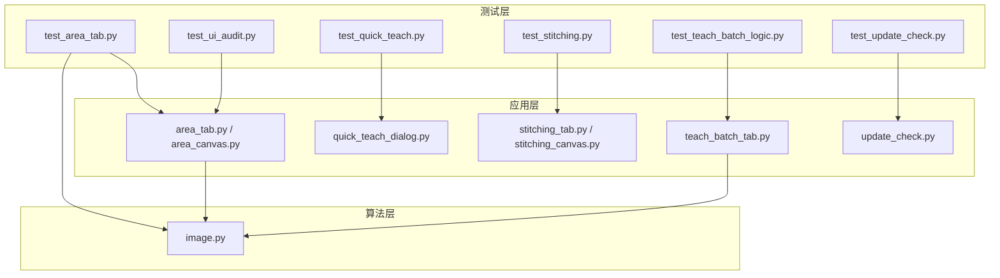
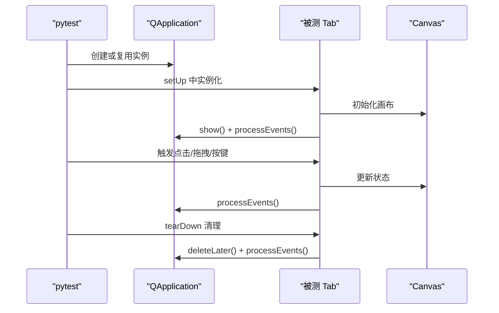
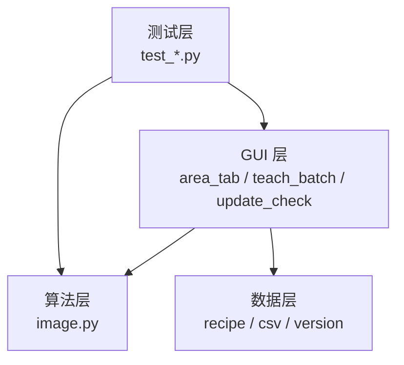
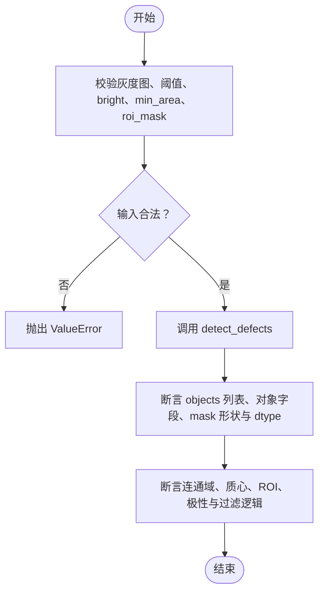
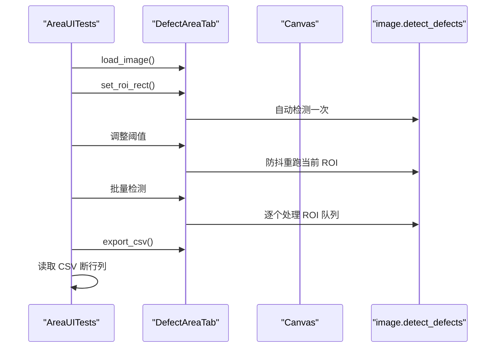
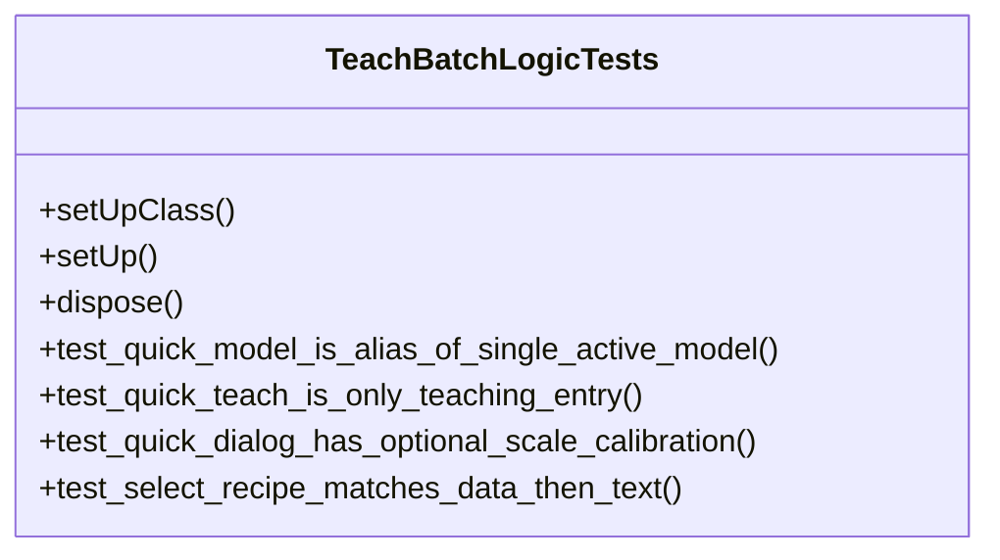
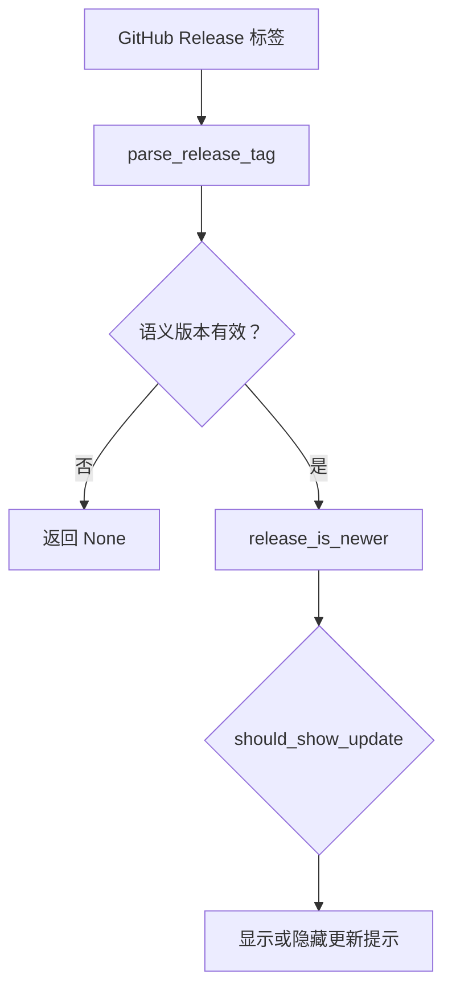
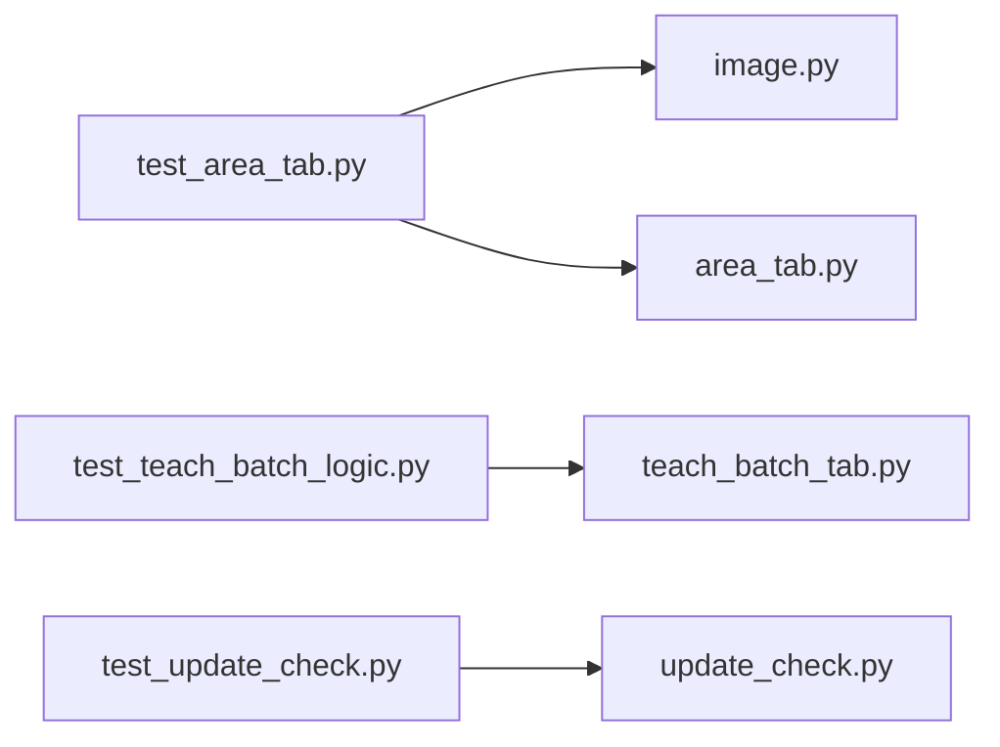
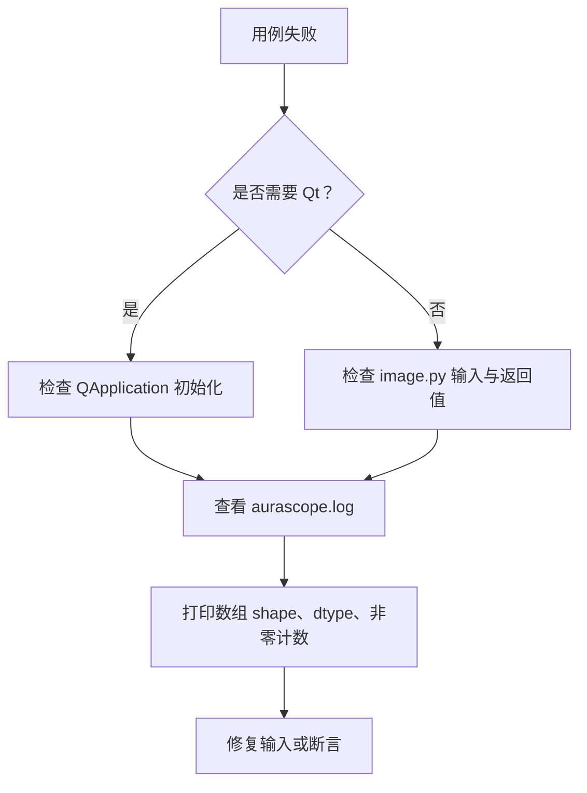

# 测试编写指南

<cite>
**本文引用的文件**   
- [README.md](file://README.md)
- [PROJECT_CONCEPTION.md](file://PROJECT_CONCEPTION.md)
- [image.py](file://image.py)
- [logging_setup.py](file://logging_setup.py)
- [test_area_tab.py](file://test_area_tab.py)
- [test_teach_batch_logic.py](file://test_teach_batch_logic.py)
- [test_update_check.py](file://test_update_check.py)
</cite>

## 目录
1. [引言](#引言)
2. [项目结构](#项目结构)
3. [核心组件](#核心组件)
4. [架构总览](#架构总览)
5. [详细组件分析](#详细组件分析)
6. [依赖分析](#依赖分析)
7. [性能考虑](#性能考虑)
8. [故障排查指南](#故障排查指南)
9. [结论](#结论)
10. [附录](#附录)

## 引言
本指南面向 Aurascope 仓库中的测试编写与维护。Aurascope 是面向微电子封装产线的半自动化视觉检测与数据分析桌面工具，技术栈为 PyQt6、OpenCV、NumPy 与 Pandas；产品定位强调“替代重复性人工判断”，算法集中在 image.py，GUI 层通过 Tab 页面与 Canvas 绘制层组织交互。

仓库根目录下以 `test_*.py` 开头的 pytest 风格单测覆盖缺陷面积 UI、快速示教、图像拼接、批量示教逻辑、UI 审计与自动更新检查等场景。当前仓库没有 CI 配置，因此不要虚构流水线、覆盖率门槛或发布流程；所有运行方式均以本地 pytest 为主。

**章节来源**
- [README.md:1-80](file://README.md#L1-L80)
- [PROJECT_CONCEPTION.md:1-143](file://PROJECT_CONCEPTION.md#L1-L143)

## 项目结构
从测试视角看，仓库根目录下的测试文件按业务模块拆分：

| 测试文件 | 职责 | 是否依赖 Qt |
|---|---|---|
| `test_area_tab.py` | 缺陷面积算法契约、多 ROI 交互、标定、距离测量、CSV 导出 | 是 |
| `test_quick_teach.py` | 快速示教流程（由作者说明） | 通常需 Qt |
| `test_stitching.py` | 图像拼接逻辑（由作者说明） | 视实现而定 |
| `test_teach_batch_logic.py` | 示教/批量 Tab 入口合并与模型状态 | 是 |
| `test_ui_audit.py` | UI 审计（由作者说明） | 通常需 Qt |
| `test_update_check.py` | GitHub Releases 版本解析与比较 | 否 |

**图表来源**
- [test_area_tab.py:1-800](file://test_area_tab.py#L1-L800)
- [test_teach_batch_logic.py:1-87](file://test_teach_batch_logic.py#L1-L87)
- [test_update_check.py:1-62](file://test_update_check.py#L1-L62)

**章节来源**
- [README.md:42-64](file://README.md#L42-L64)
- [PROJECT_CONCEPTION.md:77-107](file://PROJECT_CONCEPTION.md#L77-L107)

## 核心组件
本节聚焦测试相关核心组件：pytest 运行约定、QApplication 初始化策略、图像与 ROI 构造方法、各测试文件职责、导出断言方法与调试建议。

### pytest 运行约定
- 所有用例位于仓库根目录的 `test_*.py` 文件中。
- 用例采用 unittest.TestCase 风格，但可通过 pytest 直接发现与运行。
- 需要 GUI 的用例在类级别创建 `QApplication.instance() or QApplication([])`，并在 `setUpClass` 中完成初始化。
- 不需要 GUI 的纯算法用例可直接 import `image.py` 并断言返回值。

**章节来源**
- [test_area_tab.py:304-350](file://test_area_tab.py#L304-L350)
- [test_teach_batch_logic.py:13-28](file://test_teach_batch_logic.py#L13-L28)
- [test_update_check.py:10-18](file://test_update_check.py#L10-L18)

### QApplication 依赖处理
对于需要 Qt 组件的用例，应遵循以下模式：

1. 使用 `@classmethod setUpClass` 创建全局 QApplication。
2. 在 `setUp` 中创建临时目录、实例化被测 Tab 或对话框。
3. 调用 `self.tab.show()` 后执行 `self.app.processEvents()`，确保事件循环有机会刷新界面。
4. 在 `tearDown` 或 `addCleanup` 中关闭控件、删除对象并再次 `processEvents()`。
5. 对长耗时批量任务，使用 `QTest.qWait` 与 `app.processEvents()` 配合，避免死锁。

**图表来源**
- [test_area_tab.py:337-360](file://test_area_tab.py#L337-L360)
- [test_teach_batch_logic.py:13-34](file://test_teach_batch_logic.py#L13-L34)

**章节来源**
- [test_area_tab.py:337-360](file://test_area_tab.py#L337-L360)
- [test_teach_batch_logic.py:13-34](file://test_teach_batch_logic.py#L13-L34)

### 模拟图像与 ROI 的方法
写测试时，优先使用 NumPy 构造确定性输入，再交给 `image.py` 或 UI 层处理。

| 目标 | 推荐做法 | 说明 |
|---|---|---|
| 灰度图 | `np.zeros((h, w), dtype=np.uint8)` | 背景为黑，前景可赋值为 255 |
| RGB 图 | `cv2.cvtColor(gray, cv2.COLOR_GRAY2RGB)` | 当 UI 或 OpenCV 接口期望三通道时使用 |
| 矩形前景 | 切片赋值，例如 `gray[y:y+h, x:x+w] = 255` | 适合空洞、焊料区、ROI 区域 |
| 多边形 ROI | 构造顶点列表，调用 `image.polygon_to_mask(points, gray.shape)` | 返回二值掩码，用于 `roi_mask` |
| 空 ROI | `np.zeros_like(gray)` | 表示无有效区域 |
| 只读数组 | `arr.setflags(write=False)` | 验证函数不修改输入 |

示例路径参考：
- 灰度图与像素级断言：[test_area_tab.py:15-40](file://test_area_tab.py#L15-L40)
- 多边形 ROI 与 mask 形状断言：[test_area_tab.py:183-197](file://test_area_tab.py#L183-L197)
- 只读与非连续输入支持：[test_area_tab.py:226-236](file://test_area_tab.py#L226-L236)

**章节来源**
- [test_area_tab.py:15-40](file://test_area_tab.py#L15-L40)
- [test_area_tab.py:183-197](file://test_area_tab.py#L183-L197)
- [test_area_tab.py:226-236](file://test_area_tab.py#L226-L236)
- [image.py:138-155](file://image.py#L138-L155)

### 各测试文件的职责
| 测试文件 | 覆盖范围 | 关键断言点 |
|---|---|---|
| `test_area_tab.py` | 缺陷面积算法契约、多 ROI 交互、标定、距离测量、CSV 导出 | `detect_defects` 返回值结构、ROI 状态、union 面积、CSV 列名与行数 |
| `test_quick_teach.py` | 快速示教流程 | 快速示教对话框、可选像素比标定、配方选择 |
| `test_stitching.py` | 图像拼接逻辑 | 拼接参数、结果尺寸、边界行为 |
| `test_teach_batch_logic.py` | 示教/批量 Tab 入口合并与单一模型状态 | `quick_model` 别名、`_mode`、左侧堆栈数量 |
| `test_ui_audit.py` | UI 审计 | 控件命名、样式、布局约束 |
| `test_update_check.py` | 自动更新检查 | 版本号解析、语义比较、跳过版本逻辑 |

**章节来源**
- [test_area_tab.py:1-800](file://test_area_tab.py#L1-L800)
- [test_teach_batch_logic.py:1-87](file://test_teach_batch_logic.py#L1-L87)
- [test_update_check.py:1-62](file://test_update_check.py#L1-L62)

### 断言导出结果的示例
当测试需要验证 CSV 导出时，推荐步骤如下：

1. 使用 `tempfile.TemporaryDirectory` 创建临时目录。
2. 将输出路径指向该临时目录。
3. 调用被测对象的导出方法，例如 `tab.export_csv(path)`。
4. 使用 Python 标准库 `csv.DictReader` 读取 UTF-8 BOM 编码的 CSV。
5. 断言 `fieldnames` 包含预期列名。
6. 断言行数与业务预期一致。
7. 在 `addCleanup` 中清理临时目录。

参考路径：
- 临时目录与 CSV 字段断言：[test_area_tab.py:743-756](file://test_area_tab.py#L743-L756)

**章节来源**
- [test_area_tab.py:743-756](file://test_area_tab.py#L743-L756)

## 架构总览
测试与代码的依赖方向应遵循“GUI 层不得内联实现图像算法”的原则。测试层主要验证三类契约：

1. 算法契约：`image.py` 的输入校验、返回值结构、mask 形状、连通域行为。
2. UI 契约：Tab 页面状态、Canvas 绘制文本、ROI 交互、批量队列。
3. 数据契约：配方 JSON、CSV 导出列名与行内容、版本号解析。

**图表来源**
- [PROJECT_CONCEPTION.md:77-107](file://PROJECT_CONCEPTION.md#L77-L107)
- [test_area_tab.py:1-800](file://test_area_tab.py#L1-L800)
- [test_update_check.py:1-62](file://test_update_check.py#L1-L62)

**章节来源**
- [PROJECT_CONCEPTION.md:77-107](file://PROJECT_CONCEPTION.md#L77-L107)

## 详细组件分析

### 缺陷面积测试：test_area_tab.py
该文件同时覆盖算法契约与 Qt 交互，是仓库中最重的测试文件之一。

#### 算法契约
- 断言 `image.detect_defects` 存在且可调用。
- 断言返回对象包含 `id`、`area_px`、`cx`、`cy`、`rect`、`points`、`mask`。
- 断言 mask 的 dtype 为 `np.uint8`，shape 与前景区域一致。
- 断言孔洞不被填充、嵌套连通域不会泄漏到外层 mask。
- 断言八连通、质心计算、阈值端点、极性反转、ROI 裁剪、最小面积过滤等行为。
- 断言输入数组不被修改，输出 mask 不与输入共享内存。
- 断言只读、非连续输入仍可处理。
- 断言非法输入抛出 `ValueError`。

**图表来源**
- [test_area_tab.py:10-40](file://test_area_tab.py#L10-L40)
- [test_area_tab.py:70-102](file://test_area_tab.py#L70-L102)
- [test_area_tab.py:238-280](file://test_area_tab.py#L238-L280)

#### Qt 交互契约
- 类级别初始化 `QApplication`。
- 加载图片、设置 ROI、触发自动检测。
- 断言按钮状态、模式切换、Escape 退出、七度吸附规则。
- 断言标定、距离测量、删除线段、清空距离后的状态。
- 断言多 ROI 独立阈值、重叠 ROI 的 union 面积、手动增删仅影响当前 ROI。
- 断言批量检测队列、停止批量、新图清空队列。
- 断言 CSV 导出列名与每行 ROI 编号。

**图表来源**
- [test_area_tab.py:337-360](file://test_area_tab.py#L337-L360)
- [test_area_tab.py:426-450](file://test_area_tab.py#L426-L450)
- [test_area_tab.py:678-710](file://test_area_tab.py#L678-L710)
- [test_area_tab.py:743-756](file://test_area_tab.py#L743-L756)

**章节来源**
- [test_area_tab.py:1-800](file://test_area_tab.py#L1-L800)

### 批量示教逻辑测试：test_teach_batch_logic.py
该文件重点验证示教/批量 Tab 的入口合并与模型状态：

- 类级别创建 `QApplication`。
- 使用 `tempfile.TemporaryDirectory` 作为 `AURASCOPE_RECIPE_DIR`。
- 断言 `quick_model` 是 `model` 的别名。
- 断言 `_mode` 为 `batch`，快速示教按钮对象名为 `PrimaryBtn`。
- 断言左侧堆栈只有一个页面。
- 断言快速示教对话框支持可选像素比标定。

**图表来源**
- [test_teach_batch_logic.py:13-87](file://test_teach_batch_logic.py#L13-L87)

**章节来源**
- [test_teach_batch_logic.py:1-87](file://test_teach_batch_logic.py#L1-L87)

### 自动更新检查测试：test_update_check.py
该文件是纯解析与比较逻辑的单测，不依赖 Qt：

- 断言 `parse_release_tag` 接受带 `v` 前缀或不带的标签。
- 断言空字符串、`latest`、`v`、`None` 被拒绝。
- 断言 `release_is_newer` 使用语义版本比较。
- 断言 `should_show_update` 尊重已跳过版本。
- 断言 `parse_latest_release` 提取 version、tag、url、notes。
- 断言草稿、预发布、缺失 tag 的版本被跳过。

**图表来源**
- [test_update_check.py:10-57](file://test_update_check.py#L10-L57)

**章节来源**
- [test_update_check.py:1-62](file://test_update_check.py#L1-L62)

## 依赖分析
测试与源码之间的依赖关系如下：

**图表来源**
- [test_area_tab.py:1-800](file://test_area_tab.py#L1-L800)
- [test_teach_batch_logic.py:1-87](file://test_teach_batch_logic.py#L1-L87)
- [test_update_check.py:1-62](file://test_update_check.py#L1-L62)

**章节来源**
- [test_area_tab.py:1-800](file://test_area_tab.py#L1-L800)
- [test_teach_batch_logic.py:1-87](file://test_teach_batch_logic.py#L1-L87)
- [test_update_check.py:1-62](file://test_update_check.py#L1-L62)

## 性能考虑
- 长耗时检测应在算法内部让出事件循环。`image._pump_events` 在无 GUI 场景下安全降级，避免把分析引擎与 PyQt6 强绑定。
- 测试中若模拟长检测，应使用 `unittest.mock.patch` 包裹 `_pump_events`，并断言其至少被调用一次。
- 批量 ROI 检测应避免阻塞事件循环；测试中使用 `QTest.qWait` 与 `app.processEvents()` 等待队列清空。
- 避免在测试中反复创建大型图像；优先复用 NumPy 小图进行边界与形状断言。

**章节来源**
- [image.py:8-25](file://image.py#L8-L25)
- [test_area_tab.py:293-301](file://test_area_tab.py#L293-L301)

## 故障排查指南
当用例失败时，建议按以下步骤排查：

1. **确认 QApplication 是否已初始化**  
   需要 Qt 的用例必须在 `setUpClass` 中创建 `QApplication`，否则 `QMessageBox`、`QTest`、`QWheelEvent` 等可能崩溃。

2. **查看日志文件**  
   使用 `logging_setup.py` 提供的统一日志机制。日志默认写入 `log_dir()` 下的 `aurascope.log`，采用滚动文件处理器，单文件 1MB、保留 5 份。

3. **打印中间数组信息**  
   对失败的图像处理用例，打印：
   - 输入图像 shape
   - dtype
   - 非零像素数
   - ROI mask 形状
   - 检测结果长度与对象字段

4. **区分 GUI 与纯算法失败**  
   - 如果错误发生在 `QApplication.processEvents()` 之后，优先检查 UI 状态、定时器、批量队列。
   - 如果错误发生在直接 import `image.py` 后，优先检查输入类型、dtype、ROI 值域。

5. **利用 logging_setup 的全局异常兜底**  
   `install_excepthook` 会把主线程与工作线程未捕获异常写入日志，并尝试弹出错误对话框；无 GUI 场景下会跳过对话框，但仍记录日志。

**图表来源**
- [logging_setup.py:15-31](file://logging_setup.py#L15-L31)
- [logging_setup.py:38-88](file://logging_setup.py#L38-L88)

**章节来源**
- [logging_setup.py:15-31](file://logging_setup.py#L15-L31)
- [logging_setup.py:38-88](file://logging_setup.py#L38-L88)

## 结论
Aurascope 的测试体系以 pytest 风格组织，核心原则是：

- 需要 Qt 的用例必须显式初始化 `QApplication`，并通过 `processEvents()` 驱动界面。
- 纯算法用例应直接 import `image.py`，用 NumPy 构造灰度图与 ROI mask，断言返回值结构与数值行为。
- 多 ROI、批量检测、标定与 CSV 导出应由 `test_area_tab.py` 这类集成测试覆盖。
- 版本解析、更新检查等无 GUI 逻辑应由 `test_update_check.py` 这类轻量单测覆盖。
- 失败排查应结合 `logging_setup.py` 的日志输出与中间数组形状、dtype 打印，而不是盲目猜测。

**章节来源**
- [README.md:1-80](file://README.md#L1-L80)
- [PROJECT_CONCEPTION.md:1-143](file://PROJECT_CONCEPTION.md#L1-L143)

## 附录

### 常用测试模板
以下为通用模板说明，不直接粘贴代码，仅提供结构指引：

| 场景 | 模板要点 |
|---|---|
| 纯算法单测 | 导入 `image.py` → 构造 `np.zeros` 灰度图 → 调用函数 → 断言返回值类型、字段、shape、dtype |
| Qt 交互单测 | `setUpClass` 创建 `QApplication` → `setUp` 创建临时目录与 Tab → `show()` + `processEvents()` → 操作控件 → `tearDown` 清理 |
| 批量检测单测 | 使用 `patch` 包装检测函数 → 触发批量 → `QTest.qWait` + `processEvents()` → 断言队列状态与结果 |
| CSV 导出单测 | 临时目录 → 调用导出 → `csv.DictReader` 读取 → 断言列名与行数 |
| 版本解析单测 | 直接调用 `update_check` 函数 → 断言语义版本比较与跳过逻辑 |

**章节来源**
- [test_area_tab.py:10-40](file://test_area_tab.py#L10-L40)
- [test_area_tab.py:337-360](file://test_area_tab.py#L337-L360)
- [test_area_tab.py:743-756](file://test_area_tab.py#L743-L756)
- [test_update_check.py:10-57](file://test_update_check.py#L10-L57)