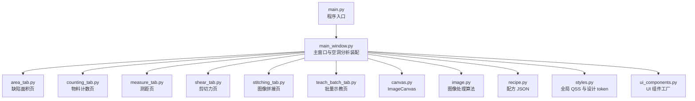
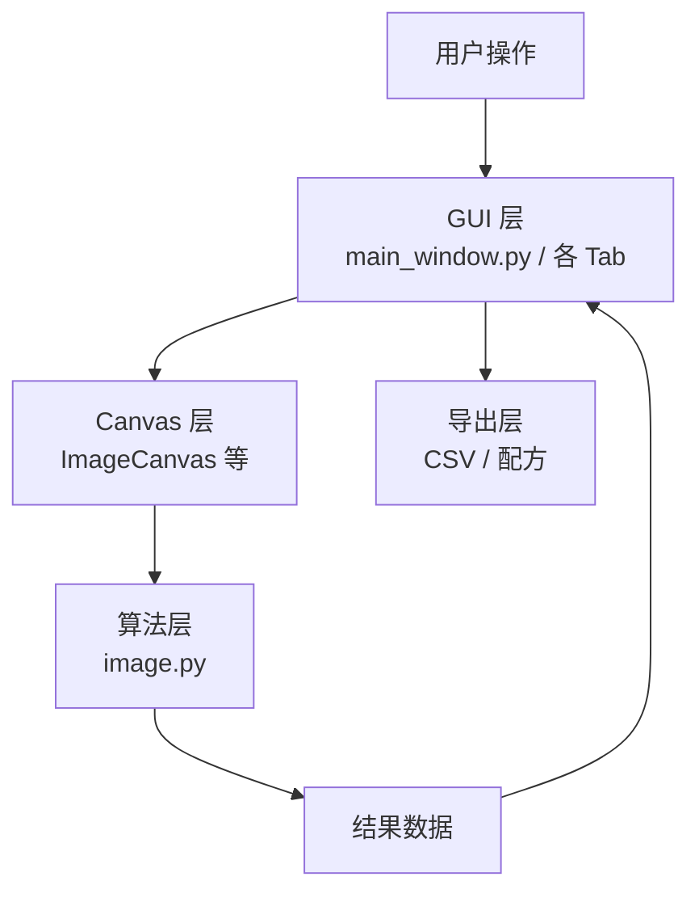
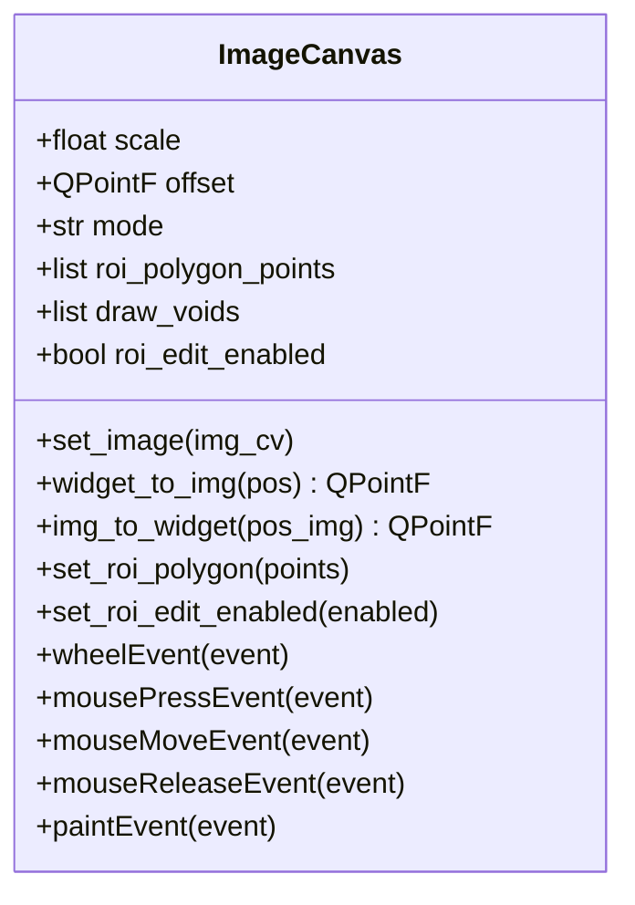
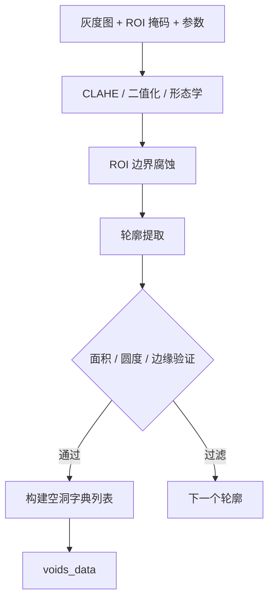
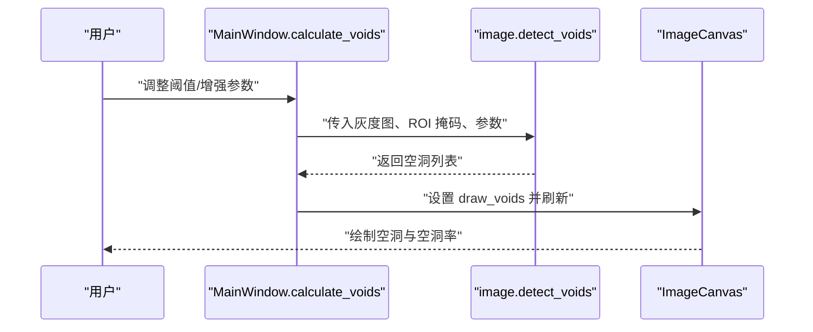
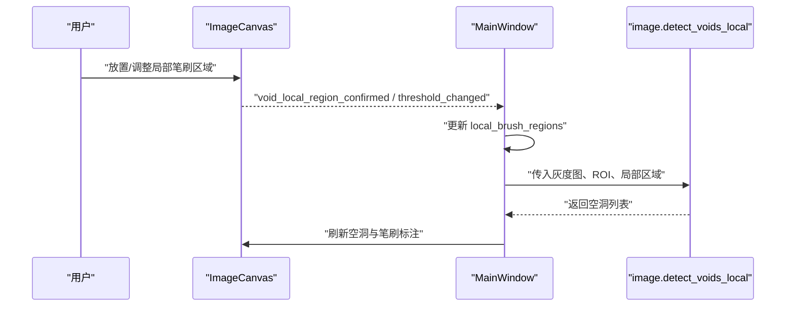
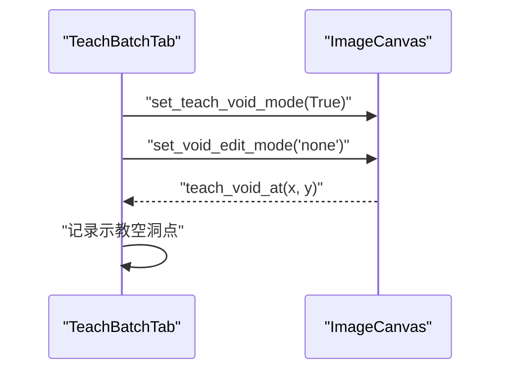
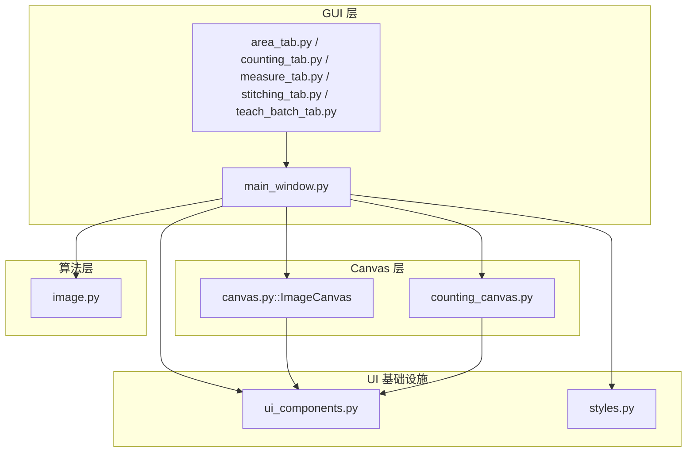

# 编码规范与约定

<cite>
**本文引用的文件**   
- [README.md](file://README.md)
- [PROJECT_CONCEPTION.md](file://PROJECT_CONCEPTION.md)
- [main.py](file://main.py)
- [main_window.py](file://main_window.py)
- [image.py](file://image.py)
- [canvas.py](file://canvas.py)
- [ui_components.py](file://ui_components.py)
- [styles.py](file://styles.py)
- [counting_canvas.py](file://counting_canvas.py)
- [teach_batch_tab.py](file://teach_batch_tab.py)
</cite>

## 目录
1. [引言](#引言)
2. [项目结构](#项目结构)
3. [核心分层与依赖方向](#核心分层与依赖方向)
4. [UI 层强制约定](#ui-层强制约定)
5. [Canvas 层通用约定](#canvas-层通用约定)
6. [算法层 image.py 契约](#算法层-imagepy-契约)
7. [已知限制与技术债](#已知限制与技术债)
8. [正确调用路径示例](#正确调用路径示例)
9. [架构总览图](#架构总览图)
10. [结论](#结论)

## 引言
Aurascope 是面向微电子封装产线的半自动化视觉检测桌面工具，使用 PyQt6 + OpenCV + NumPy + Pandas，运行在 Windows 7+ 上，纯 CPU 计算、不联网、不收集用户数据。其业务主线包括空洞分析、缺陷面积多 ROI、物料计数、测距、剪切力、图像拼接和批量示教；文档以实际源码为准，README 与 PROJECT_CONCEPTION 用于理解产品定位，代码实现才是最终行为依据。

本规范的目标是让后续修改或扩展 Aurascope 的开发者明确：GUI 层不得内联实现图像算法，所有图像处理必须通过 image.py；Canvas 层统一复用缩放/平移/坐标转换/ROI 编辑能力；新增 UI 控件遵循 ui_components.py 工厂约定，样式优先复用 styles.py 的设计 token。

**章节来源**
- [README.md:1-76](file://README.md#L1-L76)
- [PROJECT_CONCEPTION.md:77-108](file://PROJECT_CONCEPTION.md#L77-L108)

## 项目结构
仓库采用「入口 → 主窗口 → Tab 页面 → Canvas 绘制层 → 算法层 image.py → 配方/导出」的分层组织方式。入口 main.py 启动应用；main_window.py 装配主窗口、Tab 与空洞分析侧边栏；area_tab.py / area_canvas.py、counting_tab.py / counting_canvas.py、measure_tab.py / measure_canvas.py、stitching_tab.py / stitching_canvas.py 等按功能模块成对出现；image.py 集中实现阈值、形态学、轮廓、圆度、距离变换、Canny 边缘校验等算法；recipe.py 负责配方 JSON 读写；app_paths.py 提供资源与用户数据路径解析。

**图表来源**
- [main_window.py:1-50](file://main_window.py#L1-L50)
- [README.md:42-64](file://README.md#L42-L64)

**章节来源**
- [README.md:42-64](file://README.md#L42-L64)
- [PROJECT_CONCEPTION.md:77-108](file://PROJECT_CONCEPTION.md#L77-L108)

## 核心分层与依赖方向
Aurascope 的依赖方向应严格自顶向下：

| 层级 | 主要职责 | 典型文件 | 允许依赖 | 禁止依赖 |
|---|---|---|---|---|
| GUI 层 | 窗口装配、菜单、Tab、按钮、结果展示 | main_window.py、各 Tab 文件 | Qt、ui_components.py、styles.py、image.py、canvas.py、recipe.py | 不得内联实现图像算法 |
| Canvas 层 | QWidget + QPainter 自绘、缩放/平移/坐标转换/ROI 编辑 | canvas.py、counting_canvas.py 等 | Qt、OpenCV（仅坐标/几何辅助）、ui_components.py | 不得直接写空洞检测逻辑 |
| 算法层 | 纯函数式图像处理 | image.py | OpenCV、NumPy、可选 QApplication.processEvents | 不得依赖 PyQt 控件布局 |
| 数据导出层 | CSV 导出、配方读写 | main_window.py、recipe.py | Pandas、JSON、CSV | 不得包含图像像素处理 |

当前 main_window.py 同时承担 GUI 装配和部分空洞检测流程编排，因此它属于「GUI 层 + 业务编排层」，但其中真正的图像像素处理仍应落在 image.py。

**图表来源**
- [PROJECT_CONCEPTION.md:77-108](file://PROJECT_CONCEPTION.md#L77-L108)
- [main_window.py:1-50](file://main_window.py#L1-L50)
- [image.py:1-25](file://image.py#L1-L25)

**章节来源**
- [PROJECT_CONCEPTION.md:77-108](file://PROJECT_CONCEPTION.md#L77-L108)

## UI 层强制约定
以下三条为强制约定，违反会导致布局裁剪、样式不一致或测试不可用。

### 约定一：ui_components.py 的 create_* 工厂函数只创建控件
create_primary_button、create_secondary_button、create_success_button、create_danger_button、create_nav_button、create_step_title、create_info_label、create_success_label、create_checkbox、create_slider_with_label 等函数只负责构造控件并返回对象；它们不会把控件加入任何布局。调用方必须显式调用 addWidget、addLayout 或把控件放入 QHBoxLayout/QVBoxLayout。

这条约定的好处是：工厂函数可被不同 Tab、对话框、侧边栏复用，而不关心父容器是什么。

**章节来源**
- [ui_components.py:34-78](file://ui_components.py#L34-L78)
- [ui_components.py:187-235](file://ui_components.py#L187-L235)

### 约定二：create_groupbox() 必须使用 Preferred/Expanding 尺寸策略
create_groupbox 内部设置了 QGroupBox 的尺寸策略：水平 Expanding、垂直 Preferred。这意味着分组框会尽量横向撑满父布局，高度由内容决定。如果调用方绕过 create_groupbox 自行创建 QGroupBox 并设置固定宽度或错误的尺寸策略，控件可能被静默裁剪。

此外，styles.py 中 QGroupBox 的样式要求边框、圆角、标题位置与设计一致；新增分组框也应保持相同外观语义。

**章节来源**
- [ui_components.py:238-242](file://ui_components.py#L238-L242)
- [styles.py:491-499](file://styles.py#L491-L499)

### 约定三：styles.py 提供全局 QSS 与设计 token，新增样式应优先复用
styles.py 定义了中性色、主色、语义色、字阶、间距、圆角、交互态等设计 token，并通过 STYLESHEET、DIALOG_STYLESHEET、POPUP_QSS 暴露给 GUI 层。新增颜色、字号、圆角、描边不应在业务文件中硬编码十六进制值，而应优先复用 _C 中的 token。

特别地，QComboBox 弹层是独立弹出窗口，全局 QSS 不一定命中，因此 ui_components.style_combo_popups 会把 POPUP_QSS 应用到每个下拉视图。新增下拉控件时，应确保 style_combo_popups(widget) 能覆盖到该 widget。

**章节来源**
- [styles.py:1-42](file://styles.py#L1-L42)
- [styles.py:515-555](file://styles.py#L515-L555)
- [ui_components.py:425-459](file://ui_components.py#L425-L459)

## Canvas 层通用约定
Canvas 层是图像显示与交互的核心，主要约定如下：

1. **QWidget + QPainter 自绘**  
   ImageCanvas 继承 QWidget，重写 paintEvent 使用 QPainter 绘制原图、ROI、空洞、标定线、局部笔刷等覆盖层。不要在 Canvas 里嵌入 QLabel 显示图片，也不要让业务逻辑直接操作 painter。

2. **原图坐标 ↔ 屏幕坐标转换**  
   widget_to_img 把鼠标屏幕坐标转换为图像像素坐标，img_to_widget 做反向转换。所有 ROI、空洞、标注、文本标签都应基于原图坐标存储，仅在绘制时转换到屏幕坐标。

3. **滚轮缩放**  
   wheelEvent 默认以鼠标位置为锚点缩放 scale，并同步更新 offset，使缩放中心位于鼠标下方。缩放范围限制在 0.01 到 50.0。

4. **右键平移**  
   mouseMoveEvent 中按住右键移动鼠标会改变 offset，实现画布平移；mouseReleaseEvent 释放右键后恢复箭头光标。

5. **多边形 ROI 编辑**  
   set_roi_polygon、set_roi_edit_enabled、_closest_vertex_index、_closest_edge_index、keyPressEvent Delete、双击边插入顶点等共同构成 ROI 多边形编辑能力；支持吸附 edge_snap_mask、顶点拖拽、边拖拽、顶点数重采样。

6. **信号驱动状态回传**  
   Canvas 通过 pyqtSignal 把 ROI 完成、矩形变化、空洞删除/添加、局部区域确认等事件交给上层处理，而不是让上层直接读取 Canvas 内部状态。

**图表来源**
- [canvas.py:13-94](file://canvas.py#L13-L94)
- [canvas.py:152-164](file://canvas.py#L152-L164)
- [canvas.py:626-706](file://canvas.py#L626-L706)
- [canvas.py:708-943](file://canvas.py#L708-L943)

**章节来源**
- [canvas.py:13-94](file://canvas.py#L13-L94)
- [canvas.py:152-164](file://canvas.py#L152-L164)
- [canvas.py:350-544](file://canvas.py#L350-L544)
- [canvas.py:626-706](file://canvas.py#L626-L706)
- [canvas.py:708-943](file://canvas.py#L708-L943)

## 算法层 image.py 契约
image.py 是唯一的算法实现层，核心特征如下：

- 函数式接口为主，输入输出均为 NumPy/OpenCV 数据结构。
- 不包含业务状态机，也不持有 PyQt 控件引用。
- 长循环中通过 _pump_events 尝试调用 QApplication.processEvents，但 QApplication 本身是可选导入；在无 GUI 场景下仍可调用算法。
- 空洞检测主流程 detect_voids 支持 CLAHE、形态学去噪、ROI 腐蚀、轮廓提取、圆度过滤、Canny 边缘验证。
- 局部阈值 detect_voids_local 支持在全局阈值基础上叠加若干局部矩形区域的独立阈值。
- 物料计数相关函数 detect_objects、detect_defects 等复用相似流程，但面向不同业务。

**图表来源**
- [image.py:200-286](file://image.py#L200-L286)
- [image.py:328-422](file://image.py#L328-L422)

**章节来源**
- [image.py:1-25](file://image.py#L1-L25)
- [image.py:200-286](file://image.py#L200-L286)
- [image.py:328-422](file://image.py#L328-L422)

## 已知限制与技术债
根据仓库现状，以下问题属于已知限制，不应被描述为“正确设计”：

| 问题 | 影响 | 建议 |
|---|---|---|
| main_window.py 中存在 detect_voids_local 副本 | 与 image.py 中的同名函数形成重复实现，维护成本高 | 以 image.py 为准，逐步合并 main_window.py 中的副本 |
| Canny 边缘校验可能因 edge_map 未初始化而静默失效 | 开启边缘验证时检测结果可能不符合预期 | 修复 edge_map 初始化分支，并在单元测试中覆盖 |
| chk_roi_overlay 被重复创建 | 可能导致多个复选框实例状态不一致 | 统一由 _setup_void_detection_group 创建一次并复用 |
| canvas.py 滚轮缩放存在 Y 轴漂移 | 缩放后图像纵向偏移与鼠标锚点不完全一致 | 修正 img_y_before 与 new_offset_y 的计算逻辑，不要沿用现有错误行为 |
| select_for_local 为无 UI 入口的死代码 | 增加维护负担但不影响运行 | 清理或补全入口，避免误导新开发者 |
| 大图增强检测无进度提示 | 大图像 CLAHE/形态学/Canny 处理时界面可能长时间无反馈 | 在长循环中保留 _pump_events，并考虑向用户展示进度 |

需要特别强调：**canvas.py 的滚轮缩放 Y 轴漂移是 bug，不是缩放锚点的正确实现**。文档不能把它写成“以鼠标为中心缩放”的既定设计。

**章节来源**
- [main_window.py:1723-1823](file://main_window.py#L1723-L1823)
- [image.py:228-234](file://image.py#L228-L234)
- [image.py:366-370](file://image.py#L366-L370)
- [canvas.py:695-706](file://canvas.py#L695-L706)

## 正确调用路径示例
下面给出从 Tab/GUI 到 Canvas 再到 image.py 的正确调用路径。为避免复制具体代码，这里用步骤和文件路径说明。

### 示例一：空洞检测标准路径
1. 用户在 main_window.py 的空洞分析侧边栏调整阈值、面积过滤、增强选项。
2. calculate_voids 读取 slider_void.value() 和增强开关。
3. 将灰度图和 roi_mask 传给 image.detect_voids。
4. image.py 返回 voids_data。
5. main_window.py 把 voids_data 写入 canvas.draw_voids 并触发 update。
6. ImageCanvas.paintEvent 绘制空洞轮廓与编号。

**图表来源**
- [main_window.py:1199-1253](file://main_window.py#L1199-L1253)
- [image.py:200-286](file://image.py#L200-L286)
- [canvas.py:794-943](file://canvas.py#L794-L943)

**章节来源**
- [main_window.py:1199-1253](file://main_window.py#L1199-L1253)
- [image.py:200-286](file://image.py#L200-L286)
- [canvas.py:794-943](file://canvas.py#L794-L943)

### 示例二：局部阈值笔刷路径
1. 用户进入局部阈值笔刷模式。
2. Canvas 接收点击、滚轮半径调节、Shift+滚轮阈值调节、双击确认。
3. 主窗口维护 local_brush_regions，并把区域同步到 Canvas 渲染。
4. calculate_voids_with_local 调用 image.detect_voids_local 或 brush 变体。
5. 结果回写到 voids_data 并刷新画布。

**图表来源**
- [canvas.py:571-588](file://canvas.py#L571-L588)
- [canvas.py:631-669](file://canvas.py#L631-L669)
- [main_window.py:1531-1585](file://main_window.py#L1531-L1585)
- [image.py:328-422](file://image.py#L328-L422)

**章节来源**
- [canvas.py:571-588](file://canvas.py#L571-L588)
- [canvas.py:631-669](file://canvas.py#L631-L669)
- [main_window.py:1531-1585](file://main_window.py#L1531-L1585)
- [image.py:328-422](file://image.py#L328-L422)

### 示例三：Tab → Canvas 的信号协作
以 teach_batch_tab.py 为例，批量示教页通过 canvas.set_teach_void_mode 和 canvas.set_void_edit_mode 控制 Canvas 的交互模式，而不是直接监听鼠标事件。这体现了 Tab 层只做业务编排，Canvas 层负责交互细节。

**图表来源**
- [teach_batch_tab.py:2083-2119](file://teach_batch_tab.py#L2083-L2119)
- [canvas.py:116-121](file://canvas.py#L116-L121)

**章节来源**
- [teach_batch_tab.py:2083-2119](file://teach_batch_tab.py#L2083-L2119)
- [canvas.py:116-121](file://canvas.py#L116-L121)

## 架构总览图
下图把 GUI 层、Canvas 层、算法层、样式与 UI 工厂的关系汇总起来，便于扩展新功能时判断应该改哪个文件。

**图表来源**
- [main_window.py:1-50](file://main_window.py#L1-L50)
- [canvas.py:13-29](file://canvas.py#L13-L29)
- [counting_canvas.py:10-42](file://counting_canvas.py#L10-L42)
- [image.py:1-25](file://image.py#L1-L25)
- [ui_components.py:1-10](file://ui_components.py#L1-L10)
- [styles.py:1-42](file://styles.py#L1-L42)

## 结论
Aurascope 的编码规范可以浓缩为一句：**GUI 层负责交互与编排，Canvas 层负责图像坐标与绘制，image.py 负责像素算法。** 新增功能时，应先问三个问题：

1. 这个逻辑是否涉及 OpenCV/NumPy 像素处理？如果是，放到 image.py。
2. 这个逻辑是否涉及缩放、平移、坐标转换、ROI 编辑？如果是，扩展 Canvas 层。
3. 这个控件是否只是创建和配置？如果是，用 ui_components.py 的 create_* 工厂，并由调用方手动 addWidget。

同时必须记住：main_window.py 中的 detect_voids_local 副本是技术债，现行行为以 image.py 为准；canvas.py 的滚轮缩放 Y 轴漂移是已知缺陷，不应被包装成正确设计。未来扩展时应优先合并重复实现、修复已知 bug，并保持 GUI → Canvas → image.py 的单向依赖。