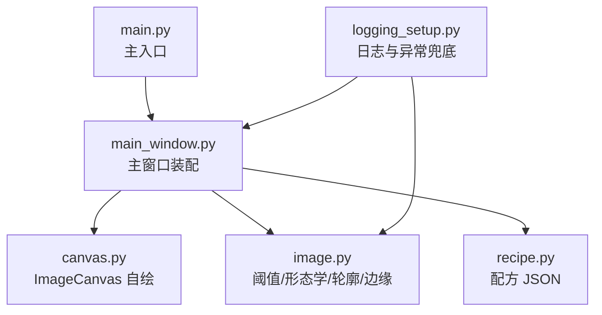
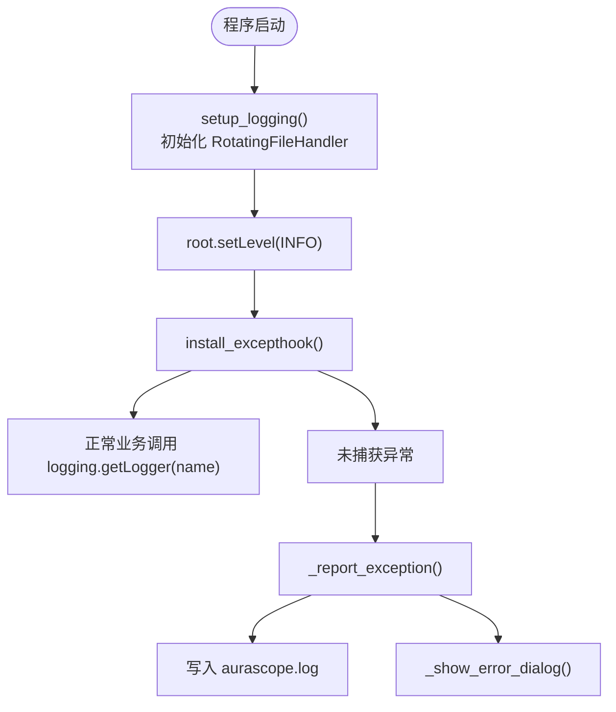
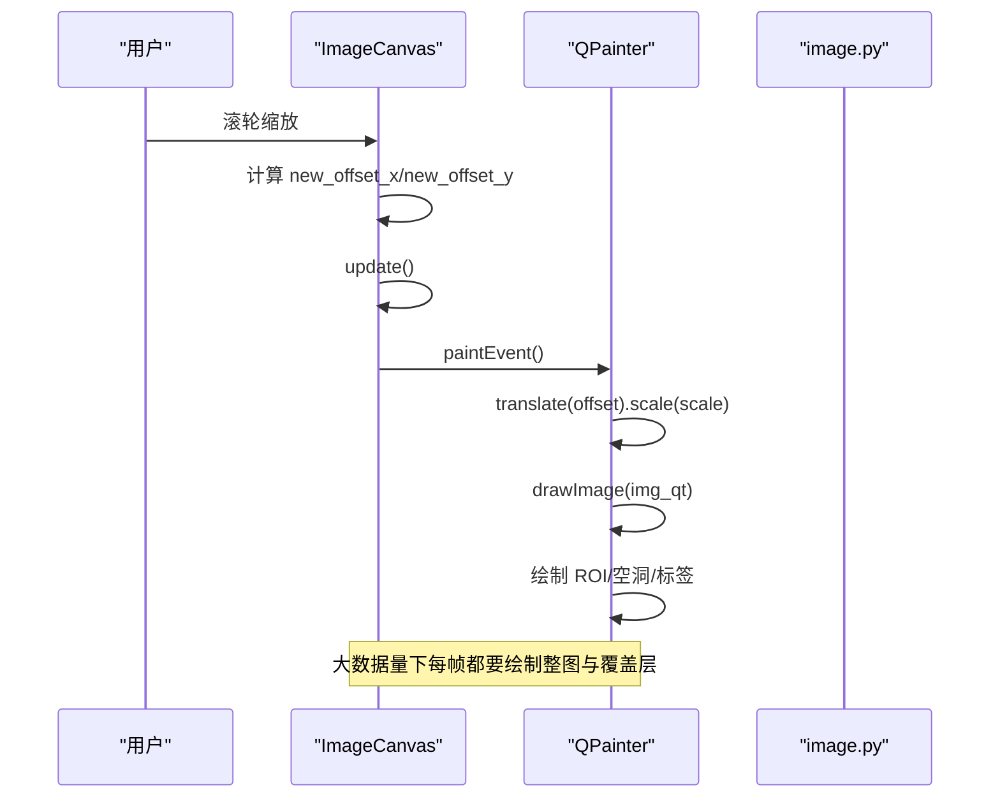
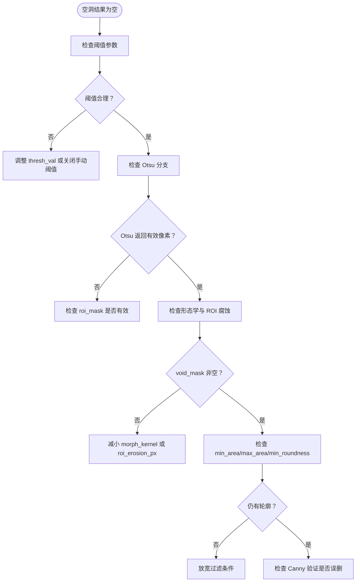
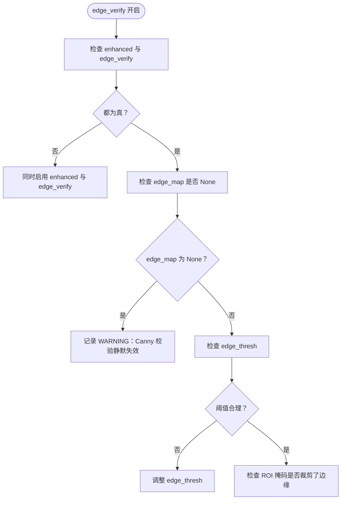
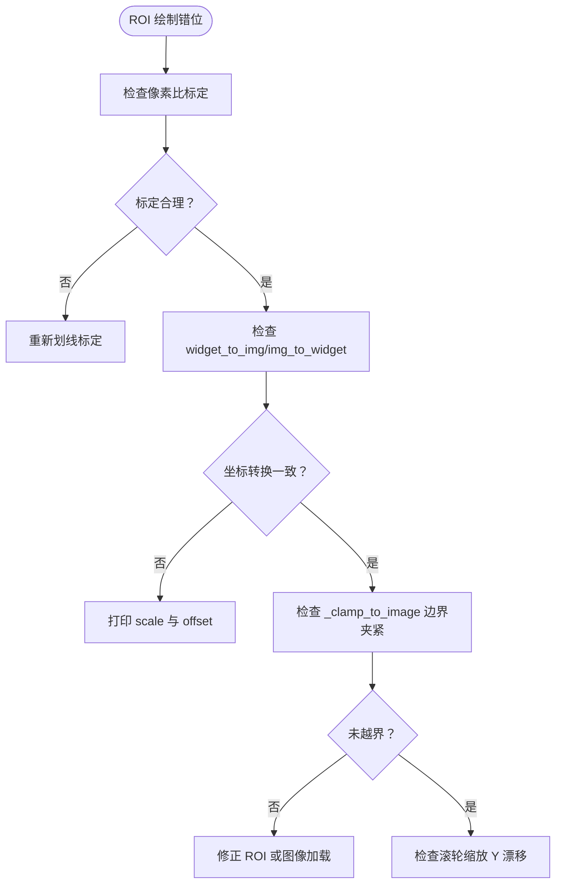
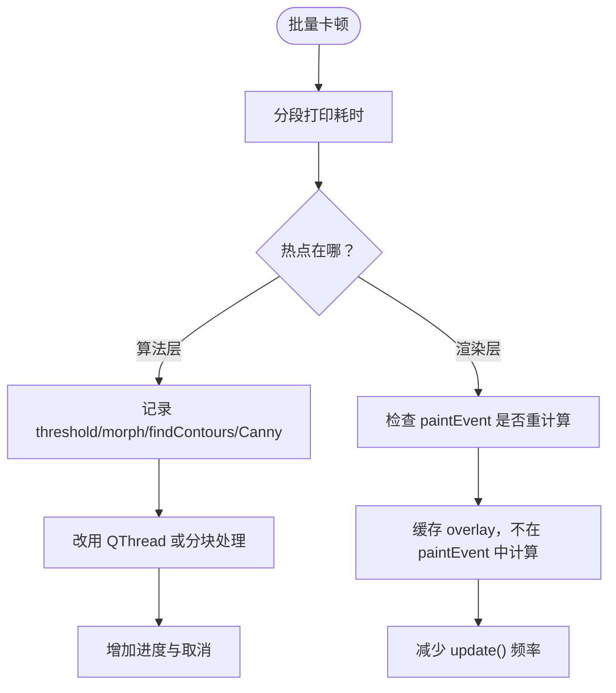

# 调试技巧与性能优化

<cite>
**本文引用的文件**   
- [logging_setup.py](file://logging_setup.py)
- [image.py](file://image.py)
- [canvas.py](file://canvas.py)
- [main_window.py](file://main_window.py)
- [README.md](file://README.md)
- [PROJECT_CONCEPTION.md](file://PROJECT_CONCEPTION.md)
- [DESIGN_分块批量空洞分析.md](file://DESIGN_分块批量空洞分析.md)
</cite>

## 目录
1. [引言](#引言)
2. [项目结构定位](#项目结构定位)
3. [日志与调试输出](#日志与调试输出)
4. [大图像检测性能分析方法](#大图像检测性能分析方法)
5. [Canvas 渲染与坐标转换开销](#canvas-渲染与坐标转换开销)
6. [已知限制与排查清单](#已知限制与排查清单)
7. [常见调试场景](#常见调试场景)
8. [性能优化建议](#性能优化建议)
9. [结论](#结论)

## 引言
Aurascope 是面向微电子封装产线的半自动化视觉检测桌面应用，核心流程为「导入图像 → 画布交互（ROI、缩放、平移）→ image.py 算法层（阈值、形态学、轮廓、距离变换、边缘校验）→ 结果统计与导出」。本文聚焦两个主题：

- **调试技巧**：如何通过 logging_setup.py 统一查看日志；如何针对空洞检测结果为空、Canny 校验失效、ROI 绘制错位、批量卡顿等典型问题快速定位。
- **性能优化**：针对大图检测中耗时函数、重复计算、paintEvent 重绘开销，给出可操作的诊断步骤和优化方向。

文档中的行为描述以仓库源码为准；handoff.md 作为“已知限制”权威来源在仓库中未找到，因此本节仅引用 DESIGN_分块批量空洞分析.md 中与 handoff.md 相关的已知问题记录，并明确说明哪些条目来自代码事实、哪些来自设计文档的待办清单。

**章节来源**
- [README.md:1-80](file://README.md#L1-L80)
- [PROJECT_CONCEPTION.md:77-108](file://PROJECT_CONCEPTION.md#L77-L108)

## 项目结构定位
从调试和性能角度，应把 Aurascope 理解为四层：

| 层级 | 主要文件 | 职责 | 调试关注点 |
|---|---|---|---|
| GUI 入口 | main.py、main_window.py | 装配 Tab、控件、信号槽 | UI 状态、重复创建控件、事件处理分支 |
| Canvas 绘制层 | canvas.py | QWidget + QPainter 自绘、缩放/平移/坐标转换、ROI 编辑 | paintEvent 是否执行重计算、滚轮缩放 Y 漂移 |
| 算法层 | image.py | 阈值/Otsu、形态学、findContours、distanceTransform、Canny、示教模型 | 输入 shape/dtype、中间数组拷贝、循环内 processEvents |
| 数据与配置 | recipe.py、app_paths.py、logging_setup.py | 配方 JSON、路径、日志滚动文件 | 日志路径、异常兜底、未捕获线程异常 |

**图表来源**
- [main_window.py:582-588](file://main_window.py#L582-L588)
- [canvas.py:13-30](file://canvas.py#L13-L30)
- [image.py:200-286](file://image.py#L200-L286)
- [logging_setup.py:15-31](file://logging_setup.py#L15-L31)

**章节来源**
- [README.md:42-64](file://README.md#L42-L64)
- [PROJECT_CONCEPTION.md:77-108](file://PROJECT_CONCEPTION.md#L77-L108)

## 日志与调试输出

### logging_setup.py 的职责
logging_setup.py 提供三个关键能力：

1. **统一日志文件**：通过 app_paths.log_dir() 确定日志目录，写入 aurascope.log，使用 RotatingFileHandler，单文件最大 1MB，保留 5 个备份。
2. **根日志级别**：root logger 默认设为 INFO，因此 DEBUG 级别消息不会自动出现，需要显式调整模块 logger 或 root logger。
3. **全局异常兜底**：install_excepthook() 同时接管 sys.excepthook 和 threading.excepthook，把未捕获异常写成 CRITICAL 日志，并在有 QApplication 时弹出错误对话框。

**图表来源**
- [logging_setup.py:15-31](file://logging_setup.py#L15-L31)
- [logging_setup.py:38-41](file://logging_setup.py#L38-L41)
- [logging_setup.py:72-87](file://logging_setup.py#L72-L87)

### 在不同模块中获取 logger
推荐做法：

- 在需要详细调试的模块顶部使用 `logging.getLogger(__name__)`，例如 `logging.getLogger("image")` 或 `logging.getLogger("canvas")`。
- 如果希望某个模块输出 DEBUG 信息，可在该模块或上层初始化处设置：
  - 对特定模块：`logging.getLogger("image").setLevel(logging.DEBUG)`
  - 对全部模块：`logging.getLogger().setLevel(logging.DEBUG)`
- 注意：logging_setup.py 已经设置了 root 级别为 INFO，所以不调整级别时，DEBUG 消息会被过滤掉。

### 设置 DEBUG/INFO/WARNING 级别
- **DEBUG**：适合打印函数入参、中间数组 shape/dtype、阈值计算过程、ROI 裁剪范围、轮廓数量、Canny 是否生成 edge_map。
- **INFO**：适合记录一次检测开始/结束、总耗时、空洞数、空洞率、是否启用 CLAHE/形态学/Canny。
- **WARNING**：适合记录参数越界、Otsu 返回空像素、edge_verify 被跳过、ROI 面积过小、批量任务取消。
- **CRITICAL**：由 logging_setup.py 的 _report_exception 用于未捕获异常；业务代码一般不应滥用。

### 查看日志输出位置
日志文件路径由 log_file() 返回，默认位于 app_paths.log_dir() 下的 aurascope.log。若尚未调用 setup_logging()，log_file() 会回退到相同默认路径。错误对话框中的「打开日志」按钮也会打开 log_dir()。

**章节来源**
- [logging_setup.py:15-35](file://logging_setup.py#L15-L35)
- [logging_setup.py:38-41](file://logging_setup.py#L38-L41)
- [logging_setup.py:44-70](file://logging_setup.py#L44-L70)
- [logging_setup.py:72-87](file://logging_setup.py#L72-L87)

## 大图像检测性能分析方法

### 定位 image.py 中的耗时函数
空洞检测相关的主要函数包括：

| 函数 | 主要操作 | 为什么可能成为瓶颈 |
|---|---|---|
| detect_voids | CLAHE、threshold、morphologyEx、erode、bitwise_and、findContours、可选 Canny、roundness、moments | 大图上 CLAHE 和 morphologyEx 成本较高；每个轮廓都可能构造 contour_mask 做 Canny 验证 |
| detect_voids_local | 同 detect_voids，但支持局部区域覆盖阈值 | 局部区域多时重复 threshold/morphology/canny 成本高 |
| detect_objects | CLAHE、threshold、morphologyEx、可选 distanceTransform、findContours、Canny | distanceTransform 与 watershed 分支在大图上代价明显 |
| otsu_threshold | flatten 或 mask 索引后调 cv2.threshold(..., THRESH_OTSU) | 全图 flatten 会产生一维大数组 |
| locate_solder_band / apply_taught_model | 二值化、形态学、connectedComponentsWithStats、fill_holes、bridge_edge_voids | 连通域、边界包络、逐列处理在大图上累积 |

### 记录输入图像 shape/dtype
建议在关键入口增加 DEBUG 日志，至少记录：

- 灰度图 shape：`(h, w)`
- dtype：是否为 uint8
- 通道数：如果是 BGR 图像，确认已正确转灰度
- ROI mask shape 是否与灰度图一致
- 是否启用了 enhanced、clahe_enabled、morph_enabled、edge_verify
- 局部区域 local_regions 的数量与尺寸

示例记录方式（概念性，不粘贴代码）：

- 进入 detect_voids 前：`logger.debug("detect_voids input=%s dtype=%s roi_mask_size=%d", gray.shape, gray.dtype, int(cv2.countNonZero(roi_mask)))`
- Otsu 前：`logger.debug("otsu roi_pixels=%d", len(roi_pixels))`
- findContours 后：`logger.debug("contours=%d max_area=%f", len(contours), float(max_area))`
- Canny 分支：`logger.debug("edge_verify enabled but edge_map is None")`

### 避免重复计算
当前实现中存在几类值得关注的重复计算模式：

1. **CLAHE 对象重复创建**：detect_voids、detect_voids_local、detect_objects 各自 createCLAHE，同一批次多次调用时会重复创建。
2. **Canny 验证为每个轮廓构造临时掩码**：在 enhanced+edge_verify 分支中，每个轮廓都 `np.zeros_like(edge_map)` 再 drawContours，再 bitwise_and 计数。
3. **局部笔刷 `_local_detect_at` 每次点击都重新做 Otsu + findContours**。
4. **paintEvent 中频繁 update()**：鼠标移动、悬停、编辑态都会触发重绘。

优化方向：

- 对固定图像，复用 CLAHE 对象或预计算灰度图。
- 将 Canny 验证改为先判断轮廓大小，小轮廓直接跳过。
- 对局部笔刷，缓存最近一次点击位置的局部二值结果，Ctrl+滚轮只改偏移而不必每次都重跑完整检测。
- 将重计算移出 paintEvent，改为只在数据变化时更新 overlay。

**章节来源**
- [image.py:200-286](file://image.py#L200-L286)
- [image.py:328-422](file://image.py#L328-L422)
- [image.py:491-632](file://image.py#L491-L632)
- [image.py:247-282](file://canvas.py#L247-L282)

## Canvas 渲染与坐标转换开销

### 滚动缩放与坐标转换
ImageCanvas 维护 scale 和 offset，并提供：

- widget_to_img：屏幕坐标 → 图像坐标
- img_to_widget：图像坐标 → 屏幕坐标
- wheelEvent：滚轮缩放，按鼠标位置计算新 offset
- mouseMoveEvent：右键拖拽平移、ROI 编辑、删除模式悬停高亮
- paintEvent：绘制原图、overlay_mask、ROI 多边形、空洞、标签、局部笔刷圆、标定线

**图表来源**
- [canvas.py:615-695](file://canvas.py#L615-L695)
- [canvas.py:697-860](file://canvas.py#L697-L860)

### 大数据量下的渲染开销
当图像分辨率很高、空洞数量很多、ROI 顶点很多时，paintEvent 会成为性能瓶颈：

- 每帧都要 drawImage 整张 Qt 图像。
- 空洞列表 draw_voids 中每个空洞都要转换为 QPointF 列表并 drawPolygon。
- ROI 多边形顶点较多时，每条边都要画线。
- 局部笔刷预览、已确认区域、标签文字、字体度量都在 paintEvent 中执行。
- 鼠标移动事件中大量 update() 会导致高频重绘。

### Y 轴漂移问题
wheelEvent 中缩放逻辑先根据鼠标位置计算新的 x offset，再根据鼠标位置计算新的 y offset。由于两次计算分别基于缩放前的 scale，而不是同一个锚点，Y 轴可能出现漂移。文档作者提示这是已知问题，不要把当前行为描述为正确设计。

排查建议：

- 固定一个鼠标位置，连续放大缩小，观察 Y 方向是否随缩放上下漂移。
- 检查是否混用了 widget 坐标和图像坐标。
- 如果需要精确缩放锚点，应以鼠标位置对应的图像坐标为中心，同时更新 x 和 y offset。

**章节来源**
- [canvas.py:141-153](file://canvas.py#L141-L153)
- [canvas.py:615-695](file://canvas.py#L615-L695)
- [canvas.py:697-927](file://canvas.py#L697-L927)

## 已知限制与排查清单

### 关于 handoff.md 的说明
仓库中不存在 handoff.md 文件，因此无法直接引用其原文。以下“已知限制”中，与 handoff.md 相关的条目来自 DESIGN_分块批量空洞分析.md 中对 handoff.md 的引用，以及代码实际行为。

### 已知限制清单

| 编号 | 限制 | 影响 | 排查建议 |
|---|---|---|---|
| L1 | 存在重复的 detect_voids_local 实现 | 主窗口 main_window.py 内有一份 detect_voids_local 副本，属于技术债；现行行为以 image.py 为准，两份待合并 | 对比两处实现差异，优先以 image.py 的 API 为准 |
| L2 | edge_map 未初始化导致 Canny 校验静默失效 | 当 enhanced+edge_verify 条件满足但 edge_map 为 None 时，Canny 验证分支被跳过，不会报错 | 在 edge_verify 分支加 WARNING 日志，记录 edge_map 是否为 None |
| L3 | chk_roi_overlay 被重复创建 | main_window.py 中创建并添加复选框，后续又读取 isChecked() 控制 show_roi_overlay，需确认是否重复实例化 | 搜索 chk_roi_overlay 的所有赋值与 addWidget 调用 |
| L4 | 滚轮缩放 Y 漂移 | wheelEvent 中 X/Y offset 分别计算，缩放锚点不一致 | 用固定鼠标位置测试缩放，记录 Y 偏移 |
| L5 | select_for_local 为无 UI 入口的死代码 | 若有该函数但没有对应按钮或信号连接，则不会被用户触发 | 搜索 symbol select_for_local，确认是否被调用 |
| L6 | 大图增强检测无进度提示 | 检测中靠 processEvents() 兜底，UI 仍可能卡顿 | 在长循环中分段打印耗时，必要时改用 QThread |

其中 L6 在 DESIGN_分块批量空洞分析.md 中被明确列为已知问题，并指出当前依赖 _pump_events()/processEvents() 兜底，大图仍会卡。

**章节来源**
- [DESIGN_分块批量空洞分析.md:20-28](file://DESIGN_分块批量空洞分析.md#L20-L28)
- [image.py:228-233](file://image.py#L228-L233)
- [image.py:366-370](file://image.py#L366-L370)
- [main_window.py:582-588](file://main_window.py#L582-L588)
- [main_window.py:1544](file://main_window.py#L1544)

## 常见调试场景

### 场景 1：空洞检测结果为空
**现象**：点击检测后，draw_voids 为空，空洞率为 0。

**排查顺序**：

1. 检查 thresh_val 是否合理：
   - 对于暗空洞，通常使用 THRESH_BINARY_INV。
   - 如果阈值过高，bin_inv 全黑；如果过低，背景也被二值化。
2. 检查 Otsu 分支：
   - 如果 roi_mask 有效但内部像素为空，otsu_threshold 会返回默认值 128。
   - 如果带内 Otsu 被退回，apply_taught_model 会记录警告。
3. 检查形态学参数：
   - morph_kernel 过大可能把小空洞开运算掉。
   - roi_erosion_px 过大会侵蚀 ROI 内部，使 void_mask 变空。
4. 检查 min_area/max_area/min_roundness：
   - 所有候选轮廓都被面积或圆度过滤掉。
5. 打印中间结果：
   - bin_inv 非零像素数
   - contours 数量
   - 最大轮廓面积
   - ROI 掩码非零像素数

**图表来源**
- [image.py:180-197](file://image.py#L180-L197)
- [image.py:200-286](file://image.py#L200-L286)
- [image.py:328-422](file://image.py#L328-L422)

**章节来源**
- [image.py:180-197](file://image.py#L180-L197)
- [image.py:200-286](file://image.py#L200-L286)
- [image.py:328-422](file://image.py#L328-L422)

### 场景 2：Canny 边缘验证无效
**现象**：开启 edge_verify 后，空洞数量没有变化，或预期被过滤的空洞仍在。

**排查顺序**：

1. 确认 enhanced 和 edge_verify 同时为真。
2. 检查 edge_map 是否成功生成：
   - detect_voids 中 edge_map 在 enhanced+edge_verify 时生成。
   - detect_voids_local 中也类似。
   - 如果 edge_map 为 None，Canny 验证分支不会执行。
3. 检查 edge_thresh：
   - 默认 0.3，表示轮廓像素中至少 30% 与 Canny 边缘重叠才保留。
   - 阈值过高会误删空洞；过低则几乎不过滤。
4. 检查 ROI 掩码：
   - Canny 后会用 roi_mask 或 interior_mask 做 bitwise_and，ROI 外边缘被剔除。

**图表来源**
- [image.py:228-233](file://image.py#L228-L233)
- [image.py:255-263](file://image.py#L255-L263)
- [image.py:366-370](file://image.py#L366-L370)
- [image.py:392-399](file://image.py#L392-L399)

**章节来源**
- [image.py:228-233](file://image.py#L228-L233)
- [image.py:255-263](file://image.py#L255-L263)
- [image.py:366-370](file://image.py#L366-L370)
- [image.py:392-399](file://image.py#L392-L399)

### 场景 3：ROI 绘制错位
**现象**：画出的 ROI、空洞标注或局部笔刷圆与实际图像位置不一致。

**排查顺序**：

1. 检查像素比标定：
   - 如果涉及实际单位换算，确认 calib_line 和 pixel_scale 是否正确。
2. 检查 widget_to_img 与 img_to_widget：
   - widget_to_img 使用 `(pos - offset) / scale`。
   - img_to_widget 使用 `pos * scale + offset`。
3. 检查坐标边界夹紧：
   - widget_to_img 会把坐标 clamp 到 `[0, width-1] × [0, height-1]`。
   - _clamp_to_image 也做类似夹紧。
4. 检查缩放后的画笔宽度：
   - 多处使用 `2 / self.scale` 或 `4.5 / self.scale`，缩放很大时线条很细，看起来像错位。
5. 检查 Y 轴漂移：
   - 如果缩放后 Y 偏移，ROI 中心点可能在视觉上偏上或偏下。

**图表来源**
- [canvas.py:141-153](file://canvas.py#L141-L153)
- [canvas.py:284-289](file://canvas.py#L284-L289)
- [canvas.py:615-695](file://canvas.py#L615-L695)

**章节来源**
- [canvas.py:141-153](file://canvas.py#L141-L153)
- [canvas.py:284-289](file://canvas.py#L284-L289)
- [canvas.py:615-695](file://canvas.py#L615-L695)

### 场景 4：批量检测卡顿
**现象**：大图或大批次图片检测时界面长时间无响应，或进度条不动。

**排查顺序**：

1. 分段打印耗时：
   - 在 detect_voids 外层记录开始时间。
   - 在 threshold、morphologyEx、findContours、Canny、轮廓遍历后分别记录耗时。
   - 对每个 ROI 或 tile 记录文件名、shape、空洞数、耗时。
2. 检查 processEvents：
   - image.py 的 _pump_events 每 10 个轮廓调用一次 QApplication.processEvents()。
   - 这能避免 Python 完全阻塞，但不能替代后台线程。
3. 检查是否有重计算：
   - paintEvent 中是否触发了 detect_voids 或 CLAHE。
   - 鼠标移动是否反复重建 edge_snap_mask。
4. 考虑分块或后台线程：
   - DESIGN_分块批量空洞分析.md 指出当前依赖 processEvents() 兜底，大图仍会卡。

**图表来源**
- [image.py:14-24](file://image.py#L14-L24)
- [image.py:238-240](file://image.py#L238-L240)
- [image.py:375-377](file://image.py#L375-L377)
- [DESIGN_分块批量空洞分析.md:20-28](file://DESIGN_分块批量空洞分析.md#L20-L28)

**章节来源**
- [image.py:14-24](file://image.py#L14-L24)
- [image.py:238-240](file://image.py#L238-L240)
- [image.py:375-377](file://image.py#L375-L377)
- [DESIGN_分块批量空洞分析.md:20-28](file://DESIGN_分块批量空洞分析.md#L20-L28)

## 性能优化建议

### 减少不必要的 NumPy 拷贝
- 避免对整幅灰度图反复 copy()。例如 detect_voids 在非 enhanced 分支直接 `processed = gray_img.copy()`，可考虑只在必要时复制。
- 局部笔刷 `_local_detect_at` 中 `full_bin = np.zeros((h, w), dtype=np.uint8)` 每次点击都分配整幅掩码，可复用缓冲区。
- Canny 验证中每个轮廓都 `np.zeros_like(edge_map)`，可复用一个临时掩码变量。

### 复用中间数组
- CLAHE 对象可按图像复用，不必每次 detect_voids 都 createCLAHE。
- ROI 掩码 erosion 后的 interior_mask 可缓存，避免重复 erode。
- 批量检测时，若多个 ROI 共享同一张原图，应共享灰度图和 ROI mask，只切片 ROI 子区域。

### 避免在 paintEvent 中执行重计算
- paintEvent 只负责绘制已有数据。
- 空洞检测、Otsu、findContours、Canny、CLAHE、形态学都应放在信号槽或后台线程中。
- 如需预览，可使用低分辨率缩略图或延迟计算。

### 降低 update() 频率
- 鼠标移动事件中不要每次 move 都 update()，可加入防抖或使用 QTimer.singleShot。
- ROI 编辑完成后一次性 emit 信号并 update()，而不是拖动过程中频繁刷新。

### 大图检测的分块策略
- 如果 ROI 明确，只对 ROI 子图运行 detect_voids。
- 如果必须整图检测，先做降采样预览，确认参数后再在原图计算。
- 对大批次图片，按 DESIGN_分块批量空洞分析.md 的思路：标量常驻、图像按需加载、进度与取消。

**章节来源**
- [image.py:208-213](file://image.py#L208-L213)
- [image.py:247-282](file://canvas.py#L247-L282)
- [image.py:255-263](file://image.py#L255-L263)
- [DESIGN_分块批量空洞分析.md:64-66](file://DESIGN_分块批量空洞分析.md#L64-L66)

## 结论
Aurascope 的调试与性能优化应围绕三层展开：

1. **日志层**：通过 logging_setup.py 统一输出 aurascope.log，合理使用 DEBUG/INFO/WARNING，并把未捕获异常交给 install_excepthook。
2. **算法层**：以 image.py 为唯一算法事实源，重点监控 threshold、morphologyEx、findContours、distanceTransform、Canny 的输入 shape/dtype、中间数组拷贝和循环次数。
3. **渲染层**：canvas.py 的 paintEvent 不应执行重计算；滚轮缩放存在 Y 轴漂移问题，ROI 错位时需检查像素比标定与 widget↔img 坐标转换。

已知限制中，重复 detect_voids_local、edge_map 未初始化导致 Canny 静默失效、chk_roi_overlay 重复创建、滚轮缩放 Y 漂移、select_for_local 死代码、大图增强检测无进度提示，都是排查时应优先核对的点。对于大图批量检测，建议结合分段耗时日志、后台线程、中间数组复用和 paintEvent 去重，逐步定位瓶颈。