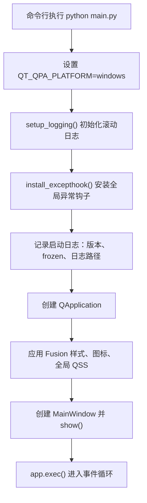
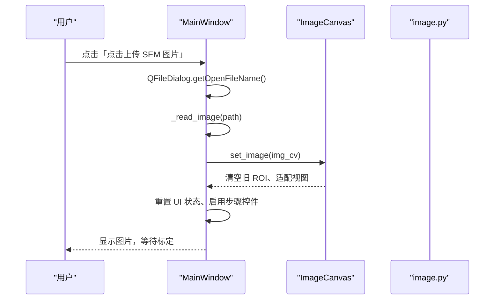
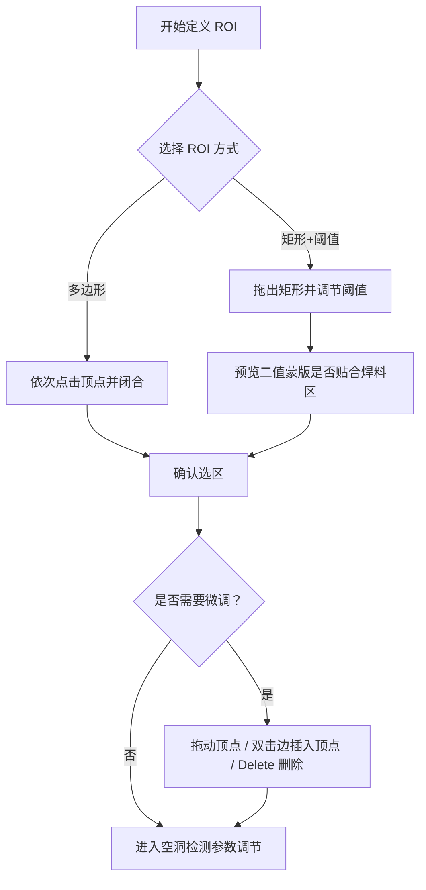
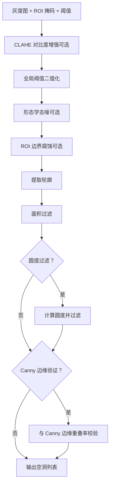
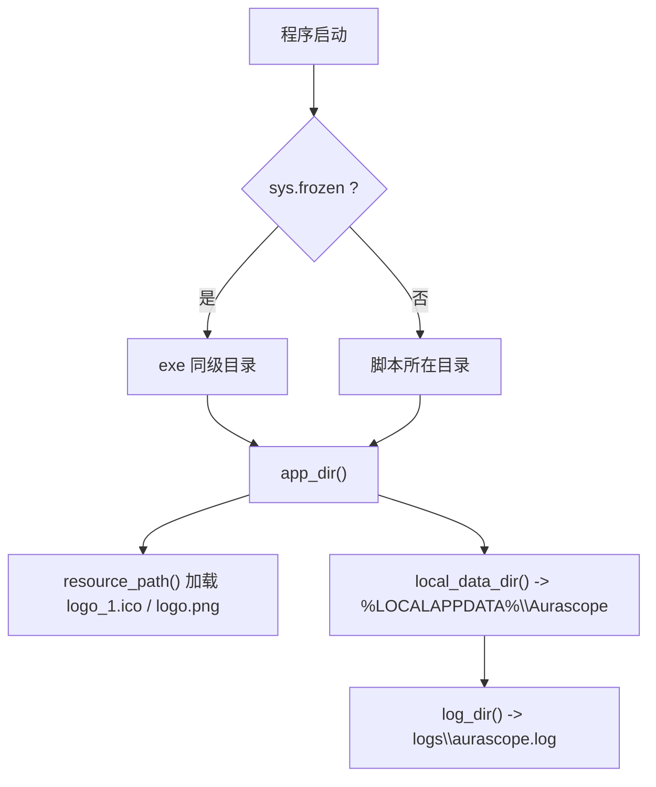
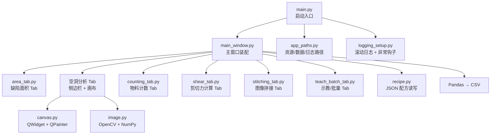

# 快速开始

<cite>
**本文引用的文件**   
- [README.md](file://README.md)
- [PROJECT_CONCEPTION.md](file://PROJECT_CONCEPTION.md)
- [requirements.txt](file://requirements.txt)
- [main.py](file://main.py)
- [app_paths.py](file://app_paths.py)
- [logging_setup.py](file://logging_setup.py)
- [main_window.py](file://main_window.py)
- [canvas.py](file://canvas.py)
- [image.py](file://image.py)
</cite>

## 目录
1. [简介](#简介)
2. [环境准备](#环境准备)
3. [启动 Aurascope](#启动-aurascope)
4. [首次打开图片](#首次打开图片)
5. [一次完整的空洞检测流程](#一次完整的空洞检测流程)
6. [资源路径与日志位置](#资源路径与日志位置)
7. [常见启动错误排查](#常见启动错误排查)
8. [架构速览](#架构速览)
9. [已知限制与注意事项](#已知限制与注意事项)
10. [结论](#结论)

## 简介
Aurascope 是面向微电子封装产线的半自动化视觉检测桌面工具，核心用途是把金锡焊料 X 光 / SEM 图中的空洞检测、缺陷面积分析、物料计数、尺寸测量等重复性手工流程标准化。它基于 PyQt6 + OpenCV + NumPy + Pandas，纯 CPU 计算，不联网、不收集用户数据，兼容 Windows 7+。

本指南只覆盖第一次接触该工具的工程师最需要的操作：装依赖、启动、导入图片、标定像素比、定义 ROI、调参、执行空洞检测、导出 CSV。

**章节来源**
- [README.md:1-40](file://README.md#L1-L40)
- [PROJECT_CONCEPTION.md:1-14](file://PROJECT_CONCEPTION.md#L1-L14)

## 环境准备
### 系统要求
- Python 3.10+
- Windows 7+

### 安装依赖
在项目根目录执行：
```bash
pip install -r requirements.txt
```

`requirements.txt` 当前声明的核心依赖如下：
| 依赖 | 最低版本 | 用途 |
|------|----------|------|
| PyQt6 | >= 6.4.0 | 桌面 GUI |
| opencv-python | >= 4.8.0 | 图像处理 |
| numpy | >= 1.24.0 | 数值计算 |
| pandas | >= 1.5.0 | CSV 导出 |
| tifffile | >= 2023.7.8 | TIF/TIFF 图像读取 |

如果安装 OpenCV 失败，优先检查 Python 位数（推荐 64 位）和 Windows 系统是否满足运行库要求；若仍失败，可尝试使用 `opencv-python-headless` 或从可信源安装预编译 wheel。

**章节来源**
- [README.md:18-33](file://README.md#L18-L33)
- [requirements.txt:1-6](file://requirements.txt#L1-L6)

## 启动 Aurascope
在仓库根目录执行：
```bash
python main.py
```

`main.py` 的启动顺序可以理解为：
1. 设置 Qt 平台为 Windows。
2. 初始化日志并安装全局异常钩子。
3. 记录启动信息，包括版本号、是否打包运行、日志文件路径。
4. 配置高 DPI 缩放策略。
5. 创建 `QApplication`，设置 Fusion 样式、窗口图标、全局 QSS。
6. 创建主窗口 `MainWindow` 并显示。
7. 进入 Qt 事件循环。



**图示来源**
- [main.py:1-44](file://main.py#L1-L44)

**章节来源**
- [main.py:1-44](file://main.py#L1-L44)

## 首次打开图片
启动后，界面顶部有模块导航按钮，默认首页是「ROI」页。首次打开图片有两种方式：

| 方式 | 操作步骤 |
|------|----------|
| 侧边栏上传 | 点击「点击上传 SEM 图片」按钮，选择 PNG/JPG/BMP/TIF/TIFF 文件 |
| 拖拽导入 | 直接把图片文件拖入窗口；单张图进入 ROI 页，多张图进入拼接页，文件夹进入批量检测页 |

成功导入后，左侧步骤面板会启用「比例尺标定」「缺陷区域定义」「缺陷识别」相关控件，右侧画布显示原图。



**图示来源**
- [main_window.py:737-769](file://main_window.py#L737-L769)
- [canvas.py:123-140](file://canvas.py#L123-L140)

**章节来源**
- [main_window.py:737-769](file://main_window.py#L737-L769)
- [canvas.py:123-140](file://canvas.py#L123-L140)

## 一次完整的空洞检测流程
以下流程以「空洞分析」Tab 为主，按顺序完成：**导入 → 标定像素比 → 定义 ROI → 调参 → 检测 → 导出 CSV**。

### 第 1 步：导入图片
参考「首次打开图片」一节。导入成功后，左侧面板应出现「比例尺标定」「缺陷区域定义」「缺陷识别」三个区块。

### 第 2 步：标定像素比
1. 点击「划线标定」。
2. 在图上按住左键拖出一条参考线，对应真实物理长度（例如一段已知微米长度的边界）。
3. 松开鼠标后，根据界面提示输入实际长度，系统自动计算每像素对应的微米值。
4. 标定完成后，「比例尺标定」区域会显示当前像素比，后续测距和面积换算才有效。

注意：标定逻辑由画布的校准模式驱动，主窗口负责接收信号并更新像素比状态。

**章节来源**
- [main_window.py:434-440](file://main_window.py#L434-L440)
- [canvas.py:420-438](file://canvas.py#L420-L438)

### 第 3 步：定义 ROI（缺陷区域）
空洞检测只在 ROI 内进行。项目支持两种 ROI 方式：

| 方式 | 适用场景 | 操作要点 |
|------|----------|----------|
| 多边形框选 | 焊料区形状不规则、边界清晰 | 依次点击顶点，回到起点闭合 |
| 矩形框 + 阈值 | 焊料区边界较明显，可用灰度阈值区分 | 拖出矩形，调节阈值预览二值效果，确认选区 |

推荐流程：
1. 先点击「多边形框选」或「矩形框+阈值」。
2. 在图上绘制 ROI。
3. 如果使用矩形方式，拖动滑块调整阈值，观察绿色预览蒙版是否贴合焊料区。
4. 点击「确认选区」。
5. 如需微调，可在高级选项中开启「选区绿色蒙版」，并使用多边形编辑功能增删顶点。



**图示来源**
- [main_window.py:442-534](file://main_window.py#L442-L534)
- [canvas.py:350-438](file://canvas.py#L350-L438)

**章节来源**
- [main_window.py:442-534](file://main_window.py#L442-L534)
- [canvas.py:350-438](file://canvas.py#L350-L438)

### 第 4 步：调节空洞检测参数
进入「缺陷识别」区块后，主要可调项包括：

| 参数 | 作用 | 建议 |
|------|------|------|
| 识别阈值 | 全局二值化阈值，越小越容易把暗点当空洞 | 先用「自动 (Otsu)」，再微调滑块 |
| 编号 / 红色填充 | 控制结果可视化 | 调试时勾选编号方便核对 |
| 最小/最大面积 | 过滤过小或过大的轮廓 | 初始保持默认，发现误检后再调整 |
| 边界腐蚀 | 将 ROI 边界向内收缩，断开边界伪影 | 通常保留默认 3px |
| 启用增强检测 | 组合 CLAHE、形态学、圆度、Canny 边缘验证 | 光照不均时建议开启 |
| CLAHE 对比度 | 局部对比度增强强度 | 过大可能放大噪声 |
| 形态学去噪 | 开运算去除小噪点 | 核大小影响连通性 |
| 圆度过滤 | 筛除非圆形轮廓 | 0 表示关闭 |
| Canny 边缘验证 | 空洞轮廓需与真实图像边缘重合 | 对噪声敏感，可先关闭 |

对于光照不均匀的区域，可使用「局部阈值调节」：在图上放置圆形笔刷，用 Shift+滚轮调节局部阈值，双击确认。

**章节来源**
- [main_window.py:536-668](file://main_window.py#L536-L668)
- [canvas.py:626-693](file://canvas.py#L626-L693)

### 第 5 步：执行检测
点击「导出数据」或触发自动计算后，程序会调用 image.py 中的空洞检测函数，典型处理链为：

1. 可选 CLAHE 对比度增强。
2. 全局阈值二值化。
3. 可选形态学去噪。
4. 可选 ROI 边界腐蚀。
5. 提取轮廓。
6. 可选圆度过滤。
7. 可选 Canny 边缘验证。
8. 统计每个空洞的面积、中心坐标、外接矩形、轮廓点。



**图示来源**
- [image.py:200-286](file://image.py#L200-L286)

**章节来源**
- [image.py:200-286](file://image.py#L200-L286)

### 第 6 步：导出 CSV
检测结果统一通过 Pandas 导出为 CSV 文件。主窗口提供「导出数据」按钮，用于查看结果表格并保存。

导出产物包含空洞编号、像素面积、中心坐标、外接矩形、轮廓点等信息，便于后续在 Excel 或其他分析工具中汇总。

**章节来源**
- [main_window.py:471-477](file://main_window.py#L471-L477)
- [PROJECT_CONCEPTION.md:55-59](file://PROJECT_CONCEPTION.md#L55-L59)

## 资源路径与日志位置

### 资源路径解析逻辑
`app_paths.py` 提供两类关键路径：

| 函数 | 行为 | 说明 |
|------|------|------|
| `resource_path(name)` | 源码运行时取脚本所在目录；PyInstaller 单文件模式下取 `_MEIPASS` 解包目录 | 用于加载 logo、图标等资源 |
| `app_dir()` | 源码运行时取本文件目录；打包后取 exe 同级目录 | 程序所在目录 |
| `local_data_dir()` | 返回 `%LOCALAPPDATA%\Aurascope` 或 `~\AppData\Local\Aurascope` | 用户可写数据目录 |
| `log_dir()` | 返回 `local_data_dir()/logs` | 日志目录 |
| `build_date()` | 打包后取 exe 修改时间，源码运行取脚本修改时间 | 构建日期 |



**图示来源**
- [app_paths.py:8-42](file://app_paths.py#L8-L42)
- [main.py:14-15](file://main.py#L14-L15)

**章节来源**
- [app_paths.py:1-42](file://app_paths.py#L1-L42)
- [main.py:14-15](file://main.py#L14-L15)

### 日志输出位置
日志由 `logging_setup.py` 初始化，写入：
```
%LOCALAPPDATA%\Aurascope\logs\aurascope.log
```

日志特征：
- 使用 `RotatingFileHandler`，单文件最大 1MB，最多保留 5 个备份。
- 格式包含时间、级别、模块名和消息。
- 启动时会记录 Aurascope 版本、是否打包运行、日志路径。
- 未捕获异常会通过全局异常钩子写入日志，并在 GUI 环境下弹出错误对话框，支持复制详情和打开日志目录。

**章节来源**
- [logging_setup.py:15-35](file://logging_setup.py#L15-L35)
- [logging_setup.py:38-88](file://logging_setup.py#L38-L88)
- [main.py:21-25](file://main.py#L21-L25)

## 常见启动错误排查

### 1. Qt 平台插件缺失或无法加载
**现象**
- 启动后立即退出。
- 报错类似找不到 Qt 平台插件、`qt.qpa.plugin` 相关错误。
- 在 PyInstaller 打包环境中更容易出现。

**排查步骤**
1. 确认已安装 PyQt6：`pip show PyQt6`。
2. 如果是源码运行，确保 `QT_QPA_PLATFORM` 没有被其他进程设置为异常值。
3. 如果是打包后的 exe，检查 PyInstaller 打包配置是否正确包含 Qt 平台插件。
4. 临时尝试设置环境变量 `QT_QPA_PLATFORM=windows` 后再次启动。

**关联代码**
`main.py` 显式设置 `os.environ["QT_QPA_PLATFORM"] = "windows"`，这是 Windows 桌面环境的必要入口。

**章节来源**
- [main.py:3-10](file://main.py#L3-L10)

### 2. OpenCV DLL 加载失败
**现象**
- 启动时报错找不到 `cv2` 或某些 OpenCV DLL。
- 导入 OpenCV 时抛出 `ImportError` 或 `OSError`。

**排查步骤**
1. 确认 `opencv-python>=4.8.0` 已成功安装。
2. 检查 Python 解释器位数与 OpenCV wheel 位数一致（推荐 64 位）。
3. 清理虚拟环境后重新安装：
   ```bash
   pip uninstall opencv-python
   pip install opencv-python
   ```
4. 如果仍失败，尝试安装 `opencv-python-headless` 或从可信渠道获取预编译 wheel。
5. 检查系统是否缺少 Visual C++ 运行库。

**章节来源**
- [requirements.txt:1-6](file://requirements.txt#L1-L6)

### 3. 图片加载失败
**现象**
- 点击「点击上传 SEM 图片」后提示图片加载失败。
- 拖拽图片无响应或提示无法打开。

**排查步骤**
1. 确认文件格式为 PNG/JPG/JPEG/BMP/TIF/TIFF。
2. 检查文件路径是否含特殊字符或权限不足。
3. TIF/TIFF 依赖 `tifffile`，确认已安装。
4. 查看日志 `%LOCALAPPDATA%\Aurascope\logs\aurascope.log`，搜索「图片加载失败」。

**章节来源**
- [main_window.py:737-769](file://main_window.py#L737-L769)
- [main_window.py:771-800](file://main_window.py#L771-L800)

### 4. 界面空白或样式异常
**现象**
- 窗口出现但控件不可见或被裁剪。
- 下拉弹层样式不一致。

**排查步骤**
1. 确认 PyQt6 版本不低于 6.4.0。
2. 检查是否使用了不支持的 Qt 后端。
3. 如果是自定义 UI 组件，遵循 ui_components.py 的工厂函数约定：只创建控件、不加入布局，调用方必须手动 addWidget。
4. 使用 `create_groupbox()` 时必须使用 Preferred/Expanding 尺寸策略，否则控件可能被静默裁剪。

**章节来源**
- [main.py:27-35](file://main.py#L27-L35)
- [main_window.py:90-92](file://main_window.py#L90-L92)

## 架构速览
Aurascope 的代码结构按「入口 → 主窗口 → Tab 页面 → Canvas 绘制层 → 算法层 image.py → 配方/导出」分层组织，GUI 层不得内联实现图像算法。



**图示来源**
- [main.py:1-44](file://main.py#L1-L44)
- [main_window.py:53-149](file://main_window.py#L53-L149)
- [canvas.py:13-28](file://canvas.py#L13-L28)
- [image.py:1-12](file://image.py#L1-L12)
- [app_paths.py:1-42](file://app_paths.py#L1-L42)
- [logging_setup.py:1-11](file://logging_setup.py#L1-L11)

**章节来源**
- [PROJECT_CONCEPTION.md:77-107](file://PROJECT_CONCEPTION.md#L77-L107)
- [README.md:42-64](file://README.md#L42-L64)

## 已知限制与注意事项
以下限制来自项目交接清单，属于当前实现现状，不应视为正确设计：

| 问题 | 影响 | 备注 |
|------|------|------|
| 存在重复的 `detect_voids_local` | 维护成本高，两份实现待合并 | 现行行为以 `image.py` 为准 |
| `edge_map` 未初始化导致 Canny 校验静默失效 | 开启边缘验证可能不生效 | 需要修复条件分支 |
| `chk_roi_overlay` 被重复创建 | UI 状态可能异常 | 需清理冗余控件 |
| 滚轮缩放存在 Y 轴漂移 | 缩放锚点不准确 | canvas.py 已知问题 |
| `select_for_local` 为无 UI 入口的死代码 | 增加维护负担 | 可清理 |
| 大图增强检测无进度提示 | 大图像长时间无反馈 | 用户体验待改进 |

此外，Canvas 层共享原图坐标↔屏幕坐标转换、滚轮缩放、右键平移、多边形 ROI 编辑约定，但缩放锚点行为存在 Y 轴漂移，文档中不得把现状描述为正确设计。

**章节来源**
- [handoff.md](file://handoff.md)

## 结论
对于第一次接触 Aurascope 的工程师，建议按以下顺序上手：
1. 用 `pip install -r requirements.txt` 安装依赖。
2. 用 `python main.py` 启动。
3. 通过侧边栏上传或拖拽导入 SEM/X 光图片。
4. 使用「划线标定」设置像素比。
5. 用多边形或矩形+阈值定义 ROI。
6. 调节全局阈值、增强检测、圆度、Canny 等参数。
7. 执行检测并导出 CSV。
8. 遇到问题时查看 `%LOCALAPPDATA%\Aurascope\logs\aurascope.log`。

Aurascope 的价值不在于发明新算法，而在于把已有的阈值、轮廓、形态学、距离变换等方法整合成一套对工艺工程师友好的交互流程，让重复性检测任务更可复现、更少出错。