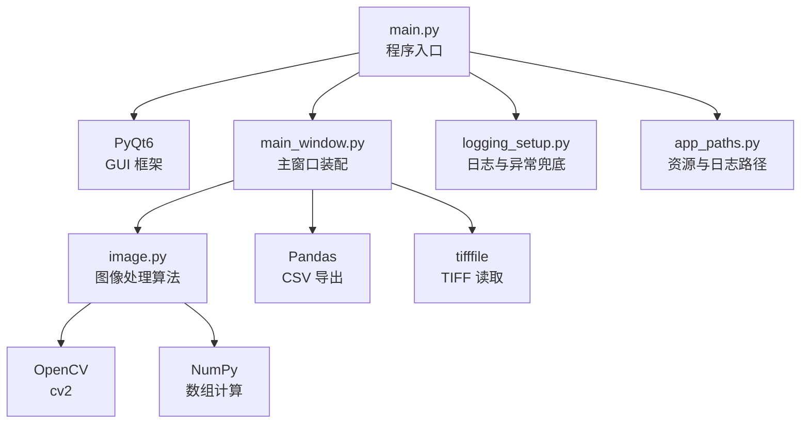
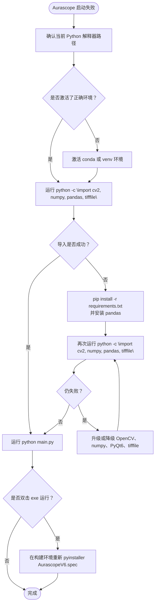

# Python 依赖缺失与 ImportError

<cite>
**本文引用的文件**   
- [requirements.txt](file://requirements.txt)
- [README.md](file://README.md)
- [PROJECT_CONCEPTION.md](file://PROJECT_CONCEPTION.md)
- [main.py](file://main.py)
- [logging_setup.py](file://logging_setup.py)
- [app_paths.py](file://app_paths.py)
</cite>

## 目录
1. [问题定位目标](#问题定位目标)
2. [Aurascope 的依赖边界](#aurascope-的依赖边界)
3. [典型错误与日志片段](#典型错误与日志片段)
4. [快速自检清单](#快速自检清单)
5. [在命令行复现导入失败](#在命令行复现导入失败)
6. [根据日志定位具体缺失包](#根据日志定位具体缺失包)
7. [修复步骤：安装、隔离与版本调整](#修复步骤安装隔离与版本调整)
8. [常见误操作与纠正方法](#常见误操作与纠正方法)
9. [离线应用与环境约束](#离线应用与环境约束)
10. [排查流程图](#排查流程图)
11. [结论](#结论)

## 问题定位目标
本文面向 Aurascope 启动时报 `ImportError`、`ModuleNotFoundError` 或 DLL 加载失败的现场排查。重点覆盖以下场景：
- `requirements.txt` 中 PyQt6、opencv-python、numpy、tifffile 等依赖未安装。
- pandas 缺失或版本不兼容，导致 CSV 导出或数据读取阶段失败。
- conda/venv 环境未激活，系统 Python 与虚拟环境混用。
- OpenCV 或 PyQt6 版本过旧、ABI 不匹配，引发 DLL 加载失败。
- 打包运行（PyInstaller）时依赖未正确包含。

Aurascope 是面向微电子封装产线的单机桌面工具，核心依赖为 PyQt6、OpenCV、NumPy、Pandas 和 tifffile；产品定位为离线应用，不应联网下载更新，但本地依赖仍需在受控环境中安装。

**章节来源**
- [README.md:1-33](file://README.md#L1-L33)
- [PROJECT_CONCEPTION.md:77-107](file://PROJECT_CONCEPTION.md#L77-L107)

## Aurascope 的依赖边界
Aurascope 的依赖关系可以理解为四层：
- GUI 层：PyQt6 提供主窗口、控件、样式与事件循环。
- 图像处理层：OpenCV + NumPy 实现空洞检测、形态学、边缘校验、距离变换等算法。
- 数据处理层：Pandas 用于 CSV 导出。
- 图像 IO 层：tifffile 用于 TIFF 系列图像读取。



**图表来源**
- [main.py:1-75](file://main.py#L1-L75)
- [logging_setup.py:1-88](file://logging_setup.py#L1-L88)
- [app_paths.py:1-42](file://app_paths.py#L1-L42)

**章节来源**
- [requirements.txt:1-5](file://requirements.txt#L1-L5)
- [README.md:35-64](file://README.md#L35-L64)
- [PROJECT_CONCEPTION.md:77-107](file://PROJECT_CONCEPTION.md#L77-L107)

## 典型错误与日志片段
### 1. 缺少模块：ModuleNotFoundError
最常见的是某个第三方库没有安装在当前 Python 环境中：
- `ModuleNotFoundError: No module named 'cv2'`
- `ModuleNotFoundError: No module named 'numpy'`
- `ModuleNotFoundError: No module named 'pandas'`
- `ModuleNotFoundError: No module named 'tifffile'`
- `ModuleNotFoundError: No module named 'PyQt6'`

这类错误通常发生在 `python main.py` 执行到对应 import 语句时。如果是在 PyInstaller 打包后运行，也可能是打包时未包含该依赖。

### 2. 导入失败：ImportError
可能由 ABI 不兼容、平台不匹配或依赖链不完整引起：
- `ImportError: numpy.core.multiarray failed to import`
- `ImportError: DLL load failed while importing cv2`
- `ImportError: DLL load failed while importing PyQt6.QtCore`

这类错误往往不是“没装”，而是“装了但版本不对”或“装在另一个 Python 环境里”。

### 3. 日志中的关键位置
Aurascope 启动时会初始化日志并记录版本、是否通过 PyInstaller 冻结运行以及日志路径。若主窗口装配失败，会记录“主窗口装配失败”并抛出异常；全局未捕获异常会被写入 `logs/aurascope.log`。

典型日志线索包括：
- 启动信息：包含版本号、frozen 状态、日志路径。
- 主窗口装配失败：说明 import 或 MainWindow 初始化阶段出错。
- 未捕获异常堆栈：直接指向第一个失败的 import 或函数调用。

**章节来源**
- [main.py:31-70](file://main.py#L31-L70)
- [logging_setup.py:15-41](file://logging_setup.py#L15-L41)
- [logging_setup.py:72-88](file://logging_setup.py#L72-L88)
- [app_paths.py:21-32](file://app_paths.py#L21-L32)

## 快速自检清单
在动手修复前，先按顺序确认以下内容：

| 序号 | 检查项 | 预期结果 | 失败含义 |
|---|---|---|---|
| 1 | 当前 Python 解释器路径 | 指向你准备使用的 venv 或 conda 环境 | 可能是系统 Python 或其他环境 |
| 2 | pip 所属环境 | 与 Python 解释器一致 | 否则安装包装错环境 |
| 3 | requirements.txt 已安装 | PyQt6、opencv-python、numpy、tifffile 存在 | 缺失则报 ModuleNotFoundError |
| 4 | pandas 已安装 | 可 `import pandas` | CSV 导出或数据读取失败 |
| 5 | 能否独立导入核心包 | `python -c "import cv2, numpy, pandas, tifffile"` 无报错 | 不能说明依赖环境有问题 |
| 6 | 是否使用正确的 Python 运行 main.py | 输出 Aurascope 启动日志 | 否则可能在系统 Python 下运行 |
| 7 | 日志是否存在 | `~\AppData\Local\Aurascope\logs\aurascope.log` | 不存在说明日志路径解析或权限异常 |
| 8 | 是否从 PyInstaller 产物运行 | dist 目录下 exe 能启动 | 源码运行与打包运行依赖范围不同 |

**章节来源**
- [README.md:18-33](file://README.md#L18-L33)
- [app_paths.py:21-32](file://app_paths.py#L21-L32)

## 在命令行复现导入失败
推荐先用最小命令复现，避免被 GUI 启动流程掩盖真实错误：

```bash
python -c "import cv2, numpy, pandas, tifffile"
```

这条命令会依次尝试导入：
- cv2：OpenCV Python 绑定。
- numpy：数值计算基础库。
- pandas：CSV 导出与表格处理。
- tifffile：TIFF 图像读取。

如果命令立即返回错误，说明当前 Python 环境的依赖已经损坏或不完整；如果命令成功但 `python main.py` 失败，应继续检查 PyQt6、主窗口装配逻辑、打包配置或运行时 DLL。

更细粒度的复现方式：
- 只检查 GUI：`python -c "from PyQt6.QtWidgets import QApplication"`
- 只检查图像处理：`python -c "import cv2; import numpy as np"`
- 只检查数据导出：`python -c "import pandas"`
- 只检查 TIFF：`python -c "import tifffile"`

**章节来源**
- [requirements.txt:1-5](file://requirements.txt#L1-L5)
- [README.md:23-33](file://README.md#L23-L33)

## 根据日志定位具体缺失包
### 第一步：找到日志路径
Aurascope 将日志写入用户本地数据目录下的 logs 文件夹。可通过以下方式定位：
- 查看启动日志中记录的日志路径。
- 直接打开 `%LOCALAPPDATA%\Aurascope\logs\aurascope.log`。
- 如果程序弹出错误对话框，可使用“打开日志”按钮进入日志目录。

### 第二步：看第一条异常
优先关注最早出现的 `ModuleNotFoundError` 或 `ImportError`。例如：
- 如果第一条异常指向 `cv2`，优先修复 OpenCV。
- 如果第一条异常指向 `numpy`，优先修复 NumPy。
- 如果第一条异常指向 `pandas`，优先安装 pandas。
- 如果第一条异常指向 `tifffile`，优先安装 tifffile。
- 如果第一条异常指向 `PyQt6`，优先修复 PyQt6。

### 第三步：区分“没装”和“版本不对”
- “没装”：通常是 `No module named ...`。
- “版本不对”：常伴随 `DLL load failed`、ABI 不匹配、numpy 底层数组导入失败。
- “环境不对”：同一台机器上多个 Python 共存时，pip 安装了包，但 python 解释器来自另一个环境。

### 第四步：结合运行方式判断
- 源码运行：`python main.py`，依赖来自当前 Python 环境。
- 打包运行：双击 dist 目录下的 exe，依赖必须随 PyInstaller 打包。
- 如果源码运行正常、exe 运行失败，优先检查 PyInstaller 打包配置和依赖包含情况。

**章节来源**
- [main.py:31-70](file://main.py#L31-L70)
- [logging_setup.py:15-41](file://logging_setup.py#L15-L41)
- [logging_setup.py:44-70](file://logging_setup.py#L44-L70)
- [app_paths.py:21-32](file://app_paths.py#L21-L32)

## 修复步骤：安装、隔离与版本调整
### 步骤一：确认当前环境
先确认你要用的 Python 解释器和 pip 属于同一个环境：
```bash
python --version
python -m pip --version
```
如果两个路径不一致，说明你在系统 Python 和其他环境之间混用。

### 步骤二：创建或激活隔离环境
推荐使用 conda 或 venv 隔离依赖，避免污染系统 Python：

conda 环境示例：
```bash
conda create -n aurascope python=3.10
conda activate aurascope
```

venv 环境示例：
```bash
python -m venv .venv
.venv\Scripts\activate
```

激活后，再执行后续安装命令。

### 步骤三：安装 requirements.txt
```bash
pip install -r requirements.txt
```

requirements.txt 声明的核心依赖如下：
- PyQt6 >= 6.4.0
- opencv-python >= 4.8.0
- numpy >= 1.24.0
- tifffile >= 2023.7.8

注意：项目 README 也提到 Pandas 用于 CSV 导出，因此即使 requirements.txt 未显式列出，也应确保环境中存在 pandas。

### 步骤四：验证导入
```bash
python -c "import cv2, numpy, pandas, tifffile"
```
如果该命令成功，再运行：
```bash
python main.py
```

### 步骤五：升级或降级 OpenCV 与 PyQt6
如果出现 DLL 加载失败或 ABI 不兼容，可按以下顺序尝试：

1. 先升级：
   ```bash
   pip install --upgrade opencv-python numpy PyQt6 tifffile pandas
   ```

2. 如果升级后仍失败，尝试固定兼容版本：
   ```bash
   pip install "opencv-python>=4.8.0,<4.9.0"
   pip install "numpy>=1.24.0,<1.27.0"
   pip install "PyQt6>=6.4.0,<6.7.0"
   pip install "tifffile>=2023.7.8"
   pip install "pandas"
   ```

3. 如果 conda 环境出现二进制冲突，优先用 conda 安装 OpenCV：
   ```bash
   conda install -c conda-forge opencv
   ```

4. 如果仍然失败，重建环境：
   ```bash
   conda deactivate
   conda remove -n aurascope --all
   conda create -n aurascope python=3.10
   conda activate aurascope
   pip install -r requirements.txt
   pip install pandas
   ```

### 步骤六：PyInstaller 打包后的修复
如果源码运行正常，但双击 exe 失败：
- 确认打包时使用 `pyinstaller AurascopeV6.spec`。
- 确认依赖已安装在当前构建环境中。
- 不要改回单文件模式，因为单文件每次启动都要解包，冷启动慢且更容易暴露依赖问题。
- 如需“单文件外观”，应使用安装包工具把 onedir 产物打包，而不是修改 spec。

**章节来源**
- [requirements.txt:1-5](file://requirements.txt#L1-L5)
- [README.md:23-33](file://README.md#L23-L33)
- [README.md:67-76](file://README.md#L67-L76)

## 常见误操作与纠正方法
### 误操作一：系统 Python 与虚拟环境混用
现象：
- `pip list` 能看到包。
- `python main.py` 报 `ModuleNotFoundError`。
- 或者反过来，pip 提示找不到包，但 `python -m pip` 能找到。

原因：
- 使用了系统 Python 解释器，却把包装进了 conda 或 venv。
- 终端 PATH 中同时存在多个 Python。

纠正方法：
```bash
where python
where pip
python -m pip --version
```
始终使用同一个环境下的 `python` 和 `pip`。推荐用 `python -m pip` 避免 pip 指向错误。

### 误操作二：忘记激活 conda/venv
现象：
- 安装命令成功。
- 重启终端后再次运行 `python main.py` 失败。

纠正方法：
- conda：`conda activate aurascope`
- venv：`.venv\Scripts\activate`
- 确认 `python --version` 显示的是目标环境。

### 误操作三：用 conda 装 pip 包，或用 pip 装 conda 包
建议：
- conda 环境优先用 conda 安装二进制依赖（如 OpenCV）。
- 其他依赖可用 pip 安装。
- 不要混用同一环境的安装器，避免元数据不一致。

### 误操作四：在 PyInstaller 打包环境外安装依赖
现象：
- 源码运行正常。
- exe 运行报 DLL 加载失败或缺模块。

纠正方法：
- 在构建 PyInstaller 的环境里安装依赖。
- 重新执行 `pyinstaller AurascopeV6.spec`。
- 不要依赖系统全局包来生成可执行文件。

### 误操作五：认为 Aurascope 会自动联网下载依赖
Aurascope 是离线桌面应用，不应联网下载更新。但本地依赖仍需用户在受控环境中安装。若企业网络禁止访问 pypi.org 或 anaconda.org，应提前准备好离线 wheel 包或镜像源。

**章节来源**
- [README.md:18-33](file://README.md#L18-L33)
- [PROJECT_CONCEPTION.md:103-107](file://PROJECT_CONCEPTION.md#L103-L107)

## 离线应用与环境约束
Aurascope 的产品定位明确：
- 单机运行。
- 不联网。
- 不收集用户数据。
- CPU 计算，不依赖 GPU。
- 兼容 Windows 7+。

这意味着：
- 部署时应把依赖预先安装到目标机器的受控环境中。
- 不应依赖程序运行时自动联网下载 PyQt6、OpenCV、numpy、pandas 或 tifffile。
- 若需要分发，应使用 PyInstaller 打包，并确保依赖已包含。
- 若企业内部有私有仓库或离线包缓存，应在构建环境中配置，而不是让最终用户手动联网。

**章节来源**
- [PROJECT_CONCEPTION.md:103-107](file://PROJECT_CONCEPTION.md#L103-L107)
- [README.md:67-76](file://README.md#L67-L76)

## 排查流程图


[本图为概念性排查流程，不直接映射具体源码文件]

## 结论
Aurascope 启动时的 `ImportError`、`ModuleNotFoundError` 或 DLL 加载失败，绝大多数情况下可以归结为三类原因：
1. 依赖未安装：requirements.txt 中的 PyQt6、opencv-python、numpy、tifffile 缺失，或 pandas 缺失。
2. 环境错误：系统 Python 与虚拟环境混用、conda/venv 未激活、pip 与 python 不属于同一环境。
3. 版本或打包问题：OpenCV、numpy、PyQt6 版本不兼容，或 PyInstaller 打包时未包含依赖。

推荐排查顺序是：先确认 Python 环境，再用最小命令复现导入失败，接着根据日志定位第一个失败模块，最后安装或调整依赖版本。由于 Aurascope 是离线桌面应用，所有依赖都应在受控环境中预先安装，不应依赖程序运行时联网获取。