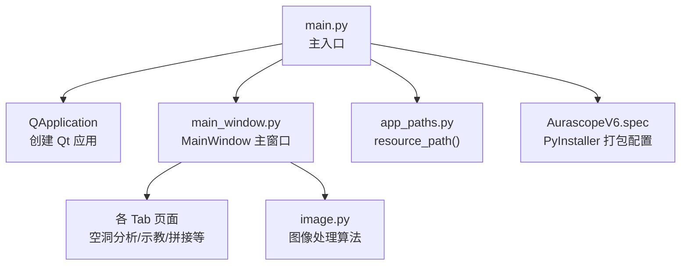
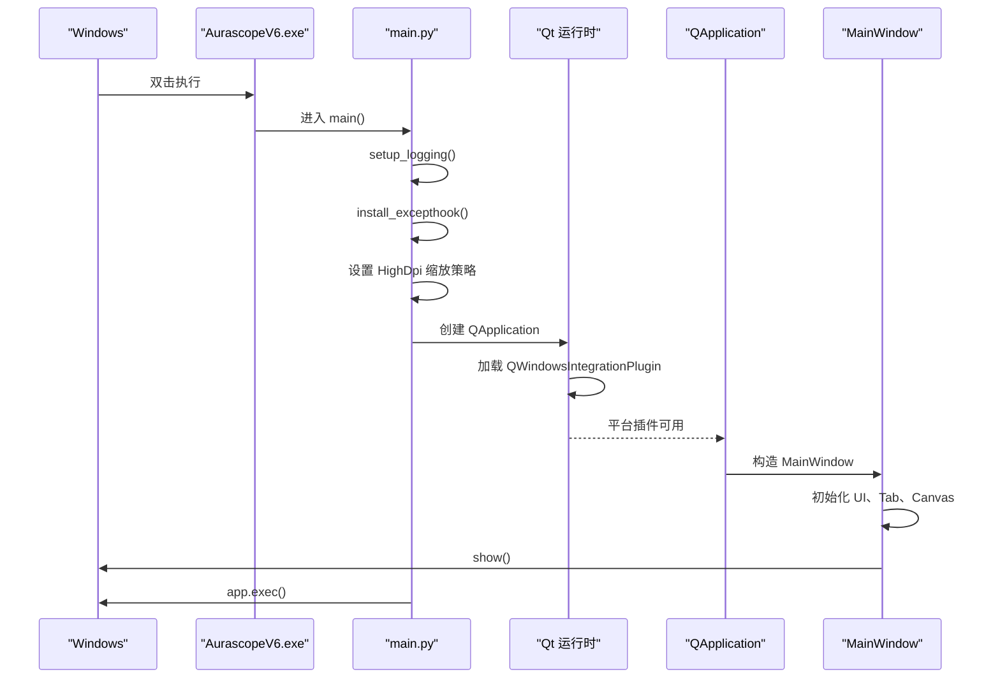
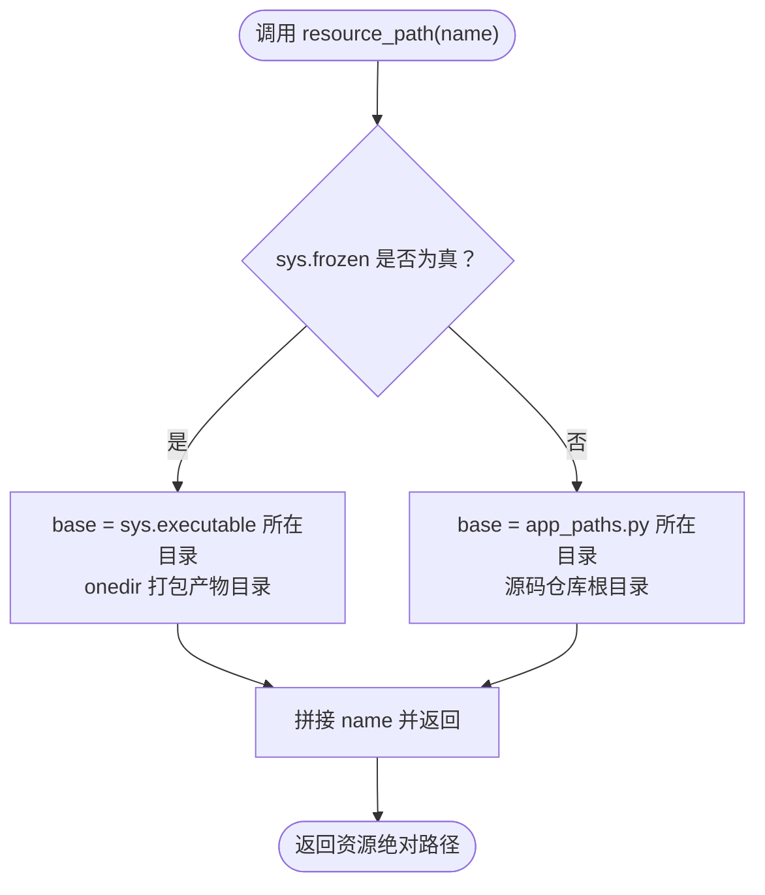
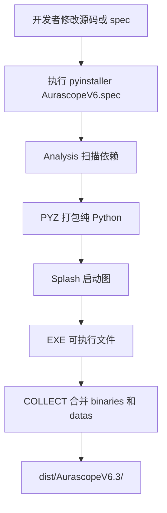

# Qt 平台插件加载失败

<cite>
**本文引用的文件**   
- [main.py](file://main.py)
- [app_paths.py](file://app_paths.py)
- [AurascopeV6.spec](file://AurascopeV6.spec)
- [README.md](file://README.md)
- [main_window.py](file://main_window.py)
- [ui_components.py](file://ui_components.py)
</cite>

## 目录
1. [引言](#引言)
2. [问题范围与结论](#问题范围与结论)
3. [项目结构与入口](#项目结构与入口)
4. [Qt 初始化流程](#qt-初始化流程)
5. [资源路径与打包环境差异](#资源路径与打包环境差异)
6. [典型错误日志与定位方法](#典型错误日志与定位方法)
7. [排查步骤](#排查步骤)
8. [临时绕过方式](#临时绕过方式)
9. [重新打包 main.spec / AurascopeV6.spec](#重新打包-mainspec--aurascopelv6spec)
10. [常见误区](#常见误区)
11. [附录：相关代码片段路径](#附录相关代码片段路径)

## 引言
本文面向在 Windows 上部署 Aurascope（金锡焊空洞分析）时遇到的 Qt 平台插件加载失败问题，重点覆盖以下现象：
- 启动时报找不到 `QWindowsIntegrationPlugin`。
- 提示 Qt 插件目录缺失。
- 环境变量 `QT_QPA_PLATFORM_PLUGIN_PATH` 配置错误或指向了错误的 Qt 安装。
- PyInstaller 打包后相对路径变化导致 Qt 插件无法被应用或第三方库找到。
- 源码运行正常、双击 exe 后崩溃；或反过来，单独拷贝 exe 后无法运行。

需要明确：**这类错误属于部署环境与 Qt 运行时依赖问题，不是图像处理算法问题**。即使图像算法逻辑完全正确，只要 Qt 的 GUI 后端插件没加载成功，程序也无法显示窗口。

## 问题范围与结论
| 类别 | 是否属于本类问题 | 说明 |
|---|---:|---|
| 找不到 `QWindowsIntegrationPlugin` | 是 | Windows 下 Qt 必须加载 Windows 集成插件才能创建桌面窗口。 |
| 插件目录缺失 | 是 | Qt 不知道去哪里找 `qwindows.dll` 等插件。 |
| `QT_QPA_PLATFORM_PLUGIN_PATH` 配置错误 | 是 | 环境变量指向了不存在的目录，或指向了与当前 Python/PyQt 不匹配的 Qt 版本。 |
| PyInstaller 打包后相对路径变化 | 是 | onedir 模式下 exe 与 Qt 插件目录的相对位置会决定能否自动发现插件。 |
| 图像检测结果为空 | 否 | 这是 image.py 算法层行为，应通过日志和检测结果判断，不应直接归因于 Qt 插件。 |
| ROI 多边形绘制异常 | 否 | 这属于 UI 交互或 Canvas 层实现细节，除非伴随 Qt 插件加载错误。 |

**核心结论**：如果报错信息中出现 `QWindowsIntegrationPlugin`、`platform plugin`、`plugin directory`、`Cannot load library` 等关键词，优先检查 Qt 插件目录和环境变量，不要先改图像阈值、形态学参数或 Canny 边缘校验。

## 项目结构与入口
仓库根目录中，与 Qt 启动和资源路径最相关的文件如下：
- `main.py`：主入口，设置 Qt 平台、创建 `QApplication`、装配 `MainWindow`。
- `app_paths.py`：提供 `resource_path()`、`app_dir()` 等路径解析函数，区分源码运行与 PyInstaller 打包环境。
- `AurascopeV6.spec`：PyInstaller 打包配置，定义入口脚本、数据文件和输出目录结构。
- `README.md`：快速开始、技术栈、打包命令与产物说明。
- `main_window.py`：主窗口装配，多处读取 `QT_QPA_PLATFORM` 以区分 offscreen 环境。
- `ui_components.py`：UI 组件工厂，部分交互逻辑也受 `QT_QPA_PLATFORM=offscreen` 影响。



**图表来源**
- [main.py:31-70](file://main.py#L31-L70)
- [AurascopeV6.spec:13-67](file://AurascopeV6.spec#L13-L67)

**章节来源**
- [main.py:1-75](file://main.py#L1-L75)
- [README.md:42-74](file://README.md#L42-L74)

## Qt 初始化流程
`main.py` 的启动顺序可以概括为：
1. 导入模块前设置环境变量 `QT_QPA_PLATFORM = "windows"`。
2. 调用 `setup_logging()` 初始化日志。
3. 安装异常钩子，记录启动版本、是否 frozen、日志路径。
4. 设置高 DPI 缩放策略。
5. 创建 `QApplication`，此时 Qt 开始加载平台插件。
6. 设置 Fusion 风格、窗口图标、全局样式表。
7. 关闭“最后一个窗口关闭即退出”的默认行为。
8. 创建 `MainWindow`，绑定销毁事件，显示窗口。
9. 使用定时器延迟关闭 PyInstaller 启动图。



**图表来源**
- [main.py:31-70](file://main.py#L31-L70)
- [main_window.py:54-85](file://main_window.py#L54-L85)

关键点：
- `QApplication(sys.argv)` 是 Qt 真正开始加载平台插件的位置。
- 如果这一步失败，通常还来不及进入 `MainWindow` 的 UI 初始化。
- 因此，若报错发生在“刚双击 exe 就闪退”，优先怀疑 Qt 插件加载，而不是主窗口控件组装。

**章节来源**
- [main.py:6-44](file://main.py#L6-L44)
- [main.py:49-70](file://main.py#L49-L70)

## 资源路径与打包环境差异
`app_paths.py` 提供了两个关键概念：
- `resource_path(name)`：用于随 exe 打包的资源文件，例如 `logo_1.ico`、`logo.png`、`说明书.md`。
- `app_dir()`：程序所在目录，用于理解“源码运行”和“打包运行”的差异。

### 源码运行
- `sys.frozen` 为假。
- `resource_path()` 的 base 是 `app_paths.py` 所在目录，也就是仓库根目录。
- `app_dir()` 同样返回 `app_paths.py` 所在目录。
- 资源文件一般位于仓库根目录，例如 `logo_1.ico`、`logo.png`、`说明书.md`。

### PyInstaller onedir 打包运行
- `sys.frozen` 为真。
- `resource_path()` 的 base 是 `sys.executable` 所在目录，即 `dist/AurascopeV6.3/`。
- `app_dir()` 也返回 exe 同级目录。
- `AurascopeV6.spec` 把 `说明书.md`、`logo_1.ico`、`logo.png`、`logo_innolight.png` 作为 datas 打包进输出目录。



**图表来源**
- [app_paths.py:8-18](file://app_paths.py#L8-L18)

这意味着：
- 如果打包后缺少 `logo_1.ico`、`logo.png`、`说明书.md`，可能是 `AurascopeV6.spec` 的 `datas` 没有包含对应文件，或者用户只复制了 exe 而没有复制整个 `dist/AurascopeV6.3/` 目录。
- 但注意：资源文件缺失通常表现为图标加载失败、帮助文档打不开，不一定直接等同于 Qt 插件加载失败。Qt 插件由 Qt 自身查找机制决定，不在 `resource_path()` 的管理范围内。

**章节来源**
- [app_paths.py:8-18](file://app_paths.py#L8-L18)
- [AurascopeV6.spec:17-21](file://AurascopeV6.spec#L17-L21)
- [README.md:67-74](file://README.md#L67-L74)

## 典型错误日志与定位方法
以下是 Windows 下 Qt 平台插件加载失败的常见日志特征。实际日志可能因 PyQt6、Qt 版本、Python 环境不同而略有差异，但关键词基本一致。

| 日志关键词 | 含义 | 优先检查项 |
|---|---|---|
| `QWindowsIntegrationPlugin` | Qt 正在寻找 Windows 平台插件 | 是否安装了带 Windows 平台的 PyQt6；插件目录是否存在。 |
| `platform plugin` | Qt 平台后端加载失败 | `QT_QPA_PLATFORM`、`QT_QPA_PLATFORM_PLUGIN_PATH`。 |
| `plugin directory` | Qt 插件目录不可用 | 环境变量是否指向真实 Qt 插件目录。 |
| `Cannot load library` | DLL 加载失败 | 是否缺少 `qwindows.dll`、VC++ 运行库、Qt DLL。 |
| `QApplication: No such file or directory` | Qt 内部资源或插件路径异常 | 是否只复制了单个 exe，未保留 onedir 目录结构。 |
| `Could not find or load the Qt platform plugin "windows"` | 明确找不到 windows 平台插件 | 环境变量、Qt 安装路径、PyInstaller 打包产物完整性。 |

### 如何收集日志
1. 打开命令行，切换到 Aurascope 可执行文件所在目录。
2. 直接运行 `AurascopeV6.3.exe`，观察控制台输出。
3. 查看应用日志目录：根据 `app_paths.local_data_dir()` 和 `log_dir()`，日志通常落在当前用户的 `AppData\Local\Aurascope\logs`。
4. 如果程序一启动就崩溃且没有控制台，优先确认是否有异常钩子落盘；`main.py` 中已安装异常钩子，并在主窗口装配失败时记录异常。

### 快速判断是否算法问题
- 如果日志中没有 Qt 插件相关错误，但检测结果为空，再检查 `image.py` 相关逻辑、ROI、阈值、Canny 边缘验证。
- 如果日志中出现 Qt 插件错误，先解决部署问题，不要修改图像算法参数。

**章节来源**
- [main.py:33-37](file://main.py#L33-L37)
- [main.py:55-61](file://main.py#L55-L61)
- [app_paths.py:21-32](file://app_paths.py#L21-L32)

## 排查步骤
请按以下顺序排查，避免跳过前置条件。

### 第一步：确认运行模式
- 源码运行：`python main.py`。
- 打包运行：双击 `dist/AurascopeV6.3/AurascopeV6.3.exe`。
- 不要把 `AurascopeV6.3.exe` 单独复制到任意目录运行，因为 onedir 模式依赖同目录下 Qt 插件和相关 DLL。

### 第二步：检查 Qt 插件目录
在 Python 环境中执行类似操作，确认 PyQt6 安装的 Qt 插件目录：
1. 打开与运行 Aurascope 相同的 Python 环境。
2. 查询 PyQt6 的 Qt 安装路径。
3. 在该路径下查找 `plugins/platform/qwindows.dll`。
4. 如果找不到，说明当前环境的 PyQt6 没有 Windows 平台插件，或安装不完整。

常见情况：
- 多个 Python 环境混用，导致命令行用的 Python 与应用运行的 Python 不一致。
- 从其他机器拷贝了 PyQt6 或 Qt 文件，版本不匹配。
- 使用了 conda、venv、系统 Python，但没有激活正确环境。

### 第三步：检查 `QT_QPA_PLATFORM`
`main.py` 在启动时设置了 `QT_QPA_PLATFORM = "windows"`。如果系统或用户环境变量中存在冲突值，可能导致 Qt 尝试加载非 Windows 平台插件。

建议：
- 临时清理用户环境变量中的 `QT_QPA_PLATFORM`。
- 重新启动命令行，再次运行 Aurascope。
- 如果业务需要 offscreen 测试，应显式设置为 `offscreen`，并注意这会禁用图形界面。

### 第四步：检查 `QT_QPA_PLATFORM_PLUGIN_PATH`
该环境变量用于告诉 Qt 去哪里找平台插件。常见问题：
- 指向了旧版 Qt 安装目录。
- 指向了 Linux 或 macOS 的 Qt 插件目录。
- 路径中包含中文、空格或特殊字符，某些 Qt 版本处理不佳。
- 指向了 PyInstaller 解包后的临时目录（单文件模式），但当前使用的是 onedir 模式。

推荐做法：
- 如果不需要自定义插件目录，优先删除该环境变量，让 Qt 使用默认查找逻辑。
- 如果需要指定，确保指向当前 Python 环境中 PyQt6 对应的 `plugins/platform` 目录。

### 第五步：检查 PyInstaller 打包产物
`AurascopeV6.spec` 使用 onedir 模式，产物是 `dist/AurascopeV6.3/` 文件夹。部署时应整体分发该目录，而不是只复制 exe。

检查清单：
- `dist/AurascopeV6.3/AurascopeV6.3.exe` 存在。
- 同目录下有 Qt 相关 DLL 和 `plugins/platform/qwindows.dll`。
- `说明书.md`、`logo_1.ico`、`logo.png`、`logo_innolight.png` 存在。
- 没有手动删除 `binaries` 或 `plugins` 子目录。

### 第六步：验证环境变量生效
在运行 Aurascope 的同一命令行中执行：
- 打印 `QT_QPA_PLATFORM`。
- 打印 `QT_QPA_PLATFORM_PLUGIN_PATH`。
- 确认这些值来自当前会话，而不是其他终端或远程登录会话。

### 第七步：复现最小用例
如果仍无法定位，可在命令行中用 Python 直接触发 Qt 初始化：
1. 使用与 Aurascope 相同的 Python 环境。
2. 执行 `python -c "from PyQt6.QtWidgets import QApplication; app = QApplication([])"`。
3. 如果这一步也报 Qt 插件错误，则问题一定出在 Qt/PyQt6 环境，而不是 Aurascope 业务逻辑。

## 临时绕过方式
以下方法可用于快速验证问题，但不建议长期作为生产部署方案。

### 强制指定平台插件
可以在启动前设置：
- `QT_QPA_PLATFORM=windows`
- `QT_QPA_PLATFORM_PLUGIN_PATH=<Qt 插件目录>`

示例思路：
- 在命令行中先 export 环境变量，再运行 exe。
- 或在批处理脚本中固定环境变量后启动 Aurascope。

注意：
- `main.py` 已经设置 `QT_QPA_PLATFORM="windows"`，所以如果仍然失败，通常是插件目录或 Qt DLL 本身的问题。
- 如果设置了 `QT_QPA_PLATFORM=offscreen`，程序不会显示 GUI，只能用于无头测试。

### 清理环境变量
如果之前为了调试设置了 `QT_QPA_PLATFORM` 或 `QT_QPA_PLATFORM_PLUGIN_PATH`，建议：
1. 打开系统环境变量设置。
2. 删除用户变量或系统变量中的这两个键。
3. 重启命令行或电脑，确保新进程继承干净的环境。

### 使用系统 Python 环境验证
如果怀疑 conda 或虚拟环境污染：
1. 使用系统 Python 安装 PyQt6。
2. 运行 `python main.py`。
3. 如果系统 Python 能运行，说明问题在当前虚拟环境或 Qt 安装路径。

### 重要提醒
- 临时绕过只是定位手段，不能替代正确的部署结构。
- 不要为了绕过插件加载而改用 Linux/macOS 的 Qt 插件。
- 不要随意替换 `qwindows.dll`，否则可能出现 VC++ 运行库缺失或 Qt 版本不匹配。

**章节来源**
- [main.py:6](file://main.py#L6)
- [main_window.py:90-91](file://main_window.py#L90-L91)
- [main_window.py:354-355](file://main_window.py#L354-L355)
- [main_window.py:440-448](file://main_window.py#L440-L448)
- [ui_components.py:14-16](file://ui_components.py#L14-L16)

## 重新打包 main.spec / AurascopeV6.spec
仓库中实际存在的打包配置文件是 `AurascopeV6.spec`。搜索结果显示仓库根目录不存在 `main.spec`，因此应以 `AurascopeV6.spec` 为准。

### 何时需要重新打包
- 新增或修改了 `datas` 中的资源文件。
- 修改了入口脚本或依赖。
- 更换了 PyQt6/Qt 版本。
- 部署后发现图标、说明书、logo 等资源缺失。
- 需要更新产品名称、版本号或图标。

### 重新打包命令
根据 `README.md`：
```bash
pip install pyinstaller
pyinstaller AurascopeV6.spec
```
产物目录为 `dist/AurascopeV6.3/`，其中包含 `AurascopeV6.3.exe`。

### 主要打包配置要点
- 入口脚本：`main.py`。
- 数据文件：`说明书.md`、`CHANGELOG.md`、`logo_1.ico`、`logo.png`、`logo_innolight.png`。
- 排除无关依赖：`PySide6`、`PySide2`、`pandas`、`matplotlib`。
- 使用 Splash 启动图：`splash_boot.png`。
- onedir 模式：`exclude_binaries=True`，不生成单文件 exe。
- 关闭 UPX：避免启动副作用和杀软误报。
- 关闭控制台：`console=False`，适合桌面应用。



**图表来源**
- [AurascopeV6.spec:13-67](file://AurascopeV6.spec#L13-L67)

### 如果确实需要 `main.spec`
当前仓库没有 `main.spec`，只有 `AurascopeV6.spec`。如果团队希望统一命名，可以把 `AurascopeV6.spec` 重命名为 `main.spec`，并同步更新 README 中的打包命令。但这属于仓库治理变更，不应与 Qt 插件故障排查混为一谈。

**章节来源**
- [README.md:67-74](file://README.md#L67-L74)
- [AurascopeV6.spec:1-10](file://AurascopeV6.spec#L1-L10)
- [AurascopeV6.spec:13-67](file://AurascopeV6.spec#L13-L67)

## 常见误区
| 误区 | 正确理解 |
|---|---|
| “图像检测不到空洞就是 Qt 插件问题。” | 不对。应先看日志是否出现 Qt 插件错误；如果没有，再检查 image.py 的阈值、形态学、轮廓、圆度、Canny 等逻辑。 |
| “只要环境变量设成 offscreen 就能绕过 bug。” | 不对。offscreen 只是无头模式，GUI 功能不可用，不适合普通用户部署。 |
| “把 Qt 插件目录随便指到一个旧版本 Qt 就行。” | 不对。Qt 插件必须与当前 PyQt6/Qt 版本匹配，否则会 DLL 加载失败。 |
| “只复制 AurascopeV6.3.exe 就能运行。” | 不对。onedir 模式需要同目录下的 Qt DLL 和 plugins 目录。 |
| “resource_path 负责加载 Qt 插件。” | 不对。`resource_path` 管理的是应用资源文件；Qt 插件由 Qt 自身查找机制决定。 |
| “main.spec 和 AurascopeV6.spec 是两个独立打包入口。” | 当前仓库只有 `AurascopeV6.spec`，`main.spec` 不存在。 |

## 附录：相关代码片段路径
| 场景 | 参考文件与行号 |
|---|---|
| 设置 Qt 平台为 windows | [main.py:6](file://main.py#L6) |
| 创建 QApplication 并启动 Qt | [main.py:44-44](file://main.py#L44-L44) |
| 主窗口装配与异常记录 | [main.py:55-61](file://main.py#L55-L61) |
| 资源路径解析 | [app_paths.py:8-11](file://app_paths.py#L8-L11) |
| 程序目录解析 | [app_paths.py:14-18](file://app_paths.py#L14-L18) |
| 用户数据与日志目录 | [app_paths.py:21-32](file://app_paths.py#L21-L32) |
| PyInstaller 打包配置 | [AurascopeV6.spec:13-67](file://AurascopeV6.spec#L13-L67) |
| 快速开始与打包说明 | [README.md:16-33](file://README.md#L16-L33) |
| offscreen 环境分支逻辑 | [main_window.py:90-91](file://main_window.py#L90-L91) |
| offscreen 环境分支逻辑 | [main_window.py:354-355](file://main_window.py#L354-L355) |
| offscreen 环境分支逻辑 | [main_window.py:440-448](file://main_window.py#L440-L448) |
| offscreen 自动确认 | [ui_components.py:14-16](file://ui_components.py#L14-L16) |