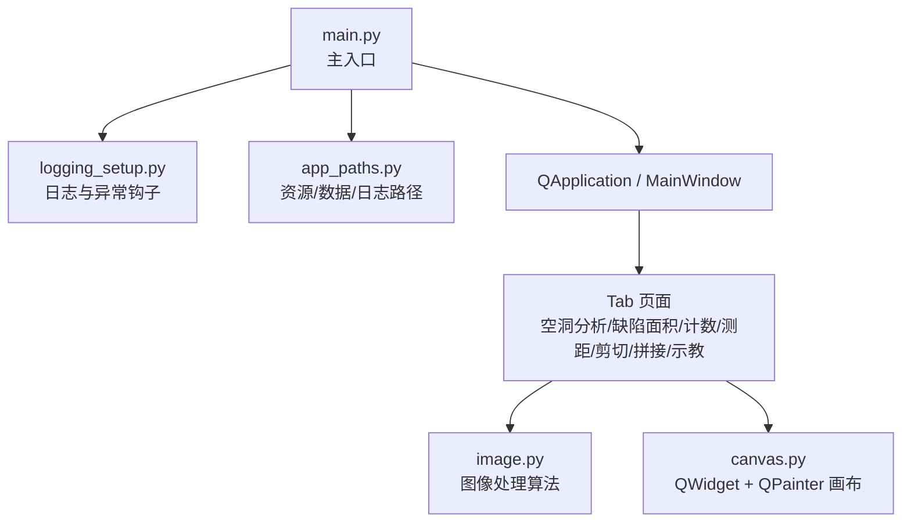
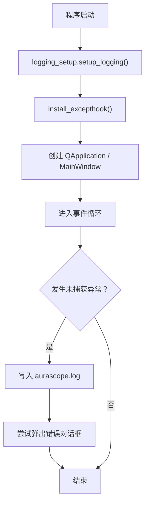
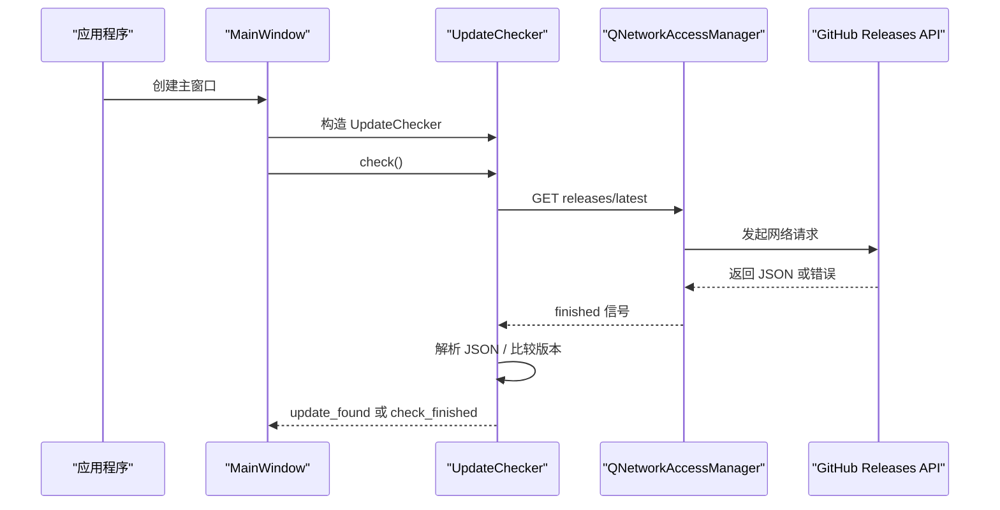
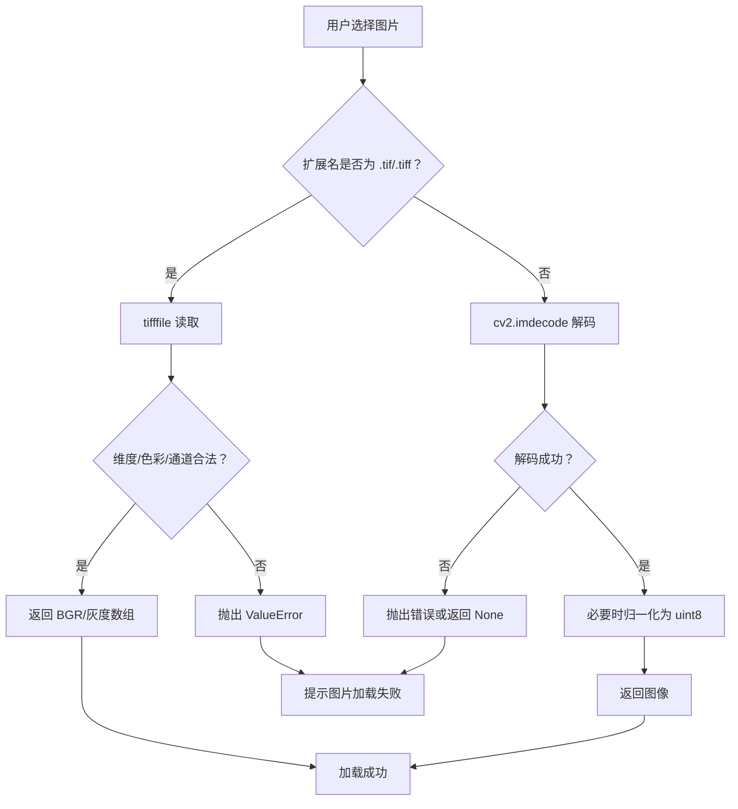
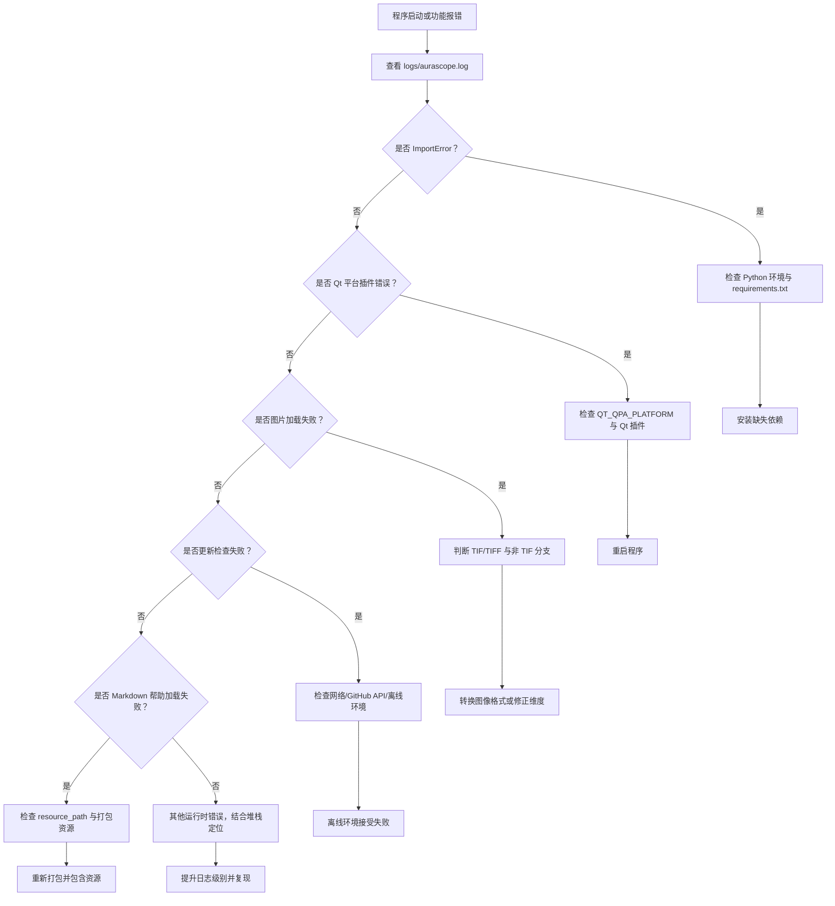

# 启动失败与运行时错误排查

<cite>
**本文引用的文件**   
- [main.py](file://main.py)
- [logging_setup.py](file://logging_setup.py)
- [app_paths.py](file://app_paths.py)
- [requirements.txt](file://requirements.txt)
- [README.md](file://README.md)
- [PROJECT_CONCEPTION.md](file://PROJECT_CONCEPTION.md)
- [update_check.py](file://update_check.py)
- [help_dialogs.py](file://help_dialogs.py)
- [area_tab.py](file://area_tab.py)
- [stitching_tab.py](file://stitching_tab.py)
- [counting_tab.py](file://counting_tab.py)
- [measure_tab.py](file://measure_tab.py)
- [image.py](file://image.py)
- [canvas.py](file://canvas.py)
</cite>

## 目录
1. [引言](#引言)
2. [项目结构与定位](#项目结构与定位)
3. [日志系统速查](#日志系统速查)
4. [常见错误分类与排查](#常见错误分类与排查)
5. [图片加载失败专项排查](#图片加载失败专项排查)
6. [自动更新检查失败排查](#自动更新检查失败排查)
7. [Markdown 帮助加载失败排查](#markdown-帮助加载失败排查)
8. [PyInstaller 打包相关注意事项](#pyinstaller-打包相关注意事项)
9. [产品约束与合规提醒](#产品约束与合规提醒)
10. [快速决策流程图](#快速决策流程图)
11. [结论](#结论)

## 引言
本指南面向 Aurascope 用户与维护者，聚焦「启动失败」和「常见运行时错误」的排查。Aurascope 是面向微电子封装产线的半自动化视觉检测与数据分析桌面工具，技术栈为 PyQt6、OpenCV、NumPy、Pandas 与 tifffile；产品定位为单机运行、不联网、不收集用户数据、纯 CPU 计算，并兼容 Windows 7+。

在排查时，请优先确认：
- Python 环境是否满足 requirements.txt；
- 日志是否写入 `logs/aurascope.log`；
- 当前问题是「程序无法启动」还是「功能模块运行时报错」；
- 是否通过 PyInstaller 打包后运行；
- 是否在离线或受限网络环境中使用。

**章节来源**
- [README.md:1-76](file://README.md#L1-L76)
- [PROJECT_CONCEPTION.md:77-108](file://PROJECT_CONCEPTION.md#L77-L108)

## 项目结构与定位
Aurascope 的核心启动路径是：
- `main.py` 设置 Qt 平台、初始化日志、安装全局异常钩子、创建 QApplication 与 MainWindow；
- `logging_setup.py` 负责滚动日志文件、未捕获异常兜底、线程异常记录；
- `app_paths.py` 提供资源路径、本地数据目录、日志目录与构建日期；
- GUI 层由 `main_window.py` 装配 Tab 页面，各业务模块（空洞分析、缺陷面积、物料计数、测距、剪切力、图像拼接、批量示教）分别位于对应 Tab 文件中；
- 算法实现集中在 `image.py`，Canvas 绘制层统一基于 QWidget + QPainter。



**图表来源**
- [main.py:1-44](file://main.py#L1-L44)
- [logging_setup.py:1-88](file://logging_setup.py#L1-L88)
- [app_paths.py:1-42](file://app_paths.py#L1-L42)
- [image.py:1-20](file://image.py#L1-L20)
- [canvas.py:1-30](file://canvas.py#L1-L30)

**章节来源**
- [main.py:1-44](file://main.py#L1-L44)
- [PROJECT_CONCEPTION.md:77-108](file://PROJECT_CONCEPTION.md#L77-L108)

## 日志系统速查
### 日志输出位置
日志文件默认位于：
- 本地用户数据目录下的 `logs/aurascope.log`；
- 具体路径由 `app_paths.local_data_dir()` 生成，通常为 `%LOCALAPPDATA%\Aurascope\logs` 或 `~\AppData\Local\Aurascope\logs`。

`setup_logging()` 会创建 RotatingFileHandler，单文件最大约 1MB，保留最多 5 个备份，编码为 UTF-8。

### 默认日志级别
根日志器默认级别为 `INFO`。因此：
- 启动信息、图片加载成功、窗口状态保存等 INFO 级消息会写入日志；
- 图片解码失败、更新检查失败等 WARNING 级消息也会写入；
- DEBUG 级日志不会默认输出。

### 如何提升日志详细程度
仓库没有提供独立的日志级别配置入口。若需要更详细日志，可在调用 `setup_logging()` 之后、创建 QApplication 之前临时调整根日志器级别，例如把 `logging.getLogger().setLevel(logging.DEBUG)` 加入 `main.py` 的 `main()` 中。注意：这是开发调试建议，不建议长期开启 DEBUG，以免日志膨胀。

### 未捕获异常处理
`install_excepthook()` 会把主线程与工作线程的未捕获异常写入日志，并在有 GUI 时弹出统一错误对话框，提供「复制详情」「打开日志」按钮。该对话框本身也有异常保护：如果显示失败，会记录一条 exception 日志。



**图表来源**
- [main.py:19-39](file://main.py#L19-L39)
- [logging_setup.py:15-88](file://logging_setup.py#L15-L88)

**章节来源**
- [logging_setup.py:15-88](file://logging_setup.py#L15-L88)
- [app_paths.py:21-32](file://app_paths.py#L21-L32)

## 常见错误分类与排查
本节按问题类型组织，每种错误给出典型日志片段、定位步骤、临时绕过方法和根本修复建议。

### 一、Python 环境缺失依赖导致的 ImportError
#### 典型症状
- 双击 exe 或执行 `python main.py` 后立即报错；
- 错误中包含 `ImportError`、`ModuleNotFoundError`；
- 常见缺失库：`cv2`（OpenCV）、`PyQt6`、`tifffile`、`pandas`、`numpy`。

#### 典型日志片段
```text
Traceback (most recent call last):
  File "main.py", line ..., in <module>
    from ... import ...
ImportError: No module named 'cv2'
```
或：
```text
ModuleNotFoundError: No module named 'PyQt6'
```

#### 定位步骤
1. 确认 Python 版本是否为 3.10+；
2. 查看 `requirements.txt` 中的依赖；
3. 在当前 Python 环境中执行 `pip list`，确认 PyQt6、opencv-python、numpy、pandas、tifffile 均已安装；
4. 如果是 PyInstaller 打包后的 exe，确认打包环境使用的 Python 环境与运行环境一致。

#### 临时绕过方法
- 仅用于验证能否启动：可暂时注释掉对应导入语句，但会导致相应功能不可用；
- 对于 TIF/TIFF 支持，若只使用 PNG/JPG/BMP，可暂时跳过 tifffile 相关逻辑，但这不是推荐做法。

#### 根本修复建议
- 使用正确的 Python 环境安装依赖：
  ```bash
  pip install -r requirements.txt
  ```
- 如果使用虚拟环境，确保激活的是同一个环境；
- 如果使用 PyInstaller，请在安装依赖的同一环境中重新打包。

**章节来源**
- [requirements.txt:1-6](file://requirements.txt#L1-L6)
- [README.md:18-33](file://README.md#L18-L33)

### 二、Qt 平台插件加载失败
#### 典型症状
- 程序启动后黑屏、闪退；
- 控制台出现 Qt 平台插件相关错误；
- 在 Windows 下尤其常见于环境变量、Qt 插件目录或 PyInstaller 打包路径变化场景。

#### 典型日志片段
日志可能没有完整堆栈，因为 Qt 平台插件加载发生在 Python 应用正常初始化之前。常见控制台输出类似：
```text
qt.qpa.plugin: Could not load the Qt platform plugin "windows" in "" even though it was found.
This application failed to start because no Qt platform plugin could be initialized.
```

#### 定位步骤
1. 检查是否设置了 `QT_QPA_PLATFORM`；
2. `main.py` 已显式设置 `os.environ["QT_QPA_PLATFORM"] = "windows"`；
3. 如果在无头环境或远程桌面中运行，可能需要改为 `offscreen`；
4. 检查 Qt 安装是否与 PyQt6 版本匹配；
5. 检查 PyInstaller 打包是否包含 Qt 平台插件。

#### 临时绕过方法
- 在无头环境或某些远程桌面场景中，将 `main.py` 中的平台设置为 `offscreen` 可跳过图形界面；
- 手动设置环境变量 `QT_QPA_PLATFORM=offscreen` 再运行。

#### 根本修复建议
- 确保 PyQt6 与系统 Qt 插件兼容；
- 如果是 PyInstaller 打包，检查 `AurascopeV6.spec` 是否正确包含 Qt 插件；
- 避免混装多个 Python/Qt 环境导致插件路径混乱。

**章节来源**
- [main.py:3-7](file://main.py#L3-L7)

### 三、图片无法打开
#### 典型症状
- 点击「打开图片」「导入图片」后提示「图片加载失败」；
- TIF/TIFF 文件无法读取；
- 非 TIF 格式图片 OpenCV 解码失败；
- 16 位图像显示异常或尺寸异常。

#### 典型日志片段
```text
ROI 图片加载失败：xxx.tif（不支持多页 TIF；请选择单张二维图像）
```
或：
```text
ROI 图片加载失败：xxx.png（无法解码图片）
```

#### 定位步骤
1. 判断文件格式：
   - `.tif` / `.tiff`：走 `area_tab._read_image()`，使用 tifffile；
   - 其他格式：走 OpenCV `cv2.imdecode`。
2. 对 TIF/TIFF：
   - 检查是否为单页二维图像；
   - 检查 axes 是否为 `YX`、`YXS` 或 `SYX`；
   - 检查色彩类型是否为 `MINISBLACK`、`MINISWHITE` 或 `RGB`；
   - 检查通道数是否为 3 或 4。
3. 对非 TIF 格式：
   - 检查文件是否损坏；
   - 检查 OpenCV 是否支持该编解码器；
   - 检查是否为 RGBA 且被裁剪为 RGB。

#### 临时绕过方法
- 将 TIF/TIFF 转换为 PNG/JPG 后再导入；
- 将 16 位图像先转换为 8 位；
- 对多页 TIF，提取单页后再导入。

#### 根本修复建议
- 确保 tifffile 已正确安装；
- 规范输入图像格式：建议使用单页灰度或 RGB TIFF，或标准 PNG/JPG/BMP；
- 对上游采集设备导出的科学图像，应在导出阶段规范化维度与通道布局。

**章节来源**
- [area_tab.py:53-92](file://area_tab.py#L53-L92)
- [area_tab.py:342-378](file://area_tab.py#L342-L378)

### 四、自动更新检查失败
#### 典型症状
- 启动后偶尔弹出「检查更新失败」；
- 手动点击「检查更新…」后返回错误；
- 离线环境或 GitHub API 限流时失败；
- 后台静默检查失败通常不影响主功能。

#### 典型日志片段
```text
检查更新失败：<QtNetwork 错误字符串>
```
或：
```text
检查更新解析失败：<JSON 解析异常>
```

#### 定位步骤
1. 确认是否联网；
2. 确认是否能访问 `https://api.github.com/repos/lingyue1932/Aurascope/releases/latest`；
3. 检查是否触发 GitHub API 限流；
4. 检查返回内容是否为合法 JSON；
5. 区分「后台静默检查」和「手动检查」：手动检查会向 UI 反馈结果。

#### 临时绕过方法
- 忽略更新检查，继续使用软件；
- 在离线环境中，可通过设置 `QT_QPA_PLATFORM=offscreen` 或禁用界面启动来避免网络请求；
- 如需完全关闭更新检查，可在 `main_window.py` 中移除 `UpdateChecker` 相关代码，但会失去版本提示能力。

#### 根本修复建议
- 在企业内网环境中，应允许访问 GitHub Releases API，或通过代理放行；
- 若产品策略要求绝对离线，应移除 update_check 模块，避免误判为网络故障；
- 对 GitHub API 限流，等待一段时间重试即可。



**图表来源**
- [main_window.py:87-92](file://main_window.py#L87-L92)
- [update_check.py:74-112](file://update_check.py#L74-L112)

**章节来源**
- [update_check.py:1-112](file://update_check.py#L1-L112)
- [main_window.py:87-92](file://main_window.py#L87-L92)
- [main_window.py:746-778](file://main_window.py#L746-L778)

### 五、Markdown 帮助加载失败
#### 典型症状
- 点击「使用说明」「更新日志」后弹窗显示「未找到文档」；
- Markdown 内容乱码或空白；
- 打包后随包分发的 Markdown 文件缺失。

#### 典型日志片段
日志中不一定有明确记录，因为 `help_dialogs.MarkdownDialog` 对文件不存在做了降级处理：
```text
未找到文档：说明书.md
请确认程序包内包含该文件。
```

#### 定位步骤
1. 确认 `resource_path(filename)` 指向的文件是否存在；
2. 源码运行时，文件应与 `main.py` 同级；
3. PyInstaller 打包后，文件必须被 spec 配置包含；
4. 检查文件编码是否为 UTF-8；
5. 检查文件名是否与菜单中传入的名称一致。

#### 临时绕过方法
- 将缺失的 Markdown 文件复制到程序资源目录；
- 如果是打包后缺失，重新打包并确保 spec 包含资源文件；
- 如果只是帮助文案缺失，不影响核心图像处理功能。

#### 根本修复建议
- 在 `AurascopeV6.spec` 中明确声明随包资源；
- 保持 `help_dialogs.py` 中调用的文件名与实际文件一致；
- 对关键帮助文档增加单元测试或发布前校验。

**章节来源**
- [help_dialogs.py:20-43](file://help_dialogs.py#L20-L43)
- [app_paths.py:8-11](file://app_paths.py#L8-L11)

## 图片加载失败专项排查
Aurascope 在不同模块中对图片加载的处理略有差异：

| 模块 | 主要加载方式 | TIF/TIFF 处理 | 非 TIF 处理 | 常见问题 |
|------|-------------|---------------|-------------|----------|
| 缺陷面积（area_tab.py） | `_read_image()` | tifffile，严格校验页数、axes、色彩类型、通道 | cv2.imdecode | 多页 TIF、非二维灰度或非 RGB |
| 图像拼接（stitching_tab.py） | `_read_image()` | tifffile.imread，回退到 cv2 | cv2.imdecode | tifffile 读取失败后仍可能失败 |
| 物料计数（counting_tab.py） | 直接读取字节缓冲 | 未专门处理 TIF | cv2.imdecode | TIF 可能无法识别 |
| 距离测量（measure_tab.py） | cv2.imdecode | 未专门处理 TIF | cv2.imdecode | TIF 可能无法识别 |
| 空洞分析（main_window.py） | `_read_image()` | 同 area_tab 逻辑 | cv2.imdecode | 与 ROI 模块共用解码逻辑 |



**图表来源**
- [area_tab.py:53-92](file://area_tab.py#L53-L92)
- [stitching_tab.py:219-260](file://stitching_tab.py#L219-L260)
- [counting_tab.py:181-193](file://counting_tab.py#L181-L193)
- [measure_tab.py:175-184](file://measure_tab.py#L175-L184)

**章节来源**
- [area_tab.py:53-92](file://area_tab.py#L53-L92)
- [stitching_tab.py:219-260](file://stitching_tab.py#L219-L260)
- [counting_tab.py:181-193](file://counting_tab.py#L181-L193)
- [measure_tab.py:175-184](file://measure_tab.py#L175-L184)

## 自动更新检查失败排查
### 行为说明
- `UpdateChecker` 使用 `QNetworkAccessManager` 异步请求 GitHub Releases；
- 请求超时时间为 8 秒；
- 失败时记录 warning 日志；
- 只有手动检查时才向 UI 反馈错误；
- 后台静默检查失败不会中断程序。

### 常见原因
1. **网络不可达**：防火墙、代理、企业内网限制；
2. **GitHub API 限流**：短时间内频繁检查；
3. **DNS 解析失败**；
4. **SSL/证书问题**；
5. **返回内容非预期 JSON**。

### 排查建议
- 先在浏览器或 curl 中测试 GitHub Releases API；
- 检查系统代理设置；
- 避免频繁点击「检查更新」；
- 离线环境应接受更新检查失败为预期行为。

**章节来源**
- [update_check.py:74-112](file://update_check.py#L74-L112)
- [main_window.py:746-778](file://main_window.py#L746-L778)

## Markdown 帮助加载失败排查
### 行为说明
`MarkdownDialog` 使用 `resource_path(filename)` 打开随包 Markdown 文件，并以 UTF-8 编码读取。如果文件不存在，会显示纯文本提示而不是崩溃。

### 常见原因
1. 打包时未包含 Markdown 资源；
2. 文件名不一致；
3. 文件编码不是 UTF-8；
4. 资源路径在 onefile 模式下解包目录不正确。

### 排查建议
- 检查 `help_dialogs.py` 中传入的文件名；
- 检查 `app_paths.resource_path()` 返回的路径；
- 检查 PyInstaller spec 是否包含资源；
- 不要修改 Markdown 文件的编码。

**章节来源**
- [help_dialogs.py:20-43](file://help_dialogs.py#L20-L43)
- [app_paths.py:8-11](file://app_paths.py#L8-L11)

## PyInstaller 打包相关注意事项
### 资源路径
`app_paths.resource_path()` 会根据 `sys._MEIPASS` 判断 PyInstaller onefile 模式：
- 打包后：取临时解包目录；
- 源码运行：取脚本所在目录。

### 日志路径
日志目录由 `local_data_dir()` 决定，始终落在用户可写目录，不依赖 exe 所在目录。

### Qt 插件
Qt 平台插件由 PyQt6 管理，但若使用自定义 Qt 环境或混合安装，可能出现插件找不到。

### 建议
- 使用 `AurascopeV6.spec` 作为打包入口；
- 确保打包环境与运行环境一致；
- 打包后首次运行检查 `logs/aurascope.log`；
- 如果资源缺失，优先检查 spec 中的 data/files 配置。

**章节来源**
- [app_paths.py:8-18](file://app_paths.py#L8-L18)
- [app_paths.py:21-32](file://app_paths.py#L21-L32)
- [README.md:67-72](file://README.md#L67-L72)

## 产品约束与合规提醒
Aurascope 的产品约束非常重要，直接影响更新检查、日志内容和部署策略：

| 约束 | 含义 | 影响 |
|------|------|------|
| 单机运行 | 不依赖服务器 | 图像处理、配方、CSV 导出均为本地操作 |
| 不联网 | 不应主动连接外部服务 | 更新检查属于额外功能，失败不应阻断主流程 |
| 不收集用户数据 | 不上传图像、配方、检测结果 | 日志中不应包含敏感图片内容 |
| 纯 CPU 计算 | 不依赖 GPU | 大图像可能较慢，但兼容性更好 |
| 兼容 Windows 7+ | 目标平台较老 | Qt/OpenCV 版本需考虑旧系统兼容性 |

特别注意：
- 自动更新检查虽然实现了网络请求，但产品定位强调「不联网」；
- 在企业离线环境中，应视为预期行为而非 bug；
- 日志只记录路径、错误信息和基础元数据，不包含图像像素数据；
- 如果产品策略禁止任何外联，应考虑移除 update_check 模块。

**章节来源**
- [PROJECT_CONCEPTION.md:103-108](file://PROJECT_CONCEPTION.md#L103-L108)
- [update_check.py:1-6](file://update_check.py#L1-L6)

## 快速决策流程图


**图表来源**
- [logging_setup.py:15-35](file://logging_setup.py#L15-L35)
- [app_paths.py:21-32](file://app_paths.py#L21-L32)
- [area_tab.py:53-92](file://area_tab.py#L53-L92)
- [update_check.py:74-112](file://update_check.py#L74-L112)
- [help_dialogs.py:20-43](file://help_dialogs.py#L20-L43)

## 结论
Aurascope 的启动与运行问题通常可以归结为四类：
1. **Python 依赖缺失**：通过 `requirements.txt` 安装解决；
2. **Qt 平台插件问题**：通过环境变量与 Qt 环境一致性解决；
3. **图片解码失败**：根据 TIF/TIFF 与非 TIF 分支分别排查；
4. **辅助功能失败**：更新检查与 Markdown 帮助属于非核心功能，失败不应阻断主流程。

排查时应始终以 `logs/aurascope.log` 为核心依据，并结合 `app_paths` 提供的日志目录、`main.py` 的启动顺序、`area_tab.py` 的图片解码逻辑以及 `update_check.py` 的网络行为进行定位。同时，务必遵守产品「单机、不联网、不收集数据」的定位，避免把离线环境的预期行为误判为严重故障。