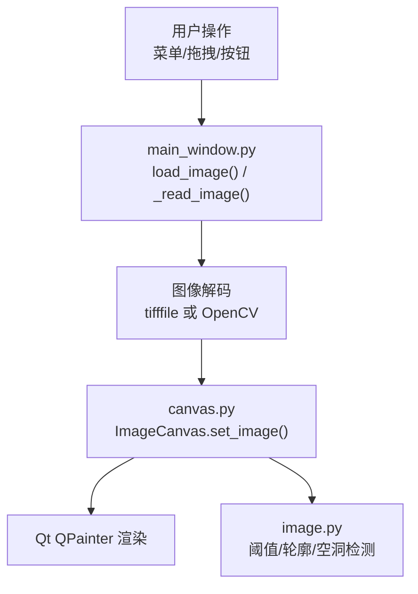
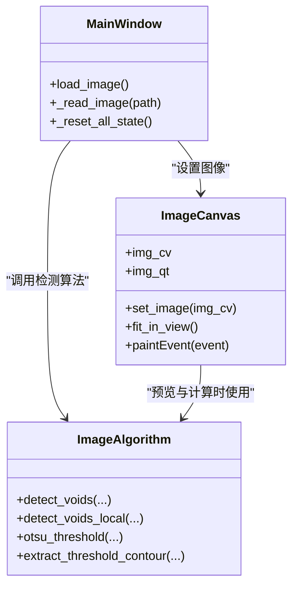
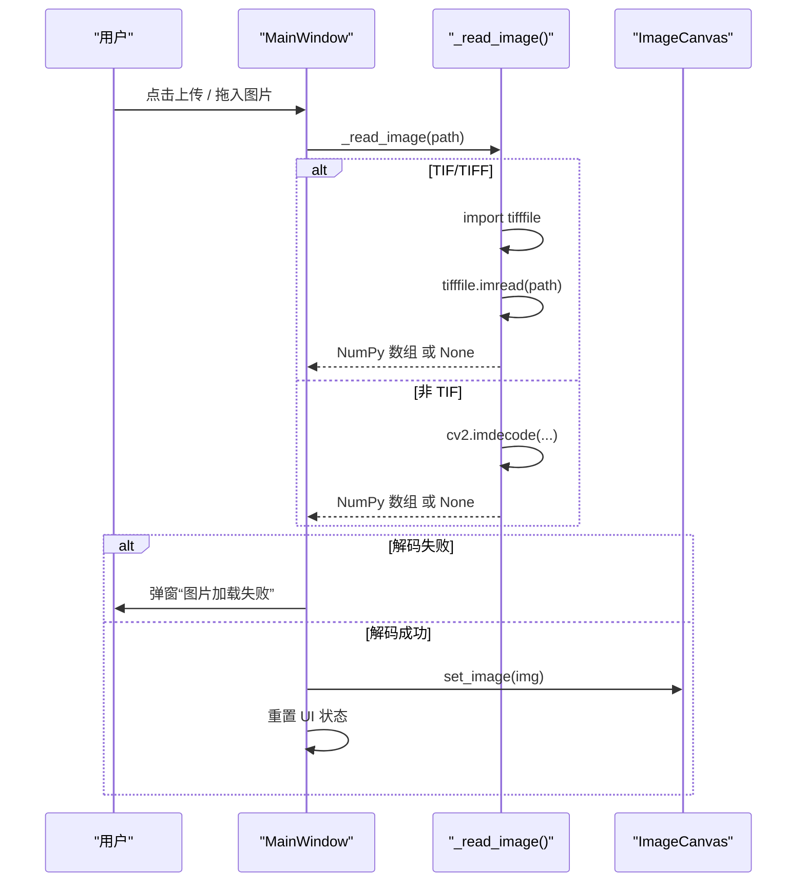
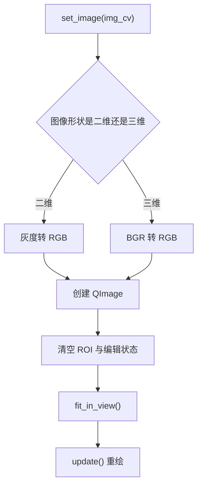

# 图片无法打开与解码失败

<cite>
**本文引用的文件**   
- [main_window.py](file://main_window.py)
- [canvas.py](file://canvas.py)
- [image.py](file://image.py)
- [requirements.txt](file://requirements.txt)
- [README.md](file://README.md)
- [area_tab.py](file://area_tab.py)
- [handoff.md](file://handoff.md)
</cite>

## 目录
1. [问题定位总览](#问题定位总览)
2. [项目结构与职责边界](#项目结构与职责边界)
3. [两类失败原因](#两类失败原因)
4. [入口与调用链](#入口与调用链)
5. [排查步骤](#排查步骤)
6. [典型错误日志与现象](#典型错误日志与现象)
7. [大图与内存压力提醒](#大图与内存压力提醒)
8. [已知限制与注意事项](#已知限制与注意事项)
9. [结论](#结论)

## 问题定位总览

当用户在 Aurascope 中打开图片后出现“无法打开”“加载失败”或画布空白时，应优先按以下顺序判断：

| 类别 | 触发条件 | 核心依赖 | 主要表现 | 首要检查项 |
|---|---|---|---|---|
| TIF/TIFF 读取失败 | 文件扩展名为 `.tif` 或 `.tiff` | `tifffile` | 可能打印 `tifffile 读取失败`，随后 OpenCV 回退仍返回空图 | tifffile 是否安装、TIF 文件头是否损坏、通道布局是否符合预期 |
| 非 TIF 图像解码失败 | 文件为 PNG/JPG/BMP 等，但 OpenCV 无法解码 | `opencv-python` + OpenCV 后端 | `_read_image` 返回 `None`，UI 提示“图片加载失败” | 文件是否损坏、格式是否受支持、路径权限、路径含特殊字符 |
| 已解码但显示异常 | 图像已成功解码为 NumPy 数组，但 Qt 渲染阶段崩溃 | PyQt6 + OpenCV 数据共享 | 通常不是“打不开”，而是渲染时报错或画面异常 | 图像 dtype、形状、连续内存、尺寸过大 |

需要特别强调：**image.py 是纯算法层，不负责 UI 报错；图片导入失败的排查应从 main_window.py 的入口开始，而不是从 image.py 的阈值或空洞检测函数开始。**

**本节来源**
- [main_window.py:793-878](file://main_window.py#L793-L878)
- [canvas.py:113-129](file://canvas.py#L113-L129)
- [image.py:1-12](file://image.py#L1-L12)

## 项目结构与职责边界

Aurascope 的图片处理链路可以抽象为四层：



各层职责如下：

| 层级 | 文件 | 职责 | 不负责 |
|---|---|---|---|
| 入口层 | `main_window.py` | 选择文件、调用解码、统一错误提示、更新 UI 状态 | 不实现图像算法 |
| 解码层 | `main_window.py._read_image()` | 根据扩展名选择 tifffile 或 OpenCV，并做基础 dtype 转换 | 不直接负责 UI 控件绘制 |
| 画布层 | `canvas.py.ImageCanvas` | 接收 NumPy 图像、转为 QImage、缩放平移、绘制 ROI 和空洞 | 不做空洞检测算法 |
| 算法层 | `image.py` | Otsu、形态学、轮廓、圆度、Canny 边缘验证、连通域统计 | 不直接弹出 UI 错误框 |



**图表来源**
- [main_window.py:793-878](file://main_window.py#L793-L878)
- [canvas.py:113-129](file://canvas.py#L113-L129)
- [image.py:27-286](file://image.py#L27-L286)

**本节来源**
- [README.md:42-64](file://README.md#L42-L64)
- [main_window.py:793-878](file://main_window.py#L793-L878)
- [canvas.py:113-129](file://canvas.py#L113-L129)
- [image.py:1-12](file://image.py#L1-L12)

## 两类失败原因

### 第一类：TIF/TIFF 缺少 tifffile 依赖

当文件扩展名为 `.tif` 或 `.tiff` 时，`main_window.py._read_image()` 会优先尝试使用 `tifffile.imread()` 读取。如果环境中没有安装 `tifffile`，或者该模块不可用，则会在内部捕获异常后尝试用 OpenCV 回退解码；若回退也失败，最终返回 `None`。

关键行为要点：

1. 扩展名匹配发生在 `_read_image()` 中，依据的是 `os.path.splitext(path)[1].lower()`。
2. TIF 分支内先 `import tifffile`，再调用 `tifffile.imread(path)`。
3. 如果 tifffile 读取抛出异常，代码会打印 `tifffile 读取失败:`，然后尝试 `cv2.imdecode(np.fromfile(path, dtype=np.uint8), cv2.IMREAD_UNCHANGED)`。
4. 如果 OpenCV 也无法解码该 TIF，则返回 `None`。
5. `load_image()` 收到 `None` 后记录警告日志，并弹出“图片加载失败！请检查文件格式/路径”。

因此，“TIF 打不开”不一定是 OpenCV 不支持 TIF，更常见的原因是：

- 未安装 `tifffile`；
- `requirements.txt` 中声明了 `tifffile>=2023.7.8`，但当前环境版本过旧或不兼容；
- TIF 文件本身是多页 TIFF、压缩格式、RGBA、CHW 通道布局等，tifffile 能读但后续 dtype 或通道转换不符合预期；
- tifffile 成功读取后，OpenCV 回退分支不再执行，因为异常已被捕获。

**本节来源**
- [main_window.py:828-878](file://main_window.py#L828-L878)
- [requirements.txt:1-5](file://requirements.txt#L1-L5)

### 第二类：非 TIF 图像由 OpenCV 解码失败

对于 PNG、JPG、JPEG、BMP 等非 TIF 文件，`_read_image()` 直接走 OpenCV 分支：

```python
img = cv2.imdecode(np.fromfile(path, dtype=np.uint8), cv2.IMREAD_UNCHANGED)
```

这里有两个重要细节：

1. 使用 `np.fromfile(path, dtype=np.uint8)` 读取原始字节，避免 Python 标准库 `open()` 对路径编码或文本模式带来的额外风险。
2. 使用 `cv2.imdecode(..., cv2.IMREAD_UNCHANGED)`，即保持原通道数；如果解码结果为 `None`，说明 OpenCV 无法识别该二进制流。

常见原因包括：

| 原因 | 说明 | 可复现方式 |
|---|---|---|
| 文件损坏 | 文件头不完整、截断、被其他程序占用 | 用系统图片查看器打开同一文件失败 |
| 不支持格式 | 某些 PNG/JPG 变体、HEIC、WebP、自定义封装 | 把扩展名改为 `.png` 但内容不是 PNG |
| 权限不足 | 当前用户无权读取文件 | 在受限账户或只读网络盘上打开 |
| 路径含特殊字符 | 文件名包含非常见 Unicode、代理区字符、超长路径 | 复制路径到命令行或 Python 脚本测试 |
| 磁盘空间不足 | 大图像解码时需要临时内存 | 打开超大 TIFF/PNG 时系统报内存不足 |

**本节来源**
- [main_window.py:873-878](file://main_window.py#L873-L878)

## 入口与调用链

### main_window.py 的图片打开入口

主窗口提供多个入口，但最终都会落到图像加载逻辑：

| 入口 | 触发方式 | 目标 Tab | 备注 |
|---|---|---|---|
| `MainWindow.load_image()` | “空洞分析”侧边栏上传按钮 | 空洞分析 | 通过 QFileDialog 选择文件 |
| `MainWindow.open_image_in_roi()` | 菜单“打开图片…” | 缺陷面积 ROI | 切换到 area_tab 并调用其 load_image |
| `MainWindow.dropEvent()` | 拖入单张图片 | 缺陷面积 ROI | 多张则进入拼接 |
| `MainWindow._open_recent_image()` | 最近打开菜单 | 缺陷面积 ROI | 先校验文件是否存在 |

其中，空洞分析的主入口 `load_image()` 流程为：

1. 弹出文件选择对话框。
2. 调用 `_read_image(path)`。
3. 如果返回 `None`，记录警告日志并弹窗。
4. 否则调用 `self.canvas.set_image(img)`。
5. 重置标定、ROI、空洞结果等状态。
6. 启用/禁用相关按钮，并记录成功日志。



**图表来源**
- [main_window.py:793-878](file://main_window.py#L793-L878)

**本节来源**
- [main_window.py:310-344](file://main_window.py#L310-L344)
- [main_window.py:396-407](file://main_window.py#L396-L407)
- [main_window.py:793-878](file://main_window.py#L793-L878)

### canvas.py 中 set_image() 的职责边界

`ImageCanvas.set_image()` 的职责非常明确：

1. 保存传入的 NumPy 图像到 `self.img_cv`。
2. 如果是灰度图，转换为 RGB。
3. 如果是彩色图，按 BGR→RGB 转换。
4. 用转换后的数据创建 `QImage`。
5. 清空 ROI 多边形、边缘吸附掩码、ROI 编辑状态。
6. 调用 `fit_in_view()` 计算缩放和平移。
7. 触发重绘。

它**不负责**：

- 判断文件是否可读；
- 解析 TIF 文件头；
- 判断 OpenCV 是否支持某种格式；
- 弹出“文件不存在”“权限不足”等错误；
- 执行空洞检测或阈值计算。

因此，如果用户看到“图片加载失败”，错误源头应在 `main_window.py._read_image()`；如果已经能看到画布但后续检测异常，才应考虑 `image.py` 中的算法输入是否合法。



**图表来源**
- [canvas.py:113-129](file://canvas.py#L113-L129)

**本节来源**
- [canvas.py:113-129](file://canvas.py#L113-L129)

### image.py 的定位原则

`image.py` 是图像处理算法层，核心内容包括：

- 阈值提取轮廓；
- 多边形采样与顶点近似；
- 多边形转掩膜；
- Otsu 自动阈值；
- 空洞检测 `detect_voids`；
- 局部空洞检测 `detect_voids_local`；
- 圆度计算；
- 连通域缺陷检测；
- 物料计数相关逻辑。

该文件顶部显式处理了 GUI 依赖的可选性：

```python
try:
    from PyQt6.QtWidgets import QApplication
except Exception:
    QApplication = None
```

这说明算法层不应承担 UI 报错职责。图片导入失败属于“文件 → 解码 → UI 展示”链路的问题，而 `image.py` 假设输入已经是合法的 NumPy 数组。

**本节来源**
- [image.py:1-25](file://image.py#L1-L25)
- [image.py:27-286](file://image.py#L27-L286)

## 排查步骤

### 第一步：确认是否为 TIF/TIFF 文件

1. 查看完整文件名，注意隐藏扩展名。
2. 如果扩展名是 `.tif` 或 `.tiff`，优先怀疑 tifffile。
3. 如果不是 TIF，直接进入第二步。

### 第二步：验证 tifffile 是否可用

在 Python 环境中执行：

```python
import tifffile
print(tifffile.__version__)
```

如果抛出 `ModuleNotFoundError`，说明 tifffile 未安装；如果版本过低，建议重新安装 requirements：

```bash
pip install -r requirements.txt
```

`requirements.txt` 中要求：

| 依赖 | 最低版本 |
|---|---|
| PyQt6 | 6.4.0 |
| opencv-python | 4.8.0 |
| numpy | 1.24.0 |
| tifffile | 2023.7.8 |

**本节来源**
- [requirements.txt:1-5](file://requirements.txt#L1-L5)

### 第三步：用 OpenCV 单独读取测试

在 Python 中运行最小测试：

```python
import cv2
import numpy as np

path = r"你的图片路径"
buf = np.fromfile(path, dtype=np.uint8)
img = cv2.imdecode(buf, cv2.IMREAD_UNCHANGED)

if img is None:
    print("OpenCV 无法解码该文件")
else:
    print("形状:", img.shape)
    print("数据类型:", img.dtype)
```

如果这一步返回 `None`，说明问题出在 OpenCV 解码层，而不是 Qt 渲染层。

### 第四步：切换 PNG/JPG 对比

将同一内容分别保存为 PNG 和 JPG（或使用另一张已知正常的 PNG/JPG）：

- 如果 PNG/JPG 能打开，TIF 不能打开：重点查 tifffile 和 TIF 文件头。
- 如果 PNG/JPG 也不能打开：重点查文件损坏、权限、路径、磁盘空间。
- 如果所有格式都不能打开：检查当前用户权限、杀毒软件拦截、文件被占用。

### 第五步：检查文件头与磁盘权限

1. 用系统图片查看器打开同一文件，确认不是应用自身问题。
2. 右键文件查看属性，确认当前用户有读取权限。
3. 检查文件是否位于只读目录、网络映射盘、回收站或临时清理目录。
4. 对疑似损坏文件，用十六进制编辑器查看文件头：
   - PNG 应以 `89 50 4E 47` 开头；
   - JPEG 应以 `FF D8 FF` 开头；
   - BMP 应以 `42 4D` 开头；
   - TIFF 应以 `49 49 2A 00` 或 `4D 4D 00 2A` 开头。

### 第六步：区分“打不开”和“显示异常”

如果 OpenCV 能解码，但 Qt 渲染时报错，应检查：

- `img.shape` 是否为 `(H, W)` 或 `(H, W, C)`；
- `img.dtype` 是否为数值类型；
- 图像尺寸是否过大；
- `rgb.data` 是否来自连续内存。

`canvas.py` 中直接使用 `rgb.data` 构造 `QImage`，因此如果上游传入的 NumPy 数组不是连续内存，可能出现渲染异常。不过这类问题通常表现为“能解码但显示异常”，而不是“图片加载失败”。

**本节来源**
- [main_window.py:828-878](file://main_window.py#L828-L878)
- [canvas.py:113-129](file://canvas.py#L113-L129)

## 典型错误日志与现象

### 典型日志一：TIF 读取失败

现象：

- 打开 TIF 文件后，控制台可能输出类似 `tifffile 读取失败: ...` 的信息。
- UI 弹出“错误：图片加载失败！请检查文件格式/路径”。
- 画布保持空白或上一张图状态。

可能原因：

- tifffile 未安装；
- tifffile 版本不兼容；
- TIF 文件头损坏；
- TIF 是多页、压缩、RGBA、CHW 等复杂结构，且回退解码失败。

对应代码位置：

- [main_window.py:833-871](file://main_window.py#L833-L871)

### 典型日志二：非 TIF 解码失败

现象：

- 打开 PNG/JPG/BMP 后直接弹出“图片加载失败”。
- 日志中出现“图片加载失败：...”。
- 最近打开菜单可能保留该路径，但再次打开仍失败。

对应代码位置：

- [main_window.py:802-806](file://main_window.py#L802-L806)
- [main_window.py:873-878](file://main_window.py#L873-L878)

### 典型日志三：ROI 页面加载失败

缺陷面积 ROI 页面的加载逻辑与空洞分析入口不同，它使用独立的 `_read_image()`，并捕获 `OSError`、`ValueError`、`cv2.error`、`zlib.error`、`ImportError`：

- 失败时记录警告日志；
- 在页面状态栏显示“图片加载失败：...”；
- 返回 `False`。

这说明不同 Tab 的错误提示方式不同，但根本原因仍可归为“tifffile 缺失”或“OpenCV 解码失败”。

**本节来源**
- [main_window.py:802-806](file://main_window.py#L802-L806)
- [main_window.py:828-878](file://main_window.py#L828-L878)
- [area_tab.py:342-378](file://area_tab.py#L342-L378)

## 大图与内存压力提醒

图片导入失败不一定只是“格式不对”。对于超大图像，尤其是高分辨率 TIF/PNG，即使依赖正确，也可能因内存不足导致：

- tifffile 读取时抛出内存相关异常；
- OpenCV 解码时返回 `None`；
- NumPy 分配图像数组时触发内存压力；
- Qt 将 NumPy 数据包装为 `QImage` 时进一步增加内存占用。

建议在排查大图问题时遵循以下顺序：

1. 先用小图验证依赖是否正确。
2. 确认 tifffile 和 OpenCV 都能正常导入。
3. 用小图验证 PNG/JPG 是否能打开。
4. 再逐步替换为大图。
5. 如果只有大图失败，优先检查系统内存、虚拟内存、磁盘空间和进程内存占用。
6. 不要一开始就调整空洞检测参数；应先确认图像能否成功解码。

**本节来源**
- [main_window.py:828-878](file://main_window.py#L828-L878)
- [canvas.py:113-129](file://canvas.py#L113-L129)

## 已知限制与注意事项

根据仓库中的交接文档与代码现状，排查图片导入时应注意以下已知限制：

1. **重复的本地空洞检测函数**：`main_window.py` 中存在一份 `detect_voids_local` 副本，属于已知技术债；现行行为以 `image.py` 为准，两份待合并。
2. **Canny 边缘校验静默失效风险**：交接文档指出 `edge_map` 在某些路径下可能未初始化，导致 Canny 校验静默失效。这属于检测结果问题，不是图片导入问题，但会影响“增强检测”体验。
3. **滚轮缩放 Y 轴漂移**：canvas 层存在缩放锚点 Y 漂移的已知问题，不要把界面缩放异常误判为图片解码失败。
4. **select_for_local 为无 UI 入口的死代码**：属于历史遗留，不影响图片导入。
5. **大图增强检测无进度提示**：长时间计算时用户可能误以为程序卡死，应结合日志和任务管理器判断。

这些限制主要来自交接清单，应与实际源码对照使用。

**本节来源**
- [handoff.md](file://handoff.md)
- [main_window.py:32-35](file://main_window.py#L32-L35)
- [image.py:228-234](file://image.py#L228-L234)

## 结论

图片无法打开的排查应按依赖与职责分层进行：

1. 先判断是否为 TIF/TIFF 文件。
2. 如果是 TIF，优先验证 tifffile 是否安装且版本满足 `requirements.txt`。
3. 如果不是 TIF，直接用 OpenCV 的 `imdecode` 测试该文件。
4. 用 PNG/JPG 做对照，缩小范围到“仅 TIF 失败”还是“所有格式都失败”。
5. 检查文件头、权限、路径、磁盘空间。
6. 只在确认图像已成功解码后，才考虑 canvas 渲染或 image.py 算法问题。
7. 对大图优先确认依赖与格式，再评估内存压力，不要直接调参空洞检测。

最终判断原则是：

- `main_window.py` 负责“文件 → 图像数组 → UI”的入口与错误提示；
- `canvas.py` 负责“图像数组 → Qt 图像 → 绘制”；
- `image.py` 负责“图像数组 → 算法结果”，不承担 UI 报错责任。