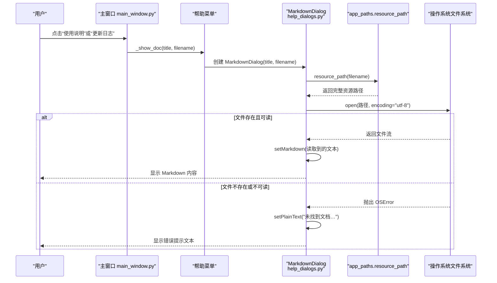
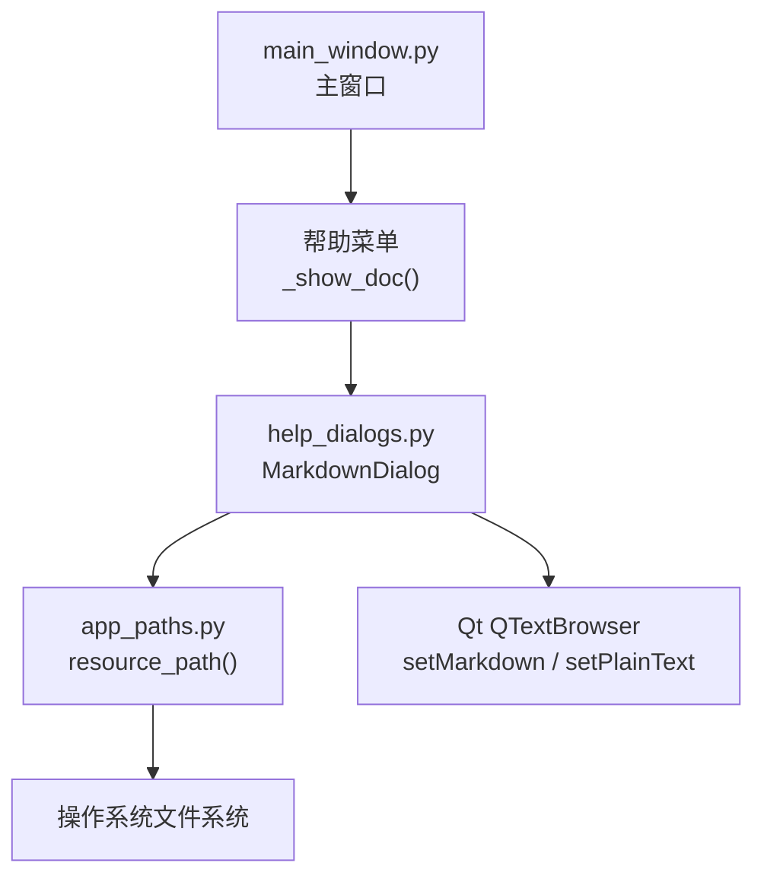
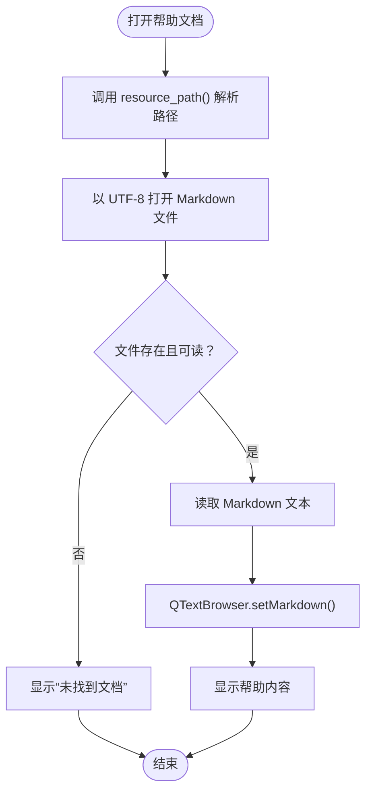

# 帮助文档与 Markdown 加载失败

<cite>
**本文引用的文件**   
- [help_dialogs.py](file://help_dialogs.py)
- [app_paths.py](file://app_paths.py)
- [main_window.py](file://main_window.py)
- [AurascopeV6.spec](file://AurascopeV6.spec)
</cite>

## 目录
1. [问题概述](#问题概述)
2. [帮助对话框的加载流程](#帮助对话框的加载流程)
3. [常见故障现象与原因](#常见故障现象与原因)
4. [排查步骤](#排查步骤)
5. [临时绕过方式](#临时绕过方式)
6. [根本修复建议](#根本修复建议)
7. [对核心算法的影响说明](#对核心算法的影响说明)
8. [附录：关键路径与调用关系图](#附录关键路径与调用关系图)

## 问题概述
本仓库的帮助功能由 `help_dialogs.py` 中的 `MarkdownDialog` 实现，用于在离线界面中显示随程序包分发的 Markdown 文档。该对话框依赖 `app_paths.py` 提供的 `resource_path()` 函数解析资源文件路径，并以 UTF-8 编码读取 Markdown 文本后交给 Qt 的 `QTextBrowser.setMarkdown()` 渲染。

当出现以下情况时，用户可能看到空内容、乱码或提示“未找到文档”：
- 打包后的程序包中没有包含目标 Markdown 文件；
- `app_paths.py` 返回的资源 base 目录不符合预期；
- Markdown 文件不是 UTF-8 编码；
- 运行环境无法读取中文路径或资源路径；
- PyInstaller 打包配置遗漏了相关 `.md` 文件。

需要特别强调的是：**帮助文档加载失败只影响“使用说明”和“更新日志”等辅助信息展示，不影响空洞分析、缺陷面积测量、物料计数、测距、剪切力计算、图像拼接、批量示教等核心算法功能。**

## 帮助对话框的加载流程
帮助菜单通过主窗口触发，最终进入 `MarkdownDialog` 构造函数并尝试打开 Markdown 文件。其核心流程如下：



**图表来源**
- [main_window.py:233-248](file://main_window.py#L233-L248)
- [help_dialogs.py:20-38](file://help_dialogs.py#L20-L38)
- [app_paths.py:8-11](file://app_paths.py#L8-L11)

**章节来源**
- [main_window.py:233-248](file://main_window.py#L233-L248)
- [help_dialogs.py:20-38](file://help_dialogs.py#L20-L38)
- [app_paths.py:8-11](file://app_paths.py#L8-L11)

## 常见故障现象与原因

| 现象 | 最可能的原因 | 对应代码位置 |
|---|---|---|
| 打开“使用说明”或“更新日志”后显示“未找到文档” | 打包产物中缺少 `说明书.md` 或 `CHANGELOG.md` | [help_dialogs.py:33-37](file://help_dialogs.py#L33-L37) |
| 帮助窗口空白但无错误提示 | Markdown 文件为空，或 `setMarkdown()` 渲染结果为空 | [help_dialogs.py:33-35](file://help_dialogs.py#L33-L35) |
| 中文标题、段落显示为乱码 | Markdown 文件不是 UTF-8 编码，而代码固定使用 `encoding='utf-8'` 读取 | [help_dialogs.py:34](file://help_dialogs.py#L34) |
| 源码运行正常，打包后找不到文档 | PyInstaller 打包配置没有把 `.md` 文件加入数据资源 | [AurascopeV6.spec:17-18](file://AurascopeV6.spec#L17-L18) |
| 打包后 base 目录变化导致路径错误 | `resource_path()` 根据是否 frozen 切换 base 目录 | [app_paths.py:8-11](file://app_paths.py#L8-L11) |
| 中文路径下无法打开帮助 | 运行环境或文件系统对中文路径支持异常 | 系统级行为，非 Python 逻辑直接报错 |

### 为什么会出现“未找到文档”
`MarkdownDialog.__init__` 中使用 `try/except OSError` 捕获文件打开异常。只要 `open(resource_path(filename), encoding='utf-8')` 抛出 `OSError`，就会执行 `view.setPlainText(...)`，显示“未找到文档”提示。因此，“未找到文档”并不一定代表文件真的不存在，也可能是权限不足、路径非法、编码异常导致底层 I/O 失败。

**章节来源**
- [help_dialogs.py:33-38](file://help_dialogs.py#L33-L38)

### 为什么会出现乱码
代码明确以 UTF-8 编码读取 Markdown 文件：

```python
with open(resource_path(filename), encoding='utf-8') as stream:
    view.setMarkdown(stream.read())
```

如果 Markdown 文件实际保存为 GBK、GB2312、ANSI 或其他编码，Python 会按 UTF-8 解码字节序列，从而产生乱码。当前实现没有提供编码回退或检测逻辑。

**章节来源**
- [help_dialogs.py:33-35](file://help_dialogs.py#L33-L35)

### 为什么 PyInstaller 打包后会找不到文件
`app_paths.resource_path()` 的逻辑是：
- 如果是 PyInstaller 单文件模式（`sys._MEIPASS` 存在），base 目录为解包临时目录；
- 否则 base 目录为当前脚本所在目录。

因此，`.md` 文件必须被打包进可执行程序的数据资源中。仓库中的打包配置示例显示 `说明书.md` 和 `CHANGELOG.md` 被作为数据文件打包到根目录：

```text
datas=[('说明书.md', '.'),
       ('CHANGELOG.md', '.')]
```

如果发布包没有包含这些文件，或者打包配置与实际文件名不一致，`resource_path('说明书.md')` 返回的路径虽然合法，但文件不存在。

**章节来源**
- [app_paths.py:8-11](file://app_paths.py#L8-L11)
- [AurascopeV6.spec:17-18](file://AurascopeV6.spec#L17-L18)

## 排查步骤

### 第一步：确认帮助菜单调用的文件名
主窗口的帮助菜单将两个动作分别绑定到：
- “使用说明” → `MarkdownDialog('使用说明', '说明书.md')`
- “更新日志” → `MarkdownDialog('更新日志', 'CHANGELOG.md')`

因此，排查时应先确认你打开的是哪一个文档，再检查对应文件名。

**章节来源**
- [main_window.py:233-248](file://main_window.py#L233-L248)

### 第二步：检查 Markdown 文件是否存在
在源码运行时，Markdown 文件通常位于仓库根目录。你可以检查：
- `说明书.md`
- `CHANGELOG.md`

如果这两个文件缺失，帮助菜单将无法加载内容。

### 第三步：检查 PyInstaller 打包配置
如果你是在打包后的 exe 中复现问题，应检查打包配置文件是否包含目标 Markdown 文件。仓库中的 `AurascopeV6.spec` 已显式声明：
- `说明书.md`
- `CHANGELOG.md`

若发布包中缺少这些文件，请重新构建应用并确保 spec 文件中包含正确的资源映射。

**章节来源**
- [AurascopeV6.spec:17-18](file://AurascopeV6.spec#L17-L18)

### 第四步：验证 `app_paths.resource_path()` 返回的 base 目录
在源码模式下，`resource_path()` 的 base 目录是当前脚本所在目录；在 PyInstaller 单文件模式下，base 目录是运行时解包目录。

你可以在调试环境中打印或记录 `resource_path('说明书.md')` 的返回值，然后手动在资源管理器中打开该路径，确认：
1. 路径确实指向一个文件；
2. 文件存在且未被杀毒软件隔离；
3. 当前用户有读取权限；
4. 路径不包含非法字符。

**章节来源**
- [app_paths.py:8-11](file://app_paths.py#L8-L11)

### 第五步：验证 Markdown 文件编码
由于代码固定使用 UTF-8 读取，建议将 `说明书.md` 和 `CHANGELOG.md` 统一保存为 **UTF-8（无 BOM）**。

可用检查方法：
- 用任意文本编辑器打开 Markdown 文件；
- 查看当前编码格式；
- 如果显示为 ANSI、GBK、GB2312 或其他编码，则转换为 UTF-8；
- 保存后再次打开帮助对话框验证。

注意：不要仅因为“能打开”就认为编码正确，必须以编辑器显示的编码为准。

**章节来源**
- [help_dialogs.py:34](file://help_dialogs.py#L34)

### 第六步：区分“文件不存在”和“编码异常”
- 如果显示“未找到文档”，优先检查文件是否存在、打包配置是否正确、路径是否可达；
- 如果能打开帮助窗口但中文显示为乱码，优先检查 Markdown 文件编码；
- 如果帮助窗口完全空白，检查文件是否为空，或 Markdown 语法是否导致渲染结果为空。

### 第七步：在中文路径环境下单独验证
如果程序安装在包含中文的目录中，例如桌面、下载文件夹或带中文的用户名路径，应额外验证：
- 源码运行是否正常；
- PyInstaller 打包后是否能读取资源；
- 是否因 Windows 旧版 API 或第三方库限制导致中文路径不可读。

当前帮助加载逻辑本身不主动处理中文路径异常，因此这类问题通常表现为 `OSError`，进而落入“未找到文档”分支。

## 临时绕过方式

### 方式一：跳过帮助加载
如果你只需要验证核心算法功能，可以暂时不调用 `_show_doc()`。主窗口中帮助菜单的两个动作分别是：

```python
help_menu.addAction('使用说明', lambda: self._show_doc('使用说明', '说明书.md'))
help_menu.addAction('更新日志', lambda: self._show_doc('更新日志', 'CHANGELOG.md'))
```

在开发或测试阶段，可以通过注释掉这两行，或替换为无害占位逻辑，避免帮助加载阻塞主流程。

**章节来源**
- [main_window.py:233-248](file://main_window.py#L233-L248)

### 方式二：恢复默认帮助文件
如果怀疑本地 Markdown 文件损坏或编码异常，可以：
1. 从仓库原始版本恢复 `说明书.md` 和 `CHANGELOG.md`；
2. 确保文件编码为 UTF-8；
3. 重新打包应用；
4. 再次打开“使用说明”和“更新日志”。

这种方式适合确认问题是否由本地 Markdown 文件损坏引起。

### 方式三：降级为纯文本提示
如果希望帮助加载失败时不再静默显示“未找到文档”，可以在 `MarkdownDialog` 中增加更明确的错误提示。当前实现仅在 `OSError` 时写入纯文本提示，没有记录日志或向用户解释编码问题。

注意：修改 `help_dialogs.py` 属于临时绕过或增强诊断，不应掩盖打包配置或编码问题的根本原因。

## 根本修复建议

### 修复一：修正资源路径与打包配置
1. 确认 `main_window.py` 中帮助菜单使用的文件名与实际 Markdown 文件名一致；
2. 确认 `AurascopeV6.spec` 中 `datas` 列表包含所有需要随包分发的 Markdown 文件；
3. 重新构建 PyInstaller 应用；
4. 检查生成的可执行文件或解包目录中是否确实包含 `说明书.md` 和 `CHANGELOG.md`。

这是解决“打包后找不到文档”的最可靠方式。

**章节来源**
- [main_window.py:233-248](file://main_window.py#L233-L248)
- [AurascopeV6.spec:17-18](file://AurascopeV6.spec#L17-L18)

### 修复二：统一 Markdown 文件编码
将所有帮助文档统一为 UTF-8 编码，避免在不同 Windows 区域设置下出现乱码。推荐做法：
- 所有 Markdown 文件使用 UTF-8（无 BOM）；
- 编辑器中关闭自动转换编码；
- 提交前检查文件编码；
- 发布前在干净虚拟机中验证打包结果。

**章节来源**
- [help_dialogs.py:34](file://help_dialogs.py#L34)

### 修复三：增强帮助加载的错误诊断
建议在 `MarkdownDialog` 中增加更明确的错误分类，例如：
- 文件不存在：提示检查打包配置；
- 编码异常：提示检查 Markdown 文件编码；
- 路径不可读：提示检查中文路径或权限；
- 渲染为空：提示检查 Markdown 内容是否为空。

同时建议将关键错误写入日志，便于用户反馈。当前实现仅捕获 `OSError` 并显示简短提示，不利于定位编码或路径问题。

### 修复四：避免硬编码文件名与路径
当前帮助菜单直接传入字符串 `'说明书.md'` 和 `'CHANGELOG.md'`，容易与打包配置脱节。长期改进方向包括：
- 将帮助文档清单集中管理；
- 在启动时校验必要帮助文件是否存在；
- 对缺失文件给出可操作的修复建议；
- 将资源路径与业务逻辑解耦。

## 对核心算法的影响说明
帮助对话框只是 UI 辅助层，不参与图像处理、空洞检测、轮廓提取、面积统计、距离测量、物料计数、图像拼接或批量示教等核心逻辑。

即使 `MarkdownDialog` 加载失败：
- 空洞分析仍可正常加载图片、定义 ROI、执行阈值与形态学处理；
- 缺陷面积多 ROI 仍可编辑选区并计算面积；
- 物料计数仍可基于 `distanceTransform` 等算法进行计数；
- 剪切力、图像拼接、批量示教等功能不受影响；
- 只有“使用说明”和“更新日志”等帮助内容无法正常显示。

因此，遇到帮助加载失败时，应优先判断是否需要立即修复帮助资源；如果用户正在执行检测任务，可先继续工作，再安排修复打包配置或 Markdown 文件。

## 附录：关键路径与调用关系图

### 帮助加载依赖关系图


**图表来源**
- [main_window.py:233-248](file://main_window.py#L233-L248)
- [help_dialogs.py:20-38](file://help_dialogs.py#L20-L38)
- [app_paths.py:8-11](file://app_paths.py#L8-L11)

### Markdown 加载失败流程图


**图表来源**
- [help_dialogs.py:33-38](file://help_dialogs.py#L33-L38)
- [app_paths.py:8-11](file://app_paths.py#L8-L11)