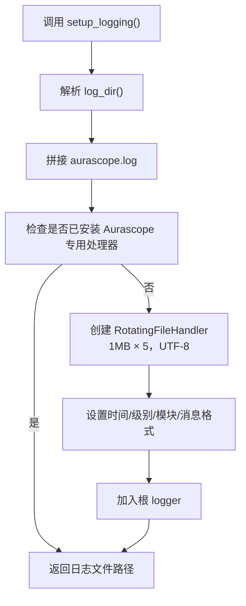
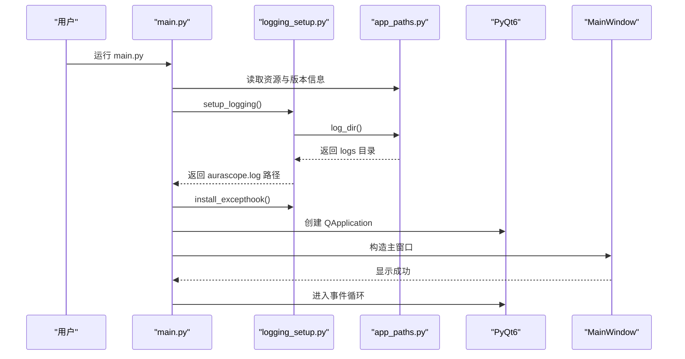
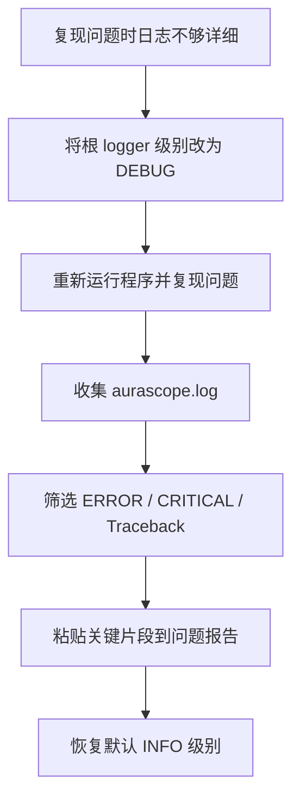
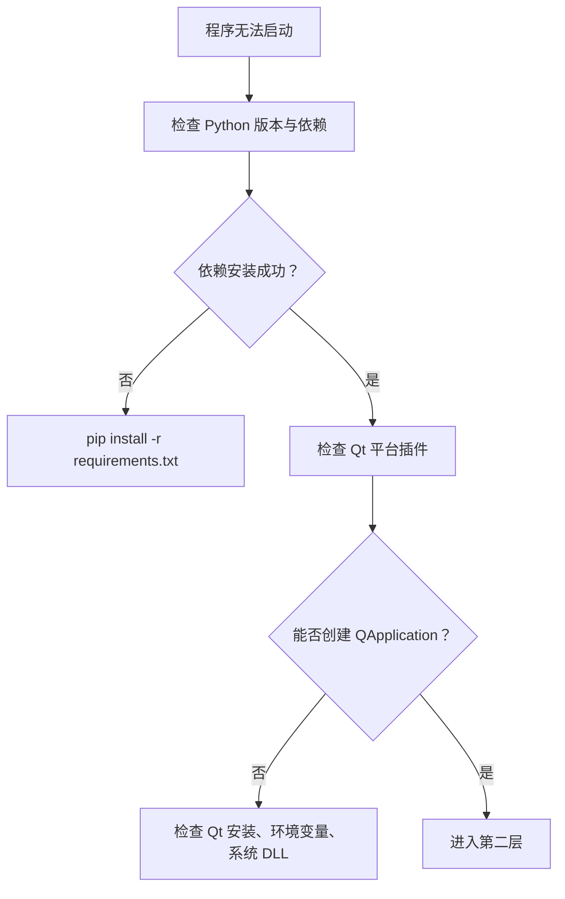
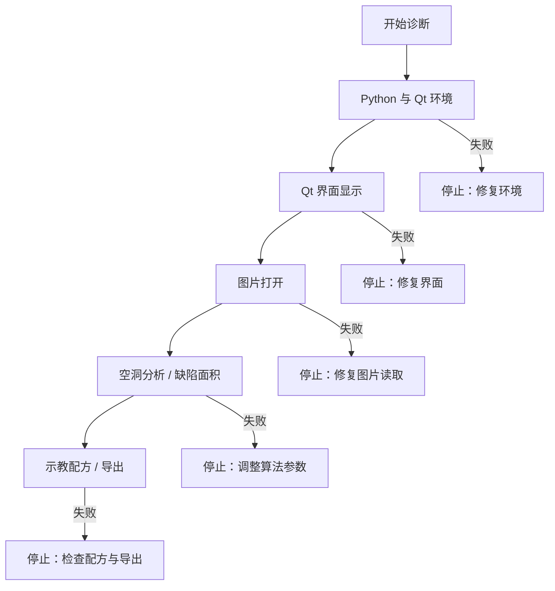

# 日志输出位置与诊断步骤

<cite>
**本文引用的文件**   
- [logging_setup.py](file://logging_setup.py)
- [main.py](file://main.py)
- [app_paths.py](file://app_paths.py)
- [README.md](file://README.md)
- [PROJECT_CONCEPTION.md](file://PROJECT_CONCEPTION.md)
</cite>

## 目录
1. [文档目标与适用范围](#文档目标与适用范围)
2. [日志输出位置与默认行为](#日志输出位置与默认行为)
3. [启动流程中的日志初始化](#启动流程中的日志初始化)
4. [如何定位日志文件](#如何定位日志文件)
5. [提升日志详细程度以捕获堆栈信息](#提升日志详细程度以捕获堆栈信息)
6. [提交问题报告时的关键日志片段](#提交问题报告时的关键日志片段)
7. [分层诊断路径：从无法启动到功能异常](#分层诊断路径从无法启动到功能异常)
8. [隐私与安全约束](#隐私与安全约束)
9. [常见问题排查清单](#常见问题排查清单)
10. [结论](#结论)

## 文档目标与适用范围
本文面向 Aurascope 用户与维护人员，说明以下事项：
- logging_setup.py 如何集中配置日志输出位置、默认级别和滚动文件策略。
- main.py 启动时如何安装日志与全局异常处理。
- 如何在 Windows 上找到 aurascope.log。
- 如何通过调整日志级别获取更完整的堆栈信息。
- 在「程序无法启动」到「界面已显示但功能异常」的分层诊断路径中，应优先确认哪些环节。
- 产品不联网、不收集数据的约束，以及日志上传的安全注意事项。

Aurascope 是面向微电子封装产线的半自动化视觉检测桌面工具，使用 PyQt6 + OpenCV + NumPy + Pandas，纯 CPU 计算，兼容 Windows 7+。其核心设计约束包括单机运行、不联网、不收集用户数据。

**章节来源**
- [README.md:1-40](file://README.md#L1-L40)
- [PROJECT_CONCEPTION.md:1-15](file://PROJECT_CONCEPTION.md#L1-L15)
- [PROJECT_CONCEPTION.md:103-108](file://PROJECT_CONCEPTION.md#L103-L108)

## 日志输出位置与默认行为
logging_setup.py 负责统一日志初始化与全局异常兜底，主要行为如下：

| 项目 | 当前实现 | 说明 |
|---|---|---|
| 日志根名称 | `Aurascope` | 应用日志通过该 logger 记录，便于过滤。 |
| 默认日志级别 | `INFO` | 根 logger 设置为 INFO；低于 INFO 的 DEBUG 日志不会写入文件。 |
| 输出目标 | 滚动日志文件 | 使用 RotatingFileHandler，单文件最大约 1MB，最多保留 5 个备份。 |
| 编码格式 | UTF-8 | 避免中文日志乱码。 |
| 日志文件名 | aurascope.log | 位于 app_paths.py 提供的 log_dir() 目录下。 |
| 未捕获异常 | 写入 critical 日志并弹出错误对话框 | 主线程与工作线程均被覆盖。 |
| 控制台输出 | 无默认 handler | 源码运行时若需控制台输出，需自行添加 StreamHandler。 |

日志文件路径由 app_paths.py 提供：先取 LOCALAPPDATA 或 `~\AppData\Local`，再拼接 `Aurascope\logs`，最后得到 `aurascope.log`。打包后与源码运行时都走同一套路径逻辑，因此用户不需要区分 exe 还是 python main.py。

**图表来源**
- [logging_setup.py:15-31](file://logging_setup.py#L15-L31)
- [app_paths.py:29-32](file://app_paths.py#L29-L32)

**章节来源**
- [logging_setup.py:1-35](file://logging_setup.py#L1-L35)
- [app_paths.py:21-32](file://app_paths.py#L21-L32)

## 启动流程中的日志初始化
main.py 是 Aurascope 的主入口，其启动顺序对诊断非常关键：

1. 设置 Qt 平台为 windows。
2. 导入 PyQt6、样式、主窗口、资源路径、版本信息与 logging_setup。
3. 调用 setup_logging() 初始化日志文件。
4. 调用 install_excepthook() 安装全局异常钩子。
5. 记录启动信息，包含版本号、是否 frozen（打包）、日志路径。
6. 设置 HighDPI 缩放策略。
7. 创建 QApplication，设置 Fusion 风格、图标、样式表。
8. 设置“最后一个窗口关闭即退出”为 False，避免启动图或对话框关闭窗口导致进程退出。
9. 构造 MainWindow；若失败，记录异常并重新抛出。
10. 绑定主窗口销毁事件，显式退出应用。
11. show() 显示主窗口，延迟关闭 PyInstaller 启动图。
12. 进入 Qt 事件循环。

**图表来源**
- [main.py:31-70](file://main.py#L31-L70)
- [logging_setup.py:15-35](file://logging_setup.py#L15-L35)
- [app_paths.py:29-32](file://app_paths.py#L29-L32)

**章节来源**
- [main.py:1-75](file://main.py#L1-L75)
- [logging_setup.py:72-88](file://logging_setup.py#L72-L88)

## 如何定位日志文件
根据 app_paths.py 的实现，日志目录位于当前用户的可写数据目录下的 `Aurascope\logs`。常见路径形式如下：

- 源码运行：`%LOCALAPPDATA%\Aurascope\logs\aurascope.log`
- 打包运行：同样使用 `%LOCALAPPDATA%\Aurascope\logs\aurascope.log`

如果找不到日志，可按以下步骤确认：

1. 打开资源管理器，地址栏输入 `%LOCALAPPDATA%`。
2. 查找 `Aurascope` 文件夹。
3. 进入 `logs` 子目录。
4. 查看 `aurascope.log` 及其备份文件。
5. 如果仍为空，确认程序是否真的完成启动；若启动阶段崩溃且未生成日志，则优先检查 Python 环境、Qt 插件与依赖库加载。

注意：logging_setup.py 只在 setup_logging() 被调用后才确定日志路径。如果 main.py 在导入阶段就崩溃，可能连日志目录都没有创建。

**章节来源**
- [app_paths.py:21-32](file://app_paths.py#L21-L32)
- [logging_setup.py:15-35](file://logging_setup.py#L15-L35)
- [main.py:31-37](file://main.py#L31-L37)

## 提升日志详细程度以捕获堆栈信息
当前默认级别为 INFO，适合日常运行记录。若需要更详细的调试信息，例如第三方库内部警告、OpenCV 或 PyQt 的内部日志，可将根 logger 级别降低到 DEBUG。

推荐操作方式：

1. 在 main.py 中 setup_logging() 之后、创建 QApplication 之前，增加一行将根 logger 级别设为 DEBUG。
2. 重新运行程序，复现问题。
3. 查看 aurascope.log，搜索 ERROR、CRITICAL、Exception、Traceback 等关键词。
4. 将关键日志片段复制到问题报告中。

需要注意：
- 仅修改日志级别不会改变业务逻辑。
- 如果问题发生在 import 阶段，必须确保修改代码后能重新运行 main.py。
- 如果问题只出现在打包后的 exe，建议先在源码模式下复现；否则只能临时修改打包产物对应位置的入口脚本。
- 不要长期保持 DEBUG 级别，因为日志量会显著增加，尤其在大图分析场景。

**图表来源**
- [logging_setup.py:19-20](file://logging_setup.py#L19-L20)
- [main.py:33-37](file://main.py#L33-L37)

**章节来源**
- [logging_setup.py:15-35](file://logging_setup.py#L15-L35)
- [main.py:31-37](file://main.py#L31-L37)

## 提交问题报告时的关键日志片段
提交问题报告时，请至少包含以下内容：

1. **启动日志**  
   包含版本号、是否 frozen、日志路径的行。用于确认当前运行的是哪个构建版本。

2. **异常堆栈**  
   如果程序崩溃，复制 critical 级别的完整 traceback。logging_setup.py 会将未捕获异常写入日志，并在 GUI 环境下弹出错误对话框，支持复制详情。

3. **图片相关错误**  
   如果问题是“图片打不开”，请附上 OpenCV 或文件读取相关的错误行。

4. **功能异常上下文**  
   如果是空洞分析、缺陷面积、示教配方等业务问题，请附上触发操作前的最近几条 INFO 日志，帮助还原调用顺序。

5. **环境与版本信息**  
   包括 Python 版本、Windows 版本、是否使用打包后的 exe、是否首次运行。

不建议上传整个日志文件到公共仓库，除非确认日志中不包含敏感图片路径、用户名、公司内网路径等信息。

**章节来源**
- [logging_setup.py:38-41](file://logging_setup.py#L38-L41)
- [logging_setup.py:44-70](file://logging_setup.py#L44-L70)
- [main.py:33-37](file://main.py#L33-L37)

## 分层诊断路径：从无法启动到功能异常
诊断应按「环境 → 图形界面 → 图像能力 → 业务算法」的顺序进行，避免一开始就陷入空洞分析或缺陷面积参数调优。

### 第一层：Python 环境与 Qt 插件
适用现象：双击 exe 无反应、命令行直接报错、import 失败、Qt 插件缺失。

排查要点：
- 确认 Python 版本满足 README 要求。
- 确认已通过 requirements.txt 安装依赖。
- 确认 Qt 平台插件可用；main.py 强制使用 windows 平台。
- 若首次运行，确认 %LOCALAPPDATA%\Aurascope\logs 是否可写。
- 查看 aurascope.log 中是否有 ImportError、ModuleNotFoundError、Qt 插件加载失败。

**图表来源**
- [README.md:18-33](file://README.md#L18-L33)
- [main.py:3-16](file://main.py#L3-L16)
- [main.py:39-47](file://main.py#L39-L47)

### 第二层：Qt 界面能否显示
适用现象：依赖正常，但主窗口不出现、白屏、图标缺失、样式异常。

排查要点：
- 查看日志中是否出现“主窗口装配失败”。
- 检查 styles.py 与 ui_components.py 是否存在。
- 检查 logo_1.ico 等资源是否能通过 resource_path 解析。
- 确认 HighDPI 设置没有导致界面不可见。

**章节来源**
- [main.py:39-67](file://main.py#L39-L67)
- [app_paths.py:8-11](file://app_paths.py#L8-L11)

### 第三层：图片能否打开
适用现象：界面已显示，但导入图片失败、空白、报错。

排查要点：
- 确认图片路径合法、文件未被占用。
- 确认 OpenCV 能读取该图片格式。
- 查看日志中是否有文件读取异常。
- 尝试更换小图、不同格式图片，判断是否为大图或特殊编码问题。

此层应在任何空洞分析、缺陷面积、计数、测距、剪切力、拼接、批量示教之前确认。

### 第四层：空洞分析与缺陷面积
适用现象：图片能打开，但空洞率、缺陷面积、ROI 结果不符合预期。

排查要点：
- 先确认 ROI 是否正确绘制。
- 再检查阈值、局部阈值笔刷、Canny 边缘验证、圆度过滤等参数。
- 对照 image.py 的算法实现，而不是只看 UI 控件。
- 对于缺陷面积多 ROI，参考 area_tab.py / area_canvas.py 与 recipe.py 的交互契约。

### 第五层：示教配方与业务导出
适用现象：单次分析看似正常，但批量结果、配方保存、CSV 导出异常。

排查要点：
- 检查 recipes/ 下的 JSON 配方结构。
- 检查 recipe.py 的读写逻辑。
- 检查导出 CSV 的目标路径与权限。
- 确认业务 Tab 与 Canvas 层的数据流一致。

**图表来源**
- [main.py:31-70](file://main.py#L31-L70)
- [logging_setup.py:15-35](file://logging_setup.py#L15-L35)

**章节来源**
- [README.md:18-33](file://README.md#L18-L33)
- [main.py:31-70](file://main.py#L31-L70)

## 隐私与安全约束
Aurascope 的产品定位明确为单机桌面工具，不联网、不收集用户数据、纯 CPU 计算。这意味着：

- 日志文件仅用于本地排查。
- 不应将 aurascope.log 上传至 GitHub、GitLab、公开论坛等公共仓库。
- 上传前必须脱敏：删除图片路径、用户名、公司内网路径、样本编号等敏感信息。
- 如需内部共享日志，请使用受控的内部渠道。
- 产品本身没有网络更新、遥测上报或远程日志收集逻辑。

**章节来源**
- [PROJECT_CONCEPTION.md:103-108](file://PROJECT_CONCEPTION.md#L103-L108)

## 常见问题排查清单
| 现象 | 优先检查 | 期望日志线索 |
|---|---|---|
| 双击 exe 无反应 | Python 环境、Qt 插件、依赖 | 无日志或启动前崩溃 |
| 命令行报 ModuleNotFoundError | pip 安装依赖 | 导入失败 |
| Qt 插件缺失 | Qt 平台、系统 DLL | QApplication 创建失败 |
| 主窗口不显示 | main_window.py、styles.py、资源路径 | “主窗口装配失败” |
| 图片打不开 | 文件路径、OpenCV 支持格式 | 文件读取异常 |
| 空洞分析结果异常 | ROI、阈值、Canny、圆度 | 最近一次分析前的 INFO 日志 |
| 缺陷面积异常 | area_tab.py / area_canvas.py / recipe.py | ROI 与配方相关日志 |
| 批量示教异常 | teach_batch_tab.py / recipe.py | 配方读写与批量任务日志 |
| 导出 CSV 异常 | 目标路径、权限、Pandas 导出 | 文件写入异常 |

**章节来源**
- [main.py:55-67](file://main.py#L55-L67)
- [logging_setup.py:38-41](file://logging_setup.py#L38-L41)

## 结论
Aurascope 的日志系统由 logging_setup.py 集中管理，默认将日志写入 `%LOCALAPPDATA%\Aurascope\logs\aurascope.log`，默认级别为 INFO，并使用滚动文件策略防止日志无限增长。main.py 在启动早期初始化日志并安装全局异常钩子，使大多数未捕获异常都能落盘。

诊断时应遵循「环境 → 界面 → 图片 → 业务」的分层路径：先确认 Python 与 Qt 插件，再确认图片能否打开，最后才进入空洞分析、缺陷面积、示教配方等业务问题。提交问题报告时，应附上启动日志、异常堆栈与关键上下文，但不要上传到公共仓库。产品不联网、不收集数据，日志仅用于内部排查。