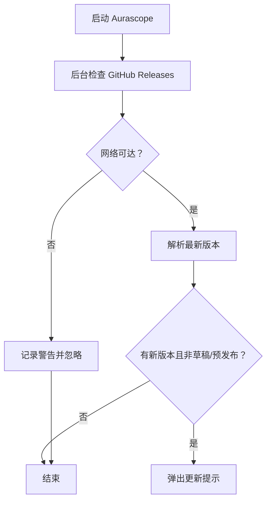
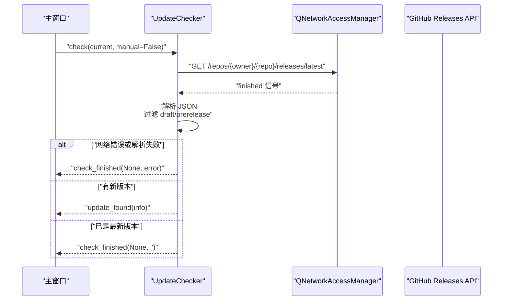
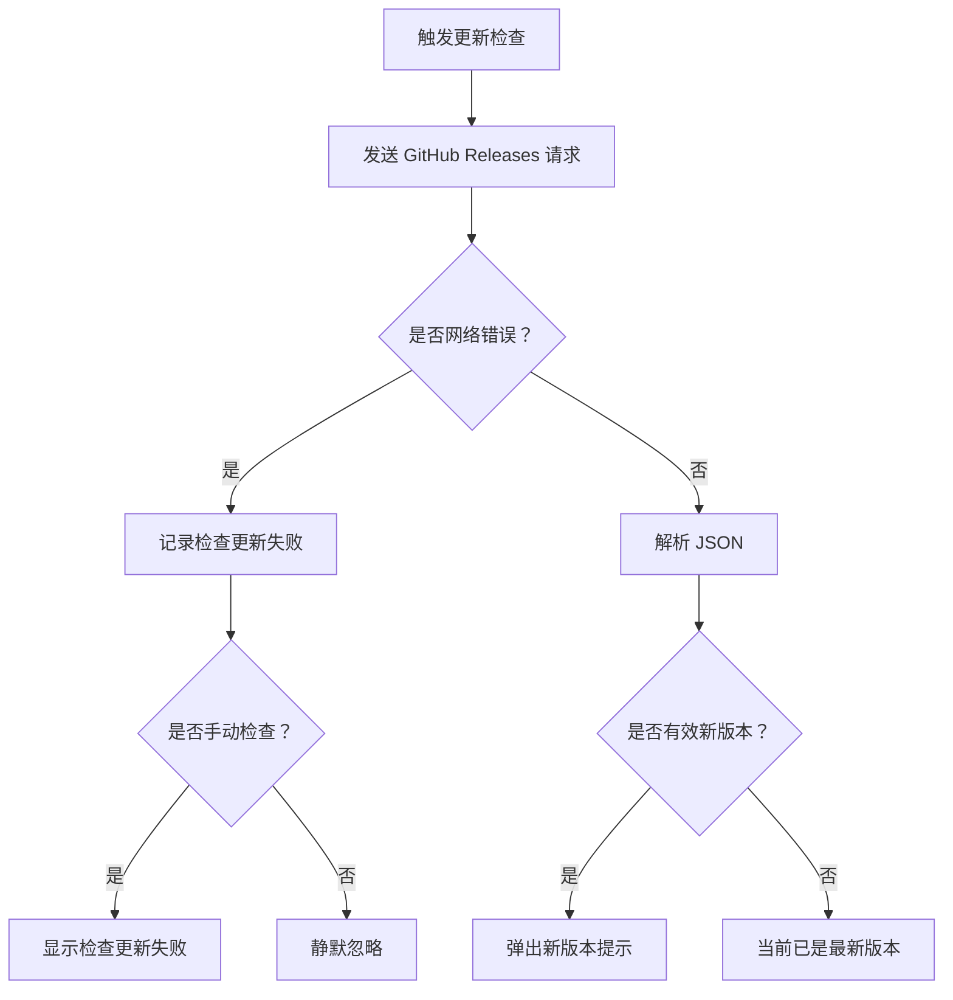
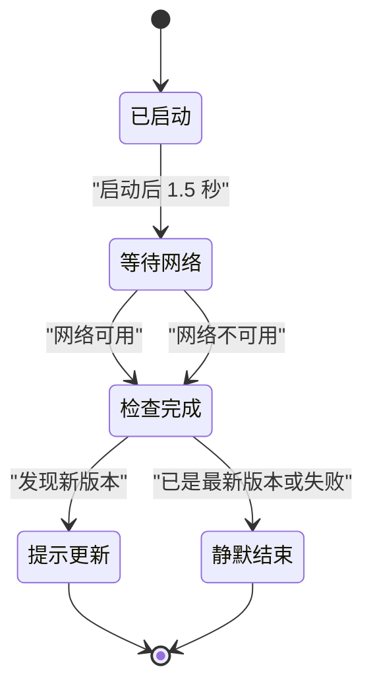
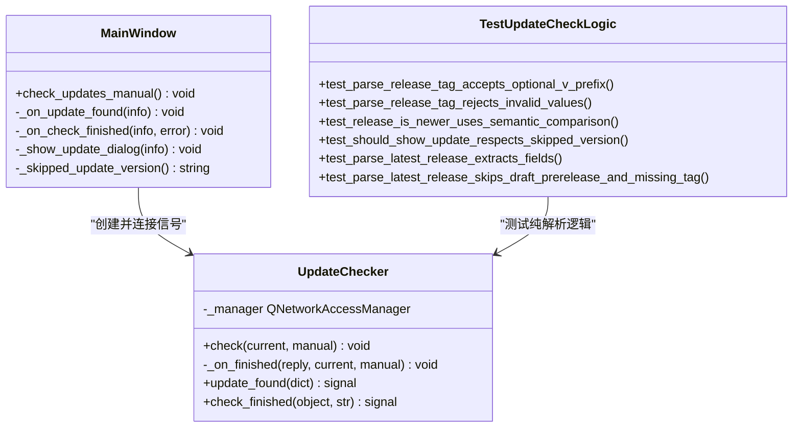

# 自动更新检查失败

<cite>
**本文引用的文件**   
- [update_check.py](file://update_check.py)
- [test_update_check.py](file://test_update_check.py)
- [main_window.py](file://main_window.py)
- [README.md](file://README.md)
- [PROJECT_CONCEPTION.md](file://PROJECT_CONCEPTION.md)
</cite>

## 目录
1. [引言](#引言)
2. [功能定位与产品约束](#功能定位与产品约束)
3. [自动更新检查的工作流程](#自动更新检查的工作流程)
4. [典型失败现象与日志特征](#典型失败现象与日志特征)
5. [判断是否为网络问题的步骤](#判断是否为网络问题的步骤)
6. [离线环境下的预期行为](#离线环境下的预期行为)
7. [开发者调试：临时关闭或替换网络请求](#开发者调试临时关闭或替换网络请求)
8. [与空洞检测核心功能的区分](#与空洞检测核心功能的区分)
9. [常见问题排查清单](#常见问题排查清单)
10. [结论](#结论)

## 引言
本文聚焦 `update_check.py` 的自动更新检查失败问题。该功能通过 PyQt6 的网络模块向 GitHub Releases 接口发起异步请求，用于提示用户是否存在新版本；它不是图像处理、空洞检测、ROI 编辑或任何业务算法的一部分。

在产品约束下，Aurascope 是面向微电子封装产线的单机桌面工具，设计原则为不联网、不收集用户数据、纯 CPU 计算。因此，在受控生产环境或离线机器上出现“检查更新失败”通常属于预期网络异常，不应被误判为空洞检测异常。

**章节来源**
- [PROJECT_CONCEPTION.md:103-107](file://PROJECT_CONCEPTION.md#L103-L107)
- [README.md:1-14](file://README.md#L1-L14)

## 功能定位与产品约束
### 功能定位
`UpdateChecker` 是一个独立的 Qt 对象，负责：
- 构造对 GitHub Releases 最新版本的 HTTP 请求；
- 设置 User-Agent 和传输超时；
- 解析返回的 JSON；
- 过滤 draft 与 prerelease；
- 比较语义化版本；
- 通过信号通知主窗口发现新版本或检查完成。

### 产品约束
根据项目构思文档，Aurascope 的核心约束包括：
- 单机运行；
- 不联网；
- 不收集用户数据；
- CPU 计算；
- 兼容 Windows 7+；
- 算法逻辑集中在 `image.py`，与 GUI 层解耦。

这意味着“能联网检查更新”只是实现细节，而不是产品必须能力。当网络不可达时，应用应继续正常工作，仅跳过更新提示。

**图表来源**
- [update_check.py:1-18](file://update_check.py#L1-L18)
- [update_check.py:74-112](file://update_check.py#L74-L112)
- [main_window.py:87-92](file://main_window.py#L87-L92)

**章节来源**
- [update_check.py:1-18](file://update_check.py#L1-L18)
- [PROJECT_CONCEPTION.md:103-107](file://PROJECT_CONCEPTION.md#L103-L107)

## 自动更新检查的工作流程
### 触发时机
主窗口初始化时创建 `UpdateChecker`，并连接两个信号：
- `update_found`：发现新版本；
- `check_finished`：检查完成，用于手动检查时的反馈。

默认情况下，主窗口在非 offscreen 环境中延迟 1.5 秒调用一次 `check()`。若处于 offscreen 环境（例如自动化测试），则不会自动检查。

### 网络请求
`UpdateChecker.check()` 使用 `QNetworkAccessManager` 发起 GET 请求，目标地址由仓库名拼接而成，指向 GitHub API 的 releases/latest 接口。请求设置了：
- User-Agent：`Aurascope-Updater`；
- 传输超时：8000 毫秒。

### 结果处理
- 如果网络错误，记录警告日志；仅在手动检查模式下通过 `check_finished` 返回错误信息；
- 如果响应体无法解析，记录警告日志，并在手动检查模式下返回“返回数据无法解析”；
- 如果解析成功但版本不更新，或在自动检查模式下无新发现，则静默结束；
- 如果存在新版本，发出 `update_found`，由主窗口决定是否弹窗。

**图表来源**
- [update_check.py:74-112](file://update_check.py#L74-L112)
- [main_window.py:87-92](file://main_window.py#L87-L92)
- [main_window.py:741-783](file://main_window.py#L741-L783)

**章节来源**
- [update_check.py:74-112](file://update_check.py#L74-L112)
- [main_window.py:87-92](file://main_window.py#L87-L92)
- [main_window.py:741-783](file://main_window.py#L741-L783)

## 典型失败现象与日志特征
### 常见失败类型
由于该功能依赖外部网络，典型失败包括：
- 网络超时；
- DNS 解析失败；
- 防火墙或代理拦截；
- GitHub API 限流或不可用；
- 返回数据格式不符合预期。

### 日志位置与级别
更新检查失败主要使用 Python logging 写入名为 `Aurascope` 的 logger。关键日志点：
- 网络错误：记录“检查更新失败”，附带 `reply.errorString()`；
- 解析失败：记录“检查更新解析失败”，附带异常信息；
- 发现新版本：记录“发现新版本”。

这些日志通常出现在应用日志文件或控制台输出中，具体落盘路径取决于应用的日志配置；本文不假设特定日志文件名，只以 logger 名称和消息内容作为识别依据。

### 用户可见表现
- 自动检查：可能没有任何提示，因为自动模式下失败会静默忽略；
- 手动检查：通过“帮助 → 检查更新…”触发时，失败会显示“检查更新失败：{错误信息}”；
- 新版本提示：只有在网络正常、解析成功且版本确实更新时才弹出。

**图表来源**
- [update_check.py:90-112](file://update_check.py#L90-L112)
- [main_window.py:751-762](file://main_window.py#L751-L762)

**章节来源**
- [update_check.py:90-112](file://update_check.py#L90-L112)
- [main_window.py:751-762](file://main_window.py#L751-L762)

## 判断是否为网络问题的步骤
### 第一步：确认是否影响图像分析
如果以下操作仍可正常进行，则基本可排除空洞检测核心功能故障：
- 打开图片；
- 选择 ROI；
- 调整阈值；
- 执行空洞检测；
- 查看检测结果表格；
- 导出 CSV；
- 截图复制。

### 第二步：确认更新检查是否失败
观察以下现象：
- 启动后未弹出新版本提示；
- 点击“帮助 → 检查更新…”后出现“检查更新失败”；
- 日志中出现“检查更新失败”或“检查更新解析失败”。

### 第三步：验证网络连接
在可联网的开发机上验证：
- 能否访问 `https://api.github.com/repos/lingyue1932/Aurascope/releases/latest`；
- 是否能解析 `api.github.com`；
- 是否有防火墙、企业代理或安全策略阻止出站 HTTPS；
- GitHub API 是否返回限流或错误状态。

### 第四步：区分自动检查与手动检查
- 自动检查失败通常不会弹窗；
- 手动检查失败会通过 `check_finished` 显示错误；
- 自动检查成功但未发现新版本也不会弹窗。

### 第五步：结合日志判断
优先查找包含以下关键词的日志：
- “检查更新失败”；
- “检查更新解析失败”；
- “发现新版本”。

若日志只有“检查更新失败”，大概率是网络层错误；若出现“返回数据无法解析”，则可能是 GitHub 返回了非预期结构或编码异常。

**章节来源**
- [update_check.py:90-112](file://update_check.py#L90-L112)
- [main_window.py:751-762](file://main_window.py#L751-L762)

## 离线环境下的预期行为
在离线环境或不允许联网的生产环境中，自动更新检查失败是预期行为。应用应满足：
- 不阻塞主界面；
- 不抛出未捕获异常；
- 不影响图片加载、ROI 编辑、空洞检测、导出等核心功能；
- 可选地记录一条警告日志；
- 用户主动点击“检查更新…”时，给出明确的失败提示。

当前实现中，自动检查失败会记录警告并通过 `logging.getLogger('Aurascope').warning` 输出；手动检查失败会通过 `show_warning` 弹窗提示。

**图表来源**
- [update_check.py:74-112](file://update_check.py#L74-L112)
- [main_window.py:87-92](file://main_window.py#L87-L92)
- [main_window.py:745-783](file://main_window.py#L745-L783)

**章节来源**
- [update_check.py:74-112](file://update_check.py#L74-L112)
- [main_window.py:87-92](file://main_window.py#L87-L92)
- [main_window.py:745-783](file://main_window.py#L745-L783)

## 开发者调试：临时关闭或替换网络请求
### 方法一：禁用自动检查
主窗口在初始化时通过 `QTimer.singleShot(1500, self.update_checker.check)` 触发自动检查。若只想调试其他功能，可在开发分支中临时注释该行，或增加一个环境变量开关控制是否执行。

注意：offscreen 环境下原本就不会自动检查，这是现有行为，不应误认为 bug。

### 方法二：替换 UpdateChecker
对于需要稳定输出的测试或 CI 场景，可以注入一个模拟实现，使其：
- 不调用真实网络；
- 直接发出 `update_found` 或 `check_finished`；
- 固定返回某个版本或空结果。

替换时应保持以下接口不变：
- `check(current=APP_VERSION, manual=False)`；
- `update_found` 信号；
- `check_finished` 信号。

### 方法三：修改超时或目标地址
当前实现将传输超时设为 8000 毫秒，目标地址基于 `REPO = 'lingyue1932/Aurascope'` 拼接。开发者可临时：
- 增大超时时间，用于弱网调试；
- 将目标地址改为本地 mock 服务；
- 添加更详细的网络错误分类日志。

不建议在生产代码中硬编码代理或绕过防火墙；如需支持企业网络，应通过配置项或环境变量暴露。

### 方法四：利用单元测试验证解析逻辑
`test_update_check.py` 覆盖了：
- tag 解析；
- 版本比较；
- 跳过版本逻辑；
- latest release JSON 字段提取；
- draft/prerelease 过滤。

这些用例不依赖网络，适合验证版本比较和解析逻辑是否正确。

**图表来源**
- [update_check.py:74-112](file://update_check.py#L74-L112)
- [main_window.py:87-92](file://main_window.py#L87-L92)
- [main_window.py:741-783](file://main_window.py#L741-L783)
- [test_update_check.py:10-57](file://test_update_check.py#L10-L57)

**章节来源**
- [update_check.py:74-112](file://update_check.py#L74-L112)
- [main_window.py:87-92](file://main_window.py#L87-L92)
- [main_window.py:741-783](file://main_window.py#L741-L783)
- [test_update_check.py:10-57](file://test_update_check.py#L10-L57)

## 与空洞检测核心功能的区分
Aurascope 的核心价值在于图像处理与检测流程，包括：
- 空洞分析；
- 缺陷面积多 ROI；
- 物料计数；
- 测距；
- 剪切力计算；
- 图像拼接；
- 批量示教与配方管理。

这些功能位于 `canvas.py`、`area_tab.py`、`counting_tab.py`、`measure_tab.py`、`shear_tab.py`、`stitching_tab.py`、`teach_batch_tab.py`、`recipe.py` 以及算法层 `image.py`。

`update_check.py` 与上述模块没有算法耦合关系。它只依赖：
- `app_version.APP_VERSION`；
- PyQt6 的 QtCore、QtNetwork；
- `packaging.version.Version`。

因此，“检查更新失败”不等于“空洞检测异常”。用户遇到更新失败时，应先确认图片导入、阈值调节、轮廓检测、结果导出是否正常；若这些功能正常，则更新检查失败仅说明网络不可达或 GitHub API 不可用。

**章节来源**
- [update_check.py:8-15](file://update_check.py#L8-L15)
- [README.md:7-14](file://README.md#L7-L14)
- [PROJECT_CONCEPTION.md:17-54](file://PROJECT_CONCEPTION.md#L17-L54)

## 常见问题排查清单
### 1. 启动后没有新版本提示
可能原因：
- 网络不可达；
- GitHub API 不可用；
- 已经是最新版本；
- 自动检查被静默忽略。

处理方式：
- 点击“帮助 → 检查更新…”进行手动检查；
- 查看日志中的“检查更新失败”或“检查更新解析失败”；
- 在可联网机器上验证 GitHub API 可达性。

### 2. 手动检查时报错
可能原因：
- DNS 解析失败；
- 防火墙拦截 HTTPS；
- 代理未配置；
- GitHub API 限流；
- 返回数据无法解析。

处理方式：
- 检查系统网络设置；
- 检查企业安全策略；
- 查看错误字符串；
- 确认 GitHub API 返回的是合法 JSON。

### 3. 日志中有“检查更新解析失败”
可能原因：
- GitHub 返回非 dict；
- 响应体编码异常；
- JSON 结构变化；
- 非 UTF-8 解码失败。

处理方式：
- 保留完整日志；
- 不要据此推断图像处理失败；
- 如为持续性问题，应在代码中增加更细粒度的解析错误分类。

### 4. 离线环境希望完全避免网络尝试
建议方案：
- 在启动阶段读取配置或环境变量；
- 若检测到离线模式，跳过 `UpdateChecker` 初始化或不调用 `check()`；
- 保留手动检查入口，但明确提示该功能需要网络。

当前实现并未提供内置离线开关，因此开发者需自行扩展。

### 5. 把更新检查失败误判为空洞检测异常
判断要点：
- 若图片能打开、ROI 能编辑、检测能出结果，则核心功能正常；
- 更新检查失败只影响“是否提示新版本”；
- 不应因更新失败而重新安装 OpenCV、重装驱动或重跑空洞检测。

**章节来源**
- [update_check.py:90-112](file://update_check.py#L90-L112)
- [main_window.py:751-762](file://main_window.py#L751-L762)

## 结论
`update_check.py` 的自动更新检查是一个独立于图像处理核心功能的辅助特性。它在产品约束下并非必需能力，且在离线环境中的失败属于预期网络异常。

排查时应遵循以下顺序：
1. 先确认图片导入、ROI、空洞检测、导出等核心功能是否正常；
2. 再确认是否点击了“帮助 → 检查更新…”；
3. 查看 `Aurascope` logger 中的“检查更新失败”或“检查更新解析失败”；
4. 验证 DNS、HTTPS、防火墙、代理和 GitHub API；
5. 在离线环境中接受“不联网、不提示更新”的预期行为；
6. 开发者可通过禁用自动检查、替换 `UpdateChecker` 或 mock 网络响应进行调试。

最终目标是避免用户将网络问题误判为空洞检测异常，同时为开发者提供可控的调试路径。