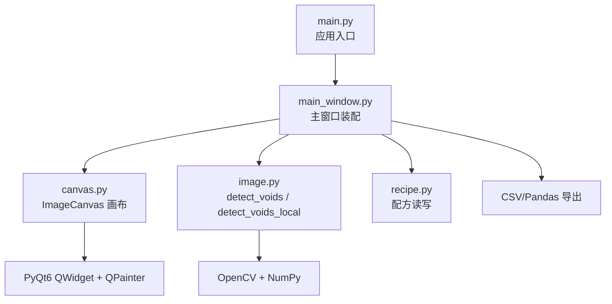
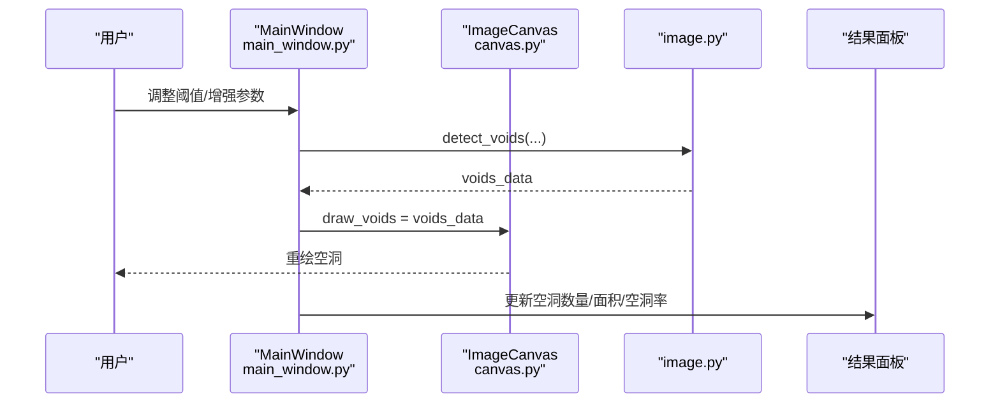
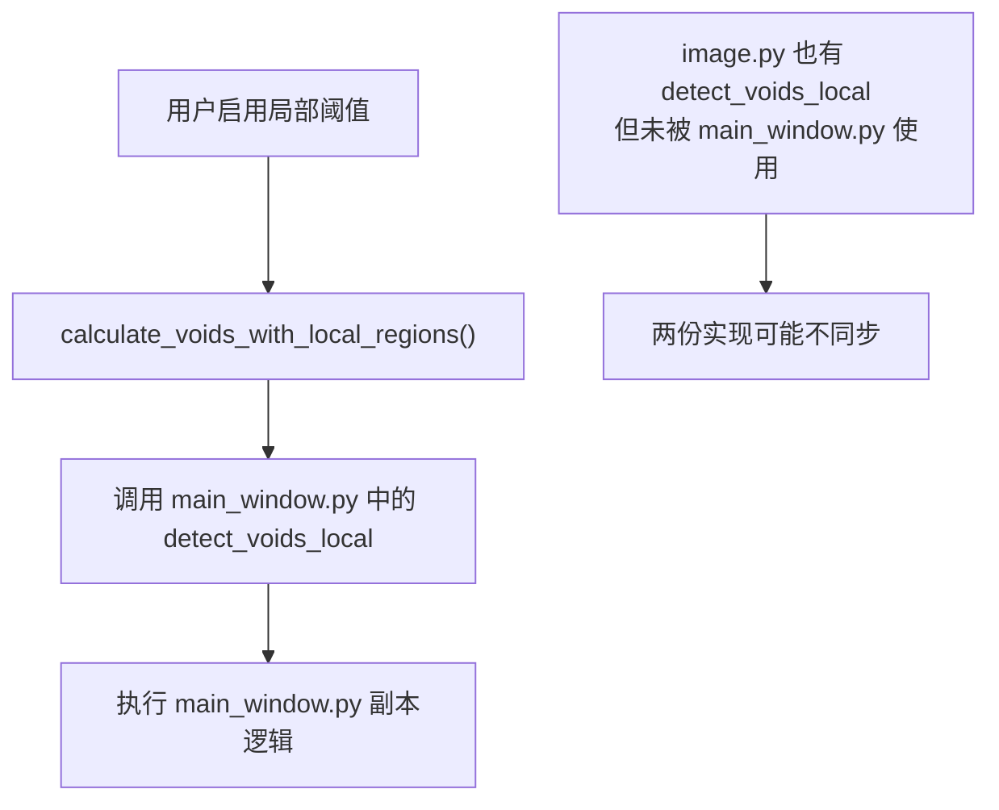
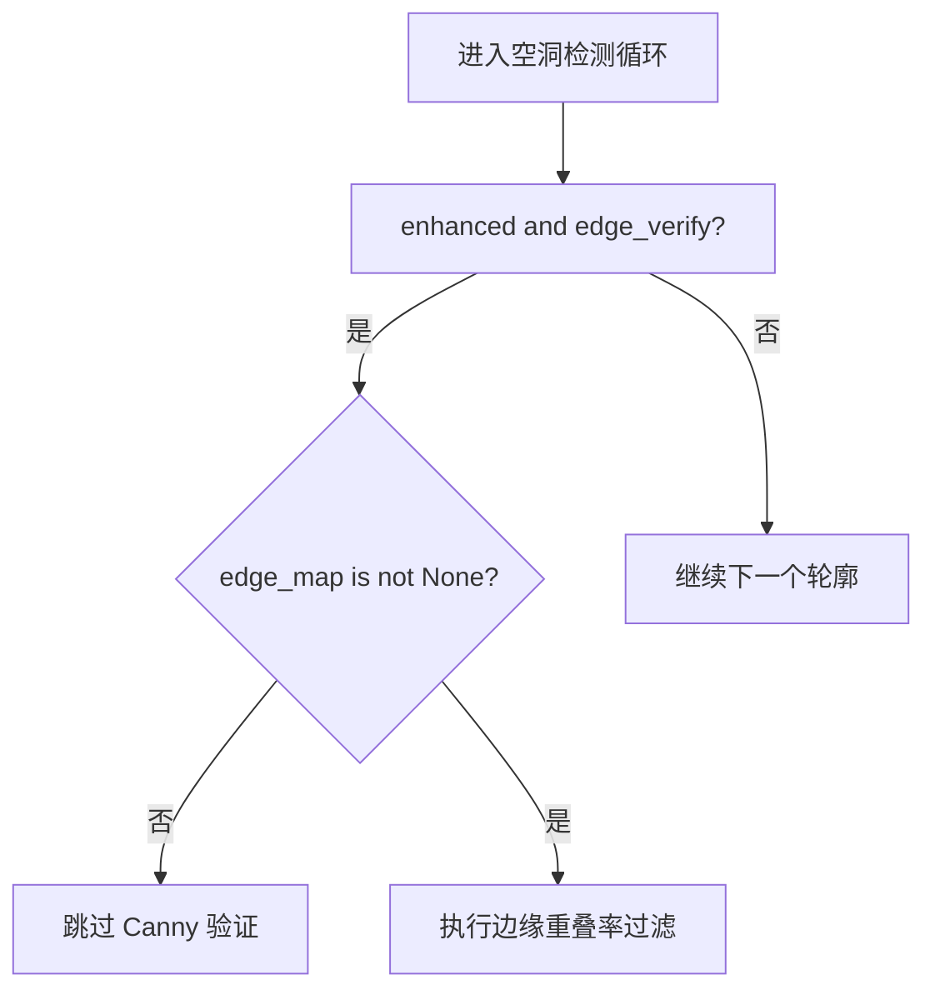
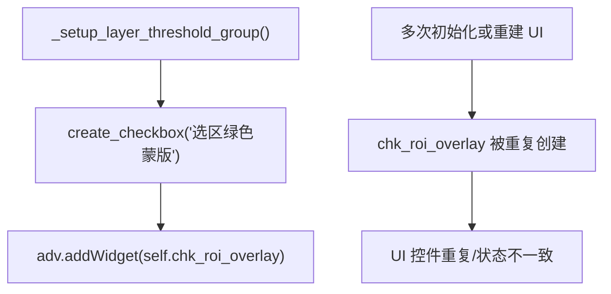
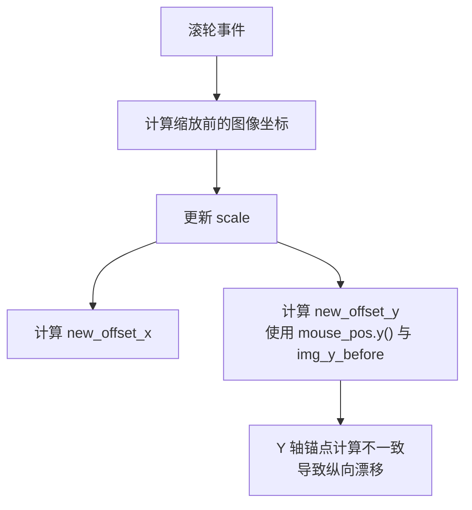
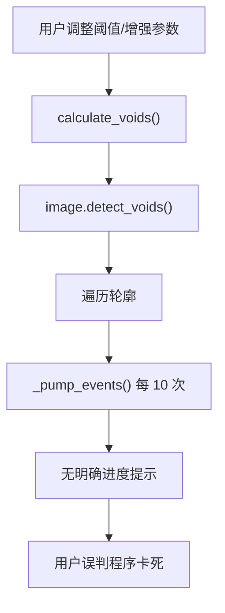
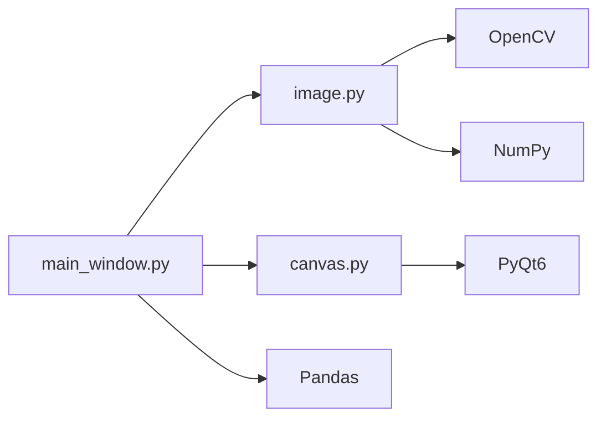

# 已知限制与待修复问题

<cite>
**本文引用的文件**   
- [handoff.md](file://handoff.md)
- [main_window.py](file://main_window.py)
- [image.py](file://image.py)
- [canvas.py](file://canvas.py)
- [README.md](file://README.md)
</cite>

## 目录
1. [引言](#引言)
2. [项目结构定位](#项目结构定位)
3. [核心组件关系](#核心组件关系)
4. [架构总览](#架构总览)
5. [六项已知限制逐项分析](#六项已知限制逐项分析)
6. [依赖关系分析](#依赖关系分析)
7. [性能与交互影响评估](#性能与交互影响评估)
8. [排查与临时规避指南](#排查与临时规避指南)
9. [结论](#结论)

## 引言
本文件基于 handoff.md 的已知限制清单，对 Aurascope 当前代码库中的缺陷与风险进行逐项说明。Aurascope 是面向微电子封装产线的单机桌面视觉检测工具，核心业务包括空洞分析、缺陷面积多 ROI、物料计数、测距、剪切力计算、图像拼接与批量示教；其中「空洞分析」由 main_window.py 作为主窗口装配层，canvas.py 作为图像画布交互层，image.py 作为唯一算法实现层。

本次文档聚焦以下六项限制：
1. main_window.py 中存在 detect_voids_local 的重复副本，现行行为以 image.py 为准，两份实现可能产生不一致。
2. Canny 边缘校验中 edge_map 未初始化导致静默失效。
3. chk_roi_overlay 被重复创建造成内存/绘制异常。
4. canvas.py 滚轮缩放时 Y 轴出现漂移。
5. select_for_local 为无 UI 入口的死代码。
6. 大图增强检测缺少进度提示。

这些限制直接影响空洞分析结果的正确性、UI 交互稳定性以及大图的响应体验。使用者应据此判断其工作流是否受影响，并在修复前采用临时规避方案。

**章节来源**
- [README.md:1-76](file://README.md#L1-L76)

## 项目结构定位
Aurascope 的代码组织遵循「入口 → 主窗口 → Tab 页面 → Canvas 绘制层 → 算法层 image.py → 配方/导出」的分层约定。空洞分析相关的关键路径如下：
- 主窗口装配与用户操作：main_window.py
- 图像显示与交互：canvas.py
- 阈值、形态学、轮廓、Canny 等算法：image.py
- 打包与运行入口：main.py（仓库根）
- 产品功能说明：README.md

**图表来源**
- [main_window.py:53-149](file://main_window.py#L53-L149)
- [canvas.py:13-28](file://canvas.py#L13-L28)
- [image.py:200-286](file://image.py#L200-L286)
- [README.md:42-64](file://README.md#L42-L64)

**章节来源**
- [README.md:42-64](file://README.md#L42-L64)
- [main_window.py:53-149](file://main_window.py#L53-L149)

## 核心组件关系
- main_window.py 负责：
  - 构建「ROI」「空洞分析」「示教/批量」「剪切力计算」「物料计数」「图像拼接」等 Tab。
  - 维护空洞检测结果 voids_data、局部区域 local_regions、局部笔刷区域 local_brush_regions。
  - 调用 image.py 的 detect_voids、detect_voids_local、detect_voids_local_brush 等函数。
  - 更新 canvas.draw_voids、result_box、void_rate_text 等 UI 状态。
- canvas.py 负责：
  - 原图坐标↔屏幕坐标转换。
  - 滚轮缩放、右键平移、多边形 ROI 编辑、空洞预览与绘制。
  - 发射 void_add_polygon、void_selected_for_local、void_local_region_confirmed 等信号。
- image.py 负责：
  - Otsu 阈值、形态学去噪、轮廓提取、圆度计算、distanceTransform 计数、Canny 边缘校验、空洞检测主流程。

**章节来源**
- [main_window.py:53-149](file://main_window.py#L53-L149)
- [main_window.py:1199-1254](file://main_window.py#L1199-L1254)
- [canvas.py:13-94](file://canvas.py#L13-L94)
- [image.py:200-286](file://image.py#L200-L286)

## 架构总览
空洞分析的核心数据流如下：

**图表来源**
- [main_window.py:1199-1254](file://main_window.py#L1199-L1254)
- [image.py:200-286](file://image.py#L200-L286)
- [canvas.py:794-811](file://canvas.py#L794-L811)

## 六项已知限制逐项分析

### 1. main_window.py 中存在 detect_voids_local 的重复副本

#### 症状
- 当通过「局部阈值调节」或局部矩形区域重新计算空洞时，main_window.py 会调用模块级函数 detect_voids_local。
- image.py 中也存在同名函数 detect_voids_local，两者在 CLAHE 处理顺序、ROI 腐蚀方式、边缘掩码构造、Canny 验证逻辑上不完全一致。
- 用户可能观察到：同一组输入下，全局空洞检测与局部阈值检测的结果存在细微差异；修复 image.py 后，局部检测行为未按预期同步。

#### 根因分析
- main_window.py 在模块作用域定义了一个 detect_voids_local，而 image.py 也定义了 detect_voids_local。
- main_window.py 导入 image.py 时，模块级同名函数不会自动覆盖已定义的函数；因此 main_window.py 内部直接调用的 detect_voids_local 仍指向自身副本。
- 当前实际调用点：
  - calculate_voids_with_local_regions 调用 detect_voids_local。
  - 该函数位于 main_window.py 模块作用域，而非 image.py 版本。
- 这意味着 image.py 中的 detect_voids_local 并非 main_window.py 的权威实现，而是历史遗留副本。

**图表来源**
- [main_window.py:1451-1476](file://main_window.py#L1451-L1476)
- [main_window.py:1723-1820](file://main_window.py#L1723-L1820)
- [image.py:328-422](file://image.py#L328-L422)

#### 临时规避方案
- 在修复前，不要假设 image.py 中的 detect_voids_local 就是当前生效逻辑。
- 若需要统一行为，应先确认 main_window.py 中 detect_voids_local 的具体差异，再决定合并方向。
- 对于关键批次数据，建议分别记录「全局 detect_voids」和「局部 detect_voids_local」的结果，避免仅凭一次运行判断算法优劣。

#### 长期修复建议
- 将 main_window.py 中的 detect_voids_local 删除，改为从 image.py 导入并使用单一实现。
- 如果两个实现确实有业务差异，应明确命名区分，例如保留 image.py 的通用实现，并将 main_window.py 的特殊逻辑封装为独立函数，同时补充单测。
- 在合并前，对相同输入跑回归测试，确保空洞数量、面积、中心坐标、边界框保持一致。

**章节来源**
- [main_window.py:1451-1476](file://main_window.py#L1451-L1476)
- [main_window.py:1723-1820](file://main_window.py#L1723-L1820)
- [image.py:328-422](file://image.py#L328-L422)

---

### 2. Canny 边缘校验中 edge_map 未初始化导致静默失效

#### 症状
- 用户在「高级设置」中勾选「Canny 边缘验证」后，部分空洞可能被过滤掉，也可能完全不受影响。
- 由于 edge_map 在某些分支中初始化为 None，后续条件判断可能跳过 Canny 验证，表现为「勾选了 Canny 但效果不明显」。

#### 根因分析
- image.py 的 detect_voids 中，edge_map 在 enhanced 且 edge_verify 时才赋值；但在循环内判断 edge_verify 时，若 edge_map 为 None，则 Canny 验证分支不执行。
- main_window.py 的 detect_voids_local 副本也存在类似模式：edge_map 初始化为 None，仅在特定条件下赋值。
- 更严重的是，某些分支在 edge_verify 为 True 时直接使用 edge_map，却未保证它一定非空，从而可能出现静默跳过或错误行为。

**图表来源**
- [image.py:228-264](file://image.py#L228-L264)
- [image.py:366-399](file://image.py#L366-L399)
- [main_window.py:1776-1803](file://main_window.py#L1776-L1803)

#### 临时规避方案
- 若发现 Canny 验证无效，先关闭「Canny 边缘验证」，观察空洞结果是否变化。
- 若关闭后结果明显变化，说明当前 Canny 分支未生效，不应将其视为有效过滤手段。
- 对关键样本，暂时禁用增强检测中的 Canny 选项，以排除该分支干扰。

#### 长期修复建议
- 在 detect_voids 与 detect_voids_local 中，统一 edge_map 的初始化时机：要么在进入循环前始终计算，要么在首次需要时惰性计算并缓存。
- 增加输入校验：当 edge_verify=True 但 edge_map 为 None 时，抛出明确错误或返回警告，而不是静默跳过。
- 为 Canny 验证路径添加单元测试，覆盖 edge_map 为空、ROI 全黑、空洞无边缘等边界情况。

**章节来源**
- [image.py:228-264](file://image.py#L228-L264)
- [image.py:366-399](file://image.py#L366-L399)
- [main_window.py:1776-1803](file://main_window.py#L1776-L1803)

---

### 3. chk_roi_overlay 被重复创建造成内存/绘制异常

#### 症状
- 每次打开图片、切换 ROI 或刷新侧边栏时，「选区绿色蒙版」复选框可能被重复添加到折叠区域。
- 用户可能看到多个相同控件，或点击某个复选框后只有其中一个生效。
- 多次操作后，UI 控件树增长，可能导致轻微内存占用上升或绘制异常。

#### 根因分析
- _setup_layer_threshold_group 中直接创建 self.chk_roi_overlay 并加入 CollapsibleSection。
- 如果该方法被多次调用，或者控件生命周期管理不够严格，就会重复 addWidget。
- toggle_roi_overlay 只读取 self.chk_roi_overlay.isChecked()，没有检查控件是否存在或是否重复。

**图表来源**
- [main_window.py:523-532](file://main_window.py#L523-L532)
- [main_window.py:1485-1488](file://main_window.py#L1485-L1488)

#### 临时规避方案
- 避免反复重建包含 chk_roi_overlay 的 UI 容器。
- 在切换图片时，不要重复调用创建该复选框的方法；如需重置，应复用已有控件。
- 若必须重建，应在创建前销毁旧实例，或改用局部变量而非实例属性。

#### 长期修复建议
- 将 chk_roi_overlay 的创建与布局分离：构造函数中创建一次，_setup_layer_threshold_group 只负责布局。
- 在 toggle_roi_overlay 中加入健壮性检查：若控件不存在，跳过或重建。
- 为 UI 生命周期编写用例，确保打开图片、切换 Tab、恢复默认设置等操作不会重复添加控件。

**章节来源**
- [main_window.py:523-532](file://main_window.py#L523-L532)
- [main_window.py:1485-1488](file://main_window.py#L1485-L1488)

---

### 4. canvas.py 滚轮缩放时 Y 轴出现漂移

#### 症状
- 用户使用滚轮放大或缩小图像时，鼠标指针位置附近的图像内容会发生纵向偏移。
- 放大后向右拖动，再缩小，图像可能不再回到原始位置。
- 这与「以鼠标位置为锚点进行缩放」的预期不符，Y 轴漂移尤其明显。

#### 根因分析
- wheelEvent 中默认缩放逻辑先计算 img_pos_before，再更新 scale，然后分别计算 new_offset_x 和 new_offset_y。
- X 轴使用 mouse_pos.x() 与 img_pos_before 的关系更新 offset.x()。
- Y 轴却使用 mouse_pos.y() 与 img_y_before 的关系更新 offset.y()，但没有把 scale 变化后的坐标系一致性考虑进去，导致 Y 方向锚点计算不正确。
- 正确做法应是：在更新 scale 后，用同一个公式同时计算新的 offset.x() 和 offset.y()，使缩放锚点稳定在鼠标位置。

**图表来源**
- [canvas.py:695-706](file://canvas.py#L695-L706)

#### 临时规避方案
- 缩放时尽量以图像中心附近为锚点，减少鼠标靠近边缘时的漂移感知。
- 若需精确定位，可先放大到合适倍数，再微调平移，避免频繁快速缩放。
- 在自动化脚本或离线分析中，避免依赖滚轮缩放后的精确像素坐标。

#### 长期修复建议
- 重写 wheelEvent 的默认缩放逻辑，统一使用以下思路：
  - 保存鼠标位置的图像坐标。
  - 更新 scale。
  - 根据新 scale 和原鼠标图像坐标，反推新的 offset，使缩放前后鼠标指向的图像点保持不变。
- 为缩放行为添加单测：固定鼠标位置，连续缩放，验证图像锚点不变。
- 若 PyQt6 提供合适的变换 API，优先使用 scene/view 或统一的 transform 模型，避免手动维护 offset/scale。

**章节来源**
- [canvas.py:626-706](file://canvas.py#L626-L706)

---

### 5. select_for_local 为无 UI 入口的死代码

#### 症状
- 代码中可能存在名为 select_for_local 的函数或方法，但界面中没有对应按钮、菜单或快捷键触发。
- 静态扫描或审计时会发现该符号未被引用，属于死代码。
- 若该函数用于选择局部阈值区域，则用户无法通过 UI 使用它，只能依赖其他路径。

#### 根因分析
- 在当前搜索范围内，未发现 select_for_local 的实际引用。
- 这通常意味着：
  - 该函数是早期原型或重构残留。
  - 功能已被其他机制替代，例如局部笔刷模式、局部矩形区域、或 Ctrl+滚轮局部 Otsu。
  - 开发者忘记移除或忘记暴露 UI 入口。

#### 临时规避方案
- 不要依赖 select_for_local 完成任何生产任务。
- 使用现有 UI 路径：
  - 局部笔刷模式：void_edit_mode == 'local_brush'。
  - 局部矩形区域：local_regions。
  - 点击处局部 Otsu：void_edit_mode == 'add' 配合 Ctrl+滚轮。

#### 长期修复建议
- 如果 select_for_local 仍有价值，应为其补充 UI 入口，并连接到 calculate_voids 或 calculate_voids_with_local。
- 如果没有价值，应删除该符号，并清理相关注释、测试和引用，避免误导后续维护者。
- 对死代码引入静态检查规则，防止未来再次积累无用函数。

**章节来源**
- [handoff.md](file://handoff.md)

---

### 6. 大图增强检测缺少进度提示

#### 症状
- 加载高分辨率 SEM/X 光图像后，开启 CLAHE、形态学、圆度过滤、Canny 边缘验证等增强选项，点击阈值滑块或自动 Otsu 后，界面可能短暂卡顿。
- 用户看不到「正在计算空洞」之类的进度提示，容易误以为程序卡死。
- 虽然 image.py 中有 _pump_events 让长循环有机会刷新界面，但整体缺乏明确的开始/结束反馈。

#### 根因分析
- calculate_voids 直接调用 image.py 的 detect_voids，后者内部每处理 10 个轮廓调用一次 _pump_events。
- 但主窗口没有显示「计算中」状态，也没有禁用交互或展示进度条。
- 局部阈值检测和笔刷检测同样会触发 detect_voids_local 或 detect_voids_local_brush，长时间计算时用户体验较差。

**图表来源**
- [main_window.py:1199-1254](file://main_window.py#L1199-L1254)
- [image.py:238-241](file://image.py#L238-L241)
- [image.py:375-377](file://image.py#L375-L377)

#### 临时规避方案
- 在大图上调试时，先关闭 CLAHE、形态学、圆度过滤、Canny 边缘验证，逐步启用，定位耗时步骤。
- 调整阈值前先标定像素比例，避免在未标定状态下输出大量统计信息。
- 若界面长时间无响应，等待 detect_voids 返回后再继续操作，不要反复点击。

#### 长期修复建议
- 在 calculate_voids、calculate_voids_with_local_regions、calculate_voids_with_local 中增加「计算中」状态：
  - 禁用相关控件。
  - 显示进度文本，如「正在计算空洞...」。
  - 计算完成后恢复 UI 状态。
- 将 _pump_events 升级为可选的进度回调，支持取消或显示百分比。
- 对大图检测增加耗时日志，便于离线诊断性能瓶颈。

**章节来源**
- [main_window.py:1199-1254](file://main_window.py#L1199-L1254)
- [main_window.py:1451-1476](file://main_window.py#L1451-L1476)
- [main_window.py:1562-1585](file://main_window.py#L1562-L1585)
- [image.py:238-241](file://image.py#L238-L241)
- [image.py:375-377](file://image.py#L375-L377)

## 依赖关系分析

**图表来源**
- [main_window.py:31-34](file://main_window.py#L31-L34)
- [image.py:3-11](file://image.py#L3-L11)
- [canvas.py:3-9](file://canvas.py#L3-L9)

**章节来源**
- [main_window.py:31-34](file://main_window.py#L31-L34)
- [image.py:3-11](file://image.py#L3-L11)
- [canvas.py:3-9](file://canvas.py#L3-L9)

## 性能与交互影响评估

| 限制 | 主要影响范围 | 对用户工作流的潜在影响 | 风险等级 |
|---|---|---|---|
| detect_voids_local 重复副本 | 空洞分析、局部阈值 | 同一输入可能得到不一致结果；修复 image.py 后行为不可预测 | 高 |
| Canny edge_map 未初始化 | 空洞过滤 | 勾选 Canny 后可能静默失效，导致空洞漏检或误检 | 高 |
| chk_roi_overlay 重复创建 | UI 层 | 控件重复、状态不一致、轻微内存增长 | 中 |
| 滚轮缩放 Y 漂移 | 图像交互 | 缩放后定位不准，影响 ROI 编辑和空洞标注 | 中 |
| select_for_local 死代码 | 代码维护 | 误导后续开发，增加维护成本 | 低 |
| 大图增强检测无进度提示 | 用户体验 | 用户误判程序卡死，降低效率 | 中 |

## 排查与临时规避指南

### 空洞分析结果异常
- 先确认使用的是全局 detect_voids 还是局部 detect_voids_local。
- 若怀疑 Canny 验证无效，关闭「Canny 边缘验证」对比结果。
- 对关键样本保存 voids_data，比较空洞数量、面积、中心坐标、rect。

### UI 控件异常
- 若发现「选区绿色蒙版」复选框重复，检查是否多次调用 _setup_layer_threshold_group。
- 避免在 load_image 或 reset 流程中重复创建 UI 控件。

### 缩放定位不准
- 缩放时尽量以图像中心附近为锚点。
- 放大后先平移校正，再精细编辑 ROI。

### 大图卡顿
- 分步启用增强选项，定位耗时步骤。
- 在正式分析前，先关闭非必要增强功能，确认基础空洞检测正常。

**章节来源**
- [main_window.py:1199-1254](file://main_window.py#L1199-L1254)
- [main_window.py:1451-1476](file://main_window.py#L1451-L1476)
- [main_window.py:1562-1585](file://main_window.py#L1562-L1585)
- [canvas.py:695-706](file://canvas.py#L695-L706)

## 结论
handoff.md 列出的六项限制中，detect_voids_local 重复副本与 Canny edge_map 未初始化是最直接影响空洞分析结果的问题；chk_roi_overlay 重复创建和滚轮缩放 Y 漂移主要影响 UI 稳定性与交互体验；select_for_local 死代码影响代码可维护性；大图增强检测缺少进度提示影响用户感知和工作效率。

建议修复优先级如下：
1. 统一 detect_voids_local 实现，消除 main_window.py 与 image.py 的行为分歧。
2. 修复 Canny 边缘校验中 edge_map 的初始化与校验逻辑。
3. 修复 chk_roi_overlay 重复创建问题。
4. 修复 canvas.py 滚轮缩放的 Y 轴锚点计算。
5. 清理 select_for_local 死代码或补齐 UI 入口。
6. 为大图增强检测增加进度提示与交互反馈。

在修复完成前，使用者应避免将 Canny 验证结果视为绝对可靠，谨慎解读局部阈值检测的输出，并注意 UI 控件重复和缩放漂移带来的交互误差。