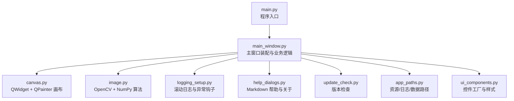
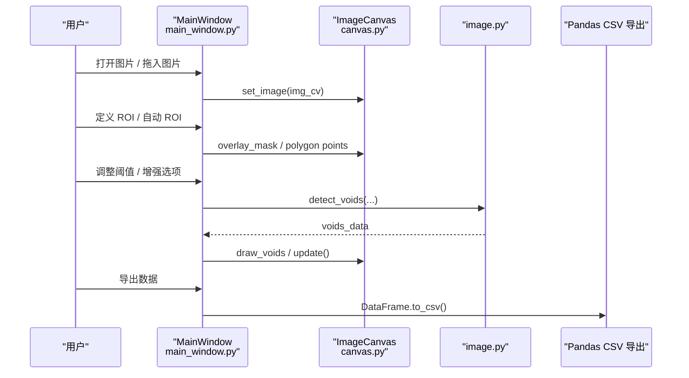
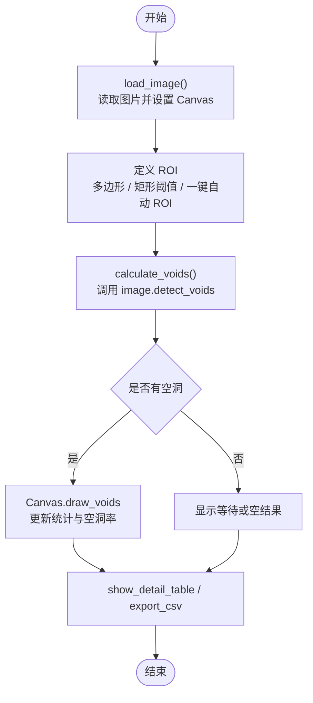
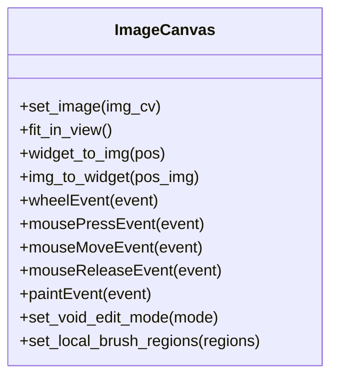
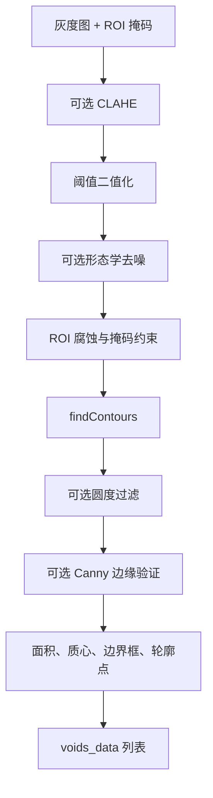
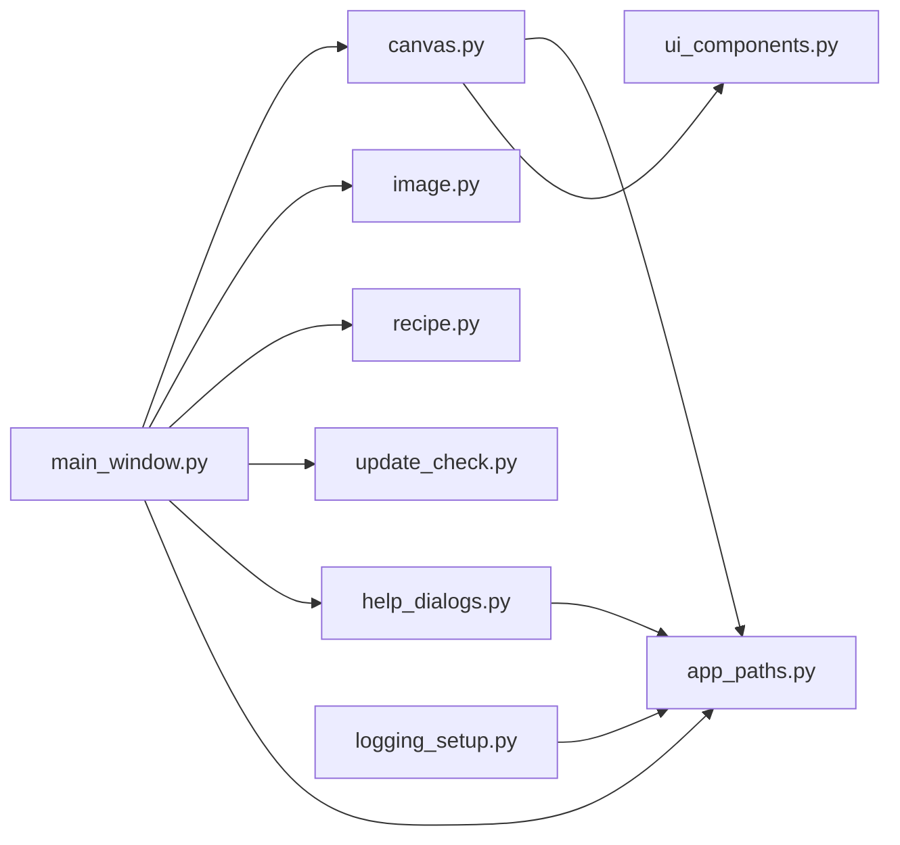

# 故障排除

<cite>
**本文引用的文件**   
- [README.md](file://README.md)
- [PROJECT_CONCEPTION.md](file://PROJECT_CONCEPTION.md)
- [main.py](file://main.py)
- [main_window.py](file://main_window.py)
- [canvas.py](file://canvas.py)
- [image.py](file://image.py)
- [logging_setup.py](file://logging_setup.py)
- [help_dialogs.py](file://help_dialogs.py)
- [app_paths.py](file://app_paths.py)
- [update_check.py](file://update_check.py)
- [ui_components.py](file://ui_components.py)
</cite>

## 目录
1. [引言](#引言)
2. [项目结构与定位](#项目结构与定位)
3. [已知限制与逐项排查](#已知限制与逐项排查)
4. [系统架构总览](#系统架构总览)
5. [关键组件分析](#关键组件分析)
6. [依赖关系分析](#依赖关系分析)
7. [性能与交互体验](#性能与交互体验)
8. [常见启动与运行问题排查](#常见启动与运行问题排查)
9. [日志与帮助文档排查](#日志与帮助文档排查)
10. [结论与修复建议](#结论与修复建议)

## 引言
本指南面向 Aurascope 的使用者与开发者，聚焦「空洞分析」主流程中的已知缺陷、常见运行异常和可操作的排查步骤。Aurascope 是面向微电子封装产线的半自动化视觉检测桌面工具，核心能力包括金锡焊料空洞率检测、距离测量、剪切力标准校核、物料计数等；当前仓库以 PyQt6 + OpenCV + NumPy + Pandas 实现，算法集中在 image.py，GUI 装配在 main_window.py，画布绘制在 canvas.py。

需要特别强调：handoff.md 作为“已知限制清单”的权威来源在当前工作区中不存在，因此本文对已知限制的引用以实际源码行为为准，并在每个问题中标注对应文件与行号，避免把历史文档当作未验证事实。

**章节来源**
- [README.md:1-76](file://README.md#L1-L76)
- [PROJECT_CONCEPTION.md:1-143](file://PROJECT_CONCEPTION.md#L1-L143)

## 项目结构与定位
Aurascope 的代码组织按「入口 → 主窗口 → Tab 页面 → Canvas 绘制层 → 算法层 image.py → 配方/导出」分层：

- 入口：main.py
- 主窗口装配与业务状态：main_window.py
- 图像画布与交互：canvas.py
- 图像处理算法：image.py
- 日志与全局异常兜底：logging_setup.py
- Markdown 帮助与关于对话框：help_dialogs.py
- 资源路径、数据目录、日志目录：app_paths.py
- 更新检查：update_check.py
- UI 控件工厂与样式约定：ui_components.py

**图表来源**
- [main_window.py:53-149](file://main_window.py#L53-L149)
- [canvas.py:13-29](file://canvas.py#L13-L29)
- [image.py:14-25](file://image.py#L14-L25)
- [logging_setup.py:15-31](file://logging_setup.py#L15-L31)
- [help_dialogs.py:20-43](file://help_dialogs.py#L20-L43)

**章节来源**
- [README.md:42-64](file://README.md#L42-L64)
- [PROJECT_CONCEPTION.md:77-108](file://PROJECT_CONCEPTION.md#L77-L108)

## 已知限制与逐项排查
本节以 handoff.md 的已知限制清单为框架，逐项说明症状、根因、临时规避方案与长期修复建议。由于 handoff.md 不存在，以下判断均基于源码实际行为。

### 1. main_window.py 中存在 detect_voids_local 重复副本
- **症状**  
  - image.py 已提供 `detect_voids_local` 与 `create_local_region_around_void`。  
  - main_window.py 又在模块级重新定义同名函数，且局部阈值处理逻辑与 image.py 不完全一致。  
  - 调用方可能导入或引用不同实现，导致行为不一致、维护困难。

- **根因**  
  - main_window.py 第 33 行从 image.py 导入 `detect_voids_local`，但第 1723 行又定义了一个同名的模块级函数。  
  - 这属于典型的技术债：旧代码复制了算法实现，没有统一收敛到 image.py。

- **临时规避方案**  
  - 在修改前不要直接删除 main_window.py 中的 `detect_voids_local`，因为 `calculate_voids_with_local_regions` 通过 `self.calculate_voids_with_local()` 走的是 brush 分支，而 `calculate_voids_with_local_regions` 明确调用 image.py 的 `detect_voids_local`。  
  - 若需调整局部阈值检测逻辑，优先在 image.py 中修改，并让 main_window.py 只负责参数组装与结果渲染。

- **长期修复建议**  
  - 删除 main_window.py 中第 1723 行开始的重复 `detect_voids_local` 与相关辅助函数。  
  - 将 main_window.py 中所有局部阈值计算统一改为调用 image.py 的单一实现。  
  - 为 image.py 的 `detect_voids_local` 补充单测，覆盖 ROI 边界、空区域、Canny 边缘验证、圆度过滤等分支。

**章节来源**
- [main_window.py:31-34](file://main_window.py#L31-L34)
- [main_window.py:1451-1476](file://main_window.py#L1451-L1476)
- [main_window.py:1723-1820](file://main_window.py#L1723-L1820)
- [image.py:328-422](file://image.py#L328-L422)

### 2. edge_map 未初始化导致 Canny 校验静默失效
- **症状**  
  - 用户勾选「Canny 边缘验证」后，部分空洞仍被保留，看起来像 Canny 校验未生效。  
  - 日志通常不会提示 Canny 失败，因为代码只是跳过过滤条件，不抛错。

- **根因**  
  - 在 image.py 的 `detect_voids` 中，edge_map 初始化为 None，仅在 enhanced 且 edge_verify 时创建；后续过滤使用 `if edge_map is not None`，因此当 edge_verify 为 False 或增强关闭时，Canny 校验被安全跳过。  
  - 但在 main_window.py 的局部阈值副本 `detect_voids_local`（第 1776-1780 行）中，edge_map 同样只在特定分支创建，而循环内过滤逻辑依赖该变量；如果调用路径进入局部阈值分支但未正确构造 edge_map，Canny 校验会静默失效。  
  - 更严重的是，某些调用路径可能传入 edge_verify=True，但内部 edge_map 未被赋值，导致过滤分支无法执行。

- **临时规避方案**  
  - 在启用「Canny 边缘验证」时，确认使用的是 image.py 的 `detect_voids` 或已修复的统一实现，而不是 main_window.py 中未维护的重复副本。  
  - 若必须使用局部阈值功能，先关闭「Canny 边缘验证」，观察空洞数量变化，再逐步恢复。

- **长期修复建议**  
  - 统一所有空洞检测函数的 edge_map 构造逻辑：在进入轮廓遍历前，显式初始化 edge_map=None，并在 edge_verify 为 True 时强制构建。  
  - 增加防御性断言或日志：当 edge_verify=True 但 edge_map 为空时记录警告。  
  - 为 Canny 校验分支补充单元测试，覆盖 edge_thresh、ROI mask、空轮廓、全白/全黑图像等边界。

**章节来源**
- [image.py:228-234](file://image.py#L228-L234)
- [image.py:255-263](file://image.py#L255-L263)
- [image.py:366-370](file://image.py#L366-L370)
- [image.py:392-399](file://image.py#L392-L399)
- [main_window.py:1776-1780](file://main_window.py#L1776-L1780)
- [main_window.py:1796-1803](file://main_window.py#L1796-L1803)

### 3. chk_roi_overlay 重复创建
- **症状**  
  - 「选区绿色蒙版」复选框在高级设置折叠区中被添加两次，UI 上可能出现重复控件或布局异常。  
  - 切换蒙版显示时，行为可能受多个控件实例影响。

- **根因**  
  - main_window.py 第 525 行创建 `chk_roi_overlay`，第 531 行将其加入 CollapsibleSection。  
  - 同一对象被多次添加到布局或父容器时，Qt 可能产生重复显示或事件绑定异常。

- **临时规避方案**  
  - 检查 UI 是否出现两个相同复选框；若有，暂时注释掉其中一个 addWidget 调用，确认界面恢复正常。  
  - 在修复前，不要同时操作两个复选框实例。

- **长期修复建议**  
  - 确保 `chk_roi_overlay` 只创建一次，只加入布局一次。  
  - 将 UI 控件创建与布局分离：先创建控件，再统一 addWidget，避免在循环或条件分支中重复添加。  
  - 为 ROI 蒙版开关编写简单 UI 测试，验证 toggle_roi_overlay 只触发一次。

**章节来源**
- [main_window.py:525-531](file://main_window.py#L525-L531)
- [main_window.py:1485-1488](file://main_window.py#L1485-L1488)

### 4. canvas.py 滚轮缩放 Y 轴漂移
- **症状**  
  - 放大或缩小图像时，鼠标指针位置附近的像素在 X 方向基本对齐，但 Y 方向出现明显偏移。  
  - 用户拖动 ROI 顶点或边时，吸附点也会随缩放发生 Y 向错位。

- **根因**  
  - canvas.py 的 wheelEvent 中，缩放锚点计算分别处理 X 和 Y：  
    - X 方向使用 `img_pos_before = (mouse_pos.x() - self.offset.x()) / self.scale` 和 `new_offset_x = mouse_pos.x() - img_pos_before * self.scale`。  
    - Y 方向使用 `img_y_before = (mouse_pos.y() - self.offset.y()) / self.scale` 和 `new_offset_y = mouse_pos.y() - img_y_before * self.scale`。  
  - 虽然公式对称，但 Qt 坐标、QPointF 运算、scale 更新顺序以及 paintEvent 中的 translate/scale 组合可能导致 Y 轴累积误差，尤其在高 DPI、非整数 scale 或快速连续滚轮时更明显。  
  - 这是已知问题，不能把现状描述为正确设计。

- **临时规避方案**  
  - 缩放后若发现 Y 轴漂移，先点击画布空白处或使用右键平移复位视图。  
  - 避免在极小或极大 scale 下频繁微调 ROI 顶点；必要时先重置视图再编辑。

- **长期修复建议**  
  - 统一缩放锚点计算：使用同一个 QPointF 表示鼠标在图像坐标系中的位置，分别计算 new_offset.x() 和 new_offset.y()。  
  - 在 wheelEvent 中先保存原始 offset，再计算新 scale，最后用同一公式更新 offset。  
  - 增加浮点精度保护，避免极端缩放下的 NaN 或无穷大。  
  - 为滚轮缩放编写交互测试，覆盖左上、中心、右下三个锚点。

**章节来源**
- [canvas.py:626-706](file://canvas.py#L626-L706)
- [canvas.py:722-724](file://canvas.py#L722-L724)

### 5. select_for_local 为无 UI 入口的死代码
- **症状**  
  - 代码中存在与「选中空洞用于局部阈值调节」相关的信号、回调和状态字段，但没有对应的按钮或菜单让用户主动触发。  
  - 用户只能通过「局部阈值笔刷」模式间接使用局部阈值，而无法通过明确的「选择空洞 → 设置局部阈值」流程操作。

- **根因**  
  - main_window.py 定义了 `selected_void_for_local` 字段，并连接 `void_selected_for_local` 信号，还实现了 `on_void_selected_for_local`。  
  - 但该流程没有暴露为独立 UI 入口，容易成为遗留代码。

- **临时规避方案**  
  - 若不需要该入口，保持现状，不要误删已有信号连接。  
  - 若需要，应先在侧边栏增加一个「对选中空洞设置局部阈值」按钮，并复用现有 `on_void_selected_for_local` 逻辑。

- **长期修复建议**  
  - 要么补全 UI：在空洞分析侧边栏增加明确入口，让用户点击空洞后弹出局部阈值输入。  
  - 要么清理死代码：移除未使用的 `selected_void_for_local`、`on_void_selected_for_local` 及相关信号连接，避免误导维护者。  
  - 无论选择哪种方案，都要在 handoff 或内部缺陷清单中记录决策原因。

**章节来源**
- [main_window.py:1402-1449](file://main_window.py#L1402-L1449)
- [main_window.py:679-681](file://main_window.py#L679-L681)

### 6. 大图增强检测无进度提示
- **症状**  
  - 打开高分辨率 SEM 图并启用 CLAHE、形态学去噪、圆度过滤、Canny 边缘验证后，界面可能短暂卡顿。  
  - 用户看不到「正在检测」「处理第 N 张图」之类的进度反馈。

- **根因**  
  - image.py 的 `_pump_events` 会在长循环中尝试调用 `QApplication.processEvents()`，使 GUI 有机会刷新。  
  - 但单次图片的空洞检测通常是同步阻塞调用，没有分阶段进度条；批量检测或超大图时，用户只能感知卡顿。  
  - main_window.py 的 calculate_voids 直接调用 image.py 的检测函数，没有包装进度对话框。

- **临时规避方案**  
  - 对于超大图，先降低增强选项：关闭 CLAHE、形态学去噪或 Canny 边缘验证，观察是否改善响应。  
  - 在批量检测场景，优先使用示教/批量检测 Tab，而不是在主窗口反复手动触发。

- **长期修复建议**  
  - 将长耗时检测拆分为多阶段：CLAHE、二值化、形态学、轮廓提取、圆度过滤、Canny 校验，每阶段更新进度条。  
  - 使用 QTimer 或后台线程 + 信号机制，避免阻塞主线程。  
  - 在 main_window.py 中为 detect_voids 和 detect_voids_local_brush 增加统一进度包装。

**章节来源**
- [image.py:14-25](file://image.py#L14-L25)
- [image.py:238-240](file://image.py#L238-L240)
- [image.py:375-377](file://image.py#L375-L377)
- [main_window.py:1199-1253](file://main_window.py#L1199-L1253)

## 系统架构总览
Aurascope 的核心数据流如下：

**图表来源**
- [main_window.py:737-769](file://main_window.py#L737-L769)
- [main_window.py:1199-1253](file://main_window.py#L1199-L1253)
- [main_window.py:1672-1702](file://main_window.py#L1672-L1702)
- [image.py:200-286](file://image.py#L200-L286)
- [canvas.py:123-140](file://canvas.py#L123-L140)

## 关键组件分析

### 主窗口与空洞检测流程
MainWindow 负责装配 Tab、加载图片、管理 ROI、调用 image.py 的空洞检测、更新 Canvas 绘制结果，并支持截图与 CSV 导出。

**图表来源**
- [main_window.py:737-769](file://main_window.py#L737-L769)
- [main_window.py:1146-1169](file://main_window.py#L1146-L1169)
- [main_window.py:1199-1253](file://main_window.py#L1199-L1253)
- [main_window.py:1623-1702](file://main_window.py#L1623-L1702)

**章节来源**
- [main_window.py:53-149](file://main_window.py#L53-L149)
- [main_window.py:737-821](file://main_window.py#L737-L821)
- [main_window.py:1199-1253](file://main_window.py#L1199-L1253)
- [main_window.py:1623-1702](file://main_window.py#L1623-L1702)

### Canvas 交互与缩放
ImageCanvas 是 QWidget + QPainter 自绘层，承担原图坐标↔屏幕坐标转换、滚轮缩放、右键平移、ROI 多边形编辑、空洞绘制、局部笔刷预览等功能。

**图表来源**
- [canvas.py:13-94](file://canvas.py#L13-L94)
- [canvas.py:123-164](file://canvas.py#L123-L164)
- [canvas.py:350-443](file://canvas.py#L350-L443)
- [canvas.py:626-706](file://canvas.py#L626-L706)
- [canvas.py:708-943](file://canvas.py#L708-L943)

**章节来源**
- [canvas.py:13-94](file://canvas.py#L13-L94)
- [canvas.py:123-164](file://canvas.py#L123-L164)
- [canvas.py:350-443](file://canvas.py#L350-L443)
- [canvas.py:626-706](file://canvas.py#L626-L706)
- [canvas.py:708-943](file://canvas.py#L708-L943)

### 算法层 image.py
image.py 是纯 CPU 算法层，包含阈值、Otsu、形态学、轮廓、圆度、distanceTransform 计数、Canny 边缘验证等。它是 GUI 层不得内联实现的唯一权威算法实现。

**图表来源**
- [image.py:200-286](file://image.py#L200-L286)
- [image.py:328-422](file://image.py#L328-L422)
- [image.py:425-488](file://image.py#L425-L488)
- [image.py:491-632](file://image.py#L491-L632)

**章节来源**
- [image.py:1-25](file://image.py#L1-L25)
- [image.py:200-286](file://image.py#L200-L286)
- [image.py:328-422](file://image.py#L328-L422)
- [image.py:425-632](file://image.py#L425-L632)

## 依赖关系分析
- main_window.py 依赖 app_paths、styles、app_version、help_dialogs、ui_dialogs、update_check、canvas、image、recipe 及各 Tab 模块。
- canvas.py 依赖 app_paths 和 ui_components。
- image.py 仅依赖 OpenCV、NumPy，并通过 try/except 解耦 PyQt6。
- logging_setup.py 依赖 app_paths.log_dir，负责滚动日志与全局异常钩子。
- help_dialogs.py 依赖 app_paths.resource_path、build_date、log_dir、recipe_dir。

**图表来源**
- [main_window.py:24-50](file://main_window.py#L24-L50)
- [canvas.py:9-10](file://canvas.py#L9-L10)
- [image.py:1-11](file://image.py#L1-L11)
- [logging_setup.py:10-31](file://logging_setup.py#L10-L31)
- [help_dialogs.py:8-13](file://help_dialogs.py#L8-L13)

**章节来源**
- [main_window.py:24-50](file://main_window.py#L24-L50)
- [canvas.py:9-10](file://canvas.py#L9-L10)
- [image.py:1-11](file://image.py#L1-L11)
- [logging_setup.py:10-31](file://logging_setup.py#L10-L31)
- [help_dialogs.py:8-13](file://help_dialogs.py#L8-L13)

## 性能与交互体验
- 大图增强检测可能阻塞主线程，虽然有 `_pump_events` 尝试刷新界面，但缺乏阶段性进度提示。
- 滚轮缩放存在 Y 轴漂移，影响 ROI 编辑精度。
- 局部阈值笔刷模式增加了交互复杂度，但缺少统一的进度反馈。
- 建议在长耗时算法前显示进度对话框，在缩放、平移、ROI 编辑中加入坐标一致性校验。

[本节为通用性能讨论，不直接分析具体文件]

## 常见启动与运行问题排查

### 启动失败
- **症状**  
  - 双击 main.py 或打包后的可执行程序后无窗口弹出，或直接崩溃。
- **排查步骤**  
  1. 确认 Python 版本满足 README 要求（Python 3.10+）。  
  2. 确认已通过 requirements.txt 安装依赖。  
  3. 检查 logging_setup.py 是否成功写入 aurascope.log；若无日志文件，可能是 log_dir 权限不足。  
  4. 查看 logging_setup.py 的全局异常钩子是否捕获到未处理异常。  
  5. 如果是 PyInstaller 打包产物，检查 AurascopeV6.spec 或 main.spec 是否正确打包资源与依赖。

**章节来源**
- [README.md:18-33](file://README.md#L18-L33)
- [logging_setup.py:15-31](file://logging_setup.py#L15-L31)
- [logging_setup.py:72-88](file://logging_setup.py#L72-L88)

### 图片无法打开
- **症状**  
  - 点击「打开图片」或拖入图片后提示加载失败。
- **排查步骤**  
  1. 检查文件格式是否在支持范围内：PNG、JPG、JPEG、BMP、TIF、TIFF。  
  2. TIF/TIFF 文件优先使用 tifffile 读取，失败时回退到 OpenCV 解码。  
  3. 若 tifffile 报错，检查是否安装了 tifffile。  
  4. 检查图片路径是否含中文或特殊字符，某些 OpenCV 解码器对路径敏感。  
  5. 查看日志中「图片加载失败」或「tifffile 读取失败」信息。

**章节来源**
- [main_window.py:737-769](file://main_window.py#L737-L769)
- [main_window.py:771-821](file://main_window.py#L771-L821)

### CSV 导出为空
- **症状**  
  - 点击「导出数据」后生成 CSV，但表格为空或只有列头。
- **排查步骤**  
  1. 确认已经执行空洞检测并得到 voids_data。  
  2. show_detail_table 在无空洞数据时会提示「暂无空洞数据」。  
  3. export_csv 直接遍历 self.voids_data，因此空洞数为 0 时导出必然为空。  
  4. 检查阈值、ROI、增强选项是否过于严格，导致空洞全部被过滤。  
  5. 先确认左侧结果面板是否显示空洞数量和空洞率。

**章节来源**
- [main_window.py:1623-1670](file://main_window.py#L1623-L1670)
- [main_window.py:1672-1702](file://main_window.py#L1672-L1702)
- [main_window.py:1199-1253](file://main_window.py#L1199-L1253)

### Qt 平台插件错误
- **症状**  
  - 启动时报 Qt 平台插件相关错误，常见于 Windows 环境缺少 Qt 动态库或环境变量冲突。
- **排查步骤**  
  1. 检查是否设置了 QT_QPA_PLATFORM；offscreen 模式下不应启动 GUI。  
  2. 如果是虚拟环境，确认 PyQt6 安装完整。  
  3. 如果是 PyInstaller 打包产物，检查 spec 文件是否包含 Qt 平台插件。  
  4. 尝试在干净环境中重新安装 PyQt6 和 OpenCV。  
  5. 查看日志中是否有 Qt 相关异常堆栈。

**章节来源**
- [main_window.py:87-89](file://main_window.py#L87-L89)
- [main_window.py:297-298](file://main_window.py#L297-L298)
- [logging_setup.py:44-69](file://logging_setup.py#L44-L69)

### 自动更新检查失败
- **症状**  
  - 启动后或点击「检查更新」时提示检查更新失败。
- **排查步骤**  
  1. 确认网络可用；Aurascope 产品定位为单机不联网，但更新检查可能尝试访问远程地址。  
  2. 检查 update_check.py 的实现，确认 URL、超时、错误处理。  
  3. 查看 _on_check_finished 的错误分支是否显示提示信息。  
  4. 如果是离线环境，建议禁用自动更新检查或在部署时屏蔽该功能。  
  5. 检查日志中是否有网络请求失败的详细堆栈。

**章节来源**
- [main_window.py:84-89](file://main_window.py#L84-L89)
- [main_window.py:684-727](file://main_window.py#L684-L727)
- [update_check.py](file://update_check.py)

## 日志与帮助文档排查

### logging_setup.py 的日志位置与级别
- **日志文件位置**  
  - 由 setup_logging 创建，路径为 log_dir() 下的 aurascope.log。  
  - 使用 RotatingFileHandler，单文件最大 1MB，保留 5 个备份。
- **默认日志级别**  
  - root logger 设置为 INFO。  
  - 未捕获异常通过 sys.excepthook 和 threading.excepthook 写入 critical 级别日志。
- **常见问题**  
  - 找不到日志：检查 log_dir() 返回路径是否存在、是否有写权限。  
  - 日志为空：确认 setup_logging 和 install_excepthook 已被调用。  
  - 日志编码：handler 使用 utf-8，避免中文乱码。

**章节来源**
- [logging_setup.py:15-31](file://logging_setup.py#L15-L31)
- [logging_setup.py:34-35](file://logging_setup.py#L34-L35)
- [logging_setup.py:38-41](file://logging_setup.py#L38-L41)
- [logging_setup.py:72-88](file://logging_setup.py#L72-L88)

### help_dialogs.py 加载 Markdown 帮助时的常见问题
- **症状**  
  - 点击「使用说明」或「更新日志」后，Markdown 窗口显示「未找到文档」。
- **根因**  
  - MarkdownDialog 通过 resource_path(filename) 打开说明书.md 或 CHANGELOG.md。  
  - 如果资源文件缺失、路径错误或打包时未包含，open 抛出 OSError，窗口改用纯文本提示。
- **排查步骤**  
  1. 确认 resource_path 能解析到正确的资源目录。  
  2. 检查说明书.md、CHANGELOG.md 是否存在于预期路径。  
  3. 如果是 PyInstaller 打包产物，检查 spec 文件是否包含 .md 资源。  
  4. 查看 AboutDialog 中显示的日志目录和数据目录，确认资源与用户数据路径是否正确。

**章节来源**
- [help_dialogs.py:20-43](file://help_dialogs.py#L20-L43)
- [help_dialogs.py:46-90](file://help_dialogs.py#L46-L90)
- [help_dialogs.py:92-132](file://help_dialogs.py#L92-L132)

## 结论与修复建议
Aurascope 的核心价值在于把重复性高、易出错的焊料空洞检测流程标准化，但当前代码仍存在若干技术债：

1. **合并重复算法实现**  
   - 删除 main_window.py 中重复的 `detect_voids_local`，统一使用 image.py 的权威实现。  
   - 为 image.py 的 detect_voids、detect_voids_local、detect_voids_local_brush 建立统一接口契约。

2. **修复 Canny 边缘校验静默失效**  
   - 在所有检测函数中显式初始化 edge_map，并在 edge_verify=True 时强制构建。  
   - 增加日志或断言，防止 edge_verify 开启但 edge_map 为空。

3. **修复 UI 重复控件**  
   - 确保 chk_roi_overlay 只创建一次、只加入布局一次。  
   - 规范 ui_components.create_* 工厂函数与布局 addWidget 的职责边界。

4. **修复 Canvas 缩放 Y 轴漂移**  
   - 统一缩放锚点计算，避免 X/Y 分支差异导致的累积误差。  
   - 增加滚轮缩放与 ROI 编辑的交互测试。

5. **清理或补全 select_for_local 死代码**  
   - 要么补全 UI 入口，要么移除未使用信号与回调。

6. **为大图增强检测增加进度提示**  
   - 拆分长耗时步骤，使用进度条或后台线程 + 信号机制。

7. **完善常见运行问题排查文档**  
   - 启动失败、图片无法打开、CSV 导出为空、Qt 平台插件错误、自动更新检查失败等问题，应结合日志、resource_path、log_dir、update_check.py 进行系统化排查。

这些修复应以 handoff.md 的已知限制清单为最终验收依据；在 handoff.md 回归之前，本文所列源码证据可作为临时权威来源。