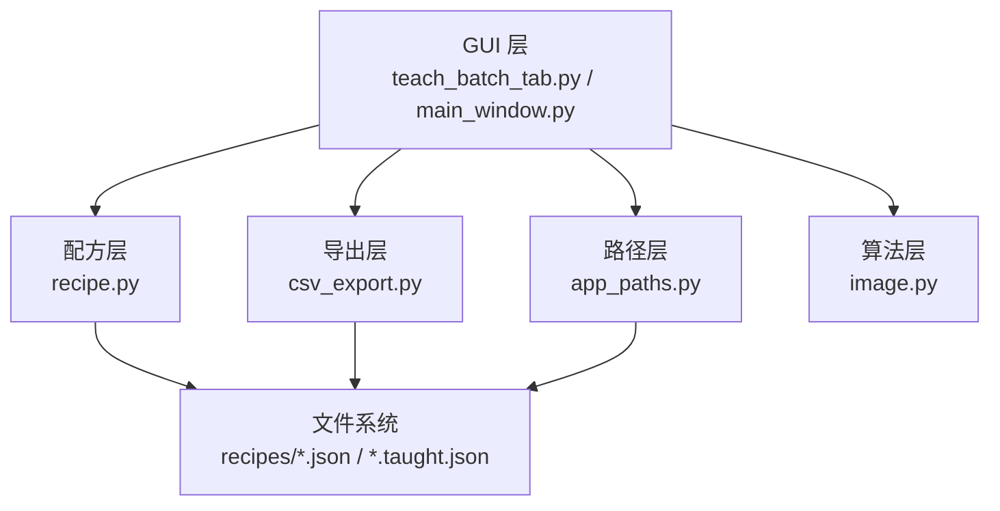
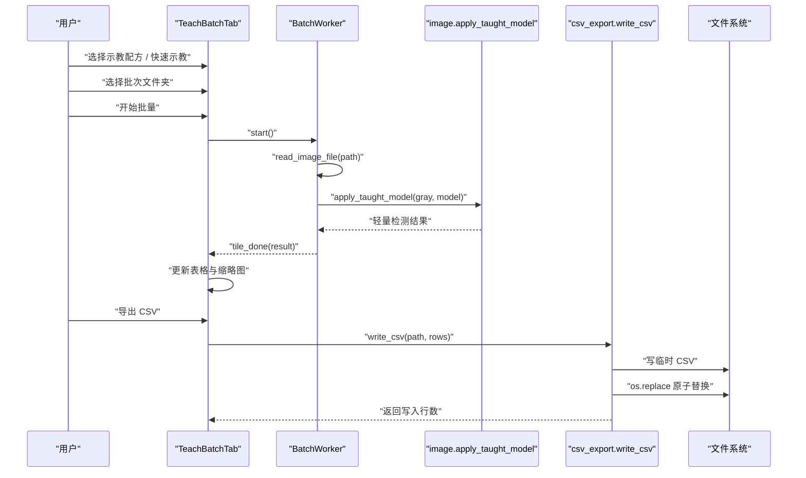
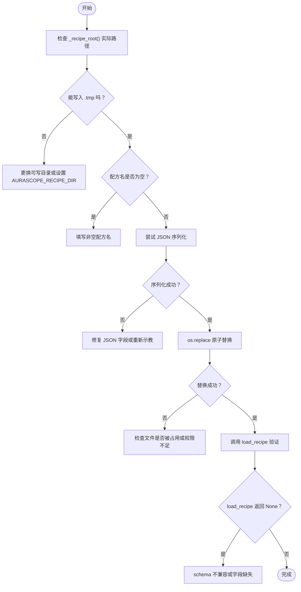
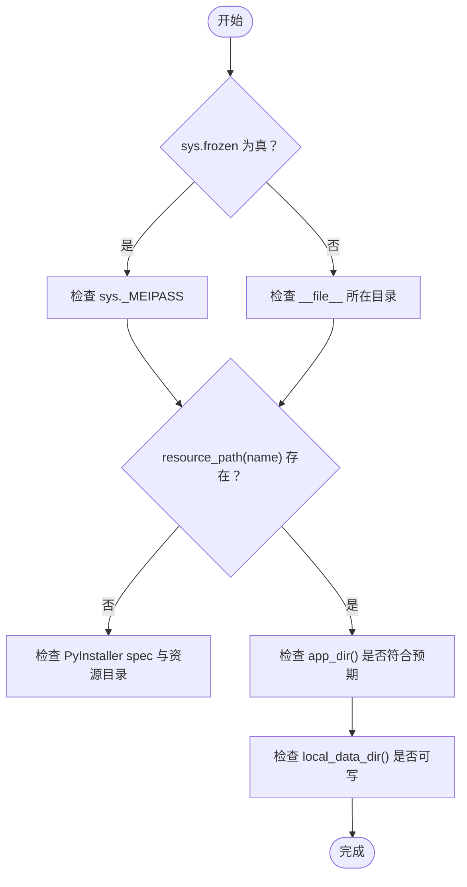
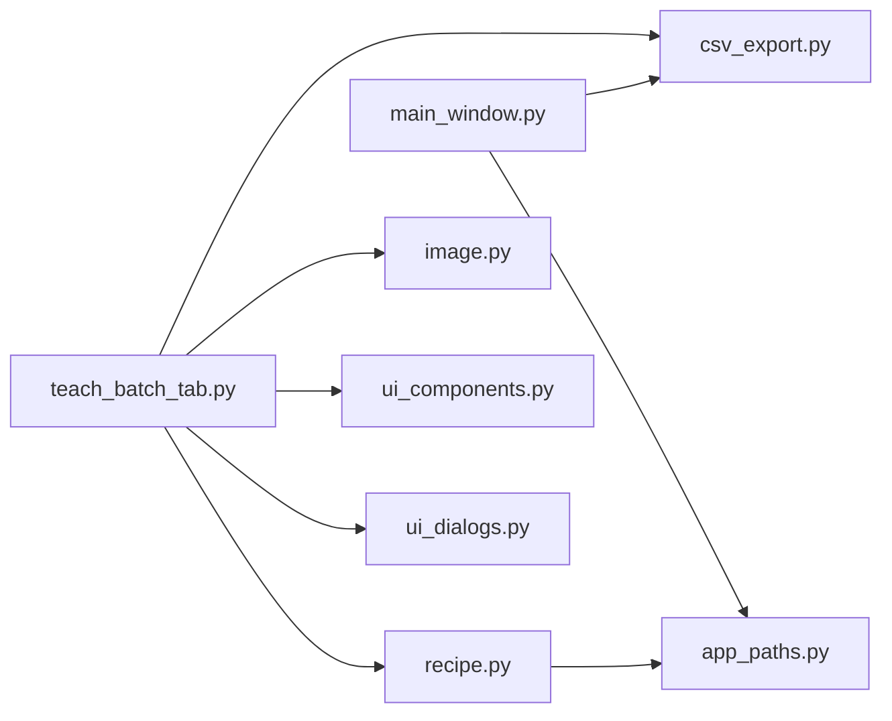

# 数据导出与持久化问题排查

<cite>
**本文引用的文件**   
- [app_paths.py](file://app_paths.py)
- [recipe.py](file://recipe.py)
- [csv_export.py](file://csv_export.py)
- [teach_batch_tab.py](file://teach_batch_tab.py)
- [main_window.py](file://main_window.py)
- [README.md](file://README.md)
- [PROJECT_CONCEPTION.md](file://PROJECT_CONCEPTION.md)
</cite>

## 目录
1. [引言](#引言)
2. [项目结构与数据持久化边界](#项目结构与数据持久化边界)
3. [核心组件与职责](#核心组件与职责)
4. [架构总览：从批量检测到 CSV 落盘](#架构总览从批量检测到-csv-落盘)
5. [CSV 导出为空排查](#csv-导出为空排查)
6. [配方 JSON 写入失败与 schema 不兼容排查](#配方-json-写入失败与-schema-不兼容排查)
7. [资源路径解析异常排查](#资源路径解析异常排查)
8. [导出文件名非法或被占用排查](#导出文件名非法或被占用排查)
9. [依赖关系分析](#依赖关系分析)
10. [性能与稳定性注意事项](#性能与稳定性注意事项)
11. [恢复建议与预防性校验](#恢复建议与预防性校验)
12. [结论](#结论)

## 引言
本文聚焦 Aurascope 在「示教/批量检测」场景下的数据持久化问题，尤其是三类典型现象：
- CSV 导出结果为空；
- `recipes/*.taught.json` 写入失败或字段缺失、schema 不兼容；
- `app_paths.py` 在源码运行与 PyInstaller 打包环境下 base 目录解析错误，导致配置文件、帮助文件或资源找不到。

Aurascope 是面向微电子封装产线的单机桌面工具，使用 PyQt6 + OpenCV + NumPy + Pandas（仅用于 CSV 导出）实现空洞率检测、物料计数、剪切力计算与尺寸测量等功能。其技术分层为：GUI 层 → Canvas 绘制层 → image.py 算法层 → 数据导出层。本文以实际源码为依据，给出可操作的诊断步骤、恢复建议与预防性校验措施。

**章节来源**
- [README.md:1-80](file://README.md#L1-L80)
- [PROJECT_CONCEPTION.md:77-107](file://PROJECT_CONCEPTION.md#L77-L107)

## 项目结构与数据持久化边界
仓库根目录下与数据持久化直接相关的模块包括：
- `app_paths.py`：统一解析资源路径、应用目录、用户本地数据目录与日志目录；
- `recipe.py`：管理检测参数配方与示教模型 JSON，负责读写、校验、默认值补齐与 schema 迁移；
- `csv_export.py`：用标准库 csv 替代 pandas 写 CSV，提供列头收集、空值处理与临时文件原子替换；
- `teach_batch_tab.py`：示教与批量检测 UI，负责选择批次、启动批量线程、汇总结果并调用 CSV 导出；
- `main_window.py`：主窗口装配，加载资源、菜单、帮助文档等，也通过 `resource_path` 访问图标与帮助文件。

**图表来源**
- [teach_batch_tab.py:34-51](file://teach_batch_tab.py#L34-L51)
- [main_window.py:24-51](file://main_window.py#L24-L51)
- [app_paths.py:1-42](file://app_paths.py#L1-L42)
- [recipe.py:1-10](file://recipe.py#L1-L10)
- [csv_export.py:1-8](file://csv_export.py#L1-L8)

**章节来源**
- [README.md:42-65](file://README.md#L42-L65)
- [PROJECT_CONCEPTION.md:77-107](file://PROJECT_CONCEPTION.md#L77-L107)

## 核心组件与职责
| 组件 | 主要职责 | 关键行为 | 常见故障点 |
|---|---|---|---|
| `app_paths.resource_path` | 根据是否 frozen 返回资源 base 目录 | frozen 时取 `_MEIPASS`，否则取当前文件目录 | PyInstaller 下资源路径指向解包目录，但期望路径不在该目录 |
| `app_paths.app_dir` | 程序所在目录 | frozen 取 exe 同级，源码取本文件目录 | 误以为 frozen 后仍按源码目录查找 `recipes` |
| `app_paths.local_data_dir` | 用户可写数据目录 | 优先 `LOCALAPPDATA`，回退到用户目录 | 环境变量缺失或用户目录不可写 |
| `recipe._recipe_root` | 配方存储根目录 | frozen 优先 exe 同级 `recipes`，不可写回退到 `local_data_dir()/recipes` | 用户手动把 exe 放到 Program Files 只读目录 |
| `recipe.save_taught` | 保存 `.taught.json` | 先写 `.tmp` 再 `os.replace`，可选保存比例尺模板 PNG | 名称为空、JSON 序列化失败、PNG 写入失败 |
| `csv_export.write_csv` | 写 CSV | 收集列头、空值转空串、临时文件 + `os.replace` | 行列表为空、列头为空、目标目录无写权限 |
| `teach_batch_tab.export_csv` | 组装批量结果行并导出 | 过滤 `ok` 行、追加汇总行、调用 `write_csv` | 未执行批量、`batch_results` 为空、所有图片处理失败 |

**章节来源**
- [app_paths.py:8-32](file://app_paths.py#L8-L32)
- [recipe.py:56-96](file://recipe.py#L56-L96)
- [recipe.py:385-404](file://recipe.py#L385-L404)
- [csv_export.py:15-51](file://csv_export.py#L15-L51)
- [teach_batch_tab.py:1855-1901](file://teach_batch_tab.py#L1855-L1901)

## 架构总览：从批量检测到 CSV 落盘
批量检测的完整流程如下：
1. 用户在「示教/批量」Tab 选择示教配方或快速示教模型；
2. 选择批次文件夹，`load_folder` 扫描图像扩展名；
3. 点击「开始批量」，构造 `BatchWorker` 并启动线程；
4. 线程逐图读取灰度图、识别比例尺、应用示教模型，产出轻量结果；
5. UI 接收进度与单图结果，填充表格与缩略图；
6. 用户点击「导出 CSV」，从 `batch_results` 组装行并调用 `csv_export.write_csv`。

**图表来源**
- [teach_batch_tab.py:82-158](file://teach_batch_tab.py#L82-L158)
- [teach_batch_tab.py:1401-1453](file://teach_batch_tab.py#L1401-L1453)
- [teach_batch_tab.py:1855-1901](file://teach_batch_tab.py#L1855-L1901)
- [csv_export.py:27-51](file://csv_export.py#L27-L51)

**章节来源**
- [teach_batch_tab.py:82-158](file://teach_batch_tab.py#L82-L158)
- [teach_batch_tab.py:1401-1453](file://teach_batch_tab.py#L1401-L1453)
- [teach_batch_tab.py:1855-1901](file://teach_batch_tab.py#L1855-L1901)
- [csv_export.py:27-51](file://csv_export.py#L27-L51)

## CSV 导出为空排查
CSV 导出为空通常不是 `csv_export.write_csv` 本身没有实现，而是上游没有传入有效行。需要按以下顺序排查。

### 1. 确认是否真正执行了批量检测
如果用户直接点击「导出 CSV」而没有先「开始批量」，`batch_results` 可能为空，`export_csv` 会提前返回。

检查要点：
- 是否选择了示教配方或快速示教模型；
- 是否选择了包含图片的批次文件夹；
- 是否看到进度条和表格行增长；
- 若批量被取消，`_batch_canceled` 会导致线程提前退出。

相关逻辑位置：
- 批量入口：[start_batch:1401-1453](file://teach_batch_tab.py#L1401-L1453)；
- 批量线程：[BatchWorker.run:106-158](file://teach_batch_tab.py#L106-L158)；
- 导出入口：[export_csv:1855-1901](file://teach_batch_tab.py#L1855-L1901)。

### 2. 确认 ROI 或焊层带未定义
批量检测依赖示教模型定位焊层带。如果模型无效、样板图无法识别比例尺、或 `apply_taught_model` 返回失败，单图结果中 `ok=False`，这些行不会进入正常统计行。

检查要点：
- 示教配方是否为 `type='taught'`；
- 批量结果表中「警告」列是否出现「图片读取失败」「未能定位焊层带」等提示；
- 预览某张图时是否显示「未能定位焊层带」。

相关逻辑位置：
- 批量前校验：[start_batch:1401-1420](file://teach_batch_tab.py#L1401-L1420)；
- 单图结果组装：[BatchWorker.run:106-158](file://teach_batch_tab.py#L106-L158)；
- 预览失败提示：[preview_result:1947-1969](file://teach_batch_tab.py#L1947-L1969)。

### 3. 确认 `objects` 列表为空
这里的 `objects` 对应批量结果中的空洞集合。即使金锡区域存在，如果空洞数量为零，CSV 中仍会有行，只是空洞数、空洞面积、空洞率为零或空值。但如果连金锡区域也没有，则该行不会被计入汇总行。

检查要点：
- CSV 中是否有「图片」列；
- 空洞数为 0 还是整张表都没有行；
- 是否所有图片都 `ok=False`。

相关逻辑位置：
- 正常行组装：[export_csv:1864-1886](file://teach_batch_tab.py#L1864-L1886)；
- 失败行组装：[export_csv:1887-1889](file://teach_batch_tab.py#L1887-L1889)；
- 汇总行条件：[export_csv:1890-1899](file://teach_batch_tab.py#L1890-L1899)。

### 4. 确认 Pandas 版本兼容性
虽然 `csv_export.py` 已改用标准库 `csv`，不再直接依赖 Pandas 写 CSV，但项目 README 仍声明技术栈包含 Pandas，且历史设计文档提到「Pandas → CSV」。因此排查时应区分：
- 当前代码路径：`csv_export.write_csv` 使用标准库 csv；
- 其他模块或旧版本代码是否仍依赖 Pandas；
- 环境安装是否与 `requirements.txt` 一致。

检查要点：
- 运行环境是否安装了 Pandas；
- 是否混用了旧版导出逻辑；
- 是否因 Pandas 版本过新/过旧导致其他功能异常。

**章节来源**
- [teach_batch_tab.py:106-158](file://teach_batch_tab.py#L106-L158)
- [teach_batch_tab.py:1401-1453](file://teach_batch_tab.py#L1401-L1453)
- [teach_batch_tab.py:1855-1901](file://teach_batch_tab.py#L1855-L1901)
- [csv_export.py:1-8](file://csv_export.py#L1-L8)
- [README.md:35-41](file://README.md#L35-L41)

## 配方 JSON 写入失败与 schema 不兼容排查
配方分为两类：
- 参数型配方：普通 `.json`；
- 示教模型配方：`.taught.json`，`type='taught'`，schema v3。

### 1. 确认配方存储目录
`recipe._recipe_root` 会优先尝试 exe 同级的 `recipes` 目录；如果不可写，则回退到 `local_data_dir()/recipes`。

常见问题：
- 用户把 exe 放在 Program Files 或只读共享目录；
- 用户期望配方保存在源码目录，但实际保存在 `%LOCALAPPDATA%\Aurascope\recipes`；
- 设置了环境变量 `AURASCOPE_RECIPE_DIR`，但指向不可写路径。

检查步骤：
- 在 Python 中打印 `_recipe_root()`；
- 检查 exe 同级是否存在 `recipes`；
- 检查 `%LOCALAPPDATA%\Aurascope\recipes`；
- 检查环境变量 `AURASCOPE_RECIPE_DIR`。

相关逻辑位置：
- [_recipe_root:69-89](file://recipe.py#L69-L89)；
- [local_data_dir:21-26](file://app_paths.py#L21-L26)。

### 2. 确认 `.taught.json` 写入是否成功
`save_taught` 会：
- 校验配方名不能为空；
- 生成 `<name>.taught.json`；
- 先写 `<name>.taught.json.tmp`；
- 成功后 `os.replace` 覆盖原文件；
- 可选写入 `_bar.png` 比例尺模板。

常见问题：
- 配方名为空；
- 目标目录无写权限；
- JSON 序列化失败；
- PNG 模板写入失败；
- 同名文件被其他进程占用。

相关逻辑位置：
- [save_taught:385-404](file://recipe.py#L385-L404)；
- [_taught_path_for:115-120](file://recipe.py#L115-L120)；
- [safe_name:99-103](file://recipe.py#L99-L103)。

### 3. 确认 schema 兼容性与字段缺失
`normalize_recipe` 会把任意来源字典规范化为完整配方；`validate_taught` 会把 schema < 3 的旧配方迁移到 v3，并保留部分旧字段供追溯。

常见问题：
- 手工修改 JSON 后缺少必填字段；
- 旧 schema 的 `min_area` / `max_area` 语义与新自动档不一致；
- `solder`、`background`、`void`、`band`、`scale_bar`、`diagnostics` 等子对象缺失；
- `px_per_um` 非数值类型。

检查步骤：
- 打开 `recipes/*.taught.json`，确认顶层字段：`schema_version`、`type`、`name`、`note`、`updated`、`detection` 或示教模型字段；
- 对 `type='taught'` 的配方，确认 `solder`、`void`、`band`、`scale_bar`、`diagnostics` 等结构；
- 对旧配方，确认迁移后是否仍保留 `*_taught` 字段；
- 使用 `load_recipe` 加载，若返回 `None`，说明 JSON 无法规范化。

相关逻辑位置：
- [normalize_recipe:241-258](file://recipe.py#L241-L258)；
- [validate_taught:271-348](file://recipe.py#L271-L348)；
- [load_recipe:452-462](file://recipe.py#L452-L462)。

### 4. 诊断流程图

**图表来源**
- [recipe.py:69-89](file://recipe.py#L69-L89)
- [recipe.py:385-404](file://recipe.py#L385-L404)
- [recipe.py:452-462](file://recipe.py#L452-L462)

**章节来源**
- [recipe.py:69-89](file://recipe.py#L69-L89)
- [recipe.py:99-120](file://recipe.py#L99-L120)
- [recipe.py:241-348](file://recipe.py#L241-L348)
- [recipe.py:385-404](file://recipe.py#L385-L404)
- [recipe.py:452-462](file://recipe.py#L452-L462)
- [app_paths.py:21-26](file://app_paths.py#L21-L26)

## 资源路径解析异常排查
`app_paths.py` 同时承担资源路径与应用目录解析，需区分两种运行环境。

### 1. `resource_path(name)`
- frozen 模式：base = `sys._MEIPASS`（PyInstaller 解包目录）；
- 源码模式：base = `os.path.dirname(os.path.abspath(__file__))`。

常见问题：
- 打包后图标、帮助文件、logo 找不到；
- 开发者在源码目录放资源，但发布包未正确打包；
- 自定义资源路径拼接到 `_MEIPASS` 下，但该目录不存在。

检查步骤：
- 在 frozen 模式下打印 `sys._MEIPASS`；
- 在源码模式下打印 `__file__` 所在目录；
- 确认资源文件是否在对应 base 下；
- 确认 PyInstaller spec 是否包含所需资源。

相关逻辑位置：
- [resource_path:8-11](file://app_paths.py#L8-L11)；
- [main_window.py 中使用 resource_path 加载图标与 logo:66-68](file://main_window.py#L66-L68)。

### 2. `app_dir()`
- frozen 模式：exe 同级目录；
- 源码模式：本文件目录。

常见问题：
- 期望 `app_dir()` 返回源码目录，但实际运行的是 exe；
- 期望 `app_dir()` 返回 exe 目录，但实际以 `python main.py` 运行。

相关逻辑位置：
- [app_dir:14-18](file://app_paths.py#L14-L18)。

### 3. `local_data_dir()`
- 优先 `LOCALAPPDATA`；
- 回退到 `~\AppData\Local`；
- 创建 `Aurascope` 目录。

常见问题：
- 环境变量缺失；
- 用户目录不可写；
- 多用户环境下不同用户看到不同数据。

相关逻辑位置：
- [local_data_dir:21-26](file://app_paths.py#L21-L26)。

### 4. 诊断流程图

**图表来源**
- [app_paths.py:8-26](file://app_paths.py#L8-L26)
- [main_window.py:66-68](file://main_window.py#L66-L68)

**章节来源**
- [app_paths.py:8-26](file://app_paths.py#L8-L26)
- [main_window.py:66-68](file://main_window.py#L66-L68)

## 导出文件名非法或被占用排查
### 1. 配方名与文件名
`recipe.safe_name` 会过滤 Windows 非法字符 `\ / : * ? " < > |`，并限制长度为 64。  
`recipe_filename` 拼接 `.json`；`.taught.json` 由 `_taught_path_for` 拼接。

常见问题：
- 用户输入含非法字符的配方名；
- 同名参数型配方与示教配方互相覆盖（已通过 `.taught.json` 隔离命名空间）；
- 文件名过长被截断。

相关逻辑位置：
- [safe_name:99-103](file://recipe.py#L99-L103)；
- [recipe_filename:106-108](file://recipe.py#L106-L108)；
- [_taught_path_for:115-120](file://recipe.py#L115-L120)。

### 2. CSV 导出文件名
`teach_batch_tab.export_csv` 默认使用 `批量空洞率_YYYYMMDD_HHMMSS.csv`。  
`csv_export.write_csv` 使用 `tempfile.mkstemp` 在同目录写 `.csv_.tmp`，成功后 `os.replace`。

常见问题：
- 目标目录无写权限；
- 文件名被 Excel 或其他进程占用；
- 网络驱动器或只读目录；
- 杀毒软件锁定临时文件。

相关逻辑位置：
- [export_csv:1855-1901](file://teach_batch_tab.py#L1855-L1901)；
- [write_csv:27-51](file://csv_export.py#L27-L51)。

### 3. 诊断清单
- 检查导出对话框选择的目录是否可写；
- 关闭正在编辑该 CSV 的 Excel、记事本或其他编辑器；
- 检查任务管理器中是否有进程占用该文件；
- 尝试导出到 `%TEMP%` 或桌面；
- 检查杀毒软件是否拦截临时文件；
- 对配方 JSON，检查 `recipes/` 或 `%LOCALAPPDATA%\Aurascope\recipes` 的权限。

**章节来源**
- [recipe.py:99-120](file://recipe.py#L99-L120)
- [teach_batch_tab.py:1855-1901](file://teach_batch_tab.py#L1855-L1901)
- [csv_export.py:27-51](file://csv_export.py#L27-L51)

## 依赖关系分析

**图表来源**
- [teach_batch_tab.py:34-51](file://teach_batch_tab.py#L34-L51)
- [main_window.py:24-51](file://main_window.py#L24-L51)
- [recipe.py:85-86](file://recipe.py#L85-L86)

**章节来源**
- [teach_batch_tab.py:34-51](file://teach_batch_tab.py#L34-L51)
- [main_window.py:24-51](file://main_window.py#L24-L51)
- [recipe.py:85-86](file://recipe.py#L85-L86)

## 性能与稳定性注意事项
- 批量线程避免传递大对象：`BatchWorker` 明确剔除 `band_mask`、`voids` 等重型字段，只传轻量结果，防止几十张 4K 图的掩码常驻内存。
- CSV 与配方写入均采用临时文件 + `os.replace`，降低中途失败留下半截文件的概率。
- 配方加载失败时 `list_recipes` 会按 v1 处理，让用户能在界面上看到并删除损坏文件。
- 资源路径函数尽量捕获异常，例如 `build_date` 在获取文件修改时间失败时返回占位符。

**章节来源**
- [teach_batch_tab.py:82-100](file://teach_batch_tab.py#L82-L100)
- [teach_batch_tab.py:106-158](file://teach_batch_tab.py#L106-L158)
- [recipe.py:137-166](file://recipe.py#L137-L166)
- [recipe.py:439-449](file://recipe.py#L439-L449)
- [csv_export.py:27-51](file://csv_export.py#L27-L51)
- [app_paths.py:35-42](file://app_paths.py#L35-L42)

## 恢复建议与预防性校验
### 恢复步骤
1. **确认运行环境**
   - 源码运行：`python main.py`；
   - 打包运行：双击 `dist/AurascopeV6.3/AurascopeV6.3.exe`；
   - 不要随意改回 PyInstaller 单文件模式，README 明确指出 onedir 冷启动更快。

2. **检查路径**
   - 打印 `app_paths.resource_path('logo.png')`；
   - 打印 `app_paths.app_dir()`；
   - 打印 `recipe._recipe_root()`；
   - 检查 `%LOCALAPPDATA%\Aurascope\recipes`。

3. **修复配方**
   - 若 `.taught.json` 损坏，备份后删除，重新示教；
   - 若 schema 不兼容，优先用界面重新学习，不要手工编辑关键字段；
   - 若必须手工修复，确保 `type='taught'` 时具备 `solder`、`void`、`band`、`scale_bar`、`diagnostics` 等结构。

4. **修复 CSV 导出**
   - 先执行一次完整批量检测；
   - 确认表格中有成功行；
   - 导出到本地磁盘，而非网络驱动器或只读目录；
   - 关闭 Excel 或其他占用进程。

### 预防性校验措施
| 问题类型 | 预防校验 | 建议位置 |
|---|---|---|
| CSV 为空 | 导出前检查 `len(batch_results) > 0` 且至少有一行 `ok=True` | `teach_batch_tab.export_csv` |
| ROI 未定义 | 批量前校验模型存在且 `type='taught'` | `teach_batch_tab.start_batch` |
| 配方写入失败 | 保存前校验 name 非空、目录可写、JSON 序列化成功 | `recipe.save_taught` |
| schema 不兼容 | 加载后校验 `normalize_recipe` 返回值不为 `None` | `recipe.load_recipe` |
| 资源路径错误 | 启动时校验关键资源文件存在 | `main_window.py` 初始化阶段 |
| 文件名非法 | 使用 `safe_name` 过滤用户输入 | `recipe.safe_name` |
| 文件被占用 | 捕获 `OSError` 并提示用户关闭占用进程 | `csv_export.write_csv`、`recipe.save_taught` |

**章节来源**
- [README.md:67-76](file://README.md#L67-L76)
- [teach_batch_tab.py:1401-1453](file://teach_batch_tab.py#L1401-L1453)
- [teach_batch_tab.py:1855-1901](file://teach_batch_tab.py#L1855-L1901)
- [recipe.py:99-120](file://recipe.py#L99-L120)
- [recipe.py:385-404](file://recipe.py#L385-L404)
- [recipe.py:452-462](file://recipe.py#L452-L462)
- [csv_export.py:27-51](file://csv_export.py#L27-L51)

## 结论
Aurascope 的数据持久化问题通常不是单一模块缺陷，而是「路径解析 → 配方读写 → 批量检测 → CSV 导出」链路中某一环不符合预期。排查时应优先确认：
1. 当前运行环境是源码还是 PyInstaller 打包；
2. `app_paths.py` 解析出的 base 目录与实际资源/数据目录是否一致；
3. `recipe.py` 的配方存储根是否可写，schema 是否能被 `normalize_recipe` 接受；
4. 批量检测是否真正执行，`batch_results` 中是否存在 `ok=True` 的行；
5. CSV 导出目标目录是否可写，文件名是否被其他进程占用。

按照本文的诊断步骤与恢复建议操作，可以稳定定位 CSV 导出为空、配方 JSON 写入失败、资源路径解析异常等问题，并通过预防性校验降低复现概率。