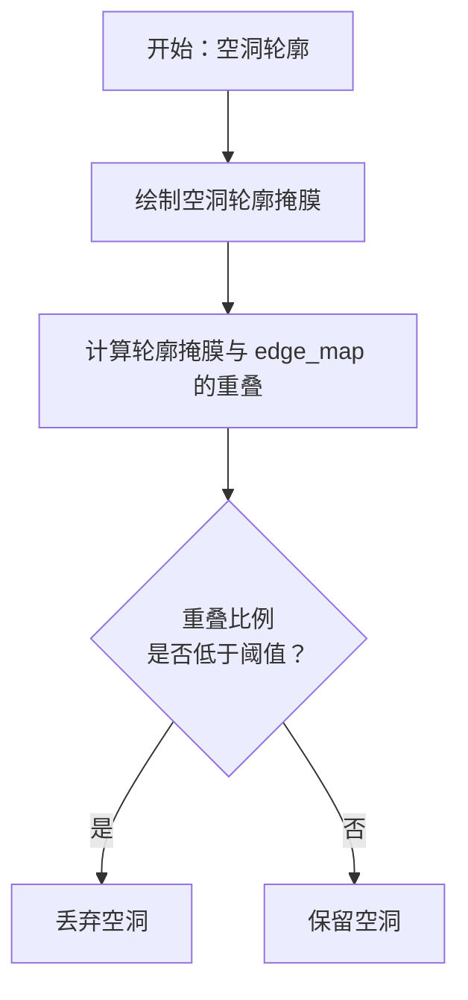
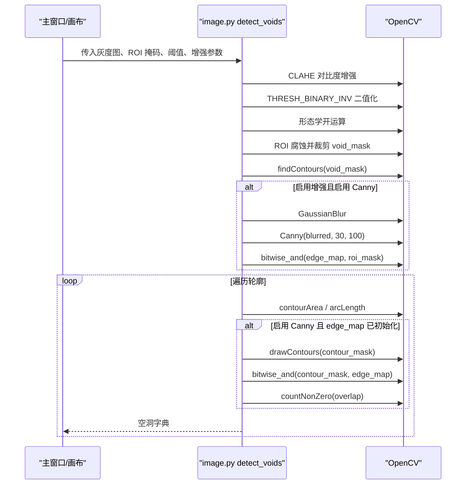
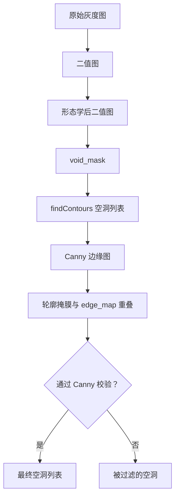
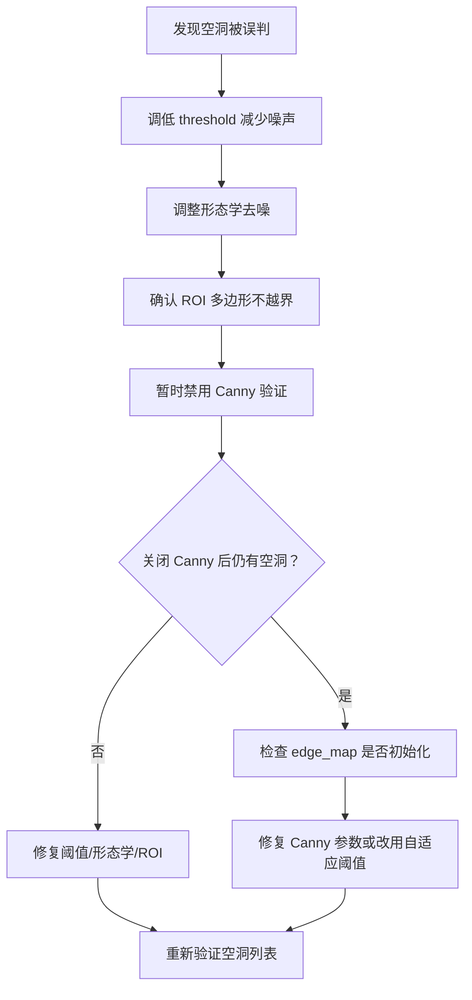
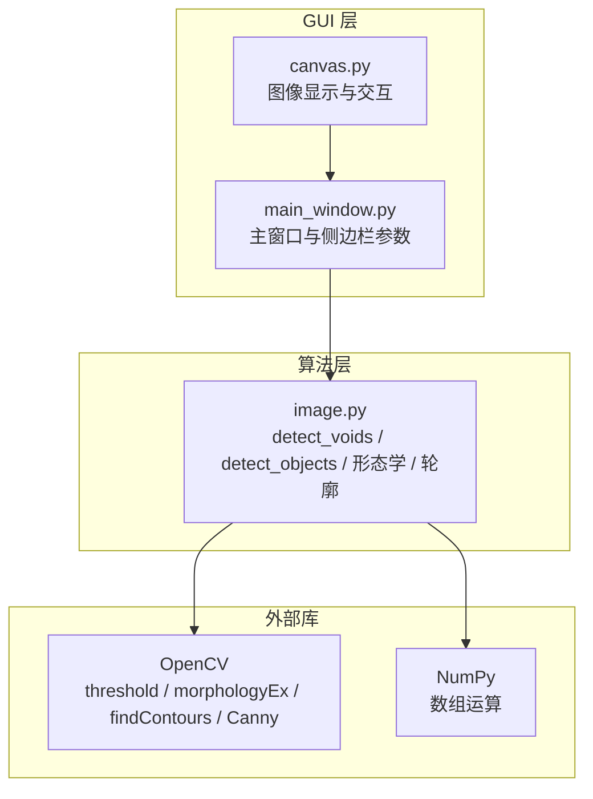

# Canny 边缘验证误判

<cite>
**本文引用的文件**   
- [image.py](file://image.py)
- [main_window.py](file://main_window.py)
- [canvas.py](file://canvas.py)
- [README.md](file://README.md)
- [PROJECT_CONCEPTION.md](file://PROJECT_CONCEPTION.md)
</cite>

## 目录
1. [引言](#引言)
2. [问题定位：Canny 校验为何会误杀空洞](#问题定位canny-校验为何会误杀空洞)
3. [可复现症状与触发条件](#可复现症状与触发条件)
4. [核心处理流程与 OpenCV 调用链](#核心处理流程与-opencv-调用链)
5. [三种典型失效场景](#三种典型失效场景)
6. [调试方法：分别查看二值图、Canny 边缘图与空洞列表](#调试方法分别查看二值图canny-边缘图与空洞列表)
7. [handoff.md 记录的已知限制与静默失效](#handoffmd-记录的已知限制与静默失效)
8. [修正顺序与排查清单](#修正顺序与排查清单)
9. [架构与依赖关系](#架构与依赖关系)
10. [结论](#结论)

## 引言
Aurascope 的空洞分析模块以「阈值二值化 → 形态学去噪 → ROI 掩码裁剪 → findContours 提取轮廓 → 可选 Canny 边缘验证」为主线。Canny 边缘验证的设计意图是：如果检测到的空洞轮廓在真实图像上几乎没有对应边缘，就把它当作噪声过滤掉。

但这一设计有一个关键前提：**edge_map 必须正确生成，且空洞轮廓确实落在 edge_map 有边缘的位置**。当二值图中噪声过多、ROI 边界裁剪不完整、或 edge_map 未初始化时，findContours 可能找不到有效边缘，或者空洞轮廓与 edge_map 的交集为空，从而让空洞被判定为无效。

本文聚焦这一误判路径，不讨论其他功能模块。

**章节来源**
- [README.md:7-14](file://README.md#L7-L14)
- [PROJECT_CONCEPTION.md:19-26](file://PROJECT_CONCEPTION.md#L19-L26)

## 问题定位：Canny 校验为何会误杀空洞
Canny 边缘验证不是直接判断「空洞是否存在」，而是对已经通过阈值和形态学找到的空洞轮廓做二次筛选。其核心逻辑可以概括为：

1. 用高斯模糊 + Canny 生成全局边缘图。
2. 把 edge_map 与 ROI 掩码做按位与，只保留 ROI 内的边缘。
3. 对每个空洞轮廓绘制一个同尺寸的轮廓掩膜。
4. 计算「轮廓掩膜与 edge_map 的重叠像素数 / 轮廓总像素数」。
5. 如果重叠比例低于 `edge_thresh`（默认约 0.3），则丢弃该空洞。

因此，即使 findContours 找到了空洞，只要 edge_map 中没有足够多的边缘像素落在空洞轮廓上，空洞仍会被过滤。

**图表来源**
- [image.py:255-263](file://image.py#L255-L263)
- [main_window.py:1852-1859](file://main_window.py#L1852-L1859)
- [main_window.py:1945-1956](file://main_window.py#L1945-L1956)

**章节来源**
- [image.py:228-286](file://image.py#L228-L286)
- [main_window.py:1832-1859](file://main_window.py#L1832-L1859)
- [main_window.py:1930-1956](file://main_window.py#L1930-L1956)

## 可复现症状与触发条件
### 典型症状
- 同一张图关闭 Canny 后出现大量空洞，开启 Canny 后全部消失。
- 关闭圆度过滤、面积上限等其它过滤条件后，仍然只有零星空洞或完全无结果。
- 调整阈值后能恢复部分空洞，但开启 Canny 后又被重新过滤。
- 导出 CSV 中空洞数量明显少于肉眼可见的暗区。
- 用户反馈「没有报错，但 Canny 好像没生效」——因为静默失效不会抛异常。

### 常见触发条件
| 触发条件 | 现象 | 原因 |
|---|---|---|
| 二值图中噪声过多 | 开启 Canny 后空洞变少甚至消失 | 噪声轮廓本身没有真实边缘，被 Canny 校验过滤 |
| ROI 多边形越界或裁剪不完整 | 边缘图只在 ROI 内有效，空洞被误判 | edge_map 与 ROI 按位与后，空洞轮廓落在 ROI 外的部分没有边缘 |
| edge_map 未初始化 | 开启 Canny 后空洞全部消失 | 代码中 edge_map 初始为 None，若增强分支未进入，校验分支跳过；但若后续实现不一致，可能出现空指针或静默失败 |
| 阈值过高导致空洞内部无暗区 | 空洞轮廓只是细线或极小区域 | 轮廓像素太少，重叠比例自然偏低 |
| 形态学开运算过强 | 空洞被断开成碎片 | 碎片轮廓太小，Canny 校验更容易失败 |

**章节来源**
- [image.py:200-286](file://image.py#L200-L286)
- [main_window.py:1779-1876](file://main_window.py#L1779-L1876)
- [main_window.py:1879-1974](file://main_window.py#L1879-L1974)

## 核心处理流程与 OpenCV 调用链
空洞检测的主流程集中在 image.py 的 `detect_voids` 中，main_window.py 中存在一份 `detect_voids_local` 副本以及 `detect_voids_local_brush`，属于已知技术债。现行行为应以 image.py 为准。

**图表来源**
- [image.py:200-286](file://image.py#L200-L286)

### 关键 OpenCV 调用与参数
| 步骤 | OpenCV 调用 | 作用 | 风险点 |
|---|---|---|---|
| 二值化 | `cv2.threshold(gray_img, thresh_val, 255, cv2.THRESH_BINARY_INV)` | 将暗色空洞转为前景 | 阈值过高会漏空洞；过低会引入噪声 |
| 形态学去噪 | `cv2.morphologyEx(bin_inv, cv2.MORPH_OPEN, kernel)` | 断开细小噪声 | 核过大可能断开空洞 |
| ROI 裁剪 | `cv2.erode(roi_mask, ...)` + `bitwise_and` | 排除 ROI 边界伪影 | ROI 越界或腐蚀过度会丢失空洞 |
| 轮廓提取 | `cv2.findContours(void_mask, RETR_EXTERNAL, CHAIN_APPROX_SIMPLE)` | 得到候选空洞 | 输入为空或全白时会返回空列表 |
| 高斯模糊 | `cv2.GaussianBlur(processed, (5,5), 1.0)` | 降低 Canny 噪声敏感度 | 模糊过强会抹平弱边缘 |
| Canny 边缘 | `cv2.Canny(blurred, 30, 100)` | 生成边缘图 | 阈值固定，不同图像可能不适用 |
| ROI 约束边缘 | `bitwise_and(edge_map, edge_map, mask=roi_mask)` | 只保留 ROI 内边缘 | ROI 不完整会导致边缘缺失 |
| 轮廓掩膜 | `drawContours(contour_mask, [cnt], -1, 255, 1)` | 构造空洞轮廓掩膜 | 单像素轮廓或退化轮廓可能面积为 0 |
| 重叠统计 | `countNonZero(overlap)` / `countNonZero(contour_mask)` | 计算边缘覆盖比例 | 分母过小或分子为 0 时比例极低 |

**章节来源**
- [image.py:214-286](file://image.py#L214-L286)
- [main_window.py:1795-1859](file://main_window.py#L1795-L1859)
- [main_window.py:1889-1956](file://main_window.py#L1889-L1956)

## 三种典型失效场景
### 场景一：二值图中噪声过多
当阈值太低时，背景噪声、划痕、颗粒都会变成前景。findContours 会把这些噪声也当成空洞轮廓。这些轮廓通常没有真实图像边缘，Canny 校验会把它们过滤掉。

但如果噪声太多，也可能出现另一种情况：噪声把空洞与背景连成一片，空洞不再是独立连通域，findContours 根本找不到空洞轮廓。此时问题不在 Canny，而在阈值和形态学。

**诊断要点**
- 先关闭 Canny，观察二值图是否充满噪声。
- 如果关闭 Canny 后也没有空洞，优先调低噪声，而不是调高 Canny 灵敏度。
- 如果关闭 Canny 后空洞很多但形状奇怪，说明阈值需要提高或形态学核需要减小。

**章节来源**
- [image.py:214-226](file://image.py#L214-L226)
- [image.py:238-286](file://image.py#L238-L286)

### 场景二：ROI 边界裁剪不完整
Canny 校验使用 ROI 掩码对 edge_map 做按位与。如果 ROI 多边形越界、顶点顺序错误、或 ROI 被意外缩小，edge_map 在空洞位置可能没有边缘。

例如：
- ROI 多边形没有包含整个焊料区域。
- ROI 坐标被截断到图像边界，但空洞靠近边界。
- ROI 腐蚀参数 `roi_erosion_px` 太大，把空洞边缘切掉。
- 局部阈值笔刷区域覆盖了空洞，但最终 final_mask 被按位与非圆形区域清空。

**诊断要点**
- 单独渲染 ROI 掩码，确认空洞是否落在 ROI 内。
- 检查 ROI 多边形顶点是否越界。
- 暂时把 `roi_erosion_px` 设为 0，看空洞是否恢复。
- 对局部笔刷模式，确认最终 final_mask 没有被笔刷区域反向清空。

**章节来源**
- [image.py:220-225](file://image.py#L220-L225)
- [image.py:230-233](file://image.py#L230-L233)
- [main_window.py:1895-1900](file://main_window.py#L1895-L1900)
- [main_window.py:1922-1926](file://main_window.py#L1922-L1926)

### 场景三：edge_map 未初始化或增强分支未进入
在 image.py 的 `detect_voids` 中，edge_map 初始化为 None，只有在 `enhanced and edge_verify` 同时成立时才生成。main_window.py 中的局部函数也有类似结构。

这意味着：
- 如果 `enhanced=False`，即使勾选了 Canny，也可能不生成 edge_map。
- 如果 GUI 状态与算法参数不一致，可能出现「界面显示启用了 Canny，但实际没有执行 Canny」的情况。
- 更危险的是：某些实现路径中 edge_map 可能始终为 None，而校验分支又依赖它，导致静默失效。

**诊断要点**
- 不要只看界面是否勾选 Canny。
- 在算法入口打印 enhanced、edge_verify、edge_map 是否为 None。
- 如果 edge_map 为 None，应视为 Canny 校验未生效，而不是「校验通过」。

**章节来源**
- [image.py:228-233](file://image.py#L228-L233)
- [image.py:255-263](file://image.py#L255-L263)
- [main_window.py:1832-1836](file://main_window.py#L1832-L1836)
- [main_window.py:1945-1949](file://main_window.py#L1945-L1949)

## 调试方法：分别查看二值图、Canny 边缘图与空洞列表
建议按以下顺序保存中间结果，便于定位问题：

| 调试视图 | 含义 | 正常表现 | 异常表现 |
|---|---|---|---|
| 原始灰度图 | 输入图像 | 焊料区域与空洞对比清晰 | 光照不均、噪声密集 |
| 二值图 | `THRESH_BINARY_INV` 结果 | 空洞为白色前景，背景为黑色 | 整幅图都是白点，或空洞与背景混在一起 |
| 形态学后二值图 | 开运算后的二值图 | 细小噪声被去除，空洞保持连通 | 空洞被断开或消失 |
| ROI 掩码 | ROI 多边形填充结果 | 空洞完全在 ROI 内 | 空洞被切边、越界或 ROI 太小 |
| void_mask | 二值图 × ROI 掩码 | 空洞集中在 ROI 内部 | ROI 外噪声被保留，或 ROI 内空洞被擦除 |
| Canny 边缘图 | `Canny(blurred, 30, 100)` × ROI | 空洞边界附近有边缘线 | 空洞边界完全没有边缘 |
| 空洞轮廓掩膜 | 单个空洞轮廓绘制的掩膜 | 轮廓覆盖空洞边界 | 轮廓太细、退化成线或面积为 0 |
| 最终空洞列表 | 通过所有过滤的空洞 | 与肉眼观察基本一致 | 全部消失或只剩噪声 |

推荐调试步骤：
1. 先关闭 Canny，确认二值图和 void_mask 能找到空洞。
2. 再打开 Canny，保存 edge_map，确认空洞边界处有边缘。
3. 如果 edge_map 为空，检查 enhanced、edge_verify、ROI 掩码。
4. 如果 edge_map 存在但空洞被过滤，检查空洞轮廓掩膜与 edge_map 的重叠区域。
5. 如果二值图本身就没有空洞，回到阈值和形态学阶段。

**图表来源**
- [image.py:214-286](file://image.py#L214-L286)

**章节来源**
- [image.py:200-286](file://image.py#L200-L286)
- [main_window.py:1779-1876](file://main_window.py#L1779-L1876)

## handoff.md 记录的已知限制与静默失效
根据项目作者指南，handoff.md 中记录了若干已知限制，其中与 Canny 相关的关键点是：

- **重复的 `detect_voids_local`**：main_window.py 内有一份 detect_voids_local 副本，属于已知技术债。文档须写明「现行行为以 image.py 为准，两份待合并」。
- **edge_map 未初始化导致 Canny 校验静默失效**：不能仅凭「没有报错」判断校验生效。
- 其他相关已知问题还包括 chk_roi_overlay 被重复创建、滚轮缩放 Y 漂移、select_for_local 为无 UI 入口的死代码、大图增强检测无进度提示。

由于仓库当前未找到 handoff.md 文件，本段依据项目作者指南中对 handoff.md 内容的转述进行记录。实际修复时应以仓库中存在的 handoff.md 原文为准。

**静默失效的含义**
- 程序没有抛出异常。
- 界面没有提示 Canny 未生效。
- 用户看到的结果是「空洞全部消失」或「结果不稳定」。
- 表面看起来像 Canny 太严格，实际上可能是 edge_map 根本没生成。

**章节来源**
- [PROJECT_CONCEPTION.md:77-108](file://PROJECT_CONCEPTION.md#L77-L108)
- [main_window.py:32-35](file://main_window.py#L32-L35)
- [main_window.py:1779-1876](file://main_window.py#L1779-L1876)

## 修正顺序与排查清单
按照问题影响面从小到大、从数据质量到算法参数的顺序，推荐如下修正流程：

### 第一步：调低 threshold，减少噪声
- 目标：让二值图中空洞成为清晰的前景，而不是被噪声淹没。
- 操作：逐步提高阈值，直到背景噪声减少，空洞连通性改善。
- 验证：关闭 Canny，确认二值图和 void_mask 中有合理数量的空洞。

### 第二步：调整形态学去噪
- 目标：去掉细小噪声，但不破坏空洞主体。
- 操作：减小 morph_kernel，或暂时关闭形态学去噪。
- 验证：比较形态学前后的空洞数量和形状变化。

### 第三步：确认 ROI 多边形不越界
- 目标：确保 ROI 掩码完整覆盖焊料区域和空洞。
- 操作：
  - 渲染 ROI 掩码。
  - 检查多边形顶点是否越界。
  - 暂时把 `roi_erosion_px` 设为 0。
  - 对局部笔刷模式，确认 final_mask 没有被笔刷区域反向清空。
- 验证：空洞轮廓掩膜应完全落在 ROI 内。

### 第四步：暂时禁用 Canny 验证定位问题
- 目标：区分「阈值/形态学/ROI 问题」和「Canny 校验问题」。
- 操作：关闭 Canny，记录空洞数量；再打开 Canny，记录空洞数量。
- 验证：
  - 如果关闭 Canny 后也没有空洞，问题在阈值、形态学或 ROI。
  - 如果关闭 Canny 后有空洞，打开 Canny 后消失，问题在 Canny 或 edge_map。

### 第五步：检查 edge_map 是否初始化
- 目标：确认 Canny 校验真正执行。
- 操作：
  - 打印 enhanced、edge_verify、edge_map。
  - 保存 edge_map 并可视化。
  - 确认 edge_map 非空且空洞边界处有边缘。
- 验证：edge_map 不应为 None；ROI 内的空洞边界应有至少少量边缘像素。

### 第六步：必要时调整 Canny 参数或改为自适应阈值
- 目标：让 Canny 对不同图像更稳定。
- 操作：
  - 调整 Canny 上下阈值。
  - 调整高斯模糊核大小。
  - 考虑基于图像噪声水平动态计算 Canny 阈值。
- 注意：当前实现使用固定阈值 30 和 100，不适合所有 SEM 图像。

**图表来源**
- [image.py:200-286](file://image.py#L200-L286)
- [main_window.py:1779-1974](file://main_window.py#L1779-L1974)

**章节来源**
- [image.py:200-286](file://image.py#L200-L286)
- [main_window.py:1779-1974](file://main_window.py#L1779-L1974)

## 架构与依赖关系
Aurascope 的空洞分析遵循分层架构：GUI 层不得内联实现图像算法，算法逻辑集中在 image.py。

**图表来源**
- [main_window.py:32-35](file://main_window.py#L32-L35)
- [image.py:1-11](file://image.py#L1-L11)
- [PROJECT_CONCEPTION.md:77-108](file://PROJECT_CONCEPTION.md#L77-L108)

### 依赖方向
- main_window.py 导入 image.py 的 `detect_voids`、`detect_voids_local`、`is_void_in_roi`、`calculate_roundness` 等函数。
- canvas.py 负责 UI 交互，不直接实现空洞检测算法。
- image.py 是唯一算法实现层，依赖 OpenCV 和 NumPy。
- 主窗口中存在 detect_voids_local 副本，属于已知技术债，应以 image.py 为准。

**章节来源**
- [main_window.py:32-35](file://main_window.py#L32-L35)
- [PROJECT_CONCEPTION.md:77-108](file://PROJECT_CONCEPTION.md#L77-L108)

## 结论
Canny 边缘验证是一个有用的二次过滤器，但它不是空洞检测的根因。当二值图噪声过多、ROI 边界裁剪不完整、或 edge_map 未初始化时，Canny 校验可能静默失效或过度过滤，导致空洞被误判为无效。

排查时应遵循「先数据质量，再算法参数」的顺序：先调低阈值减少噪声，再调整形态学去噪，再确认 ROI 多边形不越界，最后才调整 Canny 参数或暂时禁用 Canny 定位问题。更重要的是，不能仅凭「没有报错」判断 Canny 校验生效；必须显式检查 edge_map 是否初始化、ROI 掩码是否完整、以及空洞轮廓是否与 edge_map 有足够重叠。