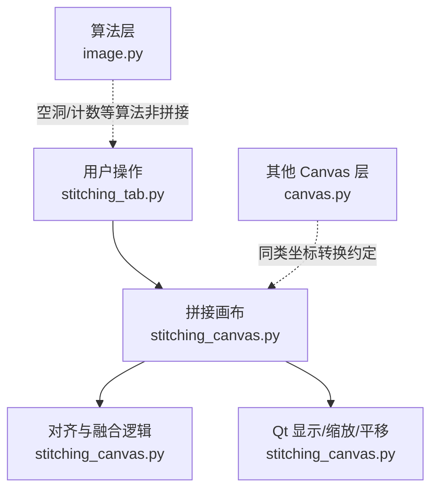
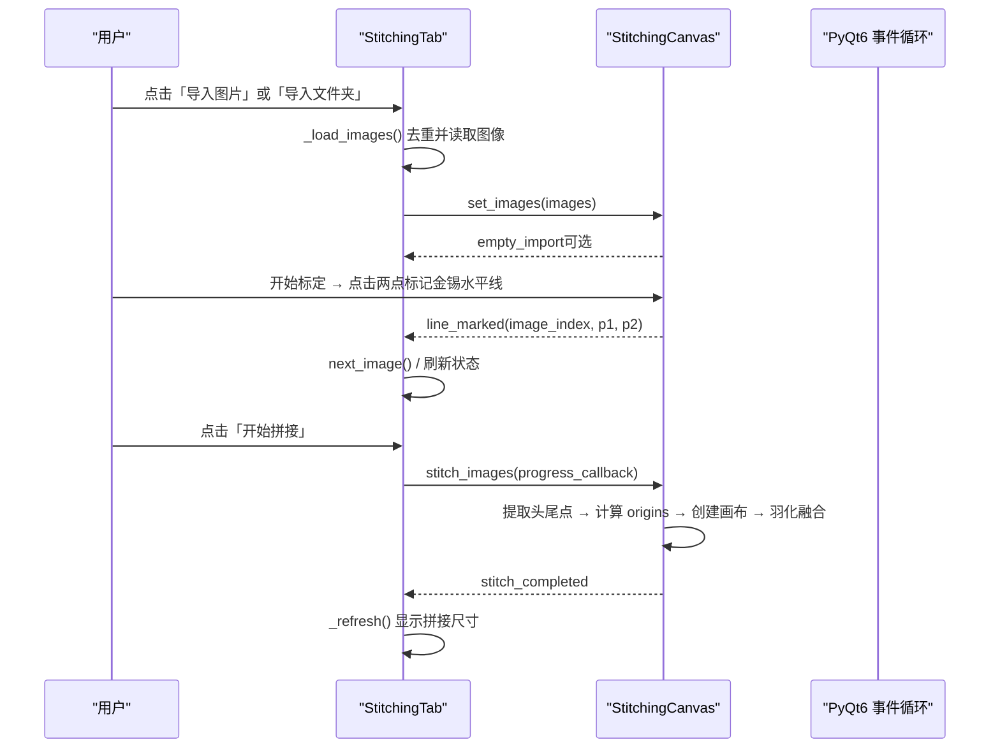
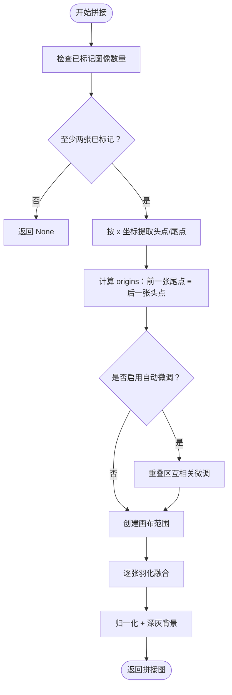
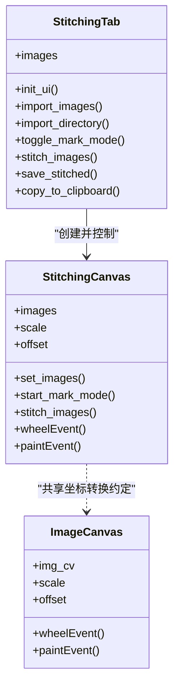

# 图像拼接错位或接缝明显

<cite>
**本文引用的文件**   
- [stitching_canvas.py](file://stitching_canvas.py)
- [stitching_tab.py](file://stitching_tab.py)
- [canvas.py](file://canvas.py)
- [image.py](file://image.py)
- [README.md](file://README.md)
- [PROJECT_CONCEPTION.md](file://PROJECT_CONCEPTION.md)
</cite>

## 目录
1. [引言](#引言)
2. [项目结构与定位](#项目结构与定位)
3. [核心组件与职责](#核心组件与职责)
4. [架构总览](#架构总览)
5. [诊断流程：多图拼接后金锡水平线错位、接缝明显、尺寸异常](#诊断流程多图拼接后金锡水平线错位接缝明显尺寸异常)
6. [关键实现细节分析](#关键实现细节分析)
7. [依赖关系分析](#依赖关系分析)
8. [性能与已知限制](#性能与已知限制)
9. [故障排查清单](#故障排查清单)
10. [结论](#结论)

## 引言
本文面向「图像拼接」模块中出现的三类典型问题：
- 多图拼接后金锡水平线错位；
- 拼接图接缝明显；
- 拼接图输出尺寸异常。

这些问题的根因通常不在最终导出环节，而在「输入图一致性 → 金锡水平线标定 → 对齐偏移计算 → 羽化融合 → Canvas 缩放交互」这一条链路上。文档按仓库实际源码给出可复现的诊断步骤，并明确标注哪些行为来自 `stitching_canvas.py`、哪些来自 `stitching_tab.py`，以及 Canvas 层滚轮缩放的已知 Y 轴漂移问题如何间接影响交互精度。

## 项目结构与定位
Aurascope 是面向微电子封装产线的半自动化视觉检测桌面工具，技术栈为 PyQt6 + OpenCV + NumPy + Pandas，纯 CPU 计算，兼容 Windows 7+。根据 README 与 PROJECT_CONCEPTION，项目采用「GUI 层 → Canvas 绘制层 → 算法层 image.py → 数据导出层」的分层结构；图像拼接属于 GUI Tab 页面 + 专用 Canvas 的组合，不直接复用空洞分析的通用 ImageCanvas。

**图表来源**
- [stitching_tab.py:26-46](file://stitching_tab.py#L26-L46)
- [stitching_canvas.py:22-73](file://stitching_canvas.py#L22-L73)
- [canvas.py:13-28](file://canvas.py#L13-L28)
- [image.py:1-11](file://image.py#L1-L11)

**章节来源**
- [README.md:1-65](file://README.md#L1-L65)
- [PROJECT_CONCEPTION.md:77-108](file://PROJECT_CONCEPTION.md#L77-L108)

## 核心组件与职责
| 组件 | 主要职责 | 与问题相关的关键点 |
|---|---|---|
| `StitchingTab` | 导入图片、管理列表、触发标定与拼接、导出结果 | 负责去重导入、调用 Canvas、更新状态、保存/复制拼接图 |
| `StitchingCanvas` | 单张图显示、标记金锡水平线、计算对齐偏移、羽化融合、绘制结果 | 头尾点提取、原点偏移累加、重叠区羽化、缩放平移、信号通知 |
| `ImageCanvas` | 空洞分析主画布，提供统一的 QWidget + QPainter 坐标转换范式 | 滚轮缩放存在 Y 轴漂移的已知问题，排查时应先排除 UI 缩放因素 |
| `image.py` | 阈值、形态学、轮廓、距离变换、Canny 边缘校验等算法 | 不是拼接算法实现层，但用于后续空洞分析；拼接错误若被误判为空洞异常，需回溯到拼接阶段 |

**章节来源**
- [stitching_tab.py:26-46](file://stitching_tab.py#L26-L46)
- [stitching_canvas.py:22-73](file://stitching_canvas.py#L22-L73)
- [canvas.py:13-28](file://canvas.py#L13-L28)
- [image.py:1-11](file://image.py#L1-L11)

## 架构总览
图像拼接的数据流如下：

**图表来源**
- [stitching_tab.py:160-217](file://stitching_tab.py#L160-L217)
- [stitching_tab.py:299-325](file://stitching_tab.py#L299-L325)
- [stitching_tab.py:329-367](file://stitching_tab.py#L329-L367)
- [stitching_canvas.py:294-403](file://stitching_canvas.py#L294-L403)

## 诊断流程：多图拼接后金锡水平线错位、接缝明显、尺寸异常

### 第一步：确认输入图是否来自同一批次且分辨率一致
如果多图分辨率不一致，或者方向不一致，拼接逻辑会按每张图的像素坐标进行 X/Y 偏移累加，从而可能出现：
- 金锡水平线在视觉上错位；
- 接缝处出现重复或断裂；
- 输出图尺寸比预期更大或更小。

建议检查项：
1. 所有图片是否来自同一 SEM 拍摄批次；
2. 每张图片的原始分辨率是否一致；
3. 是否存在横竖屏混用、旋转或镜像差异；
4. 是否通过「导入文件夹」一次性导入，避免手动挑选导致顺序错乱。

若发现分辨率不一致，应优先重新采集或统一预处理，而不是继续调标定点。

**章节来源**
- [stitching_tab.py:171-217](file://stitching_tab.py#L171-L217)
- [stitching_canvas.py:318-341](file://stitching_canvas.py#L318-L341)

### 第二步：逐张检查金锡水平线标定
拼接的核心假设是：相邻两张图中，前一张的「尾部点」和后一张的「头部点」代表同一物理位置。因此，金锡水平线标定不准会直接导致后续对齐失败。

在 `stitching_canvas.py` 中应按以下顺序检查：
1. 进入「开始标定」模式；
2. 对第一张图只标金锡右端（尾部）；
3. 对中间图分别标左端（头部）和右端（尾部）；
4. 对最后一张图只标左端（头部）；
5. 使用左右箭头键切换图像，确认每条绿色水平线都落在金锡底部边缘；
6. 如已标记的点位置不对，可直接拖拽绿点调整。

注意：代码会根据两个点的 x 坐标自动区分头尾，因此即使点击顺序颠倒，只要两点确实位于金锡两端，仍可得到正确头尾分配；但如果两点在同一侧或偏离金锡边缘，就会引入系统性偏移。

**章节来源**
- [stitching_canvas.py:142-203](file://stitching_canvas.py#L142-L203)
- [stitching_canvas.py:209-267](file://stitching_canvas.py#L209-L267)
- [stitching_canvas.py:318-341](file://stitching_canvas.py#L318-L341)

### 第三步：查看拼接前的中间对齐结果
如果水平线看起来没问题，但拼接后仍有错位，需要观察拼接算法内部计算的「原点偏移」。

关键判断依据：
- 如果错位是整体平移，可能是头尾点整体偏移；
- 如果错位随拼接数量累积变大，说明偏移在 `origins` 中逐张累加；
- 如果只有局部接缝错位，可能是某两张图之间头尾点不匹配；
- 如果自动微调开启，可能把原本对齐的结果改坏。

当前默认关闭自动微调，因为注释明确指出：在真实 SEM 纹理上，互相关微调可能把完全对齐的结果改坏，例如宽度从 768px 变成 786px。

**章节来源**
- [stitching_canvas.py:15-19](file://stitching_canvas.py#L15-L19)
- [stitching_canvas.py:333-347](file://stitching_canvas.py#L333-L347)
- [stitching_canvas.py:424-480](file://stitching_canvas.py#L424-L480)

### 第四步：对比输入图分辨率与输出图尺寸
拼接完成后，`stitching_tab.py` 会在侧边栏显示拼接图尺寸，`stitching_canvas.py` 也会在绘制时显示宽×高。

正常情况：
- 输出图尺寸应能容纳所有输入图及其相对偏移；
- 未覆盖区域以深灰背景填充；
- 有重叠的区域通过线性羽化融合，不应出现硬接缝。

异常情况：
- 输出图尺寸远大于输入图总和，可能是负偏移过大或头尾点反向；
- 输出图尺寸小于预期，可能是部分图未被纳入 marked 列表；
- 输出图尺寸变化但内容错位，通常是头尾点不匹配而非融合参数问题。

**章节来源**
- [stitching_tab.py:142-156](file://stitching_tab.py#L142-L156)
- [stitching_canvas.py:349-396](file://stitching_canvas.py#L349-L396)
- [stitching_canvas.py:497-520](file://stitching_canvas.py#L497-L520)

### 第五步：检查接缝是否由羽化带或重复导入引起
接缝明显通常有两种原因：
1. 头尾点没有真正对齐，导致重叠区权重无法补偿错位；
2. 输入图存在重复导入或顺序错误，使同一张图被当作相邻图拼接。

`stitching_tab.py` 在 `_load_images` 中会通过路径去重，防止同一文件被重复加入列表；但如果是不同文件名、不同路径的同源图，仍可能被当成独立图。此外，如果用户在列表中删除了某张图但没有重新标定，Canvas 中的标记状态可能与图像列表不一致，需要清空重建。

**章节来源**
- [stitching_tab.py:197-217](file://stitching_tab.py#L197-L217)
- [stitching_tab.py:262-290](file://stitching_tab.py#L262-L290)
- [stitching_canvas.py:405-422](file://stitching_canvas.py#L405-L422)

### 第六步：排除 Canvas 缩放导致的坐标漂移
Canvas 层存在滚轮缩放 Y 轴漂移的已知问题。虽然该问题定义在通用 `ImageCanvas` 中，但它代表了本项目的坐标转换约定：widget 坐标与图像坐标之间的转换依赖 `scale` 和 `offset`，而滚轮缩放可能让鼠标锚点不完全稳定。

排查建议：
1. 先重置视图，不要带着放大/缩小状态做标定；
2. 标定完成后，再缩放查看接缝；
3. 如果缩放后接缝位置变化，优先怀疑 UI 缩放因素，而不是算法本身；
4. 必要时清空所有图像，重新导入并重新标定。

**章节来源**
- [canvas.py:615-695](file://canvas.py#L615-L695)
- [stitching_canvas.py:268-283](file://stitching_canvas.py#L268-L283)

## 关键实现细节分析

### 头尾点提取与对齐偏移计算
`stitching_canvas.py` 的对齐逻辑基于每张图的水平线两个端点：
- 若只标了一个点，则头尾点取同一个坐标；
- 否则按 x 坐标较小者为头、较大者为尾；
- 第 i 张的尾部点与第 i+1 张的头部点共同决定相对偏移；
- 偏移同时作用于 X 和 Y，避免旧实现仅按 Y 对齐造成的整幅宽度硬接问题。

**图表来源**
- [stitching_canvas.py:318-396](file://stitching_canvas.py#L318-L396)

**章节来源**
- [stitching_canvas.py:318-341](file://stitching_canvas.py#L318-L341)
- [stitching_canvas.py:349-396](file://stitching_canvas.py#L349-L396)

### 羽化融合与背景处理
拼接不是简单地把多张图硬贴在一起，而是：
1. 计算每张图与其前一张、后一张的重叠宽度；
2. 只在有重叠的一侧生成线性羽化权重；
3. 将加权后的像素累加到 `acc`，权重累加到 `wsum`；
4. 最后按权重归一化，未覆盖区域填充深灰背景。

这意味着：
- 如果头尾点完全对齐，重叠区羽化可以消除接缝；
- 如果头尾点错位，羽化只能缓解但不能修复错位；
- 如果重叠宽度为 0，就不会羽化，接缝会更明显。

**章节来源**
- [stitching_canvas.py:374-396](file://stitching_canvas.py#L374-L396)
- [stitching_canvas.py:405-422](file://stitching_canvas.py#L405-L422)

### 自动微调的风险
`_refine_by_overlap` 会在相邻图的重叠区尝试小范围灰度匹配，寻找更小的平均绝对差。但代码注释明确指出：
- 默认关闭；
- 实测会把已经对齐的结果改坏；
- 初值必须足够小，否则不会接受任何修正。

因此，当出现“标定点没动，但拼接结果变差”时，应首先确认是否启用了自动微调，并在调试时保持关闭。

**章节来源**
- [stitching_canvas.py:15-19](file://stitching_canvas.py#L15-L19)
- [stitching_canvas.py:424-480](file://stitching_canvas.py#L424-L480)

### 导出与剪贴板坐标转换
导出拼接图时，`stitching_tab.py` 会将 numpy 数组转换为 Qt 剪贴板图像：
- 灰度图扩展为三通道；
- BGRA 去掉 alpha；
- BGR 转为 RGB；
- 使用 `QImage.Format_RGB888` 复制到剪贴板。

这个环节不会改变图像像素内容，但如果在导出前 Canvas 已经处于缩放状态，用户可能误以为导出图尺寸异常；实际上导出的是 `stitched_image`，即算法输出的完整像素图。

**章节来源**
- [stitching_tab.py:385-447](file://stitching_tab.py#L385-L447)

## 依赖关系分析

**图表来源**
- [stitching_tab.py:26-46](file://stitching_tab.py#L26-L46)
- [stitching_canvas.py:22-73](file://stitching_canvas.py#L22-L73)
- [canvas.py:13-28](file://canvas.py#L13-L28)

**章节来源**
- [stitching_tab.py:26-46](file://stitching_tab.py#L26-L46)
- [stitching_canvas.py:22-73](file://stitching_canvas.py#L22-L73)
- [canvas.py:13-28](file://canvas.py#L13-L28)

## 性能与已知限制
- 拼接过程支持进度回调，但主要耗时集中在羽化融合和可能的自动微调；
- 自动微调默认关闭，避免误改对齐结果；
- 通用 Canvas 层存在滚轮缩放 Y 轴漂移的已知问题，可能间接影响交互精度；
- 空洞分析算法集中在 `image.py`，拼接逻辑不依赖该模块；
- 测试用例存在于仓库根目录的 `test_*.py` 中，但本文不虚构具体测试行为。

**章节来源**
- [stitching_canvas.py:15-19](file://stitching_canvas.py#L15-L19)
- [stitching_canvas.py:294-403](file://stitching_canvas.py#L294-L403)
- [canvas.py:615-695](file://canvas.py#L615-L695)
- [image.py:1-11](file://image.py#L1-L11)

## 故障排查清单

### 快速自检表
| 现象 | 优先检查 | 可能原因 | 修正动作 |
|---|---|---|---|
| 金锡水平线错位 | 每张图的绿色水平线 | 头尾点标在金锡上方、下方或同一侧 | 重新进入标定模式，逐张校正 |
| 接缝明显 | 重叠区羽化是否生效 | 头尾点未对齐或重叠宽度为 0 | 重新标定；检查是否有重复导入 |
| 拼接图尺寸异常 | 输出图宽高 vs 输入图分辨率 | 负偏移过大、头尾点反向、分辨率不一致 | 统一批次与分辨率，重新标定 |
| 缩放后接缝位置变化 | Canvas 缩放状态 | UI 缩放导致坐标漂移 | 先重置视图，再判断是否为 UI 因素 |
| 自动微调后变差 | `STITCH_AUTO_REFINE` | 互相关微调误匹配 | 保持关闭，仅依赖标记对齐 |

### 推荐修正顺序
1. 确保所有输入图来自同一批次；
2. 确保所有输入图分辨率一致；
3. 清空现有列表，重新导入；
4. 重新标定金锡水平线；
5. 再次拼接并核对输出尺寸；
6. 若仍有接缝，检查是否存在重复导入、顺序错误或 Canvas 缩放导致的坐标漂移；
7. 若怀疑自动微调干扰，确认其处于关闭状态；
8. 如需进一步验证，可在 `stitching_canvas.py` 中打印头尾点和 `origins`，或在 `stitching_tab.py` 中记录拼接前后图像尺寸。

**章节来源**
- [stitching_tab.py:197-217](file://stitching_tab.py#L197-L217)
- [stitching_canvas.py:318-396](file://stitching_canvas.py#L318-L396)
- [canvas.py:615-695](file://canvas.py#L615-L695)

## 结论
多图拼接后金锡水平线错位、接缝明显、拼接图尺寸异常，本质上是「输入一致性 → 标定准确性 → 对齐偏移 → 羽化融合 → UI 缩放」链条上的误差传播。最关键的判断原则是：

1. 金锡水平线标定不准会直接导致后续对齐失败；
2. 多图分辨率或方向不一致时，拼接逻辑可能出现偏移；
3. 标注图导出时的坐标转换主要影响显示与剪贴板格式，一般不改变算法输出的像素内容；
4. 调试时应先在 `stitching_canvas.py` 中逐张检查水平线标记，再查看拼接前的中间对齐结果，最后对比输入图分辨率与输出图尺寸；
5. 修正步骤应优先保证所有输入图来自同一批次、分辨率一致，然后重新标定金锡水平线；
6. 若仍出现接缝，需检查是否存在重复导入、顺序错误或 Canvas 缩放导致的坐标漂移；
7. 排查时应先排除 UI 缩放因素，因为 Canvas 层存在滚轮缩放 Y 轴漂移的已知问题。