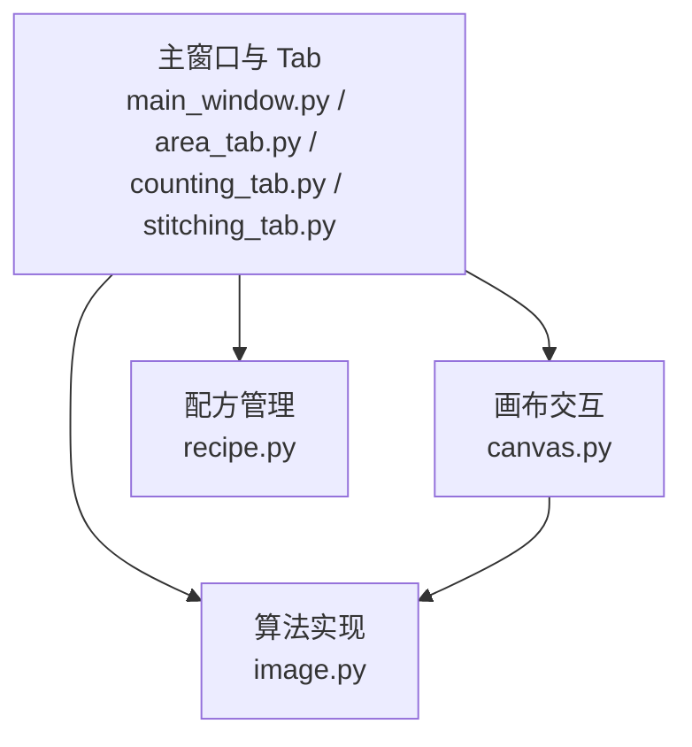
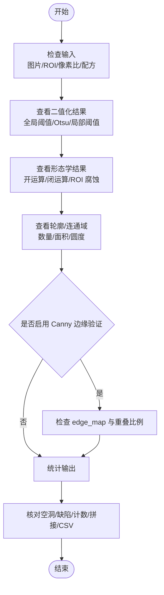
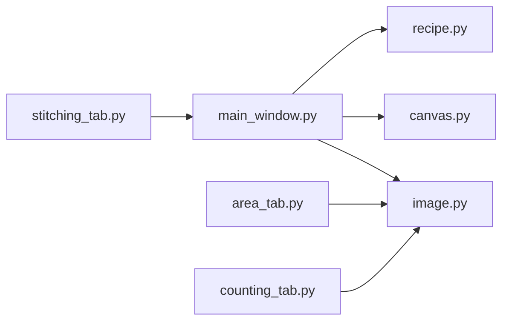

# 检测结果异常排查

<cite>
**本文引用的文件**   
- [README.md](file://README.md)
- [PROJECT_CONCEPTION.md](file://PROJECT_CONCEPTION.md)
- [image.py](file://image.py)
- [main_window.py](file://main_window.py)
- [canvas.py](file://canvas.py)
- [area_tab.py](file://area_tab.py)
- [counting_tab.py](file://counting_tab.py)
- [stitching_tab.py](file://stitching_tab.py)
- [recipe.py](file://recipe.py)
</cite>

## 目录
1. [引言](#引言)
2. [项目结构与排查原则](#项目结构与排查原则)
3. [核心排查流程总览](#核心排查流程总览)
4. [空洞面积偏大或偏小](#空洞面积偏大或偏小)
5. [Canny 边缘验证误判](#canny-边缘验证误判)
6. [缺陷面积多 ROI 漏检或误检](#缺陷面积多-roi-漏检或误检)
7. [物料计数数量异常](#物料计数数量异常)
8. [图像拼接错位或接缝明显](#图像拼接错位或接缝明显)
9. [示教配方导出为空或批量检测跳过文件](#示教配方导出为空或批量检测跳过文件)
10. [依赖关系与已知限制](#依赖关系与已知限制)
11. [结论](#结论)

## 引言
本排查文档面向 Aurascope 在「金锡焊料空洞分析、缺陷面积多 ROI、物料计数、图像拼接、示教/批量」等场景下出现的不符合预期结果。文档按业务主线组织，每项问题给出：可复现症状、关键参数、调试手段（中间二值图、轮廓数、统计表格）、修正步骤，并明确算法权威来源。

Aurascope 是面向微电子封装产线的半自动化视觉检测桌面工具，核心能力包括空洞率检测、距离测量、剪切力计算、物料计数等；技术栈为 PyQt6 + OpenCV + NumPy + Pandas，纯 CPU 计算，不联网、不收集用户数据。

**章节来源**
- [README.md:1-80](file://README.md#L1-L80)
- [PROJECT_CONCEPTION.md:1-143](file://PROJECT_CONCEPTION.md#L1-L143)

## 项目结构与排查原则
Aurascope 的排查必须遵循分层依赖：
- GUI 层：main_window.py、各 Tab 页面、Canvas 绘制层。
- 算法层：image.py 是唯一实现阈值/Otsu、形态学、轮廓、圆度、distanceTransform、Canny 校验与面积统计的地方。
- 数据层：recipe.py 负责配方 JSON 读写与校验。

**图表来源**
- [main_window.py:32-51](file://main_window.py#L32-L51)
- [area_tab.py:21-28](file://area_tab.py#L21-L28)
- [counting_tab.py:10-16](file://counting_tab.py#L10-L16)
- [stitching_tab.py:16-24](file://stitching_tab.py#L16-L24)
- [canvas.py:13-28](file://canvas.py#L13-L28)
- [image.py:1-11](file://image.py#L1-L11)
- [recipe.py:1-9](file://recipe.py#L1-L9)

排查总原则：
1. 先确认输入：ROI 是否存在、像素比是否标定、图片是否成功解码。
2. 再看中间态：二值图、掩膜、轮廓数、连通域数、局部阈值区域。
3. 最后看输出：空洞列表、缺陷对象、计数结果、拼接图、CSV。
4. 以 image.py 为准；main_window.py 中的 detect_voids_local 副本不得作为预期行为依据。

**章节来源**
- [PROJECT_CONCEPTION.md:77-108](file://PROJECT_CONCEPTION.md#L77-L108)
- [image.py:200-286](file://image.py#L200-L286)
- [main_window.py:1256-1287](file://main_window.py#L1256-L1287)

## 核心排查流程总览
通用排查顺序如下：

[本图为概念流程图，不直接映射具体源码，因此不附图表来源]

## 空洞面积偏大或偏小
### 可复现症状
- 空洞率显著高于人工目检：常见于阈值过低、形态学去噪不足、ROI 边界未腐蚀导致边界伪影被计入。
- 空洞数量过少或大面积空洞消失：常见于阈值过高、形态学核过大、圆度过滤过严、Canny 边缘验证阈值过低。
- 局部笔刷区域覆盖后，某块区域空洞突然增多或减少：常见于局部阈值设置错误、笔刷半径过大覆盖到非目标区。

### 关键参数
- 全局识别阈值：main_window.py 中 slider_void 对应值。
- Otsu 自动阈值：image.py 中 otsu_threshold。
- 增强开关：enhanced_enabled。
- CLAHE 对比度增强：clahe_enabled、clahe_clip_limit。
- 形态学去噪：morph_enabled、morph_kernel。
- ROI 边界腐蚀：roi_erosion_px。
- 圆度过滤：min_roundness。
- Canny 边缘验证：edge_verify、edge_thresh。
- 局部阈值区域：local_regions、local_brush_regions。

### 调试手段
1. 打开「空洞分析」Tab，加载 SEM 图。
2. 先关闭增强检测，仅用固定阈值观察二值图效果。
3. 逐步开启 CLAHE、形态学去噪，每次只改一个参数。
4. 调整 roi_erosion_px，观察 ROI 边界附近伪影是否断开。
5. 若使用局部阈值，确认笔刷中心、半径、阈值是否与目标暗斑一致。
6. 查看左下角或侧边栏统计：空洞数量、空洞总面积、空洞率。
7. 若启用 Canny 边缘验证，临时关闭该选项，判断是否为边缘验证误杀。

### 修正步骤
- 空洞偏多：提高阈值、增大 morph_kernel、提高 min_roundness、降低 edge_thresh 或关闭 edge_verify。
- 空洞偏少：降低阈值、减小 morph_kernel、降低 min_roundness、提高 edge_thresh。
- 边界伪影过多：增大 roi_erosion_px，使 ROI 内部掩膜向内收缩，避免把焊料界面算成空洞。
- 局部笔刷异常：重新放置笔刷，缩小半径，单独调局部阈值，不要一次覆盖整张图。

**章节来源**
- [image.py:180-197](file://image.py#L180-L197)
- [image.py:200-286](file://image.py#L200-L286)
- [image.py:328-422](file://image.py#L328-L422)
- [main_window.py:593-725](file://main_window.py#L593-L725)
- [main_window.py:1256-1331](file://main_window.py#L1256-L1331)
- [main_window.py:1459-1533](file://main_window.py#L1459-L1533)

## Canny 边缘验证误判
### 可复现症状
- 真实空洞被过滤，但关闭 Canny 后能检出。
- 噪声轮廓被保留，但开启 Canny 后全部消失。
- 启用 Canny 后结果无变化：可能 edge_map 未初始化或 edge_verify 分支未真正生效。

### 关键参数
- enhanced_enabled：决定是否进入增强检测分支。
- edge_verify：是否启用 Canny 边缘验证。
- edge_thresh：轮廓像素与 Canny 边缘像素的重叠比例下限。
- 二值图噪声：阈值不当或 CLAHE 过度增强会导致大量细小轮廓。

### 调试手段
1. 先记录当前阈值、enhanced、morph、roundness、edge_verify 状态。
2. 关闭 edge_verify，确认空洞是否能被 detect_voids 正常检出。
3. 若关闭后能检出，再打开 edge_verify，逐步提高 edge_thresh。
4. 若仍无效，检查 main_window.py 调用 detect_voids 时是否传入了 edge_verify=True。
5. 在 image.py 中注意：当 enhanced 且 edge_verify 为真时才会生成 edge_map；否则 edge_map 为 None，后续重叠比较不会生效。

### 修正步骤
- 真实空洞被误杀：提高 edge_thresh，或降低 Canny 阈值（由 image.py 内部固定 30/100），更稳妥的是放宽 roundness 和形态学参数。
- 噪声未被过滤：降低 edge_thresh，或先通过形态学去噪减少细小轮廓。
- Canny 完全静默失效：确认 enhanced_enabled 为 True，且 edge_verify 为 True；同时确认 main_window.py 确实调用 image.detect_voids 而非旧副本。

**章节来源**
- [image.py:200-286](file://image.py#L200-L286)
- [main_window.py:1269-1285](file://main_window.py#L1269-L1285)

## 缺陷面积多 ROI 漏检或误检
### 可复现症状
- 同一张图片上，某个 ROI 没有缺陷，其他 ROI 有缺陷。
- 多边形 ROI 顶点顺序看起来正确，但填充面积异常。
- 像素比标定后实际面积与像素面积不一致。
- 批量检测时，部分 ROI 参数与其他 ROI 不一致。

### 关键参数
- ROI 类型：rect 或 poly。
- ROI 掩膜：每个 ROI 独立的 mask。
- 阈值：threshold。
- 亮/暗检测：bright。
- 最小面积：min_area。
- 像素比：unit_per_px。
- 当前选中 ROI：selected_roi_id。
- 批量检测队列：_batch_queue、_batch_active。

### 调试手段
1. 在 area_tab.py 中确认当前选中的 ROI 编号。
2. 查看 ROI 表格中该 ROI 的状态、阈值、亮/暗、最小面积、缺陷数、总面积。
3. 对单个 ROI 执行「检测全部 ROI」，观察是否重跑。
4. 若多边形 ROI 异常，检查顶点是否构成有效多边形，是否包含自交或退化线段。
5. 若像素比异常，检查标定线长度是否大于 10px，单位是否正确。
6. 批量检测时，确认按钮文本是「检测全部 ROI」还是「停止并清空」。

### 修正步骤
- 单 ROI 漏检：切换 bright 方向、调整 threshold、降低 min_area。
- 多边形 ROI 面积异常：删除重建 ROI，确保至少 3 个顶点且不共线。
- 像素比错误：重新划线标定，输入正确的微米长度。
- 批量参数不一致：先统一当前 ROI 参数，再点击「检测全部 ROI」；不要在批量进行中频繁切换 ROI。

**章节来源**
- [area_tab.py:110-150](file://area_tab.py#L110-L150)
- [area_tab.py:246-314](file://area_tab.py#L246-L314)
- [area_tab.py:409-431](file://area_tab.py#L409-L431)
- [area_tab.py:561-590](file://area_tab.py#L561-L590)
- [area_tab.py:659-683](file://area_tab.py#L659-L683)
- [area_tab.py:751-800](file://area_tab.py#L751-L800)

## 物料计数数量异常
### 可复现症状
- 蓝膜 LD/Submount 数量偏少：粘连物体被合并为一个连通域。
- 数量偏多：噪声、划痕、反光点被当成独立物体。
- 开启「距离峰值计数」后数量不稳定：watershed_distance 太小或太大。
- 关闭 watershed 后数量合理，开启后反而变少：局部极大值阈值或峰值间距设置不当。

### 关键参数
- invert：True 表示检测亮色物体。
- threshold：二值化阈值。
- min_area：最小面积。
- morph_enabled、morph_kernel、morph_shape：形态学去噪。
- watershed_enabled：是否启用 distanceTransform 局部极大值计数。
- watershed_distance：最小峰值间距。

### 调试手段
1. 先关闭 watershed，仅用连通域计数观察基础数量。
2. 调整 threshold，查看二值图中物体是否分离。
3. 开启形态学去噪，先用小核，再逐步增大。
4. 开启 watershed 后，先增大 watershed_distance，让相邻物体分开。
5. 如果数量骤降，说明局部极大值太少或峰值间距过大。
6. 如果数量暴增，说明噪声被当成峰值。

### 修正步骤
- 粘连严重：开启 watershed，适当增大 watershed_distance。
- 数量过少：降低 watershed_distance，或关闭 watershed 改用形态学+阈值分离。
- 噪声过多：提高 threshold、增大 morph_kernel、提高 min_area。
- 亮/暗方向错误：切换 chk_invert。

**章节来源**
- [counting_tab.py:19-36](file://counting_tab.py#L19-L36)
- [counting_tab.py:91-148](file://counting_tab.py#L91-L148)
- [counting_tab.py:363-413](file://counting_tab.py#L363-L413)
- [image.py:491-632](file://image.py#L491-L632)

## 图像拼接错位或接缝明显
### 可复现症状
- 拼接后金锡水平线错位。
- 多图分辨率不一致导致接缝明显。
- 标记水平线后仍无法拼接，提示需要至少两张已标记图像。
- 发送到空洞分析后，拼接图尺寸异常。

### 关键参数
- 每张图片的水平线标记：canvas 中 per-image marked 状态。
- 导入图片数量与路径。
- 拼接完成后的 stitched_image。

### 调试手段
1. 确认每张图都已在「标记金锡水平线」模式下点击两点。
2. 查看侧边栏「已标记：X/Y」，确保至少两张。
3. 检查导入的图片是否来自同一批次、同一倍率。
4. 拼接完成后查看状态栏显示的宽高像素。
5. 将拼接图发送到空洞分析，确认主窗口能接收 set_stitching_result。

### 修正步骤
- 水平线标定不准：重新标记，尽量选清晰的金锡界面位置。
- 多图分辨率不一致：优先使用同设备、同拍摄条件导出的图片。
- 拼接失败：确认至少两张图已标记，再执行「开始拼接」。
- 发送到空洞分析失败：确认 stitching_tab 中 stitched_image 不为 None，且 main_window 存在 set_stitching_result。

**章节来源**
- [stitching_tab.py:94-127](file://stitching_tab.py#L94-L127)
- [stitching_tab.py:299-325](file://stitching_tab.py#L299-L325)
- [stitching_tab.py:329-363](file://stitching_tab.py#L329-L363)
- [stitching_tab.py:371-381](file://stitching_tab.py#L371-L381)
- [main_window.py:900-920](file://main_window.py#L900-L920)

## 示教配方导出为空或批量检测跳过文件
### 可复现症状
- 保存配方后 recipes/ 下没有 JSON。
- 加载配方返回空，批量检测跳过该文件。
- 配方字段缺失或类型错误，normalize_recipe 或 validate_detection 返回默认值。
- 示教模型 type=taught 与普通参数型配方混用，导致读取异常。

### 关键参数
- schema_version。
- name。
- detection.threshold、min_area、max_area、enhanced、morph_enabled、edge_verify 等。
- roi.polygon、layer_threshold、vertices。
- px_per_um。
- taught 模型的 solder/background/void/band/scale_bar/diagnostics。

### 调试手段
1. 打开 recipe.py 中的 DETECTION_DEFAULTS 与 _RANGES，对照 JSON 字段。
2. 检查 normalize_recipe 是否把输入转为 v1 参数型或 taught 示教模型。
3. 检查 validate_detection 是否对布尔、浮点、整数做了夹紧。
4. 检查 validate_roi 是否清洗了 polygon 顶点。
5. 检查 save_recipe 是否写入临时文件后原子替换。
6. 检查 load_recipe 是否解析到正确路径，JSON 是否可读。

### 修正步骤
- 导出为空：确认配方名非空，recipes 目录可写；frozen 环境下回退到 local_data_dir。
- 字段缺失：补全 detection 或 roi 字段，程序会按默认值补齐，但建议显式写出。
- 类型错误：把字符串类型的数值改为数字，布尔字段保持 true/false。
- 示教模型与普通配方混淆：确认 type=taught 时使用 .taught.json 命名空间。

**章节来源**
- [recipe.py:20-50](file://recipe.py#L20-L50)
- [recipe.py:69-96](file://recipe.py#L69-L96)
- [recipe.py:137-166](file://recipe.py#L137-L166)
- [recipe.py:169-200](file://recipe.py#L169-L200)
- [recipe.py:203-238](file://recipe.py#L203-L238)
- [recipe.py:241-258](file://recipe.py#L241-L258)
- [recipe.py:439-462](file://recipe.py#L439-L462)

## 依赖关系与已知限制
### 代码依赖关系

**图表来源**
- [main_window.py:32-51](file://main_window.py#L32-L51)
- [area_tab.py:21-28](file://area_tab.py#L21-L28)
- [counting_tab.py:10-16](file://counting_tab.py#L10-L16)
- [stitching_tab.py:16-24](file://stitching_tab.py#L16-L24)

### 已知限制
- main_window.py 中存在 detect_voids_local 副本，属于已知技术债；现行行为以 image.py 为准，两份待合并。
- Canny 边缘验证依赖 enhanced 分支；若 enhanced 未启用，edge_map 不会初始化，edge_verify 不会生效。
- canvas.py 滚轮缩放存在 Y 轴漂移的已知问题，不要把现状写成正确设计。
- select_for_local 为无 UI 入口的死代码，不应作为功能依据。
- 大图增强检测无进度提示，长循环中通过 _pump_events 尝试刷新界面事件。

**章节来源**
- [image.py:328-422](file://image.py#L328-L422)
- [image.py:14-25](file://image.py#L14-L25)
- [canvas.py:615-695](file://canvas.py#L615-L695)
- [main_window.py:1256-1533](file://main_window.py#L1256-L1533)

## 结论
排查 Aurascope 检测结果异常时，应始终从输入、中间态、输出三层入手：
- 空洞面积问题优先检查阈值、形态学、ROI 腐蚀、圆度、Canny 边缘验证。
- 多 ROI 缺陷面积问题优先检查 ROI 掩膜、像素比、批量参数一致性。
- 物料计数问题优先区分连通域计数与 distanceTransform 峰值计数。
- 图像拼接问题优先检查水平线标定与多图分辨率一致性。
- 配方问题优先检查 JSON schema、字段类型、taught 命名空间。

最终判定标准必须是 image.py 的算法实现，而不是 main_window.py 中的 detect_voids_local 副本。GUI 只负责参数传递、可视化与交互，算法逻辑不得在 UI 层内联实现。