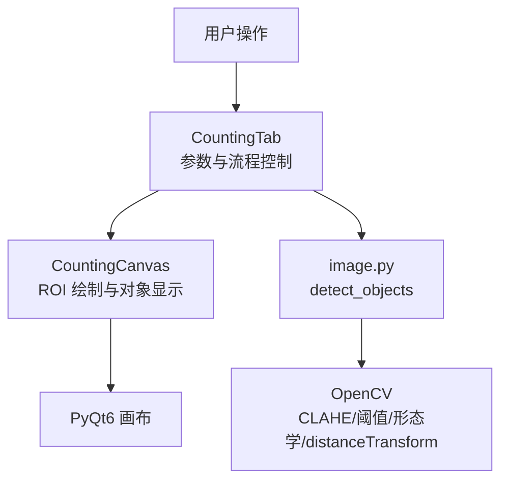
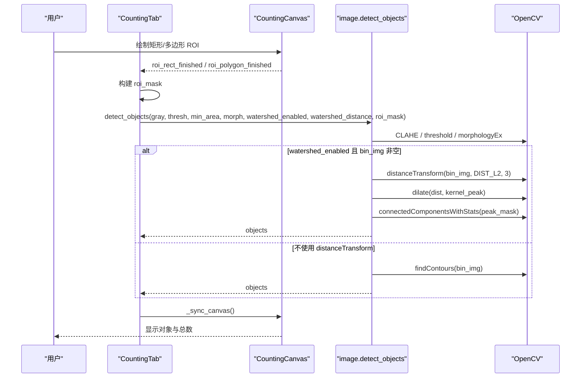
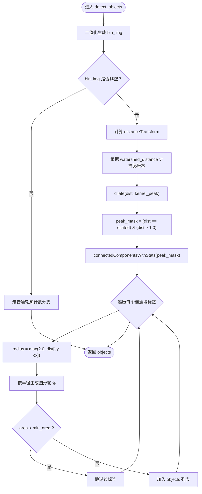

# 物料计数数量异常

<cite>
**本文引用的文件**   
- [README.md](file://README.md)
- [PROJECT_CONCEPTION.md](file://PROJECT_CONCEPTION.md)
- [counting_tab.py](file://counting_tab.py)
- [counting_canvas.py](file://counting_canvas.py)
- [image.py](file://image.py)
</cite>

## 目录
1. [引言](#引言)
2. [项目结构与定位](#项目结构与定位)
3. [核心组件与数据流](#核心组件与数据流)
4. [distanceTransform 局部极大值计数原理](#distancetransform-局部极大值计数原理)
5. [常见症状与根因对照表](#常见症状与根因对照表)
6. [排查步骤](#排查步骤)
7. [修正顺序与参数含义](#修正顺序与参数含义)
8. [调试手段清单](#调试手段清单)
9. [已知限制与注意事项](#已知限制与注意事项)
10. [结论](#结论)

## 引言
本文面向「物料计数」页面中 distanceTransform 局部极大值计数结果偏多、偏少或完全为空的问题，给出从现象到代码路径的系统化排查指南。物料计数的业务目标是统计蓝膜上的 LD / Submount 等离散物料数量；其算法依赖四个关键环节：预处理去噪、二值化、distanceTransform 计算、局部极大值阈值与连通域合并策略。GUI 层负责 ROI 绘制和用户参数调节，算法实现集中在 image.py 的 detect_objects 函数中。

## 项目结构与定位
Aurascope 是面向微电子封装产线的半自动化视觉检测桌面应用，采用 PyQt6 + OpenCV + NumPy + Pandas 架构。物料计数模块由 counting_tab.py（侧边栏参数与流程控制）、counting_canvas.py（ROI 绘制与对象显示）和 image.py（图像处理算法）组成。

**图表来源**
- [counting_tab.py:19-36](file://counting_tab.py#L19-L36)
- [counting_canvas.py:10-35](file://counting_canvas.py#L10-L35)
- [image.py:491-534](file://image.py#L491-L534)

**章节来源**
- [README.md:9-14](file://README.md#L9-L14)
- [PROJECT_CONCEPTION.md:38-45](file://PROJECT_CONCEPTION.md#L38-L45)

## 核心组件与数据流
物料计数的关键数据流如下：

1. 用户在 counting_canvas.py 中绘制矩形或多边形 ROI。
2. counting_tab.py 将 ROI 转换为整幅图像的 roi_mask。
3. counting_tab.py 调用 image.py 的 detect_objects，传入灰度图、阈值、最小面积、形态学参数、watershed_enabled、watershed_distance 等。
4. image.py 根据 invert 选择 THRESH_BINARY_INV 或 THRESH_BINARY，生成 bin_img。
5. 若 watershed_enabled 为真且 bin_img 非空，则执行 distanceTransform 局部极大值计数；否则回退到轮廓计数。
6. 最终 objects 列表同步回 CountingCanvas 并更新计数显示。

**图表来源**
- [counting_tab.py:363-414](file://counting_tab.py#L363-L414)
- [counting_canvas.py:18-35](file://counting_canvas.py#L18-L35)
- [image.py:491-572](file://image.py#L491-L572)

**章节来源**
- [counting_tab.py:363-414](file://counting_tab.py#L363-L414)
- [counting_canvas.py:18-35](file://counting_canvas.py#L18-L35)
- [image.py:491-632](file://image.py#L491-L632)

## distanceTransform 局部极大值计数原理
当 watershed_enabled 为真时，detect_objects 不直接对二值图做连通域计数，而是先计算每个前景像素到最近背景像素的距离，再寻找局部极大值作为物体中心候选点。当前实现的关键步骤是：

1. 对 bin_img 计算距离变换 dist = cv2.distanceTransform(bin_img, cv2.DIST_L2, 3)。
2. 用形态学膨胀构造核大小 ksize = max(3, int(watershed_distance) * 2 + 1)，得到 dilated。
3. peak_mask = (dist == dilated) & (dist > 1.0)。
4. 对 peak_mask 做连通域分析，每个标签对应一个局部极大值点。
5. 以该点的距离值为半径生成圆形轮廓，再用 min_area 过滤。
6. 返回 objects 列表。

**图表来源**
- [image.py:544-572](file://image.py#L544-L572)

**章节来源**
- [image.py:491-572](file://image.py#L491-L572)

## 常见症状与根因对照表
| 症状 | 可能原因 | 优先检查位置 | 建议调整方向 |
|---|---|---|---|
| 相邻蓝膜/LD/Submount 被合并成一个计数 | 未启用 distanceTransform，或 watershed_distance 过小导致多个物体共享同一个局部极大值 | counting_tab.py 中 watershield_enabled 与 watershed_distance；image.py 中 peak_mask 生成逻辑 | 先确认是否勾选「距离峰值计数」；再增大 watershed_distance |
| 背景噪声被当成独立物体 | 二值化阈值过低、形态学开运算不足、dist > 1.0 太宽松、min_area 太小 | counting_tab.py 中二值化阈值、形态学开关与核大小；image.py 中 peak_mask 条件 | 提高阈值、增强形态学去噪、提高 min_area |
| 整个 ROI 内计数为 0 | ROI 未绘制、roi_mask 全零、invert 方向错误、threshold 把全部前景变黑、watershed_distance 过大 | counting_tab.py 中 ROI 状态、invert 复选框、阈值滑块；counting_canvas.py 中蓝色 ROI 是否可见 | 先确认 ROI 是否正确绘制，再调 invert 与阈值 |
| 单个物体分裂成多个计数 | watershed_distance 过小、局部极大值过多、dist > 1.0 过松 | image.py 中 ksize 与 peak_mask 条件 | 增大 watershed_distance，必要时降低对比度增强强度 |
| 手动添加的对象消失 | 重新触发 detect() 覆盖了 objects | counting_tab.py 中 _sync_canvas 与 detect_objects 返回值覆盖 | 理解「自动检测会覆盖 objects」，手动编辑应在自动结果基础上进行 |

**章节来源**
- [counting_tab.py:96-145](file://counting_tab.py#L96-L145)
- [counting_tab.py:363-414](file://counting_tab.py#L363-L414)
- [image.py:533-572](file://image.py#L533-L572)

## 排查步骤
### 第一步：确认 ROI 是否正确
在 counting_canvas.py 中观察蓝色 ROI 是否按预期绘制：
- 矩形模式应显示蓝色矩形边框。
- 多边形模式应显示蓝色折线与顶点。
- 如果 ROI 为空，counting_tab.py 会在 _do_detect 中清空 objects 并返回，不会进入 detect_objects。

判断依据：
- counting_canvas.py 在 paintEvent 中绘制 roi_rect 和 roi_polygon。
- counting_tab.py 在 _do_detect 中根据 canvas.roi_polygon 或 canvas.roi_rect 构建 roi_mask；若两者都为空，则直接清空 objects。

**章节来源**
- [counting_canvas.py:216-226](file://counting_canvas.py#L216-L226)
- [counting_tab.py:370-388](file://counting_tab.py#L370-L388)

### 第二步：确认用户参数是否传入 image.py
在 counting_tab.py 的 _do_detect 中，detect_objects 接收以下关键参数：
- gray：灰度图
- thresh_val：阈值滑块值
- min_area：最小面积
- enhanced：固定为 True
- clahe_enabled：固定为 True
- clahe_clip_limit：固定为 2.0
- morph_enabled：来自 chk_morph
- morph_kernel：来自 slider_morph
- morph_shape：来自 cb_morph_shape
- invert：来自 chk_invert
- watershed_enabled：来自 chk_watershed
- watershed_distance：来自 slider_ws
- roi_mask：从 canvas 构建

如果计数异常，首先核对 UI 控件当前值是否与预期一致，尤其是：
- 「检测亮色物体」是否勾选正确。
- 「形态学去噪」是否开启。
- 「距离峰值计数」是否勾选。
- watershed_distance 滑块当前值。

**章节来源**
- [counting_tab.py:390-412](file://counting_tab.py#L390-L412)

### 第三步：查看中间二值图
在 image.py 中，二值图 bin_img 由 processed 与 thresh_val 决定：
- 若 invert 为真，使用 THRESH_BINARY_INV，检测亮色物体。
- 若 invert 为假，使用 THRESH_BINARY，检测暗色物体。
- 若 enhanced 且 morph_enabled 且 morph_kernel > 1，会对 bin_img 做开运算和闭运算。
- 若 roi_mask 存在，会对 bin_img 做按位与。

调试建议：
- 如果 ROI 内全是黑色，说明阈值方向或数值错误。
- 如果 ROI 内噪声很多，说明形态学去噪不足或阈值太低。
- 如果 ROI 内没有前景像素，distanceTransform 分支会被跳过，但当前代码仍可能进入后续逻辑，需结合 watershed_enabled 判断。

**章节来源**
- [image.py:527-543](file://image.py#L527-L543)

### 第四步：查看 distanceTransform 结果
当 watershed_enabled 为真且 bin_img 非空时，算法进入 distanceTransform 分支：
- dist 是距离变换结果。
- ksize 由 watershed_distance 决定。
- dilated 是 dist 经形态学膨胀后的结果。
- peak_mask 是 dist 等于 dilated 且 dist > 1.0 的位置。
- 每个连通域标签对应一个局部极大值点。

调试建议：
- 如果 peak_mask 全零，说明 dist 没有满足 (dist == dilated) 且 dist > 1.0 的点。
- 如果 peak_mask 噪声点多，说明 watershed_distance 太小或 dist > 1.0 太松。
- 如果 peak_mask 只有一个点，可能是相邻物体被合并。

**章节来源**
- [image.py:544-550](file://image.py#L544-L550)

### 第五步：查看找到的局部极大值点
每个连通域标签会提取质心 (cx, cy)，并以 radius = max(2.0, dist[yi, xi]) 生成圆形轮廓。随后用 min_area 过滤。

调试建议：
- 如果 objects 数量为 0，检查 radius 生成的轮廓面积是否小于 min_area。
- 如果 objects 数量偏多，检查是否每个噪声都生成了有效半径。
- 如果 objects 数量偏少，检查 watershed_distance 是否过大，使多个物体共用一个极大值。

**章节来源**
- [image.py:551-572](file://image.py#L551-L572)

### 第六步：查看最终 objects 列表
counting_tab.py 将 detect_objects 返回值赋给 self.objects，再通过 _sync_canvas 同步到 CountingCanvas。objects 中的每个元素包含 id、area_px、rect、cx、cy、points。

调试建议：
- 如果 objects 为空，重点回溯 ROI、二值图、distanceTransform 分支。
- 如果 objects 数量不对，重点回溯 watershed_distance、min_area、invert、形态学参数。
- 如果手动增删后数量变化，注意这是 GUI 层状态变更，不是原始图像被修改。

**章节来源**
- [counting_tab.py:395-414](file://counting_tab.py#L395-L414)
- [counting_tab.py:416-420](file://counting_tab.py#L416-L420)

## 修正顺序与参数含义
推荐修正顺序为：「降低噪声 → 调整局部极大值阈值 → 修改连通域合并规则」。

### 第一优先级：降低噪声
适用场景：背景噪声被当成独立物体，或二值图中出现大量细小前景。
可调整项：
- 二值化阈值：通过滑块或 Otsu 自动阈值调整。
- 形态学去噪：开启形态学开运算，适当增大核大小。
- 对比度增强：enhanced 和 clahe_enabled 在当前 detect_objects 调用中固定为 True，clahe_clip_limit 固定为 2.0。

对应代码位置：
- counting_tab.py 中阈值滑块、Otsu 按钮、形态学开关与核大小。
- image.py 中 CLAHE、threshold、morphologyEx。

**章节来源**
- [counting_tab.py:96-131](file://counting_tab.py#L96-L131)
- [counting_tab.py:321-351](file://counting_tab.py#L321-L351)
- [image.py:527-540](file://image.py#L527-L540)

### 第二优先级：调整局部极大值阈值
适用场景：distanceTransform 已启用，但局部极大值过多或过少。
可调整项：
- watershed_distance：当前 UI 标签为「最小间距」，取值范围 3-50，默认 10。
- 内部实现中 ksize = max(3, int(watershed_distance) * 2 + 1)，因此该值越大，膨胀核越大，局部极大值越保守。
- peak_mask 中 dist > 1.0 是最低距离门槛，当前硬编码为 1.0。

对应代码位置：
- counting_tab.py 中 watershed 复选框与 slider_ws。
- image.py 中 watershed_distance 到 ksize、peak_mask 的转换。

**章节来源**
- [counting_tab.py:133-145](file://counting_tab.py#L133-L145)
- [counting_tab.py:353-361](file://counting_tab.py#L353-L361)
- [image.py:544-550](file://image.py#L544-L550)

### 第三优先级：修改连通域合并规则
适用场景：相邻物体被合并，或需要更严格的分离策略。
当前实现并非完整 watershed，而是基于距离变换 + 形态学膨胀 + 连通域的简化方案。因此「连通域合并规则」主要体现在：
- watershed_distance 控制膨胀核大小。
- peak_mask 只保留局部极大值连通域。
- 每个极大值点生成固定角度采样的圆形轮廓，再由 min_area 过滤。

如需更强分离能力，应考虑未来扩展为真正的 watershed 分割；但在现有代码中，只能通过增大 watershed_distance、提高阈值、增强形态学去噪来间接减少合并。

**章节来源**
- [image.py:544-572](file://image.py#L544-L572)

## 调试手段清单
| 调试目标 | 查看位置 | 判断标准 |
|---|---|---|
| ROI 是否正确绘制 | counting_canvas.py 的 paintEvent | 蓝色矩形或多边形应与用户绘制一致 |
| roi_mask 是否非空 | counting_tab.py 的 _do_detect | 若 roi_polygon 和 roi_rect 都为空，objects 会被清空 |
| 二值图是否正常 | image.py 的 bin_img | 前景应为白色，背景为黑色；invert 方向要匹配实际物料明暗 |
| distanceTransform 结果 | image.py 的 dist | 应有明显峰谷结构，不应全零或全平坦 |
| 局部极大值掩码 | image.py 的 peak_mask | 不应全零，也不应充满噪声 |
| 局部极大值点 | image.py 的 centroids 与 radius | 每个标签应对应一个合理半径的圆形轮廓 |
| 最终 objects | counting_tab.py 的 self.objects | 数量、中心坐标、外接矩形应与期望一致 |

**章节来源**
- [counting_canvas.py:184-249](file://counting_canvas.py#L184-L249)
- [counting_tab.py:370-414](file://counting_tab.py#L370-L414)
- [image.py:527-572](file://image.py#L527-L572)

## 已知限制与注意事项
1. **手动增删修正不会反向改变原始图像**  
   counting_tab.py 中的 _on_add_at 和 _on_delete_at 只修改 self.objects 列表，并通过 _sync_canvas 更新 CountingCanvas。它不会修改 self.img_cv，也不会重新运行 detect_objects。因此手动添加或删除对象只是 GUI 状态变更。

2. **自动检测会覆盖 objects**  
   每次 detect() 触发 _do_detect 后，self.objects 会被 detect_objects 的返回值覆盖。因此应先让自动检测得到接近正确的结果，再进行手动微调。

3. **distanceTransform 分支只在 watershed_enabled 为真且 bin_img 非空时执行**  
   如果 watershed_enabled 为假，detect_objects 会走普通轮廓计数分支；此时即使有粘连物体，也不会通过局部极大值分离。

4. **UI 标签与实际参数存在语义差异**  
   watershed_distance 在 UI 上称为「最小间距」，但在 image.py 中用于计算形态学膨胀核大小 ksize = max(3, int(watershed_distance) * 2 + 1)。用户调节时应理解为「影响局部极大值分离强度的参数」，而不是严格意义上的物理距离单位。

5. **当前实现不是完整 watershed**  
   PROJECT_CONCEPTION.md 提到「distanceTransform 找局部极大值的方式，对近似圆形的物料效果较好，计算量也低于完整 watershed」。当前 detect_objects 的实现正是这种简化方案，不能等同于 OpenCV 的 watershed 分割。

**章节来源**
- [counting_tab.py:236-287](file://counting_tab.py#L236-L287)
- [counting_tab.py:395-414](file://counting_tab.py#L395-L414)
- [PROJECT_CONCEPTION.md:38-45](file://PROJECT_CONCEPTION.md#L38-L45)
- [image.py:544-572](file://image.py#L544-L572)

## 结论
物料计数数量异常通常不是单一参数问题，而是「ROI → 二值化 → 形态学去噪 → distanceTransform → 局部极大值阈值 → 连通域合并 → min_area 过滤」这一链条中的某个环节偏离了当前图像特性。排查时应先确认 ROI 是否正确绘制，再确认用户参数是否传入 image.py，然后依次查看二值图、distanceTransform 结果、局部极大值点和最终 objects 列表。修正顺序应遵循「降低噪声 → 调整局部极大值阈值 → 修改连通域合并规则」，并明确区分 GUI 层手动编辑与算法层自动检测的行为边界：手动增删只更新 objects 状态，不会反向修改原始图像。