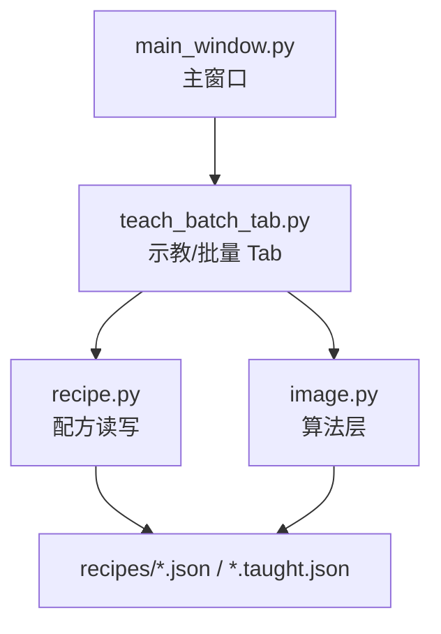
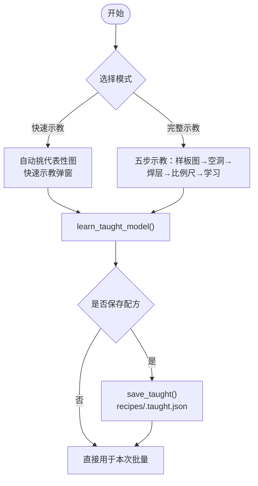
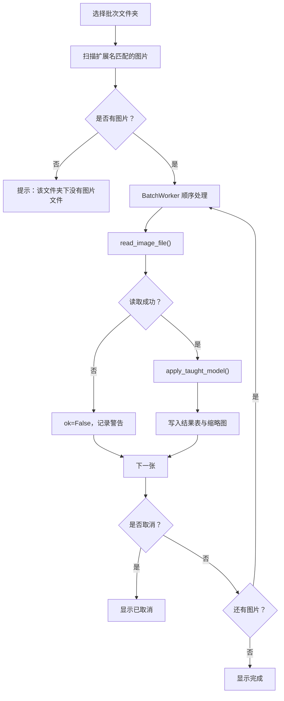
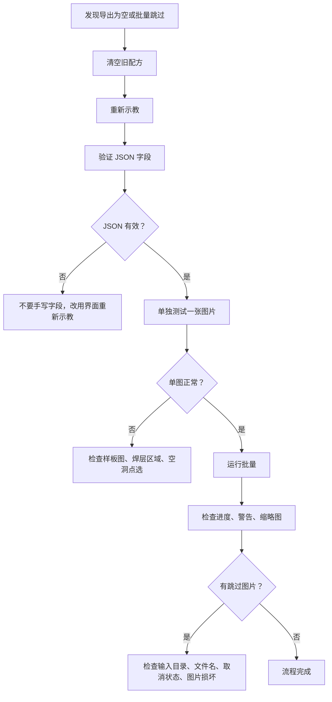
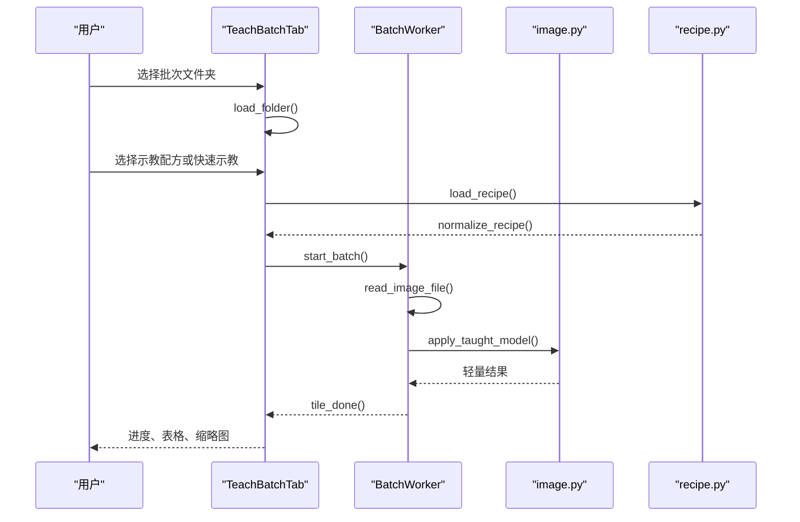
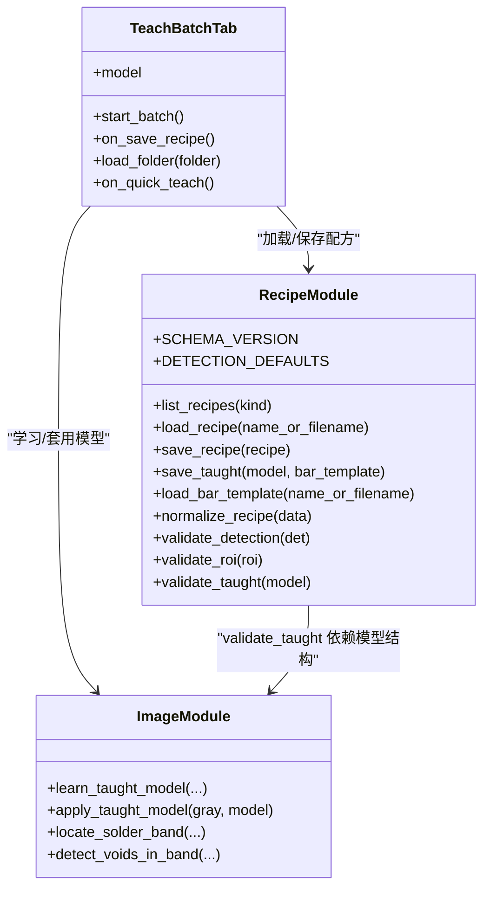

# 示教配方导出为空或批量检测跳过文件

<cite>
**本文引用的文件**   
- [recipe.py](file://recipe.py)
- [teach_batch_tab.py](file://teach_batch_tab.py)
- [image.py](file://image.py)
- [main_window.py](file://main_window.py)
- [recipes/1-1.taught.json](file://recipes/1-1.taught.json)
- [README.md](file://README.md)
</cite>

## 目录
1. [问题定位与结论](#问题定位与结论)
2. [项目结构与责任边界](#项目结构与责任边界)
3. [配方结构定义与读写逻辑](#配方结构定义与读写逻辑)
4. [快速示教与完整五步示教的字段差异](#快速示教与完整五步示教的字段差异)
5. [导出 JSON 为空的排查路径](#导出-json-为空的排查路径)
6. [批量检测跳过文件的常见原因](#批量检测跳过文件的常见原因)
7. [调试手段与验证流程](#调试手段与验证流程)
8. [修正步骤：标准操作流程](#修正步骤标准操作流程)
9. [已知限制与注意事项](#已知限制与注意事项)
10. [架构与数据流图](#架构与数据流图)

## 问题定位与结论

本指南针对以下三类现象：

| 现象 | 最可能的根因 | 首要检查点 |
|---|---|---|
| 点击「保存为示教配方」后 `recipes/*.taught.json` 没有新文件，或下拉列表不出现 | 学习阶段未完成、模型为 None、配方名为空、或外部工具修改了 schema | 先确认「学习完成」提示；再打开已有 `.taught.json` 核对字段 |
| 已存在 `.taught.json`，但批量运行时提示「配方读取失败或不是示教配方」 | 外部编辑导致 `type` 缺失、`schema_version` 异常、或关键字段被删除 | 用 `load_recipe` 的规范化结果判断，不要只看 JSON 是否可读 |
| 批量进度条走了，但表格中某行结果为空、警告栏有内容，或总张数小于输入图片数 | 输入文件夹不是纯图片目录、文件名不符合预期、批量中途取消、或该张图片处理失败 | 看进度标签、警告列、缩略图红边，以及 `batch_paths` 实际长度 |

核心结论是：**不要直接手写 `recipes/*.taught.json` 的字段**。配方写入由 `recipe.py` 中的 `validate_taught` 和 `save_taught` 控制，反序列化由 `normalize_recipe` 统一走校验。如果外部工具改变了字段名、类型或嵌套结构，可能出现“JSON 能打开但 `load_recipe` 返回 None”的情况。

**章节来源**
- [recipe.py:241-258](file://recipe.py#L241-L258)
- [recipe.py:271-348](file://recipe.py#L271-L348)
- [recipe.py:385-404](file://recipe.py#L385-L404)
- [recipe.py:452-462](file://recipe.py#L452-L462)
- [teach_batch_tab.py:1211-1235](file://teach_batch_tab.py#L1211-L1235)
- [teach_batch_tab.py:1401-1417](file://teach_batch_tab.py#L1401-L1417)

## 项目结构与责任边界

Aurascope 是 PyQt6 + OpenCV + NumPy + Pandas 的单机桌面应用，代码按「入口 → 主窗口 → Tab 页面 → Canvas 绘制层 → 算法层 image.py → 配方/导出」分层组织。

与本指南相关的职责划分如下：

| 层级 | 文件 | 责任 |
|---|---|---|
| GUI 入口 | `main_window.py` | 装配 Tab、拖拽批次文件夹、最近打开记录 |
| 示教/批量 UI | `teach_batch_tab.py` | 五步示教、快速示教、批量任务调度、进度与结果表 |
| 算法实现 | `image.py` | 焊层带定位、空洞检测、示教模型学习与套用、比例尺识别 |
| 配方持久化 | `recipe.py` | JSON 路径解析、schema 校验、读写、模板图保存 |
| 示例配方 | `recipes/*.taught.json` | 最终落盘产物，供批量加载 |

**图表来源**
- [main_window.py:134-148](file://main_window.py#L134-L148)
- [teach_batch_tab.py:34-51](file://teach_batch_tab.py#L34-L51)
- [recipe.py:1-9](file://recipe.py#L1-L9)

**章节来源**
- [README.md:42-64](file://README.md#L42-L64)
- [main_window.py:134-148](file://main_window.py#L134-L148)
- [teach_batch_tab.py:1-15](file://teach_batch_tab.py#L1-L15)

## 配方结构定义与读写逻辑

### 两种配方命名空间

`recipe.py` 把「参数型配方」和「示教模型配方」分开：

- 参数型配方：文件名 `<name>.json`，用于传统空洞分析参数。
- 示教模型配方：文件名 `<name>.taught.json`，用于批量检测。

`_taught_path_for` 使用 `.taught.json` 后缀隔离命名空间；`_resolve_path` 在查找时同时尝试 `.json` 和 `.taught.json`，避免同名覆盖。

### 规范化与校验

`load_recipe` 的调用链是：

1. `_resolve_path` 解析显示名或文件名。
2. 读取 JSON。
3. `normalize_recipe` 根据 `type` 分流。
4. 若 `type == 'taught'`，进入 `validate_taught`。
5. 非法输入返回 `None`。

这意味着：**JSON 可被 Python 解析，不等于 `load_recipe` 能返回有效模型**。

### 示教模型关键字段

从现有示例和校验逻辑看，`type=taught` 的配方至少包含：

| 字段 | 含义 | 失效后果 |
|---|---|---|
| `schema_version` | 当前为 3 | 旧版本会迁移部分面积字段 |
| `type` | 必须为 `'taught'` | 否则不走示教分支 |
| `name` | 配方名称 | 不能为空 |
| `solder.threshold` | 焊层阈值 | 缺少时 `apply_taught_model` 直接失败 |
| `void.threshold` | 空洞阈值（可为 None） | 缺失时退回带内 Otsu |
| `void.min_area` / `void.max_area` | 面积下限/上限 | 0/None 表示自动 |
| `band_ref` | 示教焊层几何基准 | 缺失时批量不做偏差校验 |
| `scale_bar` | 比例尺配置 | 影响像素比与自动识别 |
| `px_per_um` | 像素/微米 | 影响单位换算 |

示例文件 `recipes/1-1.taught.json` 展示了 v3 结构的典型值，包括 `solder`、`background`、`void`、`band`、`band_ref`、`scale_bar`、`diagnostics` 等。

**章节来源**
- [recipe.py:115-134](file://recipe.py#L115-L134)
- [recipe.py:241-258](file://recipe.py#L241-L258)
- [recipe.py:271-348](file://recipe.py#L271-L348)
- [recipe.py:452-462](file://recipe.py#L452-L462)
- [recipes/1-1.taught.json:1-56](file://recipes/1-1.taught.json#L1-L56)

## 快速示教与完整五步示教的字段差异

### 完整五步示教

完整流程在 `teach_batch_tab.py` 中定义为：

1. 上传样板图。
2. 点选典型空洞。
3. 示范焊层区域。
4. 划比例尺。
5. 学习并保存为示教配方。

`on_learn` 调用 `learn_taught_model`，得到模型后设置到 `self.model`，并在样板图上回放。`on_save_recipe` 将当前模型写入 `recipes/<name>.taught.json`。

### 快速示教

快速示教通过 `on_quick_teach` 自动挑选代表性图片，打开 `quick_teach_dialog`，用户只需完成焊层区域和空洞点选。其模型也写入同一个 `self.model`，因此批量运行时与完整示教共用同一套数据源。

### 关键差异

| 维度 | 快速示教 | 完整五步示教 |
|---|---|---|
| 样板图选择 | 自动挑 p90 接近整批中位数的图 | 用户手动上传 |
| 交互步骤 | 两步为主 | 五步 |
| 模型来源 | `quick_model` → `self.model` | `on_learn` → `self.model` |
| 批量行为 | 模型直接生效，无需先选配方 | 可从下拉框选已保存配方 |
| 字段差异 | 底层都走 `learn_taught_model`，结构一致 | 同上 |

因此，**快速示教与完整示教导出的 JSON 结构并不不同**；差异在于用户参与程度和默认样本图选择策略。真正需要区分的是「参数型配方」和「示教模型配方」。

**图表来源**
- [teach_batch_tab.py:1126-1185](file://teach_batch_tab.py#L1126-L1185)
- [teach_batch_tab.py:1211-1235](file://teach_batch_tab.py#L1211-L1235)
- [teach_batch_tab.py:1330-1382](file://teach_batch_tab.py#L1330-L1382)
- [image.py:1182-1330](file://image.py#L1182-L1330)

**章节来源**
- [teach_batch_tab.py:280-280](file://teach_batch_tab.py#L280-L280)
- [teach_batch_tab.py:1126-1185](file://teach_batch_tab.py#L1126-L1185)
- [teach_batch_tab.py:1211-1235](file://teach_batch_tab.py#L1211-L1235)
- [teach_batch_tab.py:1330-1382](file://teach_batch_tab.py#L1330-L1382)
- [image.py:1182-1330](file://image.py#L1182-L1330)

## 导出 JSON 为空的排查路径

### 第一步：确认学习是否成功

如果「保存为示教配方」按钮不可用，或点击后没有 toast 提示，优先检查：

1. 是否已完成「① 上传样板图」。
2. 是否已完成「③ 焊层区域示范」。
3. 是否点选了至少一个典型空洞。
4. 「学习完成」提示是否出现。
5. 样板图回放是否正常。

`on_learn` 在缺少必要输入时会返回，不会生成模型；`on_save_recipe` 在 `self.model is None` 时也会直接返回。

### 第二步：确认配方名不为空

`on_save_recipe` 会弹出输入框，若用户取消或输入空字符串，不会保存。`save_taught` 内部也对 `safe_name(model.get('name') or '')` 做非空校验。

### 第三步：确认写入路径

`save_taught` 使用 `_taught_path_for(name)`，即 `recipes/<name>.taught.json`。如果运行环境不可写，`_recipe_root` 会回退到用户数据目录下的 `recipes`。可通过环境变量 `AURASCOPE_RECIPE_DIR` 覆盖存储目录。

### 第四步：确认外部工具未破坏 schema

如果 JSON 存在但批量加载失败，重点检查：

- `type` 是否为 `'taught'`。
- `solder.threshold` 是否存在且为数值。
- `void.threshold` 是否为数值或 `null`。
- `void.min_area` / `void.max_area` 是否为整数或 `null`。
- `band_ref` 是否为合法字典或缺失（缺失时允许）。
- `scale_bar` 是否为字典。
- `schema_version` 是否为数字。

`validate_taught` 对多数字段做了夹紧和默认值填充，但对顶层结构、`type`、`solder`、`background`、`void`、`band`、`scale_bar`、`diagnostics` 等仍依赖外层键存在。

### 第五步：用 load_recipe 验证

不要只凭 JSON 能否打开判断。应通过 `load_recipe(name_or_filename)` 获取规范化结果：

- 返回 `None`：说明 JSON 不可读、结构非法、或 `normalize_recipe` 拒绝。
- 返回字典且 `type == 'taught'`：可用于批量。
- 返回字典但 `type != 'taught'`：是参数型配方，不是示教模型。

**章节来源**
- [teach_batch_tab.py:1126-1185](file://teach_batch_tab.py#L1126-L1185)
- [teach_batch_tab.py:1211-1235](file://teach_batch_tab.py#L1211-L1235)
- [recipe.py:69-89](file://recipe.py#L69-L89)
- [recipe.py:385-404](file://recipe.py#L385-L404)
- [recipe.py:452-462](file://recipe.py#L452-L462)

## 批量检测跳过文件的常见原因

### 1. 输入文件夹不是纯图片目录

`load_folder` 会列出文件夹下所有文件，只保留扩展名为 `.png`、`.jpg`、`.jpeg`、`.bmp`、`.tif`、`.tiff` 的文件。如果文件夹里混入 `.txt`、`.csv`、子目录或其他文件，它们不会被加入 `batch_paths`，也不会报错——只是不在批量列表中。

### 2. 文件名不符合预期

快速示教挑选代表性图时，优先选择「纯数字命名的切片」，例如 `N-1.jpg` 这类变体或总览图可能被排除。这不是批量跳过，而是「代表图选择偏好」。

### 3. 批量任务中途取消

`cancel_batch` 设置 `_batch_canceled = True`，`BatchWorker.run` 每处理一张图前检查 `_cancel`。取消后，`on_batch_finished` 会显示「已取消，已完成 X/Y 张」，而不是全部完成。

### 4. 单张图片读取失败

`read_image_file` 支持 TIF 和 OpenCV 解码。如果图片损坏、格式不支持、或 tifffile 导入失败，批量线程会把结果标记为 `ok=False`，并添加「图片读取失败」警告。

### 5. 主窗口 `detect_voids_local` 副本与 `image.py` 不一致

`main_window.py` 中存在一份 `detect_voids_local` 副本，属于已知技术债。现行批量检测以 `image.py` 为准。文档维护时应明确两份实现待合并，不要把主窗口的副本当作批量行为的权威来源。

### 6. 图片处理失败但不等于整个批量失败

`BatchWorker` 顺序处理图片，单张失败只会产生一条 `ok=False` 的结果记录，其他图片继续处理。最终汇总可能只有部分图片有效。

**图表来源**
- [teach_batch_tab.py:1256-1288](file://teach_batch_tab.py#L1256-L1288)
- [teach_batch_tab.py:1401-1453](file://teach_batch_tab.py#L1401-L1453)
- [teach_batch_tab.py:1507-1546](file://teach_batch_tab.py#L1507-L1546)
- [teach_batch_tab.py:56-79](file://teach_batch_tab.py#L56-L79)

**章节来源**
- [teach_batch_tab.py:56-79](file://teach_batch_tab.py#L56-L79)
- [teach_batch_tab.py:1256-1288](file://teach_batch_tab.py#L1256-L1288)
- [teach_batch_tab.py:1401-1453](file://teach_batch_tab.py#L1401-L1453)
- [teach_batch_tab.py:1507-1546](file://teach_batch_tab.py#L1507-L1546)
- [main_window.py:328-328](file://main_window.py#L328-L328)

## 调试手段与验证流程

### 1. 打开导出的 JSON 文件检查字段

优先打开 `recipes/<配方名>.taught.json`，确认：

- `schema_version` 为数字。
- `type` 为 `'taught'`。
- `name` 不为空。
- `solder.threshold` 存在。
- `void.threshold` 为数值或 `null`。
- `void.min_area`、`void.max_area` 为整数或 `null`。
- `band_ref` 为字典或不存在。
- `scale_bar` 为字典。
- `px_per_um` 为数值。

如果这些字段缺失或类型错误，`validate_taught` 可能返回 `None`，导致批量加载失败。

### 2. 在 teach_batch_tab.py 中观察批量进度与日志

重点关注：

- 进度条百分比。
- `lbl_current` 显示的 `idx/total filename`。
- 结果表「警告」列。
- 缩略图是否描红边。
- 完成后提示是「完成」还是「已取消」。

### 3. 确认输入文件夹结构

确保批量文件夹只包含图片文件。如果文件夹来自产线或拼接工具，可能混入：

- 中间结果文件。
- 配置文件。
- 子目录。
- 非图像扩展名文件。

### 4. 单独测试一张图片

在批量开始前，先用样板图或代表性图跑一次快速示教或完整示教，确认：

- 焊层带能被定位。
- 空洞能被标注。
- 学习过程对话框能打开。
- 样板图回放正常。

### 5. 用 load_recipe 验证配方

如果怀疑外部工具改坏了 JSON，不要直接手写修复。应先通过 `load_recipe` 查看规范化结果，再对照 `validate_taught` 需要的字段补全。

**章节来源**
- [teach_batch_tab.py:1461-1463](file://teach_batch_tab.py#L1461-L1463)
- [teach_batch_tab.py:1465-1489](file://teach_batch_tab.py#L1465-L1489)
- [teach_batch_tab.py:1507-1546](file://teach_batch_tab.py#L1507-L1546)
- [recipe.py:271-348](file://recipe.py#L271-L348)
- [recipe.py:452-462](file://recipe.py#L452-L462)

## 修正步骤：标准操作流程

推荐采用以下标准流程，避免静默失败：

1. **清空旧配方**  
   删除 `recipes/` 下与当前产品无关的 `.taught.json`，尤其是之前外部工具编辑过、来源不明的文件。

2. **重新示教**  
   使用「快速示教（两步）」或完整五步示教，重新学习焊层区域、空洞、比例尺。

3. **验证 JSON**  
   保存配方后，打开 `recipes/<name>.taught.json`，确认 `type`、`solder.threshold`、`void.threshold`、`band_ref`、`scale_bar` 等关键字段存在。

4. **单独测试一张图片**  
   选择一张代表性图片，运行快速示教或完整示教，确认样板图回放正常，学习过程对话框能打开。

5. **再运行批量**  
   选择同一批次文件夹，选择刚保存的示教配方，点击「开始批量」。

6. **检查批量结果**  
   查看进度、警告列、缩略图、汇总信息。如果有图片被跳过，优先检查该图片是否损坏、是否不在纯图片目录、或是否被中途取消。

7. **不要直接手写 JSON 字段**  
   除非你熟悉 `recipe.py` 的 schema 校验逻辑，否则不要手动编辑 `.taught.json`。应通过界面重新示教，或通过 `build_recipe` / `validate_taught` 的逻辑理解字段约束后再调整。

**图表来源**
- [teach_batch_tab.py:1211-1235](file://teach_batch_tab.py#L1211-L1235)
- [teach_batch_tab.py:1401-1453](file://teach_batch_tab.py#L1401-L1453)
- [recipe.py:271-348](file://recipe.py#L271-L348)

**章节来源**
- [teach_batch_tab.py:1211-1235](file://teach_batch_tab.py#L1211-L1235)
- [teach_batch_tab.py:1401-1453](file://teach_batch_tab.py#L1401-L1453)
- [recipe.py:271-348](file://recipe.py#L271-L348)

## 已知限制与注意事项

### 1. detect_voids_local 重复实现

`image.py` 和 `main_window.py` 中都存在 `detect_voids_local`。文档应以 `image.py` 为准，`main_window.py` 中的副本属于已知技术债，两者待合并。

### 2. Canny 边缘校验可能静默失效

handoff 清单指出 `edge_map` 在某些路径下未初始化，可能导致 Canny 校验静默失效。排查空洞误检或漏检时，不应只依赖「启用 Canny 边缘验证」开关，还要结合空洞率、面积、可视化叠加图判断。

### 3. 批量大图增强检测无进度提示

批量检测本身有进度条，但某些图像处理阶段的细粒度进度可能不够直观。遇到大批量卡顿时，应优先看 `lbl_current` 和进度条，而不是假设程序无响应。

### 4. 配方目录可能回退到用户数据目录

如果 `recipes/` 不可写，`_recipe_root` 会回退到 `local_data_dir()` 下的 `recipes`。排查「找不到配方」时，不要只查源码同级目录。

### 5. 不要混淆参数型配方与示教模型配方

参数型配方用于传统空洞分析，示教模型配方用于批量检测。批量启动时要求 `model.get('type') == 'taught'`，否则会提示「配方读取失败或不是示教配方」。

**章节来源**
- [main_window.py:32-35](file://main_window.py#L32-L35)
- [main_window.py:1779-1779](file://main_window.py#L1779-L1779)
- [recipe.py:69-89](file://recipe.py#L69-L89)
- [teach_batch_tab.py:1412-1417](file://teach_batch_tab.py#L1412-L1417)

## 架构与数据流图

### 批量检测数据流

**图表来源**
- [teach_batch_tab.py:1256-1288](file://teach_batch_tab.py#L1256-L1288)
- [teach_batch_tab.py:1401-1453](file://teach_batch_tab.py#L1401-L1453)
- [teach_batch_tab.py:1465-1489](file://teach_batch_tab.py#L1465-L1489)
- [recipe.py:452-462](file://recipe.py#L452-L462)
- [image.py:1333-1478](file://image.py#L1333-L1478)

### 配方校验类关系

**图表来源**
- [recipe.py:20-50](file://recipe.py#L20-L50)
- [recipe.py:241-258](file://recipe.py#L241-L258)
- [recipe.py:271-348](file://recipe.py#L271-L348)
- [recipe.py:385-404](file://recipe.py#L385-L404)
- [recipe.py:452-462](file://recipe.py#L452-L462)
- [teach_batch_tab.py:1126-1185](file://teach_batch_tab.py#L1126-L1185)
- [teach_batch_tab.py:1211-1235](file://teach_batch_tab.py#L1211-L1235)
- [teach_batch_tab.py:1401-1453](file://teach_batch_tab.py#L1401-L1453)
- [image.py:1182-1330](file://image.py#L1182-L1330)
- [image.py:1333-1478](file://image.py#L1333-L1478)