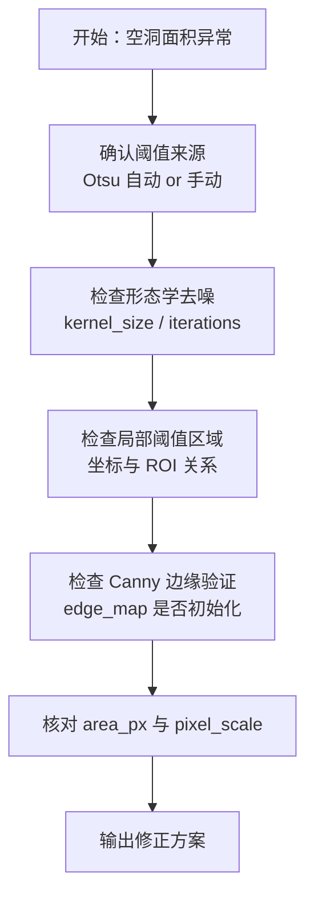
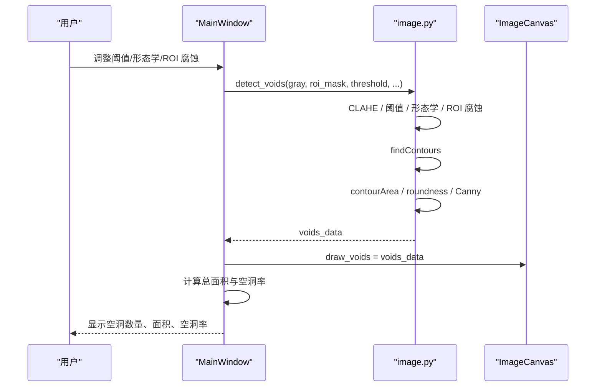
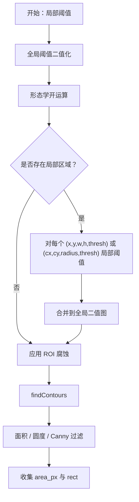

# 空洞面积偏大或偏小

<cite>
**本文引用的文件**   
- [image.py](file://image.py)
- [main_window.py](file://main_window.py)
- [README.md](file://README.md)
</cite>

## 目录
1. [引言](#引言)
2. [问题定位总览](#问题定位总览)
3. [症状与关键参数对照表](#症状与关键参数对照表)
4. [排查流程：按症状展开](#排查流程按症状展开)
5. [调试手段](#调试手段)
6. [典型修正示例](#典型修正示例)
7. [代码级架构与数据流](#代码级架构与数据流)
8. [已知限制与注意事项](#已知限制与注意事项)
9. [结论](#结论)

## 引言
本指南面向 Aurascope「空洞分析」模块中出现的空洞面积统计异常，包括：
- 单个空洞面积偏大；
- 单个空洞面积偏小；
- 整图无空洞结果。

Aurascope 是微电子封装产线半自动化视觉检测桌面工具，核心算法集中在 `image.py`，主窗口逻辑在 `main_window.py`。空洞检测的权威实现以 `image.py` 中的 `detect_voids` 和 `detect_voids_local` 为准；`main_window.py` 内存在一份同名局部阈值函数副本，属于已知技术债，不应作为行为依据。

## 问题定位总览
空洞面积由以下阶段共同决定：
1. **灰度处理**：是否启用 CLAHE 对比度增强。
2. **阈值化**：Otsu 自动阈值 vs 手动阈值；亮/暗方向是否正确。
3. **形态学去噪**：开运算核大小 `morph_kernel`、是否启用。
4. **ROI 边界腐蚀**：`roi_erosion_px` 把 ROI 向内收缩，避免边界伪影连入空洞。
5. **局部阈值**：矩形区域 `(x, y, w, h, thresh)` 或圆形笔刷 `(cx, cy, radius, thresh)` 是否与图片尺寸、ROI 一致。
6. **轮廓面积**：`cv2.contourArea` 返回的是像素面积 `area_px`。
7. **单位换算**：若已标定，最终面积 = `area_px / (pixel_scale²)`。
8. **Canny 边缘验证**：若启用但 `edge_map` 未初始化，可能静默跳过校验，导致误判。

**图表来源**
- [image.py:180-286](file://image.py#L180-L286)
- [image.py:328-422](file://image.py#L328-L422)
- [main_window.py:1256-1331](file://main_window.py#L1256-L1331)

## 症状与关键参数对照表

| 症状 | 最可能的关键参数 | 现象解释 | 优先检查项 |
|---|---|---|---|
| 空洞面积偏大 | `threshold` 过低、`morph_kernel` 过大、`roi_erosion_px` 过小、局部阈值区域过大 | 二值图中噪声连通成大片暗区；形态学开运算未能断开粘连；ROI 边界伪影被保留；局部区域覆盖过多背景 | 阈值、形态学开关、ROI 腐蚀、局部区域坐标 |
| 空洞面积偏小 | `threshold` 过高、`min_area` 过大、`roi_erosion_px` 过大、圆度过滤过严 | 真实空洞被阈值切掉；小空洞被面积下限过滤；ROI 腐蚀把空洞边缘吃掉；非圆形结构被剔除 | 阈值、面积过滤、ROI 腐蚀、圆度阈值 |
| 整图无结果 | `threshold` 完全错误、ROI 为空、`roi_mask` 全零、`local_regions` 全部越界、Canny 校验误杀 | 二值图全白或全黑；ROI 未定义；局部区域被裁剪到无效尺寸；边缘匹配率低于阈值 | Otsu 输入、ROI、局部区域、edge_verify |
| 面积数值合理但 μm² 不对 | `pixel_scale` 未标定或标错 | `area_px` 正确，但除以错误的 `pixel_scale²` 后得到错误物理面积 | 比例尺标定 |

**章节来源**
- [image.py:200-286](file://image.py#L200-L286)
- [image.py:328-422](file://image.py#L328-L422)
- [main_window.py:1256-1331](file://main_window.py#L1256-L1331)
- [main_window.py:1644-1670](file://main_window.py#L1644-L1670)

## 排查流程：按症状展开

### 第一步：确认是否使用 Otsu 自动阈值还是手动阈值
- 如果点击「自动（Otsu）」，`main_window.py` 调用 `otsu_threshold(gray, roi_mask)`，对当前 ROI 内的灰度像素计算阈值。
- 如果手动拖动识别阈值滑块，则直接使用该值进行 `THRESH_BINARY_INV` 二值化。
- Otsu 失败时，`image.py` 中 `otsu_threshold` 会返回默认值 128；若 ROI 内没有有效像素，也会回退到 128。

**排查要点：**
1. 先关闭所有增强选项，仅用原始灰度 + 手动阈值观察二值图。
2. 若 Otsu 结果明显不合理，说明 ROI 包含太多非焊层区域，或图像灰度分布不满足双峰假设。
3. 记录 Otsu 输出的阈值，再逐步调高或调低，观察空洞数量与面积变化。

**章节来源**
- [image.py:180-197](file://image.py#L180-L197)
- [main_window.py:1318-1331](file://main_window.py#L1318-L1331)

### 第二步：检查形态学去噪的 kernel_size / iterations
`detect_voids` 和 `detect_voids_local` 在启用增强且 `morph_enabled=True` 且 `morph_kernel > 1` 时执行开运算：
- 核形状为椭圆；
- 核大小为 `(morph_kernel, morph_kernel)`；
- 开运算会断开细小连接、消除小噪声，但同时可能把真实空洞的边缘“咬掉”。

**常见错误：**
- `morph_kernel` 过大：空洞边缘被腐蚀，面积偏小。
- `morph_kernel` 过小：噪声未被去除，多个小空洞连成一大片，面积偏大。
- 开启 CLAHE 后再做形态学：CLAHE 会改变局部对比度，使形态学效果不稳定。

**建议做法：**
1. 先关闭形态学去噪，确认基础二值图是否合理。
2. 若需要去噪，从较小的 `morph_kernel` 开始，逐步增大。
3. 注意：`roi_erosion_px` 是 ROI 边界腐蚀，不是空洞形态学去噪，两者作用不同。

**章节来源**
- [image.py:216-218](file://image.py#L216-L218)
- [image.py:340-342](file://image.py#L340-L342)

### 第三步：检查 ROI 边界腐蚀 `roi_erosion_px`
`roi_erosion_px` 通过 `cv2.erode` 对 `roi_mask` 向内收缩，目的是断开图像边界上的伪影与空洞连通。

**常见错误：**
- `roi_erosion_px` 过大：ROI 内部被过度侵蚀，空洞靠近边界的部分被排除，面积偏小。
- `roi_erosion_px` 为 0：边界伪影可能连入空洞，面积偏大。
- ROI 本身太小或为空：`interior_mask` 全零，空洞掩码为空，整图无结果。

**建议做法：**
1. 将 `roi_erosion_px` 设为 0，观察空洞是否包含图像边缘伪影。
2. 若确实有边界连通问题，再逐步增加 `roi_erosion_px`，但不要超过空洞与边界的距离。
3. 确认 ROI 多边形或矩形框选覆盖了真实焊层区域。

**章节来源**
- [image.py:220-225](file://image.py#L220-L225)
- [image.py:358-363](file://image.py#L358-L363)
- [main_window.py:1341-1345](file://main_window.py#L1341-L1345)

### 第四步：检查局部阈值笔刷或局部区域
项目中有两类局部阈值机制：
1. **矩形局部区域**：`local_regions` 中每个元素为 `(x, y, w, h, thresh)`。
2. **圆形笔刷区域**：`local_brush_regions` 中每个元素为 `{cx, cy, radius, thresh}`。

#### 矩形局部区域
`detect_voids_local` 会对每个局部区域执行：
- 取 `gray_img[y:y+h, x:x+w]`；
- 对该区域单独阈值化；
- 把局部二值结果写回全局 `bin_inv` 对应位置。

**关键风险：**
- 如果 `(x, y, w, h)` 超出图片范围，代码会通过 `max(0, x)`、`min(w, gray_img.shape[1] - x)` 等截断；
- 如果截断后 `w <= 0` 或 `h <= 0`，该区域会被跳过；
- 如果局部阈值比全局阈值更激进，会把原本不该亮的区域变成空洞，面积偏大；
- 如果局部阈值太保守，会把真实空洞变回背景，面积偏小。

#### 圆形笔刷区域
`detect_voids_local_brush` 使用圆形掩码替换对应区域的二值结果，并再次与 ROI 掩码合并。

**关键风险：**
- 半径过大：覆盖过多背景，面积偏大。
- 半径过小：只覆盖空洞中心，边缘丢失，面积偏小。
- 圆心不在空洞上：局部阈值应用到错误区域。

**建议做法：**
1. 先确认使用的是矩形局部区域还是圆形笔刷。
2. 打印每个局部区域的 `(x, y, w, h)` 或 `(cx, cy, radius)`，并与原图尺寸比较。
3. 临时关闭其他局部区域，逐个验证。
4. 若局部区域画到了图片外，应缩小区域或调整坐标。

**章节来源**
- [image.py:328-356](file://image.py#L328-L356)
- [image.py:1879-1927](file://image.py#L1879-L1927)
- [main_window.py:1459-1506](file://main_window.py#L1459-L1506)
- [main_window.py:1588-1610](file://main_window.py#L1588-L1610)

### 第五步：检查 Canny 边缘验证
当 `enhanced=True` 且 `edge_verify=True` 时，代码会：
1. 对灰度图高斯模糊；
2. 使用 Canny 提取边缘；
3. 与 ROI 掩码做位与；
4. 计算空洞轮廓与边缘的重叠比例；
5. 若重叠比例小于 `edge_thresh`，则丢弃该空洞。

**已知问题：**
- 在部分实现路径中，`edge_map` 可能为 `None`，而后续判断写成 `if enhanced and edge_verify and edge_map is not None`，导致 Canny 校验被静默跳过。
- 在 `main_window.py` 的局部阈值副本中，`edge_map` 的初始化位置与 `interior_mask` 的使用也存在不一致风险。
- 在 `detect_voids_local_brush` 中，`edge_map` 是在轮廓循环内部延迟计算的，若提前进入过滤分支，可能出现未初始化访问或逻辑不一致。

**排查要点：**
1. 先关闭 `Canny 边缘验证`，确认空洞数量和面积是否恢复正常。
2. 若关闭后恢复，说明 Canny 阈值或边缘质量不适合当前图像。
3. 若仍异常，不要依赖 Canny 作为主要诊断依据，因为当前实现可能静默跳过。

**章节来源**
- [image.py:228-233](file://image.py#L228-L233)
- [image.py:255-263](file://image.py#L255-L263)
- [image.py:366-370](file://image.py#L366-L370)
- [image.py:392-399](file://image.py#L392-L399)
- [main_window.py:1832-1836](file://main_window.py#L1832-L1836)
- [main_window.py:1945-1956](file://main_window.py#L1945-L1956)

### 第六步：核对像素面积与物理面积
空洞面积最终以 `area_px` 形式保存在空洞字典中。显示层根据 `pixel_scale` 换算物理面积：
- 若 `pixel_scale > 0`，物理面积 = `area_px / (pixel_scale²)`。
- 若未标定，`pixel_scale = 0`，界面显示像素面积并注明“未标定”。

**常见错误：**
- 用户看到 μm² 数值异常，但 `area_px` 正常，说明是比例尺标定问题。
- 用户认为空洞面积偏小，但实际是 `min_area` 或 `max_area` 过滤掉了结果。
- 用户导出 CSV 时，`scale = self.pixel_scale if self.pixel_scale > 0 else 1.0`，未标定时按 1 px/μm 换算，容易误导。

**建议做法：**
1. 先确认 `area_px` 是否合理。
2. 再确认 `pixel_scale` 是否已标定。
3. 最后确认导出逻辑是否使用了正确的 `pixel_scale`。

**章节来源**
- [image.py:275-283](file://image.py#L275-L283)
- [image.py:411-419](file://image.py#L411-L419)
- [main_window.py:1289-1310](file://main_window.py#L1289-L1310)
- [main_window.py:1644-1670](file://main_window.py#L1644-L1670)
- [main_window.py:1707-1757](file://main_window.py#L1707-L1757)

## 调试手段

### 在 `image.py` 中临时保存中间结果
建议在 `detect_voids` 或 `detect_voids_local` 附近添加临时调试输出，用于确认：
- 二值图是否为空；
- 轮廓数量；
- 每个空洞的 `area_px`；
- 每个空洞的 `rect`。

可参考以下路径定位插入点：
- `image.py` 中 `detect_voids` 的轮廓循环前；
- `image.py` 中 `detect_voids_local` 的轮廓循环前；
- `main_window.py` 中 `calculate_voids` 调用 `detect_voids` 之后。

**推荐调试字段：**
| 字段 | 含义 | 用途 |
|---|---|---|
| `bin_inv` 非零像素数 | 二值图前景像素量 | 判断阈值是否把整图变白或变黑 |
| `contours` 长度 | 轮廓数量 | 判断是否整图无结果 |
| `area_px` | 空洞像素面积 | 判断单个空洞是否偏大或偏小 |
| `rect` | 空洞外接矩形 | 判断空洞位置是否在 ROI 内 |
| `points` | 空洞轮廓点 | 用于可视化或进一步几何分析 |

**章节来源**
- [image.py:238-286](file://image.py#L238-L286)
- [image.py:375-422](file://image.py#L375-L422)
- [main_window.py:1276-1287](file://main_window.py#L1276-L1287)

### 在 `main_window.py` 中观察 `detect_voids_local` 副本差异
`main_window.py` 中存在一个 `detect_voids_local` 副本，其实现与 `image.py` 不完全一致：
- 副本中局部区域处理顺序不同；
- 副本中 Canny 边缘验证的阈值硬编码为 0.3；
- 副本中 `edge_map` 初始化位置与 `interior_mask` 使用方式不同。

**重要原则：**
- 现行行为以 `image.py` 为准。
- `main_window.py` 中的副本是已知技术债，文档明确两份待合并，不得以其为最终行为依据。
- 调试时应优先查看 `image.py` 的输出，再用 `main_window.py` 的 UI 表现做交叉验证。

**章节来源**
- [image.py:328-422](file://image.py#L328-L422)
- [main_window.py:1779-1876](file://main_window.py#L1779-L1876)

### 快速自检清单
1. 是否定义了 ROI？
2. ROI 是否包含焊层区域？
3. 是否使用了 Otsu？Otsu 输入的 ROI 是否正确？
4. 手动阈值是否接近 Otsu 结果？
5. 形态学去噪是否开启？`morph_kernel` 是否过大？
6. `roi_erosion_px` 是否把空洞边缘吃掉？
7. 局部阈值区域是否超出图片范围？
8. 局部阈值是否比全局阈值更激进？
9. Canny 边缘验证是否关闭？
10. `pixel_scale` 是否已标定？

## 典型修正示例

### 示例一：空洞面积偏大
**可能原因：**
- 阈值太低，背景噪声被当作空洞。
- 形态学开运算核太大，反而把多个小空洞连在一起。
- ROI 边界腐蚀不足，边界伪影连入空洞。
- 局部阈值区域过大，覆盖过多背景。

**修正步骤：**
1. 提高 `threshold`，直到背景不再出现大量暗斑。
2. 关闭形态学去噪，确认空洞是否由噪声连通造成。
3. 若需要形态学，减小 `morph_kernel`。
4. 适当增大 `roi_erosion_px`，但要避免吃掉真实空洞。
5. 缩小局部阈值区域，确保只覆盖目标空洞。

**章节来源**
- [image.py:214-225](file://image.py#L214-L225)
- [image.py:339-363](file://image.py#L339-L363)

### 示例二：空洞面积偏小
**可能原因：**
- 阈值太高，真实空洞被切掉。
- `min_area` 设置过大。
- `roi_erosion_px` 过大，ROI 内部空洞被腐蚀掉。
- 圆度过滤过严，非圆形空洞被剔除。

**修正步骤：**
1. 降低 `threshold`，观察空洞是否重新出现。
2. 将 `min_area` 设为较小值，例如 1。
3. 将 `roi_erosion_px` 设为 0，确认空洞是否恢复。
4. 将圆度过滤设为 0，暂时关闭圆度筛选。
5. 若使用局部阈值，缩小笔刷半径，确保覆盖空洞边缘。

**章节来源**
- [image.py:241-253](file://image.py#L241-L253)
- [image.py:378-390](file://image.py#L378-L390)
- [main_window.py:619-634](file://main_window.py#L619-L634)
- [main_window.py:693-703](file://main_window.py#L693-L703)

### 示例三：整图无结果
**可能原因：**
- ROI 未定义或为空。
- 阈值方向错误。
- Otsu 输入 ROI 内无有效像素。
- 所有局部区域被裁剪到无效尺寸。
- Canny 边缘验证误杀全部空洞。

**修正步骤：**
1. 先确认 ROI 绿色蒙版是否出现在图上。
2. 关闭增强选项，仅用原始灰度 + 手动阈值。
3. 若 Otsu 返回 128，检查 ROI 是否包含足够像素。
4. 打印 `local_regions`，确认每个区域 `w > 0` 且 `h > 0`。
5. 关闭 Canny 边缘验证，确认是否因边缘匹配率过低被过滤。

**章节来源**
- [image.py:190-197](file://image.py#L190-L197)
- [image.py:344-356](file://image.py#L344-L356)
- [image.py:228-233](file://image.py#L228-L233)
- [main_window.py:1256-1260](file://main_window.py#L1256-L1260)

### 示例四：像素面积合理但 μm² 不对
**可能原因：**
- 未进行比例尺标定。
- 标定长度输入错误。
- 导出逻辑在未标定时按 1 px/μm 换算。

**修正步骤：**
1. 在「比例尺标定」中划线并输入实际长度。
2. 确认状态栏显示 `1 μm = x.xx px`。
3. 检查导出 CSV 时是否使用了正确的 `pixel_scale`。
4. 若只是界面显示问题，优先核对 `result_box` 的计算逻辑。

**章节来源**
- [main_window.py:930-962](file://main_window.py#L930-L962)
- [main_window.py:1296-1310](file://main_window.py#L1296-L1310)
- [main_window.py:1656-1670](file://main_window.py#L1656-L1670)
- [main_window.py:1738-1757](file://main_window.py#L1738-L1757)

## 代码级架构与数据流

### 空洞检测主流程

**图表来源**
- [main_window.py:1256-1331](file://main_window.py#L1256-L1331)
- [image.py:200-286](file://image.py#L200-L286)

### 局部阈值流程

**图表来源**
- [image.py:328-422](file://image.py#L328-L422)
- [image.py:1879-1974](file://image.py#L1879-L1974)

### 关键数据结构
空洞检测结果统一为字典列表，关键字段如下：

| 字段 | 类型 | 含义 |
|---|---|---|
| `id` | 整数 | 空洞编号 |
| `area_px` | 浮点/整数 | 空洞像素面积 |
| `rect` | 元组 | `(x, y, w, h)` 外接矩形 |
| `cx`, `cy` | 浮点 | 空洞质心 |
| `points` | 列表 | 空洞轮廓点 |
| `manual` | 布尔 | 是否手动添加 |

**章节来源**
- [image.py:275-283](file://image.py#L275-L283)
- [image.py:411-419](file://image.py#L411-L419)

## 已知限制与注意事项

1. **重复的 `detect_voids_local`**  
   `image.py` 和 `main_window.py` 各有一份支持局部阈值的空洞检测函数，实现细节不完全一致。现行行为应以 `image.py` 为准，两份代码待合并。

2. **Canny 边缘验证可能静默失效**  
   部分实现路径中 `edge_map` 未初始化或初始化位置不一致，导致 `edge_verify` 打开后仍可能跳过校验。排查时应优先关闭该选项。

3. **ROI 相关 UI 控件重复创建**  
   历史 handoff 清单指出 `chk_roi_overlay` 被重复创建，属于已知 UI 问题。虽然不直接影响空洞面积计算，但会影响用户对 ROI 蒙版的直观判断。

4. **滚轮缩放 Y 轴漂移**  
   canvas 层存在 Y 轴漂移的已知问题，不要把现状描述为正确设计。这会影响用户绘制 ROI 和局部阈值区域的精度。

5. **大图增强检测无进度提示**  
   长循环中虽有 `_pump_events()` 让界面有机会刷新，但整体大图增强检测仍缺乏明确的进度反馈。

6. **测试环境**  
   仓库提供 pytest 风格单测，部分用例依赖 QApplication；仓库内无 CI 配置，不应虚构流水线或覆盖率门槛。

**章节来源**
- [README.md:1-80](file://README.md#L1-L80)
- [image.py:328-422](file://image.py#L328-L422)
- [main_window.py:1779-1974](file://main_window.py#L1779-L1974)

## 结论
空洞面积异常通常不是单一参数问题，而是「阈值 → 形态学 → ROI 腐蚀 → 局部阈值 → 轮廓过滤 → 单位换算」链条中的某一段偏离了预期。排查时应遵循以下顺序：
1. 先确认阈值来源：Otsu 自动还是手动。
2. 关闭形态学去噪，确认是否过度膨胀或腐蚀。
3. 检查 `roi_erosion_px` 是否吞掉空洞边缘。
4. 核对局部阈值区域坐标与图片尺寸、ROI 的关系。
5. 关闭 Canny 边缘验证，排除静默跳过导致的误判。
6. 先核对 `area_px`，再核对 `pixel_scale`。
7. 以 `image.py` 的实现为准，不把 `main_window.py` 的副本当作权威行为。

对于现场用户，最简单的修正路径是：
- 面积偏大：增大阈值、关闭形态学、缩小局部阈值区域、适当增大 ROI 腐蚀。
- 面积偏小：减小阈值、关闭形态学、减小 ROI 腐蚀、降低圆度过滤。
- 整图无结果：重新定义 ROI、改用手动阈值、关闭局部阈值、关闭 Canny 验证。
- 物理面积不对：重新标定像素比。