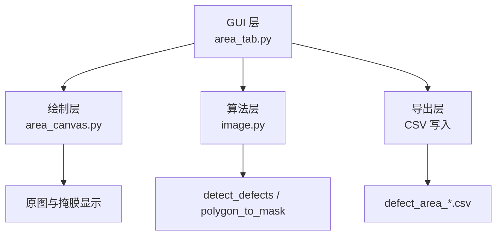
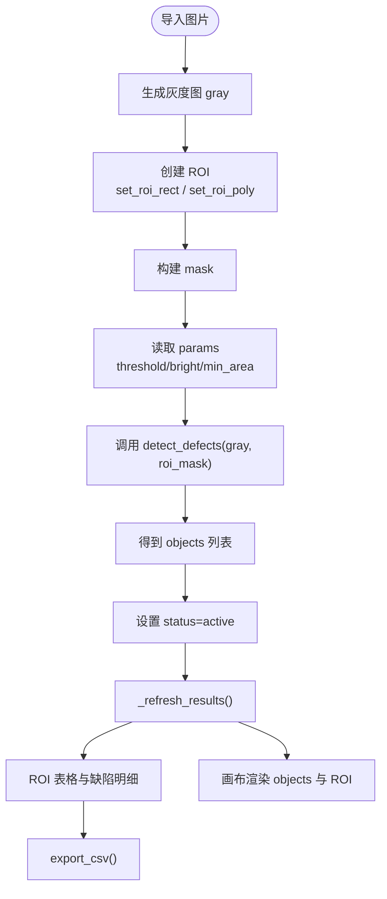
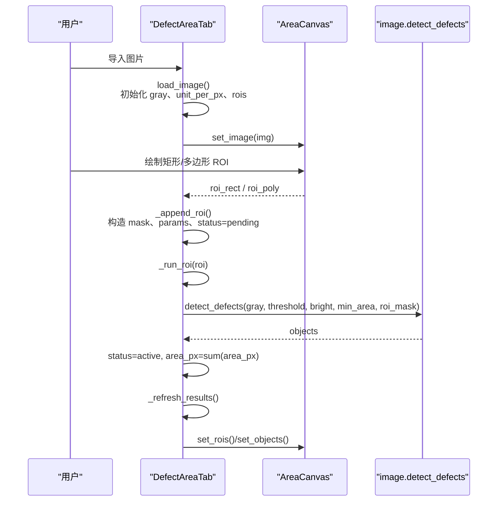
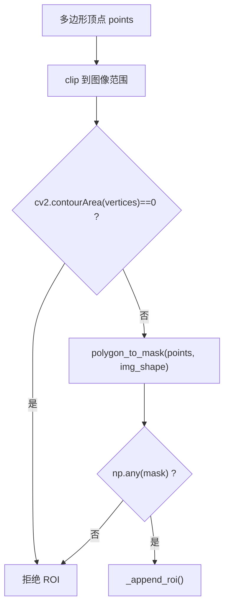
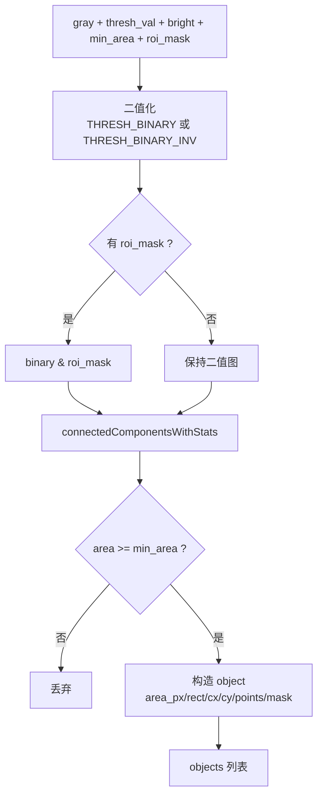
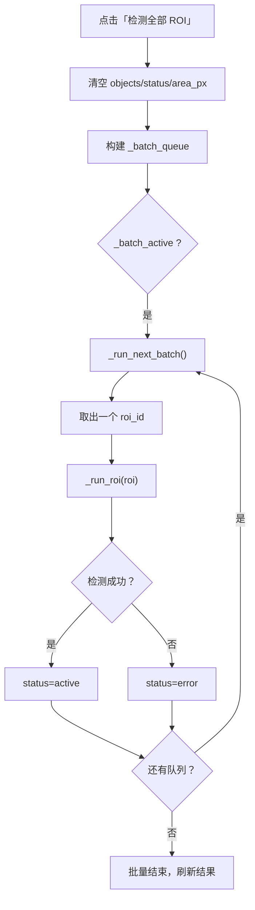
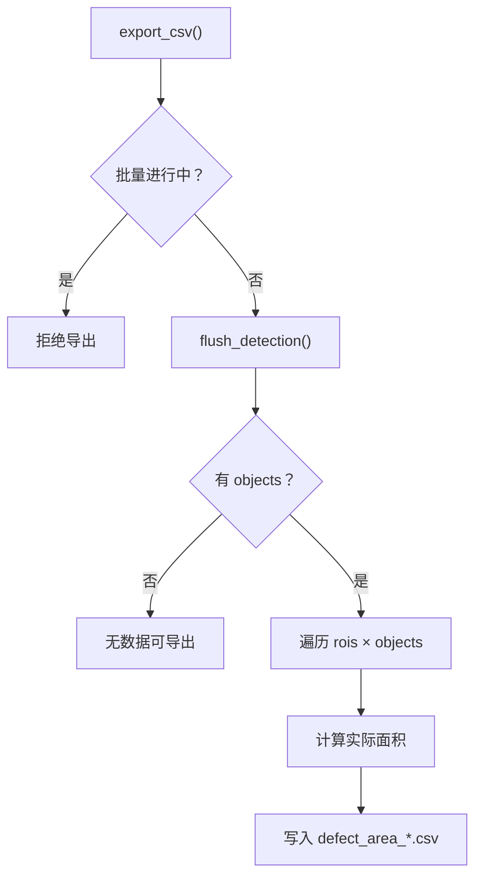

# 缺陷面积多 ROI 漏检或误检

<cite>
**本文引用的文件**   
- [area_canvas.py](file://area_canvas.py)
- [area_tab.py](file://area_tab.py)
- [image.py](file://image.py)
- [README.md](file://README.md)
- [PROJECT_CONCEPTION.md](file://PROJECT_CONCEPTION.md)
- [test_area_tab.py](file://test_area_tab.py)
</cite>

## 目录
1. [引言](#引言)
2. [项目结构与定位](#项目结构与定位)
3. [核心组件与数据流](#核心组件与数据流)
4. [架构总览](#架构总览)
5. [关键排查维度](#关键排查维度)
6. [详细排查流程](#详细排查流程)
7. [批量一致性专项](#批量一致性专项)
8. [CSV 导出字段说明](#csv-导出字段说明)
9. [已知限制与注意事项](#已知限制与注意事项)
10. [结论](#结论)

## 引言
本文面向「缺陷面积多 ROI」页面的三类问题：

- **漏检**：ROI 内确实存在缺陷，但检测结果中没有。
- **误检**：检测出非缺陷区域，或手动添加被拒绝。
- **批量检测结果不一致**：同一套参数下，不同图片、不同 ROI 的结果出现差异，或批量中途状态异常。

这些问题的根因通常不在单一函数中，而是由「ROI 顶点 → mask → 阈值/连通域 → 标定换算 → UI 展示 → CSV 导出」这条链路共同决定。因此排查必须同时覆盖 area_canvas.py（画布与坐标）、area_tab.py（业务状态与批量流程）、image.py（算法实现）三个层次。

## 项目结构与定位
根据仓库 README 和项目构思文档，Aurascope 是面向微电子封装产线的单机桌面视觉检测工具，使用 PyQt6 + OpenCV + NumPy + csv；缺陷面积多 ROI 功能属于独立 Tab，其权威实现位于 area_tab.py 与 area_canvas.py，算法集中在 image.py。

**图表来源**
- [area_tab.py:110-150](file://area_tab.py#L110-L150)
- [area_canvas.py:85-147](file://area_canvas.py#L85-L147)
- [image.py:425-488](file://image.py#L425-L488)

**章节来源**
- [README.md:1-65](file://README.md#L1-L65)
- [PROJECT_CONCEPTION.md:1-108](file://PROJECT_CONCEPTION.md#L1-L108)

## 核心组件与数据流
缺陷面积多 ROI 的核心数据结构是 `self.rois`，每个 ROI 至少包含以下关键字段：

| 字段 | 含义 | 排查要点 |
|---|---|---|
| `id` | ROI 编号 | 删除/清空后是否重新从 1 开始 |
| `roi` | `('rect'|'poly', data)` | 矩形 `(x,y,w,h)` 或多边形顶点列表 |
| `mask` | 与灰度图同形的 uint8 二值掩膜 | 多边形是否闭合、顶点是否在图像范围内 |
| `params` | `threshold` / `bright` / `min_area` | 当前 ROI 与批量时是否一致 |
| `objects` | 检测到的缺陷对象列表 | 数量、像素面积、来源 |
| `status` | `pending` / `active` / `error` | 批量进度和最终判定依据 |
| `manual_changed` | 是否有人工增删 | 重跑会清空人工修改 |
| `area_px` | 当前 ROI 所有 objects 的像素面积之和 | 用于汇总和 CSV |

**图表来源**
- [area_tab.py:342-378](file://area_tab.py#L342-L378)
- [area_tab.py:561-590](file://area_tab.py#L561-L590)
- [area_tab.py:821-847](file://area_tab.py#L821-L847)
- [area_tab.py:914-1008](file://area_tab.py#L914-L1008)
- [area_tab.py:1116-1166](file://area_tab.py#L1116-L1166)
- [image.py:425-488](file://image.py#L425-L488)

**章节来源**
- [area_tab.py:110-150](file://area_tab.py#L110-L150)
- [area_tab.py:561-590](file://area_tab.py#L561-L590)
- [area_tab.py:821-847](file://area_tab.py#L821-L847)
- [area_tab.py:914-1008](file://area_tab.py#L914-L1008)
- [image.py:425-488](file://image.py#L425-L488)

## 架构总览
缺陷面积多 ROI 的调用链如下：

**图表来源**
- [area_tab.py:342-378](file://area_tab.py#L342-L378)
- [area_tab.py:561-590](file://area_tab.py#L561-L590)
- [area_tab.py:659-683](file://area_tab.py#L659-L683)
- [area_tab.py:821-847](file://area_tab.py#L821-L847)
- [area_tab.py:914-978](file://area_tab.py#L914-L978)
- [image.py:425-488](file://image.py#L425-L488)

## 关键排查维度
针对漏检、误检、批量不一致，应依次检查以下五个维度：

1. **ROI 几何是否正确**  
   - 多边形顶点顺序、是否自交、是否闭合。
   - 顶点是否超出图像尺寸。
   - 矩形 ROI 的宽高是否小于最小阈值。

2. **polygon_to_mask 生成的 mask 是否有效**  
   - 多边形顶点经 clip 后是否仍构成非零面积。
   - mask 是否为与 gray 同形的 uint8 二值数组。
   - 多边形内部是否被正确填充。

3. **阈值与连通域逻辑是否合理**  
   - `bright=True` 检测亮缺陷，`False` 检测暗缺陷。
   - 阈值过高可能漏检，过低可能引入噪声。
   - `min_area` 过小会保留噪点，过大可能吞掉小缺陷。
   - ROI mask 会参与二值化后的按位与，ROI 外像素不会被计入。

4. **像素比标定是否影响物理面积**  
   - 未标定时 CSV 中的实际面积为空，单位列写“未标定”。
   - 标定错误会导致物理面积和距离测量失真，但不影响像素面积。

5. **批量流程是否共享同一套 params 且没有中途重置状态**  
   - 单个 ROI 调参只保存该 ROI 的 `params`。
   - 「检测全部 ROI」会清空所有 ROI 的 objects 并重建队列。
   - 批量进行中不应导出 CSV。

**章节来源**
- [area_tab.py:561-590](file://area_tab.py#L561-L590)
- [area_tab.py:659-683](file://area_tab.py#L659-L683)
- [area_tab.py:751-800](file://area_tab.py#L751-L800)
- [area_tab.py:821-847](file://area_tab.py#L821-L847)
- [area_tab.py:914-1008](file://area_tab.py#L914-L1008)
- [image.py:138-155](file://image.py#L138-L155)
- [image.py:425-488](file://image.py#L425-L488)

## 详细排查流程

### 第一步：确认图片加载与图像尺寸
在 `load_image()` 中，程序仅解码图片、生成灰度图、清空 ROI 和检测结果，不会自动执行连通域检测。导入成功后，底部状态栏会显示图像尺寸。

排查动作：
- 确认 `self.gray.shape` 与导入图片的实际分辨率一致。
- 确认 `self.unit_per_px` 是否为 None。
- 确认 `self.rois` 是否为空。
- 确认 `self.canvas.img_qt` 已更新。

若导入失败，日志会记录路径和异常信息；UI 上通过 `_status()` 提示错误。

**章节来源**
- [area_tab.py:342-378](file://area_tab.py#L342-L378)
- [area_tab.py:325-329](file://area_tab.py#L325-L329)

### 第二步：检查 ROI 多边形顶点与 mask
多边形 ROI 通过 `set_roi_poly(points)` 处理：

1. 将顶点转为 float64 并检查有限性。
2. 用当前灰度图尺寸做边界 clip。
3. 用 `cv2.contourArea(vertices)` 判断多边形面积是否为零。
4. 调用 `polygon_to_mask(points, self.gray.shape)` 生成 mask。
5. 如果 mask 全零，直接拒绝该 ROI。

常见错误：
- 顶点顺序导致多边形自交，fillPoly 填充区域不符合预期。
- 顶点落在图像外部，clip 后退化。
- 多边形只有两个点或三点共线，contourArea 为零。
- 多边形顶点顺序反转并不一定导致 mask 为空，但会影响后续几何分析语义。

调试手段：
- 在 `area_canvas.py` 中检查 `roi_polygon_pts` 与当前图像尺寸的关系。
- 在 `area_tab.py` 中查看 `roi['mask']` 是否非零。
- 对比多边形 ROI 与矩形 ROI 的 mask 可视化结果。

**图表来源**
- [area_tab.py:576-590](file://area_tab.py#L576-L590)
- [image.py:138-155](file://image.py#L138-L155)

**章节来源**
- [area_tab.py:576-590](file://area_tab.py#L576-L590)
- [image.py:138-155](file://image.py#L138-L155)

### 第三步：检查 detect_defects 的检测逻辑
`detect_defects()` 是缺陷面积多 ROI 使用的核心算法函数，行为如下：

- 输入必须是二维 uint8 灰度图。
- `bright=True` 时使用 `THRESH_BINARY`，检测大于阈值的像素。
- `bright=False` 时使用 `THRESH_BINARY_INV`，检测小于等于阈值的像素。
- 如果提供 `roi_mask`，会对二值化结果做按位与，只保留 ROI 内的像素。
- 使用 8 邻域连通域统计，返回精确像素面积、bbox、质心、最大外轮廓点和局部 mask。
- `min_area` 为下限时保留等于该值的连通域。

常见错误：
- 选错 `bright`：亮缺陷选了暗模式，或反之。
- 阈值方向理解错误：`bright=True` 不是“更亮的才检测”，而是“大于阈值的像素被选中”。
- `min_area` 设置过大，小缺陷被过滤。
- ROI mask 太小或边缘侵蚀导致缺陷被裁剪。

**图表来源**
- [image.py:425-488](file://image.py#L425-L488)

**章节来源**
- [image.py:425-488](file://image.py#L425-L488)

### 第四步：检查像素比标定对物理面积的影响
标定逻辑在 `calibrate()` 中：

- 标定线长度必须大于等于 10 像素。
- 用户输入的实际长度必须大于 0。
- `unit_per_px = length / distance`。
- 未标定时，物理面积为 None，CSV 中实际面积列为空，单位列为“未标定”。
- 标定错误不会改变像素面积，但会直接放大或缩小物理面积。

排查动作：
- 检查 `self.unit_per_px` 是否为 None。
- 检查标定线两端点是否在图像内。
- 检查用户输入的实际长度和单位是否合理。
- 对比像素面积与实际面积：若像素面积正常但物理面积异常，优先怀疑标定。

**章节来源**
- [area_tab.py:380-431](file://area_tab.py#L380-L431)
- [area_tab.py:910-912](file://area_tab.py#L910-L912)
- [area_tab.py:1145-1153](file://area_tab.py#L1145-L1153)

### 第五步：检查 UI 与 Canvas 渲染
`AreaCanvas` 负责显示原图、ROI、检测对象、测距线和状态摘要，不持有检测业务逻辑。

关键点：
- `set_image()` 会清空 ROI、标定、距离、对象和预览。
- `set_rois()` 接收 ROI 条目列表，用于绘制 ROI 边框和标签。
- `set_objects()` 会为每个 object 生成 mask 的 QImage 缓存。
- `paintEvent()` 先绘制原图，再绘制对象、ROI、测距线和草稿。
- 命中检测使用 `mask_hit()`，基于 object 的 bbox 和 mask 进行像素级命中。

调试手段：
- 在 `area_canvas.py` 中检查 `roi_polygon_pts` 与当前图像尺寸。
- 在 `area_tab.py` 中查看 `rois` 列表中每个 ROI 的 `mask`、`objects`、`status`。
- 对比批量检测前后的 `canvas.objects` 与 `canvas._mask_images`。

**章节来源**
- [area_canvas.py:133-196](file://area_canvas.py#L133-L196)
- [area_canvas.py:365-492](file://area_canvas.py#L365-L492)
- [area_tab.py:914-978](file://area_tab.py#L914-L978)

## 详细排查流程

### 单个 ROI 问题排查
适用场景：只有一个 ROI，或某个特定 ROI 出现漏检/误检。

建议步骤：

1. **确认 ROI 类型**  
   - 矩形 ROI：检查 `roi['roi']` 是否为 `('rect', (x,y,w,h))`。
   - 多边形 ROI：检查 `roi['roi']` 是否为 `('poly', points)`。

2. **验证 mask**  
   - 打印 `roi['mask'].shape`，应与 `self.gray.shape` 一致。
   - 打印 `np.count_nonzero(roi['mask'])`，必须大于 0。
   - 如果是多边形，检查顶点顺序是否形成合理闭合区域。

3. **验证检测参数**  
   - 打印 `roi['params']['threshold']`。
   - 打印 `roi['params']['bright']`。
   - 打印 `roi['params']['min_area']`。
   - 确认滑块和复选框状态与 ROI 参数一致。

4. **验证检测结果**  
   - 打印 `len(roi['objects'])`。
   - 打印每个 object 的 `area_px`、`rect`、`source`。
   - 如果手动添加过，检查 `manual_changed` 是否为 True。

5. **验证 Canvas 渲染**  
   - 检查 `canvas.selected_roi_id` 是否与当前选中 ROI 一致。
   - 检查 `canvas.objects` 是否包含当前 ROI 的对象。
   - 检查 `canvas.summary` 是否反映总面积。

6. **修正策略**  
   - 如果 mask 无效：重新绘制 ROI，确保多边形顶点不越界、不自交、面积非零。
   - 如果阈值方向错误：切换 `bright` 或调整阈值。
   - 如果 `min_area` 过大：降低最小面积。
   - 如果标定错误：重新标定，不要依赖像素面积推断物理面积。

**章节来源**
- [area_tab.py:561-590](file://area_tab.py#L561-L590)
- [area_tab.py:659-683](file://area_tab.py#L659-L683)
- [area_tab.py:821-847](file://area_tab.py#L821-L847)
- [area_tab.py:914-1008](file://area_tab.py#L914-L1008)
- [area_canvas.py:133-196](file://area_canvas.py#L133-L196)

### 批量检测结果不一致排查
适用场景：多张图片或多个 ROI 的结果不一致，或批量中途状态异常。

建议步骤：

1. **确认批量是否完成**  
   - 检查 `self._batch_active` 是否为 False。
   - 检查 `self._batch_queue` 是否为空。
   - 检查所有 ROI 的 `status` 是否为 `active` 或 `error`，不应仍有 `pending`。

2. **确认每张图片的参数一致**  
   - 批量检测前，当前 ROI 的 `params` 会被写入按钮入口。
   - 每个 ROI 有自己的 `params`，调参只会更新当前 ROI。
   - 如果某张图参数不同，需重新点击「检测全部 ROI」。

3. **确认批量流程没有中途重置状态**  
   - 点击「停止并清空」会清空所有 ROI 的 objects 并设为 pending。
   - 导入新图片会调用 `_invalidate_batch()`，清空队列并重置批量状态。
   - 批量进行中禁止导出 CSV。

4. **确认单个 ROI 失败不影响其他 ROI**  
   - `_run_roi()` 捕获 `ValueError` 和 `cv2.error`，将该 ROI 设为 `error`。
   - 批量继续处理下一个 ROI。

5. **对比批量前后差异**  
   - 批量前：所有 ROI 的 `objects=[]`，`status='pending'`。
   - 批量中：部分 ROI 为 `active`，部分为 `pending`。
   - 批量后：所有 ROI 应为 `active` 或 `error`。

**图表来源**
- [area_tab.py:751-800](file://area_tab.py#L751-L800)
- [area_tab.py:803-847](file://area_tab.py#L803-L847)

**章节来源**
- [area_tab.py:704-800](file://area_tab.py#L704-L800)
- [area_tab.py:803-847](file://area_tab.py#L803-L847)
- [test_area_tab.py:758-815](file://test_area_tab.py#L758-L815)

## 批量一致性专项
批量一致性问题的核心在于：**每个 ROI 有自己的 params，但批量流程要求一次运行中所有 ROI 都使用当时确定的参数集合。**

需要重点检查：

| 检查项 | 正常行为 | 异常表现 |
|---|---|---|
| 首次点击「检测全部 ROI」 | 所有 ROI 设为 pending，进入队列 | 某些 ROI 仍为 active，某些为 pending |
| 拖动阈值 | 仅更新当前 ROI 的 params | 其他 ROI 意外使用新参数 |
| Otsu | 仅计算当前 ROI 的阈值 | 全局阈值被误写 |
| 停止并清空 | 所有 ROI 的 objects 清空，status 设为 pending | 残留 objects 或 status 不一致 |
| 导入新图片 | 清空 rois、objects、批量状态 | 旧 ROI 残留 |
| 批量进行中导出 | 拒绝导出 | 导出中间状态 |

修复原则：

- **单个 ROI 问题**：修复顶点、阈值、min_area、像素比。
- **批量一致性问题**：确保所有图片共享同一套 params，且批量流程没有中途重置状态。

**章节来源**
- [area_tab.py:600-626](file://area_tab.py#L600-L626)
- [area_tab.py:751-800](file://area_tab.py#L751-L800)
- [area_tab.py:855-890](file://area_tab.py#L855-L890)
- [area_tab.py:1116-1119](file://area_tab.py#L1116-L1119)

## CSV 导出字段说明
CSV 导出的列定义在 `CSV_COLUMNS` 中：

| 列名 | 含义 | 数据来源 |
|---|---|---|
| ROI编号 | ROI 的 id | `roi['id']` |
| 缺陷编号 | 缺陷在 ROI 中的 id | `obj['id']` |
| 像素面积 | 缺陷的像素面积 | `obj['area_px']` |
| 实际面积 | 标定后的物理面积 | `compute_real_area(area_px, unit_per_px)` |
| 面积单位 | 标定单位或未标定 | `unit` 或“未标定” |
| 质心x_px | 缺陷质心 x 坐标 | `obj['cx']` |
| 质心y_px | 缺陷质心 y 坐标 | `obj['cy']` |
| 来源 | 自动或手动 | `obj.get('source', '自动')` |

注意：

- CSV 中**没有 status 列**。
- status 字段反映的是每块 ROI 的最终判定，存在于内存中的 `roi['status']`，用于 UI 表格和批量流程控制。
- 如果批量检测未完成就导出，程序会拒绝导出。
- 如果无数据可导出，也会报错。

**图表来源**
- [area_tab.py:1116-1166](file://area_tab.py#L1116-L1166)

**章节来源**
- [area_tab.py:31-32](file://area_tab.py#L31-L32)
- [area_tab.py:1116-1166](file://area_tab.py#L1116-L1166)
- [area_tab.py:935-942](file://area_tab.py#L935-L942)

## 已知限制与注意事项
结合代码实现和项目约定，以下限制与缺陷需要特别注意：

1. **image.py 中存在两份空洞检测逻辑**  
   - 现行缺陷面积多 ROI 使用 `detect_defects()`。
   - `detect_voids_local()` 是历史副本，属于已知技术债，文档应以 `image.py` 为准。

2. **Canny 边缘校验在增强检测分支中可能静默失效**  
   - 当 `edge_map` 未初始化或条件不满足时，边缘验证不会生效。
   - 这与 handoff 清单中提到的 edge_map 未初始化风险一致。

3. **ROI 多边形顶点顺序不会在 fillPoly 前强制规范化**  
   - `polygon_to_mask()` 直接调用 `cv2.fillPoly`。
   - 顶点顺序可能导致填充区域不符合直觉，尤其是自交多边形。

4. **Canvas 缩放存在 Y 轴漂移的已知问题**  
   - 项目约定明确指出 canvas.py 存在 Y 轴漂移问题，不要把现状写成正确设计。
   - 虽然缺陷面积页使用 area_canvas.py，但坐标转换逻辑相似，调试时应留意缩放锚点。

5. **批量检测期间不能导出 CSV**  
   - 这是保护机制，避免导出中间状态。

6. **手动增删会标记 manual_changed**  
   - 再次检测当前 ROI 会清空手动增删。
   - 这解释了为什么调参后手动添加的缺陷消失。

**章节来源**
- [image.py:328-422](file://image.py#L328-L422)
- [image.py:425-488](file://image.py#L425-L488)
- [area_tab.py:1079-1096](file://area_tab.py#L1079-L1096)
- [area_tab.py:1116-1119](file://area_tab.py#L1116-L1119)

## 结论
缺陷面积多 ROI 的漏检、误检和批量不一致问题，本质上是「几何输入 → 掩膜 → 阈值 → 连通域 → 标定 → UI → 导出」链条中某一环的状态不一致。

排查时应遵循以下原则：

1. **先几何，后算法**：确认 ROI 顶点、mask、图像尺寸一致。
2. **先像素，后物理**：像素面积异常看阈值和 ROI；物理面积异常看标定。
3. **先单 ROI，后批量**：单个 ROI 能稳定复现，再检查批量流程。
4. **先看内存状态，再看 UI**：以 `rois`、`objects`、`status` 为准，不以截图为准。
5. **区分两类修复**：单个 ROI 问题修顶点/阈值/像素比；批量一致性问题修 params 共享和批量状态管理。

对于批量一致性，最关键的一条规则是：**批量检测前确保所有 ROI 使用同一套 params，批量进行中不得导入新图、不得中途重置状态，批量完成后才能导出 CSV。**