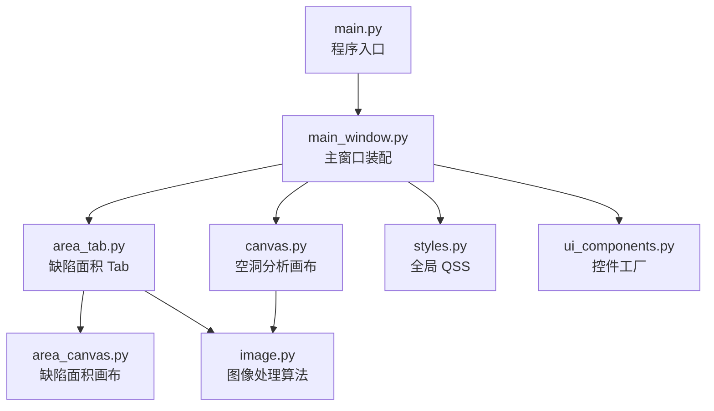
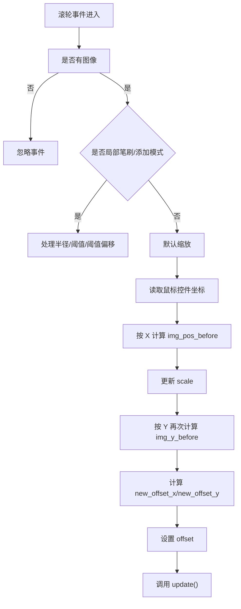
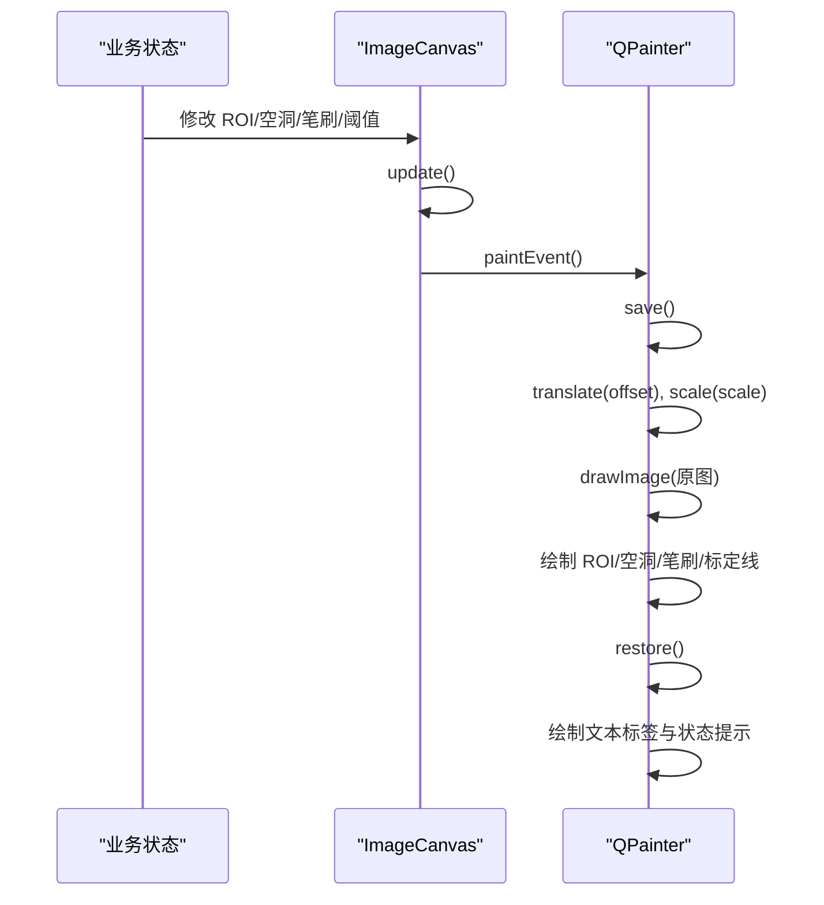
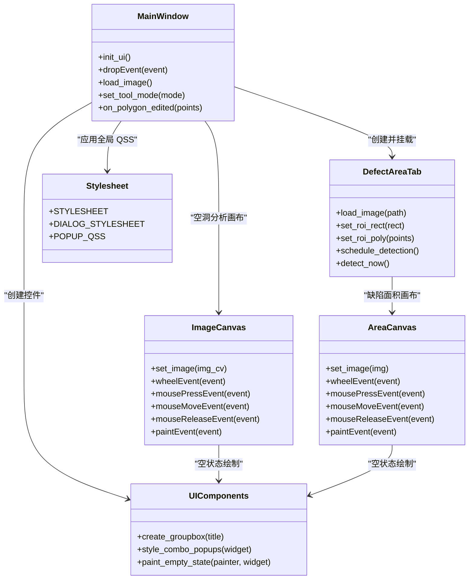
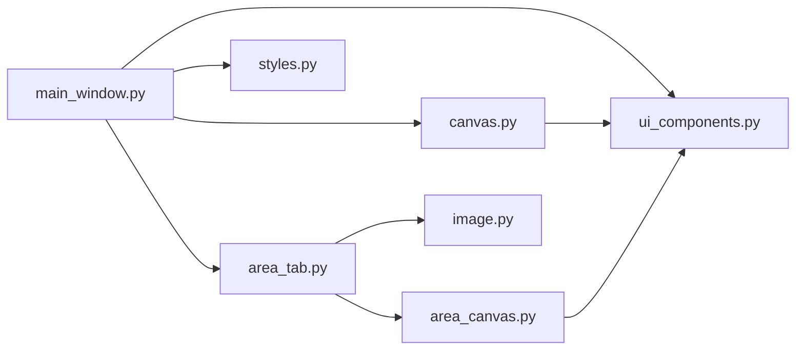

# 界面交互与绘制问题排查

<cite>
**本文引用的文件**   
- [README.md](file://README.md)
- [PROJECT_CONCEPTION.md](file://PROJECT_CONCEPTION.md)
- [canvas.py](file://canvas.py)
- [area_canvas.py](file://area_canvas.py)
- [main_window.py](file://main_window.py)
- [area_tab.py](file://area_tab.py)
- [styles.py](file://styles.py)
- [ui_components.py](file://ui_components.py)
</cite>

## 目录
1. [引言](#引言)
2. [项目结构与分层约定](#项目结构与分层约定)
3. [Canvas 层通用约定](#canvas-层通用约定)
4. [常见问题与解决方案](#常见问题与解决方案)
5. [架构总览](#架构总览)
6. [依赖关系分析](#依赖关系分析)
7. [性能与绘制优化建议](#性能与绘制优化建议)
8. [故障排查清单](#故障排查清单)
9. [结论](#结论)

## 引言
本文聚焦 Aurascope GUI 层的已知交互与绘制问题，覆盖空洞分析画布、缺陷面积页、主窗口拖拽导入、全局 QSS 样式以及 UI 组件工厂。文档以实际源码为依据，按「现象 → 触发条件 → 相关函数 → 临时规避 → 修复方向」组织，并补充 Canvas 层原图坐标↔屏幕坐标转换、缩放锚点计算、QPainter 绘制覆盖层刷新时机等通用约定，帮助开发者快速定位自绘异常。

## 项目结构与分层约定
Aurascope 是 PyQt6 + OpenCV + NumPy + Pandas 的单机桌面应用，核心分层为：
- GUI 层：主窗口、Tab 页面、Canvas 绘制层、UI 组件工厂、全局样式。
- 算法层：image.py（阈值、形态学、轮廓、距离变换、Canny 等）。
- 数据导出层：CSV 导出。
- 资源路径与打包：app_paths.py、main.spec / AurascopeV6.spec。

**图表来源**
- [README.md:42-64](file://README.md#L42-L64)
- [PROJECT_CONCEPTION.md:77-107](file://PROJECT_CONCEPTION.md#L77-L107)

**章节来源**
- [README.md:1-80](file://README.md#L1-L80)
- [PROJECT_CONCEPTION.md:77-107](file://PROJECT_CONCEPTION.md#L77-L107)

## Canvas 层通用约定
Canvas 层统一使用 QWidget + QPainter 自绘，承担图像显示、缩放、平移、ROI 编辑、结果覆盖层绘制。两个主要实现如下：
- `ImageCanvas`：空洞分析画布，承载 ROI 多边形编辑、局部笔刷、空洞添加/删除、标定线、空洞率文字等。
- `AreaCanvas`：缺陷面积画布，承载 ROI 矩形/多边形、测距、对象掩膜叠加、预览对象等。

### 原图坐标 ↔ 屏幕坐标转换
- `widget_to_img(pos)`：把鼠标在控件中的位置转换为原图像素坐标。
- `img_to_widget(pos_img)`：把原图像素坐标转换为控件屏幕坐标。
- 两者通过 `scale` 和 `offset` 线性映射；当无图像时返回零坐标或空值。

| 场景 | 关键方法 | 行为说明 |
|---|---|---|
| 鼠标点击 | `mousePressEvent` → `widget_to_img` | 将控件坐标转为原图坐标，用于 ROI、空洞、测距等逻辑。 |
| 右键平移 | `mouseMoveEvent` | 直接修改 `offset`，不改变 `scale`。 |
| 滚轮缩放 | `wheelEvent` | 根据鼠标位置计算锚点，更新 `scale` 和 `offset`。 |
| 覆盖层绘制 | `paintEvent` | 先 translate/scale，再绘制图像与覆盖层；文本标签用 `img_to_widget` 转回控件坐标。 |

**章节来源**
- [canvas.py:141-153](file://canvas.py#L141-L153)
- [area_canvas.py:157-165](file://area_canvas.py#L157-L165)

### 缩放锚点计算
Canvas 缩放应满足：鼠标悬停的原图像素点在缩放前后仍落在同一屏幕像素附近。  
当前 `ImageCanvas.wheelEvent` 默认缩放分支存在 Y 轴漂移问题：它分别用 X 和 Y 独立计算偏移，但中间只更新了一次 `self.scale`，导致第二次计算使用的是新倍率，从而破坏 Y 锚点。

**图表来源**
- [canvas.py:615-695](file://canvas.py#L615-L695)

**章节来源**
- [canvas.py:615-695](file://canvas.py#L615-L695)

### QPainter 绘制覆盖层刷新时机
- 所有状态变化后应调用 `update()`，触发 `paintEvent`。
- 图像绘制前保存 painter 状态，执行 `translate(offset)` 和 `scale(scale, scale)`。
- ROI 多边形、空洞轮廓、局部笔刷圆、标定线、检测对象掩膜都在图像坐标系下绘制。
- 文本标签、状态提示、空洞率文字等在恢复 painter 状态后，使用控件坐标绘制。

**图表来源**
- [canvas.py:697-860](file://canvas.py#L697-L860)
- [area_canvas.py:416-492](file://area_canvas.py#L416-L492)

**章节来源**
- [canvas.py:697-927](file://canvas.py#L697-L927)
- [area_canvas.py:416-492](file://area_canvas.py#L416-L492)

## 常见问题与解决方案

### 问题一：Canvas 滚轮缩放时鼠标锚点 Y 轴漂移
- **现象**：放大后图像整体向下或向上偏移，鼠标悬停位置不再稳定。
- **触发条件**：在 `ImageCanvas` 上滚动滚轮进行默认缩放。
- **相关函数**：`canvas.py::ImageCanvas.wheelEvent` 默认缩放分支。
- **根因**：代码先按 X 计算 `img_pos_before`，然后更新 `self.scale`，再按 Y 计算 `img_y_before`。由于第二次计算发生在 `scale` 已变更后，Y 锚点公式失效，导致 Y 轴漂移。
- **临时规避方式**：
  - 避免频繁大倍数缩放，尽量使用小步长滚轮。
  - 若需要精确锚点，可在主窗口侧增加“居中缩放”按钮，重置 `offset` 后再缩放。
- **修复方向**：
  - 在更新 `scale` 之前，同时保存鼠标位置的 X、Y 原图坐标。
  - 使用同一个旧 `scale` 计算 X、Y 锚点，再一次性应用新的 `scale` 和 `offset`。
  - 参考 `area_canvas.py` 的写法：先算 `anchor = widget_to_img(event.position())`，再 `self.offset = event.position() - anchor * self.scale`，两轴对称处理。

**章节来源**
- [canvas.py:684-695](file://canvas.py#L684-L695)
- [area_canvas.py:329-338](file://area_canvas.py#L329-L338)

### 问题二：右键平移卡顿或坐标转换异常
- **现象**：右键拖动平移时偶尔卡顿，或在某些模式下出现坐标误判。
- **触发条件**：
  - `ImageCanvas` 中按住右键移动。
  - `AreaCanvas` 中右键平移与左键绘制/测量共存。
- **相关函数**：
  - `canvas.py::ImageCanvas.mouseMoveEvent` 右键平移分支。
  - `area_canvas.py::AreaCanvas.mousePressEvent/mouseMoveEvent/mouseReleaseEvent`。
- **根因**：
  - `ImageCanvas` 的右键平移直接累加 `offset`，没有防抖或节流；高频 `update()` 可能引发重绘压力。
  - `AreaCanvas` 有 `_panning` 标志，并在平移优先于其他拖拽逻辑，但若左右键释放顺序异常，可能出现草稿被取消或坐标未提交的情况。
- **临时规避方式**：
  - 平移时减少同时进行的 ROI 编辑、阈值重算等操作。
  - 在缺陷面积页，先结束左键拖拽，再使用右键平移。
- **修复方向**：
  - 对 `offset` 增量做合理限制，避免极端抖动。
  - 明确区分“平移模式”和“绘制模式”，确保右键平移不会干扰左键 ROI/测距草稿。
  - 在 `mouseReleaseEvent` 中统一清理 `_drag_start`、`_drag_end`、`_panning` 等状态，防止状态残留。

**章节来源**
- [canvas.py:493-497](file://canvas.py#L493-L497)
- [area_canvas.py:212-310](file://area_canvas.py#L212-L310)

### 问题三：多边形 ROI 编辑后刷新不及时
- **现象**：拖拽顶点、双击边插入顶点、Delete 删除顶点后，UI 未及时反映最新 ROI。
- **触发条件**：
  - 在空洞分析画布中启用 ROI 多边形编辑。
  - 在缺陷面积页完成多边形框选或编辑。
- **相关函数**：
  - `canvas.py::ImageCanvas.mouseMoveEvent`、`mouseReleaseEvent`、`mouseDoubleClickEvent`、`keyPressEvent`。
  - `main_window.py::on_polygon_edited`。
  - `area_tab.py::set_roi_poly`、`area_canvas.py::AreaCanvas` 多边形绘制。
- **根因**：
  - `ImageCanvas` 在拖拽顶点/边时会立即 `update()`，但在释放后还会执行吸附、发射 `roi_polygon_edited` 信号，再由主窗口重建 mask 并调用 `finalize_roi()`。如果上层未正确连接信号或刷新表单项，会出现“画布已变、表格未变”。
  - `main_window.py::on_polygon_edited` 会重建 `roi_mask` 并恢复手动空洞，但如果 ROI 无效或 mask 为空，可能提前返回。
- **临时规避方式**：
  - 编辑完成后手动点击一次“确认选区”或重新触发检测流程。
  - 切换 Tab 或重新加载图片可强制刷新。
- **修复方向**：
  - 确保 `roi_polygon_edited` 信号始终触发 `update()` 和上层 `_refresh_results()`。
  - 在 `on_polygon_edited` 中增加更明确的错误提示，例如“多边形面积过小”“无法生成有效掩膜”。
  - 将 ROI 编辑后的刷新拆分为“即时视觉刷新”和“业务结果刷新”，避免每次拖动都跑完整检测。

**章节来源**
- [canvas.py:386-404](file://canvas.py#L386-L404)
- [canvas.py:500-518](file://canvas.py#L500-L518)
- [canvas.py:535-548](file://canvas.py#L535-L548)
- [canvas.py:601-613](file://canvas.py#L601-L613)
- [main_window.py:1170-1191](file://main_window.py#L1170-L1191)
- [area_tab.py:576-590](file://area_tab.py#L576-L590)

### 问题四：控件被静默裁剪（create_groupbox 尺寸策略）
- **现象**：使用 `create_groupbox()` 创建的分组框内容被截断，尤其是垂直布局中高度不足时。
- **触发条件**：调用 `ui_components.create_groupbox(title)` 并将子控件加入其布局。
- **相关函数**：`ui_components.py::create_groupbox`。
- **根因**：该函数当前设置了 `Expanding` 水平策略和 `Preferred` 垂直策略。若父布局要求固定高度或压缩空间，分组框可能在垂直方向被压缩到最小可用高度，导致内部控件被裁剪。
- **临时规避方式**：
  - 在创建后立即显式设置合适的最小高度或固定高度。
  - 将分组框放入 `QScrollArea`，避免外层布局压缩。
- **修复方向**：
  - 将 `create_groupbox()` 的尺寸策略改为更适合卡片式面板的组合，例如水平 `Preferred`、垂直 `Expanding`，或允许父布局控制。
  - 在样式表中为 `QGroupBox` 提供最小内边距和标题区域，避免标题与内容重叠。

**章节来源**
- [ui_components.py:232-236](file://ui_components.py#L232-L236)
- [styles.py:512-520](file://styles.py#L512-L520)

### 问题五：QSS 样式未生效或全局主题异常
- **现象**：部分控件颜色、字体、下拉弹层样式不符合设计系统；全局主题 token 冲突。
- **触发条件**：
  - 应用 `STYLESHEET` 后，QComboBox 下拉弹层样式不一致。
  - 自定义控件未设置 `objectName`，导致 QSS 选择器命中失败。
  - 设计 token 字典 `_C` 与注释 token 名称不完全一致。
- **相关函数**：
  - `styles.py::_sheet()`、`POPUP_QSS`。
  - `ui_components.py::style_combo_popups()`。
  - `main_window.py` 初始化时调用 `style_combo_popups(self)`。
- **根因**：
  - QComboBox 的弹出视图是独立窗口，全局 QSS 在某些平台/风格下命中不稳定，因此需要单独对每个 `view()` 应用 `POPUP_QSS`。
  - `_C` 中 token 名如 `surface2`、`border2`、`text2`、`text3` 与顶部注释命名不完全一致，新增样式时容易误写旧名。
- **临时规避方式**：
  - 对关键控件显式设置 `objectName`，并使用 styles.py 中已定义的 token。
  - 对 QComboBox 调用 `style_combo_popups(widget)`，确保下拉弹层样式生效。
- **修复方向**：
  - 统一 token 命名：让注释契约与实际 `_C` 字典完全一致，新增 token 时同步更新注释。
  - 在 `style_combo_popups` 中增加失败日志，便于定位哪些 ComboBox 未成功应用弹层样式。
  - 对全局 QSS 中未命中的控件，集中补充选择器，而不是在各 Tab 里散落 setStyleSheet。

**章节来源**
- [styles.py:27-42](file://styles.py#L27-L42)
- [styles.py:44-536](file://styles.py#L44-L536)
- [styles.py:541-576](file://styles.py#L541-L576)
- [ui_components.py:419-453](file://ui_components.py#L419-L453)
- [main_window.py:93-95](file://main_window.py#L93-L95)

### 问题六：拖拽导入图片后主窗口状态不同步
- **现象**：从系统文件管理器拖入图片后，Tab 切换到了预期页面，但侧边栏按钮、检测状态、最近打开记录或画布状态未完全同步。
- **触发条件**：
  - 拖入单张图片 → 应进入 ROI 缺陷面积页。
  - 拖入多张图片 → 应进入图像拼接页。
  - 拖入文件夹 → 应进入示教/批量页。
- **相关函数**：`main_window.py::dragEnterEvent`、`dropEvent`。
- **根因**：
  - `dropEvent` 负责判断 URL 类型并切换 Tab，但对单张图片只调用 `area_tab.load_image(images[0])`，没有像 `load_image()` 那样调用 `_reset_all_state()` 或统一的状态重置逻辑。
  - 如果是从其他模块跳转到 ROI 页，主窗口的空洞分析侧边栏、画布状态、最近打开列表可能仍处于上一状态。
- **临时规避方式**：
  - 拖入图片后，手动切换到对应 Tab，再重新点击“导入图片”或“检测全部 ROI”。
  - 重启应用可恢复默认状态。
- **修复方向**：
  - 在 `dropEvent` 中复用统一的图片加载流程，例如封装一个 `_handle_drop_images(urls)`，内部调用 `area_tab.load_image` 或 `stitching_tab.add_images`，并确保调用 `remember_recent_image`。
  - 对单图拖入，补充主窗口状态同步：清空空洞分析侧边栏、重置画布、更新最近打开菜单。
  - 对多图拖入，确保拼接 Tab 接收图片后也同步主窗口标题、状态提示和最近批次记录。

**章节来源**
- [main_window.py:314-344](file://main_window.py#L314-L344)
- [main_window.py:800-826](file://main_window.py#L800-L826)
- [main_window.py:864-878](file://main_window.py#L864-L878)

## 架构总览
下图展示 GUI 层与 Canvas 层的关键交互：

**图表来源**
- [main_window.py:99-154](file://main_window.py#L99-L154)
- [area_tab.py:110-150](file://area_tab.py#L110-L150)
- [canvas.py:13-29](file://canvas.py#L13-L29)
- [area_canvas.py:85-132](file://area_canvas.py#L85-L132)
- [styles.py:536-576](file://styles.py#L536-L576)
- [ui_components.py:232-236](file://ui_components.py#L232-L236)
- [ui_components.py:419-453](file://ui_components.py#L419-L453)

## 依赖关系分析
- `main_window.py` 依赖 `canvas.ImageCanvas`、`area_tab.DefectAreaTab`、`styles.STYLESHEET`、`ui_components` 工厂函数。
- `area_tab.py` 依赖 `area_canvas.AreaCanvas`、`image.detect_defects`、`ui_components` 工厂函数。
- `canvas.py` 依赖 `app_paths.resource_path`、`ui_components.paint_empty_state`。
- `area_canvas.py` 依赖 `ui_components.paint_empty_state`。
- `styles.py` 提供全局 QSS token 和弹窗 QSS，不反向依赖 GUI 业务类。
- `ui_components.py` 提供通用控件创建和空状态绘制，不持有业务逻辑。

**图表来源**
- [main_window.py:31-49](file://main_window.py#L31-L49)
- [area_tab.py:21-28](file://area_tab.py#L21-L28)
- [canvas.py:9-10](file://canvas.py#L9-L10)
- [area_canvas.py:12-12](file://area_canvas.py#L12-L12)

**章节来源**
- [main_window.py:31-49](file://main_window.py#L31-L49)
- [area_tab.py:21-28](file://area_tab.py#L21-L28)
- [canvas.py:9-10](file://canvas.py#L9-L10)
- [area_canvas.py:12-12](file://area_canvas.py#L12-L12)

## 性能与绘制优化建议
- 避免在 `mouseMoveEvent` 中执行耗时算法；ROI 编辑应只做几何更新和 `update()`。
- 对大图增强检测、批量 ROI 检测使用定时器防抖，已在 `area_tab.py` 中使用 150ms 防抖。
- 覆盖层图像建议使用 `.copy()` 避免 numpy 临时数组释放后花屏，`ui_components.copy_bgr_to_clipboard` 已有类似实践。
- 文本标签绘制应缓存字体度量或仅在必要时重绘，避免每帧重复计算。
- QComboBox 下拉弹层样式应在应用启动时统一处理，不要在每个控件创建时重复 setStyleSheet。

[本节为通用优化建议，不直接分析具体文件]

## 故障排查清单
- **滚轮缩放 Y 漂移**：检查 `ImageCanvas.wheelEvent` 默认缩放分支是否先更新 `scale` 再计算 Y 锚点。
- **右键平移卡顿**：检查 `mouseMoveEvent` 中是否高频 `update()`，以及 `_panning` 状态是否正确清理。
- **多边形 ROI 刷新延迟**：检查 `roi_polygon_edited` 信号是否触发，主窗口是否重建 mask 并刷新表格。
- **控件被裁剪**：检查 `create_groupbox()` 返回值是否被放入允许 Expanding 的布局，或是否被 QScrollArea 包裹。
- **QSS 未生效**：检查控件 `objectName` 是否在 styles.py 中有对应选择器；QComboBox 是否调用 `style_combo_popups`。
- **拖拽导入状态不同步**：检查 `dropEvent` 是否复用统一加载流程，是否调用最近打开记录、Tab 状态同步。

**章节来源**
- [canvas.py:615-695](file://canvas.py#L615-L695)
- [area_canvas.py:329-338](file://area_canvas.py#L329-L338)
- [main_window.py:314-344](file://main_window.py#L314-L344)
- [ui_components.py:232-236](file://ui_components.py#L232-L236)
- [styles.py:536-576](file://styles.py#L536-L576)
- [ui_components.py:419-453](file://ui_components.py#L419-L453)

## 结论
Aurascope 的 GUI 层以 Canvas 自绘为核心，优势是灵活可控，代价是坐标转换、缩放锚点、绘制刷新必须严格遵循约定。当前主要风险集中在：
- `ImageCanvas` 滚轮缩放 Y 锚点计算存在已知缺陷。
- 右键平移与多边形编辑的状态机需要更清晰的边界。
- `create_groupbox()` 尺寸策略可能导致控件被静默裁剪。
- QSS token 与弹窗样式需要统一管理。
- 拖拽导入图片缺少统一状态同步入口。

建议优先修复缩放锚点、统一拖拽导入流程、规范 create_groupbox 尺寸策略，并建立 Canvas 层坐标与绘制约定的单元测试或可视化回归用例，以降低后续自绘异常的概率。