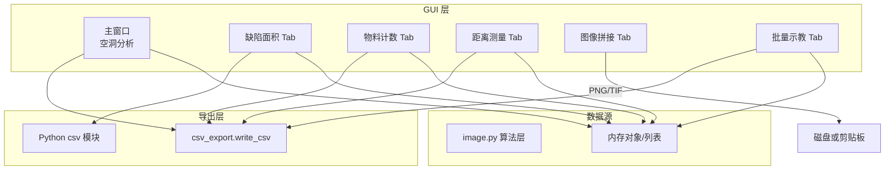
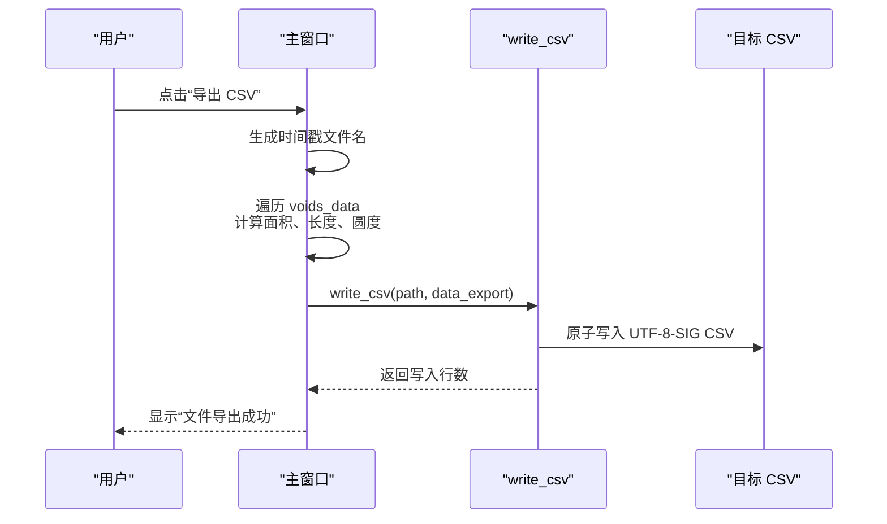
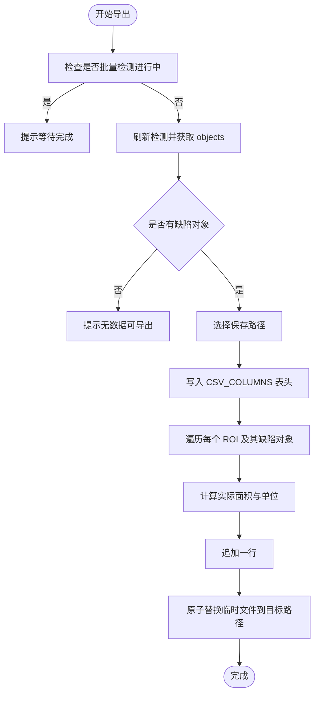
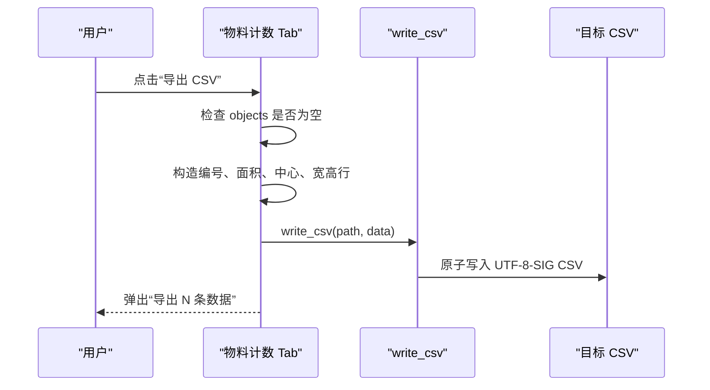
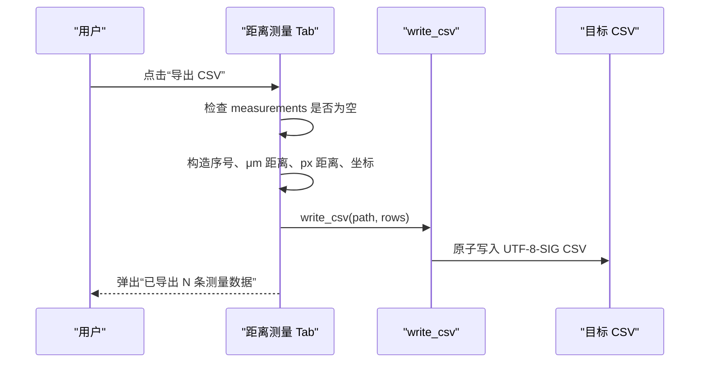
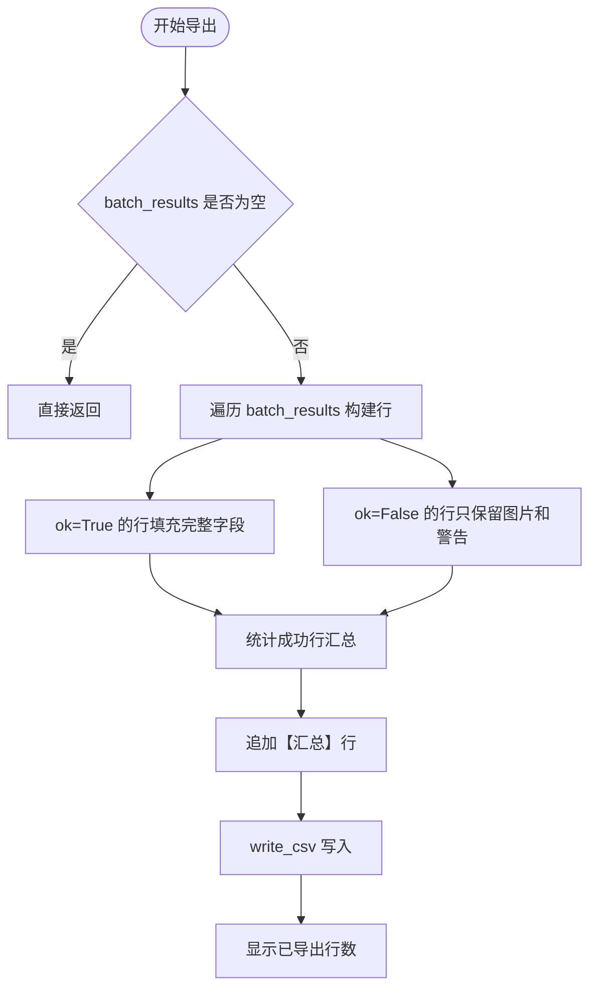
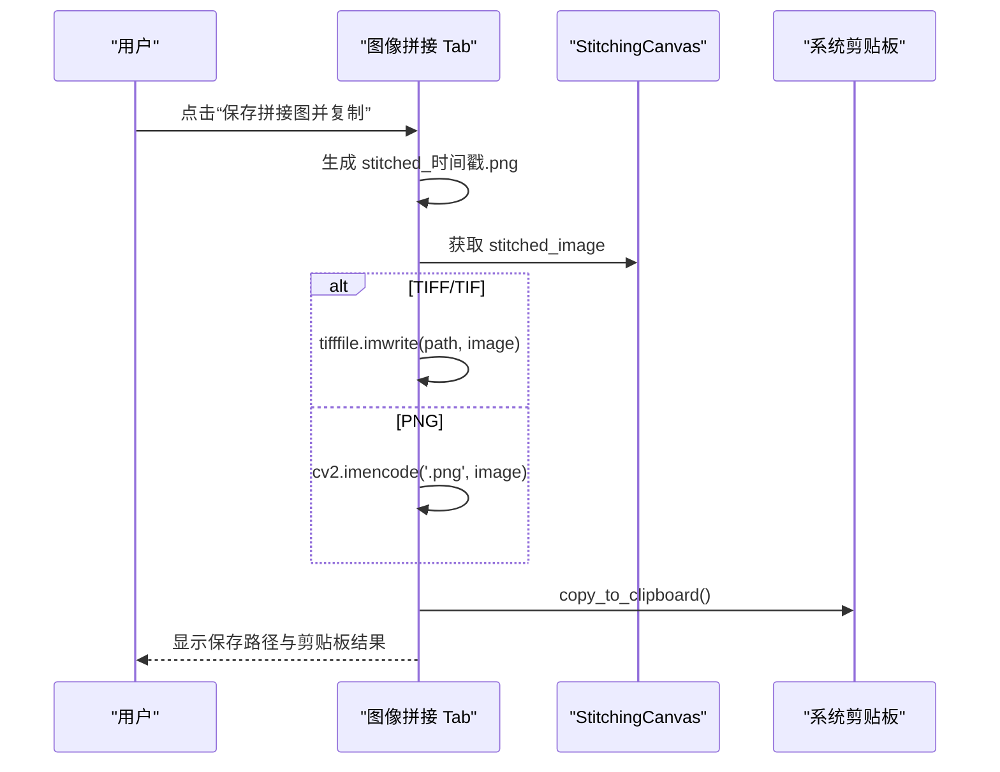
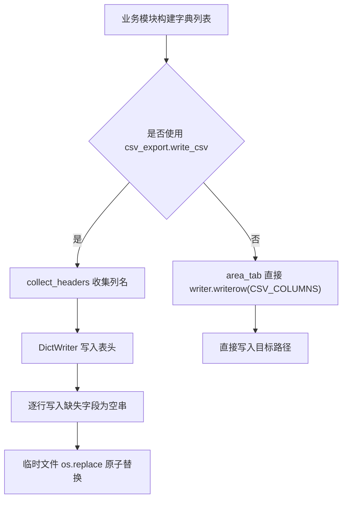
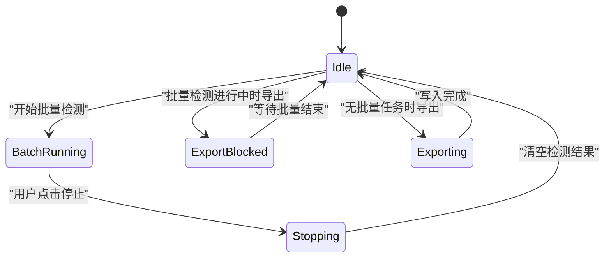

# 导出文件格式

<cite>
**本文引用的文件**   
- [README.md](file://README.md)
- [PROJECT_CONCEPTION.md](file://PROJECT_CONCEPTION.md)
- [csv_export.py](file://csv_export.py)
- [area_tab.py](file://area_tab.py)
- [counting_tab.py](file://counting_tab.py)
- [measure_tab.py](file://measure_tab.py)
- [shear_tab.py](file://shear_tab.py)
- [stitching_tab.py](file://stitching_tab.py)
- [main_window.py](file://main_window.py)
- [teach_batch_tab.py](file://teach_batch_tab.py)
- [test_area_tab.py](file://test_area_tab.py)
- [test_teach_batch_logic.py](file://test_teach_batch_logic.py)
</cite>

## 目录
1. [引言](#引言)
2. [导出总览与通用规则](#导出总览与通用规则)
3. [空洞分析结果导出](#空洞分析结果导出)
4. [缺陷面积多 ROI 结果导出](#缺陷面积多-roi-结果导出)
5. [物料计数结果导出](#物料计数结果导出)
6. [距离测量结果导出](#距离测量结果导出)
7. [剪切力计算结果导出](#剪切力计算结果导出)
8. [批量示教空洞率结果导出](#批量示教空洞率结果导出)
9. [图像拼接产物命名约定](#图像拼接产物命名约定)
10. [像素单位与物理单位换算](#像素单位与物理单位换算)
11. [pandas DataFrame 构建过程与写入路径](#pandas-dataframe-构建过程与写入路径)
12. [文件名生成、编码与覆盖策略](#文件名生成编码与覆盖策略)
13. [批量导出进度提示与取消行为](#批量导出进度提示与取消行为)
14. [已知字段顺序不一致与空结果差异](#已知字段顺序不一致与空结果差异)
15. [排查方法](#排查方法)
16. [结论](#结论)

## 引言
Aurascope 是面向微电子封装产线的半自动化视觉检测桌面工具，核心业务包括金锡焊料空洞分析、芯片剪切力标准校核、蓝膜物料计数和微观尺寸测量。仓库文档明确说明“检测结果统一输出为 CSV”，但实际实现中不同模块的导出逻辑并不完全统一：有的使用统一的 `csv_export.write_csv`，有的直接调用 Python 标准库 `csv` 模块；有的用 Pandas 概念描述，有的则显式避免 Pandas。

本文件聚焦所有导出产物的格式规范，重点回答以下问题：
- 各导出 CSV 的表头、字段含义、最小示例行。
- 像素面积与实际物理面积的换算关系及标定参数来源。
- 导出时的临时文件、编码、覆盖策略。
- 批量处理中的进度提示与取消行为。
- 当前实现中可能存在的字段顺序不一致、空结果处理差异，以及排查方法。

## 导出总览与通用规则
目前仓库中存在以下导出相关代码路径：
- 通用 CSV 写入器：`csv_export.py`。
- 空洞分析主窗口导出：`main_window.py`。
- 缺陷面积多 ROI 导出：`area_tab.py`。
- 物料计数导出：`counting_tab.py`。
- 距离测量导出：`measure_tab.py`。
- 剪切力计算：`shear_tab.py`（无 CSV 导出）。
- 批量示教空洞率导出：`teach_batch_tab.py`。
- 图像拼接产物：`stitching_tab.py`（PNG/TIF 图片，非 CSV）。

**图表来源**
- [main_window.py:1729-1758](file://main_window.py#L1729-L1758)
- [area_tab.py:1116-1167](file://area_tab.py#L1116-L1167)
- [counting_tab.py:425-446](file://counting_tab.py#L425-L446)
- [measure_tab.py:302-321](file://measure_tab.py#L302-L321)
- [teach_batch_tab.py:1855-1901](file://teach_batch_tab.py#L1855-L1901)
- [stitching_tab.py:385-404](file://stitching_tab.py#L385-L404)
- [csv_export.py:1-52](file://csv_export.py#L1-L52)

**章节来源**
- [README.md:35-41](file://README.md#L35-L41)
- [PROJECT_CONCEPTION.md:55-60](file://PROJECT_CONCEPTION.md#L55-L60)
- [PROJECT_CONCEPTION.md:77-107](file://PROJECT_CONCEPTION.md#L77-L107)

## 空洞分析结果导出
### 表头定义
主窗口空洞分析导出的 CSV 包含以下列：
- `序号`：空洞编号。
- `面积(μm²)`：按像素面积除以像素比例平方得到的物理面积。
- `最大长度(μm)`：外接矩形宽度与高度换算后的最大值。
- `圆度`：由轮廓点集与像素面积计算的圆度值。
- `Center_X`：质心 X 坐标，取整。
- `Center_Y`：质心 Y 坐标，取整。

注意：该导出没有“Canny 状态”“手动标记”等列。虽然空洞检测流程支持 Canny 边缘校验与手动修正，但主窗口 `export_csv` 只从 `voids_data` 中读取固定字段并构造字典。

### 最小示例行
假设某空洞像素面积为 400 px²，像素比例为 1.0 px/μm，外接矩形宽 20、高 20，圆度为 0.850，质心为 (10, 10)，则一行可表示为：

| 序号 | 面积(μm²) | 最大长度(μm) | 圆度 | Center_X | Center_Y |
|---|---|---|---|---|---|
| 1 | 400.00 | 20.00 | 0.850 | 10 | 10 |

### 处理流程

**图表来源**
- [main_window.py:1729-1758](file://main_window.py#L1729-L1758)
- [csv_export.py:27-51](file://csv_export.py#L27-L51)

**章节来源**
- [main_window.py:1729-1758](file://main_window.py#L1729-L1758)

## 缺陷面积多 ROI 结果导出
### 表头定义
缺陷面积 Tab 的 CSV 列由常量 `CSV_COLUMNS` 定义：
- `ROI编号`：当前 ROI 的编号。
- `缺陷编号`：该 ROI 内缺陷对象的编号。
- `像素面积`：缺陷掩码的像素数。
- `实际面积`：未标定时为空字符串；已标定时为 `像素面积 × unit_per_px²`，保留科学计数风格。
- `面积单位`：未标定时为“未标定”；已标定时为 `unit²`，例如“µm²”。
- `质心x_px`：缺陷质心 X 坐标。
- `质心y_px`：缺陷质心 Y 坐标。
- `来源`：通常为“自动”，也可来自手动修正。

### 最小示例行
假设一个 ROI 编号为 1，缺陷编号为 1，像素面积为 200，未标定，质心为 (100.5, 60.3)，来源为“自动”，则一行可表示为：

| ROI编号 | 缺陷编号 | 像素面积 | 实际面积 | 面积单位 | 质心x_px | 质心y_px | 来源 |
|---|---|---|---|---|---|---|---|
| 1 | 1 | 200 |  | 未标定 | 100.5 | 60.3 | 自动 |

若已标定且单位为 µm，`unit_per_px = 0.5`，则 `实际面积 = 200 × 0.5² = 50.0`，单位列为“µm²”。

### 处理流程

**图表来源**
- [area_tab.py:1116-1167](file://area_tab.py#L1116-L1167)

**章节来源**
- [area_tab.py:31-36](file://area_tab.py#L31-L36)
- [area_tab.py:1116-1167](file://area_tab.py#L1116-L1167)

## 物料计数结果导出
### 表头定义
物料计数 Tab 导出的 CSV 包含以下列：
- `编号`：物体编号。
- `面积(像素)`：物体像素面积。
- `中心X`：质心 X 坐标，保留两位小数。
- `中心Y`：质心 Y 坐标，保留两位小数。
- `宽度`：外接矩形宽度。
- `高度`：外接矩形高度。

该导出不输出物理面积，也不区分 ROI 名称；它直接遍历当前 `self.objects`。

### 最小示例行
假设检测到两个物体，编号分别为 1 和 2，像素面积分别为 120 和 80，质心和外接矩形如下：

| 编号 | 面积(像素) | 中心X | 中心Y | 宽度 | 高度 |
|---|---|---|---|---|---|
| 1 | 120 | 50.25 | 30.10 | 12 | 10 |
| 2 | 80 | 120.00 | 80.00 | 8 | 10 |

### 处理流程

**图表来源**
- [counting_tab.py:425-446](file://counting_tab.py#L425-L446)
- [csv_export.py:27-51](file://csv_export.py#L27-L51)

**章节来源**
- [counting_tab.py:425-446](file://counting_tab.py#L425-L446)

## 距离测量结果导出
### 表头定义
距离测量 Tab 导出的 CSV 包含以下列：
- `序号`：从 1 开始的测量序号。
- `距离(μm)`：以 μm 为单位的距离，保留两位小数。
- `距离(px)`：像素距离，保留一位小数。
- `起点X`：起点 X 坐标，保留一位小数。
- `起点Y`：起点 Y 坐标，保留一位小数。
- `终点X`：终点 X 坐标，保留一位小数。
- `终点Y`：终点 Y 坐标，保留一位小数。

注意：这里使用的是 `measure_tab.MeasureTab`，不是 `area_tab.DefectAreaTab`。两者都支持测距，但导出实现不同。

### 最小示例行
假设第一条测量起点为 (10.0, 20.0)，终点为 (110.0, 20.0)，像素距离为 100.0，像素比例为 0.5 px/μm，则物理距离为 200.0 μm：

| 序号 | 距离(μm) | 距离(px) | 起点X | 起点Y | 终点X | 终点Y |
|---|---|---|---|---|---|---|
| 1 | 200.00 | 100.0 | 10.0 | 20.0 | 110.0 | 20.0 |

### 处理流程

**图表来源**
- [measure_tab.py:302-321](file://measure_tab.py#L302-L321)
- [csv_export.py:27-51](file://csv_export.py#L27-L51)

**章节来源**
- [measure_tab.py:302-321](file://measure_tab.py#L302-L321)

## 剪切力计算结果导出
剪切力 Tab 是一个纯计算器界面，输入芯片长宽后计算 MIL-STD-883H Method 2019.9 的最小剪切力要求，并在界面上显示 1X、1.25X、2X 的克值和牛顿值。

当前实现中：
- 没有“导出 CSV”按钮。
- 没有 `export_csv` 方法。
- 没有将计算结果写入文件或剪贴表以外的持久化产物。
- 唯一的外部操作是复制 2X 力值到系统剪贴板。

因此，“剪切力计算结果表头”在当前仓库中没有 CSV 定义。如果未来需要导出，应新增独立表头，例如：
- `长度(mm)`
- `宽度(mm)`
- `面积(mm²)`
- `面积(in²)`
- `1X 最小力值(g)`
- `1.25X 测试力值(g)`
- `2X 测试力值(g)`
- `2X 测试力值(N)`

但这属于建议扩展，不是现有行为。

**章节来源**
- [shear_tab.py:1-285](file://shear_tab.py#L1-L285)

## 批量示教空洞率结果导出
### 表头定义
批量示教 Tab 导出的 CSV 每行对应一张图片的处理结果，主要列包括：
- `图片`：图片文件名。
- `金锡面积(px²)`：金锡区域像素面积。
- `金锡面积(μm²)`：根据 `px_per_um_used` 换算的物理面积。
- `空洞数`：空洞数量。
- `空洞面积(px²)`：空洞总面积。
- `空洞率(%)`：空洞面积除以金锡面积的比例乘以 100。
- `t_空洞`：使用的空洞阈值。
- `空洞面积下限(px²)`：过滤掉的小于最小面积的空洞阈值。
- `空洞面积上限(px²)`：过滤掉的大于最大面积的空洞阈值。
- `未计入大暗斑数`：大于最大面积的空洞数量。
- `未计入小暗斑数`：小于最小面积的空洞数量。
- `比例尺识别`：是否识别到比例尺。
- `厚度过滤剔除(%)`：诊断信息中的薄层剔除比例。
- `面积口径`：面积口径，如“检测掩码”或人工修正后的口径。
- `警告`：多条警告用分号连接。

失败行会省略其他数值列，只保留 `图片` 和 `警告`。

此外，导出会在末尾追加一行汇总行，`图片` 列为“【汇总】”，包含汇总的金锡面积、空洞面积、空洞率，以及空洞率的均值与标准差。

### 最小示例行
成功行示例：

| 图片 | 金锡面积(px²) | 金锡面积(μm²) | 空洞数 | 空洞面积(px²) | 空洞率(%) | t_空洞 | 空洞面积下限(px²) | 空洞面积上限(px²) | 未计入大暗斑数 | 未计入小暗斑数 | 比例尺识别 | 厚度过滤剔除(%) | 面积口径 | 警告 |
|---|---|---|---|---|---|---|---|---|---|---|---|---|---|---|
| sample.png | 10000 | 2500.0 | 5 | 120.0 | 1.200 | 150.0 | 10 | 5000 | 2 | 3 | 是 | 0.000 | 检测掩码 |  |

失败行示例：

| 图片 | 警告 |
|---|---|
| bad.png | 处理失败 |

汇总行示例：

| 图片 | 金锡面积(px²) | 空洞面积(px²) | 空洞率(%) | 警告 |
|---|---|---|---|---|
| 【汇总】 | 30000 | 360.0 | 1.200 | 均值1.20%±0.10% |

### 处理流程

**图表来源**
- [teach_batch_tab.py:1855-1901](file://teach_batch_tab.py#L1855-L1901)

**章节来源**
- [teach_batch_tab.py:1855-1901](file://teach_batch_tab.py#L1855-L1901)

## 图像拼接产物命名约定
图像拼接 Tab 不导出 CSV，而是导出拼接后的图像：
- 默认保存文件名前缀为 `stitched_`，后缀为时间戳和 `.png`。
- 支持 PNG 和 TIF/TIFF 两种格式。
- 保存成功后还会尝试复制到系统剪贴板。

命名约定可总结为：
- 文件名模板：`stitched_{YYYYMMDD_HHMMSS}.png`。
- 可选扩展名：`.tif`、`.tiff`。
- 内容：拼接后的 BGR/Numpy 图像数组。

**图表来源**
- [stitching_tab.py:385-404](file://stitching_tab.py#L385-L404)
- [stitching_tab.py:413-447](file://stitching_tab.py#L413-L447)

**章节来源**
- [stitching_tab.py:385-404](file://stitching_tab.py#L385-L404)
- [stitching_tab.py:413-447](file://stitching_tab.py#L413-L447)

## 像素单位与物理单位换算
### 缺陷面积多 ROI
- `unit_per_px` 表示“每微米对应的像素数”，即 px/μm。
- 像素面积转换为物理面积的公式为：
  - `实际面积 = 像素面积 × unit_per_px²`。
- 单位由 `unit` 决定，默认值为“µm”，也支持 nm、mm、cm、m。
- 未标定时 `unit_per_px` 为 None，导出时 `实际面积` 为空字符串，`面积单位` 为“未标定”。

### 主窗口空洞分析
- `pixel_scale` 表示“每微米对应的像素数”，与缺陷面积 Tab 的语义一致。
- 导出时若 `pixel_scale <= 0`，则回退为 1.0，此时物理面积等于像素面积。
- 物理面积计算公式为：
  - `面积(μm²) = area_px / pixel_scale²`。
- 最大长度由外接矩形宽度和高度分别除以 `pixel_scale` 得到。

### 距离测量
- `pixel_scale` 在 `MeasureTab` 中表示“像素数 ÷ 物理长度”，即 px/μm。
- 距离存储的是 μm 值，导出时再乘以 `pixel_scale` 得到 px 值。
- 这与缺陷面积 Tab 的 `unit_per_px` 语义相同，都是 px/μm。

### 批量示教
- 使用 `px_per_um_used` 作为像素到微米的换算参数。
- 金锡物理面积计算公式为：
  - `金锡面积(μm²) = solder_area_px / (px_per_um_used)²`。
- 若未识别比例尺，该列可能为空。

### 标定参数来源
- 缺陷面积 Tab：通过画线标定，用户输入实际长度和单位，计算 `unit_per_px = 实际长度 / 像素距离`。
- 距离测量 Tab：通过划线标定，用户输入参考线实际长度，计算 `pixel_scale = 像素距离 / 实际长度`。
- 批量示教：可从快速示教对话框中可选地输入比例尺，或由模型/配方推断。

**章节来源**
- [area_tab.py:31-36](file://area_tab.py#L31-L36)
- [area_tab.py:380-430](file://area_tab.py#L380-L430)
- [area_tab.py:1147-1153](file://area_tab.py#L1147-L1153)
- [main_window.py:1738-1755](file://main_window.py#L1738-L1755)
- [measure_tab.py:227-253](file://measure_tab.py#L227-L253)
- [measure_tab.py:309-319](file://measure_tab.py#L309-L319)
- [teach_batch_tab.py:1865-1876](file://teach_batch_tab.py#L1865-L1876)

## pandas DataFrame 构建过程与写入路径
项目构思文档中技术架构提到“Pandas → CSV”，但实际实现中：
- `csv_export.py` 明确注释“用标准库 csv 替代 pandas，只为写表 + 行的几处调用”。
- `counting_tab.py`、`measure_tab.py`、`main_window.py`、`teach_batch_tab.py` 使用 `csv_export.write_csv`。
- `area_tab.py` 的缺陷面积导出直接使用 Python 标准库 `csv.writer`，不使用 `csv_export.write_csv`。
- 仓库中没有发现任何 `import pandas` 或 `pd.DataFrame(...).to_csv(...)` 的实际调用。

因此，当前实现不应理解为“先构建 Pandas DataFrame 再导出”，而应理解为：
- 多数模块构建 Python 字典列表 `[{"列": 值}, ...]`。
- 通过 `csv_export.write_csv` 或标准库 `csv` 写入。
- `csv_export.collect_headers` 负责按首次出现顺序收集列名，等价于 Pandas 的列对齐语义。

**图表来源**
- [csv_export.py:15-51](file://csv_export.py#L15-L51)
- [area_tab.py:1139-1154](file://area_tab.py#L1139-L1154)

**章节来源**
- [PROJECT_CONCEPTION.md:97-101](file://PROJECT_CONCEPTION.md#L97-L101)
- [csv_export.py:1-8](file://csv_export.py#L1-L8)
- [csv_export.py:15-51](file://csv_export.py#L15-L51)
- [area_tab.py:1139-1154](file://area_tab.py#L1139-L1154)

## 文件名生成、编码与覆盖策略
### 文件名生成规则
| 模块 | 默认文件名模板 | 说明 |
|---|---|---|
| 主窗口空洞分析 | `空洞分析_{YYYYMMDD_HHMMSS}.csv` | 使用 `datetime.now().strftime('%Y%m%d_%H%M%S')` |
| 缺陷面积多 ROI | `defect_area_{YYYYMMDD_HHMM%S}.csv` | 使用 `datetime.now():%Y%m%d_%H%M%S` |
| 物料计数 | `计数_{YYYYMMDD_HHMM%S}.csv` | 使用 `datetime.now().strftime('%Y%m%d_%H%M%S')` |
| 距离测量 | `测量数据_{YYYYMMDD_HHMM%S}.csv` | 使用 `datetime.now().strftime('%Y%m%d_%H%M%S')` |
| 批量示教空洞率 | `批量空洞率_{YYYYMMDD_HHMM%S}.csv` | 使用 `datetime.now().strftime('%Y%m%d_%H%M%S')` |
| 图像拼接 | `stitched_{YYYYMMDD_HHMM%S}.png` | 可改为 `.tif` 或 `.tiff` |

### 编码格式
- `csv_export.write_csv` 统一使用 `utf-8-sig`，使 Excel 双击打开时中文不乱码。
- `area_tab.py` 的缺陷面积导出也显式使用 `utf-8-sig`。
- `measure_tab.py` 的导出走 `csv_export.write_csv`，因此也是 `utf-8-sig`。
- `counting_tab.py` 和 `teach_batch_tab.py` 同样走 `csv_export.write_csv`。

### 重复覆盖策略
- 所有导出最终都会调用操作系统层面的文件写入。
- `csv_export.write_csv` 使用同目录临时文件 + `os.replace`，避免中途失败留下半截文件。
- `area_tab.py` 的缺陷面积导出使用 `tempfile.NamedTemporaryFile` + `os.replace`，语义类似。
- 如果用户选择已存在的路径，通常会直接覆盖旧文件；仓库中没有统一的“同名冲突确认弹窗”逻辑。
- 图像拼接保存时也没有看到覆盖前确认逻辑。

**章节来源**
- [main_window.py:1731-1733](file://main_window.py#L1731-L1733)
- [area_tab.py:1125-1127](file://area_tab.py#L1125-L1127)
- [area_tab.py:1139-1154](file://area_tab.py#L1139-L1154)
- [counting_tab.py:429-431](file://counting_tab.py#L429-L431)
- [measure_tab.py:305-306](file://measure_tab.py#L305-L306)
- [teach_batch_tab.py:1858-1861](file://teach_batch_tab.py#L1858-L1861)
- [stitching_tab.py:391-394](file://stitching_tab.py#L391-L394)
- [csv_export.py:27-51](file://csv_export.py#L27-L51)

## 批量导出进度提示与取消行为
### 缺陷面积多 ROI
- 批量检测过程中有 `_batch_active`、`_batch_queue`、`_batch_generation` 控制。
- 批量检测进行时，`export_csv` 会拒绝导出并提示“批量检测进行中，请等待完成或停止后再导出 CSV”。
- 批量检测本身通过定时器 `_batch_timer` 逐个执行 ROI，但没有独立的“批量导出进度条”。
- 批量检测的 UI 状态变化由 `_status` 和表格刷新驱动。

### 图像拼接
- 图像拼接有明确的 `QProgressDialog`，标题为“拼接中”，带“取消”按钮。
- 进度回调通过 `progress_callback` 更新进度条文本和值。
- 这是仓库中较完整的批量任务进度与取消示例。

### 批量示教空洞率
- `export_csv` 直接遍历 `batch_results` 并调用 `write_csv`。
- 没有独立的进度条。
- 导出完成后通过 `show_toast` 提示“已导出 N 行”。

**图表来源**
- [area_tab.py:704-800](file://area_tab.py#L704-L800)
- [area_tab.py:1116-1124](file://area_tab.py#L1116-L1124)
- [stitching_tab.py:340-359](file://stitching_tab.py#L340-L359)
- [teach_batch_tab.py:1855-1901](file://teach_batch_tab.py#L1855-L1901)

**章节来源**
- [area_tab.py:704-800](file://area_tab.py#L704-L800)
- [area_tab.py:1116-1124](file://area_tab.py#L1116-L1124)
- [stitching_tab.py:340-359](file://stitching_tab.py#L340-L359)
- [teach_batch_tab.py:1855-1901](file://teach_batch_tab.py#L1855-L1901)

## 已知字段顺序不一致与空结果差异
### 字段顺序不一致
- 主窗口空洞分析导出列顺序由字典插入顺序决定：`序号`、`面积(μm²)`、`最大长度(μm)`、`圆度`、`Center_X`、`Center_Y`。
- 缺陷面积多 ROI 导出列顺序由 `CSV_COLUMNS` 常量决定，测试中也断言了该顺序。
- 物料计数导出列顺序由构造字典时的键顺序决定。
- 距离测量导出列顺序由构造字典时的键顺序决定。
- 批量示教导出列顺序由 `rows.append({...})` 的键顺序决定。

由于 Python 3.7+ 字典保持插入顺序，这些导出通常稳定，但不同模块之间没有统一的列定义，因此不能假设所有 CSV 列顺序一致。

### 空结果处理差异
| 模块 | 空结果行为 |
|---|---|
| 主窗口空洞分析 | 如果 `voids_data` 为空，循环不会添加任何行，最终写入空表头 CSV。 |
| 缺陷面积多 ROI | 如果 `objects` 为空，直接返回 False 并提示“无数据可导出”。 |
| 物料计数 | 如果 `objects` 为空，弹出“没有数据可导出”提示，不打开保存对话框。 |
| 距离测量 | 如果 `measurements` 为空，直接返回，不触发导出。 |
| 批量示教空洞率 | 如果 `batch_results` 为空，直接返回；否则即使全部失败也会写入至少失败行和可能的汇总行。 |
| 图像拼接 | 如果没有拼接结果，保存和复制操作会提示“请先完成拼接”。 |

### 缺失字段处理差异
- `csv_export.write_csv` 对 `None` 值转为空字符串，并使用 `extrasaction='ignore'` 忽略多余字段。
- `area_tab.py` 的缺陷面积导出直接写 `'' if real is None else f'{real:.6g}'`，对未标定场景做特殊处理。
- 其他模块依赖 `csv_export.write_csv` 的统一空值处理。

**章节来源**
- [main_window.py:1748-1757](file://main_window.py#L1748-L1757)
- [area_tab.py:31-32](file://area_tab.py#L31-L32)
- [area_tab.py:1116-1167](file://area_tab.py#L1116-L1167)
- [counting_tab.py:425-446](file://counting_tab.py#L425-L446)
- [measure_tab.py:302-321](file://measure_tab.py#L302-L321)
- [teach_batch_tab.py:1855-1901](file://teach_batch_tab.py#L1855-L1901)
- [csv_export.py:27-51](file://csv_export.py#L27-L51)

## 排查方法
当导出结果不符合预期时，可按以下步骤排查：

1. **确认是哪个模块的导出**  
   - 主窗口空洞分析：查看 `main_window.py` 的 `export_csv`。
   - 缺陷面积多 ROI：查看 `area_tab.py` 的 `export_csv` 和 `CSV_COLUMNS`。
   - 物料计数：查看 `counting_tab.py` 的 `export_csv`。
   - 距离测量：查看 `measure_tab.py` 的 `export_csv`。
   - 批量示教空洞率：查看 `teach_batch_tab.py` 的 `export_csv`。
   - 图像拼接：查看 `stitching_tab.py` 的 `save_stitched` 和 `copy_to_clipboard`。

2. **检查是否使用了正确的导出入口**  
   - 如果期望列包含 ROI 编号，应使用缺陷面积多 ROI 导出，而不是主窗口空洞分析导出。
   - 如果期望物理面积，需确认是否已完成标定，并检查 `unit_per_px` 或 `pixel_scale` 是否大于 0。

3. **检查 CSV 编码**  
   - 用文本编辑器打开 CSV，确认首字节是否为 UTF-8 BOM。
   - 如果是 `csv_export.write_csv` 或 `area_tab.py` 的导出，应为 `utf-8-sig`。

4. **检查列顺序**  
   - 不要跨模块比较列顺序。
   - 缺陷面积多 ROI 的列顺序由 `CSV_COLUMNS` 定义，测试中已断言。

5. **检查空结果**  
   - 如果导出为空，先确认业务数据是否为空。
   - 缺陷面积多 ROI 会在无数据时直接返回 False。
   - 主窗口空洞分析可能写出只有表头的空 CSV。

6. **检查物理单位换算**  
   - 缺陷面积多 ROI：`实际面积 = 像素面积 × unit_per_px²`。
   - 主窗口空洞分析：`面积(μm²) = area_px / pixel_scale²`。
   - 距离测量：`距离(px) = 距离(μm) × pixel_scale`。
   - 批量示教：`金锡面积(μm²) = solder_area_px / (px_per_um_used)²`。

7. **检查批量任务状态**  
   - 缺陷面积多 ROI 在批量检测进行中会阻止导出。
   - 图像拼接有进度条，可观察进度回调是否被调用。
   - 批量示教导出没有进度条，仅提示导出行数。

8. **运行测试辅助验证**  
   - `test_area_tab.py` 中 `test_csv_contains_roi_id_for_each_roi` 断言缺陷面积多 ROI 的 CSV 列名、ROI 编号和像素面积。
   - `test_area_tab.py` 中 `AreaFormattingTests` 断言 `compute_real_area` 和 `fmt_area` 的单位转换。
   - `test_teach_batch_logic.py` 主要验证批量示教入口合并与模型状态，不直接断言导出 CSV 列，但可作为批量 Tab 集成测试入口。

**章节来源**
- [test_area_tab.py:743-757](file://test_area_tab.py#L743-L757)
- [test_area_tab.py:321-334](file://test_area_tab.py#L321-L334)
- [test_teach_batch_logic.py:13-86](file://test_teach_batch_logic.py#L13-L86)

## 结论
Aurascope 的导出体系可以概括为：
- 业务模块负责准备结果数据。
- 大多数模块通过 `csv_export.write_csv` 写入 UTF-8-SIG CSV。
- 缺陷面积多 ROI 模块直接调用 Python 标准库 `csv`，但语义与其他模块基本一致。
- 像素到物理单位的换算集中在各 Tab 的标定逻辑中，导出层只做格式化。
- 图像拼接产物是 PNG/TIF 图片，不是 CSV。
- 剪切力计算当前没有 CSV 导出。
- 不同模块的 CSV 表头不完全统一，不能假设全局一致的列顺序。
- 空结果处理存在差异：有些模块拒绝导出，有些模块写出空表头，有些模块写出失败行或汇总行。

对于后续维护，建议：
- 新增统一导出配置表，集中定义每个导出类型的列名、类型、单位和排序。
- 将 `csv_export.write_csv` 设为所有 CSV 导出的唯一写入入口。
- 对空结果、失败行、汇总行制定统一策略。
- 对批量任务补充统一的进度提示与取消接口。
- 对剪切力计算增加可选 CSV 导出，并与现有导出规范对齐。