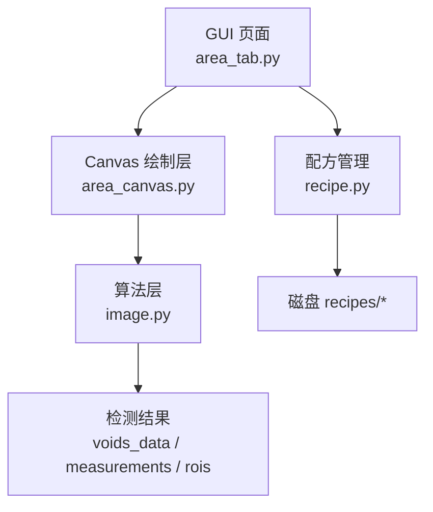
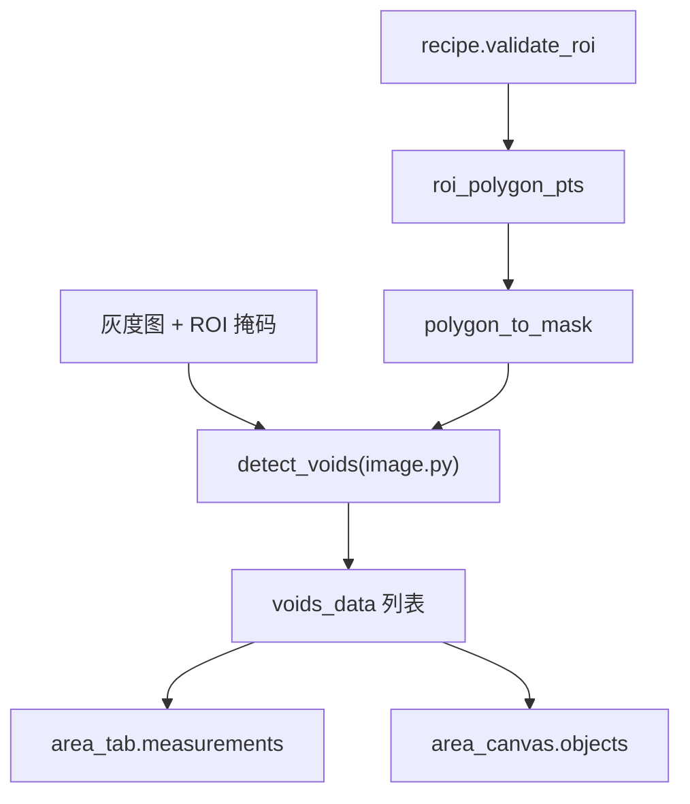
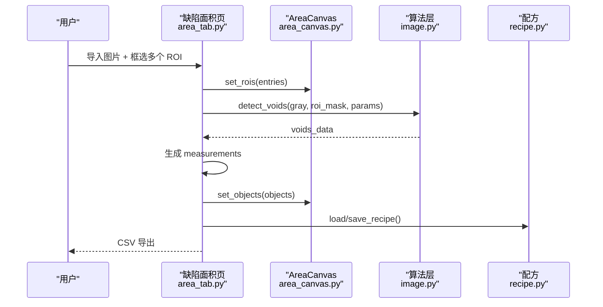
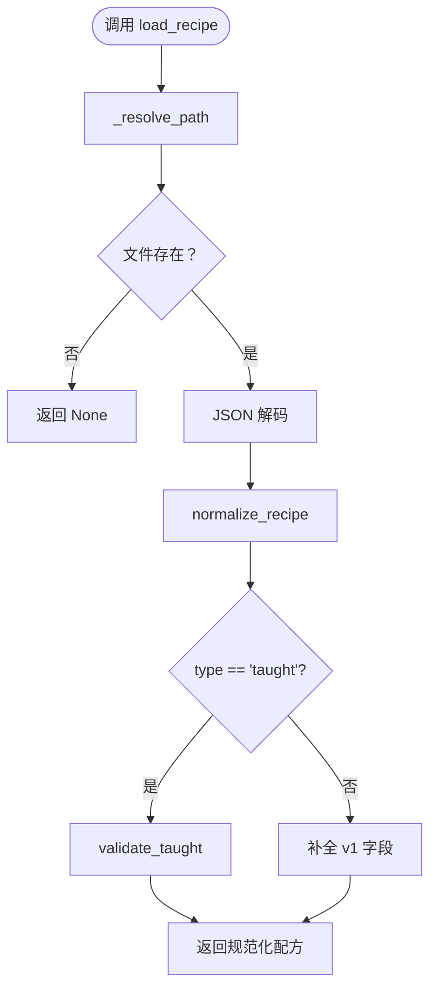
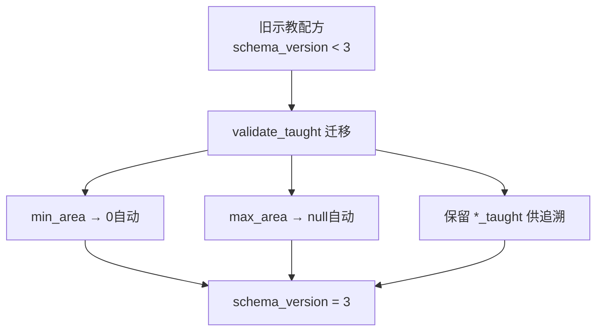
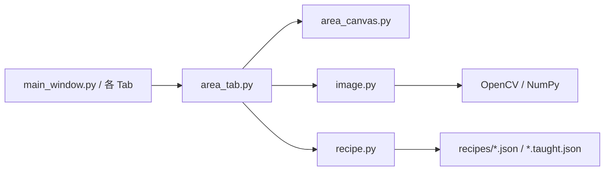

# 数据模型与配置

<cite>
**本文引用的文件**   
- [recipe.py](file://recipe.py)
- [DESIGN_分块批量空洞分析.md](file://DESIGN_分块批量空洞分析.md)
- [image.py](file://image.py)
- [area_tab.py](file://area_tab.py)
- [area_canvas.py](file://area_canvas.py)
- [recipes/1-1.taught.json](file://recipes/1-1.taught.json)
- [recipes/2.taught.json](file://recipes/2.taught.json)
- [recipes/4.taught.json](file://recipes/4.taught.json)
- [recipes/7.taught.json](file://recipes/7.taught.json)
- [recipes/8.taught.json](file://recipes/8.taught.json)
</cite>

## 目录
1. [引言](#引言)
2. [项目结构与定位](#项目结构与定位)
3. [配方 JSON 规范（recipe.py）](#配方-json-normativerecipepy)
4. [检测结果数据结构](#检测结果数据结构)
5. [缺陷面积多 ROI：设计意图与实现差异](#缺陷面积多-roi设计意图与实现差异)
6. [读写 API 与落盘路径](#读写-api与落盘路径)
7. [CSV 导出字段映射](#csv-导出字段映射)
8. [版本兼容与迁移策略](#版本兼容与迁移策略)
9. [依赖关系与架构总览](#依赖关系与架构总览)
10. [性能与已知限制](#性能与已知限制)
11. [故障排查](#故障排查)
12. [结论](#结论)

## 引言
Aurascope 是面向金锡焊空洞分析的单机桌面工具，核心由「GUI 页面 → Canvas 绘制层 → image.py 算法层 → recipe.py 配方/导出」构成。本文件聚焦数据模型与配置规范，重点说明：
- recipe.py 中的参数型配方与示教型配方结构；
- 检测返回的 voids_data、ROI 顶点、局部区域、测量结果等数据结构；
- 缺陷面积多 ROI 的设计意图与实际代码实现的差异；
- recipes/*.taught.json 的实际落盘位置、读取流程与迁移规则；
- CSV 导出字段映射与示例。

## 项目结构与定位
从仓库根看，配方相关资产集中在三个层次：
- 配置层：recipe.py 定义 schema_version、校验、默认值、读写 API；
- 数据层：recipes/*.json 与 recipes/*.taught.json 为持久化产物；
- 使用层：area_tab.py / area_canvas.py 消费检测结果并导出 CSV；image.py 提供 detect_voids 等算法接口。

**图示来源**
- [recipe.py:1-20](file://recipe.py#L1-L20)
- [area_tab.py:1-35](file://area_tab.py#L1-L35)
- [area_canvas.py:1-15](file://area_canvas.py#L1-L15)
- [image.py:200-260](file://image.py#L200-L260)

**章节来源**
- [recipe.py:1-20](file://recipe.py#L1-L20)
- [area_tab.py:1-35](file://area_tab.py#L1-L35)

## 配方 JSON 规范（recipe.py）
recipe.py 同时承载两类配方：
- 参数型配方：用于空洞分析 Tab 的检测参数 + ROI；
- 示教型配方：type=taught，用于批量/示教学习，schema_version 已升到 3。

### 顶层字段
| 字段 | 类型 | 必填 | 默认值 | 说明 |
|---|---|---:|---|---|
| schema_version | int | 是 | 1（参数型）、3（示教型） | 当前常量 SCHEMA_VERSION=1；validate_taught 会写回 3 |
| type | string | 否 | 缺失时按参数型处理 | taught 表示示教模型 |
| name | string | 是（保存时校验） | '' | 显示名，保存前 safe_name 过滤非法字符并截断到 64 |
| note | string | 否 | '' | 备注 |
| updated | string | 否 | '' | ISO 时间戳 |
| detection | object | 否 | DETECTION_DEFAULTS | 参数型检测参数 |
| roi | object | 否 | validate_roi 清洗后对象 | ROI 多边形或 none |
| px_per_um | number | 否 | 0.0 | 像素/微米，与 main_window.pixel_scale 语义一致 |
| solder/background/void/band/scale_bar/diagnostics | object | 仅示教型 | 见 validate_taught | 示教模型统计量、几何基准、比例尺、诊断指标 |

### 参数型 detection 字段
| 字段 | 类型 | 范围/约束 | 默认值 | 说明 |
|---|---|---|---|---|
| threshold | int | 0–255 | 80 | 二值化阈值 |
| min_area | int | 0–10,000,000 | 1 | 最小空洞面积 |
| max_area | int or null | 0/null 表示无上限 | None | 大于 0 才生效 |
| roi_erosion_px | int | 0–20 | 3 | ROI 内缩像素 |
| enhanced | bool | — | True | 是否启用增强管线 |
| clahe_enabled | bool | — | True | CLAHE |
| clahe_clip_limit | float | 1.0–4.0 | 2.0 | CLAHE 裁剪限 |
| morph_enabled | bool | — | True | 形态学开运算 |
| morph_kernel | int | 1–15 | 3 | UI 未暴露，固定默认 |
| min_roundness | float | 0.0–1.0 | 0.0 | 圆度下限 |
| edge_verify | bool | — | False | Canny 边缘验证 |
| edge_thresh | float | 0.0–1.0 | 0.3 | UI 未暴露，固定默认 |

### ROI 字段
| 字段 | 类型 | 默认值 | 说明 |
|---|---|---|---|
| type | string | polygon 或 none | 少于 3 个有效点时降级为 none |
| polygon | list of [x,y] | [] | 每个点取浮点后四舍五入到 1 位小数 |
| layer_threshold | int | 100 | 自动 ROI 相关阈值 |
| vertices | int | 24 | 顶点数，夹紧到 3–120 |

### 示教型 void 关键字段
| 字段 | 类型 | 默认值 | 说明 |
|---|---|---|---|
| threshold | int or null | None | 若样板图未标到空洞则为 null，退回带内 Otsu |
| min_area | int | 0 | 0 表示自动：按带面积的 0.02% 且至少 12px² |
| min_area_taught | int | 4 | 保留用户点选的最小尺寸供追溯 |
| max_area | int or null | None | null 表示自动：max(400, 30%×带面积)，仅作分割失败兜底 |
| max_area_taught | int or null | 0→None | 同上，旧值追溯 |
| min_roundness | float | 0.0 | 圆度下限 |
| depth_offset | float | 0.0 | -80~80，正值更包容偏浅暗斑 |
| taught_count | int | 0 | 示范空洞数量 |
| median | float or null | None | 空洞类中位数 |

### 其他示教字段摘要
- solder：median/std/p5/p95/threshold，取值 0–255，默认中位数 128、std 0、p5 0、p95 255、threshold 128。
- background：median/std，默认 128/0。
- band：min_aspect≥1，min_area_frac∈[0,1]，open_kernel 奇核 1–21，min_thickness_px 0–60，bridge_win_px -1/0/>1 三态。
- band_ref：cx_norm/cy_norm/w_norm/h_norm/area_frac/aspect，任一缺失返回 None。
- scale_bar：horizontal/dark 布尔，length_px/real_um 浮点。
- diagnostics：solder_bg_separability、solder_void_separability，以及实际落盘出现的 bg_same_gray_frac。

**章节来源**
- [recipe.py:20-50](file://recipe.py#L20-L50)
- [recipe.py:169-225](file://recipe.py#L169-L225)
- [recipe.py:228-258](file://recipe.py#L228-L258)
- [recipe.py:271-348](file://recipe.py#L271-L348)
- [recipe.py:355-382](file://recipe.py#L355-L382)

## 检测结果数据结构
image.py 的 detect_voids 是当前空洞检测的核心入口，其输出被 GUI 层消费。

### voids_data
detect_voids 内部维护 voids_data 列表，每个元素对应一个通过面积/圆度/可选边缘验证的轮廓。典型字段包括：
- id：空洞编号；
- contour：OpenCV 轮廓；
- area：轮廓面积；
- roundness：圆度；
- centroid：质心；
- mask：空洞掩码；
- rect：外接矩形；
- edge_score：可选 Canny 边缘重叠得分；
- 其它由调用方补充的标注信息。

该结构在 area_tab.py 中被转换为 measurements 行，并在 area_canvas.py 中渲染为对象集合。

### roi_polygon_pts
来自 recipe.validate_roi 的 roi.polygon，是二维坐标数组 [[x,y], ...]，每个坐标保留一位小数。它不是 OpenCV 原生 contour，而是配方持久化的多边形顶点序列。

### local_regions
在 defect-area 页中，local_regions 通常指当前激活 ROI 对应的图像子区域或掩码上下文；在批量/示教设计中，它对应每块 tile 的 ROI mask 与裁切后的检测上下文。area_tab.py 持有 self.rois 与 self.objects，area_canvas.py 负责把 objects 渲染到画布。

### measurements
area_tab.py 将 voids_data 转为 CSV-ready 的 measurements 列表，每条记录包含：
- ROI 编号；
- 缺陷编号；
- 像素面积；
- 实际面积（单位换算后）；
- 面积单位；
- 质心 x_px / y_px；
- 来源（如自动检测、人工修正等）。

### rois
area_tab.py 中 self.rois 存储多个 ROI 条目；area_canvas.py 的 set_rois 接收 entries，每个 entry 含 id、roi 类型（rect/poly）及 label。Canvas 层不持有业务逻辑，只负责渲染与交互信号。

**图示来源**
- [image.py:200-260](file://image.py#L200-L260)
- [area_tab.py:110-150](file://area_tab.py#L110-L150)
- [area_canvas.py:177-199](file://area_canvas.py#L177-L199)
- [recipe.py:203-225](file://recipe.py#L203-L225)

**章节来源**
- [image.py:200-260](file://image.py#L200-L260)
- [area_tab.py:110-150](file://area_tab.py#L110-L150)
- [area_canvas.py:177-199](file://area_canvas.py#L177-L199)

## 缺陷面积多 ROI：设计意图与实现差异
DESIGN_分块批量空洞分析.md 最初提出「测量与拼接解耦」「批次引擎只持标量、图像按需加载」「配方即 JSON」等目标，并把 recipe.py 作为新增模块。但实际落地路径与初稿存在明显偏差：

| 维度 | 设计文档意图 | 实际代码现状 |
|---|---|---|
| 批量入口 | stitching_tab.py 新增「批量空洞分析」区 | 批量/示教能力主要落在 teach_batch_tab.py 与 area_tab.py 的缺陷面积页 |
| 配方用途 | 参数型配方绑定产品，批量复用 | 现有 recipes/*.taught.json 多为示教型，参数型配方仍服务于空洞分析 Tab |
| 多 ROI | 设计强调 TileResult/BatchResult 与 CSV 汇总 | area_tab.py 支持多 ROI 检测与 CSV 导出，但未直接实现 DESIGN 中 TileResult/BatchResult dataclass |
| 等价性论证 | 无缝拼接下 ΣV_i/ΣA_i 等价整图 | area_tab.py 的多 ROI 是同一张图上多个检测区域，并非跨 tile 汇总 |
| 自动 ROI | extract_threshold_contour + contour_to_polygon | 确实复用 image.py 函数，但集成点在空洞分析/示教流程，而非 stitching_tab |

因此，「缺陷面积多 ROI」在当前仓库中更接近「单图多 ROI 检测 + CSV 导出」，而不是 DESIGN 文档里「跨 tile 批次汇总」。两者可以共存：area_tab.py 管单图多 ROI，teach_batch_tab.py 管批量/示教，stitching_tab.py 保持拼接主流程。

**图示来源**
- [area_tab.py:110-150](file://area_tab.py#L110-L150)
- [area_canvas.py:177-199](file://area_canvas.py#L177-L199)
- [image.py:200-260](file://image.py#L200-L260)
- [recipe.py:439-462](file://recipe.py#L439-L462)

**章节来源**
- [DESIGN_分块批量空洞分析.md:50-177](file://DESIGN_分块批量空洞分析.md#L50-L177)
- [DESIGN_分块批量空洞分析.md:180-258](file://DESIGN_分块批量空洞分析.md#L180-L258)
- [area_tab.py:1-35](file://area_tab.py#L1-L35)

## 读写 API 与落盘路径
### 路径解析
- 首选目录：exe 同级 recipes（frozen），否则源码目录 recipes；
- 不可写时回退到 app_paths.local_data_dir()/recipes；
- 可通过环境变量 AURASCOPE_RECIPE_DIR 覆盖；
- 参数型配方文件名：<name>.json；
- 示教型配方文件名：<name>.taught.json；
- _resolve_path 兼容显示名或文件名，先尝试 .json，再尝试 .taught.json。

### 关键 API
| API | 输入 | 输出 | 行为 |
|---|---|---|---|
| recipe_dir() | 无 | str | 确保目录存在并返回路径 |
| list_recipes(kind=None) | 'v1'/'taught'/None | [(display, filename)] | 按修改时间倒序，损坏文件按 v1 展示 |
| save_recipe(recipe) | dict | str | 原子写入 tmp+os.replace |
| load_recipe(name_or_filename) | 显示名或文件名 | dict or None | normalize_recipe 规范化 |
| delete_recipe(name_or_filename) | 显示名或文件名 | bool | 删除成功返回 True |
| build_recipe(name, detection, roi, px_per_um, note) | 原始参数 | dict | 自动 validate_detection + validate_roi |
| normalize_recipe(data) | 任意 dict | dict or None | type=taught 走 validate_taught |
| save_taught(model, bar_template) | 示教模型 + 可选模板图 | str | 写 .taught.json 与 _bar.png |
| load_bar_template(name_or_filename) | 名称 | numpy.ndarray or None | 绕过 cv2.imread 中文路径问题 |

**图示来源**
- [recipe.py:123-134](file://recipe.py#L123-L134)
- [recipe.py:452-462](file://recipe.py#L452-L462)
- [recipe.py:241-258](file://recipe.py#L241-L258)
- [recipe.py:271-348](file://recipe.py#L271-L348)

**章节来源**
- [recipe.py:56-96](file://recipe.py#L56-L96)
- [recipe.py:123-166](file://recipe.py#L123-L166)
- [recipe.py:439-474](file://recipe.py#L439-L474)

## CSV 导出字段映射
area_tab.py 明确定义 CSV_COLUMNS：
- ROI编号
- 缺陷编号
- 像素面积
- 实际面积
- 面积单位
- 质心x_px
- 质心y_px
- 来源

UNIT_FACTORS 支持 nm/µm/mm/cm/m 等单位换算；compute_real_area 根据 unit_per_px 计算实际面积；fmt_area 负责格式化输出。

| CSV 列 | 数据来源 | 含义 |
|---|---|---|
| ROI编号 | 当前 ROI 标识 | 区分同一图中的多个检测区域 |
| 缺陷编号 | voids_data 序号 | 空洞 ID |
| 像素面积 | cv2.contourArea 或对象 mask | 像素级面积 |
| 实际面积 | pixel_area × (unit_per_px)^2 | 物理面积，单位取决于标定 |
| 面积单位 | unit_per_px 对应单位 | µm 等 |
| 质心x_px | 轮廓质心 | 图像坐标系下的 x |
| 质心y_px | 轮廓质心 | 图像坐标系下的 y |
| 来源 | 检测/人工修正标记 | 例如自动检测、手动编辑等 |

**章节来源**
- [area_tab.py:31-50](file://area_tab.py#L31-L50)
- [area_tab.py:35-36](file://area_tab.py#L35-L36)

## 版本兼容与迁移策略
recipe.py 的兼容策略分为三层：

1. **参数型配方**：normalize_recipe 对缺失字段补默认值，detection 和 roi 分别经 validate_detection/validate_roi 夹紧；
2. **示教型配方**：validate_taught 会把 schema_version 写回 3，并对旧版 <3 的 void.min_area/max_area 做迁移：
   - 旧配方一律转为自动档；
   - 原值保留到 *_taught 字段，便于追溯；
   - 新默认：min_area=0（自动 0.02%×带面积，最低 12px²），max_area=null（自动 max(400, 30%×带面积)）；
3. **文件命名隔离**：参数型用 .json，示教型用 .taught.json，避免同名互相覆盖。

**图示来源**
- [recipe.py:285-323](file://recipe.py#L285-L323)

**章节来源**
- [recipe.py:241-258](file://recipe.py#L241-L258)
- [recipe.py:285-323](file://recipe.py#L285-L323)

## 依赖关系与架构总览

**图示来源**
- [area_tab.py:1-35](file://area_tab.py#L1-L35)
- [area_canvas.py:1-15](file://area_canvas.py#L1-L15)
- [image.py:1-12](file://image.py#L1-L12)
- [recipe.py:1-20](file://recipe.py#L1-L20)

**章节来源**
- [area_tab.py:1-35](file://area_tab.py#L1-L35)
- [recipe.py:1-20](file://recipe.py#L1-L20)

## 性能与已知限制
- detect_voids 在循环中调用 _pump_events，避免长循环完全阻塞 GUI；
- area_tab.py 使用 QTimer 延迟检测，减少滑块拖动时的频繁重算；
- 已知限制（结合 handoff.md 与代码事实）：
  - main_window.py 中存在 detect_voids_local 副本，现行行为以 image.py 为准，两份待合并；
  - edge_map 初始化条件较严格，edge_verify 未满足时可能静默失效；
  - canvas 层滚轮缩放存在 Y 轴漂移已知问题；
  - select_for_local 为无 UI 入口的死代码；
  - 大图增强检测无进度提示；
  - recipes/*.taught.json 的 bar 模板 PNG 需绕过 cv2.imwrite/imread 的非 ASCII 路径问题。

**章节来源**
- [image.py:14-25](file://image.py#L14-L25)
- [image.py:228-233](file://image.py#L228-L233)
- [area_tab.py:127-135](file://area_tab.py#L127-L135)
- [recipe.py:385-429](file://recipe.py#L385-L429)

## 故障排查
| 现象 | 可能原因 | 排查建议 |
|---|---|---|
| 加载配方返回 None | JSON 损坏、非 dict、normalize_recipe 拒绝 | 检查文件编码、schema_version、type 与必填字段 |
| 示教模型无法加载 bar 模板 | 文件名后缀处理错误或非 ASCII 路径 | 确认 name_or_filename 先剥 .taught.json 再拼 _bar.png |
| 空洞检测无结果 | threshold/min_area 过严、ROI 为空、edge_verify 未生效 | 查看 detection.threshold、min_area、roi.type |
| CSV 实际面积为空 | unit_per_px 为 None | 检查比例尺标定是否完成 |
| 最大空洞漏检 | max_area 被旧示教点选上限限制 | 检查 void.max_area 是否为 null，或是否被迁移为自动 |
| 小空洞漏检 | min_area 被点选样本绑架 | 检查 void.min_area 是否为 0，以及 below_min_area_count |
| 批量/示教结果异常 | 几何偏差告警、亮度漂移、桥接开关误设 | 查看 band_ref、ref_median、band.bridge_win_px |

**章节来源**
- [recipe.py:452-474](file://recipe.py#L452-L474)
- [recipe.py:385-429](file://recipe.py#L385-L429)
- [area_tab.py:31-50](file://area_tab.py#L31-L50)
- [recipe.py:285-323](file://recipe.py#L285-L323)

## 结论
- recipe.py 是当前配方系统的权威定义：参数型配方用于空洞分析 Tab，示教型配方用于批量/示教学习；
- 检测结果以 voids_data 为核心，area_tab.py 将其转为 measurements 并导出 CSV；
- 缺陷面积多 ROI 的实际实现是「单图多 ROI 检测」，与 DESIGN 文档中「跨 tile 批次汇总」存在范围差异；
- recipes/*.taught.json 的落盘路径受 frozen 状态与环境变量影响，读取流程通过 _resolve_path → load_recipe → normalize_recipe → validate_taught；
- 版本迁移策略以 validate_taught 为中心，旧版面积上下限统一转为自动档，旧值保留 *_taught 字段；
- 后续若扩展批量功能，应优先对齐 area_tab.py 的 measurements 与 recipe.py 的 schema，避免再次出现设计与实现脱节。