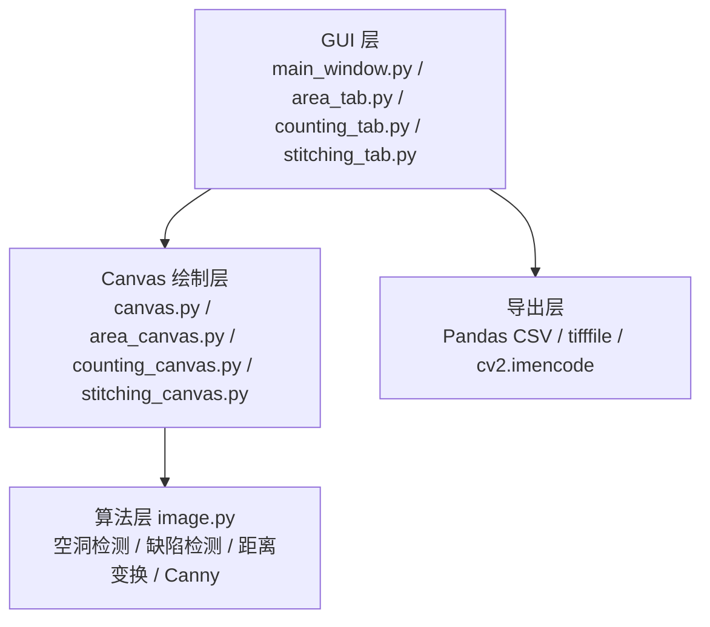
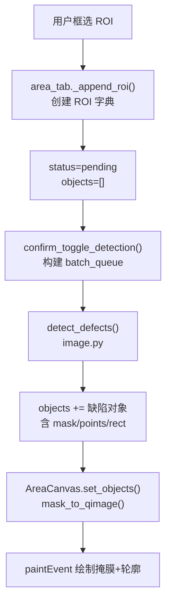
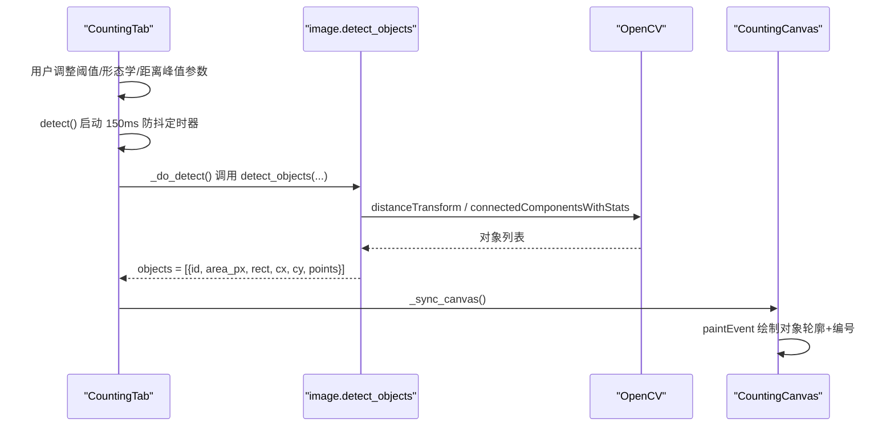
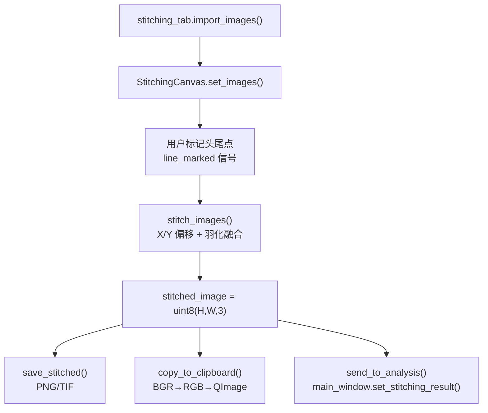
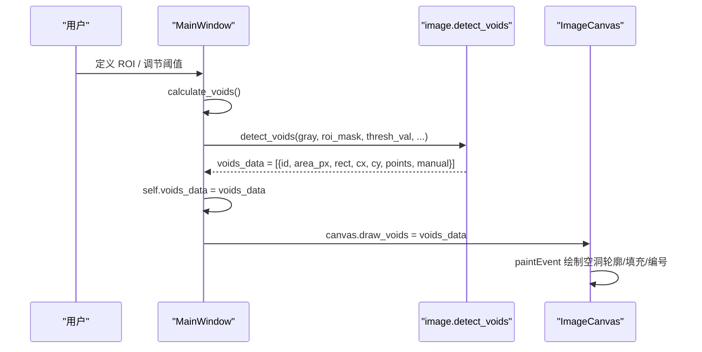
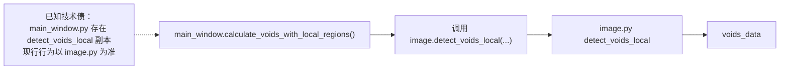

# 检测结果数据结构

<cite>
**本文引用的文件**   
- [README.md](file://README.md)
- [PROJECT_CONCEPTION.md](file://PROJECT_CONCEPTION.md)
- [image.py](file://image.py)
- [main_window.py](file://main_window.py)
- [canvas.py](file://canvas.py)
- [area_tab.py](file://area_tab.py)
- [area_canvas.py](file://area_canvas.py)
- [counting_tab.py](file://counting_tab.py)
- [counting_canvas.py](file://counting_canvas.py)
- [stitching_tab.py](file://stitching_tab.py)
- [stitching_canvas.py](file://stitching_canvas.py)
</cite>

## 目录
1. [引言](#引言)
2. [项目结构与数据边界](#项目结构与数据边界)
3. [核心检测结果数据结构总览](#核心检测结果数据结构总览)
4. [空洞分析：voids_data、roi_polygon_pts、local_regions、measurements、rois](#空洞分析voids_dataroi_polygon_ptslocal_regionsmeasurementsrois)
5. [缺陷面积多 ROI：area_canvas.rois 的 mask/params/objects/status](#缺陷面积多-roiarea_canvasrois-maskparamsobjectsstatus)
6. [物料计数：distanceTransform 结果与 UI 表格映射](#物料计数distancetransform-结果与-ui-表格映射)
7. [图像拼接：拼接数组与导出结构](#图像拼接拼接数组与导出结构)
8. [从 image.py 到 Canvas 的数据流转图](#从-imagepy-到-canvas-的数据流转图)
9. [main_window.detect_voids_local 副本与 image.py 的差异](#main_windowdetect_voids_local-副本与-imagepy-的差异)
10. [典型数据结构示例](#典型数据结构示例)
11. [CSV/JSON 序列化字段映射规则](#csvjson-序列化字段映射规则)
12. [已知限制与排查建议](#已知限制与排查建议)
13. [结论](#结论)

## 引言
Aurascope 是面向微电子封装产线的半自动化视觉检测桌面工具，当前覆盖金锡焊料空洞率分析、芯片剪切力标准校核、蓝膜物料自动计数和微观尺寸测量。其代码分层约定为：GUI 层 → Canvas 绘制层 → 算法层 image.py → 配方/导出。Canvas 统一基于 QWidget + QPainter 自绘，共享原图坐标↔屏幕坐标转换、滚轮缩放、右键平移和多边形 ROI 编辑约定；image.py 是唯一算法实现层，负责阈值、形态学、轮廓、距离变换、Canny 边缘校验与面积统计。

本文件聚焦“内存中的检测结果数据结构”，重点说明 voids_data、roi_polygon_pts、local_regions、measurements、rois 的字段名、类型、生命周期与消费方，并给出从 image.py 算法输出到 Canvas 绘制层的完整数据流、典型示例、序列化映射以及已知限制。

**章节来源**
- [README.md:1-76](file://README.md#L1-L76)
- [PROJECT_CONCEPTION.md:17-107](file://PROJECT_CONCEPTION.md#L17-L107)

## 项目结构与数据边界
Aurascope 的核心数据边界如下：
- GUI Tab 持有业务状态（例如 main_window.py 的空洞分析状态、area_tab.py 的多 ROI 状态、counting_tab.py 的计数对象列表）。
- Canvas 仅持有渲染所需状态（图像、ROI 顶点、空洞轮廓、局部笔刷区域、距离测量草稿等），不内联图像算法。
- image.py 提供纯 NumPy/OpenCV 算法函数，返回字典列表或掩膜数组，不依赖 PyQt。
- stitching_canvas.py 维护拼接图像数组 stitched_image，stitching_tab.py 负责导入、标记、导出和发送到空洞分析模块。

**图示来源**
- [PROJECT_CONCEPTION.md:77-107](file://PROJECT_CONCEPTION.md#L77-L107)
- [README.md:42-64](file://README.md#L42-L64)

**章节来源**
- [PROJECT_CONCEPTION.md:77-107](file://PROJECT_CONCEPTION.md#L77-L107)
- [README.md:42-64](file://README.md#L42-L64)

## 核心检测结果数据结构总览
| 数据结构 | 主要持有者 | 生命周期 | 主要消费方 | 单位/语义 |
|---|---|---|---|---|
| voids_data | main_window.py | 图片加载后初始化，ROI 确认后参与空洞计算，撤销栈可恢复 | calculate_voids()、on_void_delete_at()、on_void_add_polygon()、_refresh_void_metrics()、Canvas.draw_voids | 像素级空洞记录 |
| roi_polygon_pts | main_window.py、canvas.py | 多边形 ROI 完成时写入，ROI 重置或编辑时更新 | finalize_roi()、set_roi_polygon()、polygon_to_mask() | 图像坐标下的多边形顶点 |
| local_regions | main_window.py | 通过 on_void_selected_for_local() 或局部笔刷确认写入，calculate_voids_with_local_regions() 消费 | detect_voids_local(gray, roi_mask, global_thresh, local_regions) | (x, y, w, h, thresh) 矩形局部阈值区 |
| measurements | area_tab.py | 标定后新增，清除标定时清空 | add_distance()、_refresh_distances()、export_distance_csv() | 两点测距记录 |
| rois | area_tab.py | 框选 ROI 时追加，检测全部 ROI 时批量填充 objects/status | confirm_toggle_detection()、select_roi()、_run_next_batch() | 多 ROI 检测单元 |
| objects | area_tab.py / counting_tab.py | 算法或手动操作后生成，UI 刷新时同步到 Canvas | _sync_canvas()、AreaCanvas.set_objects() | 缺陷或物料对象 |

**章节来源**
- [main_window.py:69-83](file://main_window.py#L69-L83)
- [main_window.py:1251-1305](file://main_window.py#L1251-L1305)
- [area_tab.py:110-138](file://area_tab.py#L110-L138)
- [counting_tab.py:19-36](file://counting_tab.py#L19-L36)

## 空洞分析：voids_data、roi_polygon_pts、local_regions、measurements、rois

### voids_data：空洞列表
voids_data 是空洞分析的主检测结果，由 image.py 的 detect_voids() 或 detect_voids_local() 返回，再由 main_window.py 的 calculate_voids() 或 calculate_voids_with_local_regions() 写入 self.voids_data，并复制到 canvas.draw_voids 用于绘制。

| 字段 | 类型 | 物理含义 | 单位 | 生命周期与消费方 |
|---|---|---|---|---|
| id | int | 空洞编号，从 1 开始递增 | 无 | 算法生成；删除时按 ID 匹配；手动添加时取最大 ID+1 |
| area_px | float/int | 轮廓面积 | 像素² | 统计空洞总面积、空洞率 |
| rect | tuple | (x, y, w, h) 外接矩形 | 像素 | 删除命中、预览、导出宽度高度 |
| cx | float | 轮廓质心 x | 像素 | 标注中心点 |
| cy | float | 轮廓质心 y | 像素 | 标注中心点 |
| points | list | 轮廓点集，每个点为 [x, y] | 像素 | 画布绘制、pointPolygonTest 命中判断 |
| manual | bool | 是否手动添加 | 无 | ROI 重算后保留仍在 ROI 内的手动空洞 |

voids_data 中所有坐标均基于原始图像坐标系；area_px 来自 OpenCV 轮廓面积，不是真实物理面积。若已标定像素比，main_window.py 会按 pixel_scale 换算 μm² 显示，但 voids_data 本身不保存物理单位。

**章节来源**
- [image.py:200-286](file://image.py#L200-L286)
- [image.py:328-422](file://image.py#L328-L422)
- [main_window.py:1251-1305](file://main_window.py#L1251-L1305)
- [main_window.py:1391-1452](file://main_window.py#L1391-L1452)

### roi_polygon_pts：多边形 ROI 顶点
roi_polygon_pts 表示用户绘制或自动提取的焊料区域多边形顶点。它由 canvas.py 的 roi_poly_finished 信号传入 main_window.py 的 finish_poly_roi()，再转换为 roi_mask 并传给 polygon_to_mask()。同时，canvas.py 也保存一份 roi_polygon_points 用于绘制 ROI 边线和顶点手柄。

| 字段/位置 | 类型 | 物理含义 | 单位 | 生命周期与消费方 |
|---|---|---|---|---|
| main_window.roi_polygon_pts | list[float] | 最终确认的多边形顶点 | 像素 | finish_poly_roi() 写入，finalize_roi() 使用 |
| canvas.roi_polygon_points | list[QPointF] | 画布渲染用的顶点 | 像素 | set_roi_polygon() 写入，paintEvent 绘制 |
| main_window.roi_mask | numpy.ndarray | 二值 ROI 掩膜 | 像素 | finalize_roi() 计算焊层面积、空洞检测输入 |
| main_window.snap_edge_mask | numpy.ndarray | 边缘吸附掩膜 | 像素 | build_snap_edge_mask() 生成，ROI 编辑吸附使用 |

**章节来源**
- [main_window.py:976-990](file://main_window.py#L976-L990)
- [main_window.py:1058-1083](file://main_window.py#L1058-L1083)
- [canvas.py:166-177](file://canvas.py#L166-L177)
- [image.py:138-177](file://image.py#L138-L177)

### local_regions：局部阈值区域
local_regions 是全局阈值基础上叠加的局部矩形阈值区，格式为 (x, y, w, h, thresh)。它由两个路径产生：
1. 旧式「选中空洞后弹出对话框设置局部阈值」：on_void_selected_for_local() 调用 create_local_region_around_void() 生成矩形，再调用 calculate_voids_with_local_regions()。
2. 新式「局部阈值笔刷」：toggle_void_selection_mode() 切换 local_brush 模式，on_local_region_confirmed() 把圆形笔刷区域加入 local_brush_regions，再由 calculate_voids_with_local() 消费。

注意：current codebase 中 calculate_voids_with_local_regions() 调用的是 image.py 的 detect_voids_local()，而该函数签名接受 local_regions 作为 [(x,y,w,h,thresh), ...]；但主窗口在笔刷模式下维护的是包含 cx/cy/radius/thresh 的圆形区域，因此实际消费逻辑需要以最新实现为准。文档只描述现有职责边界，不假设未实现的圆形→矩形自动转换。

| 字段 | 类型 | 物理含义 | 单位 | 生命周期与消费方 |
|---|---|---|---|---|
| x, y | int/float | 局部矩形左上角 | 像素 | create_local_region_around_void() 根据空洞 rect 扩展 padding |
| w, h | int/float | 局部矩形宽高 | 像素 | 裁剪到图像边界后传给 detect_voids_local() |
| thresh | int | 局部二值化阈值 | 0-255 | 覆盖 bin_inv 对应区域 |
| local_brush_regions | list[dict] | 圆形笔刷区域 | 像素 | toggle_void_selection_mode()、on_local_region_confirmed()、canvas.set_local_brush_regions() |

**章节来源**
- [main_window.py:1454-1528](file://main_window.py#L1454-L1528)
- [main_window.py:1542-1599](file://main_window.py#L1542-L1599)
- [image.py:635-651](file://image.py#L635-L651)
- [canvas.py:111-114](file://canvas.py#L111-L114)

### measurements：距离测量记录
measurements 属于缺陷面积页 area_tab.py，不是独立 measure_tab.py 的状态。每条记录包含起点、终点、像素距离和约束方向。

| 字段 | 类型 | 物理含义 | 单位 | 生命周期与消费方 |
|---|---|---|---|---|
| id | int | 测量序号，从 1 递增 | 无 | add_distance() 分配 |
| p1 | tuple | 起点图像坐标 | 像素 | AreaCanvas.distance_entries 渲染 |
| p2 | tuple | 终点图像坐标 | 像素 | AreaCanvas.distance_entries 渲染 |
| dist_px | float | 两点欧氏距离 | 像素 | 乘以 unit_per_px 得到物理距离 |
| constraint | str | 'h'/'v'/'' | 无 | 水平/垂直吸附标识 |

_area_tab._refresh_distances() 将 measurements 转为带 label 的 entries 传给 AreaCanvas.set_distances()，并在 distance_table 中显示物理距离和像素距离。

**章节来源**
- [area_tab.py:444-500](file://area_tab.py#L444-L500)
- [area_canvas.py:187-189](file://area_canvas.py#L187-L189)

### rois：多 ROI 对象集合
area_tab.py 的 rois 是缺陷面积多 ROI 的核心数据结构。每个 ROI 代表一个检测区域，拥有独立参数、状态和检测结果。

| 字段 | 类型 | 物理含义 | 单位 | 生命周期与消费方 |
|---|---|---|---|---|
| id | int | ROI 编号 | 无 | _append_roi() 自增 |
| roi | tuple | ('rect'|'poly', data) | 像素 | AreaCanvas 绘制 ROI 轮廓 |
| mask | numpy.ndarray | ROI 二值掩膜 | 像素 | 选择点击命中、union_area_px() |
| params | dict | threshold/bright/min_area | 像素/布尔/像素² | select_roi() 同步控件 |
| objects | list[dict] | 当前 ROI 的缺陷对象 | 像素 | _run_next_batch() 填充，AreaCanvas.set_objects() 渲染 |
| status | str | pending/active/error | 无 | 按钮文本、批处理队列控制 |
| manual_changed | bool | 是否有人工增删 | 无 | 取消待检测时保留人工修改标记 |
| area_px | int | ROI 内缺陷总面积 | 像素² | ROI 表格汇总 |

**章节来源**
- [area_tab.py:659-683](file://area_tab.py#L659-L683)
- [area_tab.py:751-800](file://area_tab.py#L751-L800)
- [area_canvas.py:177-199](file://area_canvas.py#L177-L199)

## 缺陷面积多 ROI：area_canvas.rois 的 mask/params/objects/status
area_canvas.py 本身不持有业务意义上的 rois；它渲染的是：
- roi_entries：用于显示的 ROI 列表，字段为 id、roi、label。
- objects：当前 ROI 的检测对象列表，每个对象必须包含 mask、points、rect。
- distance_entries：距离测量线。
- calib_line：比例尺标定线。

area_tab.py 才是 rois 的业务所有者，area_canvas.py 通过 set_rois()、set_objects()、set_distances()、set_calib() 接收渲染数据。

**图示来源**
- [area_tab.py:659-683](file://area_tab.py#L659-L683)
- [area_tab.py:751-800](file://area_tab.py#L751-L800)
- [area_canvas.py:192-199](file://area_canvas.py#L192-L199)
- [area_canvas.py:419-498](file://area_canvas.py#L419-L498)

**章节来源**
- [area_tab.py:659-683](file://area_tab.py#L659-L683)
- [area_canvas.py:15-49](file://area_canvas.py#L15-L49)
- [area_canvas.py:177-199](file://area_canvas.py#L177-L199)
- [area_canvas.py:419-498](file://area_canvas.py#L419-L498)

## 物料计数：distanceTransform 结果与 UI 表格映射
counting_tab.py 使用 image.py 的 detect_objects()，支持距离变换峰值计数分离粘连物体。当 watershed_enabled=True 时，算法对二值图做 distanceTransform，找局部极大值作为种子，生成近似圆形轮廓并统计 area_px、rect、cx/cy、points。

**图示来源**
- [counting_tab.py:363-414](file://counting_tab.py#L363-L414)
- [counting_tab.py:416-424](file://counting_tab.py#L416-L424)
- [image.py:491-632](file://image.py#L491-L632)
- [counting_canvas.py:208-221](file://counting_canvas.py#L208-L221)

**章节来源**
- [counting_tab.py:363-424](file://counting_tab.py#L363-L424)
- [image.py:491-632](file://image.py#L491-L632)
- [counting_canvas.py:10-38](file://counting_canvas.py#L10-L38)
- [counting_canvas.py:208-221](file://counting_canvas.py#L208-L221)

## 图像拼接：拼接数组与导出结构
stitching_canvas.py 的 StitchingCanvas 维护 images 列表和 stitched_image 数组。images 中每项为 {image, name, line_p1, line_p2, marked}；stitched_image 是 uint8 三通道 NumPy 数组，背景未覆盖区域用 STITCH_BG=64 填充。

stitching_tab.py 负责：
- 导入图像到 self.images。
- 调用 canvas.stitch_images() 生成 stitched_image。
- 通过 send_to_analysis() 把 stitched_image 传给 main_window.set_stitching_result()。
- 通过 save_stitched() 导出 PNG/TIF。
- 通过 copy_to_clipboard() 复制 BGR/灰度到系统剪贴板。

**图示来源**
- [stitching_canvas.py:29-75](file://stitching_canvas.py#L29-L75)
- [stitching_canvas.py:297-406](file://stitching_canvas.py#L297-L406)
- [stitching_tab.py:329-382](file://stitching_tab.py#L329-L382)
- [stitching_tab.py:385-447](file://stitching_tab.py#L385-L447)

**章节来源**
- [stitching_canvas.py:29-75](file://stitching_canvas.py#L29-L75)
- [stitching_canvas.py:297-406](file://stitching_canvas.py#L297-L406)
- [stitching_tab.py:329-447](file://stitching_tab.py#L329-L447)

## 从 image.py 到 Canvas 的数据流转图
空洞分析的主流程是：用户定义 ROI → 调节阈值 → calculate_voids() → image.detect_voids() → voids_data → main_window.canvas.draw_voids → ImageCanvas.paintEvent()。

**图示来源**
- [main_window.py:1251-1305](file://main_window.py#L1251-L1305)
- [image.py:200-286](file://image.py#L200-L286)
- [canvas.py:794-800](file://canvas.py#L794-L800)

**章节来源**
- [main_window.py:1251-1305](file://main_window.py#L1251-L1305)
- [image.py:200-286](file://image.py#L200-L286)
- [canvas.py:794-800](file://canvas.py#L794-L800)

## main_window.detect_voids_local 副本与 image.py 的差异
main_window.py 导入了 image.detect_voids_local，并通过 calculate_voids_with_local_regions() 调用它。仓库中存在两份 detect_voids_local 相关逻辑：
- image.py 中的 detect_voids_local(gray_img, roi_mask, global_thresh_val, local_regions, ...) 是正式算法实现。
- main_window.py 中还存在 detect_voids_local 的副本或历史引用，属于已知技术债。

两者差异要点：
- image.py 的 detect_voids_local 明确支持 local_regions 列表，先全局阈值，再逐区域覆盖局部二值结果，然后与 ROI 内部掩膜进行 bitwise_and，再做轮廓提取。
- main_window.py 的调用方式会把 enhanced、clahe、morph、roundness、edge_verify、roi_erosion_px 等参数透传给 image.detect_voids_local，因此现行行为应以 image.py 为准。
- 文档应明确：main_window.py 中的 detect_voids_local 副本是待合并的技术债，不应被视为独立算法分支。

**图示来源**
- [main_window.py:1503-1528](file://main_window.py#L1503-L1528)
- [image.py:328-422](file://image.py#L328-L422)

**章节来源**
- [main_window.py:1503-1528](file://main_window.py#L1503-L1528)
- [image.py:328-422](file://image.py#L328-L422)

## 典型数据结构示例
以下示例仅展示字段结构和类型，不直接粘贴源码。

### voids_data 条目
- id：整数，空洞编号。
- area_px：数值，轮廓面积。
- rect：四元组，(x, y, w, h)，像素。
- cx：浮点数，质心 x，像素。
- cy：浮点数，质心 y，像素。
- points：二维点列表，[[x, y], ...]，像素。
- manual：布尔，False 表示算法检测，True 表示手动添加。

### roi_polygon_pts
- 列表形式：[(x, y), (x, y), ...]，元素为浮点坐标。
- 对应 roi_mask：uint8 二值数组，形状与原图一致。
- snap_edge_mask：uint8 二值数组，用于 ROI 顶点吸附到边缘。

### local_regions
- 矩形形式：(x, y, w, h, thresh)。
- 圆形笔刷形式：{'id': int, 'cx': float, 'cy': float, 'radius': float, 'thresh': int}。

### measurements
- {'id': int, 'p1': (x, y), 'p2': (x, y), 'dist_px': float, 'constraint': 'h'|'v'|''}。

### area_canvas.rois
- {'id': int, 'roi': ('rect'|'poly', data), 'mask': ndarray, 'params': dict, 'objects': list, 'status': str, 'manual_changed': bool, 'area_px': int}。

### counting_tab.objects
- {'id': int, 'area_px': float/int, 'rect': (x, y, w, h), 'cx': float, 'cy': float, 'points': [[x, y], ...]}。

### stitching_canvas.stitched_image
- NumPy 数组，dtype=uint8，shape=(H, W, 3)，背景未覆盖区域值为 STITCH_BG=64。

**章节来源**
- [image.py:275-283](file://image.py#L275-L283)
- [image.py:411-419](file://image.py#L411-L419)
- [area_tab.py:667-677](file://area_tab.py#L667-L677)
- [counting_tab.py:279-286](file://counting_tab.py#L279-L286)
- [stitching_canvas.py:12-19](file://stitching_canvas.py#L12-L19)
- [stitching_canvas.py:392-406](file://stitching_canvas.py#L392-L406)

## CSV/JSON 序列化字段映射规则
Aurascope 没有统一的 JSON 导出入口；CSV 导出分散在各 Tab。

| 模块 | 导出方法 | CSV 列映射 | 备注 |
|---|---|---|---|
| 空洞分析 | main_window.show_detail_table() | 通常包含 id、area_px、rect、cx/cy、points、manual 等字段 | 具体列名以 show_detail_table() 实现为准 |
| 缺陷面积多 ROI | area_tab.export_csv() | ['ROI编号', '缺陷编号', '像素面积', '实际面积', '面积单位', '质心x_px', '质心y_px', '来源'] | compute_real_area() 使用 unit_per_px² |
| 距离测量 | area_tab.export_distance_csv() | ['序号', f'距离({unit})', '距离(px)', '起点X', '起点Y', '终点X', '终点Y', '约束'] | constraint 映射为 '水平'/'垂直'/'自由' |
| 距离测量独立 Tab | measure_tab.export_csv() | ['序号', '距离(μm)', '距离(px)', '起点X', '起点Y', '终点X', '终点Y'] | 使用 MeasureTab.measurements |
| 物料计数 | counting_tab.export_csv() | ['编号', '面积(像素)', '中心X', '中心Y', '宽度', '高度'] | 不包含 points |
| 图像拼接 | stitching_tab.save_stitched() | 不导出 CSV，导出 PNG/TIF | copy_to_clipboard() 复制图像 |

对于 JSON 序列化，仓库中没有统一 schema；若外部脚本读取 voids_data 或 objects，应直接读取 Python 字典结构，而不是假设固定 CSV 列名。

**章节来源**
- [area_tab.py:31-32](file://area_tab.py#L31-L32)
- [area_tab.py:502-543](file://area_tab.py#L502-L543)
- [measure_tab.py:302-321](file://measure_tab.py#L302-L321)
- [counting_tab.py:425-446](file://counting_tab.py#L425-L446)
- [stitching_tab.py:385-447](file://stitching_tab.py#L385-L447)

## 已知限制与排查建议
根据项目约定和代码现状，以下限制需特别注意：

| 限制 | 现象 | 影响 | 排查建议 |
|---|---|---|---|
| edge_map 未初始化导致 Canny 校验静默失效 | enhanced 且 edge_verify 为 True 时，部分分支可能跳过 edge_map 初始化 | 边缘验证看似开启却无效 | 检查 enhanced 条件与 edge_verify 组合，确认 edge_map 赋值路径 |
| main_window.detect_voids_local 副本 | main_window.py 与 image.py 存在重复逻辑 | 两份实现可能漂移 | 以 image.py 为准，后续合并副本 |
| select_for_local 为无 UI 入口的死代码 | 函数存在但无界面触发 | 局部阈值功能可能被误认为可用 | 确认当前入口是 on_void_selected_for_local() 还是局部笔刷 |
| 滚轮缩放 Y 轴漂移 | canvas.py 缩放锚点计算存在 Y 漂移问题 | 缩放后图像纵向偏移 | 不要把现状写成正确设计；修复前需对齐 X/Y 锚点计算 |
| chk_roi_overlay 被重复创建 | UI 组件可能在多处构造 | 状态不一致或重复渲染 | 检查 _setup_layer_threshold_group() 与 toggle_roi_overlay() |
| 大图增强检测无进度提示 | 长循环中虽有 _pump_events()，但无用户可见进度 | 用户以为卡死 | 参考 stitching_tab 的 QProgressDialog 模式 |
| area_canvas 掩膜绘制默认 nearest-neighbour | paintEvent 中先 drawImage 再启用抗锯齿 | 掩膜不插值、不填外轮廓孔洞 | 这是有意设计，避免掩膜模糊 |

**章节来源**
- [image.py:228-234](file://image.py#L228-L234)
- [image.py:366-370](file://image.py#L366-L370)
- [main_window.py:1503-1528](file://main_window.py#L1503-L1528)
- [canvas.py:695-706](file://canvas.py#L695-L706)
- [area_canvas.py:419-433](file://area_canvas.py#L419-L433)
- [stitching_tab.py:340-359](file://stitching_tab.py#L340-L359)

## 结论
Aurascope 的检测结果数据结构以 image.py 为算法源头，以 main_window.py 和各个 Tab 为业务状态容器，以 Canvas 为渲染载体。voids_data 是空洞分析的核心输出，roi_polygon_pts 是 ROI 几何输入，local_regions 是局部阈值增强输入，measurements 是距离测量记录，rois 是多 ROI 检测单元。物料计数通过 detect_objects() 的 distanceTransform 峰值路径产出 objects，拼接模块通过 stitched_image 输出融合后的图像数组。

在实际使用中，应始终以 image.py 的算法输出为准，Canvas 只负责可视化；CSV 导出列名因模块而异，不能跨模块复用；Canny 边缘验证、局部阈值笔刷、ROI 编辑缩放等行为需结合已知限制排查。未来改进方向包括合并 detect_voids_local 副本、修复滚轮缩放 Y 漂移、为增强检测增加进度提示，以及统一 JSON/CSV 导出 schema。