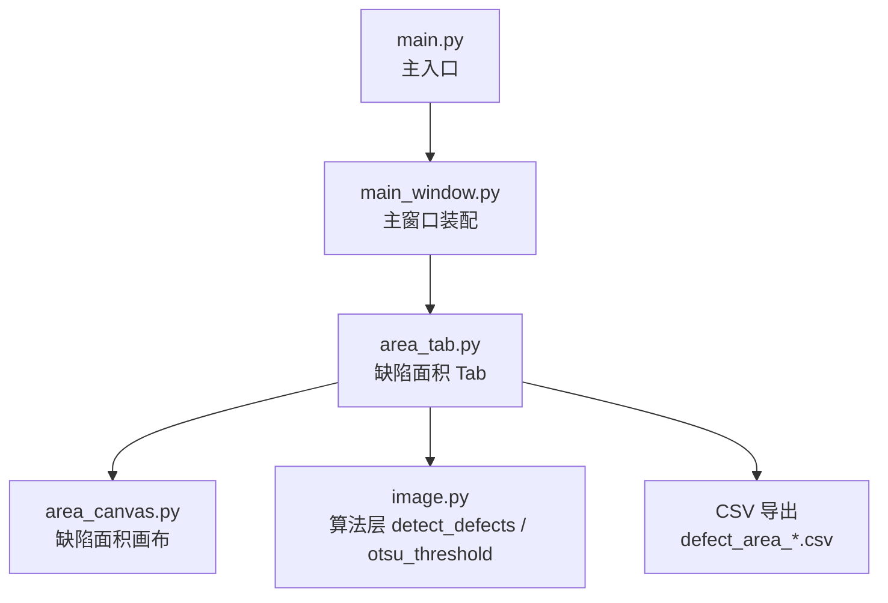
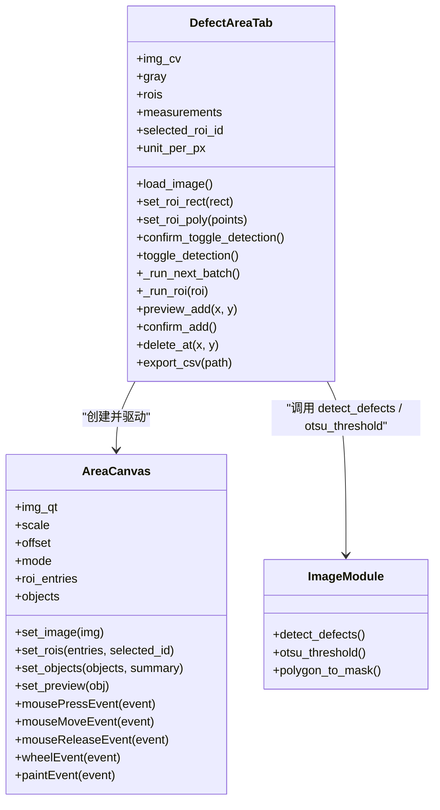
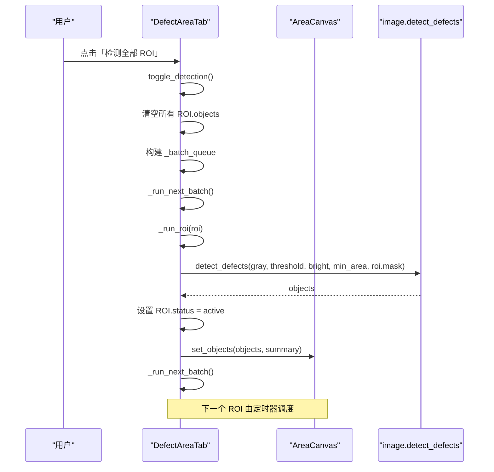
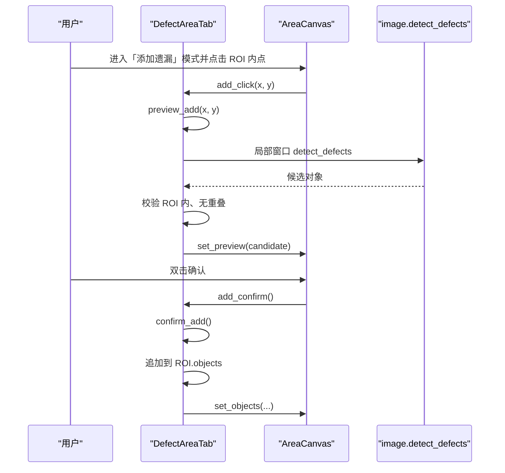

# 设计规格与实现对照

<cite>
**本文引用的文件**   
- [DESIGN_分块批量空洞分析.md](file://DESIGN_分块批量空洞分析.md)
- [area_tab.py](file://area_tab.py)
- [area_canvas.py](file://area_canvas.py)
- [README.md](file://README.md)
- [PROJECT_CONCEPTION.md](file://PROJECT_CONCEPTION.md)
</cite>

## 目录
1. [引言](#引言)
2. [项目结构定位](#项目结构定位)
3. [设计意图总览](#设计意图总览)
4. [缺陷面积多 ROI 的设计契约](#缺陷面积多-roi-的设计契约)
5. [实际实现对照：已实现 / 部分实现 / 未实现](#实际实现对照已实现--部分实现--未实现)
6. [「设计 → 接口 → 数据结构 → UI → 导出」追溯矩阵](#设计--接口--数据结构--ui--导出追溯矩阵)
7. [架构与数据流图](#架构与数据流图)
8. [偏差原因与判定原则](#偏差原因与判定原则)
9. [维护建议](#维护建议)
10. [结论](#结论)

## 引言

本文围绕 Aurascope 的「缺陷面积多 ROI 与分块批量空洞分析」主题，对比三份设计依据与实际代码实现：

- `DESIGN_分块批量空洞分析.md`（以下简称「分块设计方案」）：面向拼接 tile 的分块批量空洞检测、配方、示教学习与批次统计。
- `docs/superpowers/specs/2026-11-19-defect-area-design.md`：缺陷面积页的 specs 文档；该路径在当前仓库中不存在。
- `docs/superpowers/plans/2026-11-20-defect-area-multi-roi.md`：缺陷面积多 ROI 的实施计划；该路径在当前仓库中不存在。
- `.qoder/skills/roi-page-ui-design/SKILL.md`：缺陷面积页 UI 技能文档；该路径在当前仓库中不存在。

因此，本文对「缺陷面积多 ROI」的分析以 **实际源码 `area_tab.py` 与 `area_canvas.py`** 为最终事实源；对「分块批量空洞分析」则以 `DESIGN_分块批量空洞分析.md` 为设计意图来源，并明确标注哪些需求尚未落地到当前仓库。

Aurascope 是面向微电子封装产线的单机桌面视觉检测工具，使用 PyQt6 + OpenCV + NumPy + Pandas，不联网、不收集用户数据、纯 CPU 计算，兼容 Windows 7+。缺陷面积页属于「缺陷面积测量」业务主线，对应 `area_tab.py`（页面逻辑）、`area_canvas.py`（绘制与交互）、`image.py`（算法层）。

**章节来源**
- [README.md:1-80](file://README.md#L1-L80)
- [PROJECT_CONCEPTION.md:1-143](file://PROJECT_CONCEPTION.md#L1-L143)

## 项目结构定位

从仓库根目录看，缺陷面积相关代码位于顶层，而不是按功能模块再细分子目录：

**图表来源**
- [README.md:42-65](file://README.md#L42-L65)
- [area_tab.py:1-30](file://area_tab.py#L1-L30)
- [area_canvas.py:1-13](file://area_canvas.py#L1-L13)

需要特别区分两个容易混淆的概念：

| 概念 | 设计文档中的含义 | 当前仓库中的实现位置 |
|---|---|---|
| 缺陷面积多 ROI | 单张图上定义多个 ROI，分别检测缺陷面积 | `area_tab.py` + `area_canvas.py` |
| 分块批量空洞分析 | 对拼接后的多图 tile 做批量空洞检测、汇总批次结果 | `DESIGN_分块批量空洞分析.md` 中有完整设计，但当前仓库未出现 `batch_analysis.py` 或对应的批量面板 |

**章节来源**
- [area_tab.py:1-30](file://area_tab.py#L1-L30)
- [area_canvas.py:1-13](file://area_canvas.py#L1-L13)
- [DESIGN_分块批量空洞分析.md:1-48](file://DESIGN_分块批量空洞分析.md#L1-L48)

## 设计意图总览

### 分块批量空洞分析的设计目标

「分块设计方案」明确列出五个目标：

| 编号 | 目标 | 当前状态判断 |
|---|---|---|
| G1 | 对全部 tile 分块独立分析，自动汇总总空洞率，且与整图分析数学等价 | 未实现；仓库无批量 tile 引擎 |
| G2 | 检测参数 + ROI 存为配方，按产品名保存/加载 | 配方能力在「示教/批量」Tab 与 `recipe.py` 中体现，但不在 `area_tab.py` 的缺陷面积页内 |
| G3 | 提供一键自动 ROI，把手动画多边形压缩为粗框选 + 微调 | 未体现在 `area_tab.py` 的缺陷面积页 |
| G4 | 批次统计（均值/标准差/极值/异常高亮）+ CSV 导出 | 未实现；`area_tab.py` 只导出逐缺陷明细，不输出批次汇总 |
| G5 | 后台线程执行，带进度与取消，不卡 UI | 未实现；`area_tab.py` 的批量是按 Qt 定时器顺序调度，不是 QThread 批处理 |

**章节来源**
- [DESIGN_分块批量空洞分析.md:32-48](file://DESIGN_分块批量空洞分析.md#L32-L48)

### 分块方案的核心设计决策

| 设计决策 | 设计意图 | 是否进入 `area_tab.py` |
|---|---|---|
| D1 测量与拼接解耦 | 拼接图给人看，测量按 tile 算，总空洞率 = Σ空洞面积 / ΣROI 面积 | 不适用；`area_tab.py` 处理单张图 |
| D2 标量常驻、图像按需加载 | 批次引擎只存 path + 标量，tile 图像用完释放 | 不适用 |
| D3 重叠处理策略 | seamless / overlap_crop / centroid_dedupe 三档 | 未实现 |
| D4 配方即 JSON | 配方是唯一事实源 | 不在缺陷面积页内 |
| D5 示教学习替代固定 ROI | 用灰度统计与阈值分离代替模板 ROI | 不在缺陷面积页内 |

**章节来源**
- [DESIGN_分块批量空洞分析.md:50-92](file://DESIGN_分块批量空洞分析.md#L50-L92)

## 缺陷面积多 ROI 的设计契约

由于 `docs/superpowers/specs/2026-11-19-defect-area-design.md` 与 `docs/superpowers/plans/2026-11-20-defect-area-multi-roi.md` 在当前仓库中不存在，且搜索 `.qoder/skills/roi-page-ui-design/SKILL.md` 也返回空结果，本文不能把「缺失的技能文档」当作权威契约。

根据作者指南，涉及缺陷面积页的 UI 契约应引用 `.qoder/skills/roi-page-ui-design/SKILL.md`；但该文件不可读，因此本文只能以 **现有源码行为** 作为事实契约，并明确标注「UI 契约应以 SKILL.md 为准，当前仓库缺少该文件」。

从 `area_tab.py` 可归纳出当前缺陷面积页的实际契约：

| 契约项 | 当前行为 |
|---|---|
| 导入图片 | 支持 PNG/JPG/JPEG/BMP/TIF/TIFF；TIF 仅支持单页二维灰度或 RGB/RGBA |
| ROI 类型 | 矩形框选、多边形框选 |
| ROI 数量 | 同一张图可添加多个 ROI，每个 ROI 有独立 ID、mask、参数、检测结果 |
| 参数绑定 | 当前选中 ROI 的参数包括二值化阈值、亮/暗缺陷、最小面积 |
| 批量检测 | 「检测全部 ROI」会清空所有 ROI 的检测结果后按队列顺序重跑 |
| 手动修正 | 支持「添加遗漏」「删除误检」，标记 source 为「手动」 |
| 标定 | 支持划线标定像素比，用于将 px² 换算为 µm² 等 |
| 距离测量 | 与 ROI 并列存在，不是 ROI 的子功能 |
| 导出 | 导出逐缺陷 CSV，列包含 ROI 编号、缺陷编号、像素面积、实际面积、单位、质心坐标、来源 |
| 总面积语义 | 显示「全部 ROI 总面积（重叠去重）」，通过合并各缺陷 mask 后计数非零像素 |

**章节来源**
- [area_tab.py:31-36](file://area_tab.py#L31-L36)
- [area_tab.py:53-92](file://area_tab.py#L53-L92)
- [area_tab.py:110-150](file://area_tab.py#L110-L150)
- [area_tab.py:197-318](file://area_tab.py#L197-L318)
- [area_tab.py:561-590](file://area_tab.py#L561-L590)
- [area_tab.py:1116-1166](file://area_tab.py#L1116-L1166)

## 实际实现对照：已实现 / 部分实现 / 未实现

### 已实现功能

| 需求维度 | 已实现内容 | 代码依据 |
|---|---|---|
| 多 ROI 定义 | 支持矩形和多边形 ROI，每个 ROI 有独立 mask、ID、参数、检测结果 | `set_roi_rect`、`set_roi_poly`、`_append_roi` |
| 多 ROI 列表 | 侧边栏表格展示 ROI 编号、状态、阈值、亮/暗、最小面积、缺陷数、总面积 | `_refresh_results` |
| 当前 ROI 选择 | 点击 ROI 行、画布上 pick、或点击 ROI 区域均可切换当前 ROI | `select_roi`、`pick_roi`、`roi_table.itemSelectionChanged` |
| 参数同步 | 切换 ROI 时同步滑块、复选框、阈值标签 | `_sync_parameter_widgets` |
| 批量检测 | 「检测全部 ROI」启动顺序检测队列，完成后提示完成 | `confirm_toggle_detection`、`toggle_detection`、`_run_next_batch` |
| 防抖重检测 | 调节阈值时延迟触发当前 ROI 重检测 | `schedule_detection`、`detect_now` |
| 手动添加遗漏 | 点击 ROI 内点，局部 Otsu 提取候选，双击确认 | `preview_add`、`confirm_add` |
| 手动删除误检 | 删除模式下点击缺陷轮廓命中即删 | `delete_at`、`hit_index` |
| 重复计数防护 | 添加前检查候选 mask 与已有缺陷 mask 是否有真实像素交集 | `_overlaps` |
| 标定与面积单位 | 支持划线标定，将 px² 换算为 µm² 等单位 | `calibrate`、`compute_real_area`、`fmt_area` |
| 距离测量 | 独立于 ROI 的两点测距、统计、导出 | `add_distance`、`export_distance_csv` |
| 缺陷明细表 | 当前 ROI 的缺陷编号、像素面积、实际面积、来源 | `_refresh_results` |
| CSV 导出 | 原子写入 UTF-8-SIG CSV，列含 ROI 编号、缺陷编号、面积、质心、来源 | `export_csv` |
| 画布渲染 | ROI 虚线、选中 ROI 高亮、缺陷掩膜叠加、鼠标缩放平移 | `AreaCanvas.paintEvent`、`wheelEvent`、`mousePressEvent` |

**章节来源**
- [area_tab.py:561-590](file://area_tab.py#L561-L590)
- [area_tab.py:659-683](file://area_tab.py#L659-L683)
- [area_tab.py:751-800](file://area_tab.py#L751-L800)
- [area_tab.py:803-847](file://area_tab.py#L803-L847)
- [area_tab.py:855-908](file://area_tab.py#L855-L908)
- [area_tab.py:1029-1114](file://area_tab.py#L1029-L1114)
- [area_tab.py:1116-1166](file://area_tab.py#L1116-L1166)
- [area_canvas.py:85-130](file://area_canvas.py#L85-L130)
- [area_canvas.py:212-338](file://area_canvas.py#L212-L338)
- [area_canvas.py:416-492](file://area_canvas.py#L416-L492)

### 部分实现

| 设计意图 | 当前实现程度 | 说明 |
|---|---|---|
| 多 ROI 批量检测 | 已实现「检测全部 ROI」，但不是异步线程批量 | 使用 `_batch_timer` 和 `_run_next_batch` 顺序调度，每次调用 `_run_roi` 后立即刷新 UI；适合少量 ROI，不适合大批次长耗时任务 |
| 多 ROI 参数隔离 | 基本实现 | 每个 ROI 有自己的 `params`，但「检测全部 ROI」会先清空所有 ROI 的 `objects`，再逐个重跑 |
| 多 ROI 结果显示 | 已实现 | ROI 表格显示每框缺陷数和总面积；缺陷明细表只显示当前 ROI |
| 多 ROI 总面积 | 已实现，但语义是「所有 ROI 中缺陷 mask 的并集面积」 | 不是「所有 ROI 的面积之和」，也不是「空洞率汇总」 |
| 分块批量空洞分析 | 未实现 | 仓库没有批量 tile 读取、批次引擎、批次汇总表、批次 CSV |
| 配方管理 | 不在缺陷面积页内 | `area_tab.py` 不读写 recipe JSON |
| 自动 ROI | 未体现在缺陷面积页 | `area_tab.py` 没有「自动 ROI」按钮 |
| 批次统计 | 未实现 | 只有单张图上的 ROI 统计，没有跨图均值/标准差/极值 |
| 后台线程 | 未实现 | 批量检测走 QTimer，不是 QThread |

**章节来源**
- [area_tab.py:751-847](file://area_tab.py#L751-L847)
- [area_tab.py:914-978](file://area_tab.py#L914-L978)
- [DESIGN_分块批量空洞分析.md:180-215](file://DESIGN_分块批量空洞分析.md#L180-L215)

### 未实现功能

| 设计条目 | 当前状态 | 原因或现状 |
|---|---|---|
| 分块批量空洞分析 | 未实现 | 仓库无 `batch_analysis.py`，也无拼接 Tab 新增的「批量空洞分析」区 |
| 配方 JSON 存取 | 未在缺陷面积页实现 | `area_tab.py` 不依赖 `recipe.py` |
| 自动 ROI | 未在缺陷面积页实现 | 无「自动 ROI」控件 |
| 批次统计（均值/标准差/极值） | 未实现 | 当前只统计单张图 |
| 异常块高亮 | 未实现 | 无批次结果表 |
| 背景线程 + 进度条 + 取消 | 未实现 | 当前批量检测是 UI 线程内定时调度 |
| 重叠模式 seamless / overlap_crop / centroid_dedupe | 未实现 | 不涉及 tile 拼接 |
| 示教模型 | 未在缺陷面积页实现 | 示教/批量逻辑属于其他 Tab，不在 `area_tab.py` |
| 导出批次 CSV | 未实现 | `export_csv` 只导出当前图的缺陷明细 |

**章节来源**
- [DESIGN_分块批量空洞分析.md:180-258](file://DESIGN_分块批量空洞分析.md#L180-L258)
- [area_tab.py:1116-1166](file://area_tab.py#L1116-L1166)

## 「设计 → 接口 → 数据结构 → UI → 导出」追溯矩阵

| 设计需求 | 接口/函数 | 数据结构 | UI 表现 | 导出产物 | 是否落地 |
|---|---|---|---|---|---|
| 多 ROI 定义 | `set_roi_rect`、`set_roi_poly` | ROI dict：id、roi、mask、params、objects、status、manual_changed、area_px | 矩形/多边形绘制、ROI 列表、当前 ROI 高亮 | 否 | 已实现 |
| 多 ROI 检测 | `_run_roi` → `detect_defects` | ROI.objects、ROI.area_px | ROI 表格、缺陷明细表、画布缺陷覆盖 | 否 | 已实现 |
| 批量检测全部 ROI | `toggle_detection`、`_run_next_batch` | _batch_queue、_batch_active、_batch_generation | 「检测全部 ROI」/「停止并清空」 | 否 | 部分实现 |
| 手动添加遗漏 | `preview_add`、`confirm_add` | 单个 object dict：rect、points、mask、cx、cy、area_px、source、roi_id | 预览红框、双击确认 | 是（CSV 中 source=手动） | 已实现 |
| 手动删除误检 | `delete_at` | 同 object dict | 删除模式悬停高亮、点击删除 | 是（删除后不再导出） | 已实现 |
| 重复计数防护 | `_overlaps` | ROI.objects 中各对象 mask | 拒绝添加并提示 | 否 | 已实现 |
| 比例尺标定 | `calibrate` | unit_per_px、unit | 标定线、单位标签 | 是（CSV 含实际面积） | 已实现 |
| 距离测量 | `add_distance`、`export_distance_csv` | measurements list | 距离表格、统计标签 | distance CSV | 已实现 |
| 缺陷面积 CSV | `export_csv` | objects 列表 | 「导出 CSV」按钮 | defect_area CSV | 已实现 |
| 分块批量空洞分析 | 无对应实现 | 无 BatchResult / TileResult | 无批量面板 | 无批次 CSV | 未实现 |
| 配方管理 | 无对应实现 | 无 recipe 字段 | 无配方下拉/保存 | 无配方 JSON | 未在缺陷面积页实现 |
| 自动 ROI | 无对应实现 | 无 polygon/vertices | 无自动 ROI 按钮 | 否 | 未实现 |
| 批次统计 | 无对应实现 | 无 stats dict | 无汇总卡片 | 否 | 未实现 |
| 后台线程 | 无 QThread | 无 worker | 无进度条/取消 | 否 | 未实现 |

**章节来源**
- [area_tab.py:561-590](file://area_tab.py#L561-L590)
- [area_tab.py:659-683](file://area_tab.py#L659-L683)
- [area_tab.py:751-847](file://area_tab.py#L751-L847)
- [area_tab.py:1029-1114](file://area_tab.py#L1029-L1114)
- [area_tab.py:1116-1166](file://area_tab.py#L1116-L1166)
- [DESIGN_分块批量空洞分析.md:108-177](file://DESIGN_分块批量空洞分析.md#L108-L177)

## 架构与数据流图

### 缺陷面积页类关系

**图表来源**
- [area_tab.py:110-150](file://area_tab.py#L110-L150)
- [area_tab.py:821-847](file://area_tab.py#L821-L847)
- [area_canvas.py:85-130](file://area_canvas.py#L85-L130)

### 多 ROI 批量检测时序

**图表来源**
- [area_tab.py:751-847](file://area_tab.py#L751-L847)

### 手动添加遗漏时序

**图表来源**
- [area_tab.py:1029-1096](file://area_tab.py#L1029-L1096)
- [area_canvas.py:212-231](file://area_canvas.py#L212-L231)
- [area_canvas.py:311-327](file://area_canvas.py#L311-L327)

## 偏差原因与判定原则

### 主要偏差

1. **分块批量空洞分析未落地到 `area_tab.py`**  
   `area_tab.py` 的「批量」是指「同一张图上的多个 ROI 顺序检测」，不是「分块批量空洞分析」中的「多图 tile 批次分析」。后者在 `DESIGN_分块批量空洞分析.md` 中要求新建 `batch_analysis.py`，并在拼接 Tab 增加批量面板，但当前仓库未见该实现。

2. **配方与自动 ROI 不在缺陷面积页**  
   分块设计方案指出配方与自动 ROI 做在空洞分析 Tab 或主窗口侧边栏，而非拼接 Tab；但 `area_tab.py` 本身也没有配方或自动 ROI 能力。

3. **批量检测不是后台线程**  
   设计期望 `BatchAnalyzer(QThread)` 顺序处理、信号回调、可取消；当前实现使用 `QTimer` 在 UI 线程内顺序调度，风险是大 ROI 检测仍可能卡顿 UI。

4. **没有批次统计与异常高亮**  
   设计要求的 BatchResult、TileResult、均值/标准差/极值、异常行高亮、批次 CSV 均未出现在 `area_tab.py`。

5. **UI 契约文件缺失**  
   作者指南要求缺陷面积页 UI 契约以 `.qoder/skills/roi-page-ui-design/SKILL.md` 为准，但该文件不存在。因此本文不能声称某个 UI 行为符合 SKILL.md，只能描述源码实际行为。

### 判定原则

| 情形 | 应以什么为准 |
|---|---|
| 缺陷面积页当前能做什么 | 以 `area_tab.py` 与 `area_canvas.py` 源码为准 |
| 缺陷面积页应该怎么做 | 以 `.qoder/skills/roi-page-ui-design/SKILL.md` 为准，但该文件当前缺失 |
| 分块批量空洞分析的目标 | 以 `DESIGN_分块批量空洞分析.md` 为准 |
| 分块批量空洞分析是否已实现 | 以仓库是否存在对应代码为准；当前为未实现 |
| 历史技术债 | 以 handoff.md 清单为准；但 handoff.md 在当前仓库中也缺失，因此本文不虚构其内容 |

**章节来源**
- [area_tab.py:751-847](file://area_tab.py#L751-L847)
- [DESIGN_分块批量空洞分析.md:180-258](file://DESIGN_分块批量空洞分析.md#L180-L258)

## 维护建议

当规格变更时，建议按以下流程同步更新 specs/plans 与代码注释：

1. **先改 specs/plans，再改代码**  
   - 若变更影响缺陷面积页 UI，应优先更新 `.qoder/skills/roi-page-ui-design/SKILL.md`。
   - 若变更影响分块批量空洞分析，应更新 `docs/superpowers/specs/2026-11-19-defect-area-design.md` 与 `docs/superpowers/plans/2026-11-20-defect-area-multi-roi.md`。
   - 当前这两个 specs/plans 文件缺失，应先补全，否则后续维护无法对齐。

2. **在代码注释中标明设计来源**  
   - 对 `area_tab.py` 中与多 ROI 相关的核心方法，应在类或方法注释中引用 SKILL.md 或 specs 文件名及版本。
   - 对 `area_canvas.py` 的绘制与交互约定，应注明「坐标转换、滚轮缩放、右键平移、多边形 ROI 编辑」是 Canvas 层统一约定。

3. **明确「设计意图」与「现行行为」的区别**  
   - 对于尚未落地的需求，应在代码注释中写明「设计见 DESIGN_分块批量空洞分析.md §X，当前未实现」。
   - 对于已实现但与设计不完全一致的行为，应写明「设计期望 X，现行实现 Y，原因是 Z」。

4. **保持 GUI 层与算法层边界**  
   - `area_tab.py` 不得内联实现图像算法；当前它调用 `image.detect_defects`、`image.otsu_threshold`、`image.polygon_to_mask`，符合这一约束。
   - 新增批量空洞分析时，应继续复用 `image.py`，不要复制算法逻辑到 GUI 层。

5. **导出格式变更需同步 CSV 列定义**  
   - `area_tab.py` 中 `CSV_COLUMNS` 与 `export_csv` 必须保持一致。
   - 若未来扩展为批次 CSV，应新增独立的列定义，避免与缺陷明细 CSV 混用。

6. **测试与冒烟验证**  
   - 任何涉及 ROI 增删、批量检测、导出的改动，都应运行仓库根下的 pytest 风格单测。
   - 新增模态窗或阻塞操作时，应避免自动化测试挂起，参考分块设计方案中关于弹窗测试的经验教训。

**章节来源**
- [area_tab.py:1-30](file://area_tab.py#L1-L30)
- [area_tab.py:1116-1166](file://area_tab.py#L1116-L1166)
- [DESIGN_分块批量空洞分析.md:437-485](file://DESIGN_分块批量空洞分析.md#L437-L485)

## 结论

就「缺陷面积多 ROI 与分块批量空洞分析」而言，当前仓库呈现两种不同范围的能力：

- **缺陷面积多 ROI**：已在 `area_tab.py` 与 `area_canvas.py` 中实现。用户可以导入一张图，绘制多个矩形或多边形 ROI，分别调参检测，手动添加或删除缺陷，并进行标定、距离测量与缺陷明细 CSV 导出。
- **分块批量空洞分析**：在 `DESIGN_分块批量空洞分析.md` 中有完整设计，包括配方、自动 ROI、批次引擎、批次统计、后台线程、CSV 导出等，但当前仓库中没有对应的批量实现。

因此，读者判断某个需求是否落地时，应遵循以下规则：

1. 如果需求属于「单张图上的多 ROI 检测」，以 `area_tab.py` 与 `area_canvas.py` 为准。
2. 如果需求属于「多图 tile 分块批量空洞分析」，以 `DESIGN_分块批量空洞分析.md` 为准，但当前视为待办事项。
3. 如果需求属于缺陷面积页 UI 契约，应以 `.qoder/skills/roi-page-ui-design/SKILL.md` 为准；该文件缺失时，不应虚构契约，而应先把 SKILL.md 补齐。
4. 如果 specs/plans 与代码行为不一致，应以代码为「现行事实」，以 specs/plans 为「设计意图」，并在代码注释中记录差异与原因。