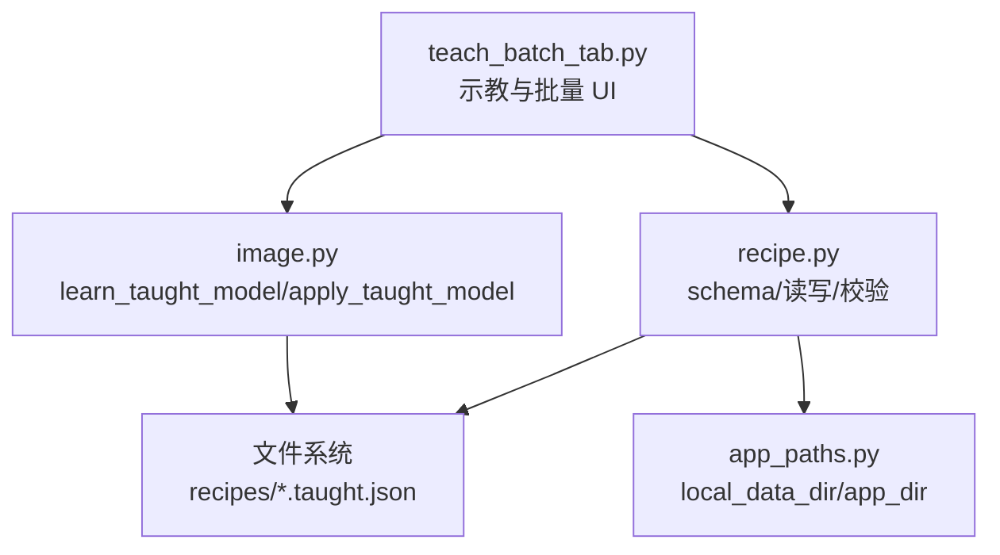
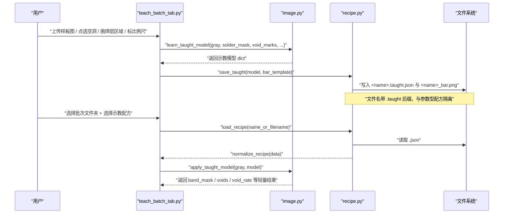
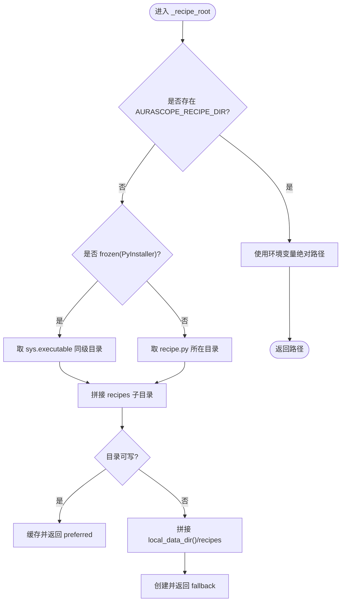
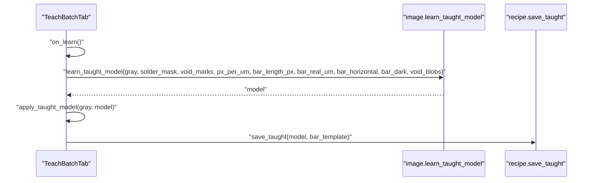
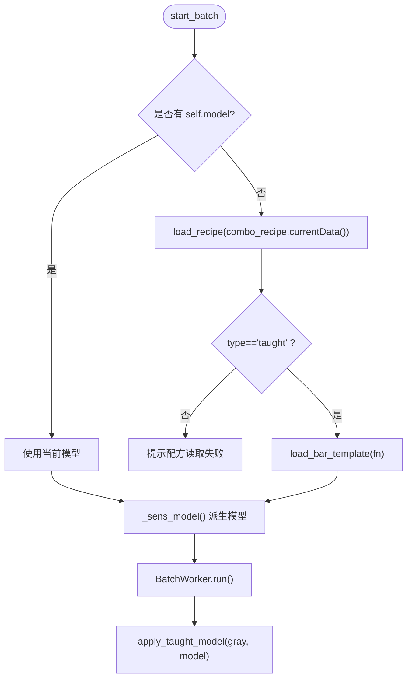

# 配方 JSON 模型

<cite>
**本文引用的文件**   
- [recipe.py](file://recipe.py)
- [app_paths.py](file://app_paths.py)
- [image.py](file://image.py)
- [teach_batch_tab.py](file://teach_batch_tab.py)
- [recipes/1-1.taught.json](file://recipes/1-1.taught.json)
- [recipes/2.taught.json](file://recipes/2.taught.json)
- [recipes/4.taught.json](file://recipes/4.taught.json)
- [recipes/7.taught.json](file://recipes/7.taught.json)
- [recipes/8.taught.json](file://recipes/8.taught.json)
</cite>

## 目录
1. [引言](#引言)
2. [项目结构与定位](#项目结构与定位)
3. [核心组件与职责](#核心组件与职责)
4. [架构总览](#架构总览)
5. [示教配方数据模型](#示教配方数据模型)
6. [公开接口规范](#公开接口规范)
7. [最小可运行示例片段](#最小可运行示例片段)
8. [配方目录解析路径（源码 vs PyInstaller）](#配方目录解析路径源码-vs-pyinstaller)
9. [配方与 image.py 检测参数映射](#配方与-imagepy-检测参数映射)
10. [UI 到配方的序列化流程](#ui-到配方的序列化流程)
11. [版本兼容与迁移策略](#版本兼容与迁移策略)
12. [常见错误诊断](#常见错误诊断)
13. [结论](#结论)

## 引言
本文件以 `recipe.py` 中的 schema 校验、规范化与落盘逻辑为权威依据，整理 Aurascope 批量示教配方的完整 JSON 数据模型。文档覆盖：
- 每个字段的名称、数据类型、必填性、默认值、取值范围与业务含义；
- `load_recipe()` / `save_recipe()` / `validate_recipe()` 等接口的参数、返回值与异常行为；
- 结合仓库中 `recipes/*.taught.json` 给出最小可运行示例片段；
- 说明 `recipes/` 目录在源码运行与 PyInstaller 打包两种路径下的解析方式；
- 新增字段与废弃字段的兼容策略；
- 配方与 `image.py` 检测参数的映射关系；
- `teach_batch_tab.py` 如何将 UI 参数序列化为配方；
- 字段缺失、类型不匹配、数值越界等错误的诊断建议。

## 项目结构与定位
Aurascope 是 PyQt6 + OpenCV + NumPy + Pandas 的单机桌面应用，按「入口 → 主窗口 → Tab 页面 → Canvas 绘制层 → 算法层 image.py → 配方/导出」分层组织。示教配方属于「批量示教」业务主线，由以下文件协作：
- `recipe.py`：配方 schema、校验、读写、命名与存储根目录；
- `app_paths.py`：程序目录、用户数据目录、资源路径；
- `image.py`：示教学习、焊层带定位、空洞检测、比例尺识别等算法实现；
- `teach_batch_tab.py`：示教 UI、批量检测 UI、UI 状态到模型的序列化；
- `recipes/*.taught.json`：实际落盘的示教配方样例。



**图表来源**
- [recipe.py:1-10](file://recipe.py#L1-L10)
- [app_paths.py:1-26](file://app_paths.py#L1-L26)
- [image.py:747-751](file://image.py#L747-L751)
- [teach_batch_tab.py:1-15](file://teach_batch_tab.py#L1-L15)

**章节来源**
- [recipe.py:1-10](file://recipe.py#L1-L10)
- [app_paths.py:1-26](file://app_paths.py#L1-L26)
- [image.py:747-751](file://image.py#L747-L751)
- [teach_batch_tab.py:1-15](file://teach_batch_tab.py#L1-L15)

## 核心组件与职责
| 模块 | 职责 | 关键函数/类 |
|---|---|---|
| `recipe.py` | 定义 schema 版本、默认值、取值范围；校验并规范化 v1 参数型配方与 v2/v3 示教模型；提供保存、加载、删除、列表、模板图读取；决定 recipes 根目录 | `SCHEMA_VERSION`、`DETECTION_DEFAULTS`、`_RANGES`、`validate_detection`、`validate_roi`、`build_recipe`、`normalize_recipe`、`validate_taught`、`save_taught`、`load_bar_template`、`save_recipe`、`load_recipe`、`delete_recipe`、`list_recipes`、`recipe_dir` |
| `app_paths.py` | 区分 PyInstaller 单文件模式与源码运行时的 base 目录；提供用户可写数据目录 | `resource_path`、`app_dir`、`local_data_dir`、`log_dir`、`build_date` |
| `image.py` | 示教学习、两类阈值分离、焊层带几何先验定位、空洞暗核抓取、批量应用示教模型、比例尺识别 | `array_stats`、`class_stats`、`two_class_threshold`、`locate_solder_band`、`grab_local_dark_blob`、`detect_voids_in_band`、`learn_taught_model`、`apply_taught_model`、`read_scale_bar` |
| `teach_batch_tab.py` | 样板图上传、点选空洞、自动/手绘焊层区域、比例尺标定、学习预览、保存示教配方、批量检测、结果核对与导出 | `TeachBatchTab`、`BatchWorker`、`on_learn`、`on_save_recipe`、`start_batch`、`_sens_model` |

**章节来源**
- [recipe.py:20-47](file://recipe.py#L20-L47)
- [recipe.py:228-258](file://recipe.py#L228-L258)
- [recipe.py:271-382](file://recipe.py#L271-L382)
- [recipe.py:385-474](file://recipe.py#L385-L474)
- [app_paths.py:8-26](file://app_paths.py#L8-L26)
- [image.py:753-823](file://image.py#L753-L823)
- [image.py:894-1046](file://image.py#L894-L1046)
- [image.py:1182-1300](file://image.py#L1182-L1300)
- [teach_batch_tab.py:1126-1235](file://teach_batch_tab.py#L1126-L1235)
- [teach_batch_tab.py:1401-1453](file://teach_batch_tab.py#L1401-L1453)

## 架构总览
示教配方从 UI 到落盘再到批量运行的整体流程如下：



**图表来源**
- [teach_batch_tab.py:1126-1235](file://teach_batch_tab.py#L1126-L1235)
- [recipe.py:385-404](file://recipe.py#L385-L404)
- [recipe.py:439-462](file://recipe.py#L439-L462)
- [image.py:1182-1300](file://image.py#L1182-L1300)

## 核心组件
本节聚焦配方数据模型本身，重点说明 schema 版本、顶层字段、子对象及校验规则。

### 示教配方顶层结构
当前代码中 `validate_taught` 固定输出 `schema_version=3`，因此现行落盘模型为 schema v3，且通过 `type='taught'` 与 v1 参数型配方隔离。

| 字段 | 类型 | 必填性 | 默认值 | 取值范围/约束 | 业务含义 |
|---|---|---:|---|---|---|
| `schema_version` | 整数 | 是 | 无（但 `validate_taught` 会重写为 3） | 当前稳定值为 3 | 配方 schema 版本号，用于兼容判断 |
| `type` | 字符串 | 是 | 无（`validate_taught` 固定写入 `'taught'`） | 固定为 `'taught'` | 标识这是示教模型，区别于 v1 参数型配方 |
| `name` | 字符串 | 是 | 空字符串 | 经 `safe_name` 过滤非法字符并截断至 64 字节 | 配方显示名，也是 `.taught.json` 文件名基础 |
| `note` | 字符串 | 否 | 空字符串 | 任意文本 | 备注，例如样板图来源或快速示教说明 |
| `updated` | 字符串 | 否 | 空字符串 | ISO 时间字符串（如 `YYYY-MM-DDTHH:MM:SS`） | 最后更新时间 |
| `solder` | 对象 | 是 | 内部各字段有默认值 | 见下方 `solder` 表 | 焊层类的灰度统计与分离阈值 |
| `background` | 对象 | 是 | 内部各字段有默认值 | 见下方 `background` 表 | 背景类的灰度统计 |
| `void` | 对象 | 是 | 内部各字段有默认值 | 见下方 `void` 表 | 空洞检测阈值、面积/圆度/深度容差、示范统计 |
| `px_per_um` | 浮点数 | 否 | 0.0 | 非负实数（代码未显式下限夹紧，但业务上应为 ≥0） | 像素/微米，与 `main_window.pixel_scale` 一致 |
| `ref_median` | 浮点数 | 否 | 0.0 | 0~255（被 `_clamp` 限制） | 参考中位灰度，用于诊断或后续扩展 |
| `band` | 对象 | 是 | 内部各字段有默认值 | 见下方 `band` 表 | 焊层带形态学参数 |
| `band_ref` | 对象或 null | 否 | null | 若存在则必须包含全部 6 个归一化几何键 | 示教模板的焊层带几何基准 |
| `band_tol` | 对象或 null | 否 | 内置默认偏差阈值 | 允许部分键覆盖 | 焊层带几何偏差容忍度 |
| `scale_bar` | 对象 | 是 | 内部各字段有默认值 | 见下方 `scale_bar` 表 | 比例尺模板配置 |
| `diagnostics` | 对象 | 是 | 内部各字段有默认值 | 见下方 `diagnostics` 表 | 示教质量诊断指标 |

**章节来源**
- [recipe.py:271-348](file://recipe.py#L271-L348)
- [recipe.py:355-382](file://recipe.py#L355-L382)

### solder 对象
| 字段 | 类型 | 必填性 | 默认值 | 取值范围 | 业务含义 |
|---|---|---:|---:|---|---|
| `median` | 浮点数 | 是 | 128.0 | 0~255 | 焊层类像素的中位数灰度 |
| `std` | 浮点数 | 是 | 0.0 | 0~255 | 焊层类像素的标准差 |
| `p5` | 浮点数 | 是 | 0.0 | 0~255 | 第 5 百分位灰度 |
| `p95` | 浮点数 | 是 | 255.0 | 0~255 | 第 95 百分位灰度 |
| `threshold` | 浮点数 | 是 | 128.0 | 0~255 | 焊层与背景的分离阈值 |

**章节来源**
- [recipe.py:296-302](file://recipe.py#L296-L302)
- [image.py:1274-1286](file://image.py#L1274-L1286)

### background 对象
| 字段 | 类型 | 必填性 | 默认值 | 取值范围 | 业务含义 |
|---|---|---:|---:|---|---|
| `median` | 浮点数 | 是 | 128.0 | 0~255 | 背景类像素的中位数灰度 |
| `std` | 浮点数 | 是 | 0.0 | 0~255 | 背景类像素的标准差 |

**章节来源**
- [recipe.py:303-306](file://recipe.py#L303-L306)
- [image.py:1287-1290](file://image.py#L1287-L1290)

### void 对象
| 字段 | 类型 | 必填性 | 默认值 | 取值范围/语义 | 业务含义 |
|---|---|---:|---:|---|---|
| `threshold` | 浮点数或 null | 否 | null | 0~255 或 null | 空洞暗核阈值；若无空洞样本则为 null |
| `min_area` | 整数 | 是 | 0 | ≥0 | 手动面积下限；0 表示自动 |
| `min_area_taught` | 整数 | 是 | 4 | ≥1 | 基于点选空洞尺寸推导出的“教学下限” |
| `max_area` | 整数或 null | 是 | null | >0 或 null | 手动面积上限；null 表示自动 |
| `max_area_taught` | 整数或 null | 是 | 0→转为 null | ≥1 或 null | 基于点选空洞尺寸推导出的“教学上限” |
| `min_roundness` | 浮点数 | 是 | 0.0 | 0.0~1.0 | 最小圆度；0 关闭 |
| `depth_offset` | 浮点数 | 是 | 0.0 | -80.0~80.0 | 深度容差：正值更包容，把偏浅的暗斑也算作空洞 |
| `taught_count` | 整数 | 是 | 0 | 0~9999 | 参与学习的空洞样本数量 |
| `median` | 浮点数或 null | 否 | null | 0~255 或 null | 空洞类像素中位数（若有空洞样本） |

注意：`min_area` 与 `max_area` 的 0/null 语义是“自动档”，而 `*_taught` 字段保留学习时根据点选空洞尺寸推导出的原始上下限，便于追溯。

**章节来源**
- [recipe.py:307-323](file://recipe.py#L307-L323)
- [image.py:1291-1300](file://image.py#L1291-L1300)

### band 对象
| 字段 | 类型 | 必填性 | 默认值 | 取值范围 | 业务含义 |
|---|---|---:|---:|---|---|
| `min_aspect` | 浮点数 | 是 | 3.0 | 1.0~50.0 | 焊层带最小长宽比 |
| `min_area_frac` | 浮点数 | 是 | 0.01 | 0.0~1.0 | 最小面积占比（相对整图） |
| `open_kernel` | 整数 | 是 | 5 | 1~21 | 开运算核大小，断开细界面 |
| `min_thickness_px` | 整数 | 是 | 8 | 0~60 | 竖向最小厚度 px；0 关闭剔除薄碎片 |

**章节来源**
- [recipe.py:326-335](file://recipe.py#L326-L335)
- [image.py:894-918](file://image.py#L894-L918)

### band_ref 对象
| 字段 | 类型 | 必填性 | 默认值 | 取值范围 | 业务含义 |
|---|---|---:|---:|---|---|
| `cx_norm` | 浮点数 | 是 | 无 | 归一化坐标 | 焊层带中心横坐标（相对图像宽度） |
| `cy_norm` | 浮点数 | 是 | 无 | 归一化坐标 | 焊层带中心纵坐标（相对图像高度） |
| `w_norm` | 浮点数 | 是 | 无 | 归一化宽度 | 焊层带宽度占图像宽度的比例 |
| `h_norm` | 浮点数 | 是 | 无 | 归一化高度 | 焊层带高度占图像高度的比例 |
| `area_frac` | 浮点数 | 是 | 无 | 0~1 | 焊层带面积占整图比例 |
| `aspect` | 浮点数 | 是 | 无 | >0 | 焊层带长宽比 |

若任一键缺失或无法转为浮点数，`_validate_band_ref` 返回 null，表示不使用几何先验择带。

**章节来源**
- [recipe.py:355-368](file://recipe.py#L355-L368)
- [image.py:836-854](file://image.py#L836-L854)

### band_tol 对象
| 字段 | 类型 | 必填性 | 默认值 | 取值范围 | 业务含义 |
|---|---|---:|---:|---|---|
| `center_shift` | 浮点数 | 否 | 0.15 | 正数 | 中心偏移容忍度 |
| `area_lo` | 浮点数 | 否 | 0.4 | 正数 | 面积比值下界 |
| `area_hi` | 浮点数 | 否 | 2.5 | 正数 | 面积比值上界 |
| `aspect_lo` | 浮点数 | 否 | 0.5 | 正数 | 长宽比下界 |
| `aspect_hi` | 浮点数 | 否 | 2.0 | 正数 | 长宽比上界 |

`_validate_band_tol` 允许只传入部分键覆盖默认值；非法值会被忽略，不会破坏整个 tol 对象。

**章节来源**
- [recipe.py:371-382](file://recipe.py#L371-L382)
- [image.py:857-891](file://image.py#L857-L891)

### scale_bar 对象
| 字段 | 类型 | 必填性 | 默认值 | 取值范围 | 业务含义 |
|---|---|---:|---:|---|---|
| `horizontal` | 布尔值 | 是 | true | true/false | 比例尺方向是否水平 |
| `dark` | 布尔值 | 是 | true | true/false | 比例尺条棒是否较暗 |
| `length_px` | 浮点数 | 是 | 0.0 | ≥0 | 示范图中比例尺像素长度 |
| `real_um` | 浮点数 | 是 | 0.0 | ≥0 | 比例尺代表的真实微米长度 |

**章节来源**
- [recipe.py:338-343](file://recipe.py#L338-L343)

### diagnostics 对象
| 字段 | 类型 | 必填性 | 默认值 | 取值范围 | 业务含义 |
|---|---|---:|---:|---|---|
| `solder_bg_separability` | 浮点数 | 是 | 0.0 | ≥0 | 焊层类与背景类的可分性 |
| `solder_void_separability` | 浮点数 | 是 | 0.0 | ≥0 | 焊层类与空洞类的可分性 |

注意：仓库现有样例中还出现 `bg_same_gray_frac` 字段，但 `validate_taught` 并未将其纳入规范化输出；该字段属于历史或扩展产物，不应作为 v3 schema 的权威字段。

**章节来源**
- [recipe.py:344-347](file://recipe.py#L344-L347)
- [recipes/1-1.taught.json:51-55](file://recipes/1-1.taught.json#L51-L55)

## 公开接口规范

### `validate_detection(det)`
- **输入**：`det` 为检测参数字典或 None。
- **输出**：规范化后的检测参数字典。
- **行为**：
  - 先拷贝 `DETECTION_DEFAULTS`；
  - 对已知键进行类型转换与范围夹紧；
  - `max_area` 为 0/null/缺失时表示无上限；
  - 未知键按 int 尝试转换，失败回退默认值。
- **异常**：不抛异常，非法值尽量降级为默认或夹紧值。

**章节来源**
- [recipe.py:22-47](file://recipe.py#L22-L47)
- [recipe.py:169-200](file://recipe.py#L169-L200)

### `validate_roi(roi)`
- **输入**：ROI 字典或 None。
- **输出**：规范化 ROI，包含 `type`、`polygon`、`layer_threshold`、`vertices`。
- **行为**：
  - 多边形顶点逐个尝试转为 `[x, y]` 浮点数组，非法点丢弃；
  - 至少 3 个有效点才判定为 `polygon`，否则为 `none`；
  - `layer_threshold` 夹紧到 0~255；
  - `vertices` 夹紧到 3~120。
- **异常**：不抛异常。

**章节来源**
- [recipe.py:203-225](file://recipe.py#L203-L225)

### `build_recipe(name, detection, roi, px_per_um=0.0, note='')`
- **用途**：组装 v1 参数型配方字典。
- **输出**：含 `schema_version`、`name`、`note`、`updated`、`detection`、`roi`、`px_per_um` 的字典。
- **异常**：不直接抛异常，但内部调用 `validate_detection` / `validate_roi`。

**章节来源**
- [recipe.py:228-238](file://recipe.py#L228-L238)

### `normalize_recipe(data)`
- **输入**：任意来源的字典。
- **输出**：
  - 若 `type == 'taught'`，调用 `validate_taught`；
  - 否则按 v1 参数型配方规范化。
- **异常**：非法输入返回 None。

**章节来源**
- [recipe.py:241-258](file://recipe.py#L241-L258)

### `validate_taught(model)`
- **输入**：示教模型字典。
- **输出**：规范化后的 v3 示教模型；非法输入返回 None。
- **行为**：
  - 补齐 `schema_version=3`、`type='taught'`；
  - 对 `solder`、`background`、`void`、`band`、`scale_bar`、`diagnostics` 各子对象做默认值填充与范围夹紧；
  - 对 `band_ref`、`band_tol` 做严格/宽松校验；
  - 对 schema < 3 的旧配方执行迁移：面积上下限迁移为自动档，旧值保留到 `*_taught` 字段供追溯。
- **异常**：不抛异常，非法输入返回 None。

**章节来源**
- [recipe.py:261-348](file://recipe.py#L261-L348)

### `save_taught(model, bar_template=None)`
- **输入**：
  - `model`：已规范化的示教模型；
  - `bar_template`：可选的比例尺模板 PNG 图像。
- **输出**：保存后的 `.taught.json` 文件路径。
- **异常**：
  - 若 `name` 为空，抛出 `ValueError('配方名不能为空')`；
  - 使用临时文件 + `os.replace` 保证原子写入；
  - 模板图通过 `cv2.imencode` + Python 文件写入，绕开 Windows 非 ASCII 路径问题。

**章节来源**
- [recipe.py:385-404](file://recipe.py#L385-L404)

### `load_bar_template(name_or_filename)`
- **输入**：显示名、`<名>.json` 或 `<名>.taught.json`。
- **输出**：灰度模板图 numpy 数组；不存在或读取失败返回 None。
- **行为**：
  - 先剥 `.taught.json`，再剥 `.json`；
  - 最终拼 `<name>_bar.png`；
  - 用 `np.frombuffer` + `cv2.imdecode` 绕过中文路径问题。

**章节来源**
- [recipe.py:407-429](file://recipe.py#L407-L429)

### `save_recipe(recipe)`
- **输入**：v1 参数型配方字典。
- **输出**：保存后的 `.json` 文件路径。
- **异常**：
  - 若 `name` 为空，抛出 `ValueError('配方名不能为空')`；
  - 同样采用临时文件 + `os.replace` 原子写入。

**章节来源**
- [recipe.py:439-449](file://recipe.py#L439-L449)

### `load_recipe(name_or_filename)`
- **输入**：显示名或文件名。
- **输出**：规范化后的配方字典；找不到文件或 JSON 解析失败返回 None。
- **行为**：
  - 通过 `_resolve_path` 支持 `.json` 与 `.taught.json`；
  - 通过 `normalize_recipe` 统一处理 v1 与 taught。

**章节来源**
- [recipe.py:123-134](file://recipe.py#L123-L134)
- [recipe.py:452-462](file://recipe.py#L452-L462)

### `delete_recipe(name_or_filename)`
- **输入**：显示名或文件名。
- **输出**：布尔值，表示是否成功删除。
- **异常**：捕获 `OSError` 后返回 False。

**章节来源**
- [recipe.py:465-474](file://recipe.py#L465-L474)

### `list_recipes(kind=None)`
- **输入**：`kind` 可为 `None`、`'v1'`、`'taught'`。
- **输出**：`[(显示名, 文件名)]`，按修改时间倒序。
- **行为**：
  - 读取目录下所有 `.json`；
  - 解析失败的文件按 v1 处理，让用户能在界面上看到并删除；
  - 按 `type` 过滤 taught 与 v1。

**章节来源**
- [recipe.py:137-166](file://recipe.py#L137-L166)

### 关于 `validate_recipe()`
仓库中未发现名为 `validate_recipe()` 的公开函数。与“校验配方”最接近的是：
- `normalize_recipe(data)`：通用规范化入口；
- `validate_taught(model)`：示教模型专用校验；
- `validate_detection(det)` / `validate_roi(roi)`：v1 参数型子对象校验。

若外部调用方需要“校验并返回规范化结果”，应优先使用 `normalize_recipe`；若明确处理示教模型，可使用 `validate_taught`。

**章节来源**
- [recipe.py:241-258](file://recipe.py#L241-L258)
- [recipe.py:271-348](file://recipe.py#L271-L348)
- [recipe.py:169-225](file://recipe.py#L169-L225)

## 最小可运行示例片段
以下示例基于仓库中 `recipes/1-1.taught.json` 的结构，展示一个最小可用的 v3 示教配方片段。为避免泄露具体业务图片参数，仅保留必要字段骨架与合理默认值。

```python
import json
from recipe import save_taught, load_recipe

minimal_model = {
    "schema_version": 3,
    "type": "taught",
    "name": "demo",
    "note": "最小可运行示例",
    "updated": "",
    "solder": {
        "median": 128.0,
        "std": 0.0,
        "p5": 0.0,
        "p95": 255.0,
        "threshold": 128.0,
    },
    "background": {
        "median": 128.0,
        "std": 0.0,
    },
    "void": {
        "threshold": None,
        "min_area": 0,
        "min_area_taught": 4,
        "max_area": None,
        "max_area_taught": None,
        "min_roundness": 0.0,
        "depth_offset": 0.0,
        "taught_count": 0,
        "median": None,
    },
    "px_per_um": 0.0,
    "ref_median": 0.0,
    "band": {
        "min_aspect": 3.0,
        "min_area_frac": 0.01,
        "open_kernel": 5,
        "min_thickness_px": 8,
    },
    "band_ref": None,
    "band_tol": None,
    "scale_bar": {
        "horizontal": True,
        "dark": True,
        "length_px": 0.0,
        "real_um": 0.0,
    },
    "diagnostics": {
        "solder_bg_separability": 0.0,
        "solder_void_separability": 0.0,
    },
}

path = save_taught(minimal_model)
print("保存路径:", path)

loaded = load_recipe("demo")
print("加载结果:", loaded is not None)
```

该示例可直接运行，前提是 `recipes/` 目录可写；若不可写，会回退到 `app_paths.local_data_dir()` 下的 `recipes`。

**章节来源**
- [recipe.py:385-404](file://recipe.py#L385-L404)
- [recipe.py:452-462](file://recipe.py#L452-L462)
- [recipes/1-1.taught.json:1-56](file://recipes/1-1.taught.json#L1-L56)

## 配方目录解析路径（源码 vs PyInstaller）
`recipe.py` 与 `app_paths.py` 共同决定配方存储位置：

| 场景 | base 目录 | 首选 recipes 路径 | 不可写时回退路径 |
|---|---|---|---|
| 源码运行 | `recipe.py` 所在目录 | `<源码目录>/recipes` | `<用户本地数据>/Aurascope/recipes` |
| PyInstaller 打包 | `sys.executable` 同级目录 | `<exe 同级>/recipes` | `<用户本地数据>/Aurascope/recipes` |
| 环境变量覆盖 | `AURASCOPE_RECIPE_DIR` | 强制使用该绝对路径 | 不再回退 |

`app_paths.local_data_dir()` 使用 `LOCALAPPDATA` 或 `~/AppData\Local`，拼接 `Aurascope` 子目录，无需管理员权限。



**图表来源**
- [recipe.py:56-89](file://recipe.py#L56-L89)
- [app_paths.py:21-26](file://app_paths.py#L21-L26)

**章节来源**
- [recipe.py:53-96](file://recipe.py#L53-L96)
- [app_paths.py:8-26](file://app_paths.py#L8-L26)

## 配方与 image.py 检测参数映射
示教配方不是直接传给 `image.detect_voids` 的参数型配方，而是先由 `learn_taught_model` 学习出 `solder/background/void` 统计，再由 `apply_taught_model` 使用这些统计定位焊层带并检测空洞。

| 配方字段 | image.py 中的使用位置 | 映射说明 |
|---|---|---|
| `solder.threshold` | `locate_solder_band` | 二值化阈值，用于定位焊层带 |
| `band.min_aspect` | `locate_solder_band` | 候选连通域最小长宽比 |
| `band.min_area_frac` | `locate_solder_band` | 最小面积占比 |
| `band.open_kernel` | `locate_solder_band` | 开运算核大小 |
| `band.min_thickness_px` | `locate_solder_band` | 剔除竖向薄碎片的水平线结构元宽度 |
| `band_ref` | `locate_solder_band` | 几何先择带基准 |
| `band_tol` | `compare_band_geometry` | 几何偏差容忍度 |
| `void.threshold` | `detect_voids_in_band` | 空洞暗核阈值 |
| `void.min_area` | `detect_voids_in_band` | 空洞面积下限 |
| `void.max_area` | `detect_voids_in_band` | 空洞面积上限 |
| `void.min_roundness` | `detect_voids_in_band` | 空洞圆度下限 |
| `void.depth_offset` | `apply_taught_model` 派生模型 | UI 调整时叠加到 `void.threshold` 或相关判据 |
| `px_per_um` | 批量线程中 `read_scale_bar` 的回退值 | 像素/微米标定值 |
| `scale_bar.*` | `read_scale_bar` | 比例尺模板识别配置 |
| `diagnostics.solder_bg_separability` | `class_separability` | 焊层与背景可分性诊断 |
| `diagnostics.solder_void_separability` | `class_separability` | 焊层与空洞可分性诊断 |

注意：`image.detect_voids` 是通用空洞检测 API，其参数如 `enhanced`、`clahe_enabled`、`morph_enabled`、`edge_verify` 属于 v1 参数型配方，不属于示教模型 schema。示教模型走 `detect_voids_in_band`，不做 CLAHE 与全局 ROI 腐蚀，因为焊层带已由示教模型自适应定位。

**章节来源**
- [image.py:894-1046](file://image.py#L894-L1046)
- [image.py:1137-1179](file://image.py#L1137-L1179)
- [image.py:1182-1300](file://image.py#L1182-L1300)
- [recipe.py:22-47](file://recipe.py#L22-L47)

## UI 到配方的序列化流程
`teach_batch_tab.py` 是示教与批量的 UI 入口，负责把用户操作转化为内存中的模型，并最终持久化。

### 学习流程
1. 用户上传样板图；
2. 点选典型空洞，生成 `void_marks` 与 `void_blobs`；
3. 自动识别或手绘焊层区域，得到 `solder_mask`；
4. 标定比例尺，得到 `pixel_scale`、`bar_info`；
5. 调用 `learn_taught_model` 生成示教模型；
6. 调用 `apply_taught_model` 在样板图上预览；
7. 点击保存时调用 `save_taught`，同时保存比例尺模板图。



**图表来源**
- [teach_batch_tab.py:1126-1235](file://teach_batch_tab.py#L1126-L1235)
- [image.py:1182-1300](file://image.py#L1182-L1300)
- [recipe.py:385-404](file://recipe.py#L385-L404)

### 批量检测流程
1. 若当前已有 `self.model`（快速示教或完整示教），直接使用；
2. 否则从下拉框读取 `fn`，调用 `load_recipe(fn)`；
3. 若读取失败或不是 `type='taught'`，提示错误；
4. 调用 `load_bar_template(fn)` 加载配套模板图；
5. 通过 `_sens_model()` 派生模型，叠加 UI 上的空洞判定设置；
6. 启动 `BatchWorker`，逐图调用 `apply_taught_model`。



**图表来源**
- [teach_batch_tab.py:1401-1453](file://teach_batch_tab.py#L1401-L1453)
- [teach_batch_tab.py:1569-1597](file://teach_batch_tab.py#L1569-L1597)

### UI 空洞判定参数如何映射到配方
`_sens_model()` 会复制当前生效模型，并覆盖 `void` 子对象：
- “自动”下限 → `min_area=0`；手动 → `min_area=spin_min.value()`；
- “自动”上限 → `max_area=None`；手动 → `max_area=spin_max.value()`；
- 深度容差 → `depth_offset=spin_depth.value()`。

该派生模型仅用于本次批量运行，不修改原配方。

**章节来源**
- [teach_batch_tab.py:1548-1597](file://teach_batch_tab.py#L1548-L1597)

## 版本兼容与迁移策略
### 当前 schema 版本
- `SCHEMA_VERSION = 1` 对应 v1 参数型配方；
- `validate_taught` 固定输出 `schema_version=3`，即现行示教模型为 v3；
- 代码中存在对 `schema_version < 3` 的迁移分支，说明曾经历过 v2 到 v3 的演进。

### 新增字段策略
1. **写入侧**：`validate_taught` / `normalize_recipe` 应始终补全新字段默认值，避免旧读入时 KeyError；
2. **读取侧**：对可选字段使用 `.get(...)` 并提供默认值；
3. **向后兼容**：旧配方缺少新字段时应静默使用默认值，而不是报错；
4. **向前兼容**：新版本写入的额外字段对旧版本读取器应视为未知键，旧版本应忽略而非崩溃；
5. **迁移逻辑**：仅在必要时升级 `schema_version`，并在迁移分支中保留旧字段供追溯（如 `min_area_taught`、`max_area_taught`）。

### 废弃字段策略
1. 不要立即删除旧字段；
2. 在新版 `validate_taught` 中继续解析旧字段，但不再写入；
3. 将旧字段值迁移到新字段或诊断字段；
4. 保留 `*_taught` 这类“教学值”字段，便于审计与回溯；
5. 在日志或 UI 中提示用户该字段已废弃。

### schema 升级迁移流程
1. 确定旧字段与新字段的语义映射；
2. 在 `validate_taught` 中加入 `legacy = int(model.get('schema_version') or 1) < N` 分支；
3. 对旧字段做安全转换（try/except + clamp）；
4. 输出新的 `schema_version=N`；
5. 保留旧字段到 `*_taught` 或 `diagnostics`；
6. 更新测试用例，覆盖旧 schema 文件；
7. 发布前验证所有 `recipes/*.taught.json` 可被 `load_recipe` 正常加载。

**章节来源**
- [recipe.py:20-20](file://recipe.py#L20-L20)
- [recipe.py:285-291](file://recipe.py#L285-L291)
- [recipe.py:307-323](file://recipe.py#L307-L323)

## 常见错误诊断

### 字段缺失
| 现象 | 可能原因 | 诊断建议 |
|---|---|---|
| `load_recipe()` 返回 None | 文件不存在、JSON 损坏、schema 完全非法 | 检查文件名是否为 `<name>.json` 或 `<name>.taught.json`；确认文件编码为 UTF-8；查看 JSON 是否完整闭合 |
| 示教模型部分字段为默认值 | 旧 schema 或缺少可选字段 | 对比 `validate_taught` 默认值；检查 `solder`、`background`、`void`、`band`、`scale_bar`、`diagnostics` 是否完整 |
| `band_ref` 被忽略 | 缺少 6 个归一化几何键之一，或值为非浮点 | 检查 `cx_norm`、`cy_norm`、`w_norm`、`h_norm`、`area_frac`、`aspect` 是否齐全且为数字 |

**章节来源**
- [recipe.py:123-134](file://recipe.py#L123-L134)
- [recipe.py:241-258](file://recipe.py#L241-L258)
- [recipe.py:355-368](file://recipe.py#L355-L368)

### 类型不匹配
| 现象 | 可能原因 | 诊断建议 |
|---|---|---|
| `bool` 字段变成 0/1 | JSON 中写成了数字 | 检查 `scale_bar.horizontal`、`scale_bar.dark` 等布尔字段 |
| 浮点字段被四舍五入 | `_clamp` 或 `_to_float` 做了 round/float 转换 | 检查 `clahe_clip_limit`、`min_roundness`、`edge_thresh`、`px_per_um` |
| 多边形顶点丢失 | 某个点不是 `[x, y]` 或无法转 float | 检查 `roi.polygon` 中每个点的长度与类型 |

**章节来源**
- [recipe.py:185-199](file://recipe.py#L185-L199)
- [recipe.py:203-225](file://recipe.py#L203-L225)
- [recipe.py:432-436](file://recipe.py#L432-L436)

### 数值越界
| 字段 | 合法范围 | 越界后果 | 修复建议 |
|---|---|---|---|
| `threshold` | 0~255 | 被夹紧到边界 | 检查空洞/焊层阈值是否合理 |
| `min_area` | 0~10,000,000 | 被夹紧 | 检查是否误填过大单位 |
| `roi_erosion_px` | 0~20 | 被夹紧 | 检查 ROI 腐蚀像素是否过大 |
| `clahe_clip_limit` | 1.0~4.0 | 被夹紧 | 检查对比度增强参数 |
| `min_roundness` | 0.0~1.0 | 被夹紧 | 检查圆度阈值 |
| `edge_thresh` | 0.0~1.0 | 被夹紧 | 检查 Canny 边缘验证阈值 |
| `morph_kernel` | 1~15 | 被夹紧 | 检查形态学核大小 |
| `void.depth_offset` | -80.0~80.0 | 被夹紧 | 检查深度容差是否超出设计范围 |
| `void.taught_count` | 0~9999 | 被夹紧 | 检查空洞样本计数 |

**章节来源**
- [recipe.py:38-47](file://recipe.py#L38-L47)
- [recipe.py:185-199](file://recipe.py#L185-L199)
- [recipe.py:307-323](file://recipe.py#L307-L323)

### 保存失败
| 现象 | 可能原因 | 诊断建议 |
|---|---|---|
| `save_taught()` 抛出 `ValueError` | 配方名为空 | 检查 UI 中输入的配方名是否经过 `safe_name` 清洗后仍为空 |
| 模板图未保存 | `bar_template` 为 None 或 `cv2.imencode` 失败 | 检查比例尺划线是否完成；确认模板图为灰度图 |
| 配置文件写不动 | recipes 目录不可写 | 检查是否在 Program Files 等只读目录；确认回退到 `local_data_dir()` |

**章节来源**
- [recipe.py:391-404](file://recipe.py#L391-L404)
- [recipe.py:56-89](file://recipe.py#L56-L89)

## 结论
Aurascope 的示教配方以 `recipe.py` 中的 `validate_taught` 与 `normalize_recipe` 为权威 schema 定义，当前稳定版本为 v3，并通过 `type='taught'` 与 v1 参数型配方隔离。配方核心围绕三类灰度分布——焊层、背景、空洞——以及焊层带几何先验与比例尺模板，最终由 `image.py` 的 `learn_taught_model` 与 `apply_taught_model` 驱动批量检测。

在实际使用中：
- 若只需调参，优先通过 `teach_batch_tab.py` 的空洞判定折叠区调整 `min_area`、`max_area`、`depth_offset`；
- 若需长期复用，应保存为 `.taught.json` 示教配方；
- 若遇到漏检或误检，先检查 `solder.threshold`、`void.threshold`、`band_ref`、`band_tol` 与 `diagnostics` 可分性；
- 若修改 JSON 手工调参，务必遵守取值范围，避免触发隐式夹紧导致行为不符合预期。