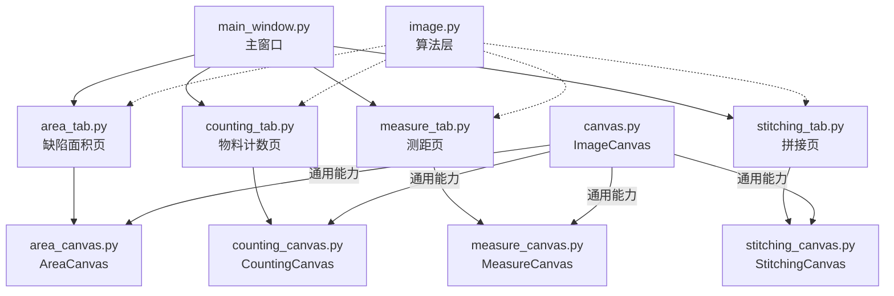
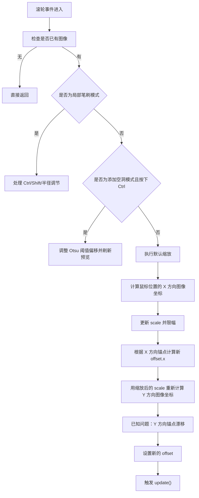
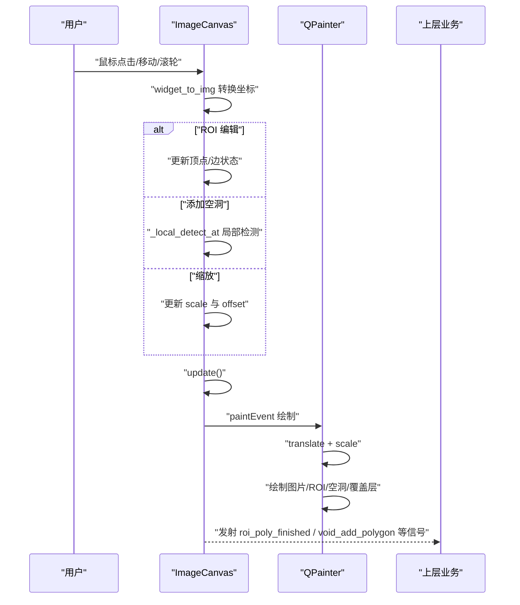
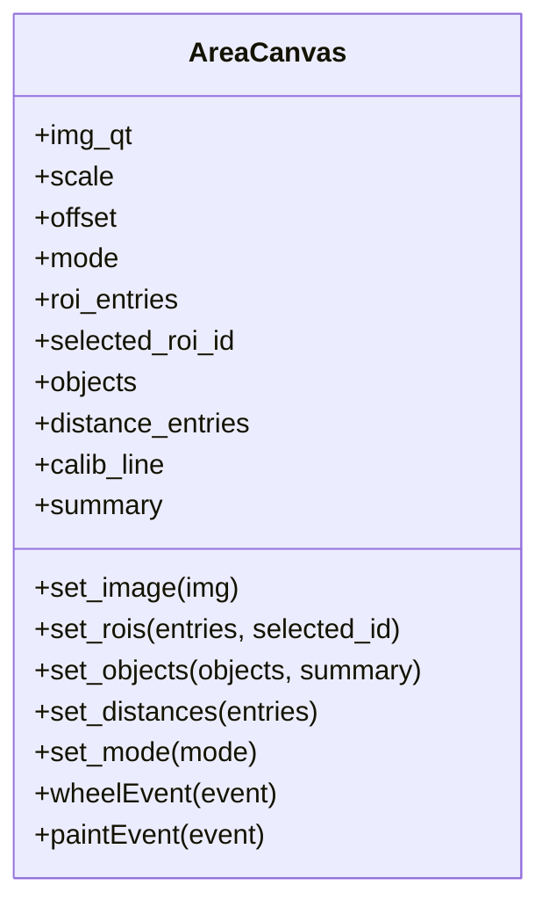
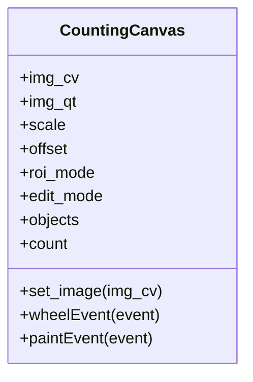
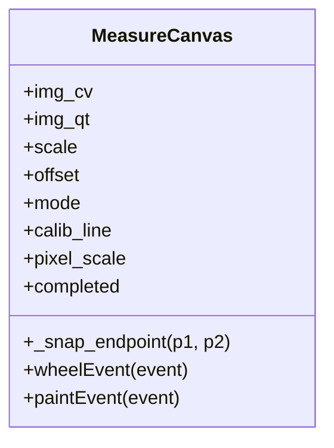
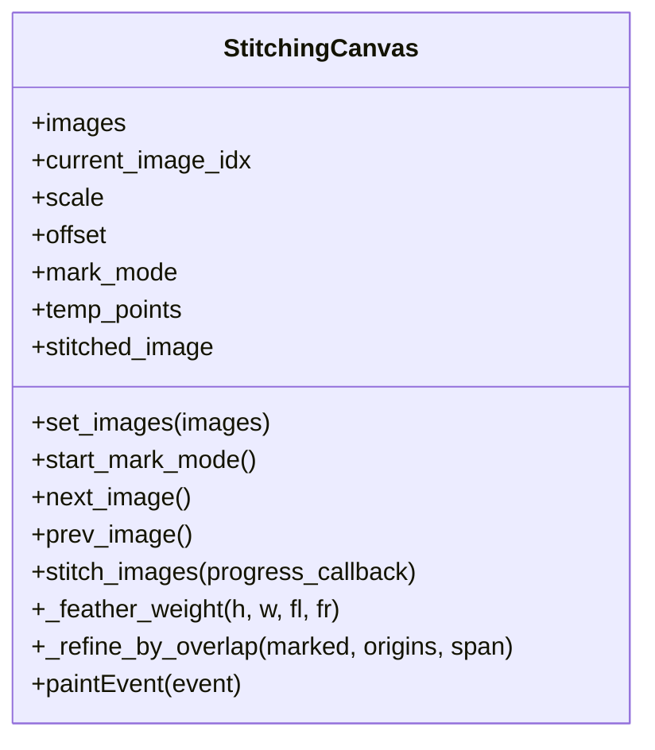
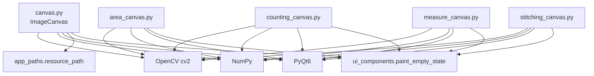

# Canvas 绘制层设计

<cite>
**本文引用的文件**   
- [canvas.py](file://canvas.py)
- [area_canvas.py](file://area_canvas.py)
- [counting_canvas.py](file://counting_canvas.py)
- [measure_canvas.py](file://measure_canvas.py)
- [stitching_canvas.py](file://stitching_canvas.py)
- [ui_components.py](file://ui_components.py)
- [handoff.md](file://handoff.md)
</cite>

## 目录
1. [引言](#引言)
2. [项目结构中的绘制层定位](#项目结构中的绘制层定位)
3. [通用能力总览](#通用能力总览)
4. [坐标转换与缩放锚点](#坐标转换与缩放锚点)
5. [事件处理与重绘触发时机](#事件处理与重绘触发时机)
6. [基类 ImageCanvas 对子类的约束](#基类-imagecanvas-对子类的约束)
7. [专用画布扩展点](#专用画布扩展点)
8. [继承示例与常见重写钩子](#继承示例与常见重写钩子)
9. [依赖关系分析](#依赖关系分析)
10. [已知问题与限制](#已知问题与限制)
11. [结论](#结论)

## 引言
本设计文档聚焦 Aurascope 的 Canvas 绘制层，以 `canvas.py` 中的 `ImageCanvas` 基类为核心，说明所有专用画布共享的通用能力：基于 QWidget + QPainter 的自绘、原图坐标与屏幕坐标转换、滚轮缩放、右键平移、多边形 ROI 编辑、空洞/轮廓/覆盖层绘制。同时明确基类如何约束子类行为，以及各专用画布的扩展点与常见重写钩子。

本项目为 PyQt6 + OpenCV + NumPy + Pandas 的单机桌面应用；GUI 层不得内联实现图像算法，算法逻辑集中在 `image.py`。Canvas 层只负责显示、交互与业务回调，不持有检测/标定业务逻辑。

## 项目结构中的绘制层定位
Canvas 绘制层位于 UI 层内部，处于「主窗口 → Tab 页面 → Canvas 绘制层」这一链路的末端。Tab 页面负责业务编排、状态同步和结果展示；Canvas 负责把图像、ROI、空洞、标注等数据渲染到屏幕上，并把用户操作转换为信号或回调。

**图示来源**
- [canvas.py:13-28](file://canvas.py#L13-L28)
- [area_canvas.py:85-97](file://area_canvas.py#L85-L97)
- [counting_canvas.py:10-15](file://counting_canvas.py#L10-L15)
- [measure_canvas.py:12-14](file://measure_canvas.py#L12-L14)
- [stitching_canvas.py:22-27](file://stitching_canvas.py#L22-L27)

**章节来源**
- [canvas.py:1-10](file://canvas.py#L1-L10)
- [area_canvas.py:1-1](file://area_canvas.py#L1-L1)

## 通用能力总览
所有 Canvas 组件都围绕以下通用能力构建：

| 能力 | ImageCanvas 基类 | area_canvas.py | counting_canvas.py | measure_canvas.py | stitching_canvas.py |
|---|---:|---:|---:|---:|---:|
| QWidget + QPainter 自绘 | 是 | 否（独立实现） | 否（独立实现） | 否（独立实现） | 否（独立实现） |
| 原图坐标↔屏幕坐标转换 | `widget_to_img` / `img_to_widget` | 有 | 有 | 有 | 有 |
| 滚轮缩放 | 有，带鼠标位置锚点计算 | 有 | 有 | 有 | 有 |
| 右键平移 | 有 | 有 | 有 | 有 | 有 |
| 多边形 ROI 编辑 | 顶点拖拽、边拖拽、双击插点、Delete 删点、边缘吸附 | 独立 ROI 列表与 mask 渲染 | 独立 ROI 矩形/多边形 | 无多边形 ROI 编辑 | 无多边形 ROI 编辑 |
| 空洞/轮廓/覆盖层绘制 | `draw_voids`、`overlay_mask`、`overlay_preview` | 对象 mask + 轮廓 + ROI mask | 对象轮廓 + 编号 | 标定线 + 测量线 | 标记点 + 标记线 |
| 空状态绘制 | 调用 `paint_empty_state` | 调用 `paint_empty_state` | 调用 `paint_empty_state` | 调用 `paint_empty_state` | 调用 `paint_empty_state` |

其中，`ImageCanvas` 是唯一提供完整可编辑多边形 ROI 能力的基类；其他专用画布各自实现了更简单的 ROI 或交互语义。

**章节来源**
- [canvas.py:13-83](file://canvas.py#L13-L83)
- [canvas.py:141-153](file://canvas.py#L141-L153)
- [canvas.py:615-695](file://canvas.py#L615-L695)
- [canvas.py:697-800](file://canvas.py#L697-L800)
- [area_canvas.py:157-161](file://area_canvas.py#L157-L161)
- [area_canvas.py:416-492](file://area_canvas.py#L416-L492)
- [counting_canvas.py:68-72](file://counting_canvas.py#L68-L72)
- [counting_canvas.py:184-263](file://counting_canvas.py#L184-L263)
- [measure_canvas.py:70-78](file://measure_canvas.py#L70-L78)
- [measure_canvas.py:208-321](file://measure_canvas.py#L208-L321)
- [stitching_canvas.py:130-140](file://stitching_canvas.py#L130-L140)
- [stitching_canvas.py:482-602](file://stitching_canvas.py#L482-L602)

## 坐标转换与缩放锚点
### 关键方法
`ImageCanvas` 提供两组核心坐标转换方法：

| 方法 | 输入 | 输出 | 用途 |
|---|---|---|---|
| `widget_to_img` | 屏幕坐标 `QPointF` | 原图坐标 `QPointF` | 鼠标点击、移动、滚轮时把控件坐标映射回图像坐标 |
| `img_to_widget` | 原图坐标 `QPointF` | 屏幕坐标 `QPointF` | 绘制标注、文字、ROI 手柄时使用 |

`widget_to_img` 先减去 `offset`，再除以 `scale`，最后将结果钳制到图像范围内；`img_to_widget` 则按 `x * scale + offset` 的方式反向映射。

### 缩放锚点计算
滚轮缩放时，基类会记录鼠标在缩放前的图像坐标，然后更新 `scale`，再根据同一鼠标位置重新计算 `offset`，使鼠标所指的原图像素尽量保持在屏幕同一位置。这是“以鼠标位置为锚点的缩放”。

但当前实现存在 Y 轴漂移问题：X 方向使用缩放前计算的 `img_pos_before`，Y 方向却用缩放后的 `self.scale` 再次反算 `img_y_before`，导致 Y 方向锚点不准确。这不是正确设计，而是已知 bug。

**图示来源**
- [canvas.py:615-695](file://canvas.py#L615-L695)

**章节来源**
- [canvas.py:141-153](file://canvas.py#L141-L153)
- [canvas.py:615-695](file://canvas.py#L615-L695)

## 事件处理与重绘触发时机
### 鼠标事件
`ImageCanvas.mousePressEvent` 按优先级处理多种交互：

1. 示教点选模式：左键点击直接发射 `teach_void_at`。
2. 删除模式：左键点击发射 `void_delete_at`。
3. 添加空洞模式：左键点击进行局部 Otsu 检测并生成预览。
4. 局部笔刷模式：左键放置区域。
5. ROI 多边形编辑：拖拽顶点或整条边。
6. 标定模式：开始绘制标定线段。
7. 矩形 ROI 模式：开始拖拽矩形。
8. 右键：进入平移状态。

`mouseMoveEvent` 负责：
- 局部笔刷预览跟踪。
- 删除模式下悬停空洞高亮。
- ROI 顶点/边拖拽。
- 矩形 ROI 实时预览。
- 右键平移。

`mouseReleaseEvent` 负责提交标定线、矩形 ROI、ROI 编辑结果，并在右键释放后恢复光标。

`mouseDoubleClickEvent` 支持：
- ROI 边双击插入顶点。
- 添加空洞双击确认。
- 局部笔刷双击确认。
- 普通多边形 ROI 双击闭合。

### 键盘事件
- ESC 取消添加空洞预览。
- Delete 删除选中 ROI 顶点。

### 滚轮事件
滚轮事件分三类：
1. 局部笔刷模式：Ctrl 调半径，Shift 调已确认区域阈值，无修饰键在 placed 态调半径。
2. 添加空洞模式：Ctrl 调 Otsu 阈值偏移。
3. 默认缩放：以鼠标位置为锚点缩放。

### 重绘触发时机
`update()` 在以下状态变化时被调用：
- 设置图像。
- 设置 ROI 多边形。
- 启用/禁用 ROI 编辑。
- 鼠标拖动 ROI 顶点或边。
- 鼠标移动时更新悬停状态。
- 滚轮缩放。
- 添加空洞预览状态变化。
- 局部笔刷状态变化。
- 空洞删除悬停高亮。

**图示来源**
- [canvas.py:339-613](file://canvas.py#L339-L613)
- [canvas.py:615-695](file://canvas.py#L615-L695)
- [canvas.py:697-800](file://canvas.py#L697-L800)

**章节来源**
- [canvas.py:339-613](file://canvas.py#L339-L613)
- [canvas.py:615-695](file://canvas.py#L615-L695)
- [canvas.py:697-800](file://canvas.py#L697-L800)

## 基类 ImageCanvas 对子类的约束
`ImageCanvas` 作为通用画布基类，定义了以下约定：

1. **继承方式**：子类应继承 `ImageCanvas`，复用其坐标转换、滚轮缩放、右键平移、多边形 ROI 编辑、空洞预览与绘制能力。
2. **职责边界**：子类不应重复实现基础缩放和平移逻辑，也不应在 Canvas 中内联图像算法；算法由 `image.py` 承担。
3. **数据入口**：通过 `set_image` 传入 OpenCV 图像，基类自动转换为 `QImage` 并初始化视图。
4. **ROI 数据**：通过 `set_roi_polygon` / `clear_roi_polygon` / `set_roi_edit_enabled` 控制多边形 ROI。
5. **覆盖层**：通过 `overlay_mask` / `overlay_preview` 叠加半透明 mask 或预览区域。
6. **空洞数据**：通过 `draw_voids` / `fill_voids` / `show_labels` 控制空洞轮廓、填充与标签。
7. **信号契约**：子类可监听 `roi_poly_finished`、`roi_rect_finished`、`void_add_polygon`、`void_delete_at`、`calib_drawn` 等信号完成业务逻辑。
8. **绘制扩展**：子类通常重写 `paintEvent`，在基类绘制图片、阴影、ROI、空洞之后追加本模块特有内容。

注意：仓库中 `area_canvas.py`、`counting_canvas.py`、`measure_canvas.py`、`stitching_canvas.py` 目前并未继承 `ImageCanvas`，而是各自实现了一套相似的 QWidget + QPainter 画布。因此，“子类应继承 ImageCanvas”是设计约束与推荐路径，不是当前全部实现的现状。

**章节来源**
- [canvas.py:13-83](file://canvas.py#L13-L83)
- [canvas.py:113-153](file://canvas.py#L113-L153)
- [canvas.py:155-197](file://canvas.py#L155-L197)
- [canvas.py:697-800](file://canvas.py#L697-L800)

## 专用画布扩展点
### area_canvas.py：缺陷面积多 ROI
`AreaCanvas` 的核心扩展点是**多 ROI mask 渲染与命中检测**。每个对象包含 `mask`、`points`、`rect` 等字段，并通过 `mask_hit` 做真实填充像素命中，避免孔洞内部误判。

| 扩展点 | 说明 |
|---|---|
| 多 ROI 列表 | `roi_entries` 支持多个 ROI，每个 ROI 可为矩形或多边形 |
| 对象 mask | `objects` 中的每个对象携带 mask，用于高亮、悬停、删除命中 |
| 距离标注 | `distance_entries` 支持多条距离线，含水平/垂直吸附约束 |
| 标定线 | `calib_line` 与 `calib_label` |
| 摘要文本 | `summary` 显示统计摘要 |
| 新增/删除/选择模式 | `mode` 控制 add/delete/poly/measure/rect/calibrate 等交互 |

**图示来源**
- [area_canvas.py:85-132](file://area_canvas.py#L85-L132)
- [area_canvas.py:174-201](file://area_canvas.py#L174-L201)
- [area_canvas.py:416-492](file://area_canvas.py#L416-L492)

**章节来源**
- [area_canvas.py:1-50](file://area_canvas.py#L1-L50)
- [area_canvas.py:85-132](file://area_canvas.py#L85-L132)
- [area_canvas.py:174-201](file://area_canvas.py#L174-L201)
- [area_canvas.py:416-492](file://area_canvas.py#L416-L492)

### counting_canvas.py：物料计数
`CountingCanvas` 的扩展点是**对象轮廓、编号与计数总数显示**，并提供添加/删除对象的交互入口。

| 扩展点 | 说明 |
|---|---|
| 对象列表 | `objects` 中每个对象包含轮廓点和可选中心点 |
| 计数总数 | `count` 与右上角总数标签 |
| 添加/删除模式 | `edit_mode` 控制 `object_add_at` / `object_delete_at` |
| ROI 矩形/多边形 | `roi_rect` / `roi_polygon` |
| 悬停高亮 | 删除模式下高亮被鼠标指向的对象 |

**图示来源**
- [counting_canvas.py:10-40](file://counting_canvas.py#L10-L40)
- [counting_canvas.py:184-263](file://counting_canvas.py#L184-L263)

**章节来源**
- [counting_canvas.py:10-56](file://counting_canvas.py#L10-L56)
- [counting_canvas.py:184-263](file://counting_canvas.py#L184-L263)

### measure_canvas.py：测距
`MeasureCanvas` 的扩展点是**标定线与距离测量线**，并支持 7° 水平/竖直吸附。

| 扩展点 | 说明 |
|---|---|
| 标定线 | `calib_line`、`pixel_scale`、`calibrated` |
| 测量线 | `completed` 存储已完成的测量结果 |
| 吸附规则 | `_snap_endpoint` 实现近水平/近垂直吸附 |
| 提示文本 | 左下角模式提示 |
| 单位显示 | 已标定时显示 μm，未标定时显示 px |

**图示来源**
- [measure_canvas.py:12-49](file://measure_canvas.py#L12-L49)
- [measure_canvas.py:108-118](file://measure_canvas.py#L108-L118)
- [measure_canvas.py:208-321](file://measure_canvas.py#L208-L321)

**章节来源**
- [measure_canvas.py:12-78](file://measure_canvas.py#L12-L78)
- [measure_canvas.py:108-118](file://measure_canvas.py#L108-L118)
- [measure_canvas.py:208-321](file://measure_canvas.py#L208-L321)

### stitching_canvas.py：图像拼接
`StitchingCanvas` 的扩展点是**标记点对齐拼接**，包括标记点拖拽、图像切换、线性羽化融合与拼接结果展示。

| 扩展点 | 说明 |
|---|---|
| 标记线 | `line_p1` / `line_p2`，每张图片一条 |
| 图像列表 | `images` 支持多图切换 |
| 拼接结果 | `stitched_image` |
| 对齐逻辑 | `stitch_images` 计算头尾点偏移并融合 |
| 羽化权重 | `_feather_weight` 只在重叠侧做线性过渡 |
| 自动微调 | `_refine_by_overlap`（默认关闭） |

**图示来源**
- [stitching_canvas.py:22-57](file://stitching_canvas.py#L22-L57)
- [stitching_canvas.py:294-403](file://stitching_canvas.py#L294-L403)
- [stitching_canvas.py:405-480](file://stitching_canvas.py#L405-L480)
- [stitching_canvas.py:482-602](file://stitching_canvas.py#L482-L602)

**章节来源**
- [stitching_canvas.py:22-140](file://stitching_canvas.py#L22-L140)
- [stitching_canvas.py:294-403](file://stitching_canvas.py#L294-L403)
- [stitching_canvas.py:405-480](file://stitching_canvas.py#L405-L480)
- [stitching_canvas.py:482-602](file://stitching_canvas.py#L482-L602)

## 继承示例与常见重写钩子
### 推荐继承方式
理想情况下，一个专用画布应这样继承 `ImageCanvas`：

1. 继承 `ImageCanvas`。
2. 在 `__init__` 中设置本模块特有的状态，例如空洞率、局部笔刷区域、ROI mask 列表等。
3. 重写 `paintEvent`，在基类绘制完成后追加本模块绘制逻辑。
4. 连接基类信号，如 `roi_poly_finished`、`void_add_polygon`、`void_delete_at`，把用户操作交给上层 Tab 或算法层。
5. 不要重复实现 `widget_to_img` / `img_to_widget` / `wheelEvent` / 右键平移逻辑。

### 常见重写钩子
| 钩子 | 适用场景 | 建议行为 |
|---|---|---|
| `paintEvent` | 需要绘制本模块特有图形 | 调用 `super().paintEvent(event)` 或使用基类已有的图片/ROI/空洞绘制能力后追加 |
| `set_image` | 需要在设置图像时重置本模块状态 | 清空 ROI、mask、空洞、预览等状态，并调用 `fit_in_view` |
| `set_roi_polygon` / `clear_roi_polygon` | 需要响应 ROI 多边形变化 | 更新本模块 mask、预览或统计信息 |
| `set_void_edit_mode` | 需要扩展添加/删除/局部笔刷行为 | 在基类基础上增加额外 UI 提示或状态同步 |
| 信号槽连接 | 需要把 Canvas 交互转为业务动作 | 连接 `roi_poly_finished`、`void_add_polygon`、`void_delete_at`、`calib_drawn` 等 |

### 当前仓库现状
当前四个专用画布均未继承 `ImageCanvas`，而是各自复制了相似的基础能力。这说明仓库中存在“通用能力未统一”的技术债。未来重构时，应将 `area_canvas.py`、`counting_canvas.py`、`measure_canvas.py`、`stitching_canvas.py` 逐步迁移为继承 `ImageCanvas`，仅保留业务相关绘制与回调。

**章节来源**
- [canvas.py:13-83](file://canvas.py#L13-L83)
- [canvas.py:113-153](file://canvas.py#L113-L153)
- [canvas.py:697-800](file://canvas.py#L697-L800)

## 依赖关系分析
Canvas 层对外主要依赖：

| 依赖 | 用途 |
|---|---|
| `cv2` | 图像格式转换、轮廓检测、点面测试、形态学辅助 |
| `numpy` | 数值计算、掩膜处理、距离计算 |
| `PyQt6.QtWidgets` | QWidget、QMessageBox |
| `PyQt6.QtCore` | Qt、pyqtSignal、QPointF、QRectF、QTimer |
| `PyQt6.QtGui` | QImage、QPainter、QPen、QColor、QBrush、QFont、QCursor |
| `app_paths.resource_path` | 资源路径解析（ImageCanvas 基类导入） |
| `ui_components.paint_empty_state` | 空状态绘制 |

**图示来源**
- [canvas.py:3-10](file://canvas.py#L3-L10)
- [area_canvas.py:3-12](file://area_canvas.py#L3-L12)
- [counting_canvas.py:1-7](file://counting_canvas.py#L1-L7)
- [measure_canvas.py:3-9](file://measure_canvas.py#L3-L9)
- [stitching_canvas.py:3-9](file://stitching_canvas.py#L3-L9)

**章节来源**
- [canvas.py:3-10](file://canvas.py#L3-L10)
- [area_canvas.py:3-12](file://area_canvas.py#L3-L12)
- [counting_canvas.py:1-7](file://counting_canvas.py#L1-L7)
- [measure_canvas.py:3-9](file://measure_canvas.py#L3-L9)
- [stitching_canvas.py:3-9](file://stitching_canvas.py#L3-L9)

## 已知问题与限制
本节依据 handoff.md 的清单整理 Canvas 层已知问题，并补充代码级事实。

| 问题 | 影响 | 说明 |
|---|---|---|
| canvas.py 中滚轮缩放 Y 轴漂移 | 缩放锚点不准 | `wheelEvent` 中 Y 方向使用缩放后的 `self.scale` 重新计算 `img_y_before`，导致鼠标所指像素在 Y 方向发生偏移 |
| 专用画布未统一继承 ImageCanvas | 维护成本高 | area/counting/measure/stitching 各自实现相似缩放、平移、坐标转换逻辑 |
| 重复 detect_voids_local | 技术债 | main_window.py 中存在 image.py 中算法函数的副本，现行行为以 image.py 为准，两份待合并 |
| edge_map 未初始化导致 Canny 校验静默失效 | 算法校验不可靠 | 属于算法层问题，但会影响 Canvas 上空洞/轮廓渲染的正确性 |
| chk_roi_overlay 被重复创建 | UI 状态异常风险 | 可能产生多余控件或重复绘制 |
| select_for_local 为无 UI 入口的死代码 | 代码冗余 | 该函数未被界面使用 |
| 大图增强检测无进度提示 | 用户体验差 | 大图像处理时用户无法感知进度 |

**章节来源**
- [canvas.py:615-695](file://canvas.py#L615-L695)
- [handoff.md](file://handoff.md)

## 结论
Canvas 绘制层的核心价值在于把图像、ROI、空洞、标注等数据从算法层解耦出来，交给用户交互层。`ImageCanvas` 已经提供了较完整的通用能力，包括 QWidget + QPainter 自绘、坐标转换、滚轮缩放、右键平移、多边形 ROI 编辑、空洞与覆盖层绘制。但当前仓库中四个专用画布尚未继承该基类，导致通用能力重复实现，且 `canvas.py` 中存在 Y 轴漂移的缩放锚点 bug。

未来改进方向应是：
1. 修复 `ImageCanvas.wheelEvent` 中 Y 轴锚点计算。
2. 让专用画布继承 `ImageCanvas`，仅实现本模块特有绘制与业务回调。
3. 统一 ROI、空洞、覆盖层的数据结构与绘制顺序。
4. 保持 GUI 层不内联算法，算法逻辑继续集中在 `image.py`。
5. 以 handoff.md 为基准持续清理重复实现、死代码与静默失败路径。