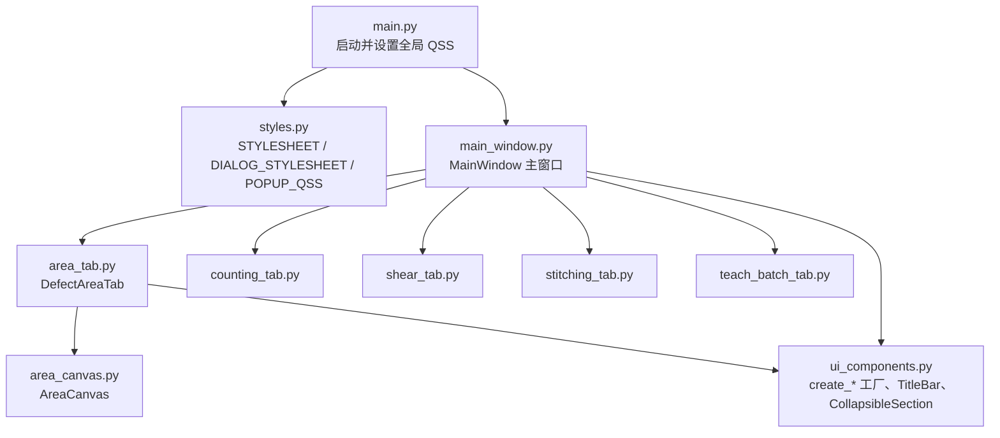
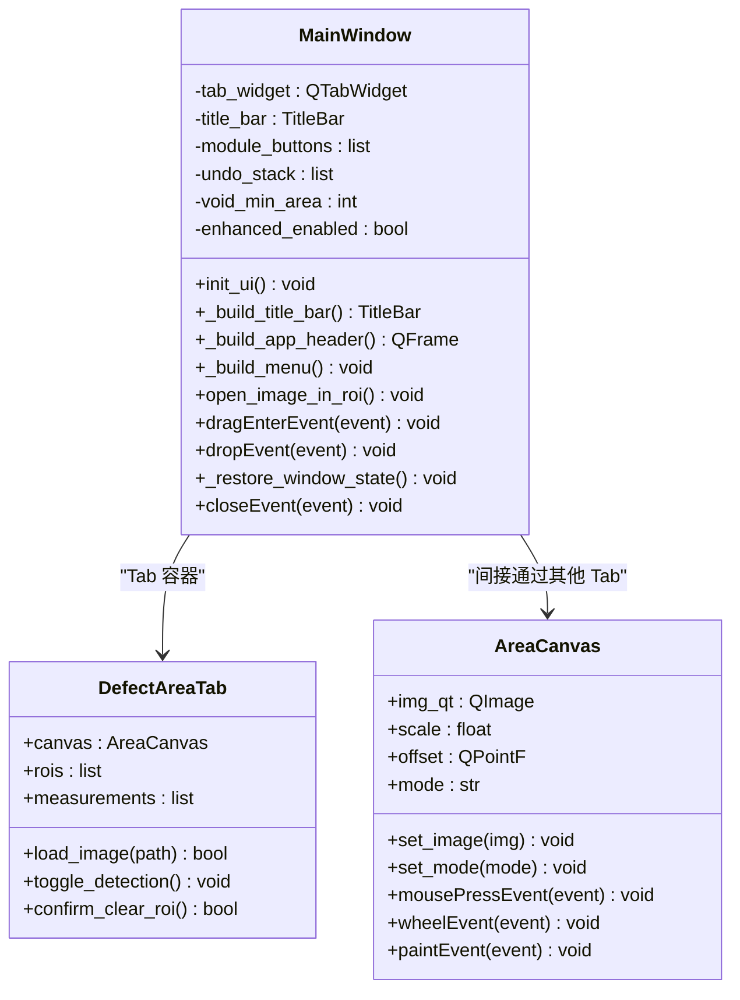
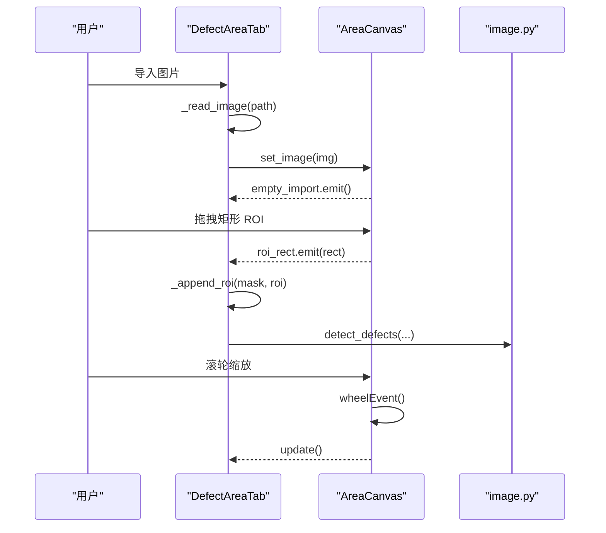
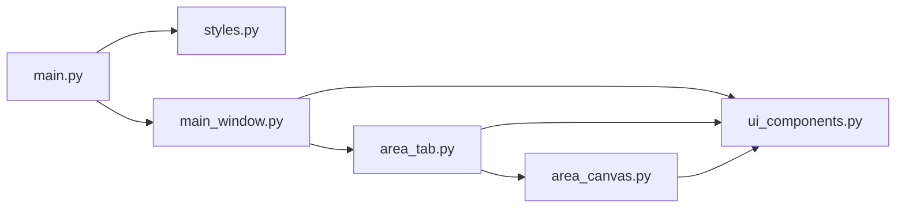

# UI 约定与全局样式

<cite>
**本文引用的文件**   
- [styles.py](file://styles.py)
- [ui_components.py](file://ui_components.py)
- [main_window.py](file://main_window.py)
- [area_tab.py](file://area_tab.py)
- [area_canvas.py](file://area_canvas.py)
- [main.py](file://main.py)
</cite>

## 目录
1. [引言](#引言)
2. [项目结构与 UI 分层](#项目结构与-ui-分层)
3. [强制约定总览](#强制约定总览)
4. [全局样式与设计 token](#全局样式与设计-token)
5. [UI 组件工厂契约](#ui-组件工厂契约)
6. [主窗口职责边界](#主窗口职责边界)
7. [缺陷面积页权威契约](#缺陷面积页权威契约)
8. [QSS、工厂与 GroupBox 使用示例](#qss工厂与-groupbox-使用示例)
9. [违反约定的症状清单](#违反约定的症状清单)
10. [依赖关系图](#依赖关系图)
11. [结论](#结论)

## 引言
Aurascope 是 PyQt6 + OpenCV + NumPy + Pandas 的单机桌面应用，面向金锡焊空洞分析等视觉检测任务。UI 层的核心目标是：用一套全局 QSS 和设计 token 统一外观，用 create_* 工厂函数收敛控件创建方式，让主窗口只承担导航与容器职责，把业务逻辑交给各 Tab 页面与 Canvas 绘制层。

本文件聚焦 UI 约定与全局样式，不展开图像算法实现；算法层以 image.py 为唯一权威来源，GUI 层不得内联实现图像算法。

## 项目结构与 UI 分层
Aurascope 的 UI 相关代码按「入口 → 主窗口 → Tab 页面 → Canvas 绘制层 → 通用 UI 组件 → 全局样式」组织：

**图表来源**
- [main.py:47-47](file://main.py#L47-L47)
- [styles.py:45-536](file://styles.py#L45-L536)
- [main_window.py:54-154](file://main_window.py#L54-L154)
- [area_tab.py:110-150](file://area_tab.py#L110-L150)
- [area_canvas.py:85-132](file://area_canvas.py#L85-L132)
- [ui_components.py:1-10](file://ui_components.py#L1-L10)

**章节来源**
- [main.py:47-47](file://main.py#L47-L47)
- [main_window.py:54-154](file://main_window.py#L54-L154)
- [area_tab.py:110-150](file://area_tab.py#L110-L150)
- [area_canvas.py:85-132](file://area_canvas.py#L85-L132)
- [ui_components.py:1-10](file://ui_components.py#L1-L10)

## 强制约定总览
以下三条为 UI 层强制约定，违反任一约定都应视为编码规范问题：

| 编号 | 约定 | 责任方 | 违反后果 |
|---|---|---|---|
| C1 | 所有颜色、字体、间距优先使用 `styles.py` 的设计 token，禁止在业务文件中硬编码颜色或字号 | 所有 UI 文件 | 样式不一致、主题不可维护、不同平台字体/灰阶漂移 |
| C2 | `ui_components.py` 的 `create_*` 工厂函数只创建控件、不加入布局；调用方必须手动 `addWidget` | 调用方（main_window.py、area_tab.py 等） | 控件重复添加、布局错位、信号连接位置混乱 |
| C3 | `create_groupbox()` 返回的分组框必须使用 Preferred/Expanding 尺寸策略，否则 Qt 可能静默裁剪内容 | 使用 `create_groupbox()` 的代码 | 分组内容被裁剪、滚动异常、高级选项区域显示不全 |

此外，缺陷面积页（area_tab.py / area_canvas.py）的 UI 权威契约来自技能文档 `.qoder/skills/roi-page-ui-design/SKILL.md`；涉及该页的章节必须引用它，不得另立一套设计语言。

**章节来源**
- [styles.py:1-25](file://styles.py#L1-L25)
- [ui_components.py:232-236](file://ui_components.py#L232-L236)
- [area_tab.py:110-150](file://area_tab.py#L110-L150)

## 全局样式与设计 token
`styles.py` 是 Aurascope 的全局样式表与设计 token 中心。它通过 `_C` 字典集中定义中性色、主色、语义色、字体族、字阶、圆角和交互态，并通过 `_sheet()` 生成完整 QSS，最终暴露三个常量：

| 名称 | 类型 | 用途 |
|---|---|---|
| `STYLESHEET` | 字符串 | 主窗口全局 QSS，由 `main.py` 通过 `app.setStyleSheet(STYLESHEET)` 应用 |
| `DIALOG_STYLESHEET` | 字符串 | 对话框背景色，保持与主界面同一套 token |
| `POPUP_QSS` | 字符串 | QComboBox 下拉弹层的独立样式，因为弹层是独立窗口，全局 QSS 不一定命中 |

token 覆盖范围包括：

| 类别 | 说明 |
|---|---|
| 中性色 | bg、surface、surface2、border、border2、text、text2、text3 |
| 主色 | accent、accent_h、accent_a、accent_tint、accent_tint2 |
| 语义色 | success、success_h、success_a、danger、warning |
| 字体 | font、font_ui、mono |
| 控件样式 | QMainWindow、QWidget、QTabWidget、QMenuBar、TitleBar、AppHeader、SidebarCard、ResultCard、StatCard、InnerCard、Divider、按钮、输入框、表格、列表、进度条、滑块、滚动条、Splitter、StatusBar、GroupBox、CollapseBody、TableEmptyHint、ForceBadge、ResultBox、AreaValue、CountResult、SuccessValue、ErrorValue、ImagePreview、Toast、StepTitle、InfoLabel、BlueLabel、SuccessLabel、ErrorLabel、WarningBox、StatValue、HeaderTitle、CardTitle、CardSubtitle |

**章节来源**
- [styles.py:27-42](file://styles.py#L27-L42)
- [styles.py:45-536](file://styles.py#L45-L536)
- [styles.py:538-576](file://styles.py#L538-L576)
- [main.py:47-47](file://main.py#L47-L47)

## UI 组件工厂契约
`ui_components.py` 提供一组 `create_*` 工厂函数，用于创建带标准 ObjectName 的控件。这些函数的职责边界很明确：

1. **只创建控件**：构造 QPushButton、QLabel、QSlider、QCheckBox、QGroupBox 等。
2. **设置样式标识**：通过 `setObjectName` 绑定到 `styles.py` 中的 QSS 选择器。
3. **可选连接回调**：如 `clicked.connect(callback)`、`valueChanged.connect(callback)`。
4. **不加入布局**：返回值交给调用方，由调用方决定 `addWidget`、`addLayout`、`setStretchFactor` 等。
5. **不持有业务状态**：业务数据放在 Tab 页面或 Canvas 中，不在工厂函数里保存。

关键工厂函数及其契约如下：

| 函数 | 返回 | 约定 |
|---|---|---|
| `create_primary_button(text, callback=None)` | QPushButton | ObjectName 为 PrimaryBtn |
| `create_secondary_button(text, callback=None, checkable=False)` | QPushButton | ObjectName 为 SecondaryBtn，支持可检查态 |
| `create_success_button(text, callback=None)` | QPushButton | ObjectName 为 SuccessBtn |
| `create_danger_button(text, callback=None)` | QPushButton | ObjectName 为 DangerBtn |
| `create_nav_button(text, callback=None, checkable=True)` | QPushButton | ObjectName 为 NavBtn |
| `create_step_title(text)` | QLabel | ObjectName 为 StepTitle |
| `create_info_label(text="")` | QLabel | ObjectName 为 InfoLabel，自动换行 |
| `create_success_label(text="")` | QLabel | ObjectName 为 SuccessLabel |
| `create_slider(min_val, max_val, default_val, callback=None)` | QSlider | 设置 range、value、可选 valueChanged 回调 |
| `create_slider_with_label(...)` | (QSlider, QLabel) | 同时返回数值标签 |
| `create_checkbox(text, checked=False, callback=None)` | QCheckBox | 设置初始 checked 与 toggled 回调 |
| `create_groupbox(title)` | QGroupBox | 设置 Preferred/Expanding 尺寸策略 |
| `create_divider()` | QFrame | ObjectName 为 Divider，高度 1px |
| `create_card_title(text)` | QLabel | ObjectName 为 CardTitle |
| `create_card_subtitle(text)` | QLabel | ObjectName 为 CardSubtitle |
| `create_stat_value(text="")` | QLabel | ObjectName 为 StatValue |
| `create_success_value(text="")` | QLabel | ObjectName 为 SuccessValue |
| `create_error_value(text="")` | QLabel | ObjectName 为 ErrorValue |
| `create_warning_box(text="")` | QLabel | ObjectName 为 WarningBox |
| `create_error_label(text="")` | QLabel | ObjectName 为 ErrorLabel |
| `create_blue_label(text="")` | QLabel | ObjectName 为 BlueLabel |
| `create_count_result(text="")` | QLabel | ObjectName 为 CountResult |

此外，`ui_components.py` 还提供：

- `empty_logo_pixmap(size)`：空画布中央 logo 缓存。
- `paint_empty_state(painter, widget, dy=-40)`：统一空画布视觉。
- `attach_empty_hint(table, text)`：表格空状态提示。
- `enable_click_sort(table, locked=None)`：点击表头后才启用排序。
- `style_combo_popups(widget)`：给 QComboBox 弹层单独应用 POPUP_QSS。
- `TitleBar`：自绘标题栏，替代系统标题栏。
- `WindowControlButton`：最小化/最大化/关闭按钮。
- `CollapsibleSection`：可折叠区域，供高级设置使用。

**章节来源**
- [ui_components.py:12-32](file://ui_components.py#L12-L32)
- [ui_components.py:35-79](file://ui_components.py#L35-L79)
- [ui_components.py:181-312](file://ui_components.py#L181-L312)
- [ui_components.py:315-388](file://ui_components.py#L315-L388)
- [ui_components.py:419-453](file://ui_components.py#L419-L453)
- [ui_components.py:456-615](file://ui_components.py#L456-L615)

## 主窗口职责边界
`main_window.py` 中的 `MainWindow` 是应用的顶层容器，负责：

1. **Tab 容器**：使用 `QTabWidget` 挂载 ROI、空洞分析、示教/批量、剪切力计算、物料计数、图像拼接等页面。
2. **侧边栏导航**：通过 `_build_app_header()` 生成 AppHeader，将每个 Tab 文本映射为 ModuleTab 按钮，点击后切换当前 Tab。
3. **菜单**：通过 TitleBar 挂「文件」「帮助」菜单，包含打开图片、最近打开、退出、使用说明、更新日志、检查更新、关于等。
4. **工具栏与状态栏**：通过 QSS 对 QStatusBar 设置背景与边框；工具类操作集中在 sidebar 与各 Tab 内部。
5. **撤销栈**：维护 `undo_stack`、`undo_limit`，并提供 Ctrl+Z 快捷键触发 `on_undo`。
6. **窗口状态持久化**：保存/恢复 geometry、windowState、当前 Tab、Splitter 尺寸。
7. **拖放入口**：单张图片进入 ROI，多张图片进入图像拼接，文件夹进入示教/批量。
8. **最近更新记录**：通过 QSettings 管理最近图片和批次文件夹。

`MainWindow` 不应直接实现具体页面的业务逻辑。例如，空洞检测、ROI 编辑、距离测量、配方加载、CSV 导出等应分别由对应 Tab 或 Canvas 处理。当前 `main_window.py` 仍保留部分空洞分析相关状态与方法，属于历史遗留；文档应以实际代码为准，并在后续重构中逐步迁移。

**图表来源**
- [main_window.py:54-154](file://main_window.py#L54-L154)
- [main_window.py:187-242](file://main_window.py#L187-L242)
- [main_window.py:310-344](file://main_window.py#L310-L344)
- [main_window.py:418-449](file://main_window.py#L418-L449)
- [area_tab.py:110-150](file://area_tab.py#L110-L150)
- [area_canvas.py:85-132](file://area_canvas.py#L85-L132)

**章节来源**
- [main_window.py:54-154](file://main_window.py#L54-L154)
- [main_window.py:187-242](file://main_window.py#L187-L242)
- [main_window.py:310-344](file://main_window.py#L310-L344)
- [main_window.py:418-449](file://main_window.py#L418-L449)

## 缺陷面积页权威契约
缺陷面积页由 `area_tab.py` 和 `area_canvas.py` 组成：

- `area_tab.py` 中的 `DefectAreaTab` 负责：图片导入、比例尺标定、距离测量、ROI 管理、阈值检测、结果表格、CSV 导出、批量检测调度、UI 状态同步。
- `area_canvas.py` 中的 `AreaCanvas` 负责：渲染原图、掩膜、ROI、测距线、预览对象、坐标变换、滚轮缩放、右键平移、鼠标/键盘交互，并通过 pyqtSignal 向父级 Tab 发出事件。

根据项目作者指南，该页的 UI 权威契约来自技能文档 `.qoder/skills/roi-page-ui-design/SKILL.md`。因此，任何关于缺陷面积页的布局、控件命名、交互流程、视觉层级、结果展示方式，都必须以该技能文档为准；本文不得为其另立一套设计语言。若技能文档不存在于当前仓库路径下，也应将其作为外部权威约束写入评审规则，避免团队自行解释。

**图表来源**
- [area_tab.py:342-378](file://area_tab.py#L342-L378)
- [area_tab.py:561-590](file://area_tab.py#L561-L590)
- [area_tab.py:659-683](file://area_tab.py#L659-L683)
- [area_canvas.py:133-148](file://area_canvas.py#L133-L148)
- [area_canvas.py:212-338](file://area_canvas.py#L212-L338)

**章节来源**
- [area_tab.py:110-150](file://area_tab.py#L110-L150)
- [area_tab.py:342-378](file://area_tab.py#L342-L378)
- [area_tab.py:561-590](file://area_tab.py#L561-L590)
- [area_tab.py:659-683](file://area_tab.py#L659-L683)
- [area_canvas.py:85-132](file://area_canvas.py#L85-L132)
- [area_canvas.py:212-338](file://area_canvas.py#L212-L338)

## QSS、工厂与 GroupBox 使用示例
本节给出约定式用法示例，不粘贴源码，而是标注路径。

### QSS 使用示例
- 主应用设置全局样式：  
  [main.py:47-47](file://main.py#L47-L47)
- 对话框使用统一 token 背景：  
  [styles.py:538-539](file://styles.py#L538-L539)
- QComboBox 弹层单独应用样式：  
  [styles.py:541-576](file://styles.py#L541-L576)
- 通过 ObjectName 匹配按钮样式：  
  [ui_components.py:35-79](file://ui_components.py#L35-L79)
- 通过 ObjectName 匹配标签样式：  
  [ui_components.py:181-312](file://ui_components.py#L181-L312)
- 表格空状态提示样式：  
  [ui_components.py:156-178](file://ui_components.py#L156-L178)

### 工厂调用示例
- 创建主按钮并加入布局：  
  [main_window.py:488-489](file://main_window.py#L488-L489)
- 创建次要按钮并连接回调：  
  [main_window.py:493-505](file://main_window.py#L493-L505)
- 创建步骤标题并加入布局：  
  [main_window.py:492-492](file://main_window.py#L492-L492)
- 创建信息标签并加入布局：  
  [main_window.py:496-497](file://main_window.py#L496-L497)
- 创建滑块与标签：  
  [main_window.py:551-552](file://main_window.py#L551-L552)
- 创建复选框并连接回调：  
  [main_window.py:580-580](file://main_window.py#L580-L580)
- 在 area_tab.py 中使用 CollapsibleSection 组织高级设置：  
  [area_tab.py:181-186](file://area_tab.py#L181-L186)

### GroupBox 尺寸策略示例
- 创建分组框：  
  [ui_components.py:232-236](file://ui_components.py#L232-L236)
- 在 main_window.py 中创建“调节缺陷区域识别阈值”分组并加入布局：  
  [main_window.py:510-512](file://main_window.py#L510-L512)
- 在 main_window.py 中创建“空洞检测设置”分组并加入布局：  
  [main_window.py:518-520](file://main_window.py#L518-L520)

注意：`create_groupbox()` 已经设置 `QSizePolicy.Policy.Expanding, QSizePolicy.Policy.Preferred`。如果业务代码再次调用 `setSizePolicy` 改为 Fixed 或 Ignored，就可能破坏这一契约，导致内容被 Qt 静默裁剪。

**章节来源**
- [main.py:47-47](file://main.py#L47-L47)
- [styles.py:538-576](file://styles.py#L538-L576)
- [ui_components.py:35-79](file://ui_components.py#L35-L79)
- [ui_components.py:156-178](file://ui_components.py#L156-L178)
- [ui_components.py:181-312](file://ui_components.py#L181-L312)
- [ui_components.py:232-236](file://ui_components.py#L232-L236)
- [main_window.py:488-520](file://main_window.py#L488-L520)
- [area_tab.py:181-186](file://area_tab.py#L181-L186)

## 违反约定的症状清单

| 违反约定 | 典型症状 | 定位建议 |
|---|---|---|
| 在业务文件中硬编码颜色或字号 | 某些控件颜色与全局主题不一致；在不同 Windows 字体下文字大小或灰阶偏移 | 搜索业务文件中的 `setStyleSheet`、`color:`、`font-size:`、`#` 十六进制颜色 |
| 工厂函数创建了控件但未 addWidget | 控件不可见；布局中缺少元素；调试时找不到控件树节点 | 检查 `create_*` 返回值是否被传入 `layout.addWidget` |
| 工厂函数在内部 addWidget | 控件可能被重复添加到多个布局；信号连接位置不符合预期 | 查看工厂函数是否调用了 `addWidget` 或 `addLayout` |
| 修改 `create_groupbox()` 的尺寸策略 | 分组内容被静默裁剪；高级设置区域只显示标题或部分内容 | 检查是否对 QGroupBox 调用过 `setSizePolicy` |
| 未使用 ObjectName 匹配 QSS | 按钮、标签、卡片、分割线没有预期样式 | 检查控件是否设置了 styles.py 中定义的 ObjectName |
| 缺陷面积页使用非权威设计语言 | 与 SKILL.md 描述不一致；后续维护者无法对齐 | 以 `.qoder/skills/roi-page-ui-design/SKILL.md` 为准进行对照 |
| 在 Canvas 中实现检测算法 | GUI 层耦合图像算法；难以测试、难以复用 | 将检测逻辑放到 image.py，Canvas 只负责渲染与交互 |
| 在主窗口中实现具体页面业务 | 主窗口膨胀；Tab 页面职责不清；撤销、状态、信号分散 | 将业务逻辑下沉到 area_tab.py、counting_tab.py 等页面 |

**章节来源**
- [styles.py:1-25](file://styles.py#L1-L25)
- [ui_components.py:232-236](file://ui_components.py#L232-L236)
- [area_tab.py:110-150](file://area_tab.py#L110-L150)
- [area_canvas.py:1-13](file://area_canvas.py#L1-L13)

## 依赖关系图
UI 层内部依赖方向如下：

**图表来源**
- [main.py:47-47](file://main.py#L47-L47)
- [main_window.py:24-49](file://main_window.py#L24-L49)
- [area_tab.py:21-28](file://area_tab.py#L21-L28)
- [area_canvas.py:1-12](file://area_canvas.py#L1-L12)

**章节来源**
- [main.py:47-47](file://main.py#L47-L47)
- [main_window.py:24-49](file://main_window.py#L24-L49)
- [area_tab.py:21-28](file://area_tab.py#L21-L28)
- [area_canvas.py:1-12](file://area_canvas.py#L1-L12)

## 结论
Aurascope 的 UI 约定可以概括为一句话：**样式集中、控件工厂化、主窗口做容器、页面做业务、Canvas 做绘制。**

- `styles.py` 是唯一设计 token 与 QSS 来源。
- `ui_components.py` 的 `create_*` 工厂函数只创建控件，不加入布局。
- `create_groupbox()` 的 Preferred/Expanding 尺寸策略是防止控件被静默裁剪的关键。
- `main_window.py` 负责 Tab 容器、侧边栏导航、菜单、工具栏、状态栏与撤销栈，不应直接实现具体页面的业务逻辑。
- 缺陷面积页的 UI 权威契约来自 `.qoder/skills/roi-page-ui-design/SKILL.md`，不得另立设计语言。

遵循这些约定，可以避免颜色与字体漂移、控件裁剪、布局错位、样式不一致等问题，并为后续统一主题、扩展新模块、合并历史技术债打下基础。