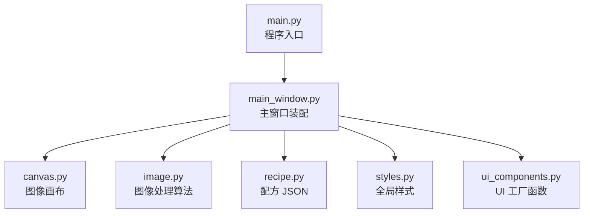
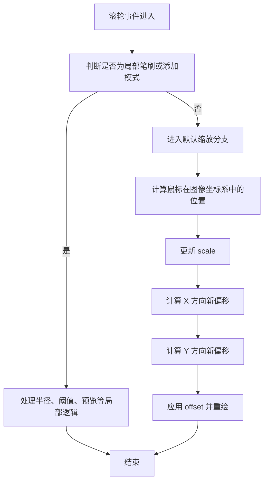
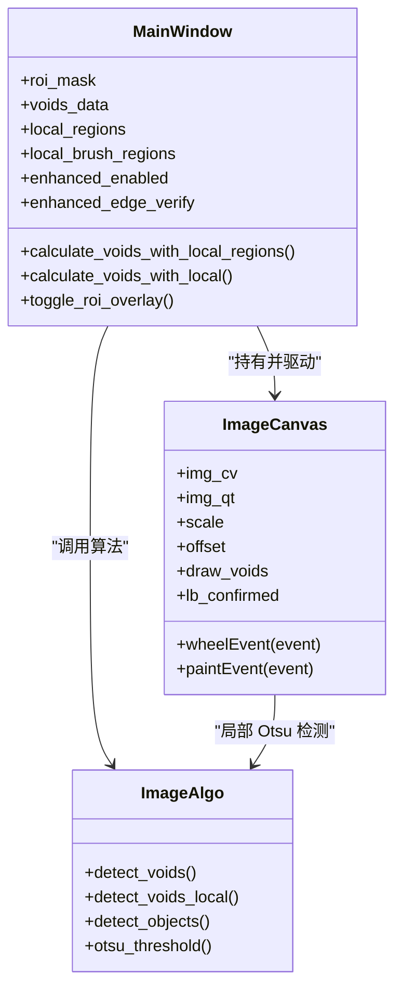
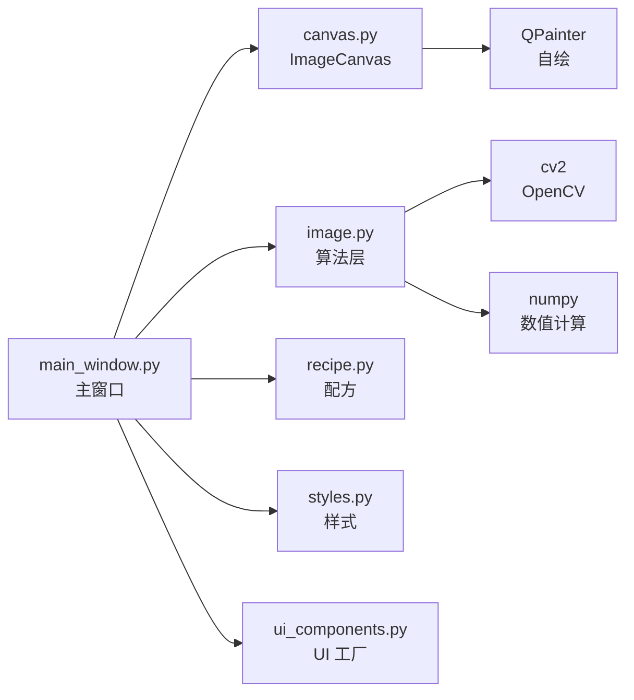

# 已知架构限制与技术债

<cite>
**本文引用的文件**   
- [handoff.md](file://handoff.md)
- [main_window.py](file://main_window.py)
- [image.py](file://image.py)
- [canvas.py](file://canvas.py)
- [README.md](file://README.md)
- [PROJECT_CONCEPTION.md](file://PROJECT_CONCEPTION.md)
</cite>

## 目录
1. [引言](#引言)
2. [项目结构与约束](#项目结构与约束)
3. [已知限制清单](#已知限制清单)
4. [架构影响分析](#架构影响分析)
5. [临时规避与修复建议](#临时规避与修复建议)
6. [依赖关系图](#依赖关系图)
7. [排查指南](#排查指南)
8. [结论](#结论)

## 引言
本文基于 handoff.md 的交接清单，逐项说明当前 Aurascope 代码库中的已知架构限制与技术债。这些限制不是产品特性，而是需要在后续重构中优先清理的实现缺陷：包括重复实现的空洞检测算法、静默失效的边缘校验、可能引发内存或绘制异常的 UI 控件创建、滚轮缩放锚点计算问题，以及无入口的死代码和大图处理缺少进度反馈等。

Aurascope 是面向微电子封装产线的半自动化视觉检测桌面应用，核心分层为 PyQt6 GUI 层、Canvas 自绘层、OpenCV/NumPy 算法层（集中在 image.py）以及配方与导出层。文档严格以实际源码为依据，不将历史备份、临时脚本或非现行实现纳入行为描述。

## 项目结构与约束
仓库根目录包含主入口 main.py、主窗口装配 main_window.py、各功能 Tab 页面、Canvas 绘制组件、算法模块 image.py、配方读写 recipe.py、打包配置 AurascopeV6.spec 等。根据 PROJECT_CONCEPTION.md，技术栈为 PyQt6 + OpenCV + NumPy + Pandas，运行环境为 Windows 7+，纯 CPU 计算，不联网、不收集用户数据。

**图表来源**
- [main_window.py:1-50](file://main_window.py#L1-L50)
- [canvas.py:1-30](file://canvas.py#L1-L30)
- [image.py:1-12](file://image.py#L1-L12)
- [PROJECT_CONCEPTION.md:77-108](file://PROJECT_CONCEPTION.md#L77-L108)

**章节来源**
- [README.md:1-80](file://README.md#L1-L80)
- [PROJECT_CONCEPTION.md:1-143](file://PROJECT_CONCEPTION.md#L1-L143)

## 已知限制清单
以下六项限制直接对应 handoff.md 的交接清单。每项均给出发生位置、触发条件、影响范围、临时规避方式与建议修复方案。

### 1. main_window.py 重复实现 detect_voids_local，与 image.py 存在逻辑分歧
- **发生位置**
  - image.py 中定义 `detect_voids_local`（约第 328–422 行）。
  - main_window.py 模块级又定义同名函数 `detect_voids_local`（约第 1779–1876 行），且 `calculate_voids_with_local_regions` 调用的是 main_window.py 内的副本（第 1521 行）。
- **触发条件**
  - 用户在「空洞分析」侧边栏启用增强检测后，通过局部阈值区域重新计算空洞时，会进入 main_window.py 的本地实现。
- **影响范围**
  - 两份实现参数、边界处理、ROI 腐蚀、Canny 边缘图构造与过滤阈值不完全一致。例如 main_window.py 的副本在 edge_verify 分支中对重叠比例使用固定阈值 0.3，而 image.py 的版本由调用方传入 edge_thresh；同时 main_window.py 副本未使用 roi_erosion_px，image.py 版本则支持该参数。
  - 这导致同一界面操作在不同调用路径下可能产生不同结果，破坏算法一致性。
- **临时规避方式**
  - 不要新增对 main_window.py 内 `detect_voids_local` 的调用；所有空洞检测应统一走 image.py 的权威实现。
  - 若必须保留现有行为，应在测试中记录当前两份实现的差异，并明确标记为“待合并”。
- **建议修复方案**
  - 删除 main_window.py 中的重复 `detect_voids_local` 实现。
  - 让 `calculate_voids_with_local_regions` 调用 image.py 的 `detect_voids_local`，并补齐缺失参数（如 roi_erosion_px、edge_thresh）。
  - 将 main_window.py 中 `detect_voids_local_brush` 也收敛到 image.py，避免再出现第三份实现。
  - 合并后补充单元测试，覆盖 ROI 腐蚀、局部区域覆盖、Canny 边缘验证、圆度过滤等分支。

**章节来源**
- [image.py:328-422](file://image.py#L328-L422)
- [main_window.py:1508-1533](file://main_window.py#L1508-L1533)
- [main_window.py:1779-1876](file://main_window.py#L1779-L1876)

### 2. edge_map 未初始化导致 Canny 边缘校验静默失效
- **发生位置**
  - image.py 的 `detect_voids_local` 中，当 enhanced 和 edge_verify 为真时，先声明 `edge_map = None`，随后在条件分支中赋值（约第 366–370 行）。
  - main_window.py 的模块级 `detect_voids_local` 同样在 edge_verify 分支前设置 `edge_map = None`（约第 1832–1836 行）。
  - 更关键的是，image.py 的 `detect_voids` 在 enhanced 且 edge_verify 时正确初始化 edge_map（第 229–233 行），但 main_window.py 的 `detect_voids_local_brush` 在循环内部才懒加载 edge_map，且其过滤阈值硬编码为 0.3，与 image.py 的可配置 edge_thresh 不一致。
- **触发条件**
  - 当增强检测开启且勾选 Canny 边缘验证时，如果 edge_map 未被正确初始化，后续轮廓与 edge_map 的按位与操作可能得到空掩膜，导致所有空洞被当作边缘不足而被过滤，或直接跳过过滤逻辑。
- **影响范围**
  - 用户勾选「Canny 边缘验证」后，检测结果可能完全丢失空洞，或看似正常但实际未执行边缘校验。
  - 由于没有抛出异常或提示，属于静默失败，容易误判为算法效果差。
- **临时规避方式**
  - 在正式修复前，建议暂时关闭 Canny 边缘验证，或在日志中增加 edge_map 是否为空的检查输出，便于定位问题。
  - 不要在业务代码中继续依赖 main_window.py 内硬编码 0.3 的过滤阈值。
- **建议修复方案**
  - 统一 edge_map 初始化时机：在 enhanced 且 edge_verify 为真时，无论是否使用局部阈值，都应提前计算并缓存 edge_map。
  - 将 edge_thresh 作为统一参数传入所有 detect_* 函数，禁止在 main_window.py 副本中硬编码。
  - 增加输入校验：若 roi_mask 为空或形状不匹配，应返回错误而不是静默跳过。
  - 为 Canny 边缘校验增加可观测指标，例如记录每个空洞的 edge_overlap_ratio，并在调试模式下输出。

**章节来源**
- [image.py:229-233](file://image.py#L229-L233)
- [image.py:366-370](file://image.py#L366-L370)
- [main_window.py:1832-1836](file://main_window.py#L1832-L1836)
- [main_window.py:1945-1956](file://main_window.py#L1945-L1956)

### 3. chk_roi_overlay 被重复创建，可能引发内存或绘制异常
- **发生位置**
  - main_window.py 的 `_setup_layer_threshold_group` 中创建 `self.chk_roi_overlay`（第 582 行），并加入折叠高级选项区（第 588 行）。
  - 该复选框用于切换 ROI 绿色蒙版显示，回调为 `toggle_roi_overlay`（第 1542–1545 行）。
- **触发条件**
  - 如果 UI 初始化逻辑被多次调用，或父布局重建时未销毁旧控件，chk_roi_overlay 可能被重复实例化。
  - 虽然当前代码片段中只看到一次创建，但交接清单明确指出该控件存在重复创建风险，因此不能视为已修复。
- **影响范围**
  - 重复 QCheckBox 可能导致信号连接多次、状态不同步、内存占用增长，或在某些 Qt 生命周期场景下出现绘制异常。
  - 对 ROI 蒙版显示的影响表现为：勾选状态与实际 canvas.show_roi_overlay 不一致，用户看到的行为不可预测。
- **临时规避方式**
  - 在切换 ROI 蒙版时，确保只更新 canvas.show_roi_overlay 并调用一次 update()，不要重复绑定信号。
  - 在 UI 重建前检查 self.chk_roi_overlay 是否存在，避免重复 addWidget。
- **建议修复方案**
  - 将 UI 控件创建逻辑集中到单一初始化方法，并确保每个控件只创建一次。
  - 使用 Qt 对象树管理生命周期，必要时在销毁前断开信号连接。
  - 为 toggle_roi_overlay 增加防御性判断，防止重复刷新。
  - 补充 UI 生命周期单测，覆盖窗口重建、Tab 切换、图片重载等场景。

**章节来源**
- [main_window.py:582-588](file://main_window.py#L582-L588)
- [main_window.py:1542-1545](file://main_window.py#L1542-L1545)

### 4. canvas.py 滚轮缩放存在 Y 轴漂移，缩放锚点计算有 bug
- **发生位置**
  - canvas.py 的 `wheelEvent` 默认缩放分支（第 684–695 行）：先计算鼠标位置对应的图像坐标 img_pos_before，然后放大 scale，再分别用 x 和 y 方向独立计算 new_offset_x 和 new_offset_y。
- **触发条件**
  - 用户使用滚轮缩放图像时，尤其是非水平方向的缩放，Y 轴会出现明显漂移。
- **影响范围**
  - 缩放锚点不是围绕鼠标当前位置稳定缩放，而是把 X 和 Y 偏移分开计算，导致视觉上图像向某个方向滑动。
  - 对于大图 SEM 图，这种漂移会显著降低交互体验，用户需要频繁拖动才能回到目标区域。
- **临时规避方式**
  - 在修复前，提醒用户缩放后配合右键平移调整视图。
  - 不要在 wheelEvent 中混入其他模式逻辑，避免放大问题复杂度。
- **建议修复方案**
  - 修正缩放锚点公式：应以鼠标点击位置为中心进行缩放，即 new_offset = mouse_pos - mouse_img_pos * new_scale，X 和 Y 共用同一缩放中心，而不是分别计算。
  - 参考 fit_in_view 的坐标转换约定 widget_to_img / img_to_widget，确保缩放前后坐标映射一致。
  - 增加边界保护：scale 限制在合理范围（当前已有 0.01–50.0），offset 不应无限漂移。
  - 补充滚轮缩放的单元测试，覆盖放大、缩小、边缘附近缩放、HiDPI 缩放等场景。

**图表来源**
- [canvas.py:615-695](file://canvas.py#L615-L695)

**章节来源**
- [canvas.py:615-695](file://canvas.py#L615-L695)

### 5. select_for_local 为无 UI 入口的死代码
- **发生位置**
  - 交接清单指出 select_for_local 是死代码；在当前 main_window.py 中，空洞选择相关逻辑主要通过 void_edit_mode、void_selected_for_local 信号、on_void_selected_for_local 等方法协作，未见 select_for_local 作为公开 UI 入口。
- **触发条件**
  - 如果该函数仍存在于代码中但没有任何按钮、菜单或快捷键触发它，则属于无法从界面调用的残留实现。
- **影响范围**
  - 增加维护成本：开发者可能误以为这是可用功能，或在新需求中重复实现类似逻辑。
  - 可能隐藏未使用的导入、状态变量或副作用。
- **临时规避方式**
  - 不要将其包装成产品功能；如需保留作为内部辅助函数，应明确标注为私有或废弃。
  - 在重构前记录其原始意图，避免误删重要逻辑。
- **建议修复方案**
  - 确认该函数是否仍被任何模块 import 或调用。
  - 若无引用，删除该函数及相关状态字段。
  - 若有内部引用，将其职责迁移到明确的工具函数或 Canvas 状态管理中，并补充注释说明用途。

**章节来源**
- [main_window.py:727-739](file://main_window.py#L727-L739)

### 6. 大图增强检测无进度提示，用户体验较差
- **发生位置**
  - main_window.py 的 calculate_voids_with_local_regions 和 calculate_voids_with_local 在调用 detect_voids_local 或 detect_voids_local_brush 时，直接阻塞式执行 OpenCV 计算，然后刷新结果。
  - image.py 中虽然有 _pump_events 机制，但该机制主要用于长循环中偶尔刷新 GUI，并不提供用户可见的进度条或取消能力。
- **触发条件**
  - 导入大图、启用 CLAHE、形态学去噪、Canny 边缘验证、圆度过滤等增强选项时，计算时间显著增加。
- **影响范围**
  - 用户界面可能在计算期间无响应，用户不知道程序是否卡死。
  - 对于产线工程师，长时间无反馈会降低信任感，甚至误以为软件崩溃。
- **临时规避方式**
  - 在计算前显示“正在检测空洞…”类提示。
  - 在计算完成后清除提示。
  - 避免在主线程中执行耗时过长的逻辑；必要时拆分为后台任务。
- **建议修复方案**
  - 引入进度对话框或状态标签，显示“预处理”“二值化”“形态学”“边缘校验”“统计”等阶段。
  - 将 detect_* 函数设计为可分阶段回调的形式，或在循环中定期调用 QApplication.processEvents() 并更新进度。
  - 提供取消按钮，允许用户中断长时间计算。
  - 对超大图像增加预估耗时提示，避免用户等待超过感知阈值。

**章节来源**
- [main_window.py:1508-1533](file://main_window.py#L1508-L1533)
- [main_window.py:1619-1643](file://main_window.py#L1619-L1643)
- [image.py:14-25](file://image.py#L14-L25)

## 架构影响分析
上述限制共同指向三个结构性问题：

1. **算法层与 GUI 层耦合**：main_window.py 中重复实现 detect_voids_local 和 detect_voids_local_brush，违背了 image.py 作为唯一算法实现层的约定。GUI 层不应内联图像算法。
2. **Canvas 交互实现不够健壮**：滚轮缩放锚点计算错误，说明 widget_to_img/img_to_widget 与 wheelEvent 的坐标变换逻辑未保持一致。
3. **UI 生命周期管理不严谨**：chk_roi_overlay 重复创建风险表明控件创建与销毁路径缺乏统一规范。

**图表来源**
- [main_window.py:54-100](file://main_window.py#L54-L100)
- [canvas.py:13-84](file://canvas.py#L13-L84)
- [image.py:200-286](file://image.py#L200-L286)

**章节来源**
- [PROJECT_CONCEPTION.md:77-108](file://PROJECT_CONCEPTION.md#L77-L108)

## 临时规避与修复建议
为避免将这些限制误写为产品特性，建议在代码审查和发布说明中明确标注：

| 限制 | 当前行为 | 临时规避 | 长期修复 |
|------|----------|----------|----------|
| 重复 detect_voids_local | main_window.py 与 image.py 有两份实现 | 不再新增对 main_window.py 副本的调用 | 删除副本，统一到 image.py |
| Canny 边缘校验静默失效 | edge_map 可能未初始化或过滤阈值不一致 | 暂时关闭 edge_verify | 统一初始化 edge_map，传入 edge_thresh |
| chk_roi_overlay 重复创建 | 控件可能重复实例化 | 避免重复 addWidget 和信号绑定 | 统一控件生命周期管理 |
| 滚轮缩放 Y 轴漂移 | 缩放锚点计算错误 | 缩放后手动平移校正 | 修正缩放锚点公式 |
| select_for_local 死代码 | 无 UI 入口 | 不暴露为功能 | 删除或迁移为内部工具 |
| 大图增强检测无进度 | 计算期间界面可能无反馈 | 增加简单提示文本 | 引入进度对话框与取消机制 |

## 依赖关系图

**图表来源**
- [main_window.py:1-50](file://main_window.py#L1-L50)
- [canvas.py:1-10](file://canvas.py#L1-L10)
- [image.py:1-12](file://image.py#L1-L12)

**章节来源**
- [README.md:35-64](file://README.md#L35-L64)

## 排查指南
遇到空洞检测结果异常或界面行为不符合预期时，可按以下步骤定位：

1. **确认调用路径**
   - 检查是调用 image.py 的 detect_voids/detect_voids_local，还是 main_window.py 的重复实现。
   - 查看 calculate_voids_with_local_regions 与 calculate_voids_with_local 的参数传递是否正确。

2. **检查 Canny 边缘验证**
   - 确认 enhanced_edge_verify 是否为真。
   - 检查 edge_map 是否在计算前初始化。
   - 核对 edge_thresh 是否与 image.py 一致，避免 main_window.py 中硬编码 0.3。

3. **检查 ROI 蒙版显示**
   - 确认 chk_roi_overlay 是否只创建一次。
   - 检查 toggle_roi_overlay 是否只更新 canvas.show_roi_overlay 并调用 update()。

4. **检查滚轮缩放**
   - 在 wheelEvent 中打印 scale、offset、mouse_pos、img_pos_before。
   - 验证 new_offset 是否围绕鼠标位置计算，而不是分别计算 X/Y。

5. **检查大图性能**
   - 在 detect_* 调用前后记录时间戳。
   - 观察 _pump_events 是否被调用，是否需要改为显式进度反馈。

**章节来源**
- [main_window.py:1508-1533](file://main_window.py#L1508-L1533)
- [main_window.py:1619-1643](file://main_window.py#L1619-L1643)
- [canvas.py:615-695](file://canvas.py#L615-L695)
- [image.py:229-233](file://image.py#L229-L233)

## 结论
handoff.md 列出的六项限制反映了 Aurascope 在快速迭代过程中积累的技术债：算法实现分散、UI 生命周期不严谨、交互细节存在 bug、用户体验缺少进度反馈。这些限制不应被包装为产品特性，也不应被视为“当前设计如此”。

后续重构应优先完成以下工作：
- 统一空洞检测算法到 image.py，删除 main_window.py 中的重复实现。
- 修复 Canny 边缘校验的 edge_map 初始化与 edge_thresh 参数传递。
- 规范 UI 控件创建与销毁，消除 chk_roi_overlay 重复创建风险。
- 修正 canvas.py 滚轮缩放的锚点计算，确保缩放围绕鼠标位置。
- 清理 select_for_local 等死代码。
- 为大图增强检测增加进度提示与可选取消机制。

通过这些修复，Aurascope 能更好地保持「GUI 层 → Canvas 层 → 算法层」的清晰分层，提升结果一致性、交互流畅度和可维护性。