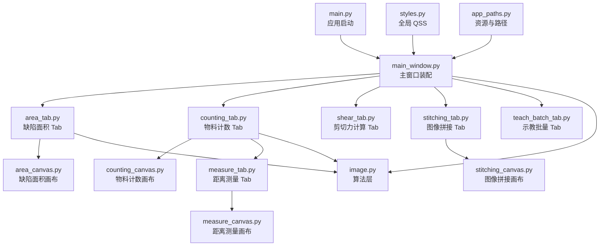
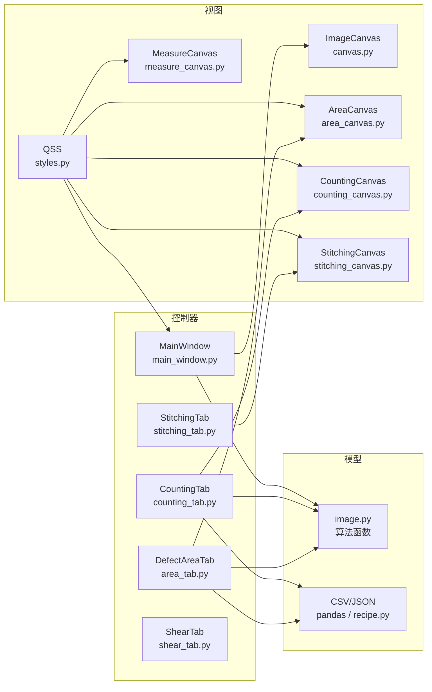
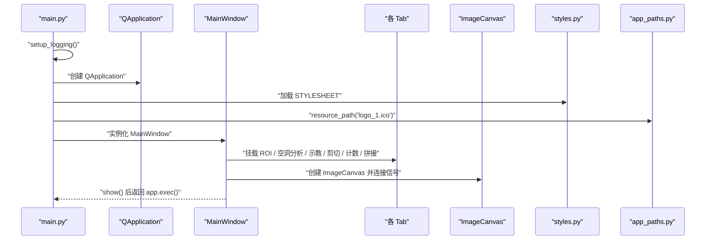
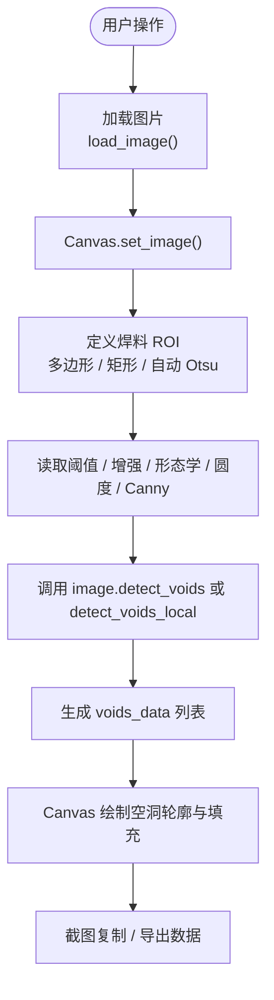
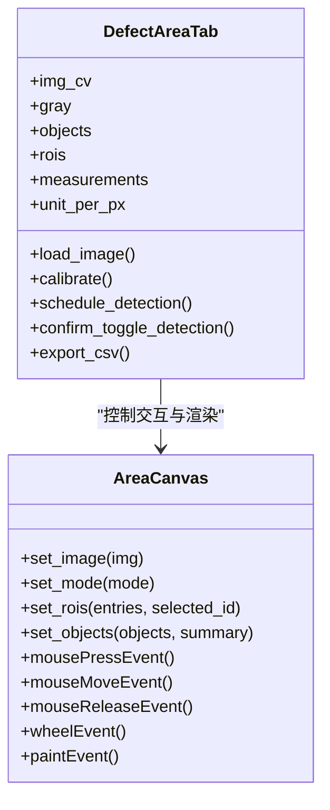
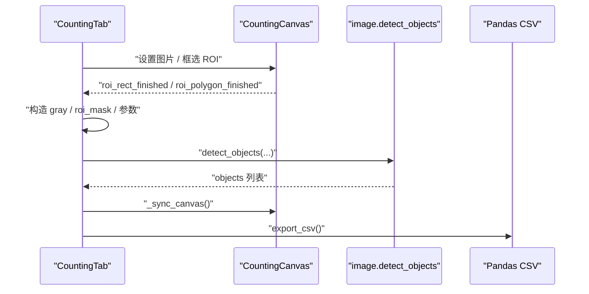
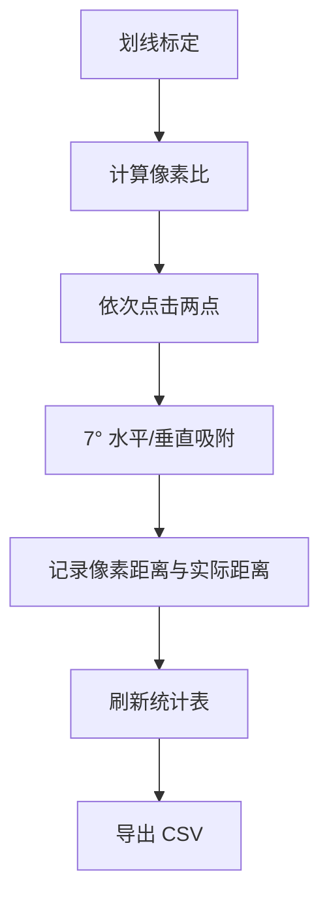
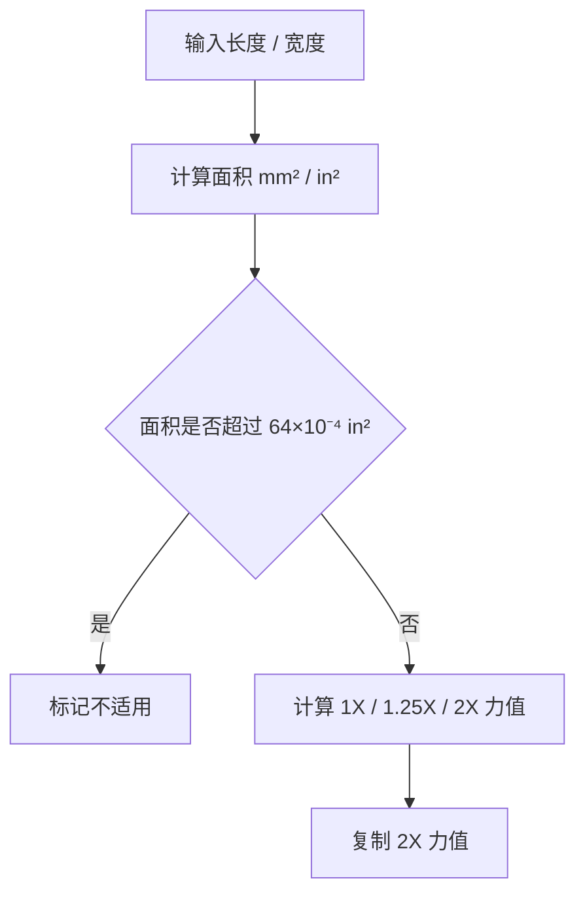
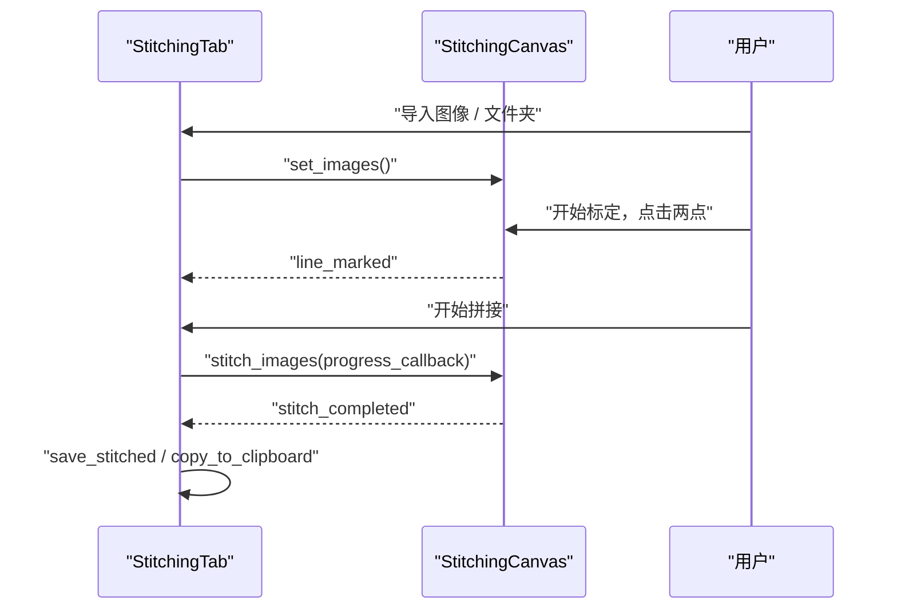
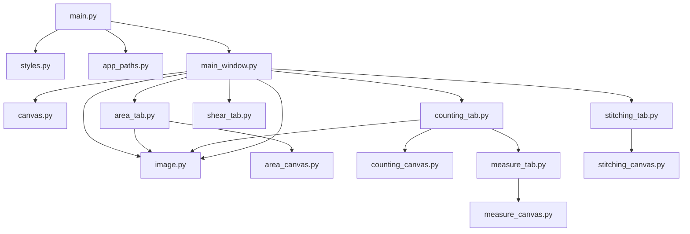

# 整体分层架构

<cite>
**本文引用的文件**   
- [main.py](file://main.py)
- [PROJECT_CONCEPTION.md](file://PROJECT_CONCEPTION.md)
- [README.md](file://README.md)
- [app_paths.py](file://app_paths.py)
- [styles.py](file://styles.py)
- [main_window.py](file://main_window.py)
- [canvas.py](file://canvas.py)
- [image.py](file://image.py)
- [area_tab.py](file://area_tab.py)
- [area_canvas.py](file://area_canvas.py)
- [counting_tab.py](file://counting_tab.py)
- [counting_canvas.py](file://counting_canvas.py)
- [measure_tab.py](file://measure_tab.py)
- [measure_canvas.py](file://measure_canvas.py)
- [shear_tab.py](file://shear_tab.py)
- [stitching_tab.py](file://stitching_tab.py)
- [stitching_canvas.py](file://stitching_canvas.py)
</cite>

## 目录
1. [引言](#引言)
2. [项目结构](#项目结构)
3. [核心组件](#核心组件)
4. [架构总览](#架构总览)
5. [详细组件分析](#详细组件分析)
6. [依赖关系分析](#依赖关系分析)
7. [性能与交互特性](#性能与交互特性)
8. [故障排查与技术债](#故障排查与技术债)
9. [结论](#结论)

## 引言
Aurascope 是面向微电子封装产线的半自动化视觉检测与数据分析桌面工具，运行在 Windows 7+ 上，使用 PyQt6 构建 GUI、OpenCV + NumPy 实现图像处理、Pandas 仅用于 CSV 导出。产品定位不是“全自动 AI 判断”，而是把重复性高、容易出错的量化工作标准化：空洞率检测、芯片剪切力标准校核、蓝膜物料计数、微观尺寸测量等。

按照仓库实际代码，系统采用四层边界：
- **GUI 层**：`main_window.py` 及 `area_tab.py`、`counting_tab.py`、`shear_tab.py`、`stitching_tab.py`、`teach_batch_tab.py` 等业务 Tab。
- **Canvas 绘制层**：`canvas.py` 基类及各专用画布 `area_canvas.py` / `counting_canvas.py` / `measure_canvas.py` / `stitching_canvas.py`，负责 QPainter 自绘、坐标转换、缩放平移和 ROI 编辑。
- **算法层**：`image.py`，唯一实现层，提供阈值/Otsu、形态学去噪、轮廓与圆度、distanceTransform 计数、Canny 边缘校验与面积统计等纯函数接口。
- **数据导出层**：Pandas CSV 与 `recipe.py` JSON（配方读写）。

依赖方向必须遵守：**GUI 层不得内联实现图像算法，必须通过 `image.py` 暴露的纯函数调用；Canvas 层只承载绘制与交互，不承载业务逻辑。**

**章节来源**
- [README.md:1-76](file://README.md#L1-L76)
- [PROJECT_CONCEPTION.md:1-143](file://PROJECT_CONCEPTION.md#L1-L143)

## 项目结构
仓库根目录按功能模块组织，入口为 `main.py`，主窗口装配在 `main_window.py`，各业务 Tab 与其 Canvas 成对出现，算法集中在 `image.py`，样式与 UI 工厂分别位于 `styles.py` 与 `ui_components.py`，路径与打包信息由 `app_paths.py` 提供。

**图表来源**
- [main.py:19-39](file://main.py#L19-L39)
- [main_window.py:96-149](file://main_window.py#L96-L149)
- [area_tab.py:110-150](file://area_tab.py#L110-L150)
- [counting_tab.py:19-52](file://counting_tab.py#L19-L52)
- [shear_tab.py:22-35](file://shear_tab.py#L22-L35)
- [stitching_tab.py:26-46](file://stitching_tab.py#L26-L46)
- [image.py:1-12](file://image.py#L1-L12)
- [styles.py:1-25](file://styles.py#L1-L25)
- [app_paths.py:8-18](file://app_paths.py#L8-L18)

**章节来源**
- [README.md:42-64](file://README.md#L42-L64)
- [PROJECT_CONCEPTION.md:77-108](file://PROJECT_CONCEPTION.md#L77-L108)

## 核心组件
| 层级 | 主要职责 | 关键文件 | 约束 |
|---|---|---|---|
| 入口层 | 初始化日志、QApplication、样式、图标，实例化 MainWindow | `main.py` | 必须在创建 QApplication 前设置 HighDpi 策略 |
| 主窗口层 | 装配 QTabWidget、挂载各 Tab、维护空洞分析侧边栏与撤销栈 | `main_window.py` | 控制器角色，持有业务状态但不直接写 OpenCV 算法 |
| GUI Tab 层 | 每个业务页面的控件组装、参数收集、结果展示与导出 | `area_tab.py`、`counting_tab.py`、`shear_tab.py`、`stitching_tab.py`、`teach_batch_tab.py` | 不得内联图像算法 |
| Canvas 绘制层 | QWidget + QPainter 自绘、原图坐标↔屏幕坐标转换、滚轮缩放、右键平移、ROI 编辑 | `canvas.py`、`area_canvas.py`、`counting_canvas.py`、`measure_canvas.py`、`stitching_canvas.py` | 不承载业务逻辑 |
| 算法层 | 阈值、Otsu、形态学、轮廓、圆度、distanceTransform、Canny 边缘校验 | `image.py` | 纯函数为主，可被无 GUI 场景复用 |
| 数据导出层 | Pandas → CSV、配方 JSON 读写 | `counting_tab.py`、`area_tab.py`、`recipe.py` | CSV 列名与单位需稳定 |

**章节来源**
- [main.py:19-39](file://main.py#L19-L39)
- [main_window.py:53-149](file://main_window.py#L53-L149)
- [image.py:1-12](file://image.py#L1-L12)

## 架构总览
Aurascope 的分层可以理解为 MVC 的变体：
- **模型**：`image.py` 中的图像处理纯函数，以及各 Tab 持有的检测结果列表、ROI 掩码、标定参数等数据结构。
- **视图**：Canvas 子类 + `styles.py` 提供的 QSS 设计 token。
- **控制器**：`MainWindow` 与各 Tab，负责用户操作、参数校验、调用算法、更新 Canvas 与表格。

**图表来源**
- [main_window.py:96-149](file://main_window.py#L96-L149)
- [canvas.py:13-29](file://canvas.py#L13-L29)
- [area_canvas.py:85-97](file://area_canvas.py#L85-L97)
- [counting_canvas.py:10-15](file://counting_canvas.py#L10-L15)
- [measure_canvas.py:10-19](file://measure_canvas.py#L10-L19)
- [stitching_canvas.py:22-27](file://stitching_canvas.py#L22-L27)
- [image.py:27-286](file://image.py#L27-L286)
- [styles.py:1-25](file://styles.py#L1-L25)

**章节来源**
- [PROJECT_CONCEPTION.md:77-108](file://PROJECT_CONCEPTION.md#L77-L108)

## 详细组件分析

### 启动流程：main.py → MainWindow → 挂载 Tab
`main.py` 的 `main()` 负责：
1. 调用 `setup_logging()` 与 `install_excepthook()` 建立日志与异常钩子。
2. 设置 Qt HighDpi 缩放策略。
3. 创建 `QApplication`，设置 Fusion 风格、窗口图标、全局样式表。
4. 实例化 `MainWindow`，显示并进入事件循环。

`MainWindow.__init__` 中设置窗口标题、接受拖放、读取版本、初始化核心数据字段，然后调用 `init_ui()` 装配 QTabWidget、侧边栏、Canvas 与各 Tab。

**图表来源**
- [main.py:19-39](file://main.py#L19-L39)
- [main_window.py:53-149](file://main_window.py#L53-L149)
- [styles.py:45-515](file://styles.py#L45-L515)
- [app_paths.py:8-18](file://app_paths.py#L8-L18)

**章节来源**
- [main.py:1-44](file://main.py#L1-L44)
- [main_window.py:53-149](file://main_window.py#L53-L149)

### 空洞分析：MainWindow + ImageCanvas + image.py
空洞分析是主窗口默认挂载的核心流程：
- `MainWindow.init_ui()` 创建 `analysis_tab`（QWidget），内部用 `QSplitter` 放置侧边栏与 `ImageCanvas`。
- 侧边栏包含标定、缺陷区域定义、空洞检测参数、结果显示与导出按钮。
- 用户点击“自动 (Otsu)”或拖动阈值滑块时，控制器从 UI 读取参数，调用 `image.detect_voids` 或 `image.detect_voids_local`，再把空洞结果传给 Canvas 渲染。

**图表来源**
- [main_window.py:110-129](file://main_window.py#L110-L129)
- [main_window.py:431-479](file://main_window.py#L431-L479)
- [main_window.py:536-668](file://main_window.py#L536-L668)
- [canvas.py:13-29](file://canvas.py#L13-L29)
- [image.py:200-286](file://image.py#L200-L286)
- [image.py:328-422](file://image.py#L328-L422)

**章节来源**
- [main_window.py:96-149](file://main_window.py#L96-L149)
- [main_window.py:431-668](file://main_window.py#L431-L668)
- [canvas.py:13-29](file://canvas.py#L13-L29)
- [image.py:200-422](file://image.py#L200-L422)

### 缺陷面积多 ROI：area_tab.py + area_canvas.py
`DefectAreaTab` 是缺陷面积测量页面，支持：
- 比例尺标定。
- 矩形或多边形 ROI。
- 二值化阈值、亮/暗缺陷、最小面积过滤。
- 手动添加遗漏、删除误检。
- 每 ROI 独立参数与结果，支持批量检测与 CSV 导出。

`AreaCanvas` 只负责渲染 ROI、缺陷对象、测距线与标注，并通过信号把鼠标交互交给 `DefectAreaTab`。

**图表来源**
- [area_tab.py:110-150](file://area_tab.py#L110-L150)
- [area_tab.py:342-378](file://area_tab.py#L342-L378)
- [area_tab.py:561-590](file://area_tab.py#L561-L590)
- [area_canvas.py:85-150](file://area_canvas.py#L85-L150)
- [area_canvas.py:215-340](file://area_canvas.py#L215-L340)

**章节来源**
- [area_tab.py:1-150](file://area_tab.py#L1-L150)
- [area_canvas.py:1-150](file://area_canvas.py#L1-L150)

### 物料计数：counting_tab.py + counting_canvas.py + image.py
`CountingTab` 负责蓝膜 LD / Submount 等离散物料的自动计数：
- 支持矩形和多边形 ROI。
- 调用 `image.detect_objects`，可选 CLAHE、形态学、圆度过滤、Canny 边缘校验、distanceTransform 峰值计数。
- 支持手动添加遗漏、删除误检。
- 结果导出为 Pandas CSV。

**图表来源**
- [counting_tab.py:363-414](file://counting_tab.py#L363-L414)
- [counting_tab.py:425-447](file://counting_tab.py#L425-L447)
- [counting_canvas.py:17-59](file://counting_canvas.py#L17-L59)
- [image.py:491-632](file://image.py#L491-L632)

**章节来源**
- [counting_tab.py:19-52](file://counting_tab.py#L19-L52)
- [counting_tab.py:363-447](file://counting_tab.py#L363-L447)
- [counting_canvas.py:10-59](file://counting_canvas.py#L10-L59)
- [image.py:491-632](file://image.py#L491-L632)

### 距离测量：measure_tab.py + measure_canvas.py
距离测量页已并入 ROI Tab 的业务契约，但仓库仍保留独立 `MeasureTab` 与 `MeasureCanvas`：
- 先划线标定像素比。
- 两点测距，支持 7° 吸附。
- 统计最小、最大、平均、总距离。
- 导出 CSV。

**图表来源**
- [measure_tab.py:227-261](file://measure_tab.py#L227-L261)
- [measure_tab.py:279-321](file://measure_tab.py#L279-L321)
- [measure_canvas.py:106-141](file://measure_canvas.py#L106-L141)

**章节来源**
- [measure_tab.py:22-40](file://measure_tab.py#L22-L40)
- [measure_canvas.py:10-47](file://measure_canvas.py#L10-L47)

### 剪切力计算：shear_tab.py
`ShearTab` 是纯计算器页面，不涉及图像算法：
- 输入芯片长宽。
- 换算 mm² 与 in²。
- 按 MIL-STD-883H Method 2019.9 计算 1X、1.25X、2X 力值。
- 支持复制 2X 力值到剪贴板。

**图表来源**
- [shear_tab.py:205-253](file://shear_tab.py#L205-L253)
- [shear_tab.py:281-285](file://shear_tab.py#L281-L285)

**章节来源**
- [shear_tab.py:22-35](file://shear_tab.py#L22-L35)
- [shear_tab.py:205-285](file://shear_tab.py#L205-L285)

### 图像拼接：stitching_tab.py + stitching_canvas.py
`StitchingTab` 负责导入多张图像、标记金锡水平线、执行拼接、导出或发送到空洞分析：
- 支持单图导入与文件夹导入。
- 每张图标记头尾点。
- `StitchingCanvas.stitch_images()` 按 X/Y 双轴对齐，重叠区线性羽化融合。
- 支持保存 PNG/TIF 与复制到剪贴板。

**图表来源**
- [stitching_tab.py:160-217](file://stitching_tab.py#L160-L217)
- [stitching_tab.py:329-363](file://stitching_tab.py#L329-L363)
- [stitching_canvas.py:297-406](file://stitching_canvas.py#L297-L406)

**章节来源**
- [stitching_tab.py:26-46](file://stitching_tab.py#L26-L46)
- [stitching_canvas.py:22-75](file://stitching_canvas.py#L22-L75)
- [stitching_canvas.py:297-406](file://stitching_canvas.py#L297-L406)

## 依赖关系分析
依赖方向应严格遵循：
- `main.py` 依赖 `styles.py`、`app_paths.py`、`main_window.py`。
- `main_window.py` 依赖 `canvas.ImageCanvas`、`image.py`、各 Tab。
- 各业务 Tab 依赖对应 Canvas 与 `image.py`。
- Canvas 子类不依赖业务 Tab，只通过 pyqtSignal 向上发送交互事件。
- `image.py` 尽量保持无 GUI 依赖，仅在 `_pump_events()` 中可选调用 `QApplication.processEvents()`。

**图表来源**
- [main.py:12-16](file://main.py#L12-L16)
- [main_window.py:31-50](file://main_window.py#L31-L50)
- [area_tab.py:21-28](file://area_tab.py#L21-L28)
- [counting_tab.py:11-16](file://counting_tab.py#L11-L16)
- [stitching_tab.py:16-23](file://stitching_tab.py#L16-L23)
- [image.py:8-24](file://image.py#L8-L24)

**章节来源**
- [main.py:1-44](file://main.py#L1-L44)
- [main_window.py:31-50](file://main_window.py#L31-L50)
- [image.py:8-24](file://image.py#L8-L24)

## 性能与交互特性
- **长循环刷新**：`image.py` 提供 `_pump_events()`，在空洞检测、连通域遍历等可能耗时较长的循环中定期调用 `QApplication.processEvents()`，避免界面假死。
- **防抖重算**：`area_tab.py` 使用 150ms 防抖定时器，`counting_tab.py` 同样使用 150ms 定时器触发 `_do_detect()`。
- **Canvas 缩放锚点**：`canvas.py` 的 `wheelEvent` 以鼠标位置为锚点调整 `scale` 与 `offset`；已知存在 Y 轴漂移问题，不应视为正确设计。
- **HiDPI**：`main.py` 设置 `HighDpiScaleFactorRoundingPolicy.PassThrough`，配合 `styles.py` 的全局字体与间距 token。
- **大图处理**：空洞增强检测、图像拼接目前缺少细粒度进度提示，大图像可能长时间无反馈。

**章节来源**
- [image.py:14-24](file://image.py#L14-L24)
- [image.py:238-240](file://image.py#L238-L240)
- [image.py:375-377](file://image.py#L375-L377)
- [area_tab.py:127-135](file://area_tab.py#L127-L135)
- [counting_tab.py:33-36](file://counting_tab.py#L33-L36)
- [canvas.py:626-706](file://canvas.py#L626-L706)
- [main.py:27-35](file://main.py#L27-L35)

## 故障排查与技术债
根据仓库现状，以下技术债需要重点关注：

| 问题 | 位置 | 影响 | 建议 |
|---|---|---|---|
| `main_window.py` 中存在 `detect_voids_local` 副本 | `main_window.py` | 与 `image.py` 重复实现，行为不一致风险 | 统一以 `image.py` 为准，合并副本 |
| Canny 边缘验证静默失效 | `image.py` | `edge_map` 未初始化时 edge_verify 分支可能无效 | 明确初始化与条件分支 |
| `chk_roi_overlay` 被重复创建 | `main_window.py` | 局部阈值调节相关 UI 状态混乱 | 清理重复创建逻辑 |
| 滚轮缩放 Y 轴漂移 | `canvas.py` | 缩放锚点 Y 坐标不稳定 | 修复 `wheelEvent` 中 offset 计算 |
| `select_for_local` 为无 UI 入口的死代码 | `main_window.py` | 增加维护成本 | 评估是否废弃 |
| 大图增强检测无进度提示 | `image.py` / `main_window.py` | 用户体验差 | 加入进度回调或线程 |
| 拼接自动微调可能改坏已对齐结果 | `stitching_canvas.py` | 拼接缝偏移 | 保持 `STITCH_AUTO_REFINE = False` |

**章节来源**
- [main_window.py:31-34](file://main_window.py#L31-L34)
- [image.py:228-234](file://image.py#L228-L234)
- [image.py:366-371](file://image.py#L366-L371)
- [canvas.py:626-706](file://canvas.py#L626-L706)
- [stitching_canvas.py:15-19](file://stitching_canvas.py#L15-L19)

## 结论
Aurascope 的整体分层清晰：GUI 层负责用户交互与业务编排，Canvas 层负责绘图与坐标变换，`image.py` 是唯一算法实现层，数据导出层通过 Pandas CSV 与配方 JSON 输出结果。当前架构已经实现了“控制器 — 视图 — 模型”的基本分离，但仍存在若干技术债，尤其是 `main_window.py` 中 `detect_voids_local` 与 `image.py` 的重复实现、Canvas 缩放 Y 漂移、Canny 边缘校验初始化等问题。

后续改进优先级建议：
1. 合并 `main_window.py` 与 `image.py` 的空洞检测实现，消除重复。
2. 修复 Canvas 缩放锚点 Y 漂移。
3. 完善 Canny 边缘校验的初始化与错误路径。
4. 为大图增强检测与拼接过程增加进度反馈。
5. 清理无 UI 入口的死代码，降低维护成本。