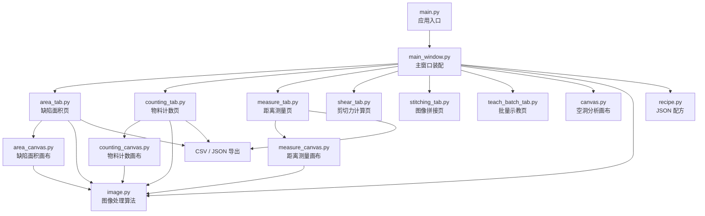
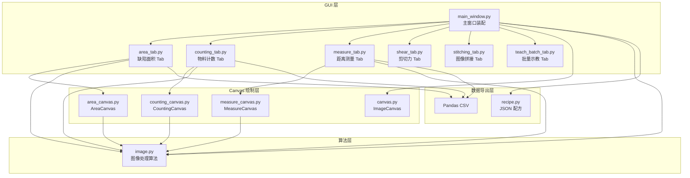
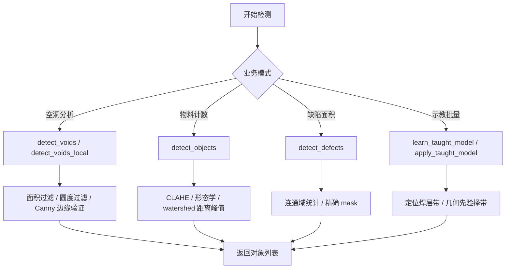
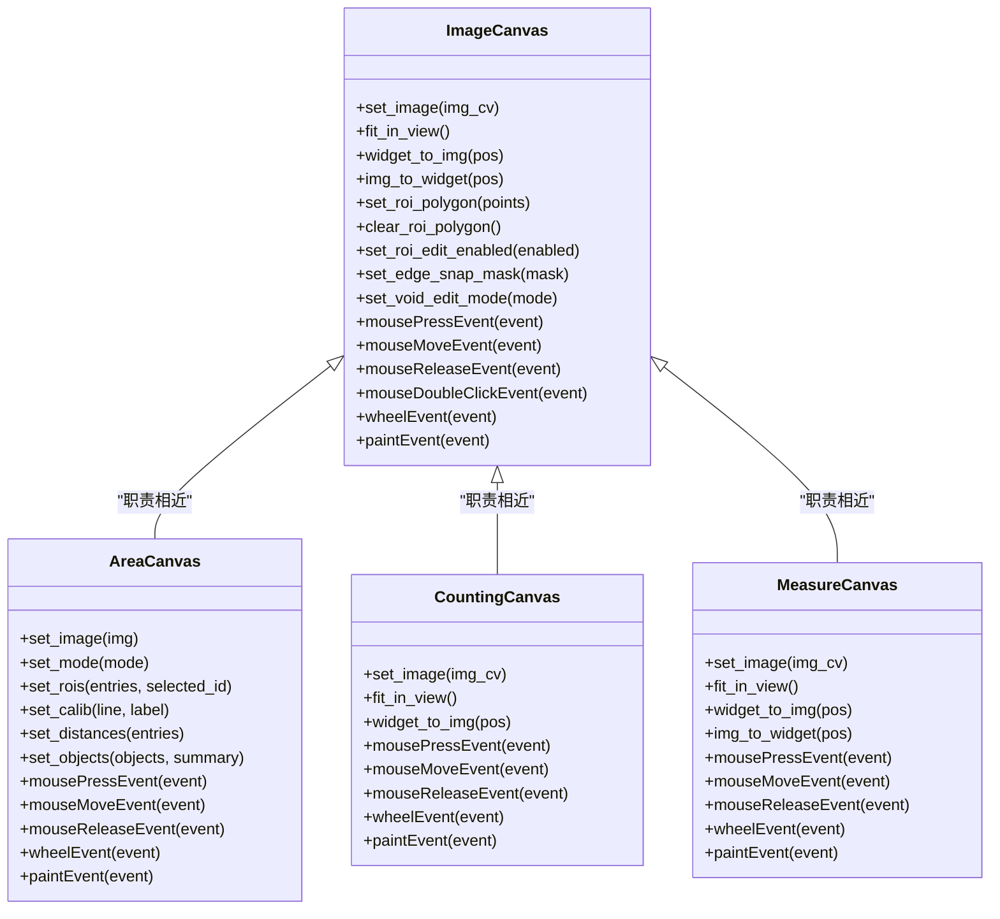
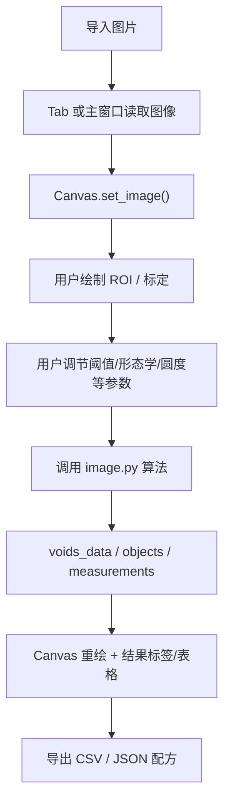
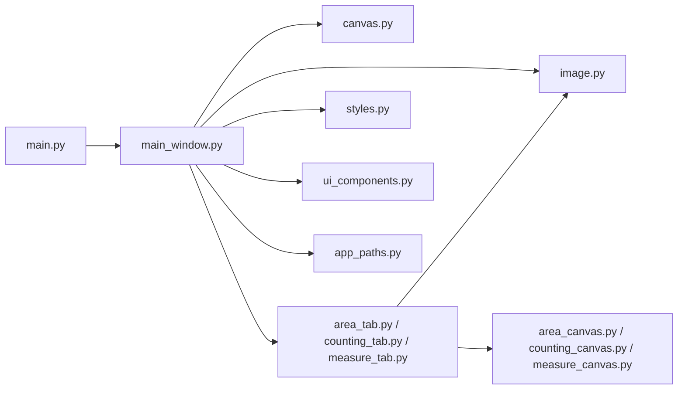

# 架构设计

<cite>
**本文引用的文件**   
- [main.py](file://main.py)
- [main_window.py](file://main_window.py)
- [canvas.py](file://canvas.py)
- [image.py](file://image.py)
- [styles.py](file://styles.py)
- [ui_components.py](file://ui_components.py)
- [app_paths.py](file://app_paths.py)
- [area_tab.py](file://area_tab.py)
- [area_canvas.py](file://area_canvas.py)
- [counting_tab.py](file://counting_tab.py)
- [counting_canvas.py](file://counting_canvas.py)
- [measure_tab.py](file://measure_tab.py)
- [measure_canvas.py](file://measure_canvas.py)
</cite>

## 目录
1. [引言](#引言)
2. [项目结构](#项目结构)
3. [核心组件](#核心组件)
4. [架构总览](#架构总览)
5. [详细组件分析](#详细组件分析)
6. [依赖关系分析](#依赖关系分析)
7. [性能与交互特性](#性能与交互特性)
8. [已知限制与技术债](#已知限制与技术债)
9. [编码规范与约定](#编码规范与约定)
10. [故障排查指南](#故障排查指南)
11. [结论](#结论)

## 引言
Aurascope 是面向微电子封装产线的半自动化视觉检测与数据分析桌面工具，运行在 Windows 7+ 上，使用 PyQt6 构建 GUI、OpenCV + NumPy 实现图像处理、Pandas 仅用于 CSV 导出。产品定位不是“全自动 AI 判断”，而是把重复性高、容易出错的量化工作标准化：空洞率检测、缺陷面积测量、物料计数、尺寸测量、剪切力标准计算、图像拼接与批量示教配方等。

仓库的 README 和 PROJECT_CONCEPTION.md 明确给出四层技术架构：GUI 层 → Canvas 绘制层 → image.py 算法层 → Pandas CSV 数据导出层；同时强调不联网、不收集用户数据、纯 CPU 计算、算法逻辑集中在 image.py。

本架构文档按「入口 → 主窗口 → Tab 页面 → Canvas 绘制层 → 算法层 image.py → 配方/导出」分层组织，并显式标注依赖方向：**GUI 层不得内联实现图像算法，必须调用 image.py**。

## 项目结构
仓库根目录采用功能模块与职责分离的组织方式：

| 层级 | 主要文件 | 职责 |
|---|---|---|
| 应用入口 | main.py | 创建 QApplication、设置全局样式、图标、日志、异常钩子，启动 MainWindow |
| 主窗口装配 | main_window.py | 管理 QTabWidget、侧边栏、菜单、拖拽导入、撤销栈、空洞分析业务状态 |
| 功能 Tab | area_tab.py、counting_tab.py、measure_tab.py、shear_tab.py、stitching_tab.py、teach_batch_tab.py | 各业务页面的 UI 组装、参数控制、结果展示与导出 |
| Canvas 绘制层 | canvas.py、area_canvas.py、counting_canvas.py、measure_canvas.py、stitching_canvas.py | QWidget + QPainter 自绘，负责坐标转换、缩放平移、ROI 编辑、结果覆盖层渲染 |
| 算法层 | image.py | OpenCV + NumPy 阈值、形态学、轮廓、圆度、distanceTransform、Canny 边缘验证、示教学模型、批量检测 |
| 资源路径 | app_paths.py | resource_path、local_data_dir、log_dir、build_date |
| 样式系统 | styles.py | 全局 QSS、设计 token、对话框样式、下拉弹层 POPUP_QSS |
| UI 工厂 | ui_components.py | create_* 控件工厂、CollapsibleSection、attach_empty_button、style_combo_popups |
| 配方与导出 | recipe.py、area_tab.py、counting_tab.py、measure_tab.py | JSON 配方读写、CSV 导出 |



**图表来源**
- [main.py:19-39](file://main.py#L19-L39)
- [main_window.py:53-149](file://main_window.py#L53-L149)
- [area_tab.py:110-323](file://area_tab.py#L110-L323)
- [counting_tab.py:19-179](file://counting_tab.py#L19-L179)
- [measure_tab.py:22-132](file://measure_tab.py#L22-L132)
- [canvas.py:13-28](file://canvas.py#L13-L28)
- [image.py:200-286](file://image.py#L200-L286)

**章节来源**
- [README.md:1-76](file://README.md#L1-L76)
- [PROJECT_CONCEPTION.md:77-108](file://PROJECT_CONCEPTION.md#L77-L108)
- [main.py:1-44](file://main.py#L1-L44)

## 核心组件
### 应用入口 main.py
main.py 的职责很集中：安装日志、安装异常钩子、设置 Qt HighDpi 策略、创建 QApplication、设置 Fusion 风格、加载 logo 图标、应用 styles.py 的全局 STYLESHEET，然后构造 MainWindow 并进入事件循环。它不持有业务状态，也不直接操作图像。

关键行为：
- `setup_logging()` 与 `install_excepthook()` 提供可追溯日志与未捕获异常处理。
- `QApplication.setHighDpiScaleFactorRoundingPolicy(PassThrough)` 适配 4K 显示。
- `app.setStyleSheet(STYLESHEET)` 让所有窗口统一走 styles.py 的设计 token。
- `resource_path('logo_1.ico')` 兼容 PyInstaller 单文件解包目录。

**章节来源**
- [main.py:1-44](file://main.py#L1-L44)
- [app_paths.py:8-11](file://app_paths.py#L8-L11)
- [styles.py:515-518](file://styles.py#L515-L518)

### 主窗口 main_window.py
MainWindow 是 GUI 层的装配中心，但不是图像算法的实现者。它负责：
- 维护 `QTabWidget`，挂载 ROI、空洞分析、示教/批量、剪切力、物料计数、图像拼接等 Tab。
- 构建顶部品牌页头与模块导航按钮，同步当前选中 Tab。
- 构建菜单栏（文件、最近打开、帮助、检查更新）。
- 处理拖拽导入：单图进 ROI 页，多图进拼接页，文件夹进批量示教页。
- 管理空洞分析的侧边栏、标定、ROI 定义、空洞检测参数、结果展示、截图与导出。
- 维护撤销栈 `undo_stack`，支持 Ctrl+Z 回退最多 30 步。
- 通过信号槽连接 Canvas 的标定、ROI、空洞删除/添加、局部笔刷等事件。

重要约束：空洞检测调用 `image.detect_voids` 与 `image.detect_voids_local`，而不是在 main_window.py 中重新实现阈值或形态学逻辑。

**章节来源**
- [main_window.py:53-149](file://main_window.py#L53-L149)
- [main_window.py:181-245](file://main_window.py#L181-L245)
- [main_window.py:257-287](file://main_window.py#L257-L287)
- [main_window.py:1198-1274](file://main_window.py#L1198-L1274)
- [main_window.py:1325-1337](file://main_window.py#L1325-L1337)

### 算法层 image.py
image.py 是唯一被多个 Tab 复用的图像处理实现层，包含：
- 阈值与 Otsu：`extract_threshold_contour`、`otsu_threshold`。
- 轮廓与多边形：`contour_to_polygon`、`polygon_to_mask`、`resample_polygon_points`。
- 空洞检测：`detect_voids`、`detect_voids_local`、`is_void_in_roi`、`calculate_roundness`。
- 物料计数：`detect_objects`（含 CLAHE、形态学、圆度过滤、Canny 边缘验证、watershed 距离峰值计数）。
- 缺陷面积检测：`detect_defects`（连通域统计 + 精确 mask）。
- 示教学模型：`array_stats`、`two_class_threshold`、`locate_solder_band`、`learn_taught_model`、`apply_taught_model`、`bridge_edge_voids` 等。
- 比例尺模板匹配与长度测量：`locate_scale_bar`、`measure_bar_length`。

image.py 内部 `_pump_events()` 在长循环中尝试 `QApplication.processEvents()`，但只在 PyQt6 已导入时调用，因此报告生成等非 GUI 场景仍可复用算法。

**章节来源**
- [image.py:1-25](file://image.py#L1-L25)
- [image.py:27-70](file://image.py#L27-L70)
- [image.py:180-197](file://image.py#L180-L197)
- [image.py:200-286](file://image.py#L200-L286)
- [image.py:328-422](file://image.py#L328-L422)
- [image.py:425-488](file://image.py#L425-L488)
- [image.py:491-632](file://image.py#L491-L632)
- [image.py:753-811](file://image.py#L753-L811)
- [image.py:894-1046](file://image.py#L894-L1046)
- [image.py:1182-1330](file://image.py#L1182-L1330)
- [image.py:1333-1478](file://image.py#L1333-L1478)

### 样式系统 styles.py
styles.py 提供全局 QSS 与设计 token，注释明确说明：QSS 不支持变量，颜色取值必须从 `_C` 字典中的 token 取用，禁止散写硬编码颜色。

Token 体系包括：
- 中性色：bg、surface、surface2、border、border2、text、text2、text3。
- 主色：accent、accent_h、accent_a、accent_tint。
- 语义色：success、danger、warning。
- 字阶：caption-2、caption、body、title-sm、title、page。
- 间距：4/8/12/16/24。
- 圆角：6/8/10/12/999。
- 交互态：default/hover/pressed/checked/disabled/focus。

此外暴露：
- `STYLESHEET`：主界面全局样式。
- `DIALOG_STYLESHEET`：对话框背景。
- `POPUP_QSS`：QComboBox 弹出层专用样式，因为独立弹窗无法命中全局 QSS。

**章节来源**
- [styles.py:1-42](file://styles.py#L1-L42)
- [styles.py:45-518](file://styles.py#L45-L518)
- [styles.py:515-556](file://styles.py#L515-L556)

### UI 组件工厂 ui_components.py
ui_components.py 提供 create_* 工厂函数，约定只创建控件、不加入布局，调用方必须手动 addWidget。典型函数包括：
- `create_primary_button`、`create_secondary_button`、`create_success_button`、`create_danger_button`、`create_nav_button`。
- `create_step_title`、`create_info_label`、`create_success_label`、`create_blue_label`、`create_warning_box`。
- `create_slider`、`create_slider_with_label`、`create_checkbox`。
- `create_groupbox`：强制设置 `Expanding/Preferred` 尺寸策略，避免控件被静默裁剪。
- `attach_empty_button`：为画布空状态居中放置“导入图片”按钮。
- `style_combo_popups`：遍历 QComboBox 并对 view() 单独应用 POPUP_QSS，解决下拉弹层样式失效问题。
- `confirm_action`：破坏性操作确认，offscreen/AURASCOPE_AUTO_CONFIRM=1 时自动确认，便于测试。

**章节来源**
- [ui_components.py:11-31](file://ui_components.py#L11-L31)
- [ui_components.py:34-78](file://ui_components.py#L34-L78)
- [ui_components.py:122-132](file://ui_components.py#L122-L132)
- [ui_components.py:187-242](file://ui_components.py#L187-L242)
- [ui_components.py:321-381](file://ui_components.py#L321-L381)
- [ui_components.py:396-422](file://ui_components.py#L396-L422)
- [ui_components.py:425-459](file://ui_components.py#L425-L459)

### 资源路径 app_paths.py
app_paths.py 统一解析源码运行与 PyInstaller 打包两种 base 目录：
- `resource_path(name)`：onefile 模式取 `_MEIPASS`，否则取当前文件所在目录。
- `app_dir()`：打包后取 exe 同级，源码运行取本文件目录。
- `local_data_dir()`：当前用户可写目录，写入 Aurascope 子目录。
- `log_dir()`：local_data_dir/logs。
- `build_date()`：exe 修改时间或源码文件时间。

**章节来源**
- [app_paths.py:1-42](file://app_paths.py#L1-L42)

## 架构总览
Aurascope 的分层架构如下：



**图表来源**
- [main_window.py:96-149](file://main_window.py#L96-L149)
- [area_tab.py:110-323](file://area_tab.py#L110-L323)
- [counting_tab.py:19-179](file://counting_tab.py#L19-L179)
- [measure_tab.py:22-132](file://measure_tab.py#L22-L132)
- [canvas.py:13-28](file://canvas.py#L13-L28)
- [area_canvas.py:85-97](file://area_canvas.py#L85-L97)
- [counting_canvas.py:10-15](file://counting_canvas.py#L10-L15)
- [measure_canvas.py:10-12](file://measure_canvas.py#L10-L12)
- [image.py:200-286](file://image.py#L200-L286)

## 详细组件分析

### MVC 分离与观察者模式
本项目没有严格套用传统 MVC 类名，但存在清晰的职责分离：
- **视图（View）**：styles.py 定义样式，ui_components.py 提供控件工厂，各 Tab 与 Canvas 负责渲染。
- **控制器（Controller）**：main_window.py、area_tab.py、counting_tab.py、measure_tab.py 等 Tab 类接收用户输入、协调状态、调用算法、刷新 UI。
- **模型（Model）**：image.py 提供无 GUI 依赖的图像处理函数；Tab 类维护 voids_data、objects、measurements、rois 等业务数据。

观察者模式通过 PyQt6 信号槽实现：
- Canvas 发射 `calib_drawn`、`roi_poly_finished`、`roi_rect_changed`、`void_delete_at`、`void_add_polygon`、`void_local_region_confirmed` 等信号。
- Tab 或 MainWindow 连接这些信号，执行业务逻辑，再反向更新 Canvas 显示。

```mermaid
sequenceDiagram
participant User as "用户"
participant Canvas as "ImageCanvas"
participant MainWindow as "MainWindow"
participant Image as "image.py"
participant UI as "结果标签/表格"
User->>Canvas : "点击检测或调整阈值"
Canvas-->>MainWindow : "emit calculate_voids()"
MainWindow->>Image : "detect_voids(gray, roi_mask, thresh_val, ...)"
Image-->>MainWindow : "返回 voids_data 列表"
MainWindow->>UI : "更新空洞数量/总面积/空洞率"
MainWindow->>Canvas : "draw_voids = voids_data; update()"
Canvas-->>User : "重绘空洞轮廓与编号"
```

**图表来源**
- [canvas.py:16-28](file://canvas.py#L16-L28)
- [main_window.py:670-682](file://main_window.py#L670-L682)
- [main_window.py:1198-1253](file://main_window.py#L1198-L1253)
- [image.py:200-286](file://image.py#L200-L286)

**章节来源**
- [canvas.py:13-28](file://canvas.py#L13-L28)
- [main_window.py:670-682](file://main_window.py#L670-L682)
- [area_tab.py:136-150](file://area_tab.py#L136-L150)
- [counting_tab.py:43-51](file://counting_tab.py#L43-L51)

### 工厂模式：ui_components.py 的 create_* 约定
ui_components.py 的 create_* 函数是 UI 工厂模式的具体体现：
- 每个函数返回一个已设置 ObjectName 的控件实例。
- 工厂函数不负责布局，布局由调用方完成。
- 按钮类型对应 styles.py 中的 PrimaryBtn、SecondaryBtn、SuccessBtn、DangerBtn、NavBtn。
- `create_groupbox` 强制 Preferred/Expanding 尺寸策略，避免控件被静默裁剪。
- `attach_empty_button` 将“导入图片”按钮挂在画布中央，随 resize 居中。
- `style_combo_popups` 遍历 widget 下所有 QComboBox，对 view() 单独设置 POPUP_QSS，并隐藏原生焦点框。

**章节来源**
- [ui_components.py:34-78](file://ui_components.py#L34-L78)
- [ui_components.py:122-132](file://ui_components.py#L122-L132)
- [ui_components.py:238-242](file://ui_components.py#L238-L242)
- [ui_components.py:425-459](file://ui_components.py#L425-L459)
- [styles.py:212-277](file://styles.py#L212-L277)

### 策略模式：可插拔检测算法
image.py 中不同业务线复用相似增强检测流程，形成“策略式”能力集合：
- 空洞检测：`detect_voids`。
- 带局部阈值的空洞检测：`detect_voids_local`。
- 物料计数：`detect_objects`，支持 invert、morph_shape、watershed_enabled、edge_verify 等策略开关。
- 缺陷面积检测：`detect_defects`，基于 8 邻域连通域统计。
- 示教学模型：`learn_taught_model` + `apply_taught_model`，根据样板图学习焊层/空洞灰度分布，再对批次图套用。

虽然目前这些函数以模块级函数形式存在，而非 Python 类接口，但从调用方角度看，它们是可替换的检测策略：同一 GUI 参数可以驱动不同算法分支。



**图表来源**
- [image.py:200-286](file://image.py#L200-L286)
- [image.py:328-422](file://image.py#L328-L422)
- [image.py:425-488](file://image.py#L425-L488)
- [image.py:491-632](file://image.py#L491-L632)
- [image.py:1182-1330](file://image.py#L1182-L1330)
- [image.py:1333-1478](file://image.py#L1333-L1478)

**章节来源**
- [image.py:200-286](file://image.py#L200-L286)
- [image.py:491-632](file://image.py#L491-L632)
- [image.py:1182-1330](file://image.py#L1182-L1330)

### 主窗口如何管理 Tab、侧边栏、菜单、拖拽与撤销栈
#### Tab 管理
MainWindow 初始化时创建 `QTabWidget`，依次添加：
1. ROI（缺陷面积）
2. 空洞分析
3. 示教/批量
4. 剪切力计算
5. 物料计数
6. 图像拼接

顶部品牌页头的模块按钮与 `tab_widget.currentChanged` 同步，确保导航按钮与 Tab 状态一致。

#### 侧边栏
空洞分析 Tab 使用 `QSplitter` 左侧 SidebarCard + 右侧 ImageCanvas。侧边栏包含上传、标定、缺陷区域定义、空洞检测设置、结果展示、截图与导出数据等操作。

#### 菜单
菜单栏包含“文件”和“帮助”两个主菜单：
- 文件：打开图片、最近打开、退出。
- 帮助：使用说明、更新日志、检查更新、关于 Aurascope。
最近打开记录通过 `QSettings('Aurascope', 'Aurascope')` 持久化，区分图片和批次文件夹。

#### 拖拽导入
`dragEnterEvent` 接受本地 URL；`dropEvent` 根据拖入内容分流：
- 文件夹 → 切换到 teach_batch_tab 并 load_folder。
- 单张图片 → 切换到 area_tab 并 load_image。
- 多张图片 → 切换到 stitching_tab 并 add_images。
- 非图片 → 提示错误。

#### 撤销栈
MainWindow 维护 `undo_stack`，默认上限 30 步。Ctrl+Z 触发 `on_undo`，恢复上一次 voids_data 快照；`push_undo` 在关键修改前保存深拷贝。

**章节来源**
- [main_window.py:96-149](file://main_window.py#L96-L149)
- [main_window.py:181-245](file://main_window.py#L181-L245)
- [main_window.py:257-287](file://main_window.py#L257-L287)
- [main_window.py:289-350](file://main_window.py#L289-L350)
- [main_window.py:394-479](file://main_window.py#L394-L479)
- [main_window.py:1325-1337](file://main_window.py#L1325-L1337)

### Canvas 绘制层：坐标转换、缩放、平移与 ROI 编辑
Canvas 层统一约定：
- 继承 QWidget，使用 QPainter 自绘。
- 维护 `scale`、`offset`，提供 `widget_to_img` 与 `img_to_widget` 双向转换。
- 滚轮缩放、右键平移、鼠标左键绘制 ROI。
- 空洞分析画布还支持多边形顶点编辑、吸附边缘掩码、局部笔刷区域、空洞删除/添加预览。

注意：canvas.py 的滚轮缩放实现中，Y 轴偏移计算存在已知漂移问题，不应描述为“正确设计”。area_canvas.py 的 wheelEvent 使用锚点缩放，相对更清晰，但仍需结合具体使用场景评估。



**图表来源**
- [canvas.py:13-164](file://canvas.py#L13-L164)
- [canvas.py:350-706](file://canvas.py#L350-L706)
- [canvas.py:708-943](file://canvas.py#L708-L943)
- [area_canvas.py:85-164](file://area_canvas.py#L85-L164)
- [area_canvas.py:215-340](file://area_canvas.py#L215-L340)
- [area_canvas.py:419-498](file://area_canvas.py#L419-L498)
- [counting_canvas.py:10-75](file://counting_canvas.py#L10-L75)
- [counting_canvas.py:77-185](file://counting_canvas.py#L77-L185)
- [counting_canvas.py:187-270](file://counting_canvas.py#L187-L270)
- [measure_canvas.py:10-76](file://measure_canvas.py#L10-L76)
- [measure_canvas.py:120-188](file://measure_canvas.py#L120-L188)
- [measure_canvas.py:206-321](file://measure_canvas.py#L206-L321)

**章节来源**
- [canvas.py:13-164](file://canvas.py#L13-L164)
- [canvas.py:350-706](file://canvas.py#L350-L706)
- [area_canvas.py:85-164](file://area_canvas.py#L85-L164)
- [counting_canvas.py:10-75](file://counting_canvas.py#L10-L75)
- [measure_canvas.py:10-76](file://measure_canvas.py#L10-L76)

### 数据流图：从图片导入到 CSV/JSON 导出


**图表来源**
- [area_tab.py:342-378](file://area_tab.py#L342-L378)
- [counting_tab.py:181-196](file://counting_tab.py#L181-L196)
- [measure_tab.py:175-185](file://measure_tab.py#L175-L185)
- [main_window.py:737-769](file://main_window.py#L737-L769)
- [image.py:200-286](file://image.py#L200-L286)
- [image.py:491-632](file://image.py#L491-L632)

**章节来源**
- [area_tab.py:342-378](file://area_tab.py#L342-L378)
- [counting_tab.py:181-196](file://counting_tab.py#L181-L196)
- [measure_tab.py:175-185](file://measure_tab.py#L175-L185)
- [main_window.py:737-769](file://main_window.py#L737-L769)

## 依赖关系分析
依赖方向应严格遵守：**GUI 层不得内联实现图像算法，必须调用 image.py**。

| 组件 | 依赖 | 说明 |
|---|---|---|
| main.py | main_window.py、styles.py、app_paths.py、app_version.py、logging_setup.py | 应用启动装配 |
| main_window.py | canvas.py、image.py、ui_components.py、area_tab.py、counting_tab.py、shear_tab.py、stitching_tab.py、teach_batch_tab.py、recipe.py | 主窗口装配与空洞分析业务 |
| area_tab.py | area_canvas.py、image.py、ui_components.py | 缺陷面积 Tab |
| counting_tab.py | counting_canvas.py、image.py、ui_components.py | 物料计数 Tab |
| measure_tab.py | measure_canvas.py、ui_components.py | 距离测量 Tab |
| Canvas 层 | ui_components.py、app_paths.py | 绘制与空状态按钮 |
| image.py | cv2、numpy | 纯算法层，可选依赖 PyQt6 |
| styles.py | 无运行时依赖 | 静态 QSS 字符串 |
| ui_components.py | PyQt6.QtWidgets、PyQt6.QtCore | UI 工厂 |
| app_paths.py | sys、os、datetime | 路径解析 |



**图表来源**
- [main.py:12-16](file://main.py#L12-L16)
- [main_window.py:24-50](file://main_window.py#L24-L50)
- [area_tab.py:21-28](file://area_tab.py#L21-L28)
- [counting_tab.py:11-16](file://counting_tab.py#L11-L16)
- [measure_tab.py:15-19](file://measure_tab.py#L15-L19)

**章节来源**
- [main.py:12-16](file://main.py#L12-L16)
- [main_window.py:24-50](file://main_window.py#L24-L50)
- [area_tab.py:21-28](file://area_tab.py#L21-L28)
- [counting_tab.py:11-16](file://counting_tab.py#L11-L16)
- [measure_tab.py:15-19](file://measure_tab.py#L15-L19)

## 性能与交互特性
### 长循环事件泵
image.py 的 `_pump_events()` 在空洞检测、连通域遍历等长循环中每若干次迭代调用一次 `QApplication.processEvents()`，避免 GUI 完全卡死。该函数对 PyQt6 导入失败做兜底，使非 GUI 场景也能复用算法。

### 防抖与批量检测
- area_tab.py 使用 150ms 防抖定时器 `schedule_detection`，避免滑块拖动时频繁重算。
- counting_tab.py 同样使用 150ms 定时器触发 `_do_detect`。
- area_tab.py 支持多 ROI 批量检测队列 `_batch_queue`，并维护 `_batch_active` 与 `_batch_generation` 防止旧结果污染。

### 撤销栈
MainWindow 的撤销栈保存 voids_data 的深拷贝，最多保留 30 步。用户可通过 Ctrl+Z 或“撤销”按钮回退。

### 缩放与平移
Canvas 层统一支持滚轮缩放与右键平移。空洞分析画布还额外支持：
- 多边形 ROI 顶点拖拽与双击插入边。
- 边缘吸附掩码。
- 局部笔刷区域半径与阈值调节。
- 空洞删除悬停高亮。

**章节来源**
- [image.py:14-25](file://image.py#L14-L25)
- [image.py:238-240](file://image.py#L238-L240)
- [image.py:375-377](file://image.py#L375-L377)
- [image.py:585-587](file://image.py#L585-L587)
- [area_tab.py:127-135](file://area_tab.py#L127-L135)
- [counting_tab.py:33-36](file://counting_tab.py#L33-L36)
- [main_window.py:154-172](file://main_window.py#L154-L172)
- [main_window.py:1325-1337](file://main_window.py#L1325-L1337)
- [canvas.py:626-706](file://canvas.py#L626-L706)

## 已知限制与技术债
以下限制以 handoff.md 清单为准，并结合代码现状补充：

| 问题 | 位置 | 影响 | 建议 |
|---|---|---|---|
| 重复的 `detect_voids_local` 副本 | main_window.py 与 image.py | 两份实现可能不一致，现行行为应以 image.py 为准，待合并 | 清理 main_window.py 中的副本，统一调用 image.py |
| edge_map 未初始化导致 Canny 校验静默失效 | image.py 部分路径 | 启用 Canny 边缘验证时可能跳过校验 | 统一初始化 edge_map，或在条件分支中增加防御性检查 |
| chk_roi_overlay 被重复创建 | main_window.py | 可能导致状态混乱或冗余控件 | 重构为单一属性控制，避免重复创建 |
| 滚轮缩放 Y 轴漂移 | canvas.py | 缩放时图像纵向位置可能出现偏差 | 修复 Y 轴 offset 计算，保持 X/Y 锚点一致 |
| select_for_local 为无 UI 入口的死代码 | main_window.py | 增加维护成本但不生效 | 删除或补全 UI 入口 |
| 大图增强检测无进度提示 | image.py / main_window.py | 大图像 CLAHE/形态学/Canny 处理时界面可能长时间无反馈 | 增加进度条或异步任务提示 |
| QComboBox 下拉弹层样式需单独注入 | ui_components.py | 全局 QSS 无法命中独立弹窗 | 继续使用 style_combo_popups 对 view() 应用 POPUP_QSS |
| create_groupbox 尺寸策略 | ui_components.py | 若不使用 create_groupbox 而直接 new QGroupBox，可能被静默裁剪 | 强制使用 create_groupbox 或手动设置 Expanding/Preferred |

**章节来源**
- [main_window.py:32-34](file://main_window.py#L32-L34)
- [main_window.py:525-531](file://main_window.py#L525-L531)
- [main_window.py:1490-1529](file://main_window.py#L1490-L1529)
- [image.py:228-234](file://image.py#L228-L234)
- [image.py:366-370](file://image.py#L366-L370)
- [canvas.py:695-706](file://canvas.py#L695-L706)
- [ui_components.py:425-459](file://ui_components.py#L425-L459)
- [ui_components.py:238-242](file://ui_components.py#L238-L242)

## 编码规范与约定
### 强制约定
1. **GUI 层不得内联实现图像算法**  
   空洞检测、物料计数、缺陷面积检测、示教学模型等逻辑必须放在 image.py，GUI 层只负责参数传递与结果展示。

2. **Canvas 层统一为 QWidget + QPainter 自绘**  
   共享原图坐标↔屏幕坐标转换、滚轮缩放、右键平移、多边形 ROI 编辑约定。不要绕过 Canvas 直接在 Tab 中绘制图像。

3. **styles.py 的全局 QSS 与设计 token 是唯一视觉来源**  
   新增颜色、字号、圆角、间距必须从 `_C` 或已有 QSS 规则引用，禁止散写硬编码。

4. **ui_components.py 的 create_* 工厂函数只创建控件、不加入布局**  
   调用方必须手动 addWidget；create_groupbox() 必须使用 Preferred/Expanding 尺寸策略，否则控件可能被静默裁剪。

5. **缺陷面积页 UI 契约以技能文档为准**  
   area_tab.py / area_canvas.py 的权威契约是 `.qoder/skills/roi-page-ui-design/SKILL.md`，不得另立一套设计语言。

6. **资源路径统一通过 app_paths.py**  
   图片、logo、日志、用户数据路径必须使用 resource_path、local_data_dir、log_dir，不能硬编码绝对路径。

7. **配方与导出产物**  
   示教配方以 JSON 落盘于 recipes/，结构定义与读写逻辑在 recipe.py；检测结果导出统一使用 Pandas CSV。

### 推荐实践
- 新 Tab 优先复用 ui_components.py 的 create_* 工厂。
- 新 Canvas 优先参考 area_canvas.py 的坐标转换与 paintEvent 结构。
- 新算法优先扩展 image.py，保持无 GUI 依赖。
- 新样式优先扩展 styles.py 的 QSS 规则，并使用 ObjectName 绑定。

**章节来源**
- [styles.py:1-42](file://styles.py#L1-L42)
- [ui_components.py:34-78](file://ui_components.py#L34-L78)
- [ui_components.py:238-242](file://ui_components.py#L238-L242)
- [app_paths.py:8-42](file://app_paths.py#L8-L42)
- [area_tab.py:110-323](file://area_tab.py#L110-L323)

## 故障排查指南
### 图片无法加载
- 检查 path 是否有效、格式是否在 PNG/JPG/BMP/TIF/TIFF 范围内。
- TIF 多页或非二维维度会被 area_tab.py 拒绝。
- 16 位图像会按最大值缩放到 8 位，注意动态范围变化。

**章节来源**
- [main_window.py:771-821](file://main_window.py#L771-L821)
- [area_tab.py:53-92](file://area_tab.py#L53-L92)

### 空洞检测结果为空
- 确认已定义 ROI。
- 检查阈值是否合理，可尝试自动 Otsu。
- 检查增强检测开关：CLAHE、形态学、圆度过滤、Canny 边缘验证。
- 注意 edge_map 未初始化可能导致 Canny 校验静默失效。

**章节来源**
- [main_window.py:1146-1169](file://main_window.py#L1146-L1169)
- [main_window.py:1198-1274](file://main_window.py#L1198-L1274)
- [image.py:228-234](file://image.py#L228-L234)

### 下拉弹层样式错乱
- 确认已调用 `style_combo_popups(self)`。
- 检查 QComboBox 的 view() 是否被覆盖。
- 注意原生焦点框需要委托移除 State_HasFocus。

**章节来源**
- [main_window.py:90-92](file://main_window.py#L90-L92)
- [ui_components.py:425-459](file://ui_components.py#L425-L459)

### 撤销无效
- 检查 undo_stack 是否为空。
- 确认修改前调用了 push_undo。
- 确认 voids_data 是深拷贝。

**章节来源**
- [main_window.py:1325-1337](file://main_window.py#L1325-L1337)

### 导出 CSV 为空或失败
- 确认有检测结果或测量数据。
- 检查保存路径权限。
- area_tab.py 使用临时文件 + os.replace 保证原子写入。

**章节来源**
- [area_tab.py:502-543](file://area_tab.py#L502-L543)
- [counting_tab.py:425-447](file://counting_tab.py#L425-L447)
- [measure_tab.py:300-321](file://measure_tab.py#L300-L321)

## 结论
Aurascope 的架构以「GUI 装配 → Canvas 绘制 → image.py 算法 → CSV/JSON 导出」为主线，通过 PyQt6 信号槽实现松耦合交互，通过 ui_components.py 工厂函数统一控件创建，通过 styles.py 统一视觉 token，通过 app_paths.py 统一资源路径。

当前主要风险在于：
- main_window.py 中存在 detect_voids_local 副本，应与 image.py 合并。
- Canny 边缘验证存在 edge_map 初始化隐患。
- Canvas 滚轮缩放存在 Y 轴漂移。
- 大图增强检测缺少进度提示。
- 部分 UI 约定未被严格执行，例如 create_groupbox 尺寸策略、QComboBox 弹层样式。

后续改进优先级建议：
1. 合并 detect_voids_local 副本，统一算法入口。
2. 修复 edge_map 初始化与 Canny 校验分支。
3. 修复 canvas.py 滚轮缩放 Y 轴漂移。
4. 为大图增强检测增加进度提示。
5. 强化 UI 工厂与样式 token 的强制约束，减少散写颜色和硬编码。
6. 完善手稿中列出的 dead code 清理计划。