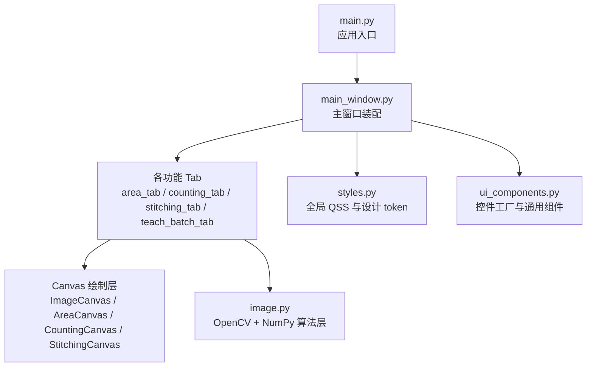
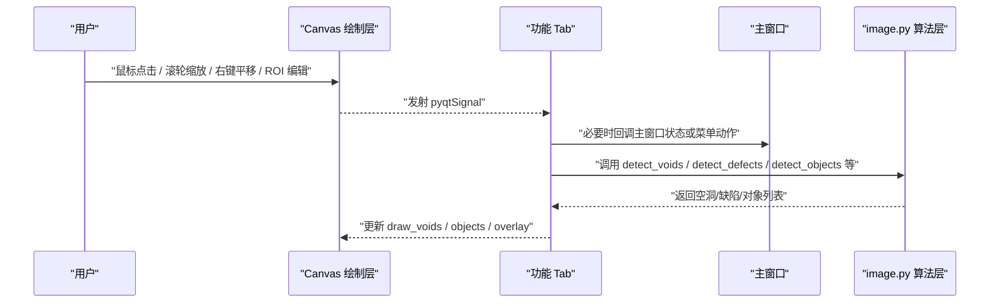
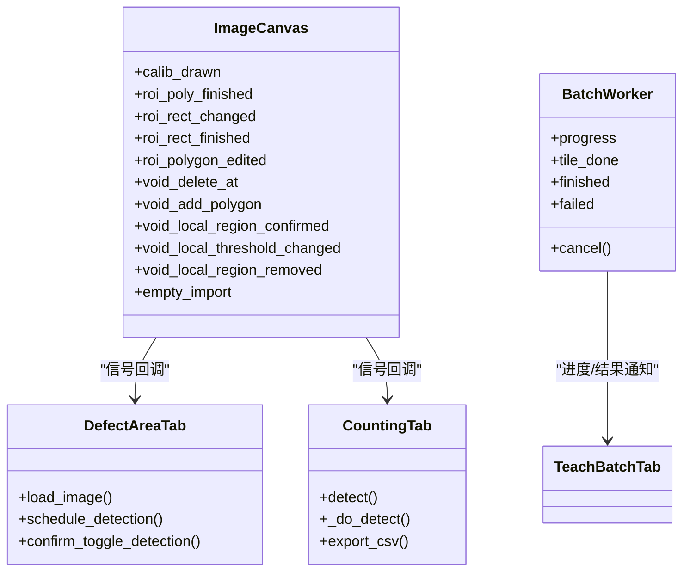
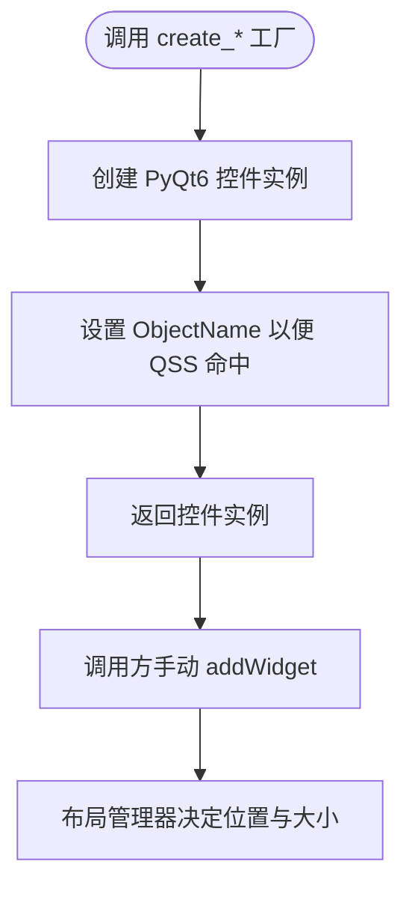
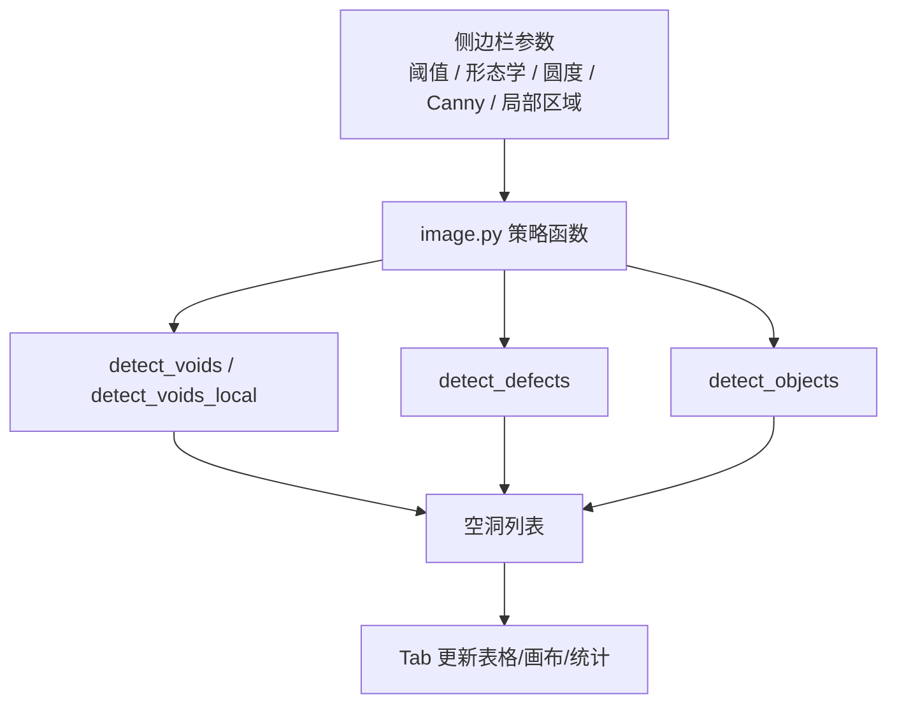
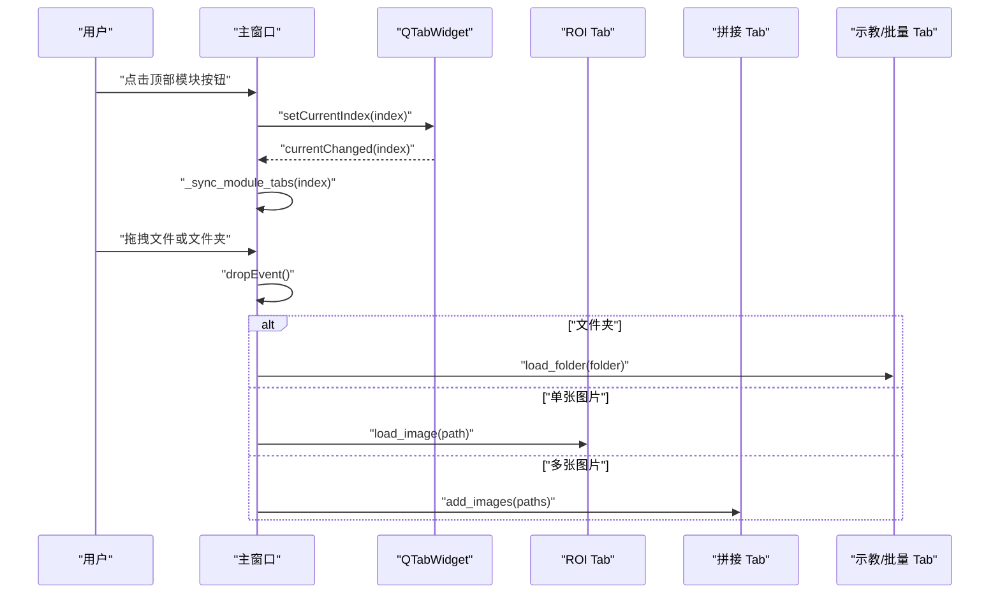
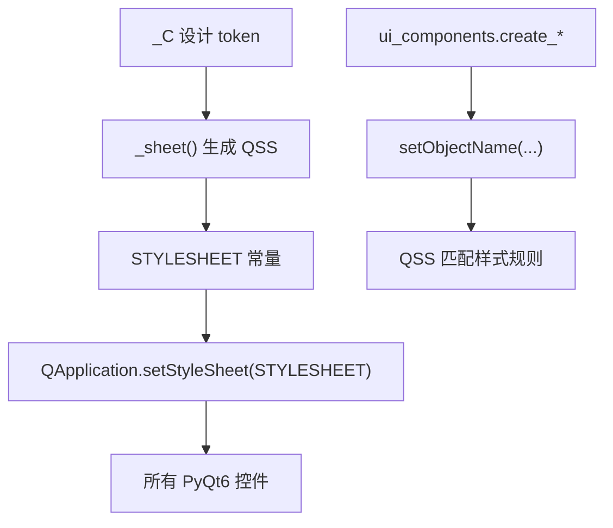
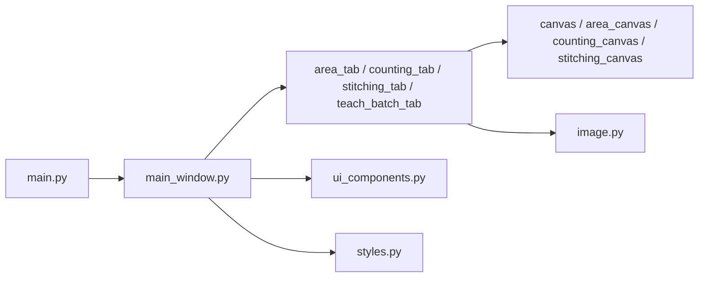

# 核心组件交互模式

<cite>
**本文引用的文件**   
- [main.py](file://main.py)
- [main_window.py](file://main_window.py)
- [canvas.py](file://canvas.py)
- [area_tab.py](file://area_tab.py)
- [area_canvas.py](file://area_canvas.py)
- [counting_tab.py](file://counting_tab.py)
- [counting_canvas.py](file://counting_canvas.py)
- [stitching_tab.py](file://stitching_tab.py)
- [stitching_canvas.py](file://stitching_canvas.py)
- [image.py](file://image.py)
- [ui_components.py](file://ui_components.py)
- [styles.py](file://styles.py)
</cite>

## 目录
1. [引言](#引言)
2. [项目结构](#项目结构)
3. [核心组件](#核心组件)
4. [架构总览](#架构总览)
5. [详细组件分析](#详细组件分析)
6. [依赖关系分析](#依赖关系分析)
7. [性能与交互特性](#性能与交互特性)
8. [故障排查指南](#故障排查指南)
9. [结论](#结论)

## 引言
本文聚焦 Aurascope 的三种设计模式在代码中的落地：观察者模式（PyQt6 信号槽）、工厂模式（`ui_components.py` 的 `create_*`）和策略模式（`image.py` 的可插拔算法函数）。同时说明主窗口如何通过侧边栏切换 Tab、菜单触发导入/导出、拖拽 `dropEvent` 接收图片路径，以及如何管理撤销栈；并解释 `styles.py` 的全局 QSS 与设计 token 如何实现 UI 外观与行为解耦。

## 项目结构
Aurascope 采用「入口 → 主窗口 → Tab 页面 → Canvas 绘制层 → 算法层 image.py → 配方/导出」的分层组织方式。GUI 层不内联实现图像算法，所有图像处理集中在 `image.py`。

**图表来源**
- [main.py:19-39](file://main.py#L19-L39)
- [main_window.py:54-154](file://main_window.py#L54-L154)
- [styles.py:45-536](file://styles.py#L45-L536)
- [ui_components.py:35-80](file://ui_components.py#L35-L80)

**章节来源**
- [README.md:42-64](file://README.md#L42-L64)
- [PROJECT_CONCEPTION.md:77-107](file://PROJECT_CONCEPTION.md#L77-L107)

## 核心组件
- **入口与应用初始化**：`main.py` 创建 `QApplication`，设置高 DPI 策略、Fusion 风格、全局样式表 `STYLESHEET`，然后实例化 `MainWindow`。
- **主窗口**：`main_window.py` 负责装配 Tab、侧边栏、标题栏、菜单、拖拽、最近打开、撤销栈、更新检查等。
- **Canvas 绘制层**：`canvas.py`、`area_canvas.py`、`counting_canvas.py`、`stitching_canvas.py` 统一为 `QWidget + QPainter` 自绘，提供缩放、平移、坐标转换、ROI 编辑、结果叠加等能力。
- **算法层**：`image.py` 集中阈值、形态学、轮廓、圆度、距离变换、Canny 边缘验证、示教学习等逻辑。
- **UI 组件工厂**：`ui_components.py` 提供 `create_primary_button`、`create_secondary_button`、`create_groupbox`、`CollapsibleSection`、`TitleBar` 等工厂函数与通用组件。
- **全局样式**：`styles.py` 定义设计 token 与完整 QSS，并通过 `app.setStyleSheet(STYLESHEET)` 应用到整个应用。

**章节来源**
- [main.py:19-39](file://main.py#L19-L39)
- [main_window.py:54-154](file://main_window.py#L54-L154)
- [canvas.py:13-29](file://canvas.py#L13-L29)
- [image.py:1-12](file://image.py#L1-L12)
- [ui_components.py:35-80](file://ui_components.py#L35-L80)
- [styles.py:45-536](file://styles.py#L45-L536)

## 架构总览
下图展示用户操作从 Canvas 到 Tab/MainWindow 的传播路径，以及算法调用方向。

**图表来源**
- [canvas.py:16-28](file://canvas.py#L16-L28)
- [main_window.py:722-734](file://main_window.py#L722-L734)
- [area_tab.py:136-150](file://area_tab.py#L136-L150)
- [counting_tab.py:363-414](file://counting_tab.py#L363-L414)
- [image.py:200-286](file://image.py#L200-L286)

## 详细组件分析

### 观察者模式：PyQt6 信号槽传播用户操作
Canvas 层通过 `pyqtSignal` 把低层交互事件抽象成高层可订阅的信号，避免直接耦合具体业务。

- **空洞分析画布**：
  - 标定线完成：`calib_drawn`
  - 多边形 ROI 完成：`roi_poly_finished`
  - 矩形 ROI 变化/完成：`roi_rect_changed` / `roi_rect_finished`
  - ROI 多边形编辑：`roi_polygon_edited`
  - 删除/添加空洞：`void_delete_at` / `void_add_polygon`
  - 局部阈值区域确认/移除/阈值变化：`void_local_region_confirmed` / `void_local_region_removed` / `void_local_threshold_changed`
  - 空状态导入：`empty_import`

- **主窗口连接点**：`_connect_signals()` 将上述信号连接到 `finish_calibration`、`finish_poly_roi`、`update_layer_preview`、`on_polygon_edited`、`on_void_delete_at`、`on_void_add_polygon`、`on_void_selected_for_local`、`on_local_region_confirmed`、`on_local_threshold_changed`、`on_local_region_removed` 等方法。

- **缺陷面积页**：`DefectAreaTab` 同样订阅 `AreaCanvas` 的 `calib_drawn`、`distance_added`、`roi_rect`、`roi_poly`、`add_click`、`delete_click` 等信号，并把业务状态同步到表格、统计标签和画布显示。

- **物料计数页**：`CountingTab` 订阅 `CountingCanvas` 的 `roi_rect_finished`、`roi_polygon_finished`、`object_delete_at`、`object_add_at`，并在 `_do_detect` 中调用 `image.detect_objects`。

- **批量检测进度与取消**：`teach_batch_tab.py` 的 `BatchWorker(QThread)` 通过 `progress`、`tile_done`、`finished`、`failed` 信号向 UI 推送进度、单图轻量结果、全部结果和异常；`cancel()` 暴露给 UI 按钮以中断循环。

**图表来源**
- [canvas.py:16-28](file://canvas.py#L16-L28)
- [main_window.py:722-734](file://main_window.py#L722-L734)
- [area_tab.py:136-150](file://area_tab.py#L136-L150)
- [counting_tab.py:363-414](file://counting_tab.py#L363-L414)
- [teach_batch_tab.py:82-159](file://teach_batch_tab.py#L82-L159)

**章节来源**
- [canvas.py:16-28](file://canvas.py#L16-L28)
- [main_window.py:722-734](file://main_window.py#L722-L734)
- [area_tab.py:136-150](file://area_tab.py#L136-L150)
- [counting_tab.py:363-414](file://counting_tab.py#L363-L414)
- [teach_batch_tab.py:82-159](file://teach_batch_tab.py#L82-L159)

### 工厂模式：`ui_components.py` 的 `create_*` 约定
`ui_components.py` 的核心约定是：**只创建控件、不加入布局**。调用方必须手动 `addWidget`，从而让布局职责与控件创建职责分离。

典型工厂函数包括：
- `create_primary_button(text, callback=None)`
- `create_secondary_button(text, callback=None, checkable=False)`
- `create_success_button(text, callback=None)`
- `create_danger_button(text, callback=None)`
- `create_nav_button(text, callback=None, checkable=True)`
- `create_slider_with_label(min_val, max_val, default_val, callback=None)`
- `create_checkbox(text, checked=False, callback=None)`
- `create_groupbox(title)`
- `create_step_title(text)`
- `create_info_label(text="")`
- `create_success_label(text="")`
- `create_card_title(text)`
- `create_warning_box(text="")`
- `attach_empty_button(canvas, callback, text='导入图片', dy=36)`
- `style_combo_popups(widget)`

强制约定：
1. 工厂函数返回控件实例，不持有父布局。
2. 调用方使用 `layout.addWidget(...)` 显式加入布局。
3. `create_groupbox()` 必须使用 `Preferred/Expanding` 尺寸策略，否则控件可能被静默裁剪。

**图表来源**
- [ui_components.py:35-80](file://ui_components.py#L35-L80)
- [ui_components.py:221-243](file://ui_components.py#L221-L243)
- [ui_components.py:123-133](file://ui_components.py#L123-L133)

**章节来源**
- [ui_components.py:35-80](file://ui_components.py#L35-L80)
- [ui_components.py:221-243](file://ui_components.py#L221-L243)
- [ui_components.py:123-133](file://ui_components.py#L123-L133)

### 策略模式：`image.py` 的可插拔算法组合
`image.py` 是唯一的算法实现层，GUI 层通过参数组合不同策略，而不是硬编码分支。

主要策略函数：
- `extract_threshold_contour`：矩形区域阈值轮廓提取。
- `otsu_threshold`：Otsu 自动阈值。
- `detect_voids`：空洞检测，支持 CLAHE、形态学去噪、ROI 腐蚀、圆度过滤、Canny 边缘验证。
- `detect_voids_local`：基于全局阈值 + 局部区域阈值的空洞检测。
- `detect_defects`：按 8 邻域连通域检测缺陷，返回精确像素面积、质心、bbox、points、mask。
- `detect_objects`：物料计数增强检测，支持 CLAHE、形态学开闭运算、ROI 掩码、距离峰值计数、Canny 边缘验证。
- `is_void_in_roi`、`calculate_roundness`、`polygon_to_mask`、`build_snap_edge_mask` 等辅助策略。

示例调用路径：
- 空洞分析：`main_window.py` 导入 `detect_voids`、`detect_voids_local`、`otsu_threshold` 等，并在侧边栏参数变化时重新计算。
- 缺陷面积：`area_tab.py` 调用 `detect_defects` 与 `polygon_to_mask`。
- 物料计数：`counting_tab.py` 调用 `detect_objects` 与 `otsu_threshold`。
- 拼接与示教：`stitching_tab.py`、`teach_batch_tab.py` 调用 `image.py` 中的标注、缩略图、示教模型相关函数。

**图表来源**
- [image.py:200-286](file://image.py#L200-L286)
- [image.py:425-488](file://image.py#L425-L488)
- [image.py:491-632](file://image.py#L491-L632)
- [area_tab.py:21-28](file://area_tab.py#L21-L28)
- [counting_tab.py:11-16](file://counting_tab.py#L11-L16)

**章节来源**
- [image.py:200-286](file://image.py#L200-L286)
- [image.py:425-488](file://image.py#L425-L488)
- [image.py:491-632](file://image.py#L491-L632)
- [area_tab.py:21-28](file://area_tab.py#L21-L28)
- [counting_tab.py:11-16](file://counting_tab.py#L11-L16)

### 主窗口：侧边栏切换 Tab、菜单导入/导出、拖拽 dropEvent、撤销栈
- **侧边栏切换 Tab**：`_build_app_header()` 根据 `tab_widget.count()` 生成模块按钮，每个按钮点击后调用 `self.tab_widget.setCurrentIndex(i)`；同时监听 `currentChanged` 同步按钮选中态。
- **菜单触发导入/导出**：`_build_menu()` 挂载「文件」「帮助」菜单，「打开图片…」跳转到 ROI Tab 并调用 `area_tab.load_image()`；「退出」关闭窗口；「使用说明」「关于 Aurascope」等通过对话框展示。
- **拖拽 dropEvent**：`dropEvent()` 判断拖入内容是文件夹还是图片：文件夹进入「示教/批量」Tab；单张图片进入 ROI Tab；多张图片进入「图像拼接」Tab。
- **撤销栈**：`undo_stack = []`、`undo_limit = 30`，并通过 `QShortcut('Ctrl+Z')` 绑定 `on_undo`；空洞分析侧边栏也有「撤销」按钮。

**图表来源**
- [main_window.py:192-218](file://main_window.py#L192-L218)
- [main_window.py:225-242](file://main_window.py#L225-L242)
- [main_window.py:309-339](file://main_window.py#L309-L339)
- [main_window.py:159-177](file://main_window.py#L159-L177)

**章节来源**
- [main_window.py:192-218](file://main_window.py#L192-L218)
- [main_window.py:225-242](file://main_window.py#L225-L242)
- [main_window.py:309-339](file://main_window.py#L309-L339)
- [main_window.py:159-177](file://main_window.py#L159-L177)

### 全局 QSS 与设计 token：UI 外观与行为解耦
`styles.py` 通过 `_C` 字典集中定义中性色、主色、语义色、字体族、间距、圆角等设计 token，并由 `_sheet()` 生成完整 QSS 字符串，最终赋值给 `STYLESHEET`。`main.py` 在创建 `QApplication` 后调用 `app.setStyleSheet(STYLESHEET)`，使所有控件统一受 QSS 控制。

关键解耦点：
- 颜色、字号、圆角、边框、悬停/按下/禁用态全部来自 `_C`，不允许散写魔法值。
- `ui_components.py` 的工厂函数通过 `setObjectName("PrimaryBtn"/"SecondaryBtn"/...` 让 QSS 精准命中。
- `style_combo_popups()` 单独处理 `QComboBox` 弹层，因为独立弹出窗口无法命中全局 QSS。
- `DIALOG_STYLESHEET` 与 `POPUP_QSS` 补充对话框与下拉弹层的样式。

**图表来源**
- [styles.py:28-42](file://styles.py#L28-L42)
- [styles.py:45-536](file://styles.py#L45-L536)
- [main.py:32-35](file://main.py#L32-L35)
- [ui_components.py:35-80](file://ui_components.py#L35-L80)
- [ui_components.py:426-460](file://ui_components.py#L426-L460)

**章节来源**
- [styles.py:28-42](file://styles.py#L28-L42)
- [styles.py:45-536](file://styles.py#L45-L536)
- [main.py:32-35](file://main.py#L32-L35)
- [ui_components.py:35-80](file://ui_components.py#L35-L80)
- [ui_components.py:426-460](file://ui_components.py#L426-L460)

## 依赖关系分析
- **GUI 层依赖算法层**：Tab 调用 `image.py` 的函数，但 `image.py` 不反向依赖 GUI；仅在长循环中可选调用 `QApplication.processEvents()`。
- **Canvas 层不持有业务逻辑**：`ImageCanvas`、`AreaCanvas`、`CountingCanvas`、`StitchingCanvas` 只负责渲染、坐标转换、交互状态，业务数据由对应 Tab 管理。
- **主窗口聚合 Tab**：`MainWindow` 创建并挂载各 Tab，但不直接实现空洞/缺陷/计数/拼接的具体算法。
- **工厂与样式解耦**：`ui_components.py` 只创建控件，`styles.py` 只定义样式，两者通过 `ObjectName` 与 QSS 间接协作。

**图表来源**
- [main.py:19-39](file://main.py#L19-L39)
- [main_window.py:54-154](file://main_window.py#L54-L154)
- [image.py:1-12](file://image.py#L1-L12)
- [ui_components.py:35-80](file://ui_components.py#L35-L80)
- [styles.py:45-536](file://styles.py#L45-L536)

**章节来源**
- [main.py:19-39](file://main.py#L19-L39)
- [main_window.py:54-154](file://main_window.py#L54-L154)
- [image.py:1-12](file://image.py#L1-L12)
- [ui_components.py:35-80](file://ui_components.py#L35-L80)
- [styles.py:45-536](file://styles.py#L45-L536)

## 性能与交互特性
- **滚动缩放锚点**：`ImageCanvas.wheelEvent()` 以鼠标位置为锚点调整 `scale` 与 `offset`；已知 Y 轴存在漂移问题，不应视为正确设计。
- **右键平移**：Canvas 层在 `mouseMoveEvent` 中响应右键拖动更新 `offset`，实现图像平移。
- **防抖检测**：`area_tab.py` 使用 150ms 单次定时器 `schedule_detection`，避免滑块频繁触发重算。
- **批量线程**：`BatchWorker` 顺序处理图片，每 10 个轮廓调用一次 `_pump_events()` 保持界面可响应。
- **撤销限制**：`undo_limit = 30`，通过 `Ctrl+Z` 与侧边栏「撤销」按钮触发。

**章节来源**
- [canvas.py:626-706](file://canvas.py#L626-L706)
- [area_tab.py:127-135](file://area_tab.py#L127-L135)
- [image.py:14-25](file://image.py#L14-L25)
- [main_window.py:159-177](file://main_window.py#L159-L177)

## 故障排查指南
- **重复 `detect_voids_local`**：`main_window.py` 内有一份副本，现行行为应以 `image.py` 为准，两份待合并。
- **Canny 边缘校验静默失效**：`image.py` 中 `edge_map` 在某些分支未初始化，可能导致边缘验证跳过。
- **`chk_roi_overlay` 被重复创建**：UI 构建过程中可能重复创建复选框，需检查 Tab 初始化流程。
- **滚轮缩放 Y 漂移**：`canvas.py` 的缩放偏移计算存在 Y 轴漂移问题，应作为已知限制记录。
- **`select_for_local` 为死代码**：该变量无 UI 入口，属于历史遗留。
- **大图增强检测无进度提示**：当前增强检测流程缺少跨组件进度反馈，批量场景有 `BatchWorker`，但单图增强检测未复用。

**章节来源**
- [main_window.py:32-35](file://main_window.py#L32-L35)
- [image.py:228-234](file://image.py#L228-L234)
- [canvas.py:626-706](file://canvas.py#L626-L706)

## 结论
Aurascope 通过观察者模式把 Canvas 的低层交互解耦为信号，由 Tab 与主窗口订阅并驱动业务；通过工厂模式统一控件创建约定，让布局与样式职责清晰；通过策略模式把空洞、缺陷、计数、示教等算法收敛到 `image.py`，由 GUI 层以参数组合选择策略。`styles.py` 的设计 token 与全局 QSS 进一步把外观与行为解耦。未来建议合并重复算法实现、修复 Canny 边缘校验初始化问题、完善大图增强检测进度提示，并修正 Canvas 缩放 Y 漂移。