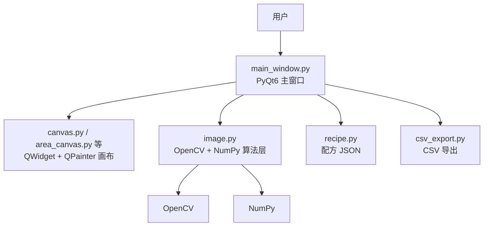
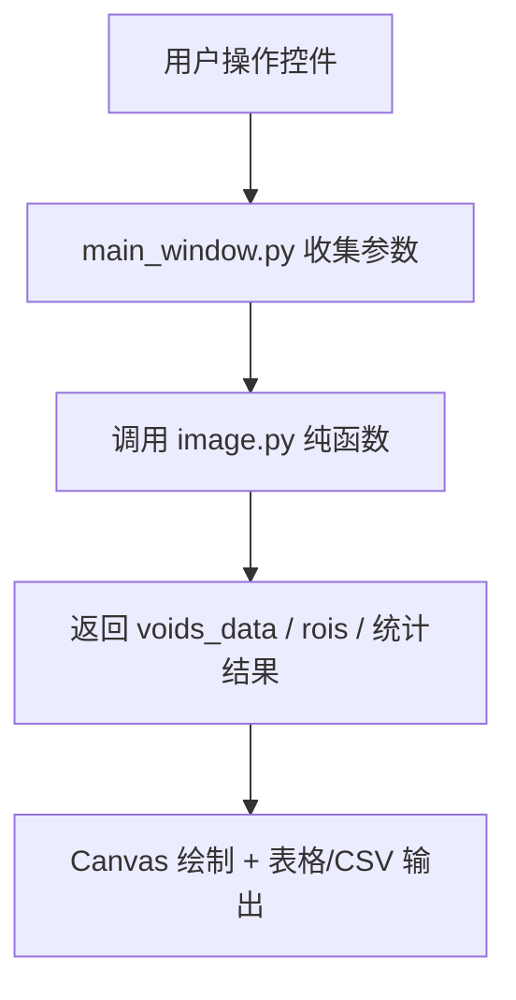
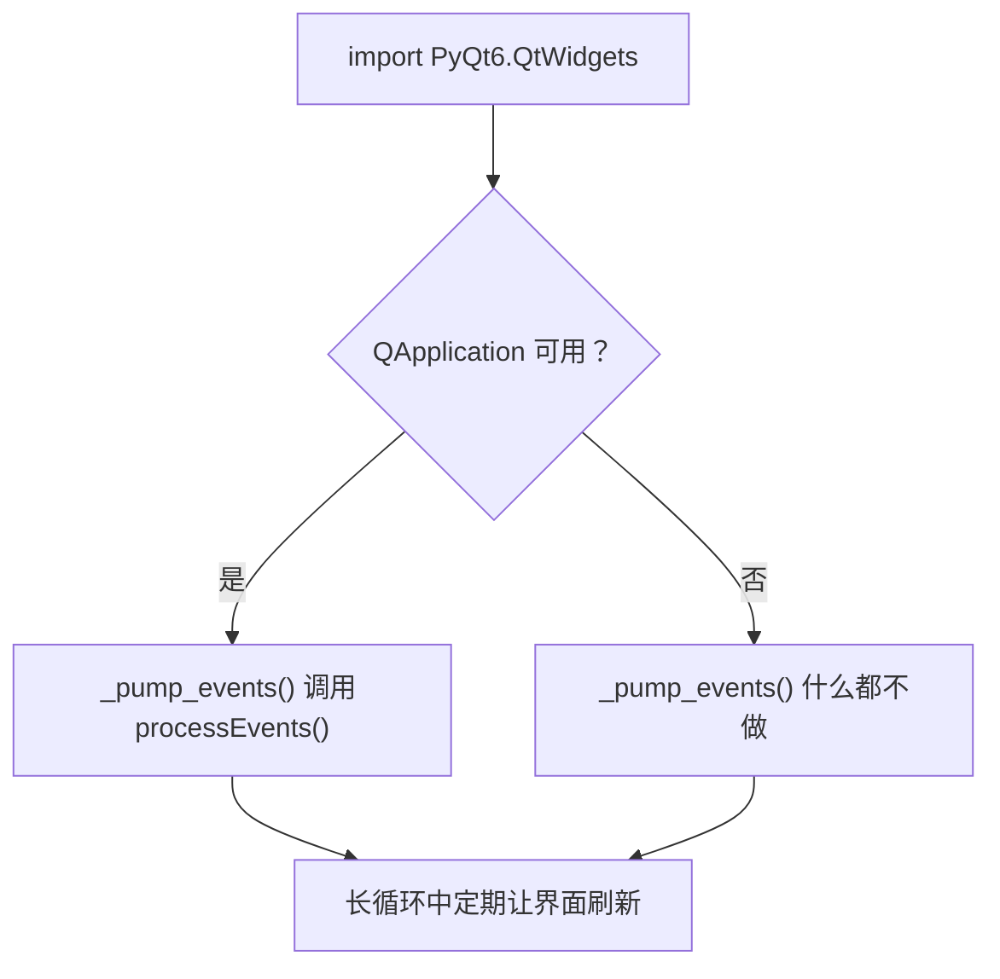
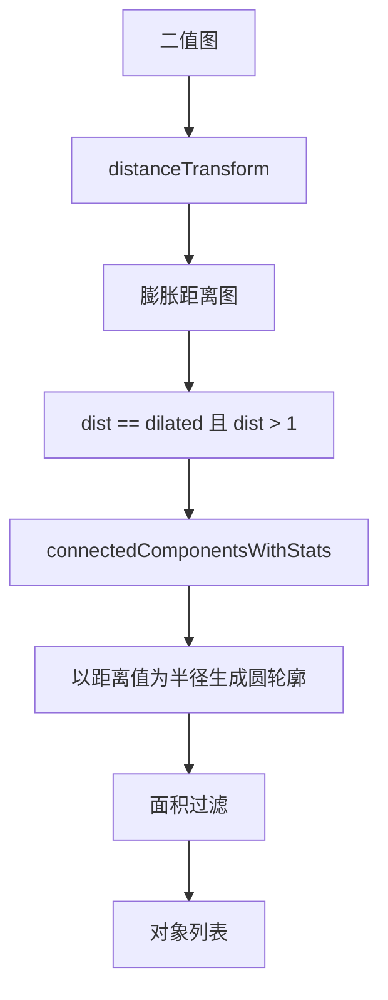
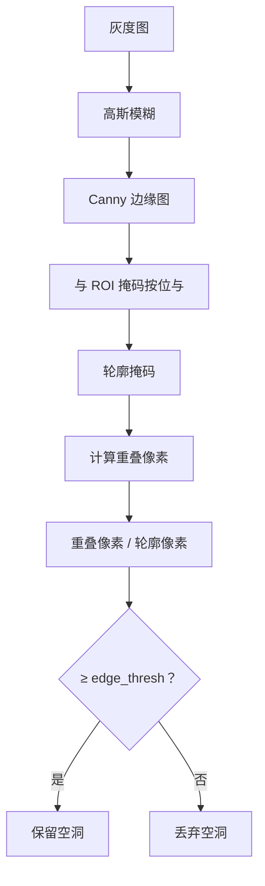
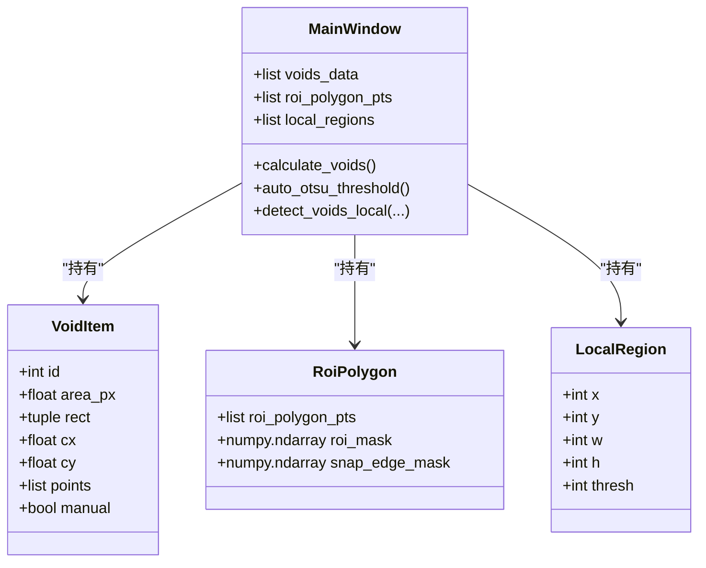
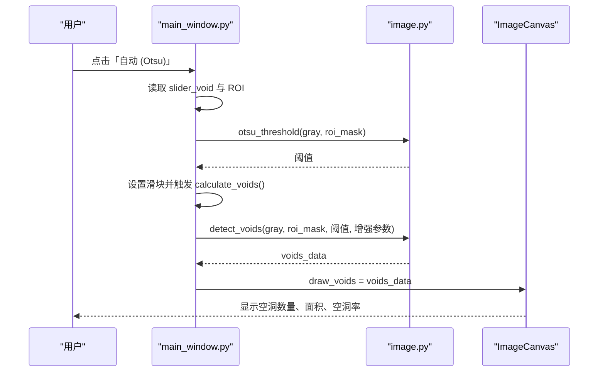
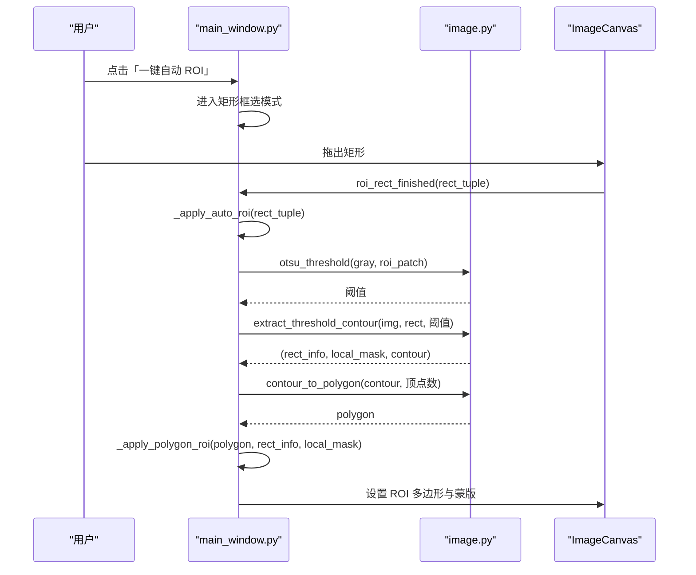
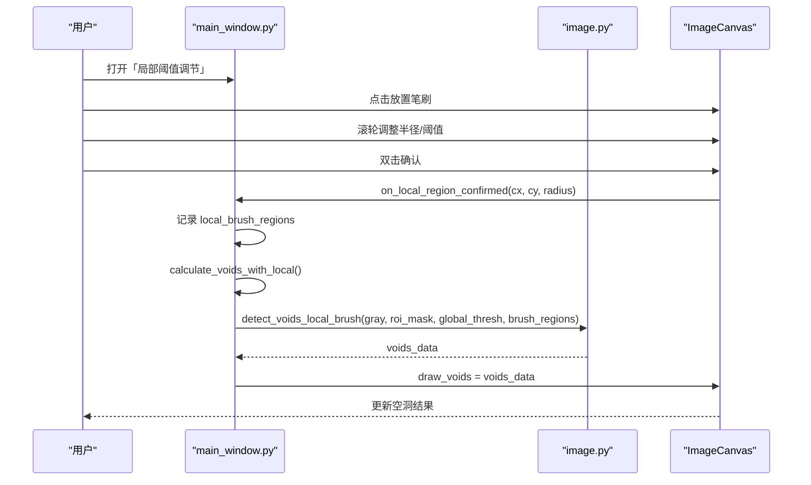
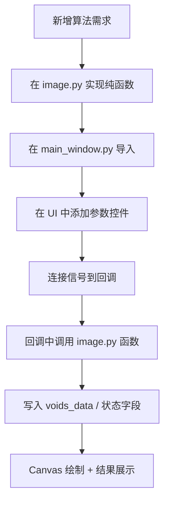

# 算法层边界与纯函数接口

<cite>
**本文引用的文件**   
- [image.py](file://image.py)
- [main_window.py](file://main_window.py)
- [README.md](file://README.md)
- [PROJECT_CONCEPTION.md](file://PROJECT_CONCEPTION.md)
</cite>

## 目录

1. [文档目标与适用范围](#文档目标与适用范围)
2. [系统分层与依赖方向](#系统分层与依赖方向)
3. [image.py：唯一算法实现层](#imagepy唯一算法实现层)
4. [对外暴露的算法接口总览](#对外暴露的算法接口总览)
5. [核心接口详细规范](#核心接口详细规范)
6. [GUI 调用链与数据契约](#gui-调用链与数据契约)
7. [典型用户流程：从调参到检测结果](#典型用户流程从调参到检测结果)
8. [已知技术债与风险](#已知技术债与风险)
9. [编码规范与扩展建议](#编码规范与扩展建议)
10. [结论](#结论)

## 文档目标与适用范围

本文聚焦 Aurascope 的**算法层边界**与**纯函数接口**，明确以下事实：

- `image.py` 是 Aurascope 唯一的图像处理算法实现层。
- `image.py` 不包含 PyQt6 业务逻辑；其 GUI 相关导入被包装为可选依赖，仅用于在长循环中让界面有机会刷新。
- 所有空洞检测、阈值二值化、形态学去噪、连通域分析、轮廓提取、圆度计算、距离变换计数、Canny 边缘校验等图像算法，均应在 `image.py` 中以纯函数形式实现。
- `main_window.py` 是 PyQt6 GUI 主窗口，负责用户交互、参数收集、状态管理、Canvas 绘制和结果展示，不得内联实现图像算法。
- 新增算法应优先扩展 `image.py`，而不是复制逻辑到 GUI 层或 Tab 页面。

项目 README 将 Aurascope 定位为微电子封装产线的半自动化视觉检测桌面工具，技术栈为 PyQt6 + OpenCV + NumPy + Pandas；PROJECT_CONCEPTION.md 进一步说明算法逻辑集中在 `image.py`，与 GUI 层解耦。

**本节来源**
- [README.md:1-80](file://README.md#L1-L80)
- [PROJECT_CONCEPTION.md:77-107](file://PROJECT_CONCEPTION.md#L77-L107)

## 系统分层与依赖方向

Aurascope 的核心分层如下：



依赖方向是单向的：

| 层级 | 职责 | 是否允许包含下层依赖 |
|------|------|----------------------|
| GUI 层（main_window.py） | 用户交互、参数收集、状态管理、结果展示 | 可调用 image.py |
| Canvas 层 | 图像显示、坐标转换、ROI 编辑、结果覆盖绘制 | 不直接实现图像算法 |
| 算法层（image.py） | 阈值、形态学、轮廓、圆度、距离变换、边缘校验 | 只依赖 OpenCV/NumPy |
| 数据层 | 配方、导出、路径、版本 | 被上层调用 |



**图示来源**
- [main_window.py:32-35](file://main_window.py#L32-L35)
- [PROJECT_CONCEPTION.md:77-107](file://PROJECT_CONCEPTION.md#L77-L107)

**本节来源**
- [PROJECT_CONCEPTION.md:77-107](file://PROJECT_CONCEPTION.md#L77-L107)

## image.py：唯一算法实现层

`image.py` 当前承担以下职责：

1. **阈值与二值化**：Otsu 自动阈值、固定阈值二值化、亮/暗缺陷检测。
2. **形态学处理**：开运算、闭运算、腐蚀、膨胀、结构元构造。
3. **轮廓与多边形**：轮廓提取、多边形近似、顶点重采样、掩码生成。
4. **空洞检测**：全局阈值空洞检测、局部阈值空洞检测、焊层带内空洞检测。
5. **形状过滤**：圆度计算、面积过滤、连通域分析。
6. **距离变换计数**：物料计数中的局部极大值计数。
7. **边缘校验**：Canny 边缘图生成与空洞轮廓重叠率过滤。
8. **示教模型**：焊层带定位、两类阈值学习、批量套用、比例尺识别。
9. **报告渲染**：缩略图、汇总大图、金锡条拼接、标注图。

需要特别强调：**image.py 不是 GUI 模块**。它尝试导入 `PyQt6.QtWidgets.QApplication`，但用 try/except 包裹，并在 `_pump_events()` 中判断是否为 None。这是为了让无 GUI 的报告工具也能复用算法，而不是把算法层绑定到 PyQt6。



**图示来源**
- [image.py:8-24](file://image.py#L8-L24)

**本节来源**
- [image.py:1-24](file://image.py#L1-L24)

## 对外暴露的算法接口总览

按功能分组，`image.py` 对外暴露的主要算法接口如下：

| 类别 | 函数名 | 输入 | 返回值 | 用途 |
|------|--------|------|--------|------|
| 阈值二值化 | `otsu_threshold(gray_img, roi_mask=None)` | 灰度图、可选 ROI 掩码 | 整数阈值 | Otsu 自动阈值 |
| 矩形区域阈值轮廓 | `extract_threshold_contour(img, rect_tuple, thresh_val)` | 原图、(x,y,w,h)、阈值 | (rect_info, local_mask, contour) 或全 None | 一键自动 ROI 的边界提取 |
| 多边形几何 | `contour_to_polygon(contour, target_vertices)` | OpenCV 轮廓、目标顶点数 | 顶点列表 | 轮廓转多边形 |
| 多边形几何 | `polygon_to_mask(points, img_shape)` | 顶点列表、图像尺寸 | uint8 掩码 | 多边形转掩码 |
| 边缘吸附 | `build_snap_edge_mask(rect_info, local_mask, img_shape)` | 矩形信息、局部掩码、图像尺寸 | uint8 掩码 | ROI 吸附辅助 |
| 空洞检测 | `detect_voids(...)` | 灰度图、ROI 掩码、阈值、增强参数 | voids_data 列表 | 主空洞检测入口 |
| 空洞位置检查 | `is_void_in_roi(points, roi_mask)` | 轮廓点、ROI 掩码 | bool | ROI 编辑后恢复手动空洞 |
| 圆度计算 | `calculate_roundness(points, area_px)` | 轮廓点、像素面积 | float | 圆度指标 |
| 局部阈值空洞检测 | `detect_voids_local(...)` | 灰度图、ROI 掩码、全局阈值、局部区域 | voids_data 列表 | 矩形局部阈值 |
| 缺陷检测 | `detect_defects(gray, thresh_val, bright, min_area, roi_mask)` | 灰度图、阈值、方向、面积、ROI | 对象字典列表 | 8 邻域缺陷检测 |
| 物料计数 | `detect_objects(...)` | 灰度图、阈值、面积、增强、分水岭等 | 对象字典列表 | distanceTransform 局部极大值计数 |
| 局部区域构造 | `create_local_region_around_void(void_info, padding)` | 空洞信息、扩展像素 | (x,y,w,h) | 围绕空洞创建局部区域 |
| 焊层带定位 | `locate_solder_band(...)` | 灰度图、阈值、几何先验等 | (band_mask, diagnostics) | 示教模型定位焊层 |
| 焊层带内空洞 | `detect_voids_in_band(...)` | 灰度图、焊层掩码、阈值、过滤参数 | voids_data 列表 | 批量套用示教模型 |
| 示教模型学习 | `learn_taught_model(...)` | 样板图、焊层掩码、空洞标记等 | 模型 dict 或 None | 从示范学习 |
| 示教模型套用 | `apply_taught_model(gray, model)` | 灰度图、模型 | 检测结果 dict | 单张图套用 |
| 比例尺识别 | `read_scale_bar(...)` | 灰度图、模板、模型比例尺 | (px_per_um, info) | 批量图自动标定 |

其中，`voids_data`、`roi_polygon_pts`、`local_regions`、`rois` 等数据结构贯穿 GUI 与算法层之间的数据契约。

**本节来源**
- [image.py:27-135](file://image.py#L27-L135)
- [image.py:180-422](file://image.py#L180-L422)
- [image.py:425-632](file://image.py#L425-L632)
- [image.py:635-651](file://image.py#L635-L651)
- [image.py:894-1046](file://image.py#L894-L1046)
- [image.py:1137-1179](file://image.py#L1137-L1179)
- [image.py:1182-1478](file://image.py#L1182-L1478)
- [image.py:1940-1976](file://image.py#L1940-L1976)

## 核心接口详细规范

### 阈值二值化与 Otsu 自动阈值

`otsu_threshold` 对灰度图或 ROI 掩码内的像素计算 Otsu 阈值。若 ROI 内没有有效像素，返回默认阈值 128。该函数是“自动 (Otsu)”按钮的核心实现。

| 参数 | 类型 | 含义 |
|------|------|------|
| `gray_img` | numpy.ndarray | 二维 uint8 灰度图 |
| `roi_mask` | numpy.ndarray 或 None | 可选 ROI 掩码；None 表示全图 |

| 返回值 | 类型 | 含义 |
|--------|------|------|
| 阈值 | int | 0~255 的整数阈值 |

`extract_threshold_contour` 则从矩形区域中提取阈值轮廓，返回 `(rect_info, local_mask, contour)`。如果矩形无效、区域太小或最大轮廓面积过小，返回三个 None。

**本节来源**
- [image.py:27-70](file://image.py#L27-L70)
- [image.py:180-197](file://image.py#L180-L197)

### 形态学去噪：开运算、闭运算、腐蚀、膨胀

形态学操作在多个算法中复用：

- `detect_voids` 使用椭圆核执行开运算去噪。
- `detect_objects` 同时使用开运算和闭运算，并支持自定义结构元形状。
- `locate_solder_band` 使用开运算断开细界面，再使用横向矩形核闭运算连接碎片。
- `bridge_edge_voids` 使用一维最小/最大滤波模拟开闭运算，桥接贴边空洞造成的边界缺口。
- `detect_voids_local` 与 `detect_voids_local_brush` 也复用开运算与 ROI 腐蚀。

这些函数本身不直接暴露“形态学去噪”这一通用 API，而是以具体算法函数的参数形式出现，例如 `morph_enabled`、`morph_kernel`、`morph_shape`、`roi_erosion_px`。

**本节来源**
- [image.py:216-218](file://image.py#L216-L218)
- [image.py:536-540](file://image.py#L536-L540)
- [image.py:926-935](file://image.py#L926-L935)
- [image.py:1554-1681](file://image.py#L1554-L1681)
- [image.py:1895-1899](file://image.py#L1895-L1899)

### 连通域分析与轮廓提取

连通域分析有两种主要用法：

1. **空洞检测**：基于 `cv2.findContours` 提取暗区轮廓，再计算面积、重心、包围盒、顶点。
2. **缺陷检测**：基于 `cv2.connectedComponentsWithStats` 获取精确像素面积、质心、bbox，再在 bbox 内提取外轮廓。

`detect_defects` 对输入做了严格校验：要求 `gray` 是非空二维 uint8，`thresh_val` 是 [0,255] 有限实数，`bright` 是布尔值，`min_area` 是有限非负实数，`roi_mask` 必须与灰度图同形且仅含 0/255。非法输入抛出 `ValueError`。

**本节来源**
- [image.py:425-488](file://image.py#L425-L488)

### 圆度计算：4π × 面积 / 周长²

圆度公式为：

```
圆度 = min(4 × π × 面积 / 周长², 1.0)
```

`calculate_roundness` 接收轮廓点和像素面积，先通过 `cv2.arcLength` 计算周长，再套用公式。若周长为 0，返回 0.0。

该函数在两个层面使用：

- 算法内部：`detect_voids`、`detect_voids_local`、`detect_objects`、`detect_voids_in_band` 根据 `min_roundness` 过滤非圆形轮廓。
- GUI 层：`main_window.py` 在详细表格和 CSV 导出中调用它，计算每个空洞的圆度指标。

**本节来源**
- [image.py:312-326](file://image.py#L312-L326)
- [main_window.py:1715-1724](file://main_window.py#L1715-L1724)
- [main_window.py:1746-1755](file://main_window.py#L1746-L1755)

### distanceTransform 局部极大值计数

`detect_objects` 是物料计数的核心算法。当启用 `watershed_enabled` 时，它不执行完整分水岭，而是：

1. 对二值图执行 `cv2.distanceTransform`。
2. 对距离图进行膨胀。
3. 取距离等于膨胀结果的局部极大值作为种子。
4. 对种子连通域计数，得到分离后的对象中心。
5. 以距离值为半径生成圆形轮廓，计算面积、包围盒、质心和顶点。

这种实现比完整 watershed 更轻量，适合近似圆形物料的快速计数。



**图示来源**
- [image.py:544-572](file://image.py#L544-L572)

**本节来源**
- [image.py:491-632](file://image.py#L491-L632)

### Canny 边缘校验与面积统计

Canny 边缘校验的逻辑是：

1. 对灰度图高斯模糊。
2. 使用 Canny 生成边缘图。
3. 将边缘图与 ROI 掩码做按位与。
4. 对每个候选轮廓生成掩码。
5. 计算轮廓掩码与边缘图的交集像素数。
6. 若交集像素占比低于 `edge_thresh`，则丢弃该轮廓。

在 `image.py` 的 `detect_voids` 中，`edge_map` 初始化为 None，仅在 `enhanced and edge_verify` 时计算。若条件不满足，`edge_map` 保持 None，后续 `edge_map is not None` 判断会跳过 Canny 校验。



**图示来源**
- [image.py:228-263](file://image.py#L228-L263)

**本节来源**
- [image.py:228-263](file://image.py#L228-L263)

### 空洞检测 detect_voids()

`detect_voids` 是主空洞检测入口，流程如下：

1. 可选 CLAHE 对比度增强。
2. 对灰度图执行反二值化。
3. 可选形态学开运算去噪。
4. 对 ROI 掩码执行腐蚀，得到内部掩码，避免边界伪影。
5. 用内部掩码裁剪二值图。
6. 连通域/轮廓提取。
7. 可选圆度过滤。
8. 可选 Canny 边缘校验。
9. 计算面积、包围盒、重心、顶点，组装 `voids_data`。

返回值为 `voids_data`，即空洞字典列表。

**本节来源**
- [image.py:200-286](file://image.py#L200-L286)

### 局部阈值 detect_voids_local()

`image.py` 中的 `detect_voids_local` 支持传入 `local_regions`，格式为 `(x, y, w, h, local_thresh)`。它在整体二值化后，逐个局部区域覆盖对应位置的局部阈值结果。

注意：`main_window.py` 中存在同名函数 `detect_voids_local`，其实现与 `image.py` 不同，且缺少 `edge_verify` 分支中的 `edge_map` 初始化逻辑。这是已知技术债。

**本节来源**
- [image.py:328-422](file://image.py#L328-L422)
- [main_window.py:1779-1876](file://main_window.py#L1779-L1876)

## GUI 调用链与数据契约

### main_window.py 如何调用 image.py

`main_window.py` 在模块顶部显式导入：

```python
from image import (
    extract_threshold_contour,
    contour_to_polygon,
    polygon_to_mask,
    build_snap_edge_mask,
    detect_voids,
    is_void_in_roi,
    calculate_roundness,
    detect_voids_local,
    create_local_region_around_void,
    otsu_threshold,
)
```

这说明 GUI 层对算法层的依赖是显式的，而不是隐式散落。

关键调用点包括：

| GUI 方法 | 调用算法 | 目的 |
|----------|----------|------|
| `update_layer_preview` | `extract_threshold_contour` | 矩形框选预览 |
| `confirm_layer_roi` | `extract_threshold_contour` + `contour_to_polygon` | 确认阈值 ROI |
| `_apply_auto_roi` | `otsu_threshold` + `extract_threshold_contour` + `contour_to_polygon` | 一键自动 ROI |
| `finalize_roi` | `polygon_to_mask` | 多边形转 ROI 掩码 |
| `auto_layer_otsu` | `otsu_threshold` | 矩形区域 Otsu |
| `auto_otsu_threshold` | `otsu_threshold` | 空洞阈值 Otsu |
| `calculate_voids` | `detect_voids` | 主空洞检测 |
| `on_polygon_edited` | `is_void_in_roi` | ROI 编辑后恢复手动空洞 |
| `show_detail_table` / `export_csv` | `calculate_roundness` | 圆度指标 |
| `on_void_selected_for_local` | `create_local_region_around_void` | 局部阈值区域 |
| `calculate_voids_with_local_regions` | `detect_voids_local` | 矩形局部阈值检测 |

**本节来源**
- [main_window.py:32-35](file://main_window.py#L32-L35)
- [main_window.py:1013-1061](file://main_window.py#L1013-L1061)
- [main_window.py:1101-1163](file://main_window.py#L1101-L1163)
- [main_window.py:1170-1191](file://main_window.py#L1170-L1191)
- [main_window.py:1256-1331](file://main_window.py#L1256-L1331)
- [main_window.py:1459-1533](file://main_window.py#L1459-L1533)
- [main_window.py:1709-1757](file://main_window.py#L1709-L1757)

### 关键数据结构契约

#### voids_data

`voids_data` 是空洞检测结果的标准列表，每个元素是字典，至少包含：

| 字段 | 类型 | 含义 |
|------|------|------|
| `id` | int | 空洞编号，从 1 开始连续 |
| `area_px` | float/int | 像素面积 |
| `rect` | tuple | (x, y, w, h) 包围盒 |
| `cx` | float | 质心 x |
| `cy` | float | 质心 y |
| `points` | list | 轮廓顶点列表 |
| `manual` | bool | 是否手动添加 |

GUI 层用它更新 `canvas.draw_voids`、计算空洞率、填充表格、导出 CSV。

#### roi_polygon_pts

`roi_polygon_pts` 是用户在画布上绘制的 ROI 多边形顶点列表，类型为浮点坐标列表。它由 `finish_poly_roi`、`on_polygon_edited`、`_apply_polygon_roi` 维护，并通过 `polygon_to_mask` 转换为 `roi_mask`。

#### local_regions

`local_regions` 是矩形局部阈值区域列表，元素为 `(x, y, w, h, thresh)`。它由 `on_void_selected_for_local` 构建，并由 `calculate_voids_with_local_regions` 传给 `detect_voids_local`。

#### rois

`rois` 主要用于缺陷面积多 ROI 页（`area_tab.py`），与空洞分析的 `voids_data` 不同。`rois` 是缺陷面积任务中的 ROI 条目列表，每个条目包含状态、对象列表等；而 `voids_data` 是空洞检测的直接结果。



**图示来源**
- [main_window.py:69-77](file://main_window.py#L69-L77)
- [main_window.py:880-897](file://main_window.py#L880-L897)
- [main_window.py:1459-1533](file://main_window.py#L1459-L1533)

**本节来源**
- [main_window.py:69-77](file://main_window.py#L69-L77)
- [main_window.py:880-897](file://main_window.py#L880-L897)
- [main_window.py:1459-1533](file://main_window.py#L1459-L1533)

## 典型用户流程：从调参到检测结果

### 流程一：自动 Otsu 阈值 + 空洞检测



**图示来源**
- [main_window.py:1318-1331](file://main_window.py#L1318-L1331)
- [main_window.py:1256-1310](file://main_window.py#L1256-L1310)
- [image.py:180-197](file://image.py#L180-L197)
- [image.py:200-286](file://image.py#L200-L286)

### 流程二：一键自动 ROI



**图示来源**
- [main_window.py:1092-1163](file://main_window.py#L1092-L1163)
- [main_window.py:1063-1088](file://main_window.py#L1063-L1088)
- [image.py:27-70](file://image.py#L27-L70)
- [image.py:112-135](file://image.py#L112-L135)

### 流程三：局部阈值笔刷检测



**图示来源**
- [main_window.py:1588-1642](file://main_window.py#L1588-L1642)
- [main_window.py:1879-1974](file://main_window.py#L1879-L1974)

## 已知技术债与风险

### 重复的 detect_voids_local 实现

`image.py` 和 `main_window.py` 各有一份 `detect_voids_local` 实现。当前行为应以 `image.py` 为准，因为它是算法层权威实现；但 `main_window.py` 中也存在同名函数，属于重复代码。两份实现待合并。

差异要点：

| 方面 | image.py 版本 | main_window.py 版本 |
|------|---------------|---------------------|
| 局部区域输入 | `local_regions=None`，支持 `(x,y,w,h,thresh)` | 同样支持矩形局部区域 |
| ROI 腐蚀 | 使用 `interior_mask` 与 `roi_erosion_px` | 未使用 `roi_erosion_px` |
| Canny 边缘校验 | 有 `edge_verify` 分支，但 `edge_map` 可能为 None | 有 `edge_verify` 分支，但 `edge_map` 初始化方式不同 |
| 圆度过滤 | 使用 `min_roundness` | 使用 `min_roundness` |
| 返回值 | `voids_data` | `voids_data` |

**本节来源**
- [image.py:328-422](file://image.py#L328-L422)
- [main_window.py:1779-1876](file://main_window.py#L1779-L1876)

### edge_map 未初始化导致 Canny 校验静默失效

在 `image.py` 的 `detect_voids` 中，`edge_map` 初始化为 None，仅在 `enhanced and edge_verify` 时赋值。如果调用方启用了 `edge_verify`，但中间某处 `edge_map` 未被正确赋值，后续 `edge_map is not None` 判断会跳过 Canny 校验，表现为“勾选了 Canny 边缘验证却没有任何过滤效果”。

在 `main_window.py` 的 `detect_voids_local` 副本中，`edge_map` 的初始化逻辑也与 `image.py` 不完全一致，进一步增加了调试难度。

修复建议：

1. 统一以 `image.py` 的 `detect_voids` 和 `detect_voids_local` 为准。
2. 在 `main_window.py` 中删除重复的 `detect_voids_local` 和 `detect_voids_local_brush`，改为调用 `image.py` 的对应实现。
3. 为 Canny 校验增加日志或单元测试，确保 `edge_map` 不为 None 时确实参与过滤。

**本节来源**
- [image.py:228-263](file://image.py#L228-L263)
- [image.py:366-399](file://image.py#L366-L399)
- [main_window.py:1832-1859](file://main_window.py#L1832-L1859)
- [main_window.py:1930-1956](file://main_window.py#L1930-L1956)

### 其他已知限制

根据项目约定，handoff.md 中列出的已知限制还包括：

- `chk_roi_overlay` 被重复创建。
- 滚轮缩放 Y 轴漂移。
- `select_for_local` 为无 UI 入口的死代码。
- 大图增强检测无进度提示。

这些限制不属于 image.py 的算法接口问题，但会影响用户体验和调试效率。

**本节来源**
- [PROJECT_CONCEPTION.md:55-60](file://PROJECT_CONCEPTION.md#L55-L60)

## 编码规范与扩展建议

### 强制约定

1. **GUI 层不得内联实现图像算法**  
   所有阈值、形态学、轮廓、连通域、距离变换、边缘校验逻辑必须放在 `image.py`。

2. **新增算法优先扩展 image.py**  
   不要在 `main_window.py`、`area_tab.py`、`counting_tab.py` 等文件中复制 OpenCV 处理逻辑。

3. **Canvas 层只做绘制与交互**  
   Canvas 是 QWidget + QPainter 自绘层，负责原图坐标↔屏幕坐标转换、滚轮缩放、右键平移、多边形 ROI 编辑，不负责算法。

4. **UI 组件工厂函数只创建控件**  
   `ui_components.py` 的 `create_*` 工厂函数只创建控件、不加入布局；调用方必须手动 `addWidget`。

5. **create_groupbox() 必须使用 Preferred/Expanding 尺寸策略**  
   否则控件可能被静默裁剪。

6. **数据结构契约必须稳定**  
   `voids_data`、`roi_polygon_pts`、`local_regions`、`rois` 等结构一旦成为跨模块契约，修改时需同步更新调用方。

### 推荐扩展方式

新增算法时，应按以下步骤：

1. 在 `image.py` 中实现纯函数，输入输出使用 numpy.ndarray、dict、list、tuple 等标准数据结构。
2. 在 `main_window.py` 中导入新函数。
3. 在侧边栏或对应 Tab 中添加控件，收集参数。
4. 在回调中调用算法函数，并将结果写入 `voids_data` 或其他状态字段。
5. 更新 Canvas 绘制和结果展示。
6. 如算法影响导出，同步更新 CSV 导出逻辑。



**图示来源**
- [main_window.py:32-35](file://main_window.py#L32-L35)
- [main_window.py:1256-1331](file://main_window.py#L1256-L1331)

**本节来源**
- [PROJECT_CONCEPTION.md:77-107](file://PROJECT_CONCEPTION.md#L77-L107)

## 结论

Aurascope 的算法层边界清晰：**image.py 是唯一图像处理实现层**，对外暴露的接口涵盖阈值二值化、Otsu 自动阈值、形态学去噪、连通域分析、轮廓提取、圆度计算、distanceTransform 局部极大值计数、Canny 边缘校验与空洞检测。

`main_window.py` 作为 GUI 主窗口，负责：

- 加载图片与标定。
- 定义 ROI（多边形或阈值轮廓）。
- 收集用户参数。
- 调用 `image.py` 的纯函数。
- 将 `voids_data` 等结果交给 Canvas 绘制。
- 提供详细表格与 CSV 导出。

当前最重要的技术债是 `main_window.py` 中存在 `detect_voids_local` 副本，且 `edge_map` 未初始化可能导致 Canny 校验静默失效。后续重构应以 `image.py` 为准，合并重复实现，并为边缘校验增加可观测性。

对于未来扩展，应坚持“算法在 image.py，交互在 main_window.py，绘制在 Canvas”的分层原则，避免再次出现 GUI 层内联图像算法的情况。