# 资源路径与版本管理

<cite>
**本文引用的文件**   
- [app_paths.py](file://app_paths.py)
- [app_version.py](file://app_version.py)
- [version_info.txt](file://version_info.txt)
- [AurascopeV6.spec](file://AurascopeV6.spec)
- [main.py](file://main.py)
- [help_dialogs.py](file://help_dialogs.py)
- [ui_components.py](file://ui_components.py)
- [canvas.py](file://canvas.py)
- [recipe.py](file://recipe.py)
- [update_check.py](file://update_check.py)
</cite>

## 目录
1. [引言](#引言)
2. [项目结构定位](#项目结构定位)
3. [核心组件](#核心组件)
4. [架构总览](#架构总览)
5. [详细组件分析](#详细组件分析)
6. [依赖关系分析](#依赖关系分析)
7. [性能与打包特性](#性能与打包特性)
8. [典型用法](#典型用法)
9. [部署与排查指南](#部署与排查指南)
10. [结论](#结论)

## 引言
本文聚焦 Aurascope 桌面应用的「资源路径」和「版本信息」两条基础设施：
- 资源路径由 `app_paths.py` 统一解析，屏蔽源码运行与 PyInstaller 打包两种 base 目录差异。
- 版本号来源包括 Python 层 `app_version.py`、Windows 二进制元数据 `version_info.txt`，以及 PyInstaller 打包配置 `AurascopeV6.spec`。
- 文档说明图标、帮助 Markdown、配方 `recipes/*.taught.json` 在开发与打包环境中的访问方式，并给出新增资源的约定。
- 说明界面中版本信息的展示位置，以及与在线更新检查 `update_check.py` 的关系。
- 提供打包后资源找不到时的排查步骤。

## 项目结构定位
本主题涉及的文件分布在仓库根目录与 `recipes/` 子目录：
- 路径与构建信息：`app_paths.py`
- 应用版本：`app_version.py`、`version_info.txt`
- 打包配置：`AurascopeV6.spec`
- 入口与 UI 使用方：`main.py`、`help_dialogs.py`、`ui_components.py`、`canvas.py`
- 配方存储与读写：`recipe.py`
- 在线更新检查：`update_check.py`

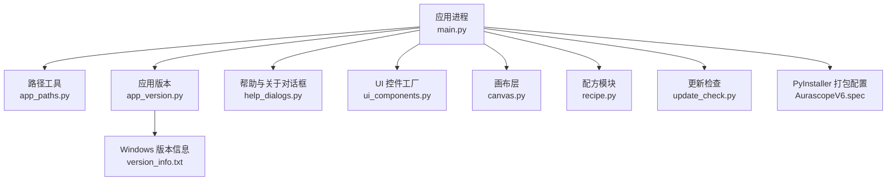

**图表来源**
- [main.py:14-15](file://main.py#L14-L15)
- [app_paths.py:8-41](file://app_paths.py#L8-L41)
- [app_version.py:1-3](file://app_version.py#L1-L3)
- [version_info.txt:1-28](file://version_info.txt#L1-L28)
- [AurascopeV6.spec:13-57](file://AurascopeV6.spec#L13-L57)
- [help_dialogs.py:8-10](file://help_dialogs.py#L8-L10)
- [ui_components.py:106-114](file://ui_components.py#L106-L114)
- [canvas.py:9](file://canvas.py#L9)
- [recipe.py:69-89](file://recipe.py#L69-L89)
- [update_check.py:15-18](file://update_check.py#L15-L18)

**章节来源**
- [app_paths.py:1-41](file://app_paths.py#L1-L41)
- [app_version.py:1-3](file://app_version.py#L1-L3)
- [version_info.txt:1-28](file://version_info.txt#L1-L28)
- [AurascopeV6.spec:1-68](file://AurascopeV6.spec#L1-L68)
- [main.py:1-75](file://main.py#L1-L75)
- [help_dialogs.py:1-132](file://help_dialogs.py#L1-L132)
- [ui_components.py:106-114](file://ui_components.py#L106-L114)
- [canvas.py:9](file://canvas.py#L9)
- [recipe.py:1-475](file://recipe.py#L1-L475)
- [update_check.py:1-112](file://update_check.py#L1-L112)

## 核心组件
本节从职责角度梳理与资源路径、版本管理直接相关的模块。

| 模块 | 主要职责 | 关键函数/常量 | 运行模式差异 |
|---|---|---|---|
| `app_paths.py` | 解析随包资源路径、程序目录、用户可写数据目录、日志目录、构建日期 | `resource_path()`、`app_dir()`、`local_data_dir()`、`log_dir()`、`build_date()` | 源码运行取脚本目录；打包后取 exe 同级或解包临时目录 |
| `app_version.py` | 暴露统一应用版本号 | `APP_VERSION` | 纯 Python 常量，不区分运行模式 |
| `version_info.txt` | Windows 二进制元数据（文件名、产品名、版本号等） | `VSVersionInfo(...)` | 仅影响打包后的 `.exe` 属性 |
| `AurascopeV6.spec` | PyInstaller 打包配置，决定产物结构与资源清单 | `Analysis.datas`、`EXE.version`、`COLLECT` | 控制哪些文件被打包进 onedir 产物 |
| `help_dialogs.py` | 显示离线帮助 Markdown、关于窗口（版本、构建日期、数据/日志目录） | `MarkdownDialog`、`AboutDialog` | 通过 `resource_path()` 读取随包 Markdown 与图片 |
| `ui_components.py` | UI 控件工厂与空状态绘制，含公司 logo 缓存 | `empty_logo_pixmap()` | 通过 `resource_path()` 加载 `logo.png` |
| `canvas.py` | 画布层，导入并使用 `resource_path` | 导入语句 | 示例：按相对资源名获取图标路径 |
| `recipe.py` | 配方 JSON 的默认存储根、校验、保存、加载、删除 | `_recipe_root()`、`recipe_dir()`、`list_recipes()`、`save_recipe()`、`load_recipe()` | 优先写入 exe 同级 `recipes/`，不可写时回退到用户数据目录 |
| `update_check.py` | 异步检查 GitHub Releases 最新版本 | `UpdateChecker.check()`、`release_is_newer()` | 当前版本来自 `app_version.APP_VERSION` |

**章节来源**
- [app_paths.py:8-41](file://app_paths.py#L8-L41)
- [app_version.py:1-3](file://app_version.py#L1-L3)
- [version_info.txt:1-28](file://version_info.txt#L1-L28)
- [AurascopeV6.spec:13-67](file://AurascopeV6.spec#L13-L67)
- [help_dialogs.py:20-132](file://help_dialogs.py#L20-L132)
- [ui_components.py:106-114](file://ui_components.py#L106-L114)
- [canvas.py:9](file://canvas.py#L9)
- [recipe.py:69-96](file://recipe.py#L69-L96)
- [update_check.py:15-42](file://update_check.py#L15-L42)

## 架构总览
下图展示资源与版本信息在应用启动、界面渲染、帮助查看、配方读写、更新检查中的调用关系。

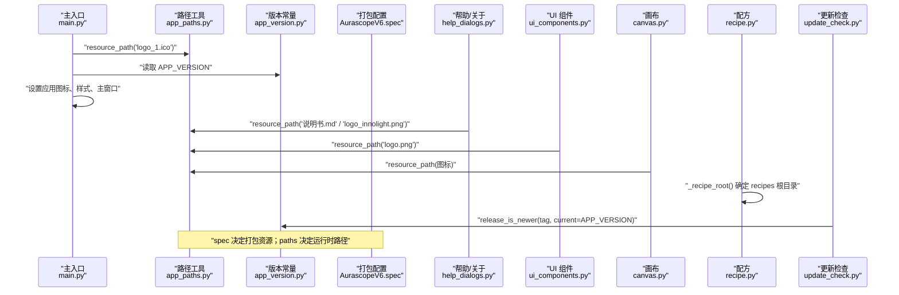

**图表来源**
- [main.py:14-47](file://main.py#L14-L47)
- [app_paths.py:8-41](file://app_paths.py#L8-L41)
- [app_version.py:1-3](file://app_version.py#L1-L3)
- [AurascopeV6.spec:17-56](file://AurascopeV6.spec#L17-L56)
- [help_dialogs.py:8-10](file://help_dialogs.py#L8-L10)
- [ui_components.py:106-114](file://ui_components.py#L106-L114)
- [canvas.py:9](file://canvas.py#L9)
- [recipe.py:69-96](file://recipe.py#L69-L96)
- [update_check.py:15-42](file://update_check.py#L15-L42)

## 详细组件分析

### 资源路径解析：`app_paths.py`
`app_paths.py` 是资源与数据路径的统一入口，核心设计是「根据运行模式选择 base 目录」。

- `resource_path(name)`：返回随包资源路径。打包为 onefile 时，`sys._MEIPASS` 指向 PyInstaller 解包临时目录；否则返回本文件所在目录。
- `app_dir()`：返回程序所在目录。frozen 模式下取 `sys.executable` 所在目录；源码模式下取 `__file__` 所在目录。
- `local_data_dir()`：返回当前用户可写数据目录，默认基于 `LOCALAPPDATA` 或 `~\AppData\Local`，子目录为 `Aurascope`，并自动创建。
- `log_dir()`：在 `local_data_dir()` 下创建 `logs` 子目录。
- `build_date()`：打包后取 exe 修改时间，源码运行取本文件修改时间，格式化为 `YYYY-MM-DD`。

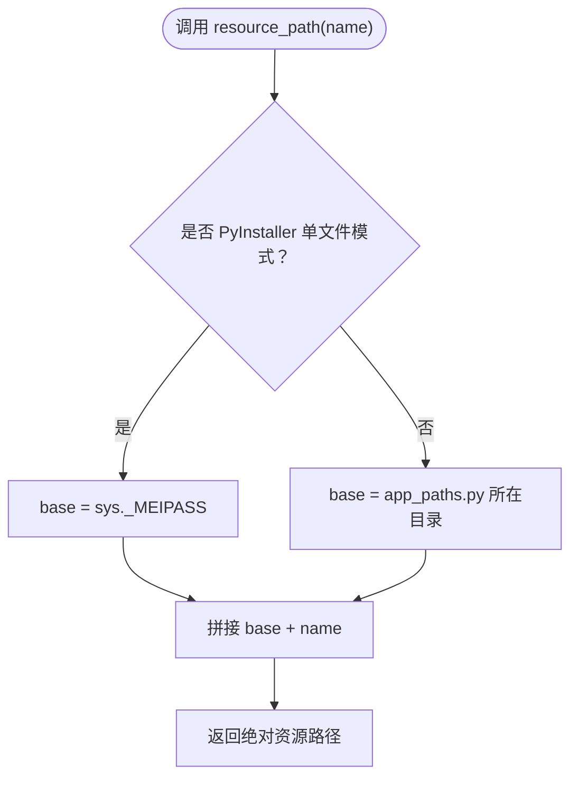

**图表来源**
- [app_paths.py:8-11](file://app_paths.py#L8-L11)

**章节来源**
- [app_paths.py:8-41](file://app_paths.py#L8-L41)

### 版本号来源：`app_version.py`、`version_info.txt`、`AurascopeV6.spec`
版本号存在三个层次：

1. **Python 层版本号**：`app_version.APP_VERSION` 是应用内部使用的统一字符串，例如当前仓库值为 `6.3.0`。
2. **Windows 二进制元数据**：`version_info.txt` 定义 `FileVersion`、`ProductVersion`、`ProductName`、`FileDescription` 等，供打包后 `.exe` 的属性页显示。
3. **PyInstaller 打包配置**：`AurascopeV6.spec` 通过 `EXE(version='version_info.txt')` 把 `version_info.txt` 注入 exe；同时 `name='AurascopeV6.3'` 决定输出目录与 exe 名称。

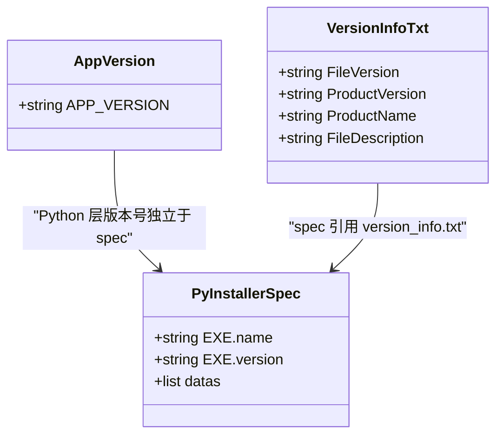

**图表来源**
- [app_version.py:1-3](file://app_version.py#L1-L3)
- [version_info.txt:1-28](file://version_info.txt#L1-L28)
- [AurascopeV6.spec:35-57](file://AurascopeV6.spec#L35-L57)

**章节来源**
- [app_version.py:1-3](file://app_version.py#L1-L3)
- [version_info.txt:1-28](file://version_info.txt#L1-L28)
- [AurascopeV6.spec:35-57](file://AurascopeV6.spec#L35-L57)

### 打包资源清单：`AurascopeV6.spec`
`AurascopeV6.spec` 是 PyInstaller onedir 打包的核心配置：
- `Analysis.datas` 声明随包资源：`说明书.md`、`CHANGELOG.md`、`logo_1.ico`、`logo.png`、`logo_innolight.png`。
- `EXE.version='version_info.txt'` 注入 Windows 版本信息。
- `EXE.icon=['logo_1.ico']` 设置 exe 图标。
- `COLLECT` 将 exe、二进制依赖与 datas 收集到同名目录。

这意味着：
- 开发环境可直接读取源码目录下的资源。
- 打包后，这些资源位于 exe 同级目录，由 `resource_path()` 通过 `sys._MEIPASS` 或 `app_dir()` 间接访问。

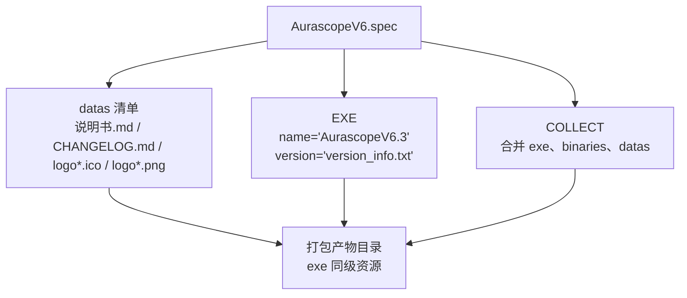

**图表来源**
- [AurascopeV6.spec:13-21](file://AurascopeV6.spec#L13-L21)
- [AurascopeV6.spec:35-57](file://AurascopeV6.spec#L35-L57)
- [AurascopeV6.spec:59-67](file://AurascopeV6.spec#L59-L67)

**章节来源**
- [AurascopeV6.spec:1-68](file://AurascopeV6.spec#L1-L68)

### 帮助 Markdown 与关于窗口：`help_dialogs.py`
`help_dialogs.py` 负责两类界面：
- `MarkdownDialog`：打开随包分发的 Markdown 文档。它通过 `resource_path(filename)` 读取文件，如果找不到则显示提示文本。
- `AboutDialog`：显示版本、构建日期、许可、联系、数据目录、日志目录，并提供复制版本信息和打开目录按钮。

其中：
- 版本信息来自 `app_version.APP_VERSION`。
- 构建日期来自 `app_paths.build_date()`。
- 数据目录来自 `recipe.recipe_dir()`。
- 日志目录来自 `app_paths.log_dir()`。

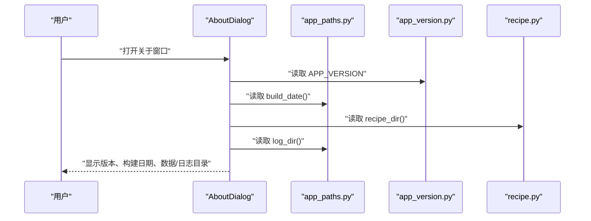

**图表来源**
- [help_dialogs.py:46-132](file://help_dialogs.py#L46-L132)
- [app_paths.py:29-41](file://app_paths.py#L29-L41)
- [app_version.py:1-3](file://app_version.py#L1-L3)
- [recipe.py:92-96](file://recipe.py#L92-L96)

**章节来源**
- [help_dialogs.py:1-132](file://help_dialogs.py#L1-L132)

### 配方存储路径：`recipe.py`
`recipe.py` 不仅管理配方 JSON 的结构与校验，还决定配方文件的实际落盘位置：
- `_recipe_root()` 优先尝试 exe 同级的 `recipes/`；若不可写，则回退到 `local_data_dir()/recipes/`。
- 环境变量 `AURASCOPE_RECUPE_DIR` 可覆盖存储目录，主要用于测试。
- 示教配方使用 `.taught.json` 后缀，与参数型配方隔离命名空间。
- `list_recipes()` 列出所有 `.json` 配方，支持按类型过滤。
- `save_recipe()`、`load_recipe()`、`delete_recipe()` 实现原子写入、规范化加载与删除。

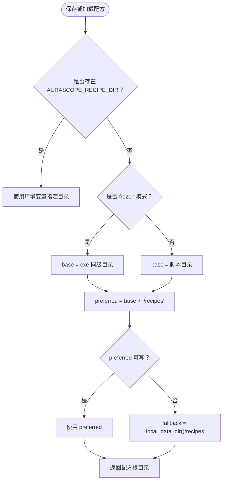

**图表来源**
- [recipe.py:56-89](file://recipe.py#L56-L89)
- [recipe.py:92-96](file://recipe.py#L92-L96)
- [recipe.py:115-134](file://recipe.py#L115-L134)
- [recipe.py:439-474](file://recipe.py#L439-L474)

**章节来源**
- [recipe.py:1-475](file://recipe.py#L1-L475)

### 在线更新检查：`update_check.py`
`update_check.py` 负责异步查询 GitHub Releases 最新版本，并与当前版本比较：
- 当前版本默认参数为 `APP_VERSION`，即 `app_version.APP_VERSION`。
- `parse_release_tag()` 处理带或不带 `v` 前缀的 tag。
- `release_is_newer()` 使用 `packaging.version.Version` 做语义化版本比较。
- `should_show_update()` 支持用户忽略某版本后不再重复提示。
- `UpdateChecker.check()` 发起网络请求，失败静默记录日志；仅在发现更高版本且非 draft/prerelease 时发出 `update_found` 信号。

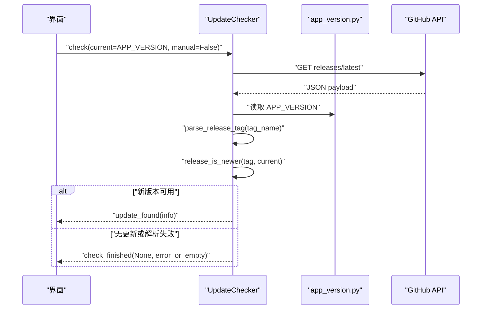

**图表来源**
- [update_check.py:15-42](file://update_check.py#L15-L42)
- [update_check.py:74-112](file://update_check.py#L74-L112)
- [app_version.py:1-3](file://app_version.py#L1-L3)

**章节来源**
- [update_check.py:1-112](file://update_check.py#L1-L112)
- [app_version.py:1-3](file://app_version.py#L1-L3)

## 依赖关系分析
资源与版本相关模块之间的依赖方向如下：

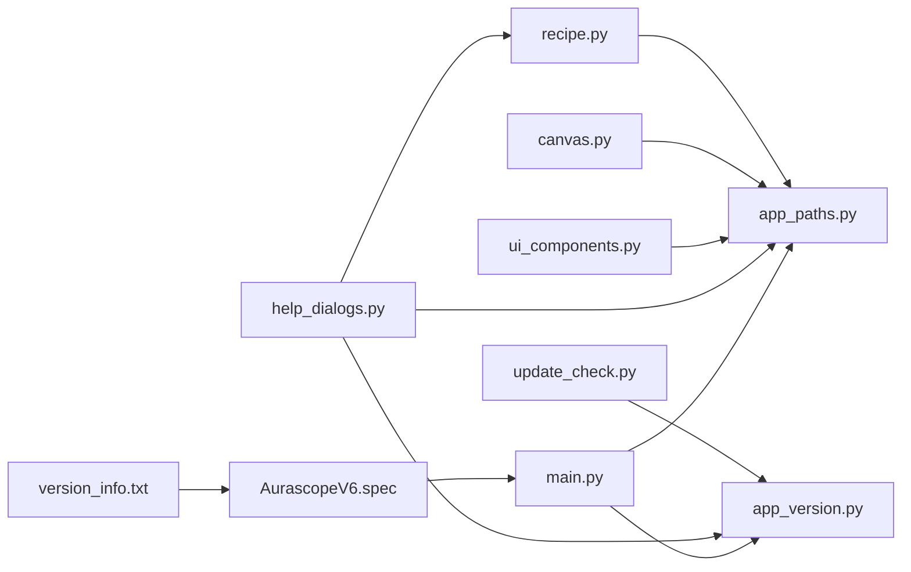

**图表来源**
- [main.py:14-15](file://main.py#L14-L15)
- [help_dialogs.py:8-10](file://help_dialogs.py#L8-L10)
- [ui_components.py:106-114](file://ui_components.py#L106-L114)
- [canvas.py:9](file://canvas.py#L9)
- [update_check.py:15](file://update_check.py#L15)
- [recipe.py:85](file://recipe.py#L85)
- [AurascopeV6.spec:55](file://AurascopeV6.spec#L55)
- [version_info.txt:1-28](file://version_info.txt#L1-L28)

**章节来源**
- [main.py:1-75](file://main.py#L1-L75)
- [help_dialogs.py:1-132](file://help_dialogs.py#L1-L132)
- [ui_components.py:106-114](file://ui_components.py#L106-L114)
- [canvas.py:9](file://canvas.py#L9)
- [recipe.py:69-96](file://recipe.py#L69-L96)
- [update_check.py:15-42](file://update_check.py#L15-L42)
- [AurascopeV6.spec:13-67](file://AurascopeV6.spec#L13-L67)
- [version_info.txt:1-28](file://version_info.txt#L1-L28)

## 性能与打包特性
- PyInstaller 官方注释指出：onedir 模式比 onefile 模式启动更快，因为 onefile 每次双击都要把大量内容解包到 `%TEMP%\_MEIxxxx`。
- `AurascopeV6.spec` 明确关闭 UPX，避免启动副作用与杀软误报。
- `main.py` 在 QApplication 创建前设置高 DPI 缩放策略，并在窗口显示后延迟关闭 bootloader 启动图，减少白屏闪烁。
- `ui_components.empty_logo_pixmap()` 对缩放后的 logo 进行缓存，避免每次重绘都重新缩放。

**章节来源**
- [AurascopeV6.spec:1-10](file://AurascopeV6.spec#L1-L10)
- [AurascopeV6.spec:35-57](file://AurascopeV6.spec#L35-L57)
- [main.py:39-70](file://main.py#L39-L70)
- [ui_components.py:106-114](file://ui_components.py#L106-L114)

## 典型用法

### 在 Canvas 或 Tab 中获取图标路径
Canvas 或 Tab 不应硬编码资源路径，而应通过 `app_paths.resource_path()` 获取：
- 入口 `main.py` 使用 `resource_path('logo_1.ico')` 设置应用图标。
- `ui_components.py` 使用 `resource_path('logo.png')` 作为空画布背景 logo。
- `canvas.py` 导入 `resource_path`，用于按相对资源名获取图标路径。

建议约定：
- 所有随包静态资源统一放在仓库根目录或明确的资源子目录。
- 新增资源后，必须在 `AurascopeV6.spec` 的 `Analysis.datas` 中添加对应条目。
- 代码中一律通过 `resource_path('相对资源名')` 访问，不要直接使用 `os.path.join(app_dir(), ...)`。

**章节来源**
- [main.py:14-47](file://main.py#L14-L47)
- [ui_components.py:106-114](file://ui_components.py#L106-L114)
- [canvas.py:9](file://canvas.py#L9)
- [AurascopeV6.spec:17-21](file://AurascopeV6.spec#L17-L21)

### 打开帮助文档
帮助文档以 Markdown 形式随包分发：
- `help_dialogs.MarkdownDialog` 通过 `resource_path(filename)` 打开 `说明书.md` 等文件。
- 如果打包遗漏该文件，对话框会显示“未找到文档”的纯文本提示。
- 因此新增帮助文档时，必须同时完成两件事：
  1. 在 `AurascopeV6.spec` 的 `datas` 中加入该 Markdown 文件。
  2. 在界面中通过 `MarkdownDialog(title, filename)` 打开。

**章节来源**
- [help_dialogs.py:20-43](file://help_dialogs.py#L20-L43)
- [AurascopeV6.spec:17-21](file://AurascopeV6.spec#L17-L21)

### 读写配方
配方读写由 `recipe.py` 统一管理：
- 读取配方列表：`list_recipes(kind=None|'v1'|'taught')`。
- 加载配方：`load_recipe(name_or_filename)`，支持显示名或文件名，兼容 `.json` 与 `.taught.json`。
- 保存参数型配方：`save_recipe(recipe)`。
- 保存示教模型：`save_taught(model, bar_template=None)`，文件名带 `.taught.json`。
- 删除配方：`delete_recipe(name_or_filename)`。

在 Canvas 或 Tab 中的典型流程：
1. 从界面获取配方显示名或文件名。
2. 调用 `load_recipe()` 加载并规范化。
3. 将结果传给算法层或 UI 表单。
4. 用户修改后调用 `save_recipe()` 或 `save_taught()`。
5. 刷新配方列表时使用 `list_recipes()`。

注意：
- 配方默认存储在 `recipes/` 目录。
- 如果 exe 同级 `recipes/` 不可写，会自动回退到用户数据目录 `local_data_dir()/recipes/`。
- 可通过环境变量 `AURASCOPE_RECIPE_DIR` 覆盖存储目录。

**章节来源**
- [recipe.py:69-96](file://recipe.py#L69-L96)
- [recipe.py:137-166](file://recipe.py#L137-L166)
- [recipe.py:439-474](file://recipe.py#L439-L474)
- [recipe.py:385-404](file://recipe.py#L385-L404)

### 版本信息在界面中的展示位置
版本信息出现在以下位置：
- 主窗口标题：`main_window.py` 使用 `APP_VERSION` 设置窗口标题。
- 关于窗口：`help_dialogs.AboutDialog` 显示版本、构建日期、数据目录、日志目录。
- 更新检查：`update_check.UpdateChecker` 使用 `APP_VERSION` 与 GitHub Release 比较。

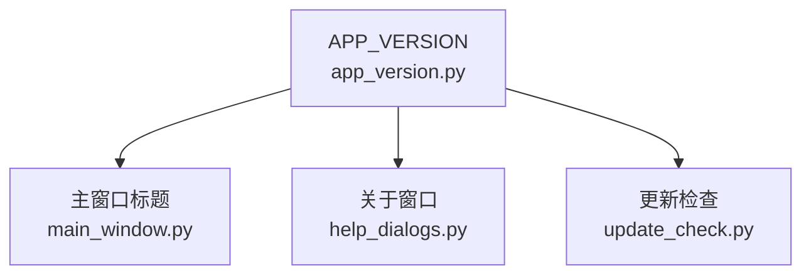

**图表来源**
- [app_version.py:1-3](file://app_version.py#L1-L3)
- [help_dialogs.py:73-81](file://help_dialogs.py#L73-L81)
- [update_check.py:34-42](file://update_check.py#L34-L42)
- [update_check.py:82-112](file://update_check.py#L82-L112)

**章节来源**
- [app_version.py:1-3](file://app_version.py#L1-L3)
- [help_dialogs.py:46-132](file://help_dialogs.py#L46-L132)
- [update_check.py:15-42](file://update_check.py#L15-L42)
- [update_check.py:74-112](file://update_check.py#L74-L112)

## 部署与排查指南

### 打包后 base 目录变化导致资源找不到
常见症状：
- 图标不显示。
- 帮助 Markdown 打开后显示“未找到文档”。
- 空画布背景 logo 缺失。
- 配方无法保存或保存后重启丢失。

排查步骤：
1. 确认当前运行模式：
   - 源码运行：base 目录是 `app_paths.py` 所在目录。
   - PyInstaller 打包：base 目录可能是 exe 同级目录或 onefile 解包临时目录。
2. 检查 `resource_path()` 返回值：
   - 如果是 onefile，`sys._MEIPASS` 指向临时目录。
   - 如果是 onedir，`app_dir()` 指向 exe 同级目录。
3. 检查 `AurascopeV6.spec` 的 `datas` 是否包含新增资源。
4. 检查打包产物目录中是否存在对应文件。
5. 对于配方写入失败：
   - 先检查 exe 同级 `recipes/` 是否可写。
   - 再检查 `local_data_dir()/recipes/` 是否生成。
   - 必要时设置 `AURASCOPE_RECIPE_DIR` 指向可写目录。

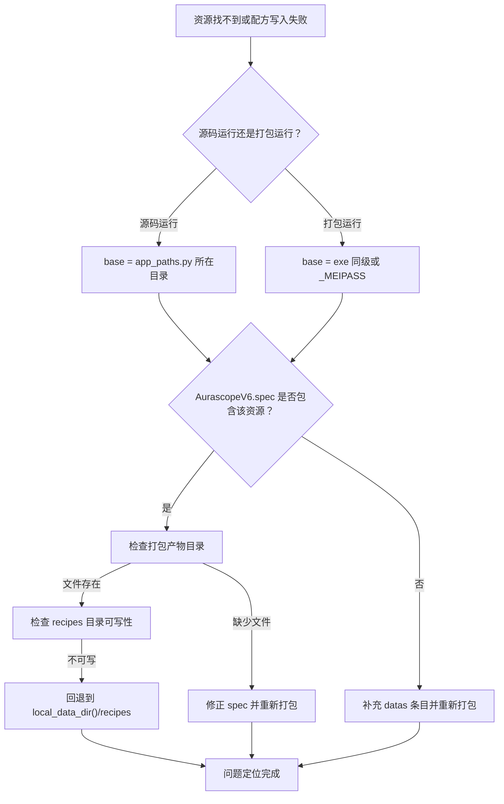

**图表来源**
- [app_paths.py:8-18](file://app_paths.py#L8-L18)
- [app_paths.py:21-32](file://app_paths.py#L21-L32)
- [AurascopeV6.spec:17-21](file://AurascopeV6.spec#L17-L21)
- [recipe.py:69-89](file://recipe.py#L69-L89)

**章节来源**
- [app_paths.py:8-41](file://app_paths.py#L8-L41)
- [AurascopeV6.spec:13-67](file://AurascopeV6.spec#L13-L67)
- [recipe.py:56-89](file://recipe.py#L56-L89)

### 新增资源时应遵循的路径约定
- 静态资源（图标、帮助 Markdown、Logo）放在仓库根目录或明确资源目录。
- 所有资源在代码中通过 `app_paths.resource_path('相对资源名')` 访问。
- 新增资源后，必须在 `AurascopeV6.spec` 的 `Analysis.datas` 中添加条目。
- 不要硬编码绝对路径或依赖当前工作目录。
- 用户数据（配方、日志、导出结果）不要放在 exe 同级只读目录；应使用 `local_data_dir()` 或 `recipe.recipe_dir()`。

**章节来源**
- [app_paths.py:8-26](file://app_paths.py#L8-L26)
- [AurascopeV6.spec:17-21](file://AurascopeV6.spec#L17-L21)
- [help_dialogs.py:33-37](file://help_dialogs.py#L33-L37)
- [recipe.py:69-96](file://recipe.py#L69-L96)

## 结论
Aurascope 的资源与版本管理采用「单一入口 + 多源版本」的设计：
- `app_paths.py` 统一处理源码与打包两种运行模式，使上层模块无需关心 base 目录差异。
- `app_version.py` 提供 Python 层统一版本号，`version_info.txt` 提供 Windows 二进制元数据，`AurascopeV6.spec` 控制打包产物。
- 帮助 Markdown、Logo、图标等静态资源通过 `resource_path()` 访问，并通过 `AurascopeV6.spec` 的 `datas` 清单纳入打包。
- 配方存储优先使用 exe 同级 `recipes/`，不可写时回退到用户数据目录，保证普通用户无需管理员权限。
- 版本信息在主窗口标题、关于窗口、更新检查中保持一致来源，便于用户识别当前版本并判断是否需要升级。

维护建议：
- 新增资源时同步修改 `AurascopeV6.spec`。
- 新增用户数据路径时优先复用 `local_data_dir()`、`log_dir()`、`recipe_dir()`。
- 更新版本号时同步更新 `app_version.py` 与 `version_info.txt`，并确认 `AurascopeV6.spec` 的 `EXE.name` 与 `EXE.version` 符合发布规范。
- 排查资源问题时，优先检查运行模式、`resource_path()` 返回值、spec 清单与打包产物目录。