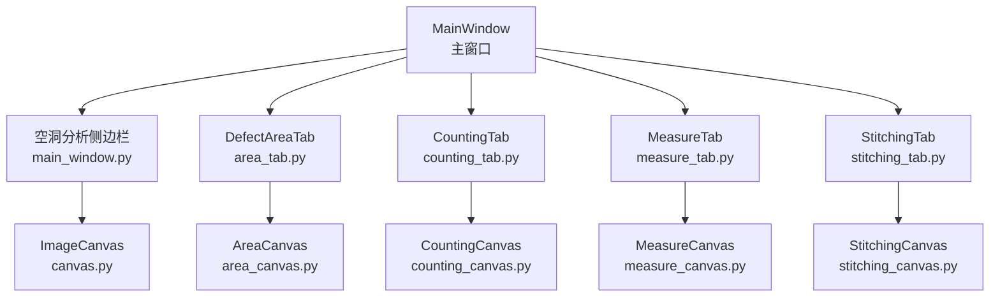
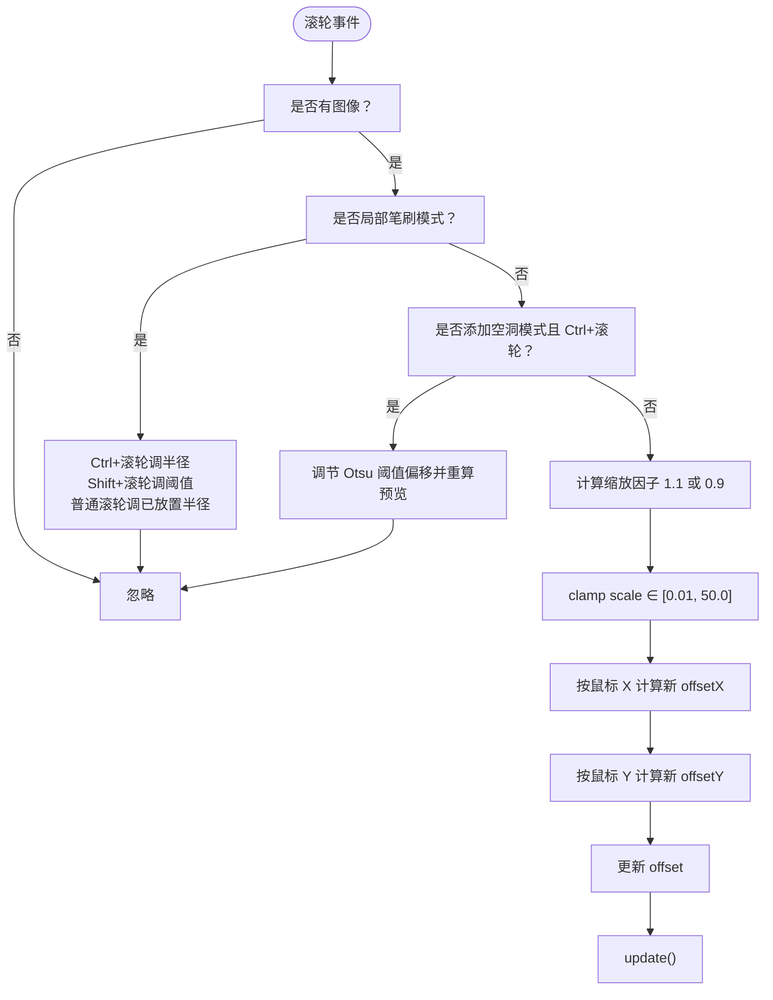
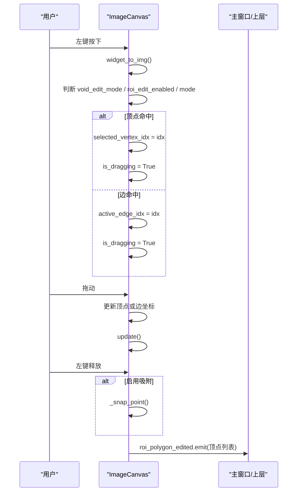
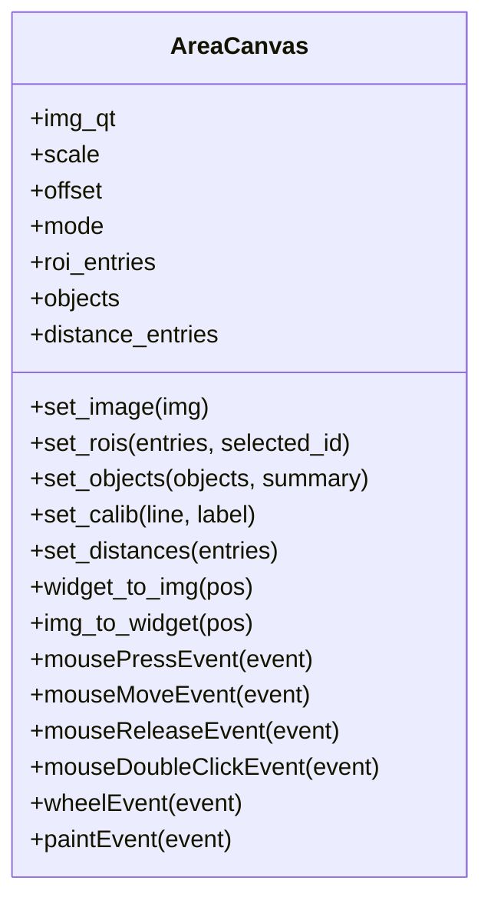
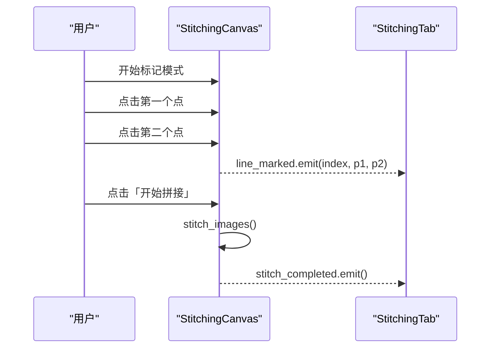
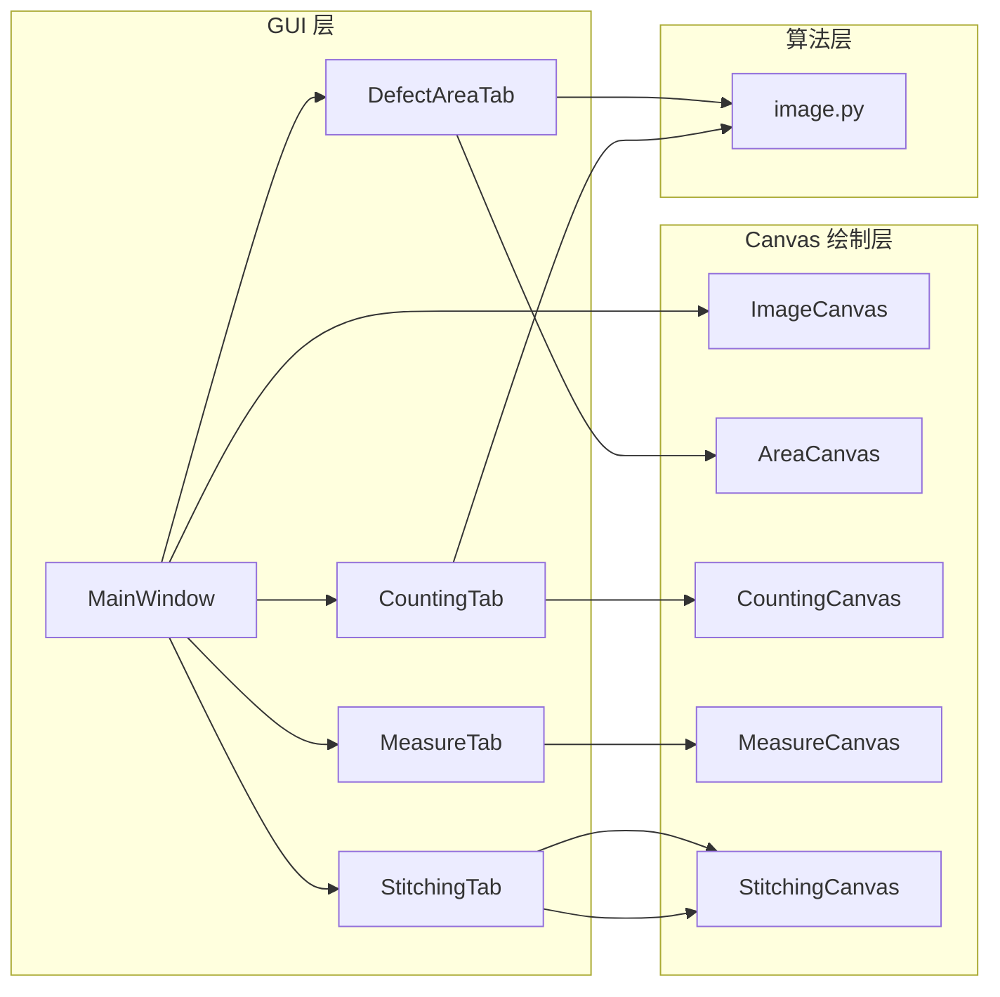

# Canvas 绘制层与 ImageCanvas 基类

<cite>
**本文引用的文件**   
- [canvas.py](file://canvas.py)
- [area_canvas.py](file://area_canvas.py)
- [counting_canvas.py](file://counting_canvas.py)
- [measure_canvas.py](file://measure_canvas.py)
- [stitching_canvas.py](file://stitching_canvas.py)
- [main_window.py](file://main_window.py)
- [area_tab.py](file://area_tab.py)
- [counting_tab.py](file://counting_tab.py)
- [measure_tab.py](file://measure_tab.py)
- [stitching_tab.py](file://stitching_tab.py)
</cite>

## 目录
1. [引言](#引言)
2. [项目结构中的 Canvas 层](#项目结构中的-canvas-层)
3. [ImageCanvas 基类的职责边界](#imagecanvas-基类的职责边界)
4. [坐标转换、缩放与平移](#坐标转换缩放与平移)
5. [鼠标事件分发与 ROI 编辑](#鼠标事件分发与-roi-编辑)
6. [覆盖层绘制与信号契约](#覆盖层绘制与信号契约)
7. [子类专用画布分析](#子类专用画布分析)
8. [与主窗口及业务 Tab 的耦合关系](#与主窗口及业务-tab-的耦合关系)
9. [典型用法：如何扩展 ImageCanvas](#典型用法如何扩展-imagecanvas)
10. [关键公共方法与信号清单](#关键公共方法与信号清单)
11. [依赖关系图](#依赖关系图)
12. [性能与已知限制](#性能与已知限制)
13. [调试建议](#调试建议)
14. [结论](#结论)

## 引言
Aurascope 是 PyQt6 + OpenCV + NumPy + Pandas 的单机桌面应用，用于金锡焊空洞分析与相关视觉测量。其 GUI 层按「入口 → 主窗口 → Tab 页面 → Canvas 绘制层 → 算法层 image.py → 配方/导出」分层组织。Canvas 层的核心职责是 QWidget + QPainter 自绘组件：显示图像、处理鼠标滚轮缩放、右键平移、ROI 交互、多边形编辑和覆盖层绘制；它不实现空洞检测、阈值分割、形态学或距离统计等算法，这些逻辑位于 image.py 和业务 Tab 中。

需要特别强调：**ImageCanvas 的滚轮缩放存在 Y 轴漂移问题**。当前实现分别用 X 和 Y 方向独立计算偏移，但并未保证鼠标位置在缩放前后始终对应同一图像像素；因此不能把现状描述为正确设计，只能视为已知缺陷。

## 项目结构中的 Canvas 层
仓库中存在多个画布类，但它们并非全部继承自同一个基类：

| 文件 | 类名 | 是否继承 ImageCanvas | 主要用途 |
|---|---|:---:|---|
| canvas.py | ImageCanvas | 否（基类） | 空洞分析页的原图显示、ROI、标定、空洞编辑、局部笔刷 |
| area_canvas.py | AreaCanvas | 否 | 缺陷面积多 ROI 页的渲染、坐标变换、测距、ROI 交互 |
| counting_canvas.py | CountingCanvas | 否 | 物料计数页的 ROI、对象绘制、计数结果展示 |
| measure_canvas.py | MeasureCanvas | 否 | 距离测量页的标定、测距、吸附徽标、统计标签 |
| stitching_canvas.py | StitchingCanvas | 否 | 图像拼接页的多图标记、对齐、羽化拼接结果绘制 |

从代码可见，AreaCanvas、CountingCanvas、MeasureCanvas、StitchingCanvas 都自行实现了 `set_image`、`fit_in_view`、`widget_to_img`、`img_to_widget`、`wheelEvent`、`paintEvent` 等方法，而不是复用 ImageCanvas。这说明 ImageCanvas 目前更像「空洞分析专用画布」，而非被所有业务共享的抽象基类。



**图表来源**
- [main_window.py:106-145](file://main_window.py#L106-L145)
- [area_tab.py:110-150](file://area_tab.py#L110-L150)
- [counting_tab.py:19-51](file://counting_tab.py#L19-L51)
- [measure_tab.py:22-40](file://measure_tab.py#L22-L40)
- [stitching_tab.py:26-46](file://stitching_tab.py#L26-L46)

**章节来源**
- [main_window.py:106-145](file://main_window.py#L106-L145)
- [area_canvas.py:85-134](file://area_canvas.py#L85-L134)
- [counting_canvas.py:10-43](file://counting_canvas.py#L10-L43)
- [measure_canvas.py:10-47](file://measure_canvas.py#L10-L47)
- [stitching_canvas.py:22-59](file://stitching_canvas.py#L22-L59)

## ImageCanvas 基类的职责边界
ImageCanvas 的职责可以概括为以下六项：

1. **原图加载与 Qt 图像缓存**  
   `set_image(img_cv)` 接收 OpenCV 格式的 numpy 数组，将灰度或 BGR 转换为 RGB，并构造 QImage 缓存到 `self.img_qt`。同时清空 ROI 多边形、边缘吸附掩膜、ROI 编辑状态，并调用 `fit_in_view()` 自适应视图。

2. **坐标转换**  
   `widget_to_img(pos)` 将控件坐标映射到原图像素坐标；`img_to_widget(pos_img)` 做反向映射。这两个方法是调试坐标偏移时的第一检查点。

3. **视图缩放与平移**  
   `fit_in_view()` 根据控件尺寸与原图尺寸设置初始 scale 和 offset。滚轮缩放由 `wheelEvent()` 处理；右键拖拽平移由 `mouseMoveEvent()` 处理。

4. **ROI 多边形编辑**  
   支持顶点拖拽、边拖拽、双击插入顶点、Delete 删除选中顶点、边缘吸附、顶点数重采样、ROI 蒙版预览。

5. **覆盖层绘制**  
   在原图上绘制 ROI 多边形、空洞轮廓、矩形 ROI 预览、标定线、局部笔刷区域、空洞编号、空洞率文字、阈值偏移提示等。

6. **信号暴露**  
   通过 pyqtSignal 向主窗口或业务 Tab 暴露 ROI 完成、空洞添加/删除、标定线、空图导入等事件。

需要注意：ImageCanvas 内部还包含大量空洞编辑状态（如 `void_edit_mode`、`lb_confirmed`、`draw_voids`、`void_add_preview`），这些状态属于空洞分析业务的 UI 表现层，不应被其他业务 Canvas 直接复用。

**章节来源**
- [canvas.py:13-94](file://canvas.py#L13-L94)
- [canvas.py:123-164](file://canvas.py#L123-L164)
- [canvas.py:166-208](file://canvas.py#L166-L208)
- [canvas.py:708-943](file://canvas.py#L708-L943)

## 坐标转换、缩放与平移
ImageCanvas 提供两个核心坐标转换方法：

| 方法 | 输入 | 输出 | 语义 |
|---|---|---|---|
| `widget_to_img(pos)` | 控件坐标 QPointF | 原图像素坐标 QPointF | 鼠标点击位置 → 图像坐标 |
| `img_to_widget(pos_img)` | 原图像素坐标 QPointF | 控件坐标 QPointF | 图像坐标 → 屏幕坐标 |
| `fit_in_view()` | 无 | 更新 `scale`、`offset` | 让图片以 90% 比例居中显示 |

`widget_to_img` 先减去 `offset`，再除以 `scale`，并把结果 clamp 到 `[0, width-1] × [0, height-1]`。`img_to_widget` 则是线性变换：`x = px * scale + offset.x`，`y = py * scale + offset.y`。

### 滚轮缩放锚点逻辑
ImageCanvas 的默认缩放逻辑如下：



**图表来源**
- [canvas.py:626-706](file://canvas.py#L626-L706)

### Y 轴缩放漂移问题
当前实现中，X 方向使用：

```
img_pos_before = (mouse_pos.x() - self.offset.x()) / self.scale
new_offset_x = mouse_pos.x() - img_pos_before * self.scale
```

Y 方向使用：

```
img_y_before = (mouse_pos.y() - self.offset.y()) / self.scale
new_offset_y = mouse_pos.y() - img_y_before * self.scale
```

虽然公式形式对称，但 `mouse_pos.y()` 与 `self.offset.y()` 在缩放后并不等价于“鼠标位置对应的图像 Y 坐标”。更稳健的做法应统一基于缩放前的图像坐标 `(mx, my)` 计算新的 offset，使缩放后的鼠标位置仍指向同一图像像素。由于该问题存在于现有实现中，文档必须明确标注为已知缺陷，而不是“锚点缩放已正确实现”。

**章节来源**
- [canvas.py:142-164](file://canvas.py#L142-L164)
- [canvas.py:626-706](file://canvas.py#L626-L706)

## 鼠标事件分发与 ROI 编辑
ImageCanvas 的鼠标事件分发优先级如下：

1. **无图像时**：忽略大部分交互，仅保留焦点与空图按钮。
2. **示教模式**：左键点击直接发射 `teach_void_at`，不进入其他分支。
3. **空洞编辑模式**：
   - `delete`：左键点击发射 `void_delete_at`。
   - `add`：左键点击触发局部 Otsu 检测，生成 `void_add_preview`。
   - `local_brush`：左键放置圆形区域，双击确认，Shift+滚轮调整阈值，右键双击删除。
4. **ROI 编辑模式**：优先命中最近顶点或边，支持拖拽顶点和整边平移。
5. **工具模式**：
   - `calibration`：拖拽标定线。
   - `poly`：多点绘制多边形 ROI。
   - `rect`：拖拽矩形 ROI。
6. **右键平移**：按住右键移动更新 `offset`。

ROI 多边形编辑的关键流程：



**图表来源**
- [canvas.py:350-443](file://canvas.py#L350-L443)
- [canvas.py:444-508](file://canvas.py#L444-L508)
- [canvas.py:510-544](file://canvas.py#L510-L544)
- [canvas.py:546-624](file://canvas.py#L546-L624)

**章节来源**
- [canvas.py:350-624](file://canvas.py#L350-L624)

## 覆盖层绘制与信号契约
ImageCanvas 的 `paintEvent()` 负责把所有可视化元素叠加到原图上，顺序大致为：

1. 背景色填充。
2. 无图时显示 logo 和空图按钮。
3. 保存 painter 状态，应用 `translate(offset)` 和 `scale(scale)`。
4. 绘制原图阴影和原图。
5. 绘制 ROI 蒙版 `overlay_mask`。
6. 绘制矩形 ROI 预览 `overlay_preview`。
7. 绘制 ROI 多边形边线和顶点手柄。
8. 绘制空洞添加预览、空洞轮廓、删除高亮。
9. 绘制标定线、局部笔刷圆、空洞率文字、空洞编号、标定标签。
10. 恢复 painter 状态，绘制控件坐标下的文本标签。

关键信号及其语义：

| 信号 | 参数 | 触发时机 | 用途 |
|---|---|---|---|
| `calib_drawn` | `QPointF, QPointF` | 标定线拖拽结束 | 通知主窗口完成比例尺标定 |
| `roi_poly_finished` | `list` | 多边形 ROI 绘制完成 | 通知上层 ROI 多边形顶点 |
| `roi_rect_changed` | `tuple` | 矩形 ROI 拖拽中 | 实时预览阈值蒙版 |
| `roi_rect_finished` | `tuple` | 矩形 ROI 拖拽结束 | 提交矩形 ROI |
| `roi_polygon_edited` | `list` | ROI 多边形顶点/边编辑完成 | 同步上层 ROI 数据 |
| `void_delete_at` | `float, float` | 删除模式下点击图像 | 通知上层删除空洞 |
| `void_add_polygon` | `list` | 添加空洞预览双击确认 | 提交自动检测的空洞轮廓 |
| `void_selected_for_local` | `int` | 选择某个空洞进行局部调节 | 与局部笔刷联动 |
| `void_local_region_confirmed` | `float, float, float` | 局部笔刷区域确认 | 提交圆形区域中心与半径 |
| `void_local_threshold_changed` | `int, int` | Shift+滚轮调整阈值 | 更新某区域的阈值 |
| `void_local_region_removed` | `int` | 右键双击删除已确认区域 | 移除局部区域 |
| `empty_import` | 无 | 空图按钮点击 | 触发图片导入 |

**章节来源**
- [canvas.py:16-28](file://canvas.py#L16-L28)
- [canvas.py:708-943](file://canvas.py#L708-L943)

## 子类专用画布分析

### AreaCanvas：缺陷面积多 ROI
AreaCanvas 不是 ImageCanvas 的子类，而是独立的 QWidget。它承担缺陷面积页面的渲染、坐标变换、ROI、测距、对象遮罩绘制和交互。

关键特点：
- 每个对象携带 `mask`、`points`、`rect`，并通过 `mask_to_qimage` 转为 RGBA QImage 用于半透明覆盖。
- 命中检测使用 `mask_hit`，只检查对象 bbox 内真实非零像素，避免把孔洞内部误判为命中。
- 支持水平/垂直吸附的 7° 规则，复用 `snap_endpoint`。
- 支持多 ROI、当前 ROI 选择、测距线、标定线、摘要统计。
- 有自己的 `wheelEvent`，使用锚点缩放：`offset = mouse_pos - anchor * scale`，比 ImageCanvas 的 Y 漂移实现更简洁。



**图表来源**
- [area_canvas.py:85-150](file://area_canvas.py#L85-L150)
- [area_canvas.py:152-214](file://area_canvas.py#L152-L214)
- [area_canvas.py:215-341](file://area_canvas.py#L215-L341)
- [area_canvas.py:419-498](file://area_canvas.py#L419-L498)

**章节来源**
- [area_canvas.py:1-498](file://area_canvas.py#L1-L498)

### CountingCanvas：物料计数
CountingCanvas 同样独立实现，不继承 ImageCanvas。它负责：
- ROI 矩形和多边形绘制。
- 检测结果对象的轮廓、编号、中心点绘制。
- 删除/添加模式下的对象命中与交互。
- 右上角总数标签。
- 滚轮缩放与右键平移。

其 `wheelEvent` 也存在类似 ImageCanvas 的 Y 轴偏移计算问题：

```python
self.offset = QPointF(mp.x() - ibx * self.scale,
                      mp.y() - ((mp.y() - self.offset.y()) / (self.scale / factor)) * self.scale)
```

这行代码试图修正 Y 方向，但逻辑复杂且容易引入数值误差，不如统一基于缩放前图像坐标计算。

**章节来源**
- [counting_canvas.py:10-270](file://counting_canvas.py#L10-L270)

### MeasureCanvas：距离测量
MeasureCanvas 是距离测量功能的独立画布，支持：
- 标定线绘制。
- 两点测距。
- 7° 吸附徽标。
- 已完成测量、预览线、单位 μm 标签。
- 滚轮缩放与右键平移。

它的 `wheelEvent` 也采用与 CountingCanvas 类似的 Y 修正方式，存在同样的锚点漂移风险。

**章节来源**
- [measure_canvas.py:10-321](file://measure_canvas.py#L10-L321)

### StitchingCanvas：图像拼接
StitchingCanvas 负责多图标记、对齐、拼接结果绘制。它不继承 ImageCanvas，也不复用其坐标系统。

关键点：
- 维护 `images` 列表，每张图有 `line_p1`、`line_p2`、`marked`。
- 支持标记模式、拖拽标定点、右键平移、滚轮缩放。
- `stitch_images()` 执行真正的拼接算法：头尾点排序、原点偏移计算、可选互相关微调、羽化融合、深灰背景。
- 拼接完成后绘制 stitched_image，并显示宽高信息。



**图表来源**
- [stitching_canvas.py:145-177](file://stitching_canvas.py#L145-L177)
- [stitching_canvas.py:297-406](file://stitching_canvas.py#L297-L406)

**章节来源**
- [stitching_canvas.py:22-610](file://stitching_canvas.py#L22-L610)

## 与主窗口及业务 Tab 的耦合关系
主窗口 MainWindow 是 GUI 层的装配者：它创建各 Tab、挂载 Canvas、连接信号、处理图片拖放、管理最近打开记录、保存窗口状态。

空洞分析 Tab 的 Canvas 是 ImageCanvas，由 main_window.py 直接持有：

```python
self.canvas = ImageCanvas()
self.canvas.empty_import.connect(self.load_image)
```

主窗口随后连接 ImageCanvas 的信号：

```python
self.canvas.calib_drawn.connect(self.finish_calibration)
self.canvas.roi_poly_finished.connect(self.finish_poly_roi)
self.canvas.roi_rect_changed.connect(self.update_layer_preview)
self.canvas.roi_rect_finished.connect(self.prepare_layer_threshold)
self.canvas.roi_polygon_edited.connect(self.on_polygon_edited)
self.canvas.void_delete_at.connect(self.on_void_delete_at)
self.canvas.void_add_polygon.connect(self.on_void_add_polygon)
...
```

其他业务 Tab 则各自持有自己的 Canvas：

| Tab | Canvas 类型 | 主要信号连接 |
|---|---|---|
| 缺陷面积 | AreaCanvas | `calib_drawn`、`distance_added`、`roi_rect`、`roi_poly`、`roi_pick`、`add_click`、`add_confirm`、`add_cancel`、`delete_click` |
| 物料计数 | CountingCanvas | `roi_rect_finished`、`roi_polygon_finished`、`object_delete_at`、`object_add_at` |
| 距离测量 | MeasureCanvas | `calib_drawn`、`measurement_added` |
| 图像拼接 | StitchingCanvas | `line_marked`、`stitch_completed` |

约束「GUI 层不得内联算法」意味着：
- Canvas 只负责显示和交互。
- 空洞检测、阈值、形态学、轮廓、圆度、距离统计等逻辑放在 image.py 或业务 Tab 的计算函数中。
- Canvas 通过信号把用户操作交给上层处理，上层再调用 image.py 的算法函数，最后把结果写回 Canvas 的状态字段。

**章节来源**
- [main_window.py:106-145](file://main_window.py#L106-L145)
- [main_window.py:670-682](file://main_window.py#L670-L682)
- [area_tab.py:136-150](file://area_tab.py#L136-L150)
- [counting_tab.py:44-51](file://counting_tab.py#L44-L51)
- [measure_tab.py:136-138](file://measure_tab.py#L136-L138)
- [stitching_tab.py:137-140](file://stitching_tab.py#L137-L140)

## 典型用法：如何扩展 ImageCanvas
如果要新增一个基于 ImageCanvas 的业务画布，推荐遵循以下约定：

1. **继承 ImageCanvas**  
   子类构造函数调用 `super().__init__(parent)`，并根据业务需要初始化额外状态。

2. **重写 paintEvent**  
   在父类绘制基础上追加业务覆盖层，例如：
   - 绘制业务 ROI 轮廓。
   - 绘制检测结果掩膜。
   - 绘制业务标签、统计值、提示信息。
   - 注意在绘制图像坐标内容前调用 `painter.save()`，绘制后调用 `painter.restore()`。

3. **重写 mousePressEvent / mouseMoveEvent / mouseReleaseEvent**  
   如果业务需要自定义交互，应在调用父类之前处理自身逻辑，或在父类之后补充行为。若业务不需要滚动缩放或右键平移，应显式处理 `event.accept()` 或避免修改 `self.offset`。

4. **重写 wheelEvent**  
   如果需要不同缩放行为，应实现锚点缩放：
   ```
   anchor = widget_to_img(mouse_pos)
   new_scale = clamp(old_scale * factor)
   new_offset = mouse_pos - anchor * new_scale
   ```
   不要复制 ImageCanvas 中已知的 Y 漂移实现。

5. **通过 emit_roi_changed 或自定义信号通知上层**  
   ImageCanvas 已有 `roi_polygon_edited`、`roi_rect_finished`、`roi_poly_finished` 等信号。若业务需要新语义，应定义新信号，而不是直接修改父类内部状态。

6. **保持算法与 UI 分离**  
   Canvas 不实现空洞检测、阈值、形态学、距离计算；这些逻辑应由业务 Tab 调用 image.py 后，再把结果写入 Canvas 的显示状态。

**章节来源**
- [canvas.py:13-94](file://canvas.py#L13-L94)
- [canvas.py:350-706](file://canvas.py#L350-L706)
- [canvas.py:708-943](file://canvas.py#L708-L943)

## 关键公共方法与信号清单

### ImageCanvas 关键公共方法

| 方法 | 签名语义 | 说明 |
|---|---|---|
| `set_image(img_cv)` | 接收 OpenCV numpy 数组 | 转换颜色空间、构造 QImage、清空 ROI、fit_in_view |
| `fit_in_view()` | 无参 | 按控件尺寸设置初始 scale 和 offset |
| `widget_to_img(pos)` | 控件坐标 → 图像坐标 | 鼠标点击定位的核心方法 |
| `img_to_widget(pos_img)` | 图像坐标 → 控件坐标 | 绘制标签、覆盖层时使用 |
| `set_roi_polygon(points)` | 设置 ROI 多边形顶点 | 接受 `(x, y)` 列表 |
| `clear_roi_polygon()` | 无参 | 清空 ROI 多边形和编辑状态 |
| `set_roi_edit_enabled(enabled)` | 布尔 | 开启/关闭 ROI 顶点编辑 |
| `set_edge_snap_mask(edge_mask)` | 二值掩膜 | 供 ROI 顶点吸附边缘 |
| `set_snap_enabled(enabled)` | 布尔 | 开关吸附功能 |
| `set_polygon_vertex_count(target_count)` | 整数 | 对 ROI 多边形按周长重采样到目标顶点数 |
| `set_void_edit_mode(mode)` | 字符串 | 切换空洞编辑模式：none/add/delete/local_brush |
| `set_teach_void_mode(enabled)` | 布尔 | 开启示教点选模式 |
| `set_local_brush_regions(regions)` | 列表 | 从主窗口同步已确认局部笔刷区域 |

### ImageCanvas 关键信号

| 信号 | 参数 | 语义 |
|---|---|---|
| `calib_drawn` | `QPointF, QPointF` | 标定线两端点 |
| `roi_poly_finished` | `list` | 多边形 ROI 完成 |
| `roi_rect_changed` | `tuple` | 矩形 ROI 拖拽中 |
| `roi_rect_finished` | `tuple` | 矩形 ROI 完成 |
| `roi_polygon_edited` | `list` | ROI 多边形编辑完成 |
| `void_delete_at` | `float, float` | 删除空洞点击位置 |
| `void_add_polygon` | `list` | 自动检测空洞轮廓 |
| `void_selected_for_local` | `int` | 选择空洞进行局部调节 |
| `void_local_region_confirmed` | `float, float, float` | 局部圆形区域确认 |
| `void_local_threshold_changed` | `int, int` | 局部区域阈值变化 |
| `void_local_region_removed` | `int` | 删除局部区域 |
| `teach_void_at` | `float, float` | 示教点选空洞 |
| `empty_import` | 无 | 空图导入 |

### 其他 Canvas 的公共方法要点

| 类 | 重要方法 | 语义 |
|---|---|---|
| AreaCanvas | `set_rois`, `set_objects`, `set_calib`, `set_distances`, `set_preview` | 设置 ROI、对象、标定、测距、预览 |
| CountingCanvas | `set_image`, `fit_in_view`, `widget_to_img` | 基础图像显示与坐标转换 |
| MeasureCanvas | `clear_calibration`, `clear_measurements`, `remove_last_measurement`, `reset_all` | 标定与测量状态管理 |
| StitchingCanvas | `set_images`, `start_mark_mode`, `stop_mark_mode`, `stitch_images` | 多图管理与拼接 |

**章节来源**
- [canvas.py:123-208](file://canvas.py#L123-L208)
- [canvas.py:95-122](file://canvas.py#L95-L122)
- [area_canvas.py:135-214](file://area_canvas.py#L135-L214)
- [counting_canvas.py:44-75](file://counting_canvas.py#L44-L75)
- [measure_canvas.py:50-103](file://measure_canvas.py#L50-L103)
- [stitching_canvas.py:60-94](file://stitching_canvas.py#L60-L94)

## 依赖关系图
下图展示 GUI 层 Canvas 与业务 Tab、主窗口之间的依赖方向：



**图表来源**
- [main_window.py:30-48](file://main_window.py#L30-L48)
- [area_tab.py:21-28](file://area_tab.py#L21-L28)
- [counting_tab.py:11-16](file://counting_tab.py#L11-L16)
- [measure_tab.py:15-19](file://measure_tab.py#L15-L19)
- [stitching_tab.py:16-23](file://stitching_tab.py#L16-L23)

**章节来源**
- [main_window.py:30-48](file://main_window.py#L30-L48)
- [area_tab.py:21-28](file://area_tab.py#L21-L28)
- [counting_tab.py:11-16](file://counting_tab.py#L11-L16)
- [measure_tab.py:15-19](file://measure_tab.py#L15-L19)
- [stitching_tab.py:16-23](file://stitching_tab.py#L16-L23)

## 性能与已知限制
Canvas 层的主要性能特征：

1. **每帧重绘**  
   所有鼠标移动、滚轮、编辑操作都会调用 `update()`，触发 `paintEvent()`。对于大图和高频 ROI 编辑，这可能带来明显刷新开销。

2. **ROI 多边形顶点较多时**  
   ImageCanvas 已经做了按需显示顶点手柄优化，只高亮选中顶点和光标最近顶点，避免上百个顶点全画导致界面拥挤。

3. **掩膜转 QImage**  
   AreaCanvas 的 `mask_to_qimage` 会为每个对象创建 RGBA QImage，并在 `set_objects` 中预构建 `_mask_images`，避免每次绘制重复转换。

4. **空洞检测预览**  
   添加空洞模式中的 `_local_detect_at` 会截取局部区域做 Otsu 和二值化，频繁点击可能触发多次 OpenCV 调用。

已知限制（与 handoff.md 一致）：
- 滚轮缩放 Y 轴漂移：ImageCanvas、CountingCanvas、MeasureCanvas 的缩放实现都存在锚点计算不够稳健的问题。
- 空洞分析主窗口中存在 `detect_voids_local` 副本，现行行为应以 image.py 为准，两份待合并。
- edge_map 未初始化可能导致 Canny 边缘校验静默失效。
- `chk_roi_overlay` 被重复创建。
- select_for_local 为无 UI 入口的死代码。
- 大图增强检测无进度提示。

**章节来源**
- [canvas.py:708-943](file://canvas.py#L708-L943)
- [area_canvas.py:15-21](file://area_canvas.py#L15-L21)
- [area_canvas.py:192-199](file://area_canvas.py#L192-L199)
- [canvas.py:258-293](file://canvas.py#L258-L293)

## 调试建议
当 Canvas 出现坐标或交互问题时，建议按以下顺序排查：

### 坐标偏移时
1. 先在 `widget_to_img` 和 `img_to_widget` 处打印或断点，验证控件坐标 ↔ 图像坐标转换是否正确。
2. 检查 `self.scale` 和 `self.offset` 是否在缩放或平移后符合预期。
3. 如果是滚轮缩放后点击位置偏移，重点检查 `wheelEvent` 的锚点计算，尤其是 Y 方向。
4. 确认 `fit_in_view()` 只在图像加载或视图重置时调用，不要在每次绘制中重新计算。

### ROI 不生效时
1. 检查 `roi_polygon_points` 是否至少有 3 个点。
2. 检查 `polygon_to_mask` 的 mask 尺寸是否与原图一致。
3. 检查 `overlay_mask` 是否被正确赋值并启用 `show_roi_overlay`。
4. 检查上层是否订阅了 `roi_polygon_edited` 或 `roi_poly_finished`，并把 ROI 数据同步给算法层。
5. 如果是 AreaCanvas，检查 `mask_hit` 是否命中对象 bbox 内的真实非零像素。

### 空洞编辑异常时
1. 检查 `void_edit_mode` 是否为预期的 none/add/delete/local_brush。
2. 检查 `_local_detect_at` 返回的轮廓面积是否大于 3。
3. 检查 `void_add_preview` 是否存在，以及 `void_add_status` 是否提示阈值偏移。
4. 检查局部笔刷的 `lb_confirmed`、`lb_state`、`lb_radius` 状态机是否一致。

**章节来源**
- [canvas.py:152-164](file://canvas.py#L152-L164)
- [canvas.py:258-293](file://canvas.py#L258-L293)
- [canvas.py:350-706](file://canvas.py#L350-L706)
- [area_canvas.py:15-49](file://area_canvas.py#L15-L49)

## 结论
ImageCanvas 是 Aurascope 空洞分析页的核心自绘组件，承担了原图显示、坐标转换、滚轮缩放、右键平移、ROI 多边形编辑、空洞编辑和覆盖层绘制等职责。但它并不是所有业务 Canvas 的统一基类：AreaCanvas、CountingCanvas、MeasureCanvas、StitchingCanvas 都是独立实现的 QWidget，各自维护 scale、offset、事件处理和绘制逻辑。

开发时应遵守以下原则：
- Canvas 层只做显示和交互，不内联图像算法。
- 子类如需扩展，优先重写 `paintEvent`、`mousePressEvent`、`wheelEvent`，并通过信号通知上层。
- 缩放锚点实现必须以「鼠标位置对应同一图像像素」为目标，不能沿用 ImageCanvas 中已知的 Y 漂移实现。
- 调试坐标问题时，优先验证 `widget_to_img` / `image_to_screen`；调试 ROI 问题时，优先验证 `polygon_to_mask` 与 mask 尺寸。
- 主窗口和各业务 Tab 作为 GUI 装配层，负责连接信号、调用 image.py 算法、更新 Canvas 状态。