# UI 组件工厂与样式系统

<cite>
**本文引用的文件**   
- [ui_components.py](file://ui_components.py)
- [styles.py](file://styles.py)
- [main.py](file://main.py)
- [main_window.py](file://main_window.py)
- [README.md](file://README.md)
- [PROJECT_CONCEPTION.md](file://PROJECT_CONCEPTION.md)
</cite>

## 目录
1. [引言](#引言)
2. [项目结构定位](#项目结构定位)
3. [强制约定](#强制约定)
4. [核心组件：UI 组件工厂](#核心组件ui-组件工厂)
5. [样式系统与设计 Token](#样式系统与设计-token)
6. [架构总览](#架构总览)
7. [详细组件分析](#详细组件分析)
8. [依赖关系分析](#依赖关系分析)
9. [典型用法示例](#典型用法示例)
10. [常用 create_* 函数参考](#常用-create_-函数参考)
11. [与 PyQt6 样式系统的关系](#与-pyqt6-样式系统的关系)
12. [局部覆盖主题而不破坏全局样式](#局部覆盖主题而不破坏全局样式)
13. [性能与布局注意事项](#性能与布局注意事项)
14. [常见问题排查](#常见问题排查)
15. [结论](#结论)

## 引言
本文件聚焦 Aurascope 的 UI 层两个关键子系统：**UI 组件工厂**与**全局样式系统**。  
Aurascope 是面向微电子封装产线的半自动化视觉检测桌面工具，使用 PyQt6、OpenCV、NumPy、Pandas，运行在 Windows 7+，不联网、不收集用户数据。UI 层通过 `ui_components.py` 提供统一的控件创建入口，通过 `styles.py` 集中管理 QSS 与设计 token；主程序入口 `main.py` 将全局样式表应用到 `QApplication`，再由各 Tab/窗口装配具体界面。

## 项目结构定位
从仓库根目录看，UI 相关代码集中在以下文件：
- `main.py`：应用启动、`QApplication` 初始化、全局样式应用。
- `main_window.py`：主窗口装配，大量使用 `ui_components` 中的工厂函数构建侧边栏、按钮、分组框等。
- `ui_components.py`：所有 `create_*` 工厂函数、通用控件类（如 `CollapsibleSection`、`TitleBar`）。
- `styles.py`：设计 token `_C`、全局 QSS `STYLESHEET`、对话框样式 `DIALOG_STYLESHEET`、下拉弹层样式 `POPUP_QSS`。

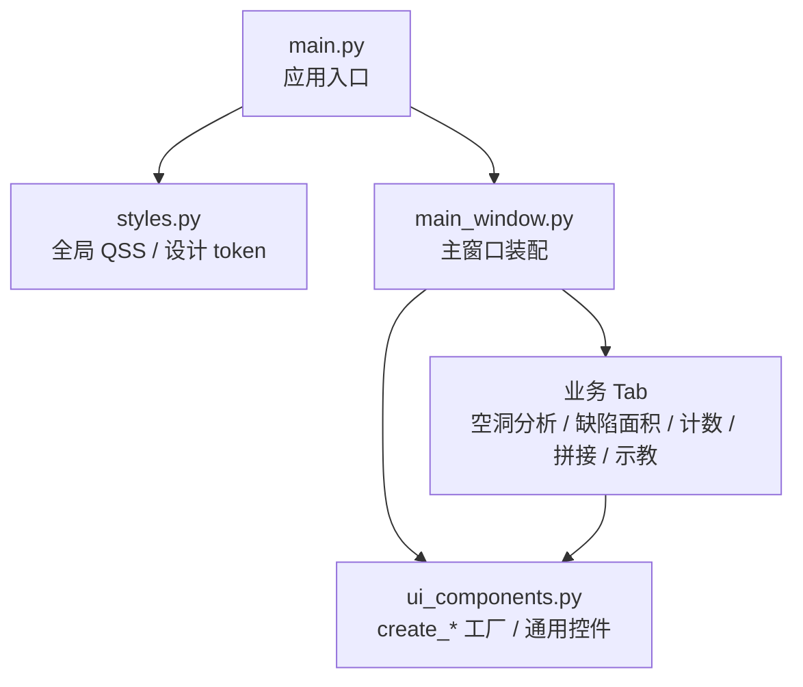

**图表来源**
- [main.py:12-35](file://main.py#L12-L35)
- [main_window.py:37-49](file://main_window.py#L37-L49)
- [ui_components.py:1-10](file://ui_components.py#L1-L10)
- [styles.py:1-42](file://styles.py#L1-L42)

**章节来源**
- [README.md:42-64](file://README.md#L42-L64)
- [PROJECT_CONCEPTION.md:77-108](file://PROJECT_CONCEPTION.md#L77-L108)

## 强制约定
本节为编码规范，违反会导致布局异常或样式失效。

| 约定 | 说明 | 违反后果 |
|---|---|---|
| 工厂函数只创建控件，不加入布局 | `create_button`、`create_label`、`create_groupbox`、`create_spinbox`、`create_slider`、`create_checkbox` 等只返回控件对象 | 调用方必须显式调用 `layout.addWidget(...)` |
| `create_groupbox()` 必须配合 Preferred/Expanding 尺寸策略 | 工厂内部已设置 `QSizePolicy.Expanding, Preferred`；若调用方重写为固定尺寸或错误组合，控件可能被静默裁剪 | 内容被裁掉但无报错 |
| 主题色、字号、间距必须来自 `styles._C` | 禁止散写颜色、字号、圆角值 | 设计不一致、后续换肤困难 |
| 下拉弹层样式需通过 `style_combo_popups()` | 因为 `QComboBox` 弹出层是独立窗口，全局 QSS 不一定命中 | 弹出项选中态、滚动条、边框异常 |
| 全局样式通过 `app.setStyleSheet(STYLESHEET)` 应用 | 主入口已统一设置，子窗口一般不应重复覆盖整个 `QApplication` 样式 | 局部样式被意外覆盖或主题错乱 |

**章节来源**
- [ui_components.py:35-80](file://ui_components.py#L35-L80)
- [ui_components.py:239-243](file://ui_components.py#L239-L243)
- [ui_components.py:426-460](file://ui_components.py#L426-L460)
- [main.py:32-35](file://main.py#L32-L35)

## 核心组件：UI 组件工厂
`ui_components.py` 的核心职责是**把业务页面从“创建 QPushButton/QLabel/QSlider”等细节中解放出来**，同时保证：
1. 控件名称语义化：`PrimaryBtn`、`SecondaryBtn`、`SuccessBtn`、`DangerBtn`、`NavBtn`、`InfoLabel`、`CardTitle`、`StepTitle` 等。
2. 样式由 `styles.py` 的 QSS 匹配 `objectName` 生效。
3. 工厂函数不持有布局，避免隐藏耦合。

### 工厂函数分类
- **按钮类**：`create_primary_button`、`create_secondary_button`、`create_success_button`、`create_danger_button`、`create_nav_button`。
- **文本类**：`create_step_title`、`create_info_label`、`create_success_label`、`create_card_title`、`create_card_subtitle`、`create_stat_value`、`create_success_value`、`create_error_value`、`create_warning_box`、`create_error_label`、`create_blue_label`、`create_count_result`。
- **输入类**：`create_slider`、`create_slider_with_label`、`create_checkbox`。
- **容器类**：`create_groupbox`、`create_divider`、`CollapsibleSection`。
- **辅助类**：`confirm_action`、`attach_empty_button`、`enable_click_sort`、`attach_empty_hint`、`style_combo_popups`、`WindowControlButton`、`TitleBar`。

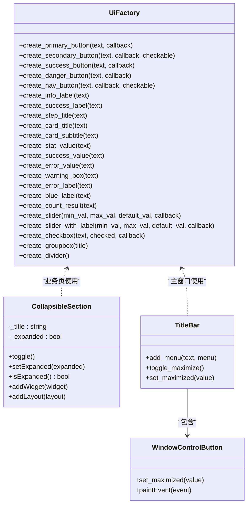

**图表来源**
- [ui_components.py:35-80](file://ui_components.py#L35-L80)
- [ui_components.py:188-319](file://ui_components.py#L188-L319)
- [ui_components.py:322-383](file://ui_components.py#L322-L383)
- [ui_components.py:463-525](file://ui_components.py#L463-L525)
- [ui_components.py:527-621](file://ui_components.py#L527-L621)

**章节来源**
- [ui_components.py:1-10](file://ui_components.py#L1-L10)
- [ui_components.py:35-80](file://ui_components.py#L35-L80)
- [ui_components.py:188-319](file://ui_components.py#L188-L319)
- [ui_components.py:322-383](file://ui_components.py#L322-L383)
- [ui_components.py:463-621](file://ui_components.py#L463-L621)

## 样式系统与设计 Token
`styles.py` 是 Aurascope 的**唯一样式权威源**，包含：
- 设计 token `_C`：中性色、主色、语义色、字体族、等宽字体。
- 全局 QSS `_sheet()` 与常量 `STYLESHEET`。
- 对话框样式 `DIALOG_STYLESHEET`。
- 下拉弹层样式 `POPUP_QSS`。

### 设计 Token 摘要
| Token 类别 | 含义 | 示例用途 |
|---|---|---|
| 背景与表面 | `bg`、`surface`、`surface2` | 页面底、卡片底、表头 |
| 描边 | `border`、`border2` | 边框、悬停边框 |
| 文字 | `text`、`text2`、`text3` | 主文、次级文、占位 |
| 主色 | `accent`、`accent_h`、`accent_a`、`accent_tint`、`accent_tint2` | 按钮、选中态、高亮 |
| 语义色 | `success`、`danger`、`warning` | 成功、危险、警告 |
| 字体 | `font`、`font_ui`、`mono` | 正文、UI、数值 |

### 样式应用入口
主程序入口 `main.py` 中：
1. 创建 `QApplication`。
2. 设置 `Fusion` 风格。
3. 设置窗口图标。
4. 调用 `app.setStyleSheet(STYLESHEET)`。

这意味着：**新增控件只要正确设置 `objectName`，就能自动获得对应样式。**

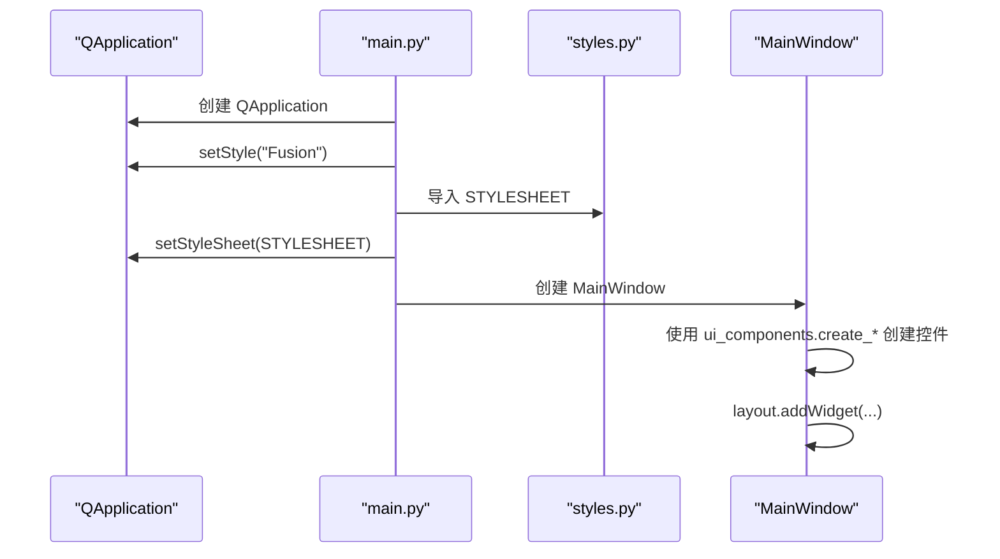

**图表来源**
- [main.py:19-39](file://main.py#L19-L39)
- [styles.py:45-536](file://styles.py#L45-L536)
- [main_window.py:37-49](file://main_window.py#L37-L49)

**章节来源**
- [styles.py:1-42](file://styles.py#L1-L42)
- [styles.py:45-536](file://styles.py#L45-L536)
- [styles.py:536-576](file://styles.py#L536-L576)
- [main.py:19-39](file://main.py#L19-L39)

## 架构总览
UI 层采用“入口 → 主窗口 → 业务 Tab → Canvas/控件”的分层结构。样式系统位于最底层，被入口和应用层共同消费；UI 组件工厂位于中间层，被主窗口和各 Tab 复用。

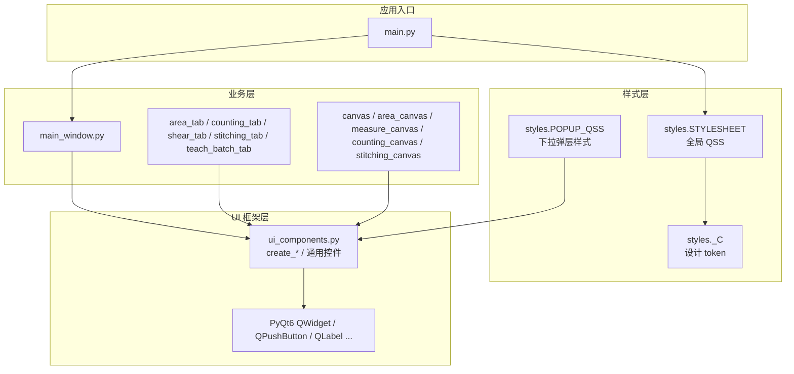

**图表来源**
- [main.py:12-35](file://main.py#L12-L35)
- [styles.py:27-42](file://styles.py#L27-L42)
- [styles.py:536-576](file://styles.py#L536-L576)
- [ui_components.py:1-10](file://ui_components.py#L1-L10)
- [main_window.py:37-49](file://main_window.py#L37-L49)

## 详细组件分析

### GroupBox 与尺寸策略
`create_groupbox(title)` 返回一个 `QGroupBox`，并设置尺寸策略为：
- 水平方向：`Expanding`
- 垂直方向：`Preferred`

这是为了避免在横向布局中被压缩到不可见宽度，同时在纵向保持按内容自适应。如果调用方手动改为 `Fixed` 或错误的组合，控件可能“看起来存在但内容被裁剪”。

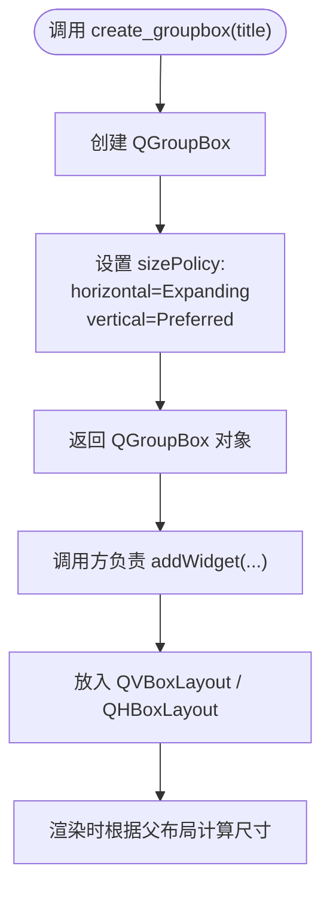

**图表来源**
- [ui_components.py:239-243](file://ui_components.py#L239-L243)

**章节来源**
- [ui_components.py:239-243](file://ui_components.py#L239-L243)

### 可折叠区域 CollapsibleSection
`CollapsibleSection` 是一个自绘风格的折叠面板：
- 头部是可点击标题行。
- 内容区通过 `addWidget` / `addLayout` 添加。
- 展开/收起状态由内部 `_expanded` 控制。
- 样式通过内联 `setStyleSheet` 实现，用于模拟卡片体感。

它适合“高级设置”“多边形编辑”这类默认收起、按需展开的区域。

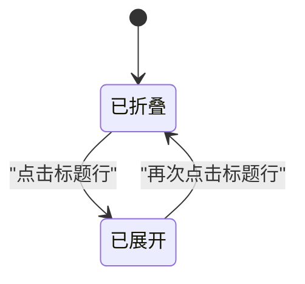

**图表来源**
- [ui_components.py:322-383](file://ui_components.py#L322-L383)

**章节来源**
- [ui_components.py:322-383](file://ui_components.py#L322-L383)

### 空画布按钮 attach_empty_button
`attach_empty_button(canvas, callback, text='导入图片', dy=36)` 用于在图像未加载时显示一个居中的主按钮：
- 使用 `create_primary_button` 创建按钮。
- 直接 `setParent(canvas)`，不走布局。
- 通过事件过滤器监听画布 resize，动态居中。
- 暴露 `_empty_button` 和 `_empty_button_placer`，供外部控制显隐。

这是“空状态”交互的典型模式：控件不属于布局树，而是作为画布子控件绝对定位。

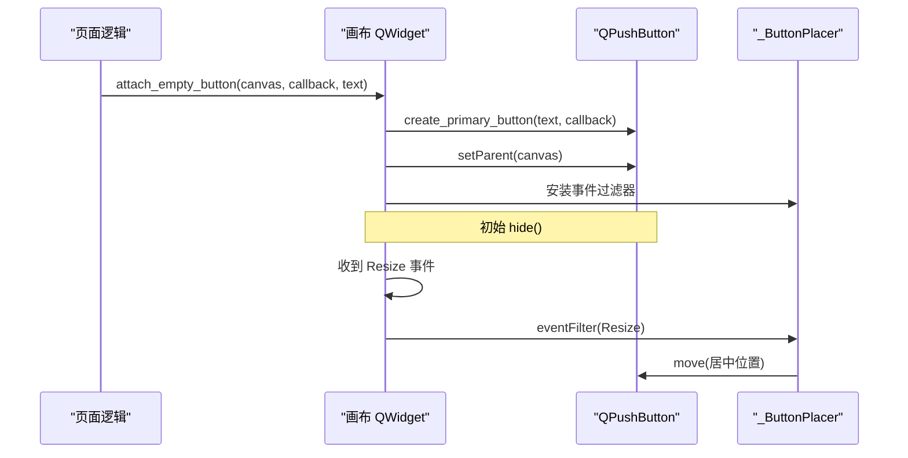

**图表来源**
- [ui_components.py:102-133](file://ui_components.py#L102-L133)

**章节来源**
- [ui_components.py:102-133](file://ui_components.py#L102-L133)

### 下拉弹层样式 style_combo_popups
`style_combo_popups(widget)` 解决 `QComboBox` 弹出层样式问题：
- 查找 widget 下所有 `QComboBox`。
- 对每个 combo 设置自定义委托，去掉原生焦点框。
- 对 `view()` 直接应用 `POPUP_QSS`。
- 根据项数估算最小高度，避免行高变化后弹出层被裁切。

这是 PyQt6 QSS 的一个已知限制：弹出层是独立窗口，全局样式不一定命中。

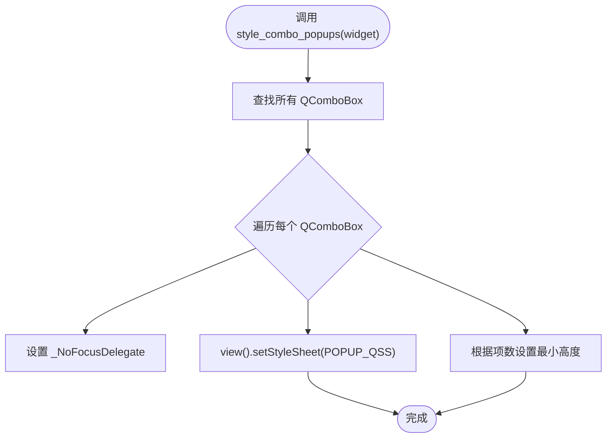

**图表来源**
- [ui_components.py:426-460](file://ui_components.py#L426-L460)
- [styles.py:541-576](file://styles.py#L541-L576)

**章节来源**
- [ui_components.py:426-460](file://ui_components.py#L426-L460)
- [styles.py:541-576](file://styles.py#L541-L576)

### 标题栏与窗口控制按钮
`TitleBar` 和 `WindowControlButton` 替代系统标题栏：
- `TitleBar` 固定高度 40px，包含品牌、版本、菜单按钮、最小化/最大化/关闭。
- `WindowControlButton` 用 QPainter 绘制图标，避免不同 Windows 字体下字符基线漂移。
- 双击标题栏触发最大化/还原。
- 按住拖动触发系统移动。

这部分属于无边框窗口的 chrome 层，不是普通业务控件，但仍遵循 objectName + QSS 的样式机制。

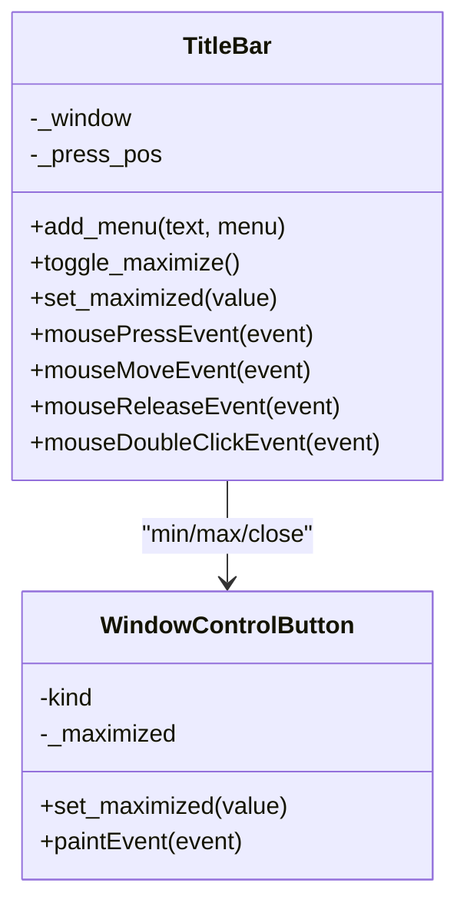

**图表来源**
- [ui_components.py:463-525](file://ui_components.py#L463-L525)
- [ui_components.py:527-621](file://ui_components.py#L527-L621)

**章节来源**
- [ui_components.py:463-621](file://ui_components.py#L463-L621)

## 依赖关系分析
UI 组件工厂与样式系统的依赖方向如下：

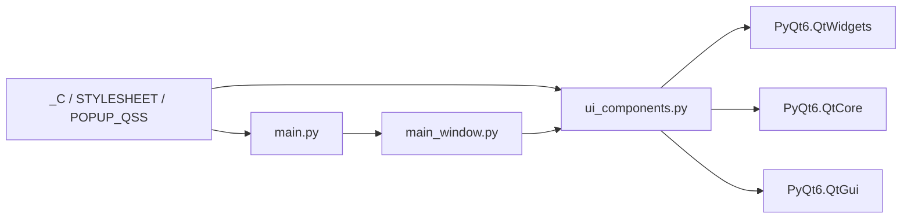

**图表来源**
- [styles.py:1-42](file://styles.py#L1-L42)
- [styles.py:536-576](file://styles.py#L536-L576)
- [ui_components.py:1-10](file://ui_components.py#L1-L10)
- [main.py:12-35](file://main.py#L12-L35)
- [main_window.py:37-49](file://main_window.py#L37-L49)

**章节来源**
- [styles.py:1-42](file://styles.py#L1-L42)
- [ui_components.py:1-10](file://ui_components.py#L1-L10)
- [main.py:12-35](file://main.py#L12-L35)
- [main_window.py:37-49](file://main_window.py#L37-L49)

## 典型用法示例
下面给出一个符合强制约定的典型流程：**创建一个带标题的 GroupBox，设置 Preferred/Expanding 尺寸策略，再手动 addWidget 子控件。**

步骤说明：
1. 调用 `create_groupbox("参数设置")` 获取 GroupBox。
2. 创建一个 `QVBoxLayout`。
3. 调用 `create_info_label`、`create_slider_with_label`、`create_checkbox` 等工厂函数创建子控件。
4. 将子控件 `addWidget` 到布局。
5. 将布局 `setLayout` 到 GroupBox。
6. 将 GroupBox `addWidget` 到父布局。

注意：
- 不要直接在 `create_groupbox` 内部 addWidget。
- 不要手动设置固定宽高导致被裁剪。
- 如果需要数值列右对齐，可使用 `align_right(item)`。
- 如果页面中有多个 `QComboBox`，应在合适时机调用 `style_combo_popups(self)`。

该流程可在 `main_window.py` 的侧边栏构造中找到实际对照：例如 `_setup_layer_threshold_group` 和 `_setup_void_detection_group` 都先创建 GroupBox，再创建布局，再把子控件加入布局，最后把布局赋给 GroupBox。

**章节来源**
- [ui_components.py:239-243](file://ui_components.py#L239-L243)
- [main_window.py:533-586](file://main_window.py#L533-L586)
- [main_window.py:588-720](file://main_window.py#L588-L720)

## 常用 create_* 函数参考

### 按钮类

| 函数 | 主要参数 | 返回值 | 适用场景 |
|---|---|---|---|
| `create_primary_button(text, callback=None)` | `text`、可选回调 | `QPushButton` | 主操作按钮，如“确认”“开始检测” |
| `create_secondary_button(text, callback=None, checkable=False)` | `text`、可选回调、是否可选中 | `QPushButton` | 次要操作、工具切换按钮 |
| `create_success_button(text, callback=None)` | `text`、可选回调 | `QPushButton` | 成功语义操作，如“确认选区” |
| `create_danger_button(text, callback=None)` | `text`、可选回调 | `QPushButton` | 危险语义操作，如“重置”“删除” |
| `create_nav_button(text, callback=None, checkable=True)` | `text`、可选回调、是否可选中 | `QPushButton` | 左侧步骤导航按钮 |

**章节来源**
- [ui_components.py:35-80](file://ui_components.py#L35-L80)

### 文本类

| 函数 | 主要参数 | 返回值 | 适用场景 |
|---|---|---|---|
| `create_step_title(text)` | `text` | `QLabel` | 步骤标题，如“比例尺标定”“缺陷识别” |
| `create_info_label(text="")` | `text` | `QLabel` | 普通说明文字 |
| `create_success_label(text="")` | `text` | `QLabel` | 成功语义提示 |
| `create_card_title(text)` | `text` | `QLabel` | 卡片大标题 |
| `create_card_subtitle(text)` | `text` | `QLabel` | 卡片副标题 |
| `create_stat_value(text="")` | `text` | `QLabel` | 统计数值标签 |
| `create_success_value(text="")` | `text` | `QLabel` | 成功语义大号数值 |
| `create_error_value(text="")` | `text` | `QLabel` | 错误语义大号数值 |
| `create_warning_box(text="")` | `text` | `QLabel` | 警告信息块 |
| `create_error_label(text="")` | `text` | `QLabel` | 错误信息标签 |
| `create_blue_label(text="")` | `text` | `QLabel` | 蓝色提示标签 |
| `create_count_result(text="")` | `text` | `QLabel` | 计数结果大号展示 |

**章节来源**
- [ui_components.py:188-319](file://ui_components.py#L188-L319)

### 输入与容器类

| 函数 | 主要参数 | 返回值 | 适用场景 |
|---|---|---|---|
| `create_slider(min_val, max_val, default_val, callback=None)` | 最小值、最大值、默认值、可选回调 | `QSlider` | 滑块参数调节 |
| `create_slider_with_label(min_val, max_val, default_val, callback=None)` | 同上 | `(slider, label)` | 需要显示当前值的滑块 |
| `create_checkbox(text, checked=False, callback=None)` | 文本、初始勾选、可选回调 | `QCheckBox` | 开关型选项 |
| `create_groupbox(title)` | 标题 | `QGroupBox` | 分组容器，必须配合 Preferred/Expanding 策略 |
| `create_divider()` | 无 | `QFrame` | 1px 分割线 |

**章节来源**
- [ui_components.py:211-252](file://ui_components.py#L211-L252)
- [ui_components.py:239-243](file://ui_components.py#L239-L243)

## 与 PyQt6 样式系统的关系
Aurascope 没有封装新的样式 API，而是基于 PyQt6 的 QSS：
- `styles._C` 提供设计 token。
- `styles._sheet()` 生成完整 QSS 字符串。
- `styles.STYLESHEET` 是全局样式表。
- `styles.DIALOG_STYLESHEET` 是对话框专用样式。
- `styles.POPUP_QSS` 是 `QComboBox` 弹出层专用样式。
- `main.py` 通过 `app.setStyleSheet(STYLESHEET)` 应用全局样式。
- `ui_components.py` 中的控件通过 `setObjectName(...)` 让 QSS 匹配。

因此，**新增控件的正确姿势是**：
1. 使用 `create_*` 工厂函数创建控件。
2. 如需特殊样式，优先扩展 `styles.py` 的 QSS。
3. 如需局部覆盖，使用 `widget.setStyleSheet(...)`，但尽量限定作用域。

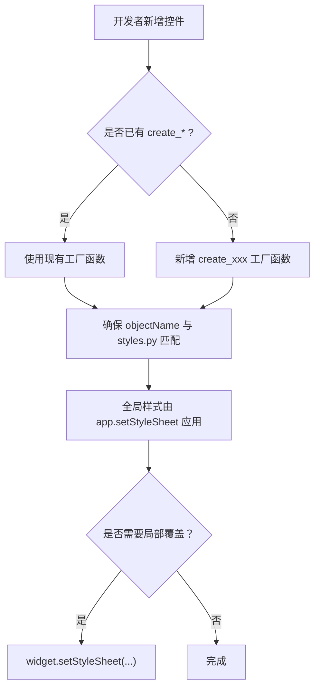

**图表来源**
- [styles.py:27-42](file://styles.py#L27-L42)
- [styles.py:45-536](file://styles.py#L45-L536)
- [styles.py:536-576](file://styles.py#L536-L576)
- [main.py:32-35](file://main.py#L32-L35)
- [ui_components.py:35-80](file://ui_components.py#L35-L80)

**章节来源**
- [styles.py:27-42](file://styles.py#L27-L42)
- [styles.py:45-536](file://styles.py#L45-L536)
- [styles.py:536-576](file://styles.py#L536-L576)
- [main.py:32-35](file://main.py#L32-L35)
- [ui_components.py:35-80](file://ui_components.py#L35-L80)

## 局部覆盖主题而不破坏全局样式
当某个控件需要临时或局部覆盖主题时，应遵循以下原则：

1. **优先使用 objectName + QSS**：在 `styles.py` 中新增选择器，而不是在业务代码里硬编码颜色。
2. **仅在必要时使用 `setStyleSheet`**：比如 `shear_tab.py` 中对 badge 做局部样式调整。
3. **限定作用域**：尽量只对目标控件或其子树应用样式，不要覆盖整个 `QApplication`。
4. **避免覆盖 `QWidget` 基础样式**：这会污染全局字号、颜色。
5. **下拉弹层单独处理**：使用 `style_combo_popups(widget)`，不要试图靠全局 QSS 一劳永逸。

常见错误做法：
- 在业务模块里直接写 `btn.setStyleSheet("background:#2563EB; color:white;")`。
- 在对话框里调用 `app.setStyleSheet(...)` 覆盖全局样式。
- 忘记给控件设置 `objectName`，导致 QSS 无法命中。

**章节来源**
- [ui_components.py:426-460](file://ui_components.py#L426-L460)
- [styles.py:45-536](file://styles.py#L45-L536)
- [main.py:32-35](file://main.py#L32-L35)

## 性能与布局注意事项
- `create_*` 工厂函数本身开销很小，主要成本在控件创建和布局计算。
- `attach_empty_button` 使用事件过滤器监听 resize，适合少量空状态按钮；不要在大量控件上滥用。
- `style_combo_popups` 会递归查找 `QComboBox` 并设置委托和样式，建议在页面初始化时调用一次，而不是每次刷新都调用。
- `CollapsibleSection` 内部维护 `QVBoxLayout`，频繁增删子控件时应注意布局重排。
- GroupBox 的尺寸策略为 `Expanding/Preferred`，在横向布局中表现稳定；若放在复杂嵌套布局中仍出现裁剪，优先检查父布局是否设置了固定宽度或拉伸因子。

[本节为通用指导，不直接分析具体代码片段]

## 常见问题排查

### 控件被裁剪
**现象**：Group Box 或子控件显示不完整，但控件存在且无报错。  
**可能原因**：
- 调用了 `create_groupbox()` 后手动设置了固定宽度或错误尺寸策略。
- 父布局没有给 GroupBox 足够的空间。
- 使用了 `Fixed` 尺寸策略而非 `Preferred/Expanding`。

**排查步骤**：
1. 确认是否使用 `create_groupbox(title)` 而非直接 `QGroupBox(title)`。
2. 检查是否覆盖了 `sizePolicy`。
3. 检查父布局是否设置了固定宽度。
4. 在调试窗口中查看控件实际几何尺寸。

**章节来源**
- [ui_components.py:239-243](file://ui_components.py#L239-L243)

### 按钮样式不生效
**现象**：按钮存在，但没有主色、悬停态或选中态。  
**可能原因**：
- 没有使用 `create_primary_button` / `create_secondary_button` 等工厂函数。
- 手动创建的按钮没有设置正确的 `objectName`。
- 局部 `setStyleSheet` 覆盖了全局样式。
- 按钮被禁用，但样式未定义 `disabled` 态。

**排查步骤**：
1. 检查按钮 `objectName` 是否为 `PrimaryBtn`、`SecondaryBtn`、`SuccessBtn`、`DangerBtn`、`NavBtn`。
2. 检查是否有 `setStyleSheet` 覆盖了按钮样式。
3. 检查 `styles.py` 中对应按钮的 QSS 是否存在。
4. 如果是 `QComboBox` 弹出层，调用 `style_combo_popups(widget)`。

**章节来源**
- [ui_components.py:35-80](file://ui_components.py#L35-L80)
- [styles.py:233-298](file://styles.py#L233-L298)
- [ui_components.py:426-460](file://ui_components.py#L426-L460)

### 字号异常
**现象**：文字过大、过小或与预期不一致。  
**可能原因**：
- 业务代码中手动设置了 `setFont` 或 `setStyleSheet("font-size:...")`。
- 对话框或子窗口覆盖了 `QWidget` 基础样式。
- 非标准字号，未走 `styles._C` 的字阶约定。

**排查步骤**：
1. 检查是否直接修改了 `font-size`。
2. 检查是否调用了 `app.setStyleSheet(...)` 覆盖全局样式。
3. 确认是否通过 `create_info_label`、`create_step_title` 等工厂创建控件。
4. 如需自定义字号，优先在 `styles.py` 中新增选择器。

**章节来源**
- [styles.py:45-62](file://styles.py#L45-L62)
- [styles.py:178-221](file://styles.py#L178-L221)
- [main.py:32-35](file://main.py#L32-L35)

### 下拉弹层样式异常
**现象**：`QComboBox` 主体样式正常，但弹出项选中态、滚动条、边框异常。  
**可能原因**：
- 没有调用 `style_combo_popups(widget)`。
- 弹出层是独立窗口，全局 QSS 不一定命中。
- 项数较多但弹出层高度未更新，导致被裁切。

**排查步骤**：
1. 在页面初始化后调用 `style_combo_popups(self)`。
2. 检查是否对 `view()` 设置了样式。
3. 检查项数是否影响弹出层高度。

**章节来源**
- [ui_components.py:426-460](file://ui_components.py#L426-L460)
- [styles.py:541-576](file://styles.py#L541-L576)

### 空状态按钮不居中
**现象**：`attach_empty_button` 创建的按钮不在画布中央。  
**可能原因**：
- 画布 resize 事件未触发。
- 事件过滤器被其他组件拦截。
- 画布尺寸尚未初始化。

**排查步骤**：
1. 确认按钮是通过 `attach_empty_button` 创建。
2. 确认画布有有效尺寸。
3. 检查是否有其他事件过滤器干扰。

**章节来源**
- [ui_components.py:102-133](file://ui_components.py#L102-L133)

## 结论
Aurascope 的 UI 组件工厂与样式系统围绕两条核心原则构建：
1. **工厂函数只创建控件，不负责布局**：调用方必须显式 `layout.addWidget(...)`，从而保持 UI 装配灵活、可测试、可复用。
2. **样式集中管理**：所有颜色、字号、圆角、交互态来自 `styles._C` 与 `styles.py` 的 QSS，业务代码只负责设置 `objectName`。

对于 `create_groupbox()`，必须记住它是“容器 + 尺寸策略”的组合：`Expanding/Preferred` 是为了避免静默裁剪；真正的子控件必须由调用方加入布局。  
对于主题覆盖，应优先扩展 `styles.py`，其次才考虑局部 `setStyleSheet`；下拉弹层则必须通过 `style_combo_popups()` 处理。

这套约定使 Aurascope 的 UI 层在 PyQt6 之上形成了一致、可维护、可扩展的设计系统。