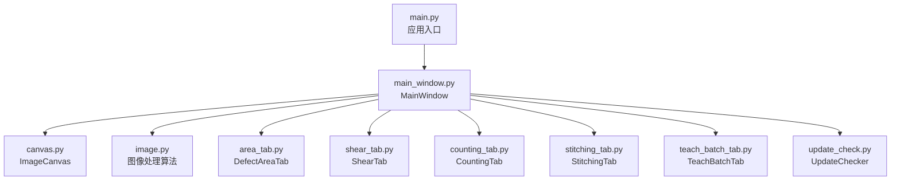
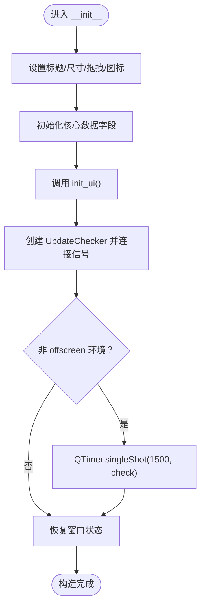
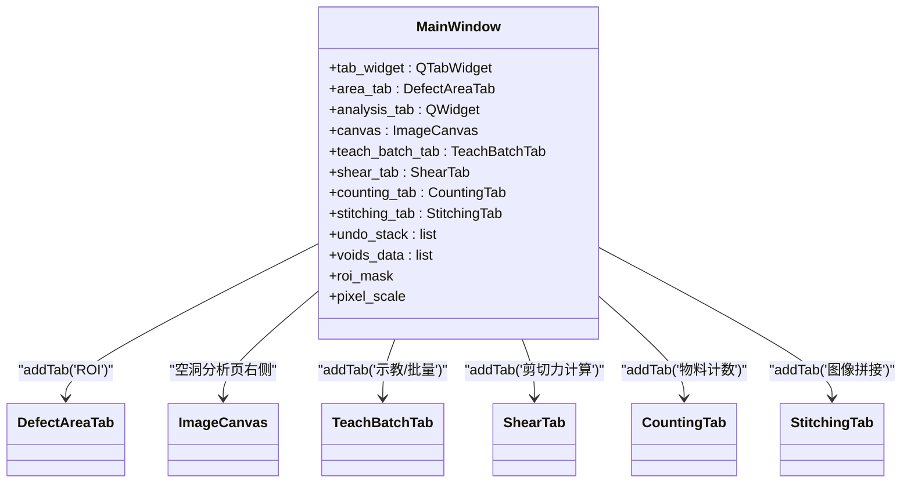
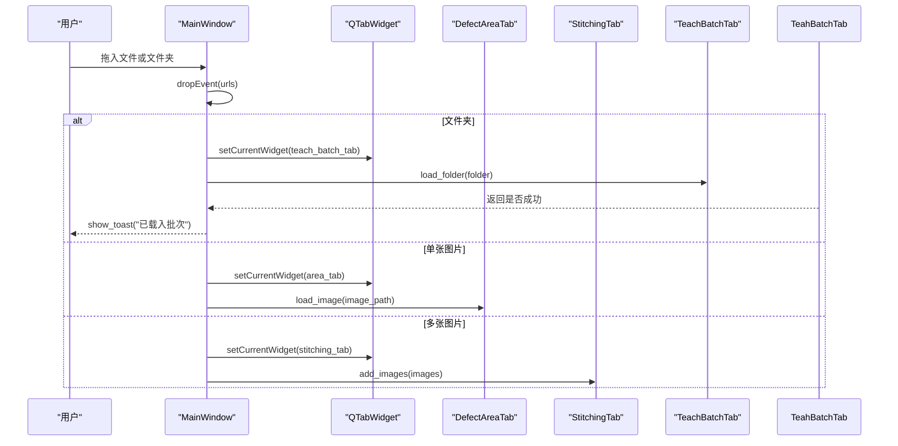
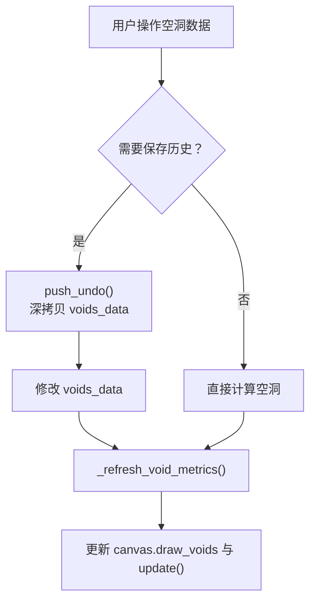
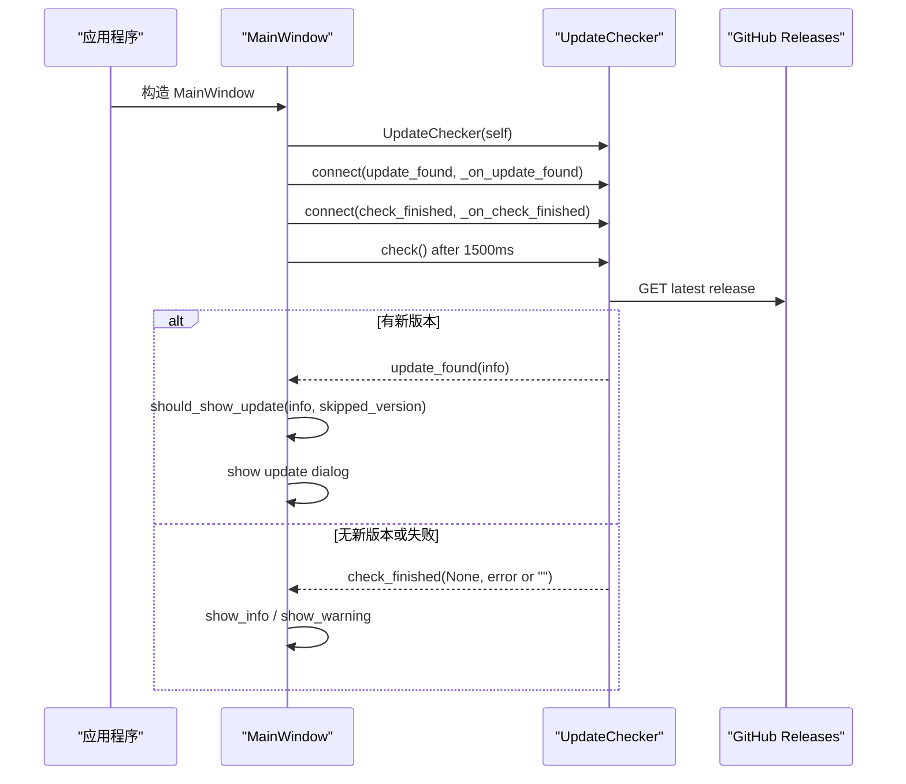
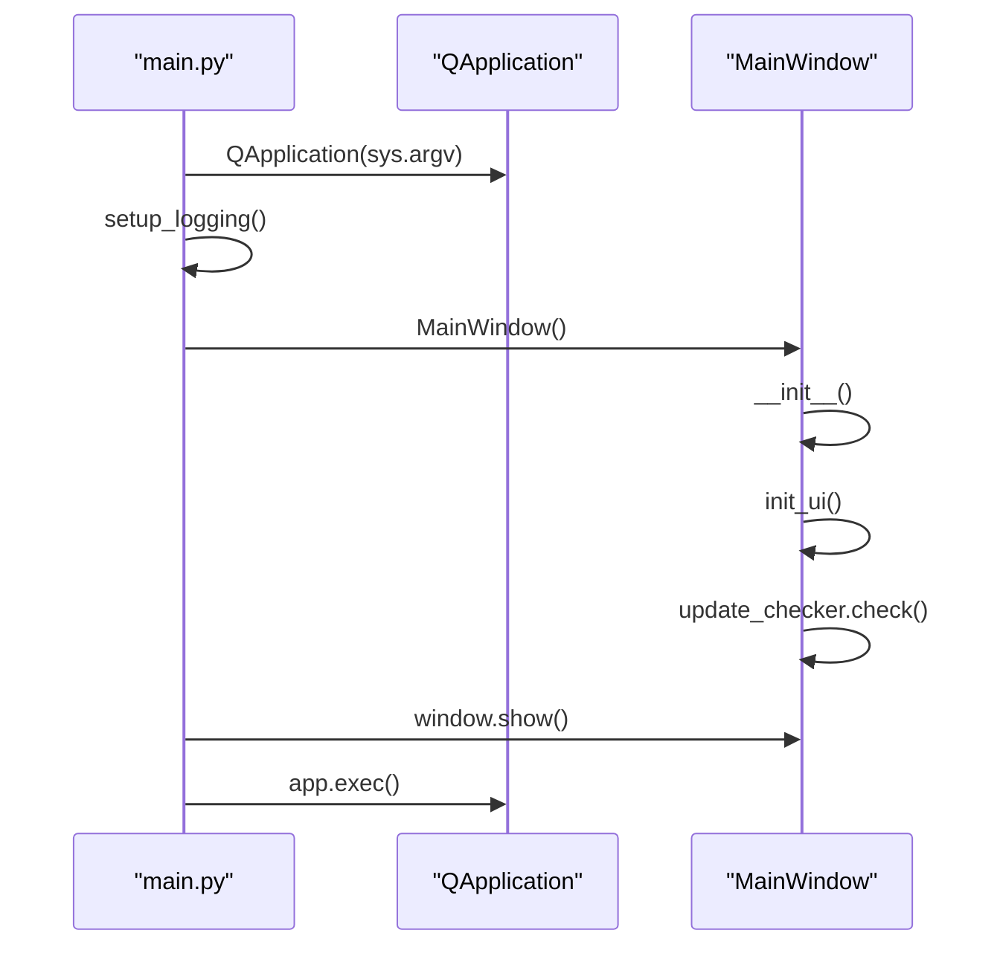
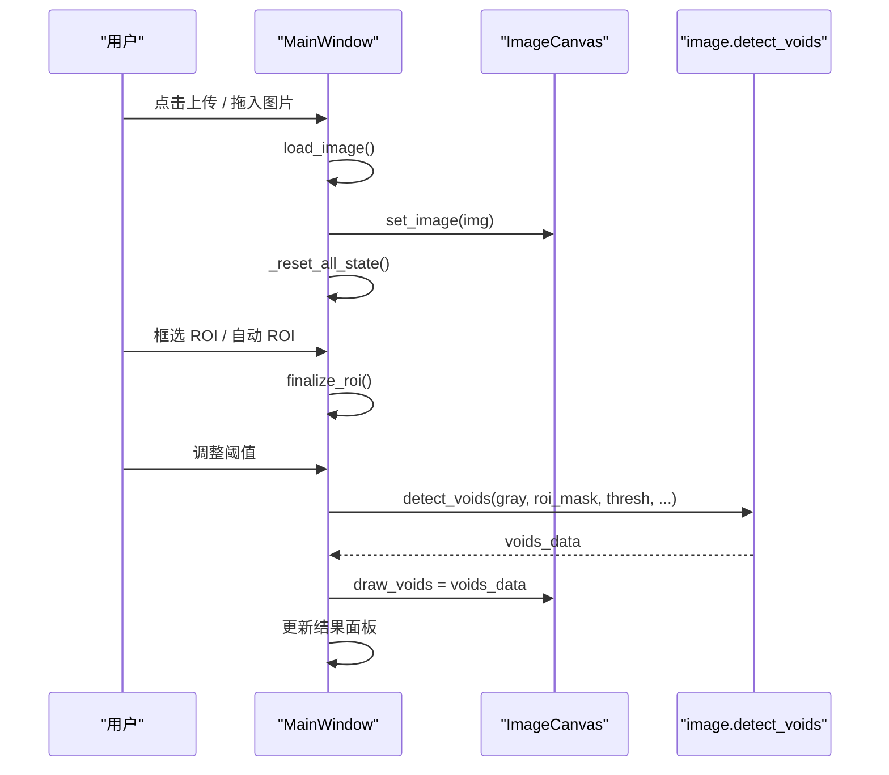
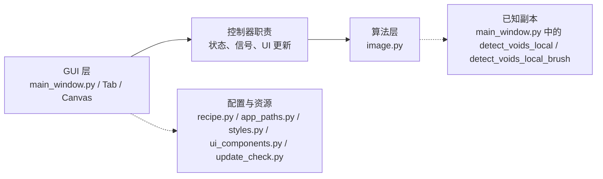

# 主窗口与 Tab 系统

<cite>
**本文引用的文件**   
- [main.py](file://main.py)
- [main_window.py](file://main_window.py)
- [area_tab.py](file://area_tab.py)
- [canvas.py](file://canvas.py)
- [image.py](file://image.py)
- [update_check.py](file://update_check.py)
- [README.md](file://README.md)
</cite>

## 目录
1. [引言](#引言)
2. [项目结构定位](#项目结构定位)
3. [MainWindow 生命周期](#mainwindow-生命周期)
4. [Tab 页面注册与控制器职责](#tab-页面注册与控制器职责)
5. [侧边栏、顶部菜单与拖拽导入流程](#侧边栏顶部菜单与拖拽导入流程)
6. [撤销栈与空洞编辑状态](#撤销栈与空洞编辑状态)
7. [自动更新检查集成](#自动更新检查集成)
8. [典型调用路径示例](#典型调用路径示例)
9. [关键公共接口](#关键公共接口)
10. [依赖方向与 GUI 约束](#依赖方向与-gui-约束)
11. [已知技术债与耦合关系](#已知技术债与耦合关系)
12. [常见问题排查](#常见问题排查)
13. [结论](#结论)

## 引言
Aurascope 是面向微电子封装产线的半自动化视觉检测桌面应用，核心业务包括金锡焊空洞分析、缺陷面积多 ROI、物料计数、剪切力计算、图像拼接和批量示教。`main_window.py` 中的 `MainWindow` 是主窗口装配器与业务控制器：它负责创建 UI、挂载各功能 Tab、协调画布与算法层、处理用户输入、维护撤销状态，并集成自动更新检查。

本文件聚焦主窗口模块，说明其生命周期、Tab 注册方式、GUI 与算法层的依赖边界，以及从入口到具体页面的典型调用链。

**章节来源**
- [README.md:1-76](file://README.md#L1-L76)

## 项目结构定位
从仓库根目录看，主窗口位于应用入口之后、各业务 Tab 之前：

**图表来源**
- [main.py:19-39](file://main.py#L19-L39)
- [main_window.py:53-149](file://main_window.py#L53-L149)
- [canvas.py:13-28](file://canvas.py#L13-L28)
- [image.py:27-286](file://image.py#L27-L286)
- [update_check.py:74-112](file://update_check.py#L74-L112)

**章节来源**
- [main.py:1-44](file://main.py#L1-L44)
- [main_window.py:1-51](file://main_window.py#L1-L51)
- [README.md:42-64](file://README.md#L42-L64)

## MainWindow 生命周期
`MainWindow` 的生命周期可划分为四个阶段：构造初始化、UI 装配、信号绑定与更新检查启动、运行时交互。

### 构造函数初始化
构造函数完成以下工作：
- 设置窗口标题、尺寸、拖拽支持、图标。
- 初始化核心数据字段：像素比例、ROI 掩码、空洞结果、ROI 多边形点、边缘吸附掩码、空洞编辑模式、ROI 腐蚀参数。
- 初始化检测配方名称、一键自动 ROI 标志。
- 调用 `init_ui()` 装配界面。
- 创建 `UpdateChecker`，连接 `update_found` 与 `check_finished` 信号。
- 在非 offscreen 环境下，延迟 1.5 秒触发一次自动版本检查。
- 修复下拉弹层样式，恢复上次窗口状态。

**图表来源**
- [main_window.py:56-94](file://main_window.py#L56-L94)

**章节来源**
- [main_window.py:53-94](file://main_window.py#L53-L94)

### UI 装配
`init_ui()` 中，主窗口创建中央布局、`QTabWidget`、六个 Tab 页面、空洞分析页的左右分割布局、侧边栏、菜单、撤销栈、增强检测开关、局部阈值相关状态，以及 Ctrl+Z 快捷键。

关键点：
- 默认首页为 ROI（缺陷面积）Tab。
- 空洞分析 Tab 内部使用 `QSplitter` 左侧放侧边栏、右侧放 `ImageCanvas`。
- 初始禁用所有步骤按钮，等待图片加载后启用。
- 撤销栈初始化为空列表，最大长度 30。

**章节来源**
- [main_window.py:96-179](file://main_window.py#L96-L179)

## Tab 页面注册与控制器职责
主窗口当前显式注册了以下 Tab：

| Tab | 类名 | 用途 | 挂载位置 |
|-----|------|------|----------|
| ROI | `DefectAreaTab` | 缺陷面积多 ROI、距离测量、CSV 导出 | 第一个 Tab，默认首页 |
| 空洞分析 | 内联 `QWidget` + 侧边栏 + `ImageCanvas` | 空洞率检测、ROI 定义、标定、结果展示 | 第二个 Tab |
| 示教/批量 | `TeachBatchTab` | 批量示教与批次文件夹导入 | 第三个 Tab |
| 剪切力计算 | `ShearTab` | 按标准计算剪切力要求值 | 第四个 Tab |
| 物料计数 | `CountingTab` | 离散物料计数 | 第五个 Tab |
| 图像拼接 | `StitchingTab` | 多张图片拼接 | 第六个 Tab |

注意：距离测量已并入 ROI Tab，原独立 `MeasureTab` 被注释掉，不再挂载。

**图表来源**
- [main_window.py:96-149](file://main_window.py#L96-L149)
- [area_tab.py:110-150](file://area_tab.py#L110-L150)
- [canvas.py:13-28](file://canvas.py#L13-L28)

**章节来源**
- [main_window.py:96-149](file://main_window.py#L96-L149)
- [area_tab.py:110-150](file://area_tab.py#L110-L150)

## 侧边栏、顶部菜单与拖拽导入流程

### 顶部模块导航
主窗口在应用页头动态生成模块按钮，按钮文本取自 `tab_widget.tabText(index)`，点击后通过 `lambda _=False, i=index: self.tab_widget.setCurrentIndex(i)` 切换 Tab；同时监听 `currentChanged` 同步按钮选中状态。

这意味着：
- 新增 Tab 时，只要加入 `tab_widget`，就会自动出现在顶部导航。
- 若 Tab 未显示，应优先检查是否成功 `addTab`，或 `tab_text` 是否为空。

### 菜单栏
菜单栏包含「文件」和「帮助」两个菜单：
- 「文件」提供打开图片、最近打开、退出。
- 「帮助」提供使用说明、更新日志、检查更新、关于。

「打开图片」会切换到 ROI Tab 并调用 `area_tab.load_image()`。

### 拖拽导入
拖拽逻辑集中在 `dragEnterEvent` 与 `dropEvent`：
- 接受本地 URL。
- 过滤出文件夹和图片路径。
- 单个图片 → 切换到 ROI Tab 并加载。
- 多个图片 → 切换到图像拼接 Tab 并传入图片列表。
- 文件夹 → 切换到示教/批量 Tab 并调用 `load_folder`。
- 非图片且非文件夹 → 提示错误。

**图表来源**
- [main_window.py:257-287](file://main_window.py#L257-L287)
- [area_tab.py:342-378](file://area_tab.py#L342-L378)
- [stitching_tab.py:入口方法由 main_window 调用:284-286](file://main_window.py#L284-L286)
- [teach_batch_tab.py:入口方法由 main_window 调用:273-276](file://main_window.py#L273-L276)

**章节来源**
- [main_window.py:181-245](file://main_window.py#L181-L245)
- [main_window.py:257-287](file://main_window.py#L257-L287)

## 撤销栈与空洞编辑状态
主窗口使用 Python 列表作为简单撤销栈：
- `push_undo()` 将当前 `voids_data` 深拷贝进栈，超过 30 条则丢弃最早一条。
- `on_undo()` 弹出上一个状态，刷新空洞指标。
- 触发撤销保存的关键操作包括：Otsu 自动阈值、面积过滤变化、ROI 边界腐蚀变化、恢复默认设置、删除空洞、手动添加空洞、局部笔刷区域确认、局部阈值变化、局部区域删除。

需要注意：
- 撤销栈只保存空洞检测结果，不保存 ROI、阈值滑块、增强开关等完整 UI 状态。
- 如果用户在调整阈值后直接撤销，可能回到上一次“保存状态”的空洞集合，而不是回到滑块调整前的阈值。

**图表来源**
- [main_window.py:1325-1337](file://main_window.py#L1325-L1337)
- [main_window.py:1261-1288](file://main_window.py#L1261-L1288)
- [main_window.py:1339-1400](file://main_window.py#L1339-L1400)
- [main_window.py:1531-1585](file://main_window.py#L1531-L1585)

**章节来源**
- [main_window.py:1325-1337](file://main_window.py#L1325-L1337)
- [main_window.py:1261-1288](file://main_window.py#L1261-L1288)
- [main_window.py:1339-1400](file://main_window.py#L1339-L1400)
- [main_window.py:1531-1585](file://main_window.py#L1531-L1585)

## 自动更新检查集成
`MainWindow` 在构造时创建 `UpdateChecker(self)`，并连接两个信号：
- `update_found`：发现新版本时触发。
- `check_finished`：检查完成时触发，携带 `(info, error)`。

自动检查行为：
- 非 offscreen 环境启动后 1.5 秒执行一次后台检查。
- 如果是手动检查（来自「帮助 → 检查更新」），设置 `_manual_check = True`，并在失败或已是最新版本时给出用户反馈。
- `should_show_update` 会根据用户“忽略本次更新”的版本决定是否弹窗。

**图表来源**
- [main_window.py:84-89](file://main_window.py#L84-L89)
- [main_window.py:684-727](file://main_window.py#L684-L727)
- [update_check.py:74-112](file://update_check.py#L74-L112)

**章节来源**
- [main_window.py:84-89](file://main_window.py#L84-L89)
- [main_window.py:684-727](file://main_window.py#L684-L727)
- [update_check.py:1-112](file://update_check.py#L1-L112)

## 典型调用路径示例

### 从 main.py 启动到 MainWindow.show()
1. `main()` 安装日志、异常钩子、创建 `QApplication`。
2. 设置全局样式表、窗口图标。
3. 实例化 `MainWindow()`。
4. 调用 `window.show()`。
5. 进入 Qt 事件循环 `app.exec()`。

**图表来源**
- [main.py:19-39](file://main.py#L19-L39)
- [main_window.py:56-94](file://main_window.py#L56-L94)

**章节来源**
- [main.py:19-39](file://main.py#L19-L39)
- [main_window.py:56-94](file://main_window.py#L56-L94)

### 用户点击某个 Tab 到对应页面实例化
由于 Tab 在 `init_ui()` 中已经实例化并加入 `QTabWidget`，点击顶部模块按钮或侧边栏按钮不会重新创建页面，而是切换当前索引。

例如点击「ROI」：
1. 顶部按钮触发 `tab_widget.setCurrentIndex(0)`。
2. `currentChanged` 信号触发 `_sync_module_tabs`。
3. 对应按钮设为选中状态。
4. `DefectAreaTab` 已在内存中，无需再次实例化。

**章节来源**
- [main_window.py:206-223](file://main_window.py#L206-L223)
- [main_window.py:106-109](file://main_window.py#L106-L109)

### 空洞分析：加载图片 → 定义 ROI → 计算空洞
1. 用户点击「点击上传 SEM 图片」或拖入单张图片。
2. `MainWindow.load_image()` 读取图像，调用 `canvas.set_image(img)`。
3. 重置状态，启用步骤控件。
4. 用户框选 ROI 或一键自动 ROI。
5. `finalize_roi()` 计算焊层面积，自动 Otsu 阈值。
6. 用户调整阈值或增强选项。
7. `calculate_voids()` 调用 `image.detect_voids()`。
8. 更新 `canvas.draw_voids` 与结果面板。

**图表来源**
- [main_window.py:737-770](file://main_window.py#L737-L770)
- [main_window.py:1146-1170](file://main_window.py#L1146-L1170)
- [main_window.py:1199-1254](file://main_window.py#L1199-L1254)
- [image.py:200-286](file://image.py#L200-L286)

**章节来源**
- [main_window.py:737-770](file://main_window.py#L737-L770)
- [main_window.py:1146-1170](file://main_window.py#L1146-L1170)
- [main_window.py:1199-1254](file://main_window.py#L1199-L1254)
- [image.py:200-286](file://image.py#L200-L286)

## 关键公共接口
以下接口是外部代码或测试中最可能调用的主窗口公共方法。返回值以源码实际行为为准。

| 接口 | 参数 | 返回值 | 说明 |
|------|------|--------|------|
| `add_tab(widget, name)` | `widget: QWidget`, `name: str` | 无 | 文档建议接口；当前源码未实现该方法，Tab 通过 `tab_widget.addTab(...)` 直接挂载。 |
| `set_image(img_cv)` | `img_cv: numpy.ndarray` | 无 | 文档建议接口；当前源码未暴露该方法，图片加载走 `load_image()` 与 `canvas.set_image()`。 |
| `open_image(path)` | `path: str` | 无 | 文档建议接口；当前源码未暴露该方法，可通过 `remember_recent_image` 或菜单间接打开。 |
| `check_update()` | 无 | 无 | 文档建议接口；当前源码对应 `check_updates_manual()`，用于主动检查更新。 |
| `load_image()` | 无 | 无 | 打开文件对话框加载图片，失败时记录日志并提示。 |
| `check_updates_manual()` | 无 | 无 | 手动触发更新检查，失败或已是最新版本时给用户反馈。 |
| `remember_recent_image(path)` | `path: str` | 无 | 将图片路径写入最近打开列表。 |
| `remember_recent_batch(folder)` | `folder: str` | 无 | 将批次文件夹写入最近打开列表。 |
| `set_stitching_result(image, mask)` | `image: numpy.ndarray`, `mask: numpy.ndarray` | 无 | 接收图像拼接结果，作为普通图片加载到空洞分析模块。 |
| `export_csv(parent_dlg)` | `parent_dlg: QDialog` | 无 | 导出空洞分析 CSV。 |
| `show_detail_table()` | 无 | 无 | 显示空洞详细数据表格。 |
| `save_screenshot()` | 无 | 无 | 截图复制到剪贴板。 |

注意：
- 当前 `MainWindow` 没有统一的 `add_tab`、`set_image`、`open_image`、`check_update` 这四个文档风格接口。
- 如果需要稳定扩展点，应在后续重构中把 `tab_widget.addTab`、`canvas.set_image`、`QFileDialog.open`、`update_checker.check` 包装成明确命名的公共方法。

**章节来源**
- [main_window.py:230-245](file://main_window.py#L230-L245)
- [main_window.py:307-311](file://main_window.py#L307-L311)
- [main_window.py:694-705](file://main_window.py#L694-L705)
- [main_window.py:737-770](file://main_window.py#L737-L770)
- [main_window.py:843-863](file://main_window.py#L843-L863)
- [main_window.py:1672-1702](file://main_window.py#L1672-L1702)
- [main_window.py:1616-1620](file://main_window.py#L1616-L1620)

## 依赖方向与 GUI 约束
项目约定依赖方向为：
- GUI 层：`main.py`、`main_window.py`、各 Tab、Canvas、UI 组件。
- 算法层：`image.py`。
- 配置与资源：`recipe.py`、`app_paths.py`、`styles.py`、`ui_components.py`、`update_check.py`。

强制约束：
- GUI 层不得内联实现图像算法。
- 空洞检测、Otsu、形态学、轮廓、圆度、Canny 边缘校验等核心逻辑应放在 `image.py`。
- `main_window.py` 应仅做参数组装、状态管理、UI 更新和业务流程编排。

现状问题：
- `main_window.py` 中存在 `detect_voids_local` 与 `detect_voids_local_brush` 两个算法副本，属于已知技术债。
- 现行空洞分析主流程调用的是 `image.detect_voids`，因此「现行行为以 image.py 为准」。
- 局部阈值相关分支还调用了 `main_window.py` 内部的 `detect_voids_local` 和 `detect_voids_local_brush`，导致同一功能存在两套实现。

**图表来源**
- [main_window.py:31-50](file://main_window.py#L31-L50)
- [image.py:27-286](file://image.py#L27-L286)
- [main_window.py:1723-1918](file://main_window.py#L1723-L1918)

**章节来源**
- [main_window.py:31-50](file://main_window.py#L31-L50)
- [image.py:27-286](file://image.py#L27-L286)
- [main_window.py:1723-1918](file://main_window.py#L1723-L1918)

## 已知技术债与耦合关系

### 主要技术债
1. **重复的 `detect_voids_local`**  
   - `image.py` 中有 `detect_voids_local`。
   - `main_window.py` 中也有一份同名函数。
   - 文档与产品行为应以 `image.py` 为准，两份代码待合并。

2. **`edge_map` 未初始化导致 Canny 校验静默失效**  
   - 部分分支在启用 Canny 前未确保 `edge_map` 已赋值，可能导致边缘验证跳过或行为不一致。

3. **`chk_roi_overlay` 被重复创建**  
   - 在局部阈值高级设置中重复创建复选框，可能影响 UI 状态一致性。

4. **滚轮缩放 Y 轴漂移**  
   - `canvas.py` 的缩放锚点计算存在 Y 轴漂移问题，不应描述为正确设计。

5. **`select_for_local` 为无 UI 入口的死代码**  
   - 该变量或方法在当前主窗口流程中没有可见 UI 入口，需清理或补全。

6. **大图增强检测无进度提示**  
   - 长耗时算法循环中虽有 `_pump_events()`，但缺少明确的进度反馈。

### 与其他模块的耦合
`main_window.py` 直接引用：
- 所有 Tab 类：`DefectAreaTab`、`ShearTab`、`CountingTab`、`StitchingTab`、`TeachBatchTab`。
- Canvas 基类：`ImageCanvas`。
- 算法层：`image.py` 中的空洞检测、轮廓、掩码、Otsu、圆度等函数。
- 配方模块：`recipe.py` 的列表、加载、保存、删除、构建配方函数。
- 更新检查：`update_check.py` 的 `UpdateChecker` 与 `should_show_update`。
- UI 组件：`ui_components.py` 的按钮、分组、折叠区、标签工厂。
- 样式与路径：`styles.py`、`app_paths.py`、`app_version.py`。

这种耦合使 `main_window.py` 成为高内聚的业务装配中心，但也意味着修改任意 Tab、Canvas、算法或更新检查逻辑都可能影响主窗口。

**章节来源**
- [main_window.py:31-50](file://main_window.py#L31-L50)
- [main_window.py:1723-1918](file://main_window.py#L1723-L1918)
- [image.py:328-422](file://image.py#L328-L422)

## 常见问题排查

### Tab 未显示
**可能原因：**
- Tab 未成功加入 `tab_widget`。
- Tab 文本为空或被隐藏。
- 顶部模块按钮数量与实际 Tab 数量不一致。
- 窗口状态恢复时设置了非法索引。

**排查步骤：**
1. 检查 `init_ui()` 中每个 `tab_widget.addTab(...)` 是否执行。
2. 检查 `self.tab_widget.count()` 是否与预期一致。
3. 检查 `_restore_window_state()` 中读取的 `ui/tab` 是否在有效范围内。
4. 检查 `_build_app_header()` 中按钮数量是否与 Tab 数量一致。

**章节来源**
- [main_window.py:106-149](file://main_window.py#L106-L149)
- [main_window.py:206-223](file://main_window.py#L206-L223)
- [main_window.py:361-380](file://main_window.py#L361-L380)

### 拖拽无效
**可能原因：**
- 拖入的不是本地文件 URL。
- 文件扩展名不在允许列表中。
- 拖入的是文件夹但 `teach_batch_tab.load_folder` 返回失败。
- 拖入单张图片但 `area_tab.load_image` 返回失败。

**排查步骤：**
1. 查看 `dropEvent` 中 `urls` 是否为空。
2. 检查文件扩展名是否为 `.png/.jpg/.jpeg/.bmp/.tif/.tiff`。
3. 检查拖入路径是文件夹还是文件。
4. 查看日志中是否有「无法导入」「打开失败」提示。
5. 对 TIF 文件确认 tifffile 是否能正常读取。

**章节来源**
- [main_window.py:257-287](file://main_window.py#L257-L287)
- [main_window.py:339-350](file://main_window.py#L339-L350)
- [main_window.py:771-821](file://main_window.py#L771-L821)

### 更新检查失败
**可能原因：**
- 网络不可用。
- GitHub API 返回非 JSON。
- 版本号解析失败。
- 用户已忽略该版本。
- 非手动检查时，旧版本不会弹窗。

**排查步骤：**
1. 查看日志中「检查更新失败」或「检查更新解析失败」信息。
2. 确认 `QT_QPA_PLATFORM` 不是 offscreen，否则自动检查会被跳过。
3. 使用「帮助 → 检查更新」触发手动检查，观察是否出现错误提示。
4. 检查 `update/skipped_version` 是否匹配当前版本。
5. 检查 `update_check.py` 中 `parse_release_tag`、`release_is_newer`、`should_show_update` 的行为。

**章节来源**
- [main_window.py:84-89](file://main_window.py#L84-L89)
- [main_window.py:684-727](file://main_window.py#L684-L727)
- [update_check.py:21-53](file://update_check.py#L21-L53)
- [update_check.py:90-112](file://update_check.py#L90-L112)

### 空洞检测结果异常
**可能原因：**
- ROI 未定义或为空。
- 阈值过高或过低。
- 增强检测关闭。
- 使用了 `main_window.py` 内的局部阈值副本而非 `image.py`。
- Canny 边缘验证因 `edge_map` 未初始化而静默失效。

**排查步骤：**
1. 确认 `roi_mask` 不为 None。
2. 检查 `slider_void.value()` 与 Otsu 自动阈值结果。
3. 检查增强检测开关、CLAHE、形态学、圆度过滤、Canny 验证。
4. 区分主流程 `image.detect_voids` 与局部流程 `main_window.detect_voids_local` / `detect_voids_local_brush`。
5. 查看结果面板中的空洞数量、总面积、空洞率。

**章节来源**
- [main_window.py:1199-1254](file://main_window.py#L1199-L1254)
- [main_window.py:1451-1476](file://main_window.py#L1451-L1476)
- [main_window.py:1562-1585](file://main_window.py#L1562-L1585)
- [image.py:200-286](file://image.py#L200-L286)

## 结论
`MainWindow` 是 Aurascope 的主窗口装配器与业务控制器：它负责创建 UI、注册六个 Tab、绑定侧边栏与菜单、处理拖拽导入、协调 `ImageCanvas` 与 `image.py` 算法、维护空洞撤销栈，并集成 `UpdateChecker`。

当前最重要的架构风险是 `main_window.py` 中存在的空洞检测算法副本。虽然主流程以 `image.detect_voids` 为准，但局部阈值分支仍调用 `main_window.py` 内部的 `detect_voids_local` 与 `detect_voids_local_brush`，这增加了维护成本与行为不一致风险。建议在后续重构中：
- 统一所有空洞检测逻辑到 `image.py`。
- 为 `MainWindow` 暴露稳定的 `add_tab`、`set_image`、`open_image`、`check_update` 等公共接口。
- 清理死代码、重复 UI 控件与未初始化变量。
- 补充大图增强检测的进度提示。
- 修正 Canvas 滚轮缩放的 Y 轴漂移问题。